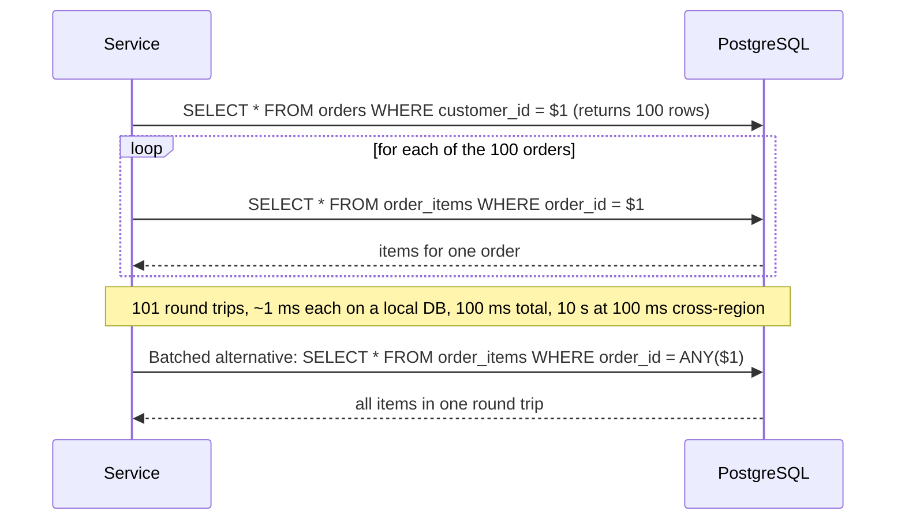

## 25.8 Eager and lazy loading

#### Concept

A relation can be loaded three ways: **explicitly** (`relations: {...}` or a join in the query builder), **eagerly** (`eager: true` on the decorator: TypeORM always loads it with `find*`), or **lazily** (the property is typed `Promise<T>` and TypeORM queries when you `await` it). Only the first one keeps the query count under your control.

#### Why does it exist?

Eager loading exists so that a relation you *always* need (a product's currency, a user's role) comes along without every caller remembering to ask. Lazy loading exists so that code can walk an object graph naturally. Both trade explicitness for convenience, and the bill arrives as query counts.

#### Mental model

Imagine ordering a coffee. Explicit loading is saying "a latte with oat milk". Eager loading is a café that puts oat milk in every drink because someone once asked. Lazy loading is a café that hands you an empty cup and makes the coffee when you lift it to your mouth, and does that again for every sip.

#### How it works

**Eager.** `@ManyToOne(() => Currency, { eager: true })`. Every `find`, `findOne`, `findBy` on the owning entity adds a `LEFT JOIN` for it, recursively through eager relations of the joined entity. It does *not* apply to `createQueryBuilder` (you must join yourself) and cannot be set on both sides of a relation. The danger is transitive: `Order` eagerly loads `Customer`, `Customer` eagerly loads `Addresses`, `Address` eagerly loads `Country`; now `find(Order)` is a four-way join for a list endpoint that shows order numbers. `find({ loadEagerRelations: false })` turns it off per call.

**Lazy.** Declare `items: Promise<OrderItem[]>` and TypeORM installs a getter that runs `SELECT ... WHERE order_id = $1` the first time you `await order.items`, caching the result on the instance. Each instance queries separately: a loop over 100 orders awaiting `items` is 101 queries (section 25.9). Lazy relations also make entity types awkward (`await` everywhere, serialisation produces `{}` for pending promises), and they need `emitDecoratorMetadata` to detect the `Promise` type.

**Explicit.** `relations: { items: { product: true } }`, `relationLoadStrategy: 'join' | 'query'`, or query-builder joins. The relation is loaded exactly when the code says so, and the SQL log shows it.

#### TypeORM example

```ts
// What to avoid
@Entity() export class Order {
  @OneToMany(() => OrderItem, (i) => i.order, { eager: true }) items: OrderItem[];   // every find joins items
  @ManyToOne(() => Customer) customer: Promise<Customer>;                          // lazy: one query per access
}

// What to do: no eager, no lazy, explicit per use case
const list = await this.orders.find({ where: { customerId }, select: { id: true, status: true, totalCents: true }, take: 20 });
const detail = await this.orders.findOne({ where: { id }, relations: { items: { product: true }, customer: true } });
```

#### Edge cases & failure modes

- `eager: true` relations are also loaded by `save()`'s internal `SELECT`, adding join cost to every write.
- Lazy relation promises hold a reference to the entity manager; entities serialised to JSON after their transaction ended can trigger queries on a released query runner and throw.
- `relations` and `eager` compose: an explicit relation on an eager entity loads the eager ones too.
- `relationLoadStrategy: 'query'` issues one extra query per relation level (not per parent), which is usually right for wide parents and wrong for tiny ones.

#### How a Senior Backend Engineer thinks about this

Explicit by default. `eager: true` only on small, always-needed lookups with no further eager relations. Lazy relations not at all in new code. Every list endpoint selects columns and loads no collections; every detail endpoint loads exactly the relations the response needs.

#### Common mistakes

- Chained eager relations that turn every query into a multi-way join.
- Lazy relations accessed in a loop.
- Returning entities with lazy properties from controllers and getting `{}` in the JSON.

#### Interview questions

1. *What does `eager: true` change about `find` and about `createQueryBuilder`?* Expected: `find*` auto-joins; query builder does not.
2. *Why are lazy relations a performance trap?* Expected: one query per instance per relation; N+1 hidden in property access.
3. *How do you load a relation for one endpoint without affecting others?* Expected: `relations` or joins per call.

#### Practical exercise

Take an entity with two eager relations and one lazy one, enable query logging, and record the statements for a list endpoint and a detail endpoint. Convert to explicit loading. Acceptance criteria: the list endpoint runs one query with no joins; the detail endpoint runs the minimum number of statements for its response; no `Promise`-typed relation properties remain.

## 25.9 The N+1 problem

#### Concept

N+1 is the pattern of one query to fetch N parent rows followed by N more queries, one per parent, to fetch their children. It is the single most common ORM performance bug, it scales linearly with data, and it is invisible in development because N is small there.

#### Why does it exist?

Because ORMs make "get the children of this parent" a property access or a one-line call, and loops are how developers process lists. Nothing in the code looks expensive.

#### Mental model

Imagine a librarian asked for the authors of 200 books. The N+1 librarian walks to the catalogue 200 times, once per book. The batched librarian writes down all 200 titles and walks once.

#### How it works



The query log makes it obvious once you look. With `logging: ['query']`:

```text
query: SELECT "o"."id", "o"."status" FROM "orders" "o" WHERE "o"."customer_id" = $1 -- PARAMETERS: ["c1"]
query: SELECT "i"."id", "i"."qty" FROM "order_items" "i" WHERE "i"."order_id" = $1 -- PARAMETERS: ["o1"]
query: SELECT "i"."id", "i"."qty" FROM "order_items" "i" WHERE "i"."order_id" = $1 -- PARAMETERS: ["o2"]
query: SELECT "i"."id", "i"."qty" FROM "order_items" "i" WHERE "i"."order_id" = $1 -- PARAMETERS: ["o3"]
... 97 more
```

Each query is fast (0.5 ms of database time), so nothing shows up in slow-query logs. What shows up is total request latency, connection churn, and CPU on the primary from parse/plan overhead. At 100 requests per second this endpoint issues 10,100 queries per second.

#### Practical example

The buggy code and the three fixes.

```ts
// BUG: 1 + N queries
const orders = await this.orders.findBy({ customerId });
for (const order of orders) {
  order.items = await this.items.findBy({ orderId: order.id });   // one query per order
}

// FIX 1: join through relations (one query; rows multiply by items per order)
const orders1 = await this.orders.find({ where: { customerId }, relations: { items: true } });

// FIX 2: two queries, no row multiplication (best for wide parents or many children)
const orders2 = await this.orders.find({ where: { customerId }, relations: { items: true }, relationLoadStrategy: 'query' });

// FIX 3: manual batch, when the children come from somewhere the ORM cannot join (another service, a cache, raw SQL)
const orders3 = await this.orders.findBy({ customerId });
const items = await this.items.findBy({ orderId: In(orders3.map((o) => o.id)) });   // WHERE order_id IN ($1..$N)
const byOrder = new Map<string, OrderItem[]>();
for (const item of items) (byOrder.get(item.orderId) ?? byOrder.set(item.orderId, []).get(item.orderId)!).push(item);
for (const o of orders3) o.items = byOrder.get(o.id) ?? [];
```

**The DataLoader pattern.** When the code that needs children is spread across resolvers or nested service calls (GraphQL is the usual case), you cannot restructure into one batch by hand. A DataLoader collects every `load(id)` call made during one tick of the event loop, issues a single batched query, and hands each caller its result. The `dataloader` package implements it; in NestJS it must be request-scoped so the cache does not leak between users.

```ts
// src/orders/order-items.loader.ts
import { Injectable, Scope } from '@nestjs/common';
import DataLoader from 'dataloader';
import { InjectRepository } from '@nestjs/typeorm';
import { In, Repository } from 'typeorm';
import { OrderItem } from './order-item.entity';

@Injectable({ scope: Scope.REQUEST })          // one loader (and cache) per request
export class OrderItemsLoader {
  constructor(@InjectRepository(OrderItem) private readonly items: Repository<OrderItem>) {}

  readonly byOrderId = new DataLoader<string, OrderItem[]>(async (orderIds) => {
    const rows = await this.items.findBy({ orderId: In([...orderIds]) });   // ONE query for all ids in this tick
    const grouped = new Map<string, OrderItem[]>();
    for (const r of rows) (grouped.get(r.orderId) ?? grouped.set(r.orderId, []).get(r.orderId)!).push(r);
    return orderIds.map((id) => grouped.get(id) ?? []);                      // must return results in input order
  });
}

// In a resolver or service: await this.loader.byOrderId.load(order.id) from 100 places => one query
```

**Measuring.** A custom TypeORM logger that counts queries per request (store a counter in `AsyncLocalStorage` keyed by request, log it in an interceptor when the response finishes, warn above a threshold such as 20) catches N+1 in staging before users do. On the database side, `pg_stat_statements` shows the offending statement with `calls` in the millions and a tiny `mean_exec_time`; that signature is N+1.

#### PostgreSQL example

The batched form uses an array parameter, which sidesteps the parameter-count limit of `IN ($1, ..., $N)` and produces a stable plan:

```sql
SELECT i.* FROM order_items i WHERE i.order_id = ANY($1::uuid[]) ORDER BY i.order_id, i.id;
```

```text
Index Scan using order_items_order_id_idx on order_items i  (cost=0.43..412.10 rows=520 width=64) (actual time=0.031..0.611 rows=498 loops=1)
  Index Cond: (order_id = ANY ('{...}'::uuid[]))
  Buffers: shared hit=112
Planning Time: 0.140 ms
Execution Time: 0.702 ms
```

One round trip, 0.7 ms, against 100 round trips of 0.5 ms each plus network.

#### Edge cases & failure modes

- N+1 on *writes*: `save()` in a loop, or cascades that insert children one statement each.
- N+1 across services: a loop calling `GET /products/:id` over HTTP is the same disease with 50 ms per iteration.
- DataLoader caches per request; using a singleton leaks data between users and serves stale rows.
- Batching too aggressively: `IN` lists over a few thousand ids should be chunked; `= ANY($1)` handles large arrays but the plan can flip to a sequential scan.
- Join-based fixes multiply rows; for 1,000 parents with 200 children each, the join returns 200,000 rows and hydration becomes the bottleneck. Use the two-query strategy.

#### How a Senior Backend Engineer thinks about this

They assume every loop that touches a repository is N+1 until the log proves otherwise. They put a per-request query counter in staging. They pick join versus two-query versus DataLoader by the shape: narrow parents with few children, join; wide parents or many children, two queries; scattered access, DataLoader.

#### Common mistakes

- Fixing N+1 with `eager: true`, which turns it into an always-on join.
- Batching with `IN (...)` and 50,000 ids in one statement.
- Not noticing N+1 because each query is fast.
- A DataLoader registered as a singleton.

#### Interview questions

1. *How do you detect N+1 in a running system?* Expected: per-request query count; `pg_stat_statements` with high calls and low mean time.
2. *Explain the DataLoader pattern and why it must be request-scoped.* Expected: batches loads per tick; per-request cache to avoid cross-user leaks.
3. *When is a join the wrong fix for N+1?* Expected: wide parents or many children; row multiplication; use two queries.
4. *What is the write-side version of N+1?* Expected: `save()` per item; cascades; fix with bulk insert.

#### Practical exercise

Introduce a query-count interceptor that logs `queries=N` per request. Find every endpoint in a sample app with N greater than 10, fix each with the appropriate strategy, and re-measure. Acceptance criteria: no endpoint exceeds 5 queries for a page of 50 parents; the fix for at least one endpoint uses a request-scoped DataLoader.

## 25.10 Cascades

#### Concept

Cascade means "when I do X to the parent, do X to the children too". There are two unrelated mechanisms with the same name: **ORM-level cascade** (`cascade` option on the relation: TypeORM saves or removes related entities that are present on the object when you `save()`/`remove()` the parent) and **database-level referential actions** (`onDelete: 'CASCADE'` on the foreign key: PostgreSQL deletes child rows when the parent row is deleted, no matter who issued the delete).

#### Why does it exist?

Aggregates are saved as a unit: create an order with its items in one `save(order)`. Deleting a parent must not leave orphans. ORM cascade handles the first; database cascade handles the second reliably.

#### How it works

```ts
@OneToMany(() => OrderItem, (i) => i.order, { cascade: ['insert', 'update'], orphanedRowAction: 'delete' })
items: OrderItem[];

@ManyToOne(() => Order, (o) => o.items, { onDelete: 'CASCADE' })   // FOREIGN KEY ... ON DELETE CASCADE
order: Order;
```

1. `save(order)` with `cascade: ['insert', 'update']`: TypeORM inserts the order, then inserts each *new* item (one statement each, or a batched insert), and updates each *changed* existing item. Items missing from `order.items` that exist in the database are handled per `orphanedRowAction`: `nullify` (default, sets `order_id = NULL`, which fails if the column is `NOT NULL`), `delete`, `soft-delete`, or `disable`.
2. `remove(order)` with `cascade: ['remove']` (or `cascade: true`): TypeORM deletes the items *that are loaded on the object*, then the order. Items not loaded are not deleted; with `onDelete: 'CASCADE'` PostgreSQL deletes them anyway; without it the delete fails on the foreign key.
3. `delete(criteria)` and query-builder deletes never cascade at the ORM level; only the database action applies.

**Why database-level is more reliable.** It runs for every path: ORM `remove`, ORM `delete`, raw SQL, a DBA in `psql`, a bulk job, another service. It is atomic with the parent delete. It needs no loading of children into memory (a parent with 100,000 children is one statement, not 100,001). ORM cascade only sees what is loaded, is only invoked by `save`/`remove`, and issues one statement per child. Use ORM cascade for *creating* aggregates, database cascade for *deleting* them, and `RESTRICT` where deleting must be impossible (an order item referencing a product).

#### Edge cases & failure modes

- `cascade: ['remove']` on a `@ManyToMany` removes the *related entities*, not just the join rows: deleting a product with cascade remove on `tags` deletes tags that other products use. To remove associations, set `product.tags = []` and save.
- `cascade: true` on both sides of a relation creates infinite recursion risk in `save()` when object graphs are circular; TypeORM guards against it, but the persisted result can surprise.
- Database cascade on a deep hierarchy (`customers` to `orders` to `order_items` to `shipments`) makes one `DELETE FROM customers` fan out into millions of rows in one transaction, with locks and WAL to match; batch such deletions or soft-delete instead.
- `orphanedRowAction: 'delete'` on a relation loaded partially (paginated children) deletes the children that were not loaded.
- Soft delete does not cascade at the database level; `softRemove` cascades only with `cascade: ['soft-remove']` and only over loaded children.

#### How a Senior Backend Engineer thinks about this

Creation cascades in the ORM, deletion cascades in the database, `RESTRICT` by default and `CASCADE` only where a child has no meaning without its parent. They read the generated FK DDL to verify `ON DELETE`, and they estimate fan-out before adding a database cascade to a large hierarchy.

#### Common mistakes

- Relying on ORM cascade remove and finding orphans created by a bulk job.
- `cascade: true` everywhere "to be safe".
- `onDelete: 'CASCADE'` from `orders` to `customers` direction (deleting an order deletes the customer).
- Cascade remove on many-to-many.

#### Interview questions

1. *ORM cascade versus `ON DELETE CASCADE`: what is the difference and which do you trust?* Expected: object-graph, loaded-only, `save`/`remove`-only versus database-enforced for every path; trust the database.
2. *What happens to children removed from `order.items` on `save()`?* Expected: `orphanedRowAction`; default nullifies the FK.
3. *When would you refuse a database cascade?* Expected: deep or large fan-out; when children carry independent value (orders under a customer).

#### Practical exercise

Model `Order` to `OrderItem` with ORM insert cascade and database delete cascade; `OrderItem` to `Product` with `RESTRICT`. Write tests that: create an order with three items in one `save`; delete the order with `delete(id)` and assert items are gone; attempt to delete a product that is referenced and assert a `23503` foreign key error. Acceptance criteria: all three tests pass; the SQL log for the create shows one order insert and one batched items insert.

## 25.11 Subscribers and listeners

#### Concept

Entity listeners are methods on the entity decorated with `@BeforeInsert`, `@AfterInsert`, `@BeforeUpdate`, `@AfterUpdate`, `@BeforeRemove`, `@AfterRemove`, `@BeforeSoftRemove`, `@AfterSoftRemove`, `@BeforeRecover`, `@AfterRecover` and `@AfterLoad`. Subscribers are separate classes implementing `EntitySubscriberInterface` with the same events plus transaction events, registered with the data source. Both run application code around persistence operations.

#### Why does it exist?

To attach behaviour to persistence: normalise an email before insert, compute a slug, stamp `updatedBy`, write an audit row, invalidate a cache. The idea is that the behaviour follows the entity wherever it is saved.

#### How it works

```ts
// Entity listener
@Entity() export class Customer {
  @Column('text') email: string;
  @BeforeInsert() @BeforeUpdate() normaliseEmail() { this.email = this.email.trim().toLowerCase(); }
  @AfterLoad() computeDisplay() { this.display = `${this.email}`; }   // runs for every loaded instance
}

// Subscriber, registered for NestJS by pushing into the data source
@EventSubscriber()
export class OrderAuditSubscriber implements EntitySubscriberInterface<Order> {
  constructor(dataSource: DataSource) { dataSource.subscribers.push(this); }
  listenTo() { return Order; }
  async afterUpdate(event: UpdateEvent<Order>): Promise<void> {
    // event.manager is the transactional manager: this audit row commits or rolls back with the update
    await event.manager.insert(AuditLog, {
      entity: 'order', entityId: event.entity?.id, columns: event.updatedColumns.map((c) => c.propertyName),
    });
  }
}
```

1. On `save()`/`remove()`/`softRemove()`/`recover()`, TypeORM builds "subjects" for every entity in the graph, runs `before*` listeners and subscriber methods, executes SQL, then runs `after*`.
2. `@AfterLoad` and `afterLoad` run for every entity hydrated by `find*` and `getMany`.
3. Subscribers get `event.manager` and `event.queryRunner`, bound to the current transaction; work done through them is part of it.

**The pitfalls, which are the reason most senior engineers avoid them for business logic.**

- **They do not run for `update()`, `delete()`, `upsert()`, `insert()` of plain objects, or query-builder writes.** Those paths pass plain values, not entity instances, so `@BeforeUpdate` never fires; subscribers may receive a partial event with no `databaseEntity`. An email that is normalised on `save()` and not on `update()` is a data quality bug you will find months later.
- **They hide logic.** A `save()` in a service does five things nobody can see from the call site. New team members change a column and break an audit trail.
- **They break with bulk operations.** A listener that calls an API per entity turns a 10,000-row `save(rows)` into 10,000 API calls; an `@AfterLoad` that formats a field runs 200,000 times for a report.
- **Ordering and errors are subtle.** An exception in `afterInsert` rolls back the insert (good) but is reported as the original operation failing (confusing); listeners on cascaded children run in graph order you did not choose.

Prefer: explicit code in the service (normalise the DTO in a pipe, write the audit row in the same transaction from the service), database triggers for audit trails that must be complete regardless of path, and `@BeforeInsert` only for pure, cheap, entity-local normalisation that you accept will not cover `update()`.

#### Edge cases & failure modes

- A subscriber registered by pushing into `dataSource.subscribers` after the first query is missed by queries already running; register at module init.
- `afterLoad` with `select` that omits columns sees `undefined` for them.
- Subscribers without `listenTo()` receive events for every entity.
- A subscriber that makes HTTP calls inside `afterInsert` runs inside the transaction (Part 24, section 24.8).

#### Interview questions

1. *Which repository methods trigger `@BeforeUpdate` and which do not?* Expected: `save()`; not `update()`, query builder, `upsert()`.
2. *When would you pick a database trigger over a subscriber for auditing?* Expected: completeness across all write paths; atomicity; no dependence on the ORM.
3. *What is the risk of `@AfterLoad` on a hot entity?* Expected: runs per hydrated row; CPU on large results.

## 25.12 Logging and slow-query logging

TypeORM's `logging` option accepts `true` (everything), `'all'`, or an array of `'query' | 'error' | 'warn' | 'info' | 'log' | 'schema' | 'migration'`. `maxQueryExecutionTime: 500` reports any query over 500 ms through `logQuerySlow`. The built-in loggers (`'advanced-console'`, `'simple-console'`, `'file'`, `'debug'`) are fine locally; in production, implement the `Logger` interface and route to your structured logger with parameters redacted or truncated.

```ts
// src/database/typeorm.logger.ts
import { Logger as NestLogger } from '@nestjs/common';
import { Logger, QueryRunner } from 'typeorm';

export class StructuredTypeOrmLogger implements Logger {
  private readonly log = new NestLogger('TypeORM');
  logQuery(query: string, parameters?: unknown[], _qr?: QueryRunner): void {
    if (process.env.LOG_SQL === 'true') this.log.debug({ msg: 'query', query, params: this.redact(parameters) });
  }
  logQueryError(error: string | Error, query: string, parameters?: unknown[]): void {
    this.log.error({ msg: 'query_error', error: String(error), query, params: this.redact(parameters) });
  }
  logQuerySlow(time: number, query: string, parameters?: unknown[]): void {
    this.log.warn({ msg: 'slow_query', durationMs: time, query, params: this.redact(parameters) });
  }
  logSchemaBuild(message: string): void { this.log.log(message); }
  logMigration(message: string): void { this.log.log(message); }
  log(level: 'log' | 'info' | 'warn', message: unknown): void { level === 'warn' ? this.log.warn(message) : this.log.log(message); }
  private redact(params?: unknown[]): unknown[] | undefined {
    return params?.map((p) => (typeof p === 'string' && p.length > 64 ? `${p.slice(0, 64)}...` : p));
  }
}
// DataSource options: logging: ['error', 'warn'], maxQueryExecutionTime: 500, logger: new StructuredTypeOrmLogger()
```

Sample slow-query log line:

```text
WARN [TypeORM] {"msg":"slow_query","durationMs":1842,"query":"SELECT \"o\".\"id\" ... FROM \"orders\" \"o\" LEFT JOIN \"order_items\" \"item\" ... WHERE \"o\".\"customer_id\" = $1 ORDER BY \"o\".\"created_at\" DESC","params":["c-2f9..."]}
```

Application-side timing includes pool wait, network and hydration; database-side timing (`pg_stat_statements`, `auto_explain` with `auto_explain.log_min_duration`) shows execution only. When they disagree, the gap is your pool or your hydration. Never log full parameters in production (PII, tokens); never enable `'query'` logging at scale (it doubles I/O and leaks data). The `application_name` connection setting (next section) makes your service identifiable in `pg_stat_activity` and the server log.

## 25.13 Connection and pool configuration in NestJS

```ts
// src/app.module.ts
TypeOrmModule.forRootAsync({
  inject: [ConfigService],
  useFactory: (config: ConfigService) => ({
    type: 'postgres',
    url: config.getOrThrow<string>('DATABASE_URL'),
    applicationName: `orders-api-${config.get('POD_NAME', 'local')}`,   // shows in pg_stat_activity
    autoLoadEntities: true,
    synchronize: false,
    migrationsRun: false,
    logging: ['error', 'warn'],
    maxQueryExecutionTime: 500,
    logger: new StructuredTypeOrmLogger(),
    poolSize: 20,                               // upper bound of connections for this process
    extra: {                                    // passed straight to pg.Pool / pg.Client
      max: 20,
      min: 2,
      idleTimeoutMillis: 30_000,                // close idle connections after 30 s
      connectionTimeoutMillis: 5_000,           // fail fast when the pool is exhausted; default 0 waits forever
      statement_timeout: 10_000,                // server-side cap per statement (ms)
      idle_in_transaction_session_timeout: 5_000,
      query_timeout: 15_000,                    // client-side cap, catches a hung socket
    },
    retryAttempts: 5,                           // @nestjs/typeorm: initial connection retries at boot
    retryDelay: 3_000,
  }),
});
```

**Pool sizing arithmetic.** PostgreSQL's `max_connections` (often 100–500) is shared by every pod of every service plus admins and jobs. With 10 pods at `max: 20` you already need 200. A pool larger than the number of CPU cores the database has for you rarely helps; 10–20 per pod is typical, and if the product exceeds `max_connections` you put PgBouncer (transaction pooling) in front and keep the application pools modest. `connectionTimeoutMillis` must be set: the `pg` default of `0` waits forever, which turns pool exhaustion into a silent hang instead of an error you can alert on.

**Read replicas.** TypeORM supports `replication: { master: {...}, slaves: [{...}] }`; `find` and query-builder selects go to a replica, writes and anything inside a transaction go to the master; `dataSource.createQueryRunner('master')` forces the primary for a read that must see the latest commit. Replica lag makes "read your own write" fail (Part 24, section 24.14); route post-write reads to the master.

**Health.** `@nestjs/terminus` provides `TypeOrmHealthIndicator` (`pingCheck('database', { timeout: 1500 })`) for readiness probes. A pod whose pool is exhausted will fail the ping and be pulled from the load balancer, which is the correct behaviour.

## 25.14 Performance tips

- **Select only what you need.** `select: { id: true, name: true }` or `.select(['p.id', 'p.name'])`. Wide rows with `jsonb` or `text` columns cost network and hydration; a list endpoint that loads product descriptions to show names is paying for bytes it discards.
- **`loadRelationIds`** when you only need foreign keys, not the related rows.
- **Stream large results.** `createQueryBuilder().stream()` returns a readable stream of raw rows (requires `pg-query-stream`); pair it with a CSV transform for exports instead of `getRawMany()` on a million rows. Memory stays flat; the connection stays busy for the duration, so use a dedicated pool or run it from a worker.
- **Bulk insert in chunks.** `insert()` with an array of 500–1,000 rows per statement; PostgreSQL's protocol allows 65,535 parameters per statement, so 20 columns means at most ~3,000 rows. `save(rows, { chunk: 500 })` for entity graphs, at the cost of one `SELECT` per chunk.
- **`insert().orIgnore()` / `orUpdate()`** for idempotent loads; never `save()` in a loop for the same purpose.
- **Never `save()` in loops.** Collect, then one `insert()` or one `save(array)`.
- **`getRawMany` for reports.** Hydration is for entities you will mutate.
- **Two-query strategy for wide parents** (`relationLoadStrategy: 'query'`) to avoid row multiplication.
- **Query result cache** (`cache: { type: 'redis', options: {...} }` in the data source, then `find({ cache: 30_000 })` or `.cache('key', 30_000)`) for read-heavy lookups that tolerate 30 seconds of staleness; it is a Redis `GET` per query, not free, and invalidation is by TTL only.
- **Indexes and plans decide everything else.** Ten milliseconds saved in the ORM is nothing next to a sequential scan; read the plan (Part 23).
