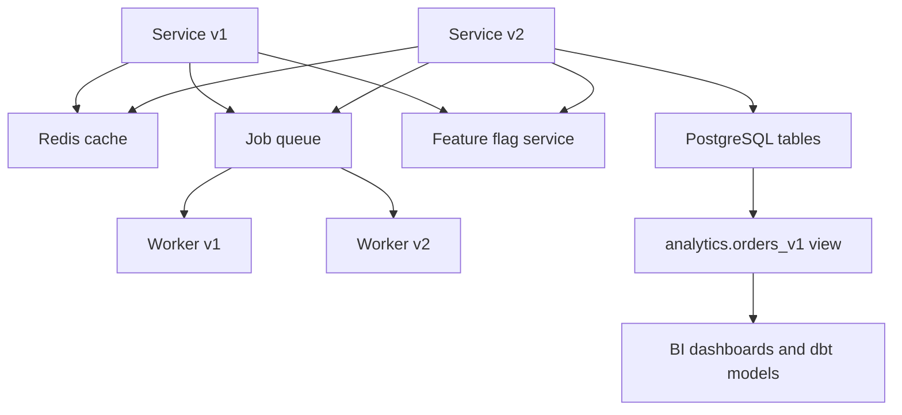
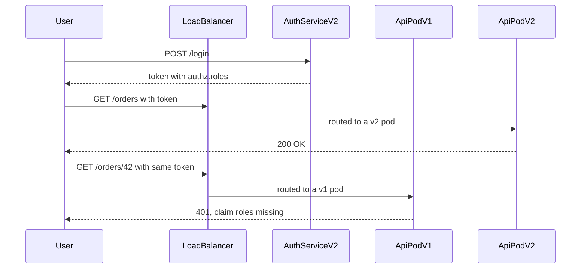

## 25.8 Compatibility beyond the API

#### Concept

The API is the compatibility surface everyone thinks about. It is not the only one. Every place where one version writes something that another version reads is a contract: the cache, the job queue, feature flags, configuration, and the database views your analytics team built on top of your tables. These contracts have no OpenAPI file, no registry and usually no owner, which is why they break more often than the API does.

#### Why does it exist?

Because serialization is a contract whether or not you called it one. The moment a value leaves a process - into Redis, into a Redis-backed job, into a config map, into a materialized view - it must be interpretable by whatever process picks it up, and that process may be a different version of your own code.

#### Mental model

Imagine a shared office fridge. You label a container "soup, Tuesday". A colleague opens it on Thursday expecting your old recipe and finds something else entirely. The fridge is the shared state; the label is the contract; nobody wrote it down; everyone assumed. The fix is not better memory, it is a label format that includes what is inside and which recipe version made it.

#### How it works



**Caches.** Two failure directions, both silent.

*Forward:* v2 writes a new shape, v1 reads it and finds fields missing. `product.price` is `undefined`, formatting yields `NaN`, and the bad value flows onward into carts, totals and receipts. This is the incident in 25.6.

*Backward:* v1 writes the old shape, v2 reads it expecting the new fields. `product.priceCents` is `undefined`; the same damage in the other direction, and it persists for the full TTL *after* the rollout finishes, which is why "the deploy is done, why are we still seeing it?" is such a common question.

The fix is a **shape version in the key namespace**: `product:v3:{tenant}:{id}`. Bump it when and only when the serialized shape changes. The two versions then live in disjoint namespaces and cannot see each other's data. Costs to state honestly: a cold cache for that namespace, so bump only on real shape changes, never per release; and briefly doubled memory while old entries expire, so keep TTLs bounded and size Redis with headroom.

Three related traps. First, **class-based deserialization**: `plainToInstance(ProductDto, JSON.parse(raw))` produces an object with the *new* class's methods and the *old* data; the types lie. Second, **Date round-tripping**: a `Date` serializes to an ISO string and comes back as a string, so `entry.createdAt.getTime()` throws `is not a function` only on cache hits, which means it passes every test that starts with a cold cache. Third, **negative caching**: caching "not found" with the old shape means a v2 pod cannot distinguish "absent" from "old empty".

**Queues and jobs.** A job is an event with a delivery guarantee, and it has the same time dimension: a job enqueued by v1 at 14:02 may be picked up by a v2 worker at 14:07, or at 14:07 *next Tuesday* if it was delayed, or after three retries and a version rollback. So:

- Every job payload carries an explicit `v` field. The worker switches on it. This costs one integer and saves you the incident.
- New payload fields must be optional from the old worker's perspective, because old workers are still draining.
- A **new job type must not be enqueued until every worker can handle it**. BullMQ, for example, will happily accept a job whose name has no processor registered; depending on configuration it stalls or fails, and either way it sits in the queue looking like a bug in the queue.
- Delayed and repeatable jobs are the long tail: a job scheduled 30 days out was serialized by a version that will be four releases old when it runs. Keep the upcaster for as long as the longest delay.
- Failed jobs in a dead-letter queue get retried manually weeks later, by a human, on whatever version is current.

**Feature flags.** Flags are configuration that changes behaviour at runtime, which makes them a compatibility surface with a lifecycle problem attached.

- *Every flag needs an expiry date at creation.* Not a wish - a field, in the flag record, with a CI job that fails the build when a flag is past it. Without this you will have 200 flags and nobody will know which are load-bearing.
- *A flag whose meaning changes must get a new key.* Reusing `newCheckout` for a different experiment six months later means old cached rules, old analytics and old code paths all point at something else.
- *Clean-up is a task, not a hope.* When a flag reaches 100% and stays there for two weeks, the removal PR gets written. Removing the flag means removing the *dead branch*, which is the actual value: the branch that has not run in six months is the one that will break when someone flips the flag by accident.
- The flag that outlived its feature is a real failure mode. A flag `useNewPricingEngine`, set to 100% two years ago, code for the old engine still present, dependencies drifted, tests deleted. Someone toggles it off during an unrelated incident because the name looks relevant. The old path runs for the first time in two years and prices everything wrong.

**Configuration.** Config is deployed independently of code in most setups, which means the same two-version problem. Rules: a new config key must have a default in code so pods that restart before the config rolls out still boot; a removed config key must be removed from code *before* it is removed from the environment; and changing a default is a behavioural change that needs the same review as a code change, because pods that have not restarted are still using the old one. Validate config at boot with a schema and fail fast - a pod that starts with a missing value and discovers it at 03:00 under load is much worse than one that refuses to become ready.

**Database views and the analytics team.** Your analytics colleagues wrote dbt models and dashboards against your tables. They are consumers. They have no OpenAPI, no Pact and usually no notification when you rename a column - they find out when a dashboard shows zero revenue on a Monday morning.

The fix is to give them a real contract: a published view layer that you own and version.

```sql
-- Internal tables are private. This is the published contract.
CREATE SCHEMA IF NOT EXISTS analytics;

CREATE VIEW analytics.orders_v1 AS
SELECT o.id                AS order_id,
       o.tenant_id,
       o.user_id,
       o.status,
       o.total_net_cents,
       o.total_gross_cents,
       o.currency,
       o.created_at
  FROM public.orders o
 WHERE o.deleted_at IS NULL;

GRANT USAGE ON SCHEMA analytics TO analytics_reader;
GRANT SELECT ON analytics.orders_v1 TO analytics_reader;
REVOKE ALL ON SCHEMA public FROM analytics_reader;   -- the point: they cannot read the raw tables
```

Now a column rename is invisible to them: you update the view's expression and their queries keep working. A genuine change publishes `analytics.orders_v2` and sunsets `_v1` on the same timeline you would give a partner. One caution: `CREATE OR REPLACE VIEW` cannot change existing column names or types or drop columns, only append at the end - which is a compatibility rule enforced by PostgreSQL itself, and a useful one. Changing a view's shape means `DROP VIEW` plus `CREATE`, which is exactly the kind of breaking change that should require deliberate effort.

#### NestJS example

A job envelope with a version, and a processor that upcasts before doing any work.

```ts
// src/jobs/job-envelope.ts
export interface JobEnvelope<T> { v: number; enqueuedAt: string; enqueuedBy: string; data: T }

// v1: { orderId, email }
// v2: { orderId, recipient: { email, locale } }
export interface SendReceiptV2 { orderId: string; recipient: { email: string; locale: string } }

export function upcastSendReceipt(env: JobEnvelope<Record<string, any>>): SendReceiptV2 {
  switch (env.v) {
    case 1:
      return { orderId: env.data.orderId, recipient: { email: env.data.email, locale: 'en' } };
    case 2:
      return env.data as SendReceiptV2;
    default:
      // A payload from a NEWER version than this worker: the additive rule says the fields
      // we need are still present, so proceed rather than dead-lettering the job.
      return env.data as SendReceiptV2;
  }
}
```

```ts
// src/jobs/receipt.processor.ts
import { Processor, WorkerHost } from '@nestjs/bullmq';
import { Job } from 'bullmq';
import { Logger } from '@nestjs/common';
import { JobEnvelope, upcastSendReceipt } from './job-envelope';
import { MailService } from '../mail/mail.service';

@Processor('receipts')
export class ReceiptProcessor extends WorkerHost {
  private readonly log = new Logger(ReceiptProcessor.name);
  constructor(private readonly mail: MailService) { super(); }

  async process(job: Job<JobEnvelope<Record<string, any>>>): Promise<void> {
    if (job.name !== 'send-receipt') { this.log.warn(`unknown job ${job.name}, ignoring`); return; }
    const data = upcastSendReceipt(job.data);
    // Idempotency: the job id is the key, so a retry after a rollback does not double-send.
    await this.mail.sendReceiptOnce(job.id!, data.orderId, data.recipient);
  }
}
```

#### Production scenario

A platform tracks its non-API contracts explicitly. The `CACHE_SHAPES` map from 25.6 has 14 entries and changes about four times a year. Job payloads all carry `v`; there are 22 job types and six live upcasters, the oldest covering a 30-day delayed job. Flags: 41 active, each with an owner and an expiry, with a weekly CI report listing expired ones; average flag lifetime 38 days. Analytics reads only `analytics.*` views; the raw schema has been refactored twice with zero analytics tickets.

#### Failure scenario

At 02:14 the on-call is paged for a spike in `send-receipt` failures. A release two hours earlier changed the receipt job payload from `{ orderId, email }` to `{ orderId, recipient: { email, locale } }`. New workers handle the new shape. There is no `v` field and no upcaster.

Three sources of old-shape jobs were still live: 1,400 jobs enqueued by v1 pods in the six-minute rollout window; 90 delayed jobs scheduled up to 72 hours earlier for subscription renewals; and 6 jobs sitting in the dead-letter queue from an unrelated outage the previous week, which an automated retry policy re-queued at 02:00. Every one of them hit `data.recipient.email` on `undefined` and threw. BullMQ retried each three times with backoff, so the error rate looked like 4,500 failures rather than 1,496 jobs.

Recovery: a hotfix processor that accepts both shapes, shipped at 02:51; the dead-lettered jobs replayed successfully; 1,400 receipts sent about 50 minutes late. Nobody lost money, but 1,400 customers got a receipt at 03:00 local time.

The permanent fixes were the envelope above, a lint rule requiring `v` in every payload interface, and a test that feeds every historical payload fixture through the current processor.

#### Edge cases & failure modes

- **Cache stampede after a shape bump**: every key in the namespace misses at once. Warm the hot keys before the deploy, or bump during low traffic.
- **Redis `KEYS` used to purge a namespace** blocks the server; use `SCAN` with a cursor, or separate logical databases per namespace.
- **A cached serialized value larger than expected** after adding fields pushes you over a memory limit and starts evicting hot keys.
- **Delayed jobs older than your retention of upcasters** cannot be processed at all; log and quarantine rather than crash-loop.
- **Repeatable job definitions** stored in Redis outlive the code that created them; changing a cron expression leaves the old schedule registered.
- **Flag SDK caching**: a pod with a stale rules snapshot serves the old decision for up to the cache TTL after a flag flip.
- **Kill switches that were never tested** are the flags most likely to be flipped in an incident and most likely to fail.
- **A config default changed in code** while running pods keep the old value from their environment: behaviour differs by pod age.
- **Materialized views** referencing a dropped column fail on refresh, often hours later in a nightly job.
- **`SELECT *` inside a view** captures the column list at creation time; adding a column to the table does not add it to the view, which surprises everybody.

#### How a Senior Backend Engineer thinks about this

They keep an explicit inventory of shared state, and they walk it during design, not during the incident: *what does this change write that another version reads?* They insist that anything serialized carries a version, because the cost is one field and the alternative is archaeology. They treat flags and config as code with a lifecycle, including deletion. And they give the analytics team a real contract, because an undeclared consumer is still a consumer, and dashboards are how the business sees itself.

#### Common mistakes

- Versioning the API carefully and the cache not at all.
- No version field in job payloads.
- Assuming the queue is empty at deploy time.
- Flags with no owner, no expiry and no removal PR.
- Letting BI tools query production tables directly.
- Using `CREATE OR REPLACE VIEW` and discovering it cannot rename columns, then dropping and recreating without telling anyone.

#### Interview questions

1. *Name three non-API compatibility surfaces and how each breaks.* Expected: cache shapes, job payloads, flags/config, analytics views; silent `undefined`, unhandled job types, stale decisions, broken dashboards.
2. *How do you change the shape of a cached object safely?* Expected: version the key namespace; accept a cold period; bump only on real shape changes.
3. *A job enqueued three weeks ago fails on the current worker. What went wrong and what prevents it?* Expected: payload shape changed with no version field or upcaster; envelope with `v`, upcasters retained for the longest delay, fixtures in tests.
4. *What is flag debt and how do you control it?* Expected: expiry dates enforced in CI, ownership, removal PRs, deleting the dead branch, new key for new meaning.
5. *Why should analytics read views instead of tables?* Expected: views are a versioned published contract; the underlying schema stays free to change; access control is explicit.

#### Practical exercise

Add a `v` field to every job payload in a service, write upcasters for the two most recent shape changes, and a Jest test that replays a fixture directory of historical payloads through the current processors. Then add a `CACHE_SHAPES` map and a lint rule that fails on any Redis key built without it. Acceptance criteria: every fixture processes without error; changing a DTO used for caching without bumping its shape version fails CI.

## 25.9 The compatibility decision table

#### Concept

This is the table to come back to. For every change you will be asked to make, it answers three questions: is it breaking, for whom, and what is the safe way to do it.

#### How it works

| Change | Breaking? | For whom | The safe way |
|---|---|---|---|
| Add a field to a response | No (usually) | Strict readers with `additionalProperties: false`; positional parsers; clients that echo the whole object back into a strict endpoint | Add it optional; do not make it required for at least one release; verify strict consumers tolerate extras |
| Remove a field from a response | **Yes** | Every reader of it | Prove nobody reads it (field-level usage per key), deprecate with headers and a date, brownout, then remove; or keep it forever with a static value |
| Rename a field | **Yes** | Every reader | Never rename. Add the new name, populate both, migrate consumers, sunset the old name on a published date |
| Change a field's type | **Yes** | Every reader; worse for typed clients | New field with the new type and a new name; both populated during the window; never widen `number` to `string` in place |
| Make validation stricter | **Yes** | Anyone sending what you now reject | Log-only first (accept and count violations), publish the numbers, notify the senders, enforce in a new version or after a deadline |
| Make validation looser | No | Nobody, on the request path | Ship it. But check the *response* side: a looser input can produce an output shape consumers have not seen |
| Add an enum value (response) | **Yes for strict clients** | Mobile and generated clients that switch exhaustively | Gate by client version, downgrade to a safe older value, ship a label field; long-term, ensure clients have an `unknown` case |
| Remove an enum value (response) | **Yes** | Anyone with a branch for it - though usually harmless | Stop producing it, keep the value documented as legacy, remove from the schema only after a sunset |
| Add an enum value (request) | No | Nobody | Ship it; old clients simply do not send it |
| Remove an enum value (request) | **Yes** | Anyone sending it | Same treatment as stricter validation: log, notify, deadline |
| Add a required request field | **Yes** | Every existing caller | Add it optional with a server-computed default; measure adoption; make it required only in a new version |
| Make a required field optional | No on the request path; **yes** on the response path | Response readers who assumed it is always present | On requests, ship it. On responses, treat as a removal: consumers rely on presence |
| Change a default | **Yes, silently** | Callers who omitted the field and relied on the old behaviour | Never change a default in place. Add an explicit value, migrate callers, change the default only in a new version, and announce it as a behaviour change |
| Change pagination | **Yes** | Every paginating client | New parameters alongside the old ones; keep the old ones working; changing default page size, cursor format or the meaning of `total` all break clients |
| Change an error code | **Yes** | Anyone branching on it | Add the new code as an additional field (`errorCode` beside `code`), keep the HTTP status stable, and never repurpose an existing code for a different condition |
| Remove an endpoint | **Yes** | Every caller | Full deprecation timeline: headers, per-consumer notification, brownouts, `410 Gone` with a pointer to the replacement |
| Change authentication | **Yes** | Every caller | Accept both mechanisms simultaneously for the full window; never flip in one release; rotate keys with `kid` and JWKS; measure adoption per key before switching off the old one |

#### The subtle ones

**Semantic changes that look additive.** This is the most dangerous row in the table, and it does not appear in any diff. A field called `total` that used to mean net now means gross. The type is the same. The name is the same. The spec diff is empty. Pact passes. The registry accepts it. Nothing logs an error. What happens is that every consumer's arithmetic is now wrong by the tax rate, and you discover it when a partner's reconciliation comes up 8% short, three weeks later, in an email that begins "we think there might be an issue".

There is exactly one defence: **new meaning gets a new name.** `totalNetCents` and `totalGrossCents` both exist; nobody is left guessing which one `total` is. It costs one field and it makes the change reviewable, because now the diff shows a field being added and another being deprecated, which reviewers understand.

The same trap in other clothes:

- **Units.** `price` from major units to minor units, `weight` from kg to g, `duration` from seconds to milliseconds. A factor of 100 or 1000 is not the kind of bug that fails a test with round numbers.
- **Time.** `createdAt` from epoch seconds to epoch milliseconds, or from UTC to local, or from a date to a datetime. Dates are especially bad because a consumer parsing "2026-03-01" as UTC midnight and one parsing it as local midnight disagree by hours, and only in some timezones.
- **Nullability.** A field that was never null starts being null. Every consumer that wrote `order.customer.email.toLowerCase()` now throws. This is the single most common production break from an "additive" change, because the schema always allowed null - the *data* did not.
- **Cardinality.** A one-to-one becomes one-to-many; `address` becomes `addresses`. Even keeping `address` populated with the first element changes meaning silently for anyone summing.
- **Ordering.** A list that happened to be sorted by creation date is now sorted by relevance. Undocumented ordering is still relied upon; if a consumer takes `items[0]`, ordering is part of your contract whether you wrote it down or not.
- **Identifier format.** Sequential integers to UUIDs, or an opaque cursor whose length changes. Consumers store ids in `varchar(20)` columns, or worse, parse them.
- **Rate limits and timeouts.** Tightening a limit is a stricter validation on a dimension nobody thinks to version. Announce it like any other break.
- **Error message text.** Somebody, somewhere, is matching on the string. It is not your fault, and it will still be your incident. Give every error a stable machine-readable code so the text is free to change.
- **Response completeness.** Adding a filter that excludes soft-deleted rows from an existing list endpoint removes data the client used to see. Additive in code, subtractive in meaning.

The pattern behind all of them: **a change is breaking if it changes what a correct consumer would compute, even if it does not change what they can parse.** The spec diff checks parseability. Only naming discipline and review check meaning.

## 25.10 Edge cases and failure modes

Each of these has happened, more than once, to teams who knew better.

**A consumer crashes on an unknown enum value.** A new `order.status` value ships. The Android client's exhaustive `when` has no `else`; the iOS client's `Decodable` enum has no `unknown` case; a Go partner unmarshals into a typed constant and gets a zero value that means something different. Symptom: crash rate up on one platform only, correlated with a data condition rather than a request. Prevention: unknown-case handling in every decoder plus server-side version gating (25.5).

**A client with strict JSON parsing rejects a new field.** A partner validates responses against a JSON Schema with `additionalProperties: false`, or a generated client runs runtime validation. You add `estimatedDeliveryAt`; their ingest job fails 100% of records. Symptom: a partner reports total failure immediately after a change you consider harmless. Prevention: ask, at onboarding, whether their parser is strict, and record the answer on the API key; ship additive changes to a canary partner first.

**A database column is dropped while old pods still `SELECT *`.** Or, more precisely, while old pods run an ORM that lists every entity column. Symptom: 100% failure on every query touching that table, on a subset of pods, starting the instant the migration commits. Prevention: two deploys - remove the column from the entity and ship, then drop. Detect with `pg_stat_statements` before dropping (25.3).

**An event replay runs old-schema events through new consumers.** A consumer is rebuilt and replays from offset zero. The upcaster for v1 was deleted six months ago "because nobody produces v1 any more" - true, and irrelevant, because the topic still *contains* v1. Symptom: the rebuild fails immediately and loudly, which is the good case; the bad case is an upcaster that silently produces wrong defaults. Prevention: retain upcasters for retention plus the longest plausible replay, and keep a fixture of one real message per version in the test suite.

**Cache poisoning with a new object shape.** Covered in 25.6 and 25.8. The distinguishing symptom is that errors persist *after* the rollout completes, for exactly the TTL, and that the errors do not correlate with pod version. Prevention: versioned key namespaces.

**A JWT with a restructured claim is rejected by pods that have not rolled yet.** The auth service ships first and starts minting `{ authz: { roles } }` instead of `{ roles }`. Every pod still on the old version returns 401. Symptom: an authentication error rate that climbs as the auth rollout progresses and falls as the API rollout catches up, with a horrible middle where users are logged out at random.



Prevention: write both claim shapes, read either, retire the old one only after the longest token lifetime has passed (25.6).

**A gateway rewrites or pins versions.** An API gateway is configured to route `/orders` to `/v1/orders` for clients that send no version header. A new deploy adds `/v2/orders` and someone updates the default to v2 "since v1 is deprecated". Every client that relied on the unversioned path silently changes contract without changing a line of code. The reverse also happens: a gateway strips an unknown header, so your carefully designed version negotiation never reaches the application. Symptom: behaviour that differs between direct calls to the service and calls through the gateway. Prevention: treat gateway routing rules as part of the contract, version them in the same repository, and have a smoke test that calls through the gateway, not around it.

**A mobile client caches an old error format.** The app persists the last error response to show offline, or a service worker caches a `4xx` body. The error format changes from `{ error: "..." }` to `{ code, message, details }`. Old cached errors render as blank dialogs, or the app crashes reading `error.error`. Symptom: complaints from a small number of users that survive a reinstall-fixes-it support response. Prevention: never cache error bodies; version error envelopes like any other response; keep a stable `code` field forever.

**A "compatible" change that broke a partner because they parsed by position.** You add a column to a CSV export, or a field in the middle of a fixed-order JSON array, or an element to an XML sequence. Every consumer using named access is fine. The partner who wrote `row[4]` now reads the wrong value: their finance import books shipping cost as tax for two weeks before anyone notices. Symptom: no errors at all, and a reconciliation discrepancy discovered by an accountant. Prevention: append-only for positional formats, a documented column order treated as frozen, a header row that consumers are contractually required to use, and a version in the file name (`orders_v2_2026-03-01.csv`).

**Two more worth knowing.** *A retry storm caused by a compatibility error*: an old client gets a 500 from a new pod, retries immediately, hits another new pod, retries again; the error rate multiplies the load exactly when the system is least healthy. Compatibility failures are especially prone to this because they affect a deterministic subset of requests that will never succeed. *A partial rollback*: a deploy is rolled back for the API but not for the workers, or for one region but not another, leaving a mixed state that was never designed for and can last days.

## Senior Checklist — Part 25

- [ ] I understand the concept
- [ ] I can explain it simply
- [ ] I can implement it
- [ ] I understand its failure modes
- [ ] I understand its scaling limitations
- [ ] I understand its security implications
- [ ] I understand its operational implications
- [ ] I can choose between alternatives
- [ ] I can explain the tradeoffs
- [ ] I can answer senior-level interview questions
- [ ] I can state the N-1 rule and apply it to a migration plan
- [ ] I can list what version N and N+1 share during a rolling deploy, and check each one
- [ ] I can classify any API change as breaking or not, and name who it breaks
- [ ] I can explain why adding a response enum value breaks mobile clients, and design both sides for unknown values
- [ ] I can version a cache key namespace and a job payload, and write an upcaster
- [ ] I can explain BACKWARD, FORWARD, FULL and the deployment order each implies
- [ ] I can set up a CI check that fails a pull request on a breaking OpenAPI diff
- [ ] I can write a consumer-driven contract test and explain what it does not catch
- [ ] I can design a deprecation and sunset timeline with brownouts, and defend the dates
- [ ] I can spot a semantic change that looks additive in a code review
- [ ] I can change a JWT claim structure with no user-visible impact
- [ ] I can explain why a rollback must be safe and what makes it unsafe

## Part 25 — Key Takeaways

- At every moment more than one version is alive: pods, apps, consumers, cached objects, queued jobs, tokens. Compatibility is not politeness, it is the condition for deploying at all.
- Add, never remove or rename. New meaning gets a new name. `total` becoming gross is worse than a crash, because nothing crashes.
- Be a tolerant reader everywhere: ignore unknown fields, handle unknown enum values, treat unknown event and job types as "not mine" rather than fatal.
- Adding a value to a response enum is a breaking change for strict clients. Gate it by client version, downgrade to a safe older value, and send a label the client can render.
- The mixed-version window covers everything both versions touch: schema, cache shapes, cache and lock keys, job and event payloads, JWT claims, feature flags, config. Walk the list for every change.
- Version anything you serialize. A shape version in the cache key and a `v` in the job payload cost one field each and prevent a whole class of silent corruption.
- Deploy consumers before producers, and make every rollback safe: the old code must still work against everything the new code has already written.
- Enforce it in CI. Generate OpenAPI from the code, diff it, fail on the breaking categories, verify consumer contracts, and let the schema registry reject bad event changes before they ship.
- Mobile and partner clients cannot be upgraded on your schedule. Ship the config endpoint, the unknown-enum fallback and server-driven layout in version 1.0, because you cannot add them later to clients already in the field.
- Deprecation works when it has a date, per-consumer notification with their own usage numbers, and brownouts. Announcements alone move nobody.
- Your analytics team is a consumer. Give them versioned views and take away access to the raw tables, and your schema is free again.
- The checks catch shape, not meaning. Naming discipline and review are the only defence against a field that quietly starts meaning something else.
