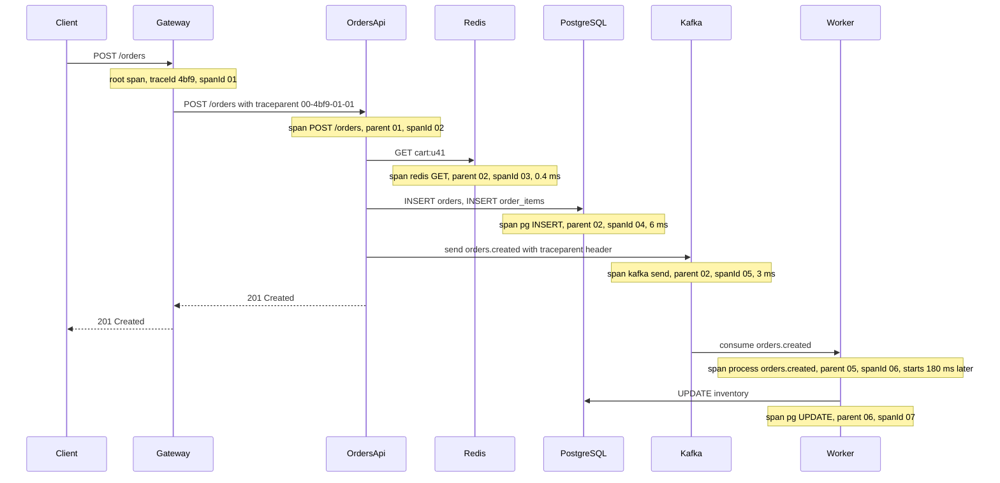
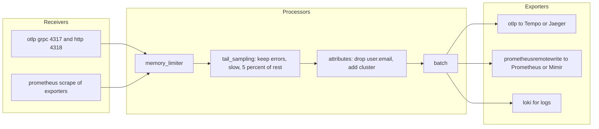
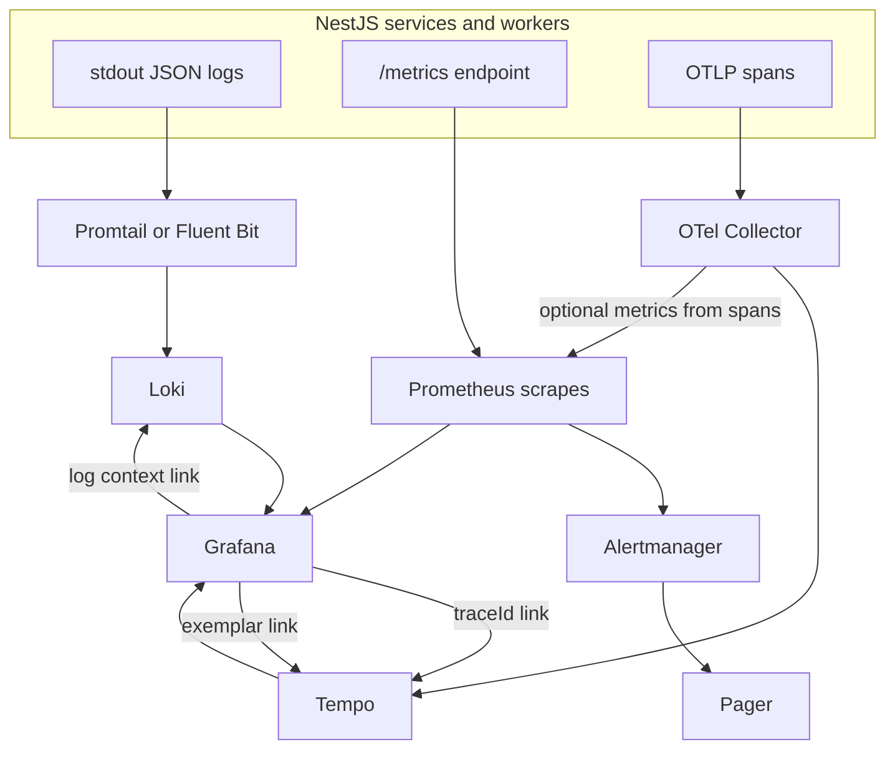

## 25.4 Traces

### 25.4.1 Distributed tracing explained simply

#### Concept

A **trace** is the record of one request's journey through your system, as a tree of timed operations called **spans**. The API handler is a span. The PostgreSQL query it runs is a child span. The Kafka publish is another child. The worker that consumes the message starts a span whose parent is the publish span, even though it runs in a different process on a different node minutes later. Put the tree on a timeline and you see exactly where the time went.

Each span carries:

- a **trace id** (128-bit, shared by every span in the request),
- a **span id** (64-bit, unique to this operation),
- a **parent span id** (empty for the root),
- a name (`POST /orders`, `SELECT orders`, `kafka.send orders.created`),
- start and end timestamps,
- **attributes**: key-value pairs such as `http.status_code`, `db.statement`, `order.id`,
- **events**: timestamped notes inside the span, such as an exception,
- a **status**: unset, ok, or error.

#### Why does it exist?

Logs tell you what happened in one process. Metrics tell you how much and how often. Neither tells you that a 3 second request spent 2.8 seconds waiting for a lock in PostgreSQL after a 100 ms Redis timeout. Tracing exists because in a system of six processes, "where did the time go" is the first question of every latency incident, and it cannot be answered from any single process.

#### Mental model

Imagine a relay race where every runner wears a GPS watch and the baton has a barcode. After the race you can lay every runner's segment on one timeline, see that runner three stood still for 40 seconds waiting for a gate to open, and know exactly which baton it was. The barcode is the trace id. Each runner's segment is a span. The gate is your database lock.

#### How it works



Step by step, for the request above:

1. The gateway sees no incoming trace context, so it starts a new trace: it generates a trace id and a root span.
2. It forwards the request with a `traceparent` header, the W3C Trace Context standard: `00-<traceId>-<spanId>-<flags>`. `00` is the version, the flags byte carries the sampled bit (`01` means sampled).
3. The NestJS HTTP instrumentation reads `traceparent`, creates a server span whose parent is the gateway's span, and stores the active span in an AsyncLocalStorage context, the same mechanism the correlation id uses.
4. Every instrumented client call (pg, ioredis, kafkajs, http) creates a child span under whatever span is active, and ends it when the call completes.
5. The Kafka instrumentation injects `traceparent` as a message header. When the worker consumes the message, the instrumentation extracts it and starts a span with that parent. The trace now crosses an asynchronous boundary and shows the 180 ms of queueing as a gap between the send span and the process span.
6. Spans are batched in memory and exported to a collector every few seconds. The collector forwards them to a trace store: Jaeger, Grafana Tempo, AWS X-Ray or a vendor.

#### Sampling: head versus tail

Tracing every request in a 5,000 RPS system produces 40,000 spans per second. Nobody stores that. **Sampling** decides which traces to keep.

- **Head sampling** decides at the root, when the trace starts, usually "keep 10 percent at random". The decision travels in the `traceparent` flags so every service agrees. It is simple and cheap, and it is blind: it cannot know that this request will fail in 3 seconds, so 90 percent of failures are discarded.
- **Tail sampling** decides after the trace is complete. The OpenTelemetry Collector buffers all spans of a trace for a few seconds, then applies policies: keep every trace with an error, keep every trace slower than 1 second, keep 5 percent of the rest. This keeps the interesting traces at a fraction of the cost. The price is memory in the collector and the requirement that every span of a trace reach the same collector instance (load balance by trace id).

The usual production shape is head sampling at 100 percent inside the application (mark everything sampled, so the collector sees everything) and tail sampling in the collector, or head sampling at 10 to 20 percent when there is no collector budget. A `ParentBasedSampler` respects the upstream decision so a trace is never half-kept.

### 25.4.2 OpenTelemetry setup in NestJS

#### Concept

OpenTelemetry (OTel) is the vendor-neutral standard for traces, metrics and logs: an API your code calls, an SDK that implements it, auto-instrumentation libraries that patch popular packages, and a wire protocol (OTLP) to ship data. You instrument once and can switch from Jaeger to Tempo to a vendor by changing the exporter.

#### How it works

The SDK must start **before** any instrumented module is imported, because auto-instrumentation works by patching `require`. In NestJS that means a separate `tracing.ts` file loaded first, either via `import './tracing'` as the first line of `main.ts` or with `node -r ./dist/tracing.js dist/main.js`.

```ts
// tracing.ts (loaded before anything else)
import { NodeSDK } from '@opentelemetry/sdk-node';
import { getNodeAutoInstrumentations } from '@opentelemetry/auto-instrumentations-node';
import { OTLPTraceExporter } from '@opentelemetry/exporter-trace-otlp-http';
import { resourceFromAttributes } from '@opentelemetry/resources';
import { ATTR_SERVICE_NAME, ATTR_SERVICE_VERSION } from '@opentelemetry/semantic-conventions';
import { ParentBasedSampler, TraceIdRatioBasedSampler, BatchSpanProcessor } from '@opentelemetry/sdk-trace-base';

const exporter = new OTLPTraceExporter({
  url: process.env.OTEL_EXPORTER_OTLP_ENDPOINT ?? 'http://otel-collector:4318/v1/traces',
  timeoutMillis: 5_000,
});

export const sdk = new NodeSDK({
  resource: resourceFromAttributes({
    [ATTR_SERVICE_NAME]: 'orders-api',
    [ATTR_SERVICE_VERSION]: process.env.APP_VERSION ?? 'dev',
    'deployment.environment': process.env.NODE_ENV ?? 'dev',
  }),
  // Respect the upstream sampled flag; sample 20 percent of new roots.
  sampler: new ParentBasedSampler({ root: new TraceIdRatioBasedSampler(0.2) }),
  spanProcessors: [
    new BatchSpanProcessor(exporter, {
      maxQueueSize: 4096,        // spans buffered before dropping; bounded so memory cannot explode
      scheduledDelayMs: 2_000,   // export at least every 2 s
      exportTimeoutMillis: 5_000,
    }),
  ],
  instrumentations: [
    getNodeAutoInstrumentations({
      '@opentelemetry/instrumentation-http': {
        ignoreIncomingRequestHook: (req) => req.url === '/health' || req.url === '/metrics',
      },
      '@opentelemetry/instrumentation-express': {},
      '@opentelemetry/instrumentation-nestjs-core': {},
      '@opentelemetry/instrumentation-pg': { enhancedDatabaseReporting: false }, // no bound parameters in spans
      '@opentelemetry/instrumentation-ioredis': {},
      '@opentelemetry/instrumentation-kafkajs': {},
      '@opentelemetry/instrumentation-fs': { enabled: false },   // file system spans are noise
    }),
  ],
});

sdk.start();

// Flush spans on shutdown; bounded so a dead collector cannot block the pod from stopping.
process.on('SIGTERM', () => {
  Promise.race([sdk.shutdown(), new Promise((r) => setTimeout(r, 3_000))])
    .finally(() => process.exit(0));
});
```

```ts
// main.ts
import './tracing';           // must be the first import
import { NestFactory } from '@nestjs/core';
import { AppModule } from './app.module';

async function bootstrap() {
  const app = await NestFactory.create(AppModule, { bufferLogs: true });
  app.enableShutdownHooks();
  await app.listen(3000);
}
bootstrap();
```

With only this file, every inbound HTTP request, every `pg` query, every ioredis command and every kafkajs send and consume produces spans with the right parents. The `pg` instrumentation names spans by operation and includes `db.statement` (the SQL text without parameters when `enhancedDatabaseReporting` is off); the Kafka instrumentation injects and extracts `traceparent` in message headers.

#### NestJS example: manual spans in services

Auto-instrumentation shows you dependencies. It does not show you *your* logic: "validate cart", "reserve inventory", "calculate pricing". Wrap meaningful business steps in manual spans and attach the business ids as attributes.

```ts
// orders/orders.service.ts
import { Injectable } from '@nestjs/common';
import { trace, SpanStatusCode, Span } from '@opentelemetry/api';

const tracer = trace.getTracer('orders-api');

@Injectable()
export class OrdersService {
  constructor(private readonly inventory: InventoryService, private readonly repo: OrdersRepository) {}

  async place(userId: string, dto: CreateOrderDto): Promise<Order> {
    // startActiveSpan makes this span the parent of everything awaited inside the callback.
    return tracer.startActiveSpan('orders.place', async (span: Span) => {
      span.setAttributes({ 'user.id': userId, 'order.item_count': dto.items.length });
      try {
        const reservation = await this.reserve(dto);              // child span
        const order = await this.repo.create(userId, dto, reservation);
        span.setAttribute('order.id', order.id);                  // searchable in Tempo or Jaeger
        span.addEvent('order.persisted', { 'order.total_cents': order.totalCents });
        span.setStatus({ code: SpanStatusCode.OK });
        return order;
      } catch (err) {
        span.recordException(err as Error);                      // stack and message as a span event
        span.setStatus({ code: SpanStatusCode.ERROR, message: (err as Error).message });
        throw err;
      } finally {
        span.end();                                               // always end, or the span never exports
      }
    });
  }

  private reserve(dto: CreateOrderDto) {
    return tracer.startActiveSpan('inventory.reserve', async (span) => {
      try {
        return await this.inventory.reserve(dto.items);
      } finally {
        span.end();
      }
    });
  }
}
```

Attribute naming: use dotted namespaces (`order.id`, `payment.provider`), never PII (`user.email`), and keep values bounded. Attributes are indexed by most backends, so `order.id` makes the trace findable from a support ticket.

For a reusable pattern, a NestJS interceptor can open a span per handler with the controller and method name, so every route has a span even before you add manual ones:

```ts
// tracing/handler-span.interceptor.ts
@Injectable()
export class HandlerSpanInterceptor implements NestInterceptor {
  intercept(ctx: ExecutionContext, next: CallHandler): Observable<unknown> {
    const name = `${ctx.getClass().name}.${ctx.getHandler().name}`;
    return new Observable((subscriber) => {
      tracer.startActiveSpan(name, (span) => {
        next.handle().pipe(finalize(() => span.end())).subscribe({
          next: (v) => subscriber.next(v),
          error: (e) => { span.recordException(e); span.setStatus({ code: SpanStatusCode.ERROR }); subscriber.error(e); },
          complete: () => subscriber.complete(),
        });
      });
    });
  }
}
```

#### Exporters and where traces go

The application exports OTLP (over HTTP on port 4318 or gRPC on 4317) to a **collector**, never directly to the storage backend. The collector then exports to one or more of:

| Backend | Character | Typical choice when |
|---|---|---|
| Jaeger | Open source, mature UI, own storage (Cassandra, Elasticsearch, or Badger) | Self-hosted, moderate volume |
| Grafana Tempo | Object-storage backed, very cheap per span, searches by trace id and attributes, integrates with Loki and Prometheus | Already on Grafana, high volume |
| AWS X-Ray | Managed, integrates with AWS services | Fully on AWS, low ops budget |
| Vendor (Datadog, Honeycomb, New Relic) | Managed, powerful, priced per span or per GB | Budget exists, ops team is small |

Switching backends is a collector config change. That is the entire point of exporting OTLP from the application.

#### Reading a trace to find the slow span

Open the trace for a slow request and read it like this:

1. Look at the root span's duration. That is what the customer felt.
2. Find the longest child. If children are sequential, the sum explains the root; if they overlap, the request did work in parallel.
3. Look for **gaps**: time in the parent that no child accounts for. A gap is CPU work in your own process (JSON serialization, a synchronous loop) or event loop lag, and neither shows as a span.
4. Look for **fan-out**: a hundred tiny sequential `SELECT` spans is an N+1 query; you will see them as a staircase.
5. Look for **waiting**: a `pg` span of 2 seconds for an `UPDATE` that normally takes 2 ms is lock contention; the SQL is fine, the row was locked.
6. Check the **async gap** between a Kafka send span and its consumer span: that is queueing delay and consumer lag, visible without any Kafka dashboard.

A trace that shows `POST /orders` at 3,100 ms with children `redis GET` 0.4 ms, `pg INSERT` 3,050 ms and everything else under 10 ms is a lock or a slow disk, not application code. A trace that shows the same root with children summing to 200 ms and a 2,900 ms gap is event loop blocking, and the next step is a CPU profile.

#### Linking logs to traces and metrics exemplars

Two links make the three pillars one tool.

**Logs to traces.** The `mixin` in 25.2.3 adds `traceId` and `spanId` from `trace.getActiveSpan()` to every log line. In Grafana, a Loki line with a `traceId` field gets a button that opens the trace in Tempo, and a Tempo trace gets a button that queries Loki for that id. You move between "what did the code say" and "where did the time go" in one click.

**Metrics to traces via exemplars.** An exemplar is a trace id attached to a histogram bucket observation. When the p99 panel shows a spike, you click a dot on the spike and open a real trace from that bucket. `prom-client` supports this with `enableExemplars`.

```ts
// metrics/http-metrics.interceptor.ts (exemplar variant)
const duration = new Histogram({
  name: 'http_request_duration_seconds',
  help: 'HTTP request latency',
  labelNames: ['method', 'route'],
  buckets: [0.005, 0.01, 0.025, 0.05, 0.1, 0.25, 0.5, 1, 2.5, 5, 10],
  enableExemplars: true,
  registers: [registry],
});

// at the end of the request
const span = trace.getActiveSpan()?.spanContext();
duration.observe({
  labels: { method, route },
  value: elapsedSeconds,
  exemplarLabels: span ? { traceId: span.traceId } : {},   // exposed as # {traceId="..."} in the scrape
});
```

Prometheus must run with `--enable-feature=exemplar-storage`, and Grafana's Prometheus data source is configured to link the `traceId` exemplar label to Tempo.

#### Production scenario

An orders API at 800 RPS, 8 spans per request, head sampling 20 percent: 1,280 spans per second exported, batched in 2 second flushes of about 2,500 spans (roughly 1 MB). The collector tail-samples down to 100 percent of errors and slow traces plus 5 percent of the rest, storing about 300 spans per second in Tempo. At typical object-storage pricing this costs tens of dollars a month; the same traffic traced at 100 percent with no tail sampling into a per-span vendor plan costs thousands.

#### Failure scenario

At 16:20 the on-call sees `POST /checkout` p99 at 4 seconds. The dashboard shows PostgreSQL and Redis healthy. They click an exemplar on the p99 spike and land on a trace. The root is 3.9 seconds; the children are `redis GET` 0.5 ms, `pg SELECT` 2 ms and `http POST https://pricing.internal/quote` 3,850 ms. The pricing service's trace, linked by the same trace id, shows its own root at 3,840 ms with an `http POST tax-provider` child at 3,800 ms. The tax provider is slow; the checkout service has no timeout on the pricing call; the pricing service has no timeout on the tax provider. Fix: 800 ms timeouts at both hops and a cached fallback for tax rates. Without tracing this was "checkout is slow, nothing is wrong"; with it, the diagnosis took the time it takes to click twice.

#### Edge cases & failure modes

- **Context loss.** `setTimeout`, `setImmediate`, `EventEmitter` listeners and `Promise` chains created outside the request lose the active span. Use `context.with(context.active(), fn)` or bind the callback; test it.
- **Spans never ended** (missing `span.end()` in an error path) never export, and the trace shows a hole exactly where the bug is.
- **Instrumentation not loaded** because the SDK started after `pg` was required. The symptom is HTTP spans with no children.
- **Exporter blocking shutdown.** `sdk.shutdown()` waits for the collector; if it is down, the pod hangs until Kubernetes kills it. Bound the wait.
- **Clock skew** between hosts makes a child span appear to start before its parent, or a consumer span appear before the producer's. Trace stores tolerate it, but negative gaps confuse humans. Run NTP or chrony on every node.
- **Sampling hiding the rare failure.** At 1 percent head sampling, a failure that happens once an hour is captured once every four days. Use tail sampling or force-sample on errors.
- **Attribute cardinality** is fine (traces are meant for it) but attribute *size* is not: a 200 KB `db.statement` per span multiplies export cost and can exceed collector limits.

### 25.4.3 Correlation ID versus Trace ID versus Span ID

| | Correlation id (request id) | Trace id | Span id |
|---|---|---|---|
| Who generates it | Gateway or first service, or the client | Tracing SDK at the root of a trace | Tracing SDK for every operation |
| Format | Anything; usually UUID | 32 hex characters (128-bit) | 16 hex characters (64-bit) |
| Header | `X-Request-Id` (convention) | `traceparent` (W3C standard) | Part of `traceparent` as the parent span id |
| Scope | One inbound request and everything it causes, including async work | One trace, which is usually the same thing but can be cut by sampling or by a new root | One operation within a trace |
| Lives in logs | Yes, on every line | Yes, on every line | Usually, to jump to the exact span |
| Survives sampling | Always; it is just a string you carry | The id exists always, but the trace data exists only if sampled | Same |
| Shown to customers | Yes, on error screens and in support tickets | No | No |
| Purpose | Human-friendly "find everything about this request" | Machine-friendly "reconstruct the timing tree" | Locate one node in that tree |

Many teams simplify by making the correlation id equal to the trace id. That works when every entry point is traced and the gateway generates the trace, but it breaks when a client wants to send its own id, or when sampling means the trace was never stored. The safest design keeps both: a request id that always exists and is always logged, and a trace id that links to the trace when there is one.

## 25.5 OpenTelemetry Collector and how the tools fit together

### 25.5.1 The collector

#### Concept

The OpenTelemetry Collector is a standalone process that receives telemetry (OTLP, Prometheus, Jaeger and other formats), processes it (batching, filtering, attribute manipulation, tail sampling, memory limiting) and exports it to one or more backends. It sits between your services and your storage so that the services do not need to know or care where the data goes.

#### Why does it exist?

Without a collector, every service holds credentials for every backend, retries against every backend, and changes when the backend changes. With a collector, the service speaks OTLP to `otel-collector:4317` and everything else is a config file operated by the platform team. The collector also makes tail sampling possible, because tail sampling needs all spans of a trace in one place.

#### How it works



A pipeline is receivers, then processors in order, then exporters. Traces, metrics and logs each get their own pipeline. The processors that matter:

- `memory_limiter` first, always. It refuses data when the collector approaches its memory limit instead of being OOMKilled and losing everything in its buffers.
- `tail_sampling` holds spans per trace for a decision window (10 to 30 seconds) then applies policies.
- `attributes` or `transform` to remove anything sensitive that slipped in, and to add cluster or region labels.
- `batch` last, to compress export traffic.

```yaml
# otel-collector.yaml
receivers:
  otlp:
    protocols:
      grpc: { endpoint: 0.0.0.0:4317 }
      http: { endpoint: 0.0.0.0:4318 }

processors:
  memory_limiter:
    check_interval: 1s
    limit_mib: 1500
    spike_limit_mib: 300
  tail_sampling:
    decision_wait: 15s
    num_traces: 200000
    policies:
      - { name: errors, type: status_code, status_code: { status_codes: [ERROR] } }
      - { name: slow, type: latency, latency: { threshold_ms: 1000 } }
      - { name: baseline, type: probabilistic, probabilistic: { sampling_percentage: 5 } }
  attributes/scrub:
    actions:
      - { key: user.email, action: delete }
      - { key: http.request.header.authorization, action: delete }
  batch:
    timeout: 2s
    send_batch_size: 2048

exporters:
  otlp/tempo:
    endpoint: tempo:4317
    tls: { insecure: true }
  prometheusremotewrite:
    endpoint: http://prometheus:9090/api/v1/write

service:
  pipelines:
    traces:
      receivers: [otlp]
      processors: [memory_limiter, tail_sampling, attributes/scrub, batch]
      exporters: [otlp/tempo]
    metrics:
      receivers: [otlp]
      processors: [memory_limiter, batch]
      exporters: [prometheusremotewrite]
```

Deploy the collector two ways at once: an **agent** as a DaemonSet on every node (or a sidecar) that receives from local pods and forwards, and a **gateway** deployment behind a Service that does tail sampling. The agent must route by trace id to the gateway (the `loadbalancing` exporter does this) so all spans of a trace land on one gateway instance.

### 25.5.2 How Prometheus, Grafana, Loki, Tempo and the collector fit together



Each tool has one job. Prometheus stores metrics and evaluates alerts. Loki stores logs. Tempo stores traces. The collector receives and shapes traces (and can generate RED metrics from spans, so services without a `/metrics` endpoint still get rate, error and duration). Grafana is the single pane where a `traceId` in a log line, an exemplar on a histogram and a span in a trace are the same clickable thing. The senior engineer's rule: the on-call should never need to open more than one UI during an incident.

#### How a Senior Backend Engineer thinks about this

They start tracing on day one of a multi-service system, because retrofitting context propagation across twelve services and three queues is a quarter of work, while adding it to the first two services is an afternoon. They keep auto-instrumentation on for dependencies and add manual spans only at business boundaries. They treat the collector as production infrastructure: it has its own dashboard (queue size, dropped spans, memory), it has a memory limit, and it is on the same deploy pipeline as everything else. They never let the application talk to a trace vendor directly, because the day the vendor has an outage must not be the day the API slows down.

#### Common mistakes

- Starting the SDK after Nest bootstraps, so nothing is patched.
- Sampling at 1 percent to save money, then having no trace for the one failing request that matters.
- Putting `db.statement` with bound parameters, or a request body, in span attributes.
- Forgetting to end spans in error paths.
- Exporting straight from the app to a vendor over the public internet without a timeout.
- Tail sampling without routing by trace id, so half of a trace is kept and the other half dropped.

#### Interview questions

1. *Explain how a trace crosses a Kafka boundary.* Expected: producer instrumentation injects `traceparent` as a message header; consumer instrumentation extracts it and starts a span with that parent; the gap between them is queueing time. Follow-up: what if the consumer batches 100 messages? (One span per message with links, or a batch span with links to each producer span.)
2. *Head versus tail sampling: tradeoffs?* Expected: head is cheap and blind; tail keeps interesting traces but needs a collector with memory and trace-id routing.
3. *What is `traceparent` and what is in it?* Expected: W3C header, version, trace id, parent span id, flags with the sampled bit.
4. *How do you connect a latency spike on a dashboard to a specific trace?* Expected: exemplars on the histogram, linked in Grafana to the trace store.
5. *A trace shows a 2 second gap in the parent span with no child. What is it?* Expected: CPU work or event loop lag in the process; next step is a profile.
6. *Why put a collector between the app and the backend?* Expected: decoupling, retries, tail sampling, credential isolation, scrubbing, one place to change backends.

#### Practical exercise

Trace an order across services:

1. Add `tracing.ts` to a NestJS `orders-api` and a `notifications-worker` with auto-instrumentation for http, express, nestjs-core, pg, ioredis and kafkajs. Export OTLP to a local collector; run Tempo (or Jaeger) and Grafana in Docker Compose.
2. Add a manual `orders.place` span with `order.id` and `user.id` attributes; record exceptions.
3. Configure the collector with `memory_limiter`, tail sampling (all errors, all traces over 500 ms, 10 percent baseline) and `batch`.
4. Add `traceId` to every pino line and configure the Grafana Loki-to-Tempo link.
5. Acceptance: placing an order produces one trace with spans in both processes and a visible queueing gap; forcing an inventory error produces a trace with an error status that is kept by tail sampling even at 10 percent baseline; searching Tempo by `order.id` finds the trace; clicking the trace id in the Loki log line opens it.
