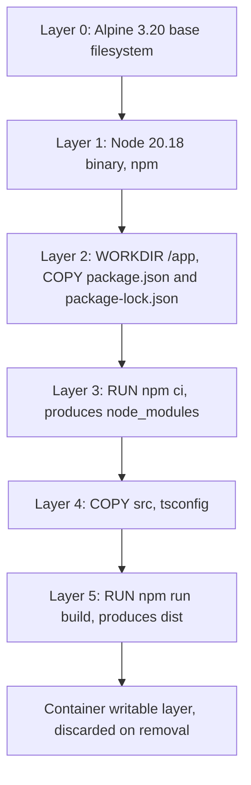

# Part 26 — Docker for Backend Engineers

Docker is the tool most backend engineers use every day and understand the least. You copy a Dockerfile from the last project, it builds, it runs, and you move on. Then one night your NestJS pods take 30 seconds to shut down and drop in-flight orders, or a container is killed at 512 MB even though "Node only uses 200 MB", or a deploy that worked yesterday fails because a native module will not compile on Alpine. Every one of those incidents comes from not knowing what a container actually is.

This part teaches containers from the kernel up: what isolation really means, how images are built from layers, why the order of lines in a Dockerfile changes your build time from 8 minutes to 40 seconds, how signals reach your Node process, how to wire a NestJS API, PostgreSQL, Redis and a message broker together with Docker Compose, and how to ship a small, secure, non-root production image. The final sections are a full worked example, a debugging guide, CI build patterns and a catalogue of the failure modes that senior engineers have all met at least once.

## 26.1 What a container really is

#### Concept

A container is a normal Linux process (or a small tree of processes) that the kernel has been told to lie to. The process believes it has its own filesystem, its own process list starting at PID 1, its own network interface and hostname, and its own share of CPU and memory. None of that is a separate machine. It is the same kernel as the host, running your `node dist/main.js`, with a few kernel features wrapped around it.

Three kernel features do almost all of the work:

- **Namespaces** change what the process can *see*: files, other processes, network interfaces, hostname, users.
- **Control groups (cgroups)** limit what the process can *use*: CPU time, memory, disk I/O, number of PIDs.
- **A union filesystem** (OverlayFS) stacks read-only image layers plus one writable layer so that many containers can share the same image files on disk while each thinks it owns a private copy.

Docker is the tooling that packages a filesystem into an image, ships it to a registry, and asks the kernel to start a process with those namespaces, cgroups and mounts configured. The container runtime underneath Docker (containerd and runc) is what actually makes the system calls.

#### Why does it exist?

Before containers, deploying a Node.js service meant a runbook: install this Node version, install these system libraries, set these environment variables, copy these files to these paths, hope nothing else on the machine conflicts. Two services on the same VM fought over global packages, OpenSSL versions and port numbers. Staging drifted from production because someone patched a library by hand. "It works on my machine" was a real, recurring cause of outages.

Virtual machines solved isolation but at a heavy price: each VM boots its own kernel, takes gigabytes of disk, minutes to start and hundreds of megabytes of memory before your application even runs. You could not afford a VM per microservice, and you certainly could not spin one up in two seconds when traffic spiked.

Containers give most of the isolation of a VM at the cost of a process. The image carries the exact filesystem your code was tested with, down to the byte, so the "my machine" problem disappears: the same image runs on your laptop, in CI, in staging and in production. Start time is milliseconds, memory overhead is close to zero, and a single 8 GB node can run dozens of them.

#### Mental model

Imagine an office building. A virtual machine is renting a whole separate building next door: its own foundation, plumbing, electricity, security desk. Total isolation, very expensive, takes months to set up.

A container is renting one office floor in a shared building. The building (the kernel) provides plumbing and electricity to everyone. Your floor has its own door with a lock (namespaces: you cannot see into other floors), your own electricity meter and a breaker that trips at an agreed limit (cgroups: you cannot consume more than your share), and your furniture is a standard kit that was photographed once and copied to every floor (image layers, shared on disk, with your own scratch desk on top as the writable layer). If you knock down a wall you only damage your floor. If the building's foundation cracks (a kernel bug), every floor feels it.

#### How it works

When you run `docker run --memory=512m --cpus=1 -p 3000:3000 orders-api:1.4.2`, this happens, step by step:

1. **Image lookup.** Docker checks whether the image layers are present locally. If not, it pulls each missing layer (a compressed tar archive) from the registry, verifying each one against its SHA-256 digest.
2. **Filesystem assembly.** OverlayFS mounts the read-only layers as the "lower" directories and creates an empty "upper" directory as the container's writable layer. The merged view is the container's root filesystem (`/`).
3. **Namespaces.** runc calls `clone()` with flags that create new namespaces:
   - `CLONE_NEWPID`: the first process becomes PID 1 inside; it cannot see host processes.
   - `CLONE_NEWNS`: a private mount table; the merged OverlayFS becomes `/` via `pivot_root`.
   - `CLONE_NEWNET`: a fresh network stack with its own `lo` and a virtual ethernet pair (`veth`) plugged into the Docker bridge.
   - `CLONE_NEWUTS`: its own hostname (the container ID by default).
   - `CLONE_NEWIPC`: private shared-memory segments and semaphores.
   - Optionally `CLONE_NEWUSER`: uid 0 inside maps to an unprivileged uid outside (user namespace remapping; not the default in Docker, which is one reason "root in the container" is dangerous).
4. **cgroups.** runc writes the limits into the cgroup v2 hierarchy: `memory.max = 536870912` and `cpu.max = 100000 100000` (1 CPU: 100 ms of CPU time per 100 ms period). The kernel enforces them: exceed the memory limit and the OOM killer terminates a process in the cgroup; exceed the CPU quota and the process is paused (throttled) until the next period.
5. **Capabilities and seccomp.** Docker drops most Linux capabilities (the container cannot load kernel modules, change the clock, or use raw sockets unless you allow it) and applies a default seccomp profile that blocks around 40 dangerous system calls.
6. **Port publishing.** For `-p 3000:3000` Docker adds iptables (or nftables) NAT rules so that traffic to the host's port 3000 is forwarded to the container's IP on port 3000.
7. **Exec.** runc calls `execve("/usr/local/bin/node", ["node", "dist/main.js"])`. Your NestJS application is now running. It is visible in the host's `ps` output as an ordinary process with a strange root directory and a cgroup.

Here is the container-versus-VM comparison senior engineers keep in their heads:

| Property | Virtual machine | Container |
|---|---|---|
| Kernel | Own kernel per VM | Shares the host kernel |
| Isolation boundary | Hypervisor (hardware-assisted) | Kernel namespaces and cgroups |
| Start time | 30 s to minutes | 50 ms to 2 s |
| Memory overhead | 200 MB to 1 GB per VM before your app | A few MB |
| Disk footprint | Gigabytes per VM | Shared layers; tens to hundreds of MB |
| Density on one 16 GB host | 4 to 10 | 50 to 200 |
| Security isolation | Strong; kernel exploit in a VM does not reach the host | Weaker; a kernel exploit escapes all containers on the node |
| Runs a different OS kernel | Yes (Windows on Linux host) | No; Linux containers need a Linux kernel (Docker Desktop hides a small Linux VM) |
| Typical use | Untrusted multi-tenant workloads, legacy OS, kernel-level customisation | Your own services, CI jobs, local dev dependencies |

Why "it works on my machine" disappears: the image is a content-addressed snapshot of the filesystem. The Node binary, the OpenSSL your `pg` driver links against, the `tzdata` package, the exact `node_modules` tree from `npm ci`: all of it is inside the image with a digest. If the digest matches, the bytes match. What remains variable is only what you deliberately inject at run time (environment variables, mounted secrets) and the kernel itself.

#### Practical example

Your team runs an orders API in NestJS on three EC2 instances. One instance was set up in 2022 with Node 18.12, one was rebuilt last year with Node 18.19, and one was patched by hand to Node 20 during an incident. A dependency (`undici`) behaves differently across them: one instance returns `ECONNRESET` on keep-alive sockets under load and the other two do not. Nobody can reproduce it locally because every laptop has yet another Node version.

After containerising: one image, `orders-api@sha256:9f3c...`, built once in CI from `node:20.18.1-alpine3.20`, deployed to all three instances. The difference in behaviour is gone because there is no difference in environment. When the bug reappears, an engineer runs the same image locally with the same environment variables and reproduces it in ten minutes.

#### NestJS example

Nothing in your NestJS code changes to run in a container, and that is the point. What changes is what the code must not assume. The following `main.ts` is container-aware: it binds to all interfaces (not `localhost`), reads its port from the environment, logs to stdout, and shuts down on signals.

```ts
// src/main.ts
import { NestFactory } from '@nestjs/core';
import { Logger, ValidationPipe } from '@nestjs/common';
import { AppModule } from './app.module';

async function bootstrap(): Promise<void> {
  const app = await NestFactory.create(AppModule, {
    // JSON logs to stdout; the container runtime collects them
    logger: ['log', 'warn', 'error'],
  });

  app.useGlobalPipes(new ValidationPipe({ whitelist: true, transform: true }));

  // Registers listeners for SIGTERM/SIGINT so OnModuleDestroy and
  // OnApplicationShutdown hooks run when the container is stopped.
  app.enableShutdownHooks();

  const port = Number(process.env.PORT ?? 3000);
  // 0.0.0.0, not 127.0.0.1: inside the container, localhost is the
  // container's own loopback and is unreachable from outside.
  await app.listen(port, '0.0.0.0');
  Logger.log(`orders-api listening on ${port}`, 'Bootstrap');
}

bootstrap();
```

#### Production scenario

A food-delivery platform runs 40 NestJS services. On Kubernetes nodes with 16 vCPU and 64 GB, each node hosts 20 to 30 containers with memory limits between 256 MB and 1 GB. Container start-to-ready time is 2 to 4 seconds for an API (dominated by Node loading the module graph and opening the PostgreSQL pool), which is what makes autoscaling from 10 to 40 replicas in under a minute possible. The same 40 images run on developer laptops via Compose, in CI for integration tests, and in production; the only per-environment differences are environment variables and secrets.

#### Failure scenario

At 02:14 an on-call engineer is paged: `payments-api` is returning `502` from the load balancer. `docker ps` on the node shows the container restarting every 40 seconds. `docker inspect` shows `"OOMKilled": true`. The cgroup memory limit was 256 MB; a new report endpoint loaded 90,000 rows into memory and the process crossed the line. The kernel does not warn and does not negotiate: it kills the process. Nothing in the Node logs explains it, because Node never got a chance to log. The engineer learns the two lessons this part will keep repeating: the container's memory limit is a hard wall, and you must look at the container runtime, not just the application logs, to see why a process died.

#### Edge cases & failure modes

- **Shared kernel means shared kernel bugs.** A kernel panic or a `conntrack` table overflow on the node affects every container on it.
- **Time and time zones come from the host kernel.** A container cannot set the system clock (the `CAP_SYS_TIME` capability is dropped). Clock skew is a host problem; see 26.16.
- **PID 1 is special.** The first process in the PID namespace does not get default signal handling from the kernel and must reap zombie children; see 26.4.
- **Docker Desktop is a VM.** On macOS and Windows, containers run inside a Linux VM, so file bind mounts cross a VM boundary (slow) and the clock can drift after the laptop sleeps.
- **Namespaces are not a security boundary on their own.** Running as root inside a container without user namespaces is root on the host if any escape exists. Treat non-root as mandatory; see 26.11.
- **Resource limits are not visible to the application by default.** `os.totalmem()` in Node reports the host's memory, not the cgroup limit, unless you read `/sys/fs/cgroup/memory.max` yourself.

#### How a Senior Backend Engineer thinks about this

A senior engineer treats a container as "a process with a contract": the contract says what files it needs (the image), what it must not assume (writable disk, localhost, root, unlimited memory), how it receives configuration (environment), how it reports health (an HTTP endpoint) and how it is told to stop (SIGTERM). They design the application to honour that contract, because everything above it, from Compose to Kubernetes to ECS, relies on it.

They also know when a container is the wrong tool: for a workload that needs a custom kernel module, for a multi-tenant platform running untrusted customer code (use Firecracker micro-VMs or gVisor instead), or for a database where the operational maturity of a managed service is worth more than portability.

Explained to a product manager: "A container is a sealed box with our app and everything it needs inside. The box we test is the exact box we ship, so the surprises between 'works in test' and 'works in production' mostly go away."

#### Common mistakes

- Thinking a container is a lightweight VM and expecting it to have its own kernel, its own clock, or a persistent disk.
- Binding the HTTP server to `127.0.0.1` inside the container and then wondering why the published port returns "connection refused".
- Running as root because "it's only a container".
- Writing files to the container's filesystem (uploads, logs, SQLite) and losing them at the next restart.
- Not knowing that `docker inspect` and the exit code (137, 143) tell you why a process died when the logs do not.

#### Interview questions

1. *What kernel features make a container possible, and what does each one do?* Expected: namespaces (visibility: pid, net, mnt, uts, ipc, user), cgroups (resource limits: cpu, memory, pids, io), union filesystem (layered image plus writable layer), plus capabilities and seccomp for hardening. Follow-up: which of these does a VM not need, and why?
2. *Why does "it works on my machine" mostly disappear with containers, and what can still differ?* Expected: the image is a content-addressed filesystem snapshot; what can differ is the kernel, environment variables, mounted secrets, resources, and network. Follow-up: give an example of a kernel-level difference that broke an app.
3. *Is a container a security boundary?* Expected: weaker than a VM; shared kernel; non-root plus dropped capabilities plus seccomp plus read-only fs makes it reasonable for your own code; for untrusted code use micro-VMs or gVisor.
4. *A container has exit code 137. What happened?* Expected: 128 + 9, killed by SIGKILL; either OOM (check `OOMKilled` in inspect) or the runtime gave up waiting after the stop grace period.
5. *How does the host reach a service listening on port 3000 inside a container?* Expected: `-p` creates NAT rules forwarding host port to container IP; the process must bind to `0.0.0.0`.

#### Practical exercise

Run `docker run -d --name probe --memory=64m --cpus=0.5 node:20-alpine node -e "setInterval(()=>{},1000)"`. From the host, find the process in `ps aux` and confirm it is a normal host process. Inside the container (`docker exec -it probe sh`), run `cat /proc/1/cgroup`, `cat /sys/fs/cgroup/memory.max`, `hostname` and `ip addr`, and explain each output in terms of a namespace or cgroup. Then run `docker exec probe node -e "console.log(require('os').totalmem())"` and explain why it does not print 64 MB. Acceptance criteria: a short written note mapping each observation to pid, mnt, net, uts namespaces or the memory cgroup, and a one-line statement of what Node would need to do to learn its real memory limit.

## 26.2 Images: layers, digests, registries and base images

#### Concept

An image is a read-only, layered snapshot of a filesystem plus a small JSON manifest that says how to run it (default command, environment, working directory, exposed ports, user). Each layer is a tar archive of filesystem changes, identified by the SHA-256 hash of its content. The image manifest lists the layer digests in order. Because everything is hashed, an image is immutable: change one byte and you get a different digest.

A registry (Docker Hub, GitHub Container Registry, Amazon ECR, Google Artifact Registry) is an HTTP server that stores manifests and layers and serves them by digest. A tag (`orders-api:1.4.2`) is a mutable pointer to a digest, like a Git branch pointing to a commit.

#### Why does it exist?

Shipping software as a full disk image (like a VM image) is slow: gigabytes for every change. Layers solve this. Ten services built on `node:20-alpine` share the same 130 MB base layers; the registry stores them once, the node pulls them once, and deploying a new version of one service transfers only the layers that changed, often just the 5 MB `dist` layer.

Content addressing solves trust and caching. If the digest matches, the bytes are identical; a cache anywhere in the chain (BuildKit, registry, node) can serve it without asking. That is why a pull of a 300 MB image can finish in two seconds when the base layers are already present.

#### Mental model

Imagine a stack of transparent sheets on an overhead projector. The bottom sheet has the operating system files drawn on it. The next sheet adds Node. The next adds your `node_modules`. The next adds your compiled code. Looking down through the stack you see one complete picture, but each sheet is stored separately. If you change only the top sheet, you only reprint that sheet. A tag is a sticky note on the pile saying "v1.4.2"; anyone can move the note to a different pile, but the sheets themselves never change.

#### How it works

1. Each Dockerfile instruction that changes the filesystem (`FROM`, `COPY`, `ADD`, `RUN`) produces a layer. Instructions that only change metadata (`ENV`, `WORKDIR`, `USER`, `CMD`, `EXPOSE`, `LABEL`) produce an empty layer with a config change.
2. Layer content is hashed. The image config (JSON) references the layers by these digests. The manifest hashes the config plus layer list; that manifest digest is what `sha256:...` refers to when you pin an image.
3. On `docker push`, the client asks the registry which layer digests it already has and uploads only the missing ones.
4. On `docker pull`, the same happens in reverse. A multi-architecture image has a manifest *list* (an index) that maps `linux/amd64` and `linux/arm64` to separate manifests; the client picks the one for its CPU.
5. Deleting a file in a later layer does not remove it from the earlier layer. OverlayFS records a "whiteout" marker. The bytes are still in the image, still downloadable, still visible with `docker history` and extraction tools. This is why a secret copied in one layer and deleted in the next is still leaked.

Tags versus digests:

| Reference | Example | Mutable? | Use it for |
|---|---|---|---|
| Tag | `node:20-alpine` | Yes; can move to a new build tomorrow | Human-readable intent |
| Pinned tag | `node:20.18.1-alpine3.20` | Mostly stable but can be republished | Dockerfiles, with regular bumps |
| Digest | `node@sha256:3b4c...` | Never | Reproducible CI builds, production deploys |
| Tag plus digest | `node:20.18.1-alpine3.20@sha256:3b4c...` | Never (digest wins) | Best of both: readable and exact |

Base image choice for Node.js:

| Base | Size (approx.) | libc | Shell and package manager | Tradeoffs |
|---|---|---|---|---|
| `node:20` (Debian full) | 1.1 GB | glibc | bash, apt, build tools | Everything works; huge; large attack surface |
| `node:20-slim` (Debian minimal) | 200 MB | glibc | bash, apt, no compilers | Native modules with prebuilt glibc binaries work out of the box; good default |
| `node:20-alpine` | 130 MB | musl | sh, apk | Smallest with a shell; native modules may need to compile from source or lack musl builds; DNS resolver differences; no `tzdata` by default |
| `gcr.io/distroless/nodejs20-debian12` | 130 MB | glibc | none (no shell, no package manager) | Smallest attack surface; cannot `docker exec sh`; `HEALTHCHECK` and `preStop` scripts must be Node code |
| Chainguard `node` | 120 MB | glibc | none in the runtime variant | Similar to distroless with daily rebuilds and SBOMs; commercial support |

The musl versus glibc issue in practice: `bcrypt`, `sharp`, `sqlite3`, `argon2`, `grpc` and other native modules ship prebuilt binaries per platform and libc. When a prebuilt for `linux-musl-x64` is missing for the version you use, `npm ci` falls back to compiling with `node-gyp`, which needs `python3 make g++` inside the image. On Alpine that adds 200 MB of build tools to your build stage and several minutes of compile time, and it fails outright if you forgot the packages. The senior choices are: use `-slim` (glibc, prebuilts always available), or use pure-JavaScript alternatives (`bcryptjs`) where the performance difference is irrelevant, or accept Alpine and install build tools only in the build stage of a multi-stage build (see 26.6).

#### Practical example

Your `orders-api` image is built from `node:20.18.1-alpine3.20@sha256:...` (pinned by digest in the Dockerfile) and tagged three ways in CI: `orders-api:1.4.2` (semver from the release), `orders-api:sha-3f9a1c2` (git commit), and `orders-api:1.4` (floating minor). Kubernetes manifests reference `orders-api:sha-3f9a1c2` so that a rollout is tied to an exact commit and a rollback is a change of one string. Nothing in production references `latest`, because `latest` means "whatever was pushed most recently", which is not a version.

#### Production scenario

An e-commerce company with 60 services and 200 deploys a day keeps images in ECR. Because all services share the same base image digest, a node pulling a new version transfers 5 to 20 MB. When the platform team bumps the base image (monthly, for OS security patches), every service rebuilds and the first pull per node transfers the new 130 MB base once; subsequent services reuse it. ECR lifecycle rules keep the last 30 `sha-*` tags per repository and delete untagged manifests after 7 days, which keeps storage at a few hundred GB rather than tens of TB.

#### Failure scenario

A team pinned `FROM node:20-alpine`. On a Tuesday the official image was rebuilt: same tag, new Alpine minor, new musl. `npm ci` in CI started compiling `bcrypt` from source because the prebuilt binary for the new musl was not published yet, and failed with `gyp ERR! find Python`. No code had changed. The fix was to pin the digest and, separately, to move password hashing to `argon2` with a prebuilt musl binary. The lesson: a tag is a promise from someone else; a digest is a fact.

#### Edge cases & failure modes

- **Deleted files are still in the image.** `RUN cp secret.pem /tmp && ... && rm /tmp/secret.pem` leaks the secret in the earlier layer.
- **Tag drift.** `node:20` today and `node:20` next month are different images; builds are not reproducible without a digest.
- **Multi-arch pulls.** Building on an M-series Mac produces `arm64` images by default; deploying them to `amd64` nodes fails with `exec format error`. Always build with explicit `--platform`.
- **Registry rate limits.** Docker Hub anonymous pulls are limited (around 100 per 6 hours per IP); a cluster of 50 nodes pulling `node:20-alpine` at once during a scale-out can hit the limit and fail. Mirror base images into your own registry.
- **Layer count and size.** Hundreds of layers (from many `RUN` lines) slow pulls; a single 900 MB layer cannot be cached partially. Aim for a handful of well-ordered layers.

#### How a Senior Backend Engineer thinks about this

They decide base images once, per organisation, and publish an internal "golden" image (`registry.internal/base/node:20`) that pins the upstream digest, adds `tini` and `tzdata`, sets `USER node`, and is rebuilt weekly with a scan. Services inherit from it. That gives one place to patch OpenSSL and one place to change the Node version.

They treat digests as the unit of deployment and tags as documentation. They mirror third-party images to avoid depending on Docker Hub availability at 3 a.m. And they resist Alpine by default: 70 MB saved is not worth a week debugging DNS or a native module unless the team already knows the tradeoffs.

#### Common mistakes

- Using `FROM node:latest` or `node:20` in a production Dockerfile.
- Choosing Alpine for size and then installing `python3 make g++` into the final image to make `bcrypt` build, ending up larger than `-slim`.
- Copying a `.npmrc` with a private registry token into a layer and deleting it later.
- Pushing `latest` from a laptop and letting production pull it.

#### Interview questions

1. *What is the difference between an image tag and a digest, and which should a production manifest use?* Expected: tag is a mutable pointer; digest is content hash; deploy by digest or immutable `sha-` tag.
2. *Why is a deleted file still a risk in an image?* Expected: layers are additive; deletion is a whiteout; earlier layer still contains bytes; mitigate with multi-stage builds and never copying secrets.
3. *Compare `node:20-alpine`, `node:20-slim` and distroless for a NestJS API.* Expected: musl versus glibc, native modules, shell availability, attack surface, size; give a recommendation with reasons.
4. *How does a multi-arch image work and why does it matter on Graviton or Apple Silicon?* Expected: manifest list per platform; build with `buildx --platform`; wrong arch gives `exec format error`.

#### Practical exercise

Build the same NestJS application on `node:20`, `node:20-slim`, `node:20-alpine` and `gcr.io/distroless/nodejs20-debian12` (multi-stage for the last three). Record image size with `docker images`, pull time from a registry on a clean machine, and whether `bcrypt` and `sharp` install without compilers. Acceptance criteria: a table of size, pull time and native-module result for each base, and a one-paragraph recommendation for your team with the tradeoff you are accepting.

## 26.3 Layers and the build cache

#### Concept

Every `RUN`, `COPY` and `ADD` line creates a layer, and BuildKit caches each layer keyed by the instruction plus the content it depends on. If nothing that feeds an instruction has changed, the cached layer is reused and the instruction is skipped. The first time an instruction's input changes, that layer and **every layer after it** are rebuilt. This single rule determines whether your build takes 40 seconds or 8 minutes.

#### Why does it exist?

Installing dependencies is the slow part of building a Node service: `npm ci` for a NestJS project with 900 packages takes 60 to 180 seconds and downloads 200 MB. Your source code changes on every commit; your `package-lock.json` changes once a week. If the dependency install layer depends only on the lockfile, it is rebuilt once a week instead of on every commit. The cache turns the average build from minutes into seconds and makes CI pipelines and hotfixes fast.

#### Mental model

Imagine cooking a lasagne where each layer is prepared and photographed. Tomorrow, if the tomato sauce recipe has not changed, you reuse yesterday's sauce; but if you change the sauce, everything above it (cheese, pasta, top) has to be redone because it sits on the sauce. Put the things that rarely change (base, system packages, dependencies) at the bottom and the things that change constantly (your code) at the top.

#### How it works



The cache-invalidation rules BuildKit applies:

1. `FROM` is cached by the image digest.
2. `RUN` is cached by the exact command string plus the state of all previous layers. Changing a single character in the command invalidates it.
3. `COPY`/`ADD` are cached by a checksum of the *contents and permissions* of the copied files (not their modification time). Copying `package*.json` first means that layer changes only when the lockfile changes.
4. Once one layer misses, all following layers miss, even if their own inputs did not change.
5. BuildKit builds stages in parallel where possible and skips stages that are not needed by the final target.

The classic wrong order:

```dockerfile
FROM node:20.18.1-alpine3.20
WORKDIR /app
COPY . .            # any source change invalidates everything below
RUN npm ci          # runs on every commit: 2 minutes wasted
RUN npm run build
CMD ["node", "dist/main.js"]
```

The right order:

```dockerfile
FROM node:20.18.1-alpine3.20
WORKDIR /app
# 1. Only the manifests. This layer changes when dependencies change.
COPY package.json package-lock.json ./
# 2. Deterministic install from the lockfile. Cached until the lockfile changes.
RUN npm ci
# 3. Source last. Changes every commit, but only this and later layers rebuild.
COPY tsconfig.json tsconfig.build.json nest-cli.json ./
COPY src ./src
RUN npm run build
CMD ["node", "dist/main.js"]
```

`.dockerignore` is part of the cache story. Without it, `COPY . .` sends your local `node_modules` (often 500 MB), `.git`, `dist`, coverage reports and `.env` to the build context, slowing the build and, worse, invalidating the cache whenever any of those files change. A production-quality `.dockerignore` for a NestJS project:

```text
node_modules
dist
coverage
.git
.github
.vscode
.env
.env.*
*.md
test
**/*.spec.ts
Dockerfile*
docker-compose*.yml
npm-debug.log
```

Inspecting layers:

```bash
# Which instruction produced which size
docker history --no-trunc --format "table {{.Size}}\t{{.CreatedBy}}" orders-api:1.4.2

# Interactive layer browser: shows wasted space (files added then deleted)
dive orders-api:1.4.2
```

A typical `docker history` for a poorly built image shows a 480 MB layer for `npm install` (dev dependencies included) and a 210 MB layer for `apk add python3 make g++`. `dive` reports an "efficiency" score and lists files that exist in multiple layers, which is how you find the `.npmrc` token you forgot about.

#### Practical example

Your CI builds `orders-api` on every push. Before reordering, the average build is 6 min 40 s and the runner downloads 210 MB from the npm registry each time. After moving `COPY package*.json` and `npm ci` above `COPY src` and adding `.dockerignore`, builds where only source changed take 55 s, of which 35 s is the TypeScript compile. Dependency-changing builds still take 6 minutes, but they happen 5 times a week instead of 200.

#### NestJS example

NestJS projects have a small set of files that must be copied before the build step. Make the build layer depend on exactly those and nothing else:

```dockerfile
# Build stage of a NestJS project (see 26.6 for the full multi-stage file)
FROM node:20.18.1-alpine3.20 AS build
WORKDIR /app
COPY package.json package-lock.json ./
RUN npm ci
COPY tsconfig.json tsconfig.build.json nest-cli.json ./
COPY src ./src
# nest build reads nest-cli.json and tsconfig.build.json; output goes to dist/
RUN npm run build
```

If your project uses TypeORM migrations in `src/migrations` and a `data-source.ts`, they live under `src` and are compiled into `dist` by the same step; there is nothing extra to copy.

#### Production scenario

A platform team measures build minutes across 60 services: 14,000 CI minutes per month, 70% spent in `npm ci` layers that should have been cached. Three changes cut it to 4,000 minutes: correct layer order, `.dockerignore`, and a registry-backed BuildKit cache (`--cache-from`, see 26.15) so that fresh CI runners start with yesterday's layers instead of an empty cache.

#### Failure scenario

A developer adds `COPY . .` before `npm ci` to "simplify" the Dockerfile. Nobody notices in review. Every build now runs `npm ci` from scratch: builds go from 1 minute to 7 minutes. A week later, a hotfix for a payment bug waits 7 minutes for a build, then 7 minutes again because a reviewer asked for a comment change. The regression cost 12 minutes on the one deploy that mattered. The reviewer's checklist now includes "does the dependency install layer depend only on the lockfile?"

#### Edge cases & failure modes

- **`npm install` versus `npm ci`.** `npm install` may update the lockfile and pull newer minor versions; the layer is cached but the *content* can drift between machines. `npm ci` fails if lockfile and manifest disagree and installs exactly what the lockfile says.
- **File permissions change the checksum.** Checking out the repo on a different OS can flip executable bits and invalidate `COPY` layers.
- **`ARG` before `FROM` versus after.** An `ARG` used in a `RUN` line is part of the cache key; changing a build arg such as `GIT_SHA` early in the file invalidates everything after it. Put volatile args (version labels) at the end.
- **Timestamps do not matter, content does.** Touching a file without changing its bytes does not invalidate the cache.
- **Cache poisoning in shared runners.** A layer cache keyed on `RUN apk add curl` reuses a months-old layer with unpatched packages. Rebuild base layers on a schedule with `--no-cache` or bump the base digest.

#### How a Senior Backend Engineer thinks about this

They read a Dockerfile top to bottom asking one question per line: "how often does the input to this line change?" The answer must be non-decreasing as they read down. They insist on `npm ci`, a committed lockfile, and a `.dockerignore` reviewed alongside the Dockerfile. They measure build time and cache hit rate in CI the way they measure p99 latency, because slow builds slow every incident response.

#### Common mistakes

- `COPY . .` before dependency install.
- No `.dockerignore`, so `node_modules` from macOS (with native binaries for Darwin) is copied into a Linux image and then overwritten, wasting hundreds of MB in a hidden layer.
- Using `npm install` in the Dockerfile.
- Installing dev dependencies in the final image because "the build needs them" (multi-stage fixes this; see 26.6).
- Putting `ARG BUILD_DATE` at the top and passing a new value every build, guaranteeing a full rebuild.

#### Interview questions

1. *Explain how Docker's layer cache decides to rebuild a layer, and how you would order a Dockerfile for a Node service.* Expected: instruction plus input checksum; first miss invalidates the rest; manifests then `npm ci` then source.
2. *What does `.dockerignore` protect you from?* Expected: large build contexts, cache invalidation from irrelevant files, leaking `.env` and `.git`, copying the wrong platform's `node_modules`.
3. *Why `npm ci` and not `npm install` in a build?* Expected: deterministic install from lockfile, fails on mismatch, no lockfile mutation, faster.
4. *How would you find why an image is 1.2 GB?* Expected: `docker history`, `dive`, look for dev dependencies, build tools, copied `node_modules`, `.git`.

#### Practical exercise

Take an existing NestJS Dockerfile with `COPY . .` before `npm ci`. Measure a cold build, then a build after changing one line in a controller. Reorder the Dockerfile, add `.dockerignore`, and measure again. Run `dive` on both images. Acceptance criteria: the warm build after a source-only change must finish in under 90 seconds, the build context must be under 5 MB, and `dive` must report no `node_modules` or `.git` directory in any layer of the final image.
