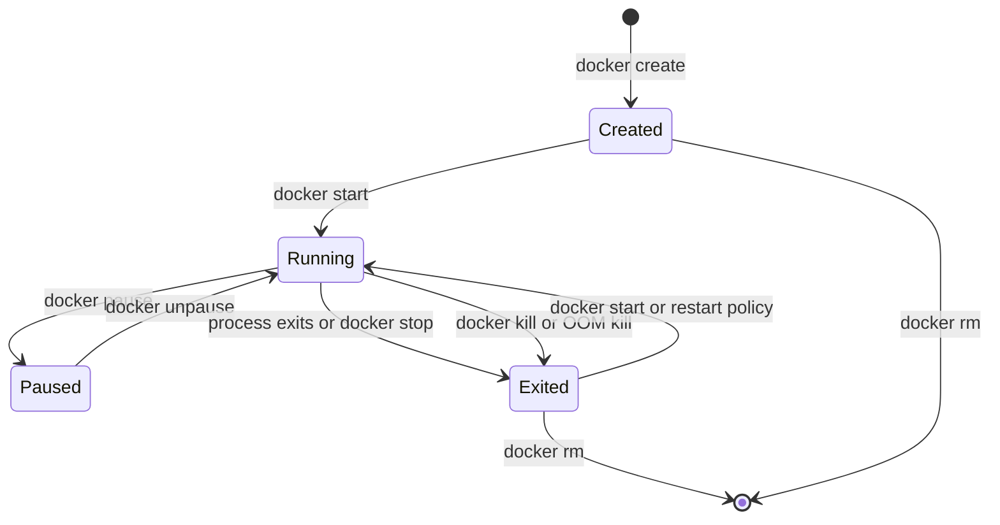

## 26.10 Container lifecycle, logs and resource limits

#### Concept

A container moves through a small set of states: created, running, paused, stopped (exited), removed. Docker commands map directly onto them. While running, the container writes logs to stdout and stderr, which the runtime captures, and it lives inside cgroup limits for memory and CPU. Node.js does not automatically size itself to those limits, so a senior engineer sets the V8 heap explicitly and understands what the kernel does when the limit is crossed.

#### Why does it exist?

Orchestrators need a predictable state machine to reason about: "is it running, did it exit cleanly, should I restart it". Operators need logs without SSH-ing into containers. And the whole point of packing 30 containers on a node is that one runaway process cannot take the node down; that requires hard limits, and hard limits require the application to know about them.

#### Mental model

Imagine a conference room booking. Created is the booking; running is the meeting; stopped is the meeting ended; removed is the booking deleted. The room has a maximum occupancy (memory limit): one more person and the fire marshal ends the meeting immediately, no discussion. The room also has a time-sharing agreement with other rooms for the projector (CPU quota): you get 50% of the projector time per minute, and when you have used your 30 seconds you wait, even if the projector is idle.

#### How it works



The commands and what they send:

| Command | What happens | Signal | Exit code seen |
|---|---|---|---|
| `docker create` | Allocates the container (filesystem, config) without starting | none | n/a |
| `docker start` | Starts PID 1 | none | n/a |
| `docker stop` | `SIGTERM`, wait grace period (default 10 s, `-t N`), then `SIGKILL` | `SIGTERM` then `SIGKILL` | 143 if handled, 137 if killed, or the app's own code |
| `docker kill` | Immediate `SIGKILL` (or `--signal`) | `SIGKILL` | 137 |
| `docker restart` | stop then start | as stop | as stop |
| `docker rm` | Removes a stopped container and its writable layer (`-f` kills first) | n/a | n/a |
| `docker pause` | Freezes all processes via the freezer cgroup | none | n/a |

Logs: the container runtime captures stdout and stderr. Docker's default `json-file` driver writes them to `/var/lib/docker/containers/<id>/<id>-json.log` (unbounded unless you set `max-size` and `max-file`). `docker logs -f --since 10m orders-api` reads them. Your application should write structured JSON lines to stdout and nothing to files. In Kubernetes the same stream is read by a log agent (Fluent Bit) and shipped to Loki, Elasticsearch or CloudWatch.

One subtle point: on Linux, Node writes to a pipe stdout synchronously. If the process reading the other end (the Docker logging driver) is blocked, `console.log` blocks the event loop. Docker's `--log-opt mode=non-blocking --log-opt max-buffer-size=4m` buffers in the driver and drops on overflow instead of stalling your service.

Resource limits and what Node sees:

1. `--memory=512m` sets `memory.max` in the cgroup. The kernel counts everything the process touches: V8 heap, native buffers, code, stack, page cache for files it reads. When usage exceeds the limit, the OOM killer sends `SIGKILL`. Exit code 137, `OOMKilled: true`. No warning, no log line from Node.
2. `--cpus=1.5` sets `cpu.max` to 150,000 microseconds per 100,000 microsecond period. Node's main thread can use at most 1 CPU anyway, but libuv's thread pool (4 threads by default: DNS, `fs`, `crypto.pbkdf2`, `zlib`) and V8's garbage collector helper threads can use the rest. When the quota is exhausted the whole container is throttled until the next period, which appears as latency spikes of up to 100 ms with no CPU-bound work visible in the profile.
3. `--pids-limit=256` prevents fork bombs and zombie accumulation.

Node's default heap limit is derived from the memory it believes is available. Newer Node versions consult the cgroup limit when computing that default, but the result is still a heuristic (roughly a quarter to a half of "available" memory, with caps) and not tuned to your container. Set it explicitly:

```dockerfile
# Container limit is 512 MB; leave ~25% for native memory, buffers and the code cache
ENV NODE_OPTIONS="--max-old-space-size=384"
```

The rule of thumb: `--max-old-space-size` at 70 to 80% of the container memory limit for a typical API; lower (60%) if the service handles large Buffers (file uploads, image processing) because those live outside the V8 heap. If the heap limit is *higher* than the container limit, V8 happily grows past the cgroup line and the kernel kills the process before V8 ever runs a full GC to reclaim space. If the heap limit is much *lower* than needed, V8 throws `FATAL ERROR: Reached heap limit Allocation failed` and exits with code 134, which at least leaves a log line.

To read the real limit at run time:

```ts
// src/runtime/cgroup.ts
import { readFileSync } from 'node:fs';

export function containerMemoryLimitBytes(): number | undefined {
  try {
    const raw = readFileSync('/sys/fs/cgroup/memory.max', 'utf8').trim(); // cgroup v2
    return raw === 'max' ? undefined : Number(raw);
  } catch {
    return undefined; // not in a container, or cgroup v1
  }
}
```

#### Practical example

The orders API runs with `--memory=512m --cpus=1`. Steady-state heap is 120 MB; RSS is 210 MB. A Prometheus gauge from `process.memoryUsage()` exports `heapUsed`, `rss` and `external` so the team can see headroom. When a report endpoint pushes RSS to 480 MB the dashboard shows it before the kernel does, and the alert "rss above 85% of limit for 5 minutes" fires first.

#### NestJS example

A small interceptor-free health signal for memory pressure, wired into Terminus so readiness can go false before the OOM killer acts:

```ts
// src/health/memory-pressure.indicator.ts
import { Injectable } from '@nestjs/common';
import { HealthIndicatorResult } from '@nestjs/terminus';
import { containerMemoryLimitBytes } from '../runtime/cgroup';

@Injectable()
export class MemoryPressureIndicator {
  private readonly limit = containerMemoryLimitBytes();

  // Returns a Terminus-compatible result; used as () => indicator.check('memory')
  async check(key: string): Promise<HealthIndicatorResult> {
    const rss = process.memoryUsage().rss;
    const ratio = this.limit ? rss / this.limit : 0;
    const healthy = ratio < 0.9;
    return {
      [key]: {
        status: healthy ? 'up' : 'down',
        rssMb: Math.round(rss / 1_048_576),
        limitMb: this.limit ? Math.round(this.limit / 1_048_576) : null,
      },
    };
  }
}
```

Marking the pod unready at 90% lets the load balancer shift traffic away and gives the process a chance to recover, instead of dying mid-request.

#### Production scenario

A payments service on Kubernetes has `limits.memory: 768Mi` and `NODE_OPTIONS=--max-old-space-size=576`. Over a quarter, its OOMKilled count is zero; before the flag was set, the same service was killed 3 to 5 times a week during end-of-month batch traffic, each time dropping 20 to 40 in-flight requests. CPU is requested at `500m` with no limit, so the garbage collector can burst during peaks without throttling; p99 latency fell from 340 ms to 190 ms when the CPU limit was removed (see Part 27 for the requests-versus-limits discussion).

#### Failure scenario

At 02:14 the on-call is paged for `inventory-sync` restarting. `docker inspect --format '{{.State.OOMKilled}} {{.State.ExitCode}}'` prints `true 137`. The container had `--memory=256m` and no `--max-old-space-size`. Node, believing it had the host's 32 GB available, let the heap grow to 300 MB while parsing a 40 MB supplier feed with `JSON.parse` on the full string. The kernel killed it at 256 MB, before V8 had run a major GC. The fix was three parts: `--max-old-space-size=192`, streaming the feed with a SAX-style parser, and an alert on RSS ratio. The heap limit alone would have converted the silent kill into an explicit `heap out of memory` error with a stack trace, which is worth a lot at 2 a.m.

#### Edge cases & failure modes

- **Page cache counts.** Reading a 300 MB file counts toward the memory cgroup as page cache; the kernel reclaims it under pressure, but a tight limit plus large file I/O can still trigger OOM.
- **Worker threads and child processes** share the cgroup; a `worker_threads` pool with 4 workers each with a 200 MB heap needs a limit sized for all of them.
- **CPU throttling without CPU-bound code.** GC and the libuv pool consume quota; throttling manifests as p99 spikes. Check `nr_throttled` in `cpu.stat`.
- **`docker stop` grace of 10 s** is shorter than many drain sequences; pass `-t 30` or configure the orchestrator.
- **Logs filling the disk.** `json-file` without rotation on a busy service writes gigabytes; set `max-size=50m max-file=5` in the daemon config.
- **Paused containers** still hold memory and connections; PostgreSQL sees the sessions as idle.
- **Exit code 0 on failure.** A worker that catches all errors and exits 0 never triggers `on-failure` restarts; exit non-zero on unrecoverable errors.

#### How a Senior Backend Engineer thinks about this

They set memory limits *and* the heap flag together, always, in the base image or the deployment template so nobody can forget one. They export process memory metrics and alert on ratio-to-limit, so the team sees pressure minutes before the kernel acts. They keep stdout as the only log destination. And they check `OOMKilled` and the exit code before reading a single line of application logs, because the kernel's verdict is the ground truth.

#### Common mistakes

- Memory limit with no `--max-old-space-size`.
- Heap flag larger than the container limit.
- Logging to files inside the container.
- `docker rm -f` in scripts, guaranteeing an unclean stop.
- Ignoring restart counts because "it comes back up".

#### Interview questions

1. *Your container has a 512 MB limit and no Node flags. What can go wrong and how do you fix it?* Expected: V8 may grow past the limit and get `SIGKILL`ed with no log; set `--max-old-space-size` to ~75% and monitor RSS.
2. *What is the difference between exit codes 134, 137 and 143?* Expected: V8 heap OOM abort, `SIGKILL` (cgroup OOM or forced stop), `SIGTERM`.
3. *Why can a container with a CPU limit show latency spikes when the CPU is not busy?* Expected: CFS quota throttling within 100 ms periods; GC and thread pool consume quota.
4. *Where should a containerised service write logs and why?* Expected: stdout/stderr; runtime captures; agents ship; no disk growth; no rotation logic in the app.

#### Practical exercise

Run the orders API with `--memory=256m` and a request that builds a 300 MB array. Observe the kill with `docker inspect` and `dmesg` (or `docker events`). Add `--max-old-space-size=192` and observe the V8 error instead. Add a `/metrics` gauge for RSS and a readiness check at 90%. Acceptance criteria: the process fails with a logged heap error rather than a silent 137, the readiness endpoint returns 503 before the crash, and `docker logs` shows structured JSON with no writes to the container filesystem.

## 26.11 Container security

#### Concept

Container security is a set of layered defaults that limit what an attacker gains if your application is compromised: the process runs as an unprivileged user, on a read-only filesystem, with no Linux capabilities it does not need, from an image that contains no secrets and as few packages as possible, scanned for known vulnerabilities, with a record of what is inside (SBOM) and a signature proving who built it.

#### Why does it exist?

A NestJS API has a large attack surface: HTTP parsing, JSON, dozens of dependencies, database drivers. Remote code execution vulnerabilities in the Node ecosystem appear every year. When one is exploited, the question is what the attacker can do next. Root inside a container with all capabilities on a node with a kernel bug is root on the node and, from there, on the cluster. A non-root process on a read-only filesystem with dropped capabilities can do very little beyond what the application itself could do. Image scanning and minimal bases reduce the number of exploitable holes in the first place.

#### Mental model

Imagine the difference between a hotel guest and a hotel manager. Both are inside the building. A guest has a key to one room, cannot enter the kitchen, cannot change the locks, cannot access the safe. A manager can do all of that. If a thief steals a guest's key, they get a room. If they steal the manager's, they get the hotel. Run your application as a guest.

#### How it works

The layers, from the image up:

1. **Minimal base.** Fewer packages, fewer CVEs. Alpine, slim or distroless (26.2). No `curl`, `wget`, compilers or package managers in the runtime image.
2. **Non-root user.** `USER node` in the Dockerfile. Verify with `docker run --rm image id -u` printing `1000`. In Kubernetes, enforce with `runAsNonRoot: true`.
3. **Read-only root filesystem.** `docker run --read-only --tmpfs /tmp` or Kubernetes `readOnlyRootFilesystem: true`. An attacker cannot drop a binary, modify `dist`, or persist. Your app needs explicit writable paths (`/tmp` for uploads in flight, a cache dir if any).
4. **Drop capabilities.** `--cap-drop=ALL`. A Node API binding to port 3000 needs none. If you must bind to port 80 as non-root, use `--cap-add=NET_BIND_SERVICE` or, better, bind to 3000 and let the load balancer handle 80/443.
5. **No privilege escalation.** `--security-opt=no-new-privileges` so setuid binaries cannot elevate.
6. **Seccomp and AppArmor defaults.** Keep Docker's default seccomp profile; never `--privileged`.
7. **No secrets in layers.** Secrets arrive at run time (26.9). Build secrets use `RUN --mount=type=secret`. Scan images for accidental secrets with `trivy image --scanners secret`.
8. **Vulnerability scanning.** Trivy or Grype in CI on every build, failing on high/critical with a fix available:

```bash
trivy image --severity HIGH,CRITICAL --ignore-unfixed --exit-code 1 \
  registry.internal/orders-api:sha-3f9a1c2
```

9. **Keep bases fresh.** A pinned digest is reproducible but ages. Rebuild weekly against the newest upstream digest, scan, and roll out. Dependabot or Renovate can bump the `FROM` digest automatically.
10. **SBOM.** A Software Bill of Materials lists every package in the image so that when the next `openssl` or `undici` CVE lands you can answer "which of our 60 images are affected" in seconds instead of rebuilding everything to find out. BuildKit can attach one at build time (`docker buildx build --sbom=true --provenance=true`), or generate it with `syft`.
11. **Signing.** `cosign` signs the image digest with a key or, in CI, with a short-lived keyless certificate tied to the GitHub Actions identity. The cluster's admission controller (Kyverno, Sigstore policy-controller) refuses to run unsigned images. This closes the "someone pushed a tag from a laptop" hole.

Run-time flags for a hardened container, all together:

```bash
docker run -d --name orders-api \
  --read-only --tmpfs /tmp:rw,noexec,nosuid,size=64m \
  --cap-drop=ALL \
  --security-opt=no-new-privileges \
  --memory=512m --cpus=1 --pids-limit=256 \
  --user 1000:1000 \
  -e NODE_OPTIONS=--max-old-space-size=384 \
  -p 3000:3000 \
  registry.internal/orders-api@sha256:9f3c...
```

#### Practical example

Your CI pipeline for `orders-api`: build (multi-stage, non-root, pinned base), `trivy image` gate, `syft` SBOM attached to the release, `cosign sign` keyless, push by digest. Kubernetes admission policy: only images from `registry.internal` with a valid signature, `runAsNonRoot`, `readOnlyRootFilesystem`, `capabilities.drop: [ALL]`. A pull request that adds `USER root` is rejected by `hadolint` before a human sees it.

#### NestJS example

Applications must cooperate with a read-only filesystem. The usual offenders are libraries writing caches or temp files. Make writable paths explicit and configurable:

```ts
// src/uploads/multer.config.ts
import { diskStorage } from 'multer';
import { mkdirSync } from 'node:fs';

// /tmp is a tmpfs mount; everything else is read-only
const tmpDir = process.env.UPLOAD_TMP_DIR ?? '/tmp/uploads';
mkdirSync(tmpDir, { recursive: true });

export const multerOptions = {
  storage: diskStorage({ destination: tmpDir }),
  limits: { fileSize: 10 * 1024 * 1024, files: 1 }, // 10 MB, one file per request
};
```

And a startup self-check that fails fast if the process is unexpectedly root:

```ts
// src/main.ts (excerpt, before NestFactory.create)
if (process.env.NODE_ENV === 'production' && process.getuid?.() === 0) {
  console.error('Refusing to start as root in production');
  process.exit(1);
}
```

#### PostgreSQL example

Least privilege extends to the database. The API's role should own nothing it does not need:

```sql
-- Migrations run as the owner role; the API runs as a restricted role
CREATE ROLE orders_migrator LOGIN PASSWORD '...';
CREATE ROLE orders_api LOGIN PASSWORD '...';

ALTER SCHEMA public OWNER TO orders_migrator;
GRANT USAGE ON SCHEMA public TO orders_api;
GRANT SELECT, INSERT, UPDATE, DELETE ON ALL TABLES IN SCHEMA public TO orders_api;
ALTER DEFAULT PRIVILEGES FOR ROLE orders_migrator IN SCHEMA public
  GRANT SELECT, INSERT, UPDATE, DELETE ON TABLES TO orders_api;

-- No DDL, no superuser, no COPY to files for the API role
REVOKE CREATE ON SCHEMA public FROM orders_api;
ALTER ROLE orders_api SET statement_timeout = '10s';
```

A compromised API container can then read and write order rows, but cannot drop tables, read `pg_authid`, or write to the server's filesystem.

#### Production scenario

A fintech runs 80 services with the hardened defaults above. In a year, Trivy blocked 140 builds, most fixed by bumping a dependency the same day. During a widely reported `undici` vulnerability, the SBOM index answered "23 images affected" in under a minute and all were rebuilt within 3 hours. A penetration test that achieved code execution through a deserialisation bug in one service reported "contained: non-root, read-only filesystem, no lateral movement possible", which is the sentence you want in that report.

#### Failure scenario

An e-commerce company ran its catalogue API as root with a writable filesystem. A vulnerable image-processing library allowed a crafted PNG to execute a shell command. The attacker wrote a crypto miner to `/usr/local/bin`, used `CAP_NET_RAW` to scan the pod network, found a Redis with no password, and read session tokens. Detection took 9 days, by which time the cloud bill had doubled. Every step after the initial exploit would have been blocked by non-root, read-only filesystem, dropped capabilities, and a Redis password. The initial exploit would have been blocked by the Trivy gate; the CVE had been public for 3 weeks.

#### Edge cases & failure modes

- **Read-only breaks libraries** that write caches (`sharp`, some font libraries, `npm` itself). Find them in staging with `--read-only`; give them a tmpfs.
- **Non-root cannot bind below 1024.** Bind to 3000; do not add capabilities.
- **Scanner noise.** Unfixed CVEs in the base OS produce permanent findings; use `--ignore-unfixed` and a reviewed `.trivyignore` with expiry dates.
- **Secrets in build logs.** `echo $NPM_TOKEN` in a `RUN` line prints it into CI logs; use secret mounts and never echo.
- **Signing without verification** is theatre; the admission controller must enforce it.
- **Base image republished with the same tag** silently reintroduces an old vulnerability; the digest pin plus scheduled rebuild handles it.
- **`docker.sock` mounted into a container** (for CI-in-Docker) grants root on the host; use rootless builders or Kaniko/BuildKit in a dedicated runner.

#### How a Senior Backend Engineer thinks about this

They assume the application will be compromised eventually and design the blast radius to be small. They make the secure path the default path: a base image and deployment template that are already hardened, with linting and admission policy to keep it that way, so that a developer would have to work hard to be insecure. They measure "time from CVE publication to all images rebuilt" as a team metric. And they keep humans out of the push path: images come from CI, signed, or they do not run.

#### Common mistakes

- `USER root` to fix a permission error.
- `--privileged` or mounting `/var/run/docker.sock` in application containers.
- Scanning only once, at project creation.
- Treating a scanner pass as "secure" while running with all capabilities and a writable filesystem.
- Sharing one database superuser between migrations and the API.

#### Interview questions

1. *Name six hardening measures for a container running a Node API and what each prevents.* Expected: non-root (privilege), read-only fs (persistence), cap-drop (kernel-level abuse), no secrets in layers (credential theft), minimal base plus scanning (fewer exploitable CVEs), signing plus admission policy (supply chain).
2. *What is an SBOM and when does it pay off?* Expected: inventory of packages per image; answers "which images contain X" instantly when a CVE lands.
3. *Why is "root inside a container" dangerous when namespaces exist?* Expected: no user namespace by default, kernel exploits, mounted sockets and volumes; uid 0 is uid 0 on the host.
4. *How do you use a private npm token during `docker build` without leaking it?* Expected: BuildKit `--mount=type=secret`; never `ARG`/`ENV`; verify with `docker history`.
5. *What does image signing protect against and what does it not?* Expected: unauthorised or tampered images reaching the cluster; not vulnerabilities in legitimately built images.

#### Practical exercise

Harden the orders API image and run it with `--read-only --cap-drop=ALL --security-opt=no-new-privileges --user 1000:1000`. Fix every failure (writable paths, port binding). Add a Trivy gate and generate an SBOM with `syft`. Acceptance criteria: the container serves traffic and passes health checks under all flags, `trivy image --severity HIGH,CRITICAL --ignore-unfixed` returns zero findings, the SBOM lists `@nestjs/core` with its exact version, and `docker history` shows no secret values.
