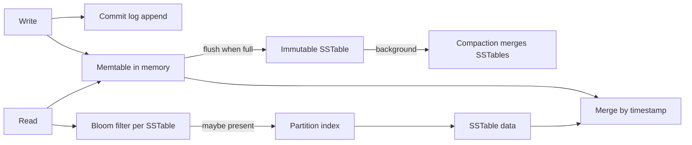

## 26.8 DynamoDB in practice: single-table design, GSIs, transactions and capacity

26.3 explained the DynamoDB mindset. This section builds a real table for an e-commerce order domain with the AWS SDK v3 inside NestJS, then does the capacity arithmetic and shows the hot-partition failure up close. The trip-history worked example in 26.11 applies the same method to a second domain.

### 26.8.1 From access patterns to keys

#### Concept

In DynamoDB the **access-pattern list is the schema**. You write every read and write the application performs, then choose a partition key (`PK`), a sort key (`SK`) and a few Global Secondary Indexes so that each pattern is one `GetItem` or one `Query`. Two techniques make one table serve many patterns: **GSI overloading** (one generic GSI whose key attributes mean different things for different item types) and **sparse GSIs** (only items that carry the GSI key attribute appear in the index).

#### Why does it exist?

DynamoDB has no joins and no query planner. A pattern that does not map to a key becomes a `Scan`, which reads and bills the whole table. Designing keys from the access list is the only way to keep every request at single-digit milliseconds no matter how large the table grows.

#### Mental model

Imagine a warehouse where every box must be labelled before it goes on a shelf, and the label is the only way to find it again. You decide the labels by asking the pickers, before opening day, exactly which questions they will ask. A GSI is a second set of labels on the same boxes, printed for a different team of pickers.

#### How it works — the access-pattern table

| # | Access pattern | Operation | Key condition |
|---|---|---|---|
| 1 | Get customer profile | `GetItem` | `PK = CUST#<id>`, `SK = PROFILE` |
| 2 | Customer's orders, newest first, 20 per page | `Query` | `PK = CUST#<id>`, `SK begins_with ORDER#`, `ScanIndexForward = false` |
| 3 | Get one order with its items | `Query` | `PK = ORDER#<id>` (header `META` + `ITEM#<sku>` rows) |
| 4 | Pending orders older than 30 minutes (ops alert) | `Query` on GSI1 | `GSI1PK = PENDING#<shard>`, `GSI1SK < <iso time>` |
| 5 | Order by payment-provider id (webhooks) | `Query` on GSI2 | `GSI2PK = PAY#<paymentId>` |

```text
PK              SK                                GSI1PK        GSI1SK                 GSI2PK
CUST#c_7        PROFILE                           -             -                      -
CUST#c_7        ORDER#2026-11-05T09:12:44Z#o_91   -             -                      -
ORDER#o_91      META                              PENDING#3     2026-11-05T09:12:44Z   PAY#pi_3Px
ORDER#o_91      ITEM#SKU-123                      -             -                      -
ORDER#o_91      ITEM#SKU-456                      -             -                      -
```

Three choices to notice. The order summary is **duplicated** under the customer partition (pattern 2) and the full order lives under its own partition (pattern 3): denormalization is the price of no joins. GSI1 is **sparse**: only pending order headers carry `GSI1PK`, and the attribute is removed when the order is paid, so the index stays tiny. And GSI1 is **write-sharded** (`PENDING#0` to `PENDING#9`), because a single `PENDING` key would put every new order on one partition.

#### NestJS example

```ts
// dynamo.provider.ts -- one DocumentClient for the app
import { DynamoDBClient } from '@aws-sdk/client-dynamodb';
import { DynamoDBDocumentClient } from '@aws-sdk/lib-dynamodb';

export const DYNAMO = Symbol('DYNAMO');
export const dynamoProvider = {
  provide: DYNAMO,
  useFactory: () =>
    DynamoDBDocumentClient.from(
      new DynamoDBClient({ region: process.env.AWS_REGION, maxAttempts: 4 }),   // SDK retries throttles with backoff
      { marshallOptions: { removeUndefinedValues: true } },
    ),
};
```

```ts
// orders.dynamo-repository.ts -- patterns 2 and 3, with real pagination
import { Inject, Injectable } from '@nestjs/common';
import { DynamoDBDocumentClient, QueryCommand } from '@aws-sdk/lib-dynamodb';

@Injectable()
export class OrdersDynamoRepository {
  private readonly table = process.env.ORDERS_TABLE!;
  constructor(@Inject(DYNAMO) private readonly db: DynamoDBDocumentClient) {}

  async customerOrders(customerId: string, cursor?: string) {
    const out = await this.db.send(new QueryCommand({
      TableName: this.table,
      KeyConditionExpression: 'PK = :pk AND begins_with(SK, :prefix)',
      ExpressionAttributeValues: { ':pk': `CUST#${customerId}`, ':prefix': 'ORDER#' },
      ScanIndexForward: false,                       // newest first: SK starts with an ISO timestamp
      Limit: 20,
      ExclusiveStartKey: cursor ? JSON.parse(Buffer.from(cursor, 'base64url').toString()) : undefined,
    }));
    return {
      items: out.Items ?? [],
      nextCursor: out.LastEvaluatedKey             // absent on the last page
        ? Buffer.from(JSON.stringify(out.LastEvaluatedKey)).toString('base64url')
        : null,
    };
  }

  async orderWithItems(orderId: string) {
    const out = await this.db.send(new QueryCommand({
      TableName: this.table,
      KeyConditionExpression: 'PK = :pk',
      ExpressionAttributeValues: { ':pk': `ORDER#${orderId}` },
      ConsistentRead: true,                          // read-your-write after checkout (2x the read cost)
    }));
    const header = out.Items?.find((i) => i.SK === 'META');
    return header ? { ...header, items: out.Items!.filter((i) => i.SK.startsWith('ITEM#')) } : null;
  }
}
```

`LastEvaluatedKey` is the cursor. A `Query` returns at most 1 MB per call, so even without `Limit` a large partition comes back in pages, and code that ignores the cursor silently truncates. `ConsistentRead` works on the base table only; GSIs are always eventually consistent.

#### Edge cases & failure modes

- **Filter expressions** run after the read: a `FilterExpression` that discards 95% of a page still bills the full page.
- **Duplicated summaries drift**: updating order status must update both the `ORDER#` header and the `CUST#` summary, in one transaction (26.8.2) or via Streams.
- **Opaque cursors**: encode `LastEvaluatedKey`, never expose raw keys that leak other customers' ids.
- **A new access pattern**: needs a new GSI (built online, with a backfill phase you must wait for) or a new item type written by a backfill job.

### 26.8.2 Transactions, capacity and hot partitions

#### Concept

`TransactWriteItems` writes up to 100 items atomically, with conditions. **Capacity** is measured in units: 1 **WCU** is one write per second of an item up to 1 KB; 1 **RCU** is one strongly consistent read per second of up to 4 KB, or two eventually consistent ones. Transactions cost double. Each physical partition serves at most about **3,000 RCU and 1,000 WCU** and holds about 10 GB.

#### Why does it exist?

Single-item writes are atomic, but placing an order touches the order header, its items, the customer summary and stock. Without a transaction a crash leaves half an order. And without the capacity arithmetic you cannot predict either your bill or the point where one key starts to throttle.

#### Mental model

Imagine a toll road with many booths (partitions). The road's total capacity is enormous, but each booth processes at most 1,000 cars a second. If every car is labelled for booth 7, booth 7 jams while the others are empty. Adding lanes to the road (more table capacity) does not help; you must spread the labels.

#### How it works

1. Conditions (`ConditionExpression`) make writes safe: `attribute_not_exists(PK)` for "create only", `available >= :qty` for stock.
2. If any condition in a transaction fails, nothing is written and the error lists which item failed.
3. `ClientRequestToken` makes a transaction idempotent for 10 minutes: a retried request with the same token does not apply twice.
4. On-demand mode bills per request and absorbs spikes up to double the previous peak instantly; provisioned mode bills per hour for set capacity, with auto scaling that reacts in minutes, not seconds.
5. Adaptive capacity moves throughput toward hot partitions and can isolate a hot item, but nothing lets one partition key exceed about 1,000 WCU.

#### NestJS example

```ts
// place-order.dynamo.ts -- order, items, customer summary and stock in one transaction
import { TransactWriteCommand } from '@aws-sdk/lib-dynamodb';
import { TransactionCanceledException } from '@aws-sdk/client-dynamodb';

async placeOrder(o: NewOrder, idempotencyKey: string) {
  const now = new Date().toISOString();
  try {
    await this.db.send(new TransactWriteCommand({
      ClientRequestToken: idempotencyKey,               // same key within 10 minutes = no double order
      TransactItems: [
        { Put: { TableName: this.table, ConditionExpression: 'attribute_not_exists(PK)',
            Item: { PK: `ORDER#${o.id}`, SK: 'META', status: 'pending', totalCents: o.totalCents,
                    GSI1PK: `PENDING#${shardOf(o.id, 10)}`, GSI1SK: now, GSI2PK: `PAY#${o.paymentId}` } } },
        { Put: { TableName: this.table,
            Item: { PK: `CUST#${o.customerId}`, SK: `ORDER#${now}#${o.id}`, status: 'pending', totalCents: o.totalCents } } },
        ...o.items.map((i) => ({ Put: { TableName: this.table,
            Item: { PK: `ORDER#${o.id}`, SK: `ITEM#${i.sku}`, quantity: i.quantity, unitCents: i.unitCents } } })),
        ...o.items.map((i) => ({ Update: { TableName: this.table,
            Key: { PK: `STOCK#${i.sku}`, SK: 'STOCK' },
            UpdateExpression: 'SET available = available - :q',
            ConditionExpression: 'available >= :q',      // never oversell
            ExpressionAttributeValues: { ':q': i.quantity } } })),
      ],
    }));
  } catch (err) {
    if (err instanceof TransactionCanceledException) {
      // CancellationReasons is index-aligned with TransactItems: find which condition failed
      throw new ConflictException({ reasons: err.CancellationReasons?.map((r) => r.Code) });
    }
    throw err;
  }
}
```

`shardOf` is a stable hash of the order id modulo 10; the ops job that lists pending orders runs ten `Query` calls in parallel (`PENDING#0` to `PENDING#9`) and merges them. That is the read-side cost of write sharding.

#### Production scenario — the capacity arithmetic

A peak of 800 orders per second, each with 3 items averaging 1.4 KB:

```text
Writes per order: 1 header + 1 summary + 3 items + 3 stock updates = 8 items
Each item 1.4 KB -> rounds up to 2 WCU      (stock rows are tiny: 1 WCU)
Per order: (5 x 2) + (3 x 1) = 13 WCU, doubled for a transaction = 26 WCU
Peak: 800 x 26 = 20,800 WCU/s    Average (200 orders/s): 5,200 WCU/s

Monthly cost at the average (us-east-1 list prices at time of writing; check the pricing page):
  On-demand:   5,200 x 2.63M s = 13.7 billion write units x $0.625 per million  ~= $8,550
  Provisioned: sized for peak with auto scaling, mean ~9,000 WCU x 730 h x $0.00065 ~= $4,270
```

On-demand costs about twice as much here but needs no capacity planning. Teams commonly launch on on-demand, learn the traffic shape for a few months, then switch steady tables to provisioned with auto scaling. Notice also what drives the bill: item size rounded up per KB, and the transaction multiplier. Trimming the summary item from 1.4 KB to 0.9 KB saves 1 WCU per order on that item alone.

#### Failure scenario

At 00:00:05 on 11 November, the start of a flash sale, checkout error rates went from 0.1% to 34%. CloudWatch showed the table at 18% of its capacity, yet `ProvisionedThroughputExceededException` was firing constantly. The culprit was a "units sold" counter for the sale banner: every order did `UpdateItem ... ADD sold :q` on the single item `PK = SALE#2026-11-11`. All 2,600 orders per second hit one partition key, far beyond its ~1,000 WCU ceiling, and because the counter update was inside the checkout transaction, the whole transaction failed. The SDK's retries tripled the load on that key. Mitigation at 00:09: remove the counter from the transaction (the banner could be a few seconds stale). Permanent fix: 20 sharded counter items (`SALE#2026-11-11#0..19`) updated asynchronously from DynamoDB Streams and summed on read with one `BatchGetCommand`. Lesson: table-level capacity tells you nothing about a single key. Look at the CloudWatch Contributor Insights "most throttled keys" report, and never put a global counter on the write path.

#### Edge cases & failure modes

- **GSI throttling back-pressures the base table**: an under-provisioned GSI throttles writes to the table itself.
- **Transactions conflict** with concurrent writes to the same item and fail with `TransactionConflict`; retry with jitter.
- **Limits**: 100 items and 4 MB per transaction, 400 KB per item, 25 items per `BatchWriteItem`, 100 keys per `BatchGetItem`; batch calls return `UnprocessedItems` / `UnprocessedKeys` that you must retry.
- **TTL deletes are not immediate** (typically within a few days of expiry); filter expired items on read.
- **Streams** keep records for 24 hours; a consumer down longer than that loses changes.

#### How a Senior Backend Engineer thinks about this

A senior does the capacity arithmetic before launch, per key and not just per table. They keep transactions for the flows that truly need atomicity, use conditions and `ClientRequestToken` for idempotency, move counters and aggregates off the hot path to Streams consumers, and watch throttling per key. They pick on-demand to learn and provisioned to save, and they write down the access patterns so the next engineer knows which ones the table does not support.

#### Common mistakes

- Treating table capacity as the limit and ignoring the per-key ceiling.
- Global counters or "latest" items updated by every request.
- Ignoring `UnprocessedItems` from batch writes.
- Large items written often: cost scales with whole-item size on every update.

#### Interview questions

1. **Your table uses 18% of its capacity but you see throttling. Why?**
   - *Expected answer:* A hot partition key: one key is taking more than a partition can serve (~1,000 WCU / 3,000 RCU). Find it with Contributor Insights, then shard the key, cache or move the write off the hot path.
   - *Why it matters:* it is the signature DynamoDB incident, and adding capacity does not fix it.
   - *Follow-ups:* How do you read a write-sharded key? What does adaptive capacity do and not do? Can a GSI cause it?
2. **How many WCU does a transactional write of a 2.5 KB item cost?** 3 WCU for the size, doubled for the transaction: 6 WCU.
3. **How do you make `TransactWriteItems` safe to retry?** Pass a `ClientRequestToken` (idempotent for 10 minutes) and use conditions such as `attribute_not_exists(PK)` so a duplicate cannot apply twice.
4. **What is a sparse GSI and why is it useful?** An index on an attribute only some items have; only those items appear, so "pending orders" stays a small, cheap index.

#### Practical exercise

Create the table and GSIs with DynamoDB Local, implement patterns 1-5 and `placeOrder`, then load-test a global counter and the sharded version. Acceptance criteria: no pattern uses `Scan`, a duplicate `placeOrder` with the same token creates one order, stock never goes negative, and the sharded counter sustains a write rate the single counter cannot.

## 26.9 Cassandra in practice: write path, read path, compaction and consistency

#### Concept

26.4 introduced Cassandra's model and its tombstone trap. Running it well means understanding three mechanisms: how a write becomes durable, how a read finds data across many immutable files, and how replication and consistency levels decide what "acknowledged" means.

#### How it works — write and read paths



1. A write is appended to the commit log (sequential, fast) and applied to the memtable; that is all a write costs, which is why Cassandra writes are cheap.
2. Full memtables flush to immutable **SSTables**.
3. A read checks the memtable, then each SSTable's **Bloom filter** (a compact structure that says "definitely not here" or "maybe here"), then the partition index, then the data, and merges versions by write timestamp.
4. The more SSTables a partition is spread over, the slower the read; **compaction** merges them and drops overwritten data and expired tombstones.

| Compaction strategy | How it works | Use when |
|---|---|---|
| SizeTiered (STCS, default) | Merges SSTables of similar size | Write-heavy, few reads, mixed data |
| Leveled (LCS) | Keeps data in levels with few overlaps | Read-heavy, updates to the same rows |
| TimeWindow (TWCS) | One SSTable per time window, dropped whole when expired | Time-series with TTL, append-only |

Consistency: with replication factor `RF` per data center, a write at `LOCAL_QUORUM` waits for `floor(RF/2) + 1` local replicas. If read replicas `R` plus write replicas `W` exceed `RF` (2 + 2 > 3), every read overlaps the latest write: strong consistency within the data center, while still tolerating one node down.

#### NestJS example

```sql
-- CQL: keyspace replicated 3x in each of two data centers; TWCS for TTL'd telemetry
CREATE KEYSPACE telemetry
  WITH replication = {'class': 'NetworkTopologyStrategy', 'eu_west': 3, 'ap_south': 3};

ALTER TABLE telemetry.readings_by_device
  WITH compaction = {'class': 'TimeWindowCompactionStrategy',
                     'compaction_window_unit': 'DAYS', 'compaction_window_size': 1}
   AND default_time_to_live = 2592000;   -- 30 days; whole SSTables expire together under TWCS
```

```ts
// cassandra.provider.ts + readings.repository.ts -- prepared statements, explicit consistency
import { Injectable, OnApplicationShutdown } from '@nestjs/common';
import { Client, types } from 'cassandra-driver';

@Injectable()
export class ReadingsRepository implements OnApplicationShutdown {
  private readonly client = new Client({
    contactPoints: process.env.CASSANDRA_HOSTS!.split(','),
    localDataCenter: 'eu_west',                       // route to local replicas only
    keyspace: 'telemetry',
  });

  async insert(r: { deviceId: string; at: Date; temperature: number }) {
    const day = r.at.toISOString().slice(0, 10);       // the time bucket in the partition key
    await this.client.execute(
      'INSERT INTO readings_by_device (device_id, day, reading_at, temperature) VALUES (?, ?, ?, ?)',
      [r.deviceId, day, r.at, r.temperature],
      { prepare: true, consistency: types.consistencies.localQuorum },
    );
  }

  async lastHour(deviceId: string) {
    const since = new Date(Date.now() - 3_600_000);
    const res = await this.client.execute(
      'SELECT reading_at, temperature FROM readings_by_device WHERE device_id = ? AND day = ? AND reading_at > ?',
      [deviceId, since.toISOString().slice(0, 10), since],   // an hour spanning midnight needs two buckets
      { prepare: true, consistency: types.consistencies.localQuorum },
    );
    return res.rows;
  }

  async onApplicationShutdown() { await this.client.shutdown(); }
}
```

#### Production scenario

The 9-node GPS cluster from 26.4 runs TWCS with daily windows and a 30-day TTL: each day's SSTables expire as whole files, so compaction does almost no work on old data and disk stays flat at about 1.8 TB per node. Monitoring watches pending compactions, SSTables per read (p99 under 4), dropped mutations and tombstones scanned per read.

#### Edge cases & failure modes

- **Repairs**: replicas drift after node outages; run incremental repair within `gc_grace_seconds` (10 days by default), or deleted data can reappear.
- **Mixing TTLs or updating old rows under TWCS** keeps old windows alive.
- **`QUORUM` across regions** adds 80-150 ms per request; prefer `LOCAL_QUORUM`.
- **Batches** across many partitions are not a performance feature; they load the coordinator.

#### How a Senior Backend Engineer thinks about this

A senior picks the compaction strategy from the data's shape, bounds partitions with time buckets, uses `LOCAL_QUORUM` with RF 3 as the default, and treats repair, compaction and tombstones as ongoing operational work, budgeted before adoption. If no one can own that work, a managed alternative (DynamoDB, or a managed Cassandra service) is the honest choice.

#### Interview questions

1. **Why are Cassandra writes cheap and reads sometimes expensive?** A write is a commit-log append plus a memtable insert; a read may merge many SSTables, which Bloom filters and compaction keep in check.
2. **With RF 3, which consistency levels give read-your-writes in one data center?** `LOCAL_QUORUM` for both reads and writes (2 + 2 > 3), or `ONE` writes with `ALL` reads (fragile).
3. **Which compaction strategy for TTL'd time-series, and why?** TWCS: data of one time window lives together and expires as whole SSTables, avoiding tombstone-heavy merges.

#### Practical exercise

Run a 3-node cluster locally, create the keyspace and table, write 1 million readings with the repository, stop one node and keep writing at `LOCAL_QUORUM`. Acceptance criteria: writes continue with one node down, reads return the latest data, and `nodetool tablestats` shows SSTables per read staying low after compaction.
