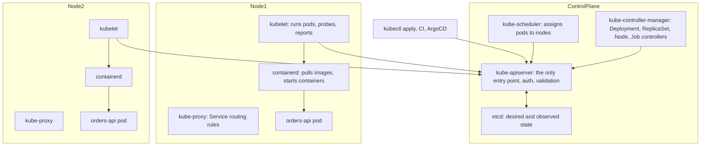
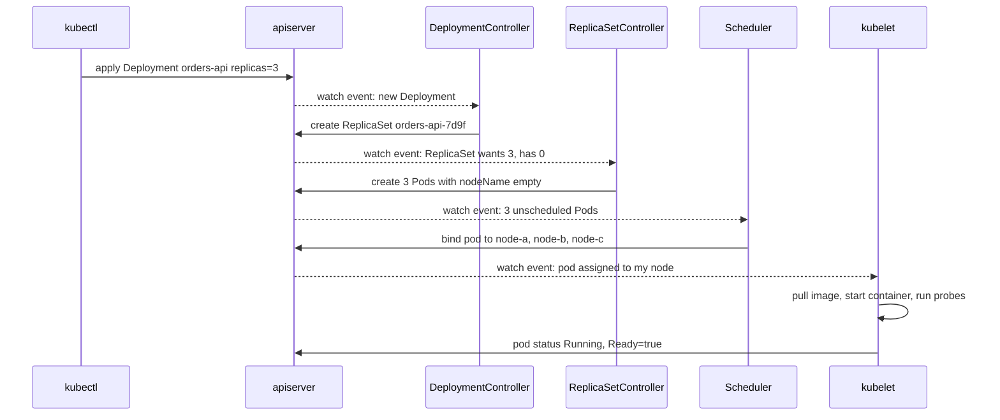

# Part 27 — Kubernetes for Backend Engineers

Kubernetes is where your container goes to become a service. Part 26 gave you an image that starts in two seconds, stops cleanly and fits in 512 MB. Kubernetes decides which machine runs it, how many copies, what happens when one dies, how traffic finds it, how it gets its configuration, and how a new version replaces the old without anyone noticing. It does this with a small set of objects described in YAML and a control loop that never stops comparing what you asked for with what exists.

Most backend engineers meet Kubernetes through a wall of YAML and a pod in `CrashLoopBackOff`. This part takes the other route: the problem each object solves, the mechanism underneath, the exact manifest for a NestJS API, the numbers that matter (probe timings, resource sizes, grace periods), and the failure modes that page you. By the end you should be able to deploy an API and its BullMQ workers to a cluster, watch a rollout, roll it back, and debug the six pod states that account for nearly every incident.

## 27.1 Why Kubernetes exists and what it costs

#### Concept

Kubernetes is a cluster operating system for containers. You describe the desired state ("three replicas of `orders-api:sha-3f9a1c2`, each with 512 MB, reachable on port 80 as `orders-api`, scaled between 3 and 20 on CPU"), and the cluster continuously works to make reality match. It schedules containers onto machines, restarts them when they die, replaces machines that fail, rolls out new versions gradually, gives every service a stable name, injects configuration and secrets, and scales replicas up and down.

#### Why does it exist?

Run one containerised NestJS service on one VM with `docker compose` and you are fine. Run forty services on thirty VMs and the questions pile up: which VM has room for this container? What restarts it when it crashes at 3 a.m.? How does `orders-api` find `inventory-api` when the latter moves to a different VM? How do you deploy a new version without downtime? How do you add ten replicas for the Black Friday spike and remove them after? How do you rotate a database password across all replicas? Every one of those has a hand-written answer (scripts, Ansible, cron jobs, a spreadsheet of IPs), and every hand-written answer is a future incident. Kubernetes is one consistent set of answers, tested by thousands of companies.

#### Mental model

Imagine a large hotel with a very disciplined operations manager. You hand her a card: "I need three identical rooms set up for the Orders team, each with a desk, a 512 MB safe, and a phone that answers to 'orders'. If a room becomes unusable, set up another one somewhere else. If more Orders guests arrive, open more rooms, up to twenty." She never sleeps, never forgets, and every minute she walks the building comparing the cards to the rooms and fixing any difference. You do not tell her *how* to do it; you tell her *what* you want. That is the desired-state model. The cost is that she is very literal: if your card is wrong, she will diligently create the wrong thing, three times, forever.

#### How it works

What Kubernetes gives you, in the order you will feel it:

1. **Scheduling.** The scheduler places each pod on a node with enough free CPU and memory (based on your *requests*), respecting constraints you set (spread across availability zones, avoid certain nodes).
2. **Self-healing.** If a container exits, the kubelet restarts it. If a node dies, the controller recreates its pods elsewhere. If a pod fails its liveness probe, it is restarted. If it fails readiness, it stops receiving traffic.
3. **Scaling.** The Horizontal Pod Autoscaler changes the replica count from metrics; the Cluster Autoscaler (or Karpenter) adds nodes when pods cannot be scheduled.
4. **Rolling updates.** A Deployment replaces pods gradually, only proceeding while new pods report ready, and can be rolled back with one command.
5. **Service discovery.** A Service gives a stable name and virtual IP to a changing set of pods; DNS resolves `orders-api.shop.svc.cluster.local` to it.
6. **Configuration and secrets.** ConfigMaps and Secrets are injected as environment variables or files, versioned with the rest of your manifests.
7. **Declarative everything.** Every object is YAML in Git; the cluster state is reproducible, reviewable and auditable.

What it costs:

- **Concepts.** Pods, Deployments, Services, Ingress, ConfigMaps, Secrets, probes, requests and limits, HPA, PDB, RBAC, NetworkPolicy. Around fifteen objects to know well before you can operate a service safely.
- **Operations.** Cluster upgrades every 4 to 6 months (versions are supported for about 14 months), node image patching, add-on management (ingress controller, cert-manager, metrics server, log agent, CNI), capacity planning, cost allocation.
- **A platform team.** Below roughly 10 services or 5 engineers, the people cost of running Kubernetes well usually exceeds the benefit. Managed control planes (EKS, GKE, AKS) remove the hardest 40%; they do not remove the rest.
- **Failure modes you did not have before.** Evictions, CrashLoopBackOff from a typo, DNS `ndots` surprises, PDBs blocking upgrades, HPA flapping, cross-zone data-transfer bills.

The decision table a senior engineer uses before recommending Kubernetes (the cloud-side detail is in Part 49, which covers AWS deployment options):

| Option | You manage | Good fit | Poor fit | Rough cost of operation |
|---|---|---|---|---|
| Single VM with Compose | Everything on one host | Internal tools, prototypes, one service with no HA requirement | Anything customer-facing that must survive a host failure | Very low, until it fails |
| AWS App Runner / Google Cloud Run | Nothing but the container | Stateless HTTP APIs, bursty traffic, small teams | Long-lived WebSockets, background workers, custom networking, GPU | Low; pay per request/CPU-second |
| AWS ECS on Fargate | Task definitions, services, ALB | 5 to 50 services on AWS, teams without a platform team, workers and APIs | Multi-cloud, complex scheduling needs, operator-based databases | Low to medium |
| Kubernetes (EKS/GKE/AKS) | Cluster add-ons, upgrades, manifests, policies | 20+ services, a platform team, workers plus APIs plus cron plus stateful add-ons, portable tooling (Helm, ArgoCD, KEDA) | Small teams; a single monolith; teams unwilling to own upgrades | Medium to high; 1 to 3 engineers |
| Self-managed Kubernetes | Everything including the control plane and etcd | Regulated on-premises, edge | Almost everyone else | High |

#### Practical example

A food-delivery company has 35 services: 20 NestJS APIs, 10 BullMQ and Kafka workers, 5 cron-style jobs, plus an ingress layer with TLS, per-service autoscaling, and a requirement to deploy 40 times a day with zero downtime. They started on ECS, which handled the APIs well; what pushed them to EKS was the operational toolkit: KEDA for queue-based worker scaling, ArgoCD for GitOps, a shared ingress with cert-manager, Prometheus Operator, and the ability to hire engineers who already knew it. Two platform engineers run the cluster for 60 developers.

#### Production scenario

The same cluster during a promotional campaign: `orders-api` scales from 4 to 22 pods over 3 minutes as CPU crosses 65%; the Cluster Autoscaler adds 5 nodes in about 90 seconds; `notifications-worker` scales from 2 to 15 on queue depth via KEDA; a node fails mid-campaign and its 11 pods are rescheduled within 40 seconds with no customer-visible errors because the PodDisruptionBudget and anti-affinity had spread replicas. Nobody did anything by hand. That is the payoff; the cost was three months of platform work to get there.

#### Failure scenario

A four-person startup with one NestJS monolith adopts Kubernetes "for scale". Six months later: two cluster upgrades consumed a week each; an expired ingress certificate caused an outage because nobody owned cert-manager; the cluster's fixed cost (control plane plus three nodes) is triple what App Runner would charge for their traffic; and the one engineer who understood the manifests left. The honest architecture would have been App Runner or ECS Fargate with RDS. Kubernetes did not fail; it was the wrong tool for the team size.

#### Edge cases & failure modes

- **Version support windows.** A cluster left on an unsupported version becomes expensive to upgrade (multiple hops, removed APIs; see 27.21).
- **Add-ons are your problem.** Ingress controller, CNI, DNS, metrics server and log agent all need upgrades and can all break the cluster.
- **Cost visibility.** Requests, not usage, drive node count; over-requesting doubles the bill silently.
- **Multi-tenancy is weak by default.** Without NetworkPolicy, RBAC and quotas, every team can reach and starve every other team.

#### How a Senior Backend Engineer thinks about this

They ask "what would this look like on the simplest platform that works?" before saying Kubernetes. They count the operational surface, not the feature list. They insist on a managed control plane and on a named owner for every add-on. If the answer is Kubernetes, they adopt it fully: GitOps, policies, autoscaling, observability; a half-adopted Kubernetes is worse than ECS.

To a product manager: "Kubernetes is a very capable operations team in software. It is worth it when we have enough services that a human operations team would be more expensive. Until then it is overhead."

#### Common mistakes

- Choosing Kubernetes for a monolith and a team of four.
- Treating a managed control plane as "managed Kubernetes"; nodes and add-ons are still yours.
- Skipping the platform basics (ingress, TLS, metrics, logs, policies) and running bare Deployments.
- Never upgrading.

#### Interview questions

1. *What problems does Kubernetes solve that Docker alone does not?* Expected: scheduling, self-healing, rolling updates, service discovery, scaling, config and secrets across many hosts.
2. *When would you recommend ECS or Cloud Run over Kubernetes?* Expected: small team, few services, stateless HTTP, no platform team; Kubernetes when the ecosystem (KEDA, ArgoCD, operators) and portability pay for the operations.
3. *What are the ongoing costs of running Kubernetes?* Expected: upgrades every few months, add-on ownership, capacity and cost management, policies, on-call knowledge.
4. *Explain desired state versus imperative deployment to a junior.* Expected: you declare the end state; controllers reconcile; no scripts that "do steps".

#### Practical exercise

Write a one-page recommendation for your own organisation: number of services, team size, traffic shape, workers and cron needs, compliance. Score Compose, App Runner or Cloud Run, ECS Fargate, and EKS against those needs with the table above. Acceptance criteria: a clear recommendation, the top three operational costs of the chosen option, and the trigger that would make you move to the next option up.

## 27.2 Architecture in simple terms

#### Concept

A Kubernetes cluster has two kinds of machines. The **control plane** holds the desired state and runs the controllers that make decisions. The **nodes** (workers) run your containers. Everything communicates through one component, the API server, and everything is stored in one database, etcd. Every other component is a loop: read desired state, observe actual state, act to close the gap, repeat.

#### Why does it exist?

Separating "what should exist" (control plane) from "what is running" (nodes) makes the system resilient: nodes can die and the desired state survives in etcd; the control plane can restart and pods keep running on the nodes. The single API server gives one place for authentication, authorisation, validation and audit. The controller-loop design means no component holds a to-do list that can be lost; every loop re-derives its work from the current state.

#### Mental model

Imagine the hotel again. The front desk (API server) is the only place anyone talks to; it writes every request into the ledger (etcd). A rooms planner (scheduler) reads the ledger for rooms that have no floor assigned and picks a floor with space. A set of supervisors (controller manager) each watch one kind of card: the "three rooms for Orders" supervisor keeps counting Orders rooms and asking the front desk to create or remove them. On each floor, a floor manager (kubelet) reads the front desk's instructions for that floor and actually sets up the rooms, checks on them and reports back. A switchboard operator on each floor (kube-proxy) makes sure calls to "orders" reach an Orders room.

#### How it works



The components:

| Component | Where | What it does | What breaks if it is down |
|---|---|---|---|
| kube-apiserver | Control plane | REST API for every object; authn/authz; validation; admission webhooks; writes to etcd | No changes possible; running pods keep running |
| etcd | Control plane | Strongly consistent key-value store (Raft); the only state | Everything; back it up; managed offerings hide it |
| kube-scheduler | Control plane | Watches unscheduled pods; scores nodes by resources, affinity, taints, spread; sets `nodeName` | New pods stay `Pending` |
| kube-controller-manager | Control plane | Dozens of controllers: ReplicaSet keeps replica counts, Deployment drives rollouts, Node marks dead nodes, Job tracks completions, EndpointSlice tracks pod IPs | No self-healing, no rollouts, no scaling |
| cloud-controller-manager | Control plane | Talks to the cloud: LoadBalancer Services, node lifecycle, volumes | LoadBalancers not created; dead cloud instances not detected |
| kubelet | Every node | Watches pods assigned to its node; pulls images; starts containers via the runtime; runs probes; enforces limits; reports status | Node goes `NotReady` after 40 s; pods evicted after 5 min |
| kube-proxy | Every node | Programs iptables or IPVS so that Service virtual IPs reach pod IPs | New Services and endpoint changes not routed |
| Container runtime (containerd) | Every node | Pulls images, creates containers with namespaces and cgroups (Part 26) | Nothing starts |
| CoreDNS | Runs as pods | Resolves Service and pod names | Every name lookup fails |
| CNI plugin (VPC CNI, Calico, Cilium) | Every node | Gives pods IPs and connectivity; enforces NetworkPolicy | Pods stuck `ContainerCreating` without IPs |

The reconciliation loop, applied to `kubectl apply -f deployment.yaml` with three replicas:



Nothing calls anything directly except through the API server, and every arrow labelled "watch event" is a controller noticing a difference between desired and observed state. If a node dies, the Node controller marks it, the pods are marked for deletion, the ReplicaSet controller sees 2 of 3, creates one more, the scheduler places it, the kubelet starts it. Same loop, no special code path.

Desired versus observed state lives in the same object: `spec` is what you want, `status` is what the controllers report. `kubectl get deployment orders-api` shows `READY 2/3` when spec says 3 and status says 2 are ready.

#### Practical example

Your CI pipeline runs `kubectl set image deployment/orders-api api=registry/orders-api:sha-3f9a1c2`. That is one `PATCH` to the API server changing one field in `spec.template`. Everything after that (new ReplicaSet, gradual pod replacement, endpoint updates) is controllers reconciling. If CI dies one second after the patch, the rollout still completes; there was no script driving it.

#### Production scenario

On EKS the control plane is managed and multi-AZ; you never see etcd. What you do operate: node groups (or Karpenter), the VPC CNI, CoreDNS, kube-proxy, the metrics server, and any add-ons. A cluster of 40 nodes runs around 900 pods; the API server handles a few hundred requests per second, mostly watches from kubelets and controllers. Control-plane outages on managed offerings are rare but do happen; the important property is that *running workloads are unaffected*, only changes stall.

#### Failure scenario

At 09:30 the platform team upgrades CoreDNS. The new version's ConfigMap has a typo; CoreDNS pods crash. Within a minute every service in the cluster fails DNS lookups: `orders-api` cannot resolve `inventory-api`, connection pools to RDS (by hostname) fail to reconnect, error rate hits 40%. Pods themselves are healthy; the cluster's *name resolution* is down. Rollback takes 3 minutes. The lesson: cluster add-ons are part of your application's availability, and DNS in particular deserves a canary and an alert on CoreDNS error rate.

#### Edge cases & failure modes

- **API server unavailable.** Existing pods run; kubelets keep applying last-known state; no scaling, no rollouts, HPA stalls.
- **etcd latency.** Slow disks on self-managed etcd make every `kubectl` slow and controllers lag; managed offerings handle this.
- **Node `NotReady`.** Pods are evicted after `pod-eviction-timeout` (5 minutes default via taints); a network partition between a node and the API server evicts healthy pods that are still serving.
- **Controller lag at scale.** Thousands of pods churning make the EndpointSlice controller lag, so a Service points at deleted pods for seconds.
- **Clock skew across nodes** affects certificate validation and log ordering; run NTP everywhere.

#### How a Senior Backend Engineer thinks about this

They know that "the cluster is down" almost never means their pods are down; it means changes are blocked. They know DNS, the CNI and the ingress controller are the add-ons most likely to take the application down and treat them as tier-one dependencies. They read `status` before `spec` when debugging, because `status` is what the controllers actually saw.

#### Common mistakes

- Assuming a control-plane outage stops traffic.
- Editing pods directly (`kubectl edit pod`) and being surprised when the ReplicaSet reverts the change.
- Ignoring add-on upgrades until they are three versions behind.
- Not knowing which CNI the cluster runs and therefore whether NetworkPolicy is enforced.

#### Interview questions

1. *Describe what happens between `kubectl apply` of a Deployment and a pod serving traffic.* Expected: API server validates and stores; Deployment controller creates a ReplicaSet; ReplicaSet controller creates pods; scheduler binds; kubelet pulls and starts; probes; EndpointSlice updated; kube-proxy routes.
2. *If the API server goes down, what happens to running pods?* Expected: they keep running; no changes or scaling; kubelets continue with last state.
3. *What is a controller, in one sentence?* Expected: a loop that observes state, compares with desired state, and acts to reconcile.
4. *Which cluster components can take your application down even when your pods are healthy?* Expected: CoreDNS, CNI, ingress controller, kube-proxy, node problems.

#### Practical exercise

On a local cluster (kind or minikube), apply a Deployment with 3 replicas, then `kubectl delete pod` one of them and `kubectl get pods -w` to watch the ReplicaSet recreate it. Then `kubectl scale --replicas=0 deployment/coredns -n kube-system` and observe what happens to a `curl orders-api` from another pod; restore it. Acceptance criteria: a written timeline of the recreate (with timestamps from `kubectl get events`), the exact DNS error the application logged, and the time to recover after CoreDNS was restored.

## 27.3 Pod

#### Concept

A pod is the smallest thing Kubernetes runs: one or more containers that share a network namespace (one IP, one port space, `localhost` between them), share storage volumes, and are scheduled, started and stopped together on one node. Almost always, a pod is one application container plus, optionally, helpers: an init container that runs before it, or a sidecar that runs beside it. Pods are ephemeral: they are created and destroyed freely, their IPs change, and you never repair one; you replace it.

#### Why does it exist?

Containers are single-process by design, but some deployment units need a small group of tightly coupled processes: your API plus a log forwarder, or your API plus a proxy that terminates mTLS. Putting them in one pod gives them what separate containers cannot easily share: the same IP and `localhost`, and the same volumes. Making the pod (not the container) the unit of scheduling means those helpers always land on the same node as the application.

#### Mental model

Imagine a hotel room booked for a small team. Everyone in the room shares the same phone line (pod IP) and can talk to each other by shouting across the room (`localhost`). They share the room's desk (volumes). Housekeeping prepares the room before they arrive (init containers). When the booking ends, everyone leaves together and the room is reset; next time they may get a different room number (new pod IP). You never "fix" a room; you get a new one.

#### How it works

1. The scheduler binds the pod to a node. The kubelet asks the runtime to create a "pause" container that holds the pod's network namespace and IP (from the CNI).
2. **Init containers** run one at a time, in order, each to completion. If one fails, the pod restarts it (subject to `restartPolicy`). They are for one-off preparation: waiting for a dependency, fetching a config file, warming a cache.
3. **App containers** (and sidecars) start. Each gets its own filesystem from its image, its own cgroup limits, but joins the pod's network namespace. Two containers in a pod cannot both listen on port 3000.
4. Kubernetes 1.29+ has native **sidecars**: an init container with `restartPolicy: Always` that starts before app containers, stays running, and is stopped after them. Before that, sidecars were ordinary containers with racy ordering (see 27.21).
5. The kubelet runs probes per container, restarts containers per `restartPolicy` (`Always` for Deployments, `Never`/`OnFailure` for Jobs), and reports `status.phase` (`Pending`, `Running`, `Succeeded`, `Failed`) and per-container states.
6. When the pod is deleted, all containers receive `SIGTERM` (after `preStop`), the grace period applies to the pod as a whole, and the IP is released.

A minimal but realistic pod spec for a NestJS API (you will almost never write a bare Pod; a Deployment wraps this template):

```yaml
apiVersion: v1
kind: Pod
metadata:
  name: orders-api-debug
  namespace: shop
  labels:
    app.kubernetes.io/name: orders-api
spec:
  serviceAccountName: orders-api
  securityContext:
    runAsNonRoot: true
    runAsUser: 1000
    fsGroup: 1000
    seccompProfile:
      type: RuntimeDefault
  initContainers:
    - name: wait-for-postgres
      image: postgres:16.4-alpine
      command: ["sh", "-c", "until pg_isready -h $DB_HOST -p 5432; do sleep 2; done"]
      env:
        - name: DB_HOST
          valueFrom:
            configMapKeyRef: { name: orders-api-config, key: DB_HOST }
  containers:
    - name: api
      image: 123456789012.dkr.ecr.eu-west-1.amazonaws.com/orders-api:sha-3f9a1c2
      ports:
        - name: http
          containerPort: 3000
      envFrom:
        - configMapRef: { name: orders-api-config }
        - secretRef: { name: orders-api-secrets }
      resources:
        requests: { cpu: 250m, memory: 256Mi }
        limits: { memory: 512Mi }
      securityContext:
        allowPrivilegeEscalation: false
        readOnlyRootFilesystem: true
        capabilities: { drop: ["ALL"] }
      volumeMounts:
        - name: tmp
          mountPath: /tmp
  volumes:
    - name: tmp
      emptyDir: { sizeLimit: 64Mi }
  terminationGracePeriodSeconds: 30
```

Why not two NestJS processes in one pod: they would share one IP and could not both use port 3000; they would be scaled, scheduled and restarted as a unit even if only one needed it; their resource limits are per container but the HPA sees pod-level metrics; and a liveness failure in one restarts only that container while traffic keeps arriving at the pod. Scale replicas, not containers. The one-process-per-container, one-app-per-pod rule keeps every Kubernetes feature meaningful.

Init containers for migrations: tempting, and wrong for multi-replica Deployments. Three replicas starting at once would run the migration three times concurrently (TypeORM takes an advisory lock in recent versions, but the others still wait and the rollout blocks), a failed migration puts every pod in `Init:Error`, and a rollback of the Deployment does not roll back the schema. Run migrations as a Job before the rollout (27.10, 27.19). An init container that *waits* for the database (as above) is fine; one that *changes* it is not.

#### Practical example

The `orders-api` pod is one container. The `payments-api` pod has two: the NestJS app and a Vault agent sidecar that renews a database credential and writes it to a shared `emptyDir`; the app watches that file. They share the pod so that the file never crosses the network and the credential lives only in memory (`emptyDir` with `medium: Memory`).

#### NestJS example

Pods know their identity through the Downward API, which is how you get a pod name into logs and traces without a library:

```yaml
env:
  - name: POD_NAME
    valueFrom: { fieldRef: { fieldPath: metadata.name } }
  - name: POD_IP
    valueFrom: { fieldRef: { fieldPath: status.podIP } }
  - name: NODE_NAME
    valueFrom: { fieldRef: { fieldPath: spec.nodeName } }
  - name: MEMORY_LIMIT_BYTES
    valueFrom: { resourceFieldRef: { containerName: api, resource: limits.memory } }
```

```ts
// src/logging/logger.factory.ts
import { LoggerService } from '@nestjs/common';
import pino from 'pino';

export function createLogger(): LoggerService & { pino: pino.Logger } {
  const base = pino({
    level: process.env.LOG_LEVEL ?? 'info',
    base: {
      service: 'orders-api',
      pod: process.env.POD_NAME,      // which replica said this
      node: process.env.NODE_NAME,    // which machine it was on
      version: process.env.APP_VERSION,
    },
  });
  return {
    pino: base,
    log: (msg, ctx) => base.info({ ctx }, msg),
    warn: (msg, ctx) => base.warn({ ctx }, msg),
    error: (msg, trace, ctx) => base.error({ ctx, trace }, msg),
    debug: (msg, ctx) => base.debug({ ctx }, msg),
    verbose: (msg, ctx) => base.trace({ ctx }, msg),
  };
}
```

With `pod` in every log line, "which replica is slow" is a filter, not an investigation.

#### PostgreSQL example

Pods are ephemeral; their IPs change. If you use `pg_hba.conf` rules by IP, or `pg_stat_activity.client_addr` to identify clients, you will chase ghosts. Instead identify by `application_name`, which the driver sets from the connection string:

```sql
-- Which pods hold connections right now
SELECT application_name, client_addr, state, count(*)
FROM pg_stat_activity
WHERE datname = 'orders'
GROUP BY 1, 2, 3
ORDER BY 4 DESC;
```

Set `application_name` to the pod name in TypeORM via `extra: { application_name: process.env.POD_NAME }` so the output reads `orders-api-7d9f6b4c8-x2k9p` rather than an IP that will be reused by a different pod tomorrow.

#### Production scenario

A cluster of 40 nodes runs 900 pods, of which 600 are single-container application pods, 200 include a log or metrics sidecar, and 100 are DaemonSet pods (one per node: log agent, CNI, node exporter). Pod churn is around 2,000 creations a day from rollouts and autoscaling. Pod IP reuse within minutes is normal; anything that caches a pod IP (a client without DNS re-resolution, an old kube-proxy rule) will misroute.

#### Failure scenario

A team puts `typeorm migration:run` in an init container. A Friday deploy includes a migration adding an index to a 200 million row table without `CONCURRENTLY`. Six replicas roll out; six init containers start the migration; the first takes the lock and runs for 25 minutes; the other five block. The Deployment's rollout stalls at zero new ready pods; the old pods keep serving, which is the only good news. The on-call cannot roll back cleanly because the half-built index must be handled by hand. Migrations moved to a Job with a `CONCURRENTLY` policy and a review checklist (Part 31 and Part 32 cover safe migrations and zero-downtime schema changes).

#### Edge cases & failure modes

- **Port collision in a pod.** Two containers listening on the same port; the second fails with `EADDRINUSE`.
- **Sidecar not ready when the app starts** (pre-1.29): the app's first database connection goes through a proxy that is not up yet; add startup retries and use native sidecars.
- **Init container hangs** waiting for a dependency that never appears; the pod stays `Init:0/1` forever; add a timeout and an alert on pods stuck in init.
- **`emptyDir` on disk counts toward ephemeral storage**; large temporary files evict the pod (27.21).
- **Pod IP reused** by a different pod; clients that cached the IP send traffic to the wrong service.
- **`fsGroup` on large volumes** makes the kubelet chown every file at mount time; slow starts.

#### How a Senior Backend Engineer thinks about this

One process per container, one application per pod, replicas for scale. Sidecars only for cross-cutting infrastructure (proxy, secrets agent, log shipper) and only when a DaemonSet or a library cannot do the job. Init containers wait; Jobs change. Every pod carries its name into logs, traces and `application_name`.

#### Common mistakes

- Running migrations in init containers.
- Bundling two services in one pod "because they talk a lot".
- Treating pods as pets: `kubectl exec` to fix a file, which the next rollout erases.
- Relying on pod IPs anywhere.

#### Interview questions

1. *What do containers in a pod share and what do they not?* Expected: share network namespace and IP, volumes, lifecycle and scheduling; do not share filesystem roots, cgroup limits or process namespace by default.
2. *Why not run migrations in an init container?* Expected: concurrent execution across replicas, rollout blocked on failure, schema not rolled back with the Deployment; use a Job.
3. *When is a sidecar justified?* Expected: infrastructure concerns that need the pod's network or filesystem (mTLS proxy, secret agent); otherwise a DaemonSet or library.
4. *A pod is `Pending`. What are the usual causes?* Expected: insufficient requests capacity, unsatisfiable affinity or taints, PVC not bound, image pull not yet started (see 27.20).

#### Practical exercise

Deploy the pod above (adjusting the image) with a wait-for-postgres init container. Observe `kubectl get pod -w` through `Init:0/1`, `PodInitializing`, `Running`, `Ready`. Then add a second container that also listens on 3000 and observe the failure. Finally replace the init container with a native sidecar (`restartPolicy: Always`) that tails a shared `emptyDir` file the app writes to. Acceptance criteria: a written timeline of pod phases, the `EADDRINUSE` error captured, and `kubectl logs pod -c sidecar` showing the app's file contents.
