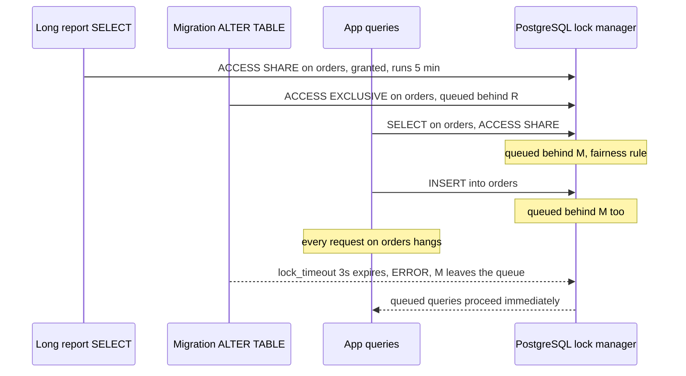

## 27.3 Locks taken by DDL

#### Concept

Every DDL statement in PostgreSQL takes a lock on the table it changes. Most take `ACCESS EXCLUSIVE`, the strongest lock, which conflicts with everything including plain `SELECT`. The question that decides whether a migration is safe is not only *which* lock it takes but *for how long*: some operations hold the lock for microseconds while updating the catalog; others hold it while rewriting every row of the table or scanning every row to validate a constraint. A 300-million-row table rewritten under `ACCESS EXCLUSIVE` is a multi-hour full outage of that table.

#### Why does it exist?

Locks exist because the catalog and the data files must be consistent: a query planned against the old column layout must not run against the new one. PostgreSQL's designers chose correctness and simplicity; it is the migration author's job to choose operations that need the lock only briefly, and to arrange the long work (rewrites, validations, index builds) so it happens without the strong lock.

#### Mental model

Imagine changing the sign on a shop door versus rebuilding the shop floor. Both require locking the door for the safety of people inside. Swapping a sign takes ten seconds; nobody minds. Rebuilding the floor with the door locked is a week without customers. The trick is to build the new floor next door while the shop stays open, then swap the sign.

#### How it works

The lock levels that matter for DDL, weakest to strongest:

| Lock mode | Taken by | Conflicts with |
|---|---|---|
| `ACCESS SHARE` | `SELECT` | only `ACCESS EXCLUSIVE` |
| `ROW EXCLUSIVE` | `INSERT`, `UPDATE`, `DELETE` | `SHARE`, `SHARE ROW EXCLUSIVE`, `EXCLUSIVE`, `ACCESS EXCLUSIVE` |
| `SHARE UPDATE EXCLUSIVE` | `VACUUM`, `CREATE INDEX CONCURRENTLY`, `VALIDATE CONSTRAINT`, `ALTER TABLE ... SET (...)` | itself and stronger; allows reads and writes |
| `SHARE` | `CREATE INDEX` (non-concurrent) | writes (`ROW EXCLUSIVE`) and stronger; allows reads |
| `SHARE ROW EXCLUSIVE` | `ADD FOREIGN KEY` (on both tables) | writes and stronger; allows reads |
| `ACCESS EXCLUSIVE` | most `ALTER TABLE`, `DROP`, `TRUNCATE`, `VACUUM FULL` | everything, including `SELECT` |

Now the table you actually need, operation by operation. "Fast" means catalog-only: the lock is held for milliseconds. "Scan" means every row is read while the lock is held. "Rewrite" means every row is copied into a new file while the lock is held.

| Operation | Lock | Duration | Safe recipe |
|---|---|---|---|
| `ADD COLUMN` nullable, no default | ACCESS EXCLUSIVE | Fast | As is, with `lock_timeout` |
| `ADD COLUMN ... DEFAULT <constant>` | ACCESS EXCLUSIVE | Fast since PostgreSQL 11 (default stored in catalog as `attmissingval`) | As is on PG11+; on PG10 and older: add nullable, backfill, set default |
| `ADD COLUMN ... DEFAULT <volatile fn>` e.g. `gen_random_uuid()`, `clock_timestamp()` | ACCESS EXCLUSIVE | Rewrite | Add nullable, set default (applies to new rows only), backfill in batches |
| `ADD COLUMN ... NOT NULL` with default | ACCESS EXCLUSIVE | Fast on PG11+ (non-volatile default) | As is on PG11+ |
| `ADD COLUMN ... NOT NULL` without default on non-empty table | fails immediately | n/a | Add nullable, backfill, then NOT NULL via CHECK recipe |
| `ALTER COLUMN ... SET NOT NULL` | ACCESS EXCLUSIVE | Scan of whole table | `ADD CONSTRAINT ... CHECK (col IS NOT NULL) NOT VALID`; `VALIDATE CONSTRAINT` (SHARE UPDATE EXCLUSIVE); then `SET NOT NULL` is fast on PG12+ because a valid CHECK proves it; drop the CHECK |
| `ALTER COLUMN ... DROP NOT NULL` | ACCESS EXCLUSIVE | Fast | As is |
| `ALTER COLUMN ... SET DEFAULT` / `DROP DEFAULT` | ACCESS EXCLUSIVE | Fast (affects future rows only) | As is |
| `ALTER COLUMN ... TYPE` binary-compatible (`varchar(50)` to `varchar(100)`, `varchar` to `text`, adding `timestamptz` precision) | ACCESS EXCLUSIVE | Fast | As is |
| `ALTER COLUMN ... TYPE` other (`int` to `bigint`, `text` to `jsonb`, `varchar(100)` to `varchar(50)`) | ACCESS EXCLUSIVE | Rewrite plus index rebuilds | New column, dual write, backfill, swap (section 27.7) |
| `ADD CONSTRAINT ... CHECK (...)` | ACCESS EXCLUSIVE | Scan | `NOT VALID` then `VALIDATE CONSTRAINT` |
| `ADD CONSTRAINT ... FOREIGN KEY` | SHARE ROW EXCLUSIVE on both tables | Scan of referencing table | `NOT VALID` then `VALIDATE CONSTRAINT` (SHARE UPDATE EXCLUSIVE on referencing, ROW SHARE on referenced) |
| `ADD CONSTRAINT ... UNIQUE` / `PRIMARY KEY` | ACCESS EXCLUSIVE | Index build under lock | `CREATE UNIQUE INDEX CONCURRENTLY`, then `ADD CONSTRAINT ... UNIQUE USING INDEX` (fast) |
| `CREATE INDEX` | SHARE | Full build; blocks writes | `CREATE INDEX CONCURRENTLY` (two scans, allows writes, cannot be in a transaction) |
| `DROP INDEX` | ACCESS EXCLUSIVE | Fast, but waits for running queries using it | `DROP INDEX CONCURRENTLY` |
| `DROP COLUMN` | ACCESS EXCLUSIVE | Fast (column marked dropped; space reclaimed on later rewrite) | As is, after no code reads it (Part 28) |
| `RENAME COLUMN` / `RENAME TABLE` | ACCESS EXCLUSIVE | Fast | Fast for the DB, but breaks code instantly; use expand/contract instead |
| `ADD VALUE` to enum | on the type, not the table | Fast | Own migration; cannot be used in the same transaction |
| `RENAME VALUE` of enum (PG10+) | Fast | Fast | Breaks code that uses the old literal |
| `DROP TABLE` / `TRUNCATE` | ACCESS EXCLUSIVE | Fast, but waits for all queries | Only after all references are gone |
| `VACUUM FULL` / `CLUSTER` | ACCESS EXCLUSIVE | Rewrite | Never on a live table; use `pg_repack` |
| `ALTER TABLE ... SET LOGGED / UNLOGGED` | ACCESS EXCLUSIVE | Rewrite | Avoid on big tables |
| `ATTACH PARTITION` with matching CHECK | SHARE UPDATE EXCLUSIVE on parent, ACCESS EXCLUSIVE on the child | Fast if the CHECK proves the bounds; else scan of the child | Add the CHECK first |
| `DETACH PARTITION CONCURRENTLY` (PG14+) | SHARE UPDATE EXCLUSIVE | Fast | As is |

Three recipes from the table deserve their full SQL.

#### PostgreSQL example

**Adding NOT NULL to a big table without a scan under lock.**

```sql
-- Step 1: constraint exists but is not checked against existing rows. Fast; ACCESS EXCLUSIVE for ms.
ALTER TABLE users ADD CONSTRAINT users_phone_e164_not_null
  CHECK (phone_e164 IS NOT NULL) NOT VALID;

-- Step 2: validation scans the table under SHARE UPDATE EXCLUSIVE: reads and writes continue.
-- On 30 M rows this takes a minute or two and blocks nothing.
ALTER TABLE users VALIDATE CONSTRAINT users_phone_e164_not_null;

-- Step 3 (PostgreSQL 12+): SET NOT NULL notices the valid CHECK and skips its own scan. Fast.
ALTER TABLE users ALTER COLUMN phone_e164 SET NOT NULL;

-- Step 4: the CHECK is now redundant.
ALTER TABLE users DROP CONSTRAINT users_phone_e164_not_null;
```

**Adding a foreign key without blocking writes for the scan.**

```sql
-- Fast: the constraint applies to new rows immediately, existing rows are unverified.
ALTER TABLE order_items ADD CONSTRAINT order_items_order_fk
  FOREIGN KEY (order_id) REFERENCES orders (id) NOT VALID;

-- The scan; SHARE UPDATE EXCLUSIVE on order_items, ROW SHARE on orders. Writes continue.
ALTER TABLE order_items VALIDATE CONSTRAINT order_items_order_fk;
```

Before `VALIDATE`, find the orphans that would make it fail, and fix or delete them:

```sql
SELECT i.id FROM order_items i LEFT JOIN orders o ON o.id = i.order_id WHERE o.id IS NULL LIMIT 100;
```

**Unique constraint without a lock during the index build.**

```sql
-- Builds without blocking writes. Fails (leaving an invalid index) if duplicates exist; check first.
SELECT email, count(*) FROM users GROUP BY email HAVING count(*) > 1 LIMIT 10;
CREATE UNIQUE INDEX CONCURRENTLY users_email_uniq ON users (lower(email));

-- Attach the built index as the constraint: catalog-only, fast.
ALTER TABLE users ADD CONSTRAINT users_email_unique UNIQUE USING INDEX users_email_uniq;
```

Changing a unique constraint (say from `(email)` to `(tenant_id, email)`): build the new unique index concurrently, add it as a constraint, then drop the old constraint (which drops its index). Both exist for a moment; that is fine.

**Concurrent index on a partitioned table.** `CREATE INDEX CONCURRENTLY` on the parent is not supported, so:

```sql
CREATE INDEX orders_status_idx ON ONLY orders (status);                    -- parent, marked invalid
CREATE INDEX CONCURRENTLY orders_2026_08_status_idx ON orders_2026_08 (status);
CREATE INDEX CONCURRENTLY orders_2026_09_status_idx ON orders_2026_09 (status);
-- repeat for each partition, then attach:
ALTER INDEX orders_status_idx ATTACH PARTITION orders_2026_08_status_idx;
ALTER INDEX orders_status_idx ATTACH PARTITION orders_2026_09_status_idx;
-- once all partitions are attached the parent index becomes valid automatically.
```

#### Production scenario

Timings on a 300-million-row `orders` table (about 120 GB with indexes) on a `db.r6g.4xlarge`, measured on a snapshot:

| Operation | Time holding ACCESS EXCLUSIVE | Total time |
|---|---|---|
| `ADD COLUMN note text` | 4 ms | 4 ms |
| `ADD COLUMN flags int DEFAULT 0` (PG14) | 6 ms | 6 ms |
| `ADD COLUMN ext_id uuid DEFAULT gen_random_uuid()` | 2 h 40 min | 2 h 40 min |
| `ALTER COLUMN total_cents TYPE bigint` | 3 h 10 min | 3 h 10 min |
| `SET NOT NULL` directly | 9 min | 9 min |
| CHECK NOT VALID + VALIDATE + SET NOT NULL | 5 ms + 0 + 8 ms | 11 min (validate, non-blocking) |
| `CREATE INDEX` (non-concurrent, blocks writes) | n/a, SHARE for 22 min | 22 min |
| `CREATE INDEX CONCURRENTLY` | 0 | 41 min |

The right-hand column is what your calendar shows; the middle column is what your users feel. The whole discipline of this part is moving time from the middle column to the right one.

#### Edge cases & failure modes

- **`DROP INDEX` without `CONCURRENTLY` waits** for every running query on the table, and every new query waits behind it (section 27.4).
- **Invalid index after a failed `CONCURRENTLY`**: writes pay for it, reads ignore it; drop it and rebuild.
- **`VALIDATE CONSTRAINT` fails** on a bad row; the constraint remains `NOT VALID`; fix data, retry.
- **PG11 fast default not applied** when the default expression is volatile; check `pg_attribute.atthasmissing` after the migration to confirm no rewrite happened.
- **Type change on a column with an index** rebuilds the index under the same lock; the estimate above includes it.
- **`ALTER TABLE` on a partitioned parent** propagates to every partition; the lock covers all of them.
- **Dropping a column referenced by a view** fails; dropping it with `CASCADE` silently drops the view.

#### How a Senior Backend Engineer thinks about this

They classify every migration statement as fast, scan or rewrite before writing it, and they never let a scan or rewrite happen under `ACCESS EXCLUSIVE` on a table with meaningful traffic. They know the PostgreSQL version in production because the safe list changes with it (fast defaults in 11, NOT NULL via CHECK in 12, `DETACH CONCURRENTLY` in 14). They test the timing on a snapshot when the table is large.

#### Interview questions

1. *Which `ALTER TABLE` operations rewrite the table?* Expected: type changes that are not binary-compatible, adding a column with a volatile default, `SET LOGGED/UNLOGGED`, `VACUUM FULL`.
2. *How do you add NOT NULL to a 300 M row column without an outage?* Expected: `CHECK ... NOT VALID`, `VALIDATE`, `SET NOT NULL` on PG12+, drop the CHECK.
3. *Why `CREATE INDEX CONCURRENTLY`, and what is its cost?* Expected: allows writes during the build; takes longer, two scans, cannot be in a transaction, may leave an invalid index.
4. *What lock does `ADD FOREIGN KEY` take and how do you soften it?* Expected: `SHARE ROW EXCLUSIVE` on both tables during the scan; `NOT VALID` then `VALIDATE`.

## 27.4 `lock_timeout` and the lock queue

#### Concept

`lock_timeout` is a session setting that makes a statement fail if it waits longer than the given time to acquire a lock. For DDL it is the single most important safety setting, because of how PostgreSQL's lock queue works: a request for `ACCESS EXCLUSIVE` that is waiting behind one long-running `SELECT` blocks *every new query* on that table, even plain reads, until it either gets the lock or gives up. A migration with no `lock_timeout` can turn one slow report into a full outage of a table.

#### Why does it exist?

Lock requests are queued fairly, in order. If a strong lock request is queued, weaker requests behind it must wait, otherwise the strong request could starve forever. That fairness is correct and also exactly what makes a migration dangerous: it does not matter that `ADD COLUMN` would take 4 ms; if it has to wait 5 minutes for a report to finish, the application is frozen for 5 minutes.

#### Mental model

Imagine a single-lane bridge with a rule: vehicles cross in the order they arrived. A wide truck (the migration) arrives and must wait for the bus already on the bridge (the long query). Every car behind the truck waits, even though cars could easily have passed alongside the bus. The truck could have made the same trip at 03:00 in four seconds. `lock_timeout` is the truck driver's rule: "if I cannot get onto the bridge within three seconds, I pull over and try again later", and the cars flow again.

#### How it works



1. Set `lock_timeout` for the migration's session or transaction. Two to five seconds is typical: long enough that the lock is normally obtained, short enough that a queue behind it is barely noticed.
2. When the timeout fires, the statement fails with `ERROR: canceling statement due to lock timeout` (SQLSTATE `55P03`). In a transaction, the transaction is aborted and must be rolled back.
3. The migration runner catches that specific error, waits with backoff (a few seconds, up to a minute), and retries. Retry a bounded number of times, then fail the job and let a human decide.
4. Combine with `statement_timeout` for the migration session so a statement that unexpectedly rewrites a table (a wrong assumption about a fast default, say) is killed after a bound instead of running for hours. Note that `statement_timeout` also covers the lock wait, so set it larger than `lock_timeout`.
5. Ask who is blocking. `pg_blocking_pids()` and `pg_stat_activity` show the offender; often it is an `idle in transaction` session from an application bug, which `idle_in_transaction_session_timeout` should have killed.

#### PostgreSQL example

```sql
-- Inside a migration transaction:
BEGIN;
SET LOCAL lock_timeout = '3s';
SET LOCAL statement_timeout = '30s';      -- must exceed lock_timeout; bounds any accidental rewrite
ALTER TABLE orders ADD COLUMN fulfilment_note text;
COMMIT;

-- Who is holding what on orders, and who is waiting?
SELECT a.pid, a.usename, a.state, now() - a.xact_start AS xact_age,
       pg_blocking_pids(a.pid) AS blocked_by, left(a.query, 60) AS query
FROM pg_stat_activity a
JOIN pg_locks l ON l.pid = a.pid
WHERE l.relation = 'orders'::regclass
ORDER BY a.xact_start;

-- Emergency: cancel the blocker (gentle) or terminate it (firm).
SELECT pg_cancel_backend(48213);
SELECT pg_terminate_backend(48213);
```

#### TypeORM example

A reusable helper that runs a DDL statement with `lock_timeout` and a retry loop. Used by migrations for every fast-but-strong-lock statement.

```ts
// src/database/migrations/util/ddl.ts
import { QueryRunner } from 'typeorm';

const LOCK_TIMEOUT_SQLSTATE = '55P03';

export interface DdlOptions { lockTimeoutMs?: number; statementTimeoutMs?: number; attempts?: number; baseDelayMs?: number }

// Runs one DDL statement in its own transaction with lock_timeout, retrying on lock timeout only.
export async function runDdlWithRetry(qr: QueryRunner, sql: string, opts: DdlOptions = {}): Promise<void> {
  const { lockTimeoutMs = 3000, statementTimeoutMs = 60_000, attempts = 10, baseDelayMs = 2000 } = opts;
  for (let attempt = 1; ; attempt++) {
    await qr.query('BEGIN');
    try {
      await qr.query(`SET LOCAL lock_timeout = '${lockTimeoutMs}ms'`);
      await qr.query(`SET LOCAL statement_timeout = '${statementTimeoutMs}ms'`);
      await qr.query(sql);
      await qr.query('COMMIT');
      return;
    } catch (err) {
      await qr.query('ROLLBACK');
      const code = (err as { code?: string }).code;
      if (code !== LOCK_TIMEOUT_SQLSTATE || attempt >= attempts) throw err;
      const delay = Math.min(baseDelayMs * 2 ** (attempt - 1), 60_000) * (0.5 + Math.random());
      console.warn(`lock timeout on attempt ${attempt}/${attempts}; retrying in ${Math.round(delay)}ms: ${sql}`);
      await new Promise((r) => setTimeout(r, delay));
    }
  }
}
```

This helper manages its own transaction, so migrations using it must run with `--transaction none` (or `migrationsTransactionMode: 'none'`), otherwise `BEGIN` inside TypeORM's transaction produces a warning and the `SET LOCAL` scope is not what you expect. A clean pattern is: migrations that use the helper are non-transactional by convention, and each statement in them is individually atomic and idempotent.

```ts
// src/database/migrations/1725582000000-AddFulfilmentNoteToOrders.ts
import { MigrationInterface, QueryRunner } from 'typeorm';
import { runDdlWithRetry } from './util/ddl';

export class AddFulfilmentNoteToOrders1725582000000 implements MigrationInterface {
  name = 'AddFulfilmentNoteToOrders1725582000000';

  public async up(qr: QueryRunner): Promise<void> {
    await runDdlWithRetry(qr, `ALTER TABLE "orders" ADD COLUMN IF NOT EXISTS "fulfilment_note" text`);
  }

  public async down(qr: QueryRunner): Promise<void> {
    await runDdlWithRetry(qr, `ALTER TABLE "orders" DROP COLUMN IF EXISTS "fulfilment_note"`);
  }
}
```

#### Sequelize example

```ts
// migrations/20260906130000-add-fulfilment-note-to-orders.ts
import { QueryInterface } from 'sequelize';

async function ddlWithRetry(qi: QueryInterface, sql: string, attempts = 10): Promise<void> {
  for (let attempt = 1; ; attempt++) {
    try {
      await qi.sequelize.transaction(async (transaction) => {
        await qi.sequelize.query(`SET LOCAL lock_timeout = '3s'`, { transaction });
        await qi.sequelize.query(sql, { transaction });
      });
      return;
    } catch (err) {
      const code = (err as { original?: { code?: string } }).original?.code;
      if (code !== '55P03' || attempt >= attempts) throw err;
      await new Promise((r) => setTimeout(r, 2000 * attempt));
    }
  }
}

export default {
  up: (qi: QueryInterface) => ddlWithRetry(qi, `ALTER TABLE "orders" ADD COLUMN IF NOT EXISTS "fulfilment_note" text`),
  down: (qi: QueryInterface) => ddlWithRetry(qi, `ALTER TABLE "orders" DROP COLUMN IF EXISTS "fulfilment_note"`),
};
```

#### Production scenario

A migration adds a column to `orders` at 14:00 on a weekday. A finance analyst is running a 6-minute aggregation on `orders` from a BI tool. Without `lock_timeout`: the migration queues, every checkout request hangs for up to 6 minutes, the load balancer's 30-second timeout fires, users see errors, on-call is paged, and by the time someone finds the analyst's query the migration has completed on its own and everything "recovers mysteriously". With `lock_timeout = '3s'` and the retry loop: the migration fails to get the lock at 14:00:03, the queued checkouts (which waited 3 seconds) proceed, the migration retries at 14:00:07, 14:00:15, 14:00:31, and succeeds at 14:06:10 when the report ends. Total user impact: a few requests 3 seconds slower.

#### Failure scenario

At 02:14 the on-call got paged because `p99 > 30s` on every endpoint touching `users`. A nightly migration had started `ALTER TABLE users DROP COLUMN legacy_flags` without a lock timeout. An `idle in transaction` session from a worker that had crashed mid-transaction (and whose connection PgBouncer kept alive) held `ACCESS SHARE` on `users` for hours. The migration queued behind it; every login queued behind the migration. Resolution: `pg_terminate_backend` on the idle session; the migration then completed in 3 ms. Fixes: `lock_timeout` in every migration, `idle_in_transaction_session_timeout = '60s'` on the database, and an alert on any transaction older than 5 minutes.

#### Edge cases & failure modes

- **`lock_timeout` set without `LOCAL` through a pooler** leaks to other clients' sessions; use `SET LOCAL` inside a transaction, or connect directly for migrations.
- **`statement_timeout` shorter than `lock_timeout`**: the statement timeout fires first with a different error code and the retry logic does not match; always set statement timeout larger.
- **Retry loop forever**: bound attempts; a migration that cannot get a lock in 10 minutes needs a human.
- **Timeout inside a multi-statement transaction** aborts everything done so far in that transaction; with `'each'` mode the migration is retried as a whole, so it must be idempotent or the retry must start from scratch cleanly.
- **`CREATE INDEX CONCURRENTLY` and lock timeout**: it needs a brief `SHARE UPDATE EXCLUSIVE` at start and end and waits for existing transactions; a lock timeout during the wait leaves an invalid index to clean up.
- **Lock queue on a partitioned table** involves the parent and every partition; the wait is for the slowest of them.

#### How a Senior Backend Engineer thinks about this

They consider a migration without `lock_timeout` a bug, in the same category as a network call without a timeout. They know the answer to "what is the longest query that runs on this table?" and they schedule migrations on hot tables outside the windows when reports run. They also fix the root cause on the other side: long transactions and idle-in-transaction sessions are application defects with their own timeouts and alerts.

#### Common mistakes

- Believing "it is only `ADD COLUMN`, it is instant" and skipping the timeout. Instant *after* the lock is acquired.
- Retrying on every error, including the "column already exists" that means the previous attempt actually succeeded.
- Setting `lock_timeout` globally on the application role, so ordinary application queries fail under lock contention that they would have survived.

#### Interview questions

1. *Explain how a 4 ms `ADD COLUMN` caused a 6-minute outage.* Expected: queued behind a long query for `ACCESS EXCLUSIVE`; all later queries queued behind it by the fairness rule.
2. *What does `lock_timeout` do and what value do you use for migrations?* Expected: fail the statement if the lock is not acquired in time; 2 to 5 seconds, with retry and backoff.
3. *How do you find and clear what is blocking a migration?* Expected: `pg_stat_activity` with `pg_blocking_pids`, `pg_locks`; cancel or terminate the blocker; fix idle-in-transaction at the source.

#### Practical exercise

On a local database with an `orders` table of 5 million rows, open one session with `BEGIN; SELECT count(*) FROM orders; SELECT pg_sleep(300);` and in another run `ALTER TABLE orders ADD COLUMN x int` without a timeout while a third session runs `SELECT * FROM orders LIMIT 1` in a loop. Observe the third session freeze. Repeat with `SET lock_timeout = '2s'` and the retry helper. Acceptance criteria: with the timeout, the reading loop never pauses more than 2 seconds, the migration eventually succeeds after the sleep ends, and the retry log shows the backoff.
