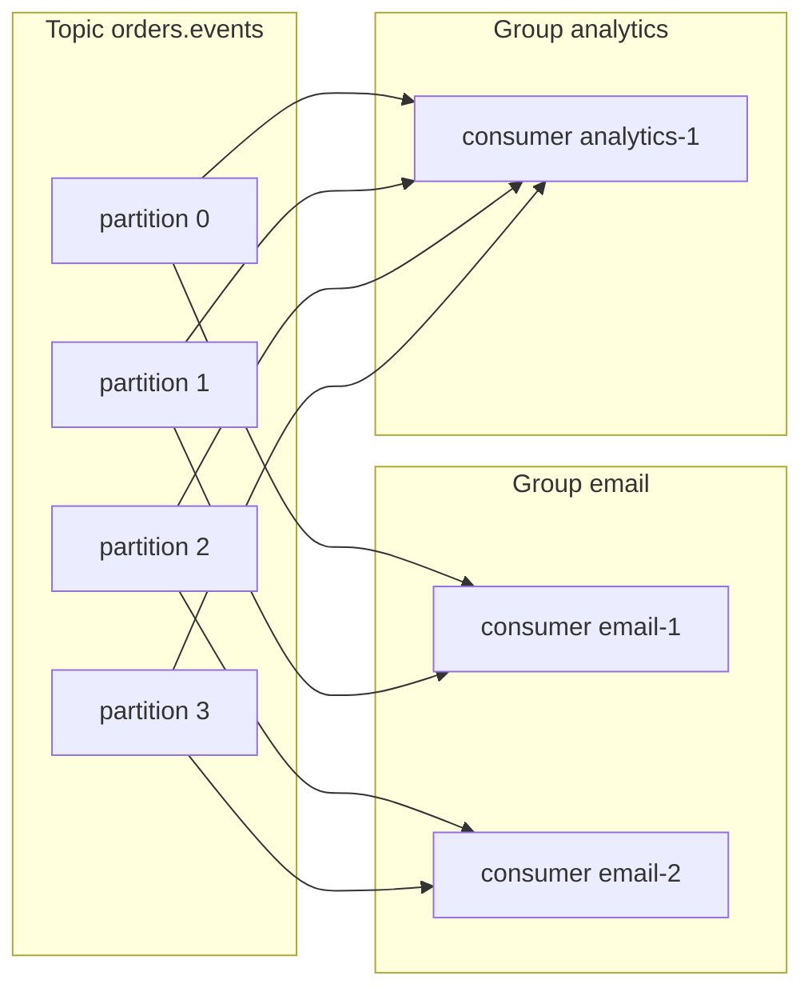

## 27.3 Kafka in depth

Kafka is not a queue. It is a distributed, replicated, append-only log that consumers read at their own pace and can re-read. Almost every Kafka surprise ("why did my consumer get kicked out", "why are there duplicates", "why is lag growing on one partition") follows directly from that design, so this section builds the design up from the storage layer.

### 27.3.1 Log-structured storage and partitions

#### Concept

A Kafka topic is a set of partitions. Each partition is an ordered, immutable sequence of records stored as files on one broker's disk (the leader) and copied to other brokers (followers). Producers append to the end; consumers read from an offset forward. Nothing is deleted when it is read; records age out by retention.

#### Why does it exist?

Appending to the end of a file and reading it sequentially is the fastest thing a disk can do, an order of magnitude faster than random reads and writes. By refusing to do anything else (no per-message deletion, no random access, no per-consumer state on the broker beyond an offset), Kafka makes a single broker capable of hundreds of megabytes per second and a cluster of millions of messages per second, and it makes replay free: a new consumer group reads from the beginning of the log.

#### Mental model

Imagine a warehouse of numbered ledger books, one shelf per partition. Clerks (producers) only ever write on the next blank line of the current book. Readers (consumers) stand at a line number and read forward; they never tear out pages. When a book is older than seven days it is shredded. Anyone can start reading from any line they like, including line one, as long as the book still exists.

#### How it works

1. A partition on disk is a directory of **segment files** (`00000000000000000000.log`, `00000000000012345678.log`), each about 1 GB by default, plus sparse index files mapping offset to byte position and timestamp to offset.
2. A producer's write is appended to the active segment of the leader partition. Kafka relies on the OS page cache: the write goes to memory and is flushed by the kernel; durability comes from replication, not from `fsync` per message.
3. A consumer fetch reads a byte range from a segment. Because data is usually in the page cache and Kafka uses `sendfile` (zero copy), a fetch does not pass through the JVM heap. This is why consumers that are caught up cost almost nothing.
4. **Retention** deletes whole segments once every record in them is older than `retention.ms` (default 7 days) or the partition exceeds `retention.bytes`. **Compaction** (`cleanup.policy=compact`) instead keeps only the latest record per key, forever, which turns a topic into a changelog: the current state of every key is always recoverable by reading it from the start. A record with a null value (a tombstone) deletes the key on the next compaction pass.
5. Partition count is set at topic creation and can be increased but never decreased. Increasing it changes which partition a key hashes to, breaking per-key ordering during the transition. Choose with headroom: for a topic that needs 6 consumers today, 12 or 24 partitions.

```text
topic orders.events, partition 2, on broker 3 (leader), replicated to brokers 1 and 5

/var/kafka/orders.events-2/
  00000000000000000000.log      offsets 0 .. 4,199,331     (1 GB, sealed)
  00000000000000000000.index
  00000000000000000000.timeindex
  00000000000004199332.log      offsets 4,199,332 .. now   (active, appended)
  00000000000004199332.index
```

#### Production scenario

A payments platform runs `payments.events` with 48 partitions, replication factor 3, 7 day retention, 12,000 messages per second at 600 bytes each: about 7 MB per second in, 21 MB per second across replicas, 4.3 TB of retained data across the cluster. Six brokers with 4 TB disks each hold it comfortably. A new fraud-scoring consumer group is added and reads the last 7 days from offset zero at 150 MB per second without affecting the production consumers, because reads are sequential and the data is on disk anyway.

### 27.3.2 Replication, ISR and acknowledgements

#### Concept

Each partition has one **leader** replica that takes all reads and writes and N-1 **follower** replicas that copy from it. The **in-sync replica set (ISR)** is the subset of replicas that are caught up with the leader (within `replica.lag.time.max.ms`, default 30 seconds). A producer's `acks` setting says how many of those must have the record before the write is acknowledged.

#### Why does it exist?

A broker will die. With one copy, its partitions are unavailable and, if the disk is gone, lost. Replication keeps the log alive across broker failures, and the ISR plus `acks` let each producer choose how much durability it pays for per write.

#### How it works

| Setting | Meaning | Durability | Latency |
|---|---|---|---|
| `acks=0` | Producer does not wait for any response | Lost on any failure, even a dropped packet | Lowest |
| `acks=1` | Leader has written it to its log | Lost if the leader dies before followers copy it | Low |
| `acks=all` (`-1`) | All replicas in the ISR have it | Survives loss of any `min.insync.replicas - 1` brokers | One extra replication round trip, a few ms |

`acks=all` alone is not enough, because the ISR can shrink to just the leader when followers fall behind; then `acks=all` means one copy. **`min.insync.replicas=2`** (with replication factor 3) makes the broker refuse the write with `NotEnoughReplicas` if fewer than 2 replicas are in sync, which is the setting that turns "durable" from a hope into a guarantee. The producer then retries or fails loudly, which is what you want for `OrderPlaced`.

`unclean.leader.election.enable=false` (the default since 0.11) means that if every in-sync replica is gone, the partition stays offline rather than electing a stale follower and silently losing the tail of the log. Availability versus consistency in one boolean.

The rule of thumb for business events: replication factor 3, `min.insync.replicas=2`, `acks=all`, and an idempotent producer. For high-volume telemetry where losing a sample is fine: `acks=1`.

### 27.3.3 Idempotent producer, keys and partitioning

#### Concept

A producer that retries after a timeout can write the same record twice, because the first write may have succeeded and only the acknowledgement was lost. The **idempotent producer** (`enable.idempotence=true`) attaches a producer id and a per-partition sequence number to each batch; the broker discards a batch it has already seen. Retries then cannot duplicate or reorder within a partition.

**Keys** decide partitions. The default partitioner hashes the key (murmur2) modulo the partition count. Records with the same key land on the same partition and are therefore ordered relative to each other. Records with a null key are spread across partitions (round-robin or sticky per batch) with no ordering.

#### How it works

1. The producer chooses a key: `orderId` for order events, `userId` for user-scoped events, `accountId` for ledger entries. The key is the entity whose events must be processed in order by one consumer.
2. The partitioner computes `hash(key) mod partitions`. If keys are skewed (one enterprise tenant produces 40 percent of traffic), one partition takes 40 percent of the load: **partition key skew**, covered in 27.16.
3. The idempotent producer keeps up to 5 in-flight batches per partition in the Java client, with sequence numbers, so it can retry without reordering. In kafkajs, `idempotent: true` is honoured with `maxInFlightRequests: 1`.
4. `acks=all` is required for idempotence.

#### NestJS example

A producer provider with the durability settings that business events need, built on plain `kafkajs` because the `@nestjs/microservices` `ClientKafka` does not expose `idempotent` or `acks` per send in a discoverable way.

```ts
// messaging/kafka-producer.service.ts
import { Injectable, Logger, OnModuleDestroy, OnModuleInit } from '@nestjs/common';
import { CompressionTypes, Kafka, Partitioners, Producer } from 'kafkajs';

@Injectable()
export class KafkaProducerService implements OnModuleInit, OnModuleDestroy {
  private readonly logger = new Logger(KafkaProducerService.name);
  private readonly kafka = new Kafka({
    clientId: process.env.SERVICE_NAME ?? 'orders-api',
    brokers: (process.env.KAFKA_BROKERS ?? 'localhost:9092').split(','),
    retry: { initialRetryTime: 100, retries: 8 },       // client-level retries with backoff
  });
  private readonly producer: Producer = this.kafka.producer({
    idempotent: true,                                    // broker de-duplicates producer retries
    maxInFlightRequests: 1,                              // required for idempotence in kafkajs
    allowAutoTopicCreation: false,                       // topics are created by migration, not by accident
    createPartitioner: Partitioners.DefaultPartitioner,  // Java-compatible murmur2 hashing
  });

  async onModuleInit(): Promise<void> { await this.producer.connect(); }
  async onModuleDestroy(): Promise<void> { await this.producer.disconnect(); }

  async publish(topic: string, key: string, value: object, headers: Record<string, string> = {}): Promise<void> {
    await this.producer.send({
      topic,
      acks: -1,                                          // all in-sync replicas
      compression: CompressionTypes.GZIP,
      messages: [{ key, value: JSON.stringify(value), headers }],
    });
  }

  get raw(): Producer { return this.producer; }
}
```

### 27.3.4 Consumer groups and rebalancing

#### Concept

A consumer group is a set of consumer instances sharing one `groupId`. The broker's **group coordinator** assigns each partition of each subscribed topic to exactly one member. When membership changes (a pod starts, stops, crashes, or is deemed dead), a **rebalance** reassigns partitions.

#### Why does it exist?

Rebalancing is what lets you scale consumers by adding pods and survive a pod dying without an operator reassigning partitions by hand. It is also the single largest source of duplicate processing and latency spikes in Kafka systems, so understanding its mechanics is not optional.

#### Mental model

Imagine a team of readers assigned to shelves. When a new reader arrives, the supervisor (coordinator) shouts "everybody stop, put your books down", re-deals the shelves, and everyone picks up from their bookmark. That is an **eager** rebalance. A **cooperative** rebalance is the supervisor saying "you two, hand one shelf each to the new person; everyone else keep reading".

#### How it works



A consumer's life in the group:

1. **Join.** The consumer sends `JoinGroup` to the coordinator with its subscriptions. The coordinator picks one member as leader and gives it the member list.
2. **Assign.** The leader runs the assignment strategy (range, round-robin, sticky, cooperative-sticky) and sends the assignment via `SyncGroup`. Everyone learns their partitions.
3. **Fetch and heartbeat.** The consumer polls for records and sends heartbeats every `heartbeat.interval.ms` (3 seconds). If the coordinator sees no heartbeat for `session.timeout.ms` (45 seconds in recent Java defaults; 30 seconds in kafkajs), it declares the member dead and triggers a rebalance.
4. **Commit.** The consumer commits offsets to the `__consumer_offsets` internal topic.
5. **Leave.** On a clean shutdown the consumer sends `LeaveGroup`, triggering an immediate rebalance rather than a session-timeout wait.

**Eager (stop-the-world) rebalancing.** Every member revokes all partitions, the group re-joins, and the new assignment is handed out. During the window (typically 1 to 10 seconds, longer with many partitions or slow members) nothing is consumed. Any message that was being processed when revocation happened and whose offset was not committed will be reprocessed by whoever gets the partition next: a duplicate.

**Cooperative (incremental) rebalancing** (`partition.assignment.strategy=CooperativeStickyAssignor` in the Java client; Kafka 2.4 and later). Only the partitions that move are revoked; everyone else keeps consuming. Two rounds of join instead of one, but no pause. kafkajs does not implement the cooperative protocol; its rebalances are eager, which is one of the reasons teams with large groups eventually move to a client with librdkafka underneath (`@confluentinc/kafka-javascript`).

**Static membership** (`group.instance.id`) tells the coordinator "this member will be back with the same id"; a restart within the session timeout does not trigger a rebalance at all. Ideal for Kubernetes StatefulSets with stable pod names.

```mermaid
sequenceDiagram
    participant C1 as email-1
    participant C2 as email-2
    participant CO as Coordinator
    participant C3 as email-3
    C3->>CO: JoinGroup (new pod)
    CO-->>C1: rebalance required
    CO-->>C2: rebalance required
    Note over C1,C2: eager: revoke ALL partitions, stop consuming
    C1->>CO: JoinGroup
    C2->>CO: JoinGroup
    CO-->>C1: SyncGroup assignment p0, p1
    CO-->>C2: SyncGroup assignment p2
    CO-->>C3: SyncGroup assignment p3
    Note over C1,C3: 2 to 10 s with nothing consumed; uncommitted in-flight messages will be re-read
```

### 27.3.5 Slow consumers, `max.poll.interval.ms` and heartbeats

#### Concept

Heartbeats prove a consumer process is alive. They do not prove it is making progress. The Java client adds `max.poll.interval.ms` (default 5 minutes): if the application does not call `poll()` within that interval, the consumer is considered stuck and leaves the group. A handler that takes 6 minutes on one batch gets its partitions revoked mid-processing; when it finally commits, the commit is rejected (`CommitFailedException` or `REBALANCE_IN_PROGRESS`) and everything it just did is reprocessed elsewhere.

#### How it works in kafkajs

kafkajs has no `max.poll.interval.ms`. Instead, heartbeats are sent between fetches from the run loop, and the `eachMessage` / `eachBatch` handlers receive a `heartbeat()` function. If your handler runs longer than `sessionTimeout` without calling `heartbeat()`, the coordinator declares the consumer dead, rebalances, and the same partitions are handed to another member while your handler is still running. The result is identical to the Java case: duplicate processing and a failed commit.

The rules:

- Keep per-message processing well under the session timeout. If a message needs a 3 minute report generated, the consumer should enqueue a job and commit, not do the work inline.
- Call `heartbeat()` in long batch loops, at least every few seconds.
- Set `sessionTimeout` and `rebalanceTimeout` deliberately (kafkajs defaults 30 s and 60 s) and make sure the handler's p99 is a fraction of them.
- Detect the kicked-out case: kafkajs emits `consumer.events.CRASH` and rebalance events; log and alert on them.

```ts
// A batch handler that heartbeats and respects the time budget
await consumer.run({
  autoCommit: false,
  eachBatch: async ({ batch, resolveOffset, heartbeat, commitOffsetsIfNecessary, isRunning, isStale }) => {
    for (const message of batch.messages) {
      if (!isRunning() || isStale()) break;          // partition revoked or shutting down: stop, do not commit further
      await handle(message);                         // idempotent handler
      resolveOffset(message.offset);                 // mark this offset as done
      await heartbeat();                             // keep the session alive during long batches
    }
    await commitOffsetsIfNecessary();                // commit resolved offsets
  },
});
```

### 27.3.6 Consumer lag

#### Concept

Lag is the difference between the last offset written to a partition (the log end offset) and the consumer group's committed offset. It is the number of messages not yet processed, per partition. Lag in messages divided by throughput gives lag in seconds, which is the number the business cares about.

#### How it works

Lag rises when the producer rate exceeds the consumer rate, when a consumer is stuck or rebalancing, or when a single partition is hot. It is exposed by `kafka-consumer-groups --describe`, by the `kafka-lag-exporter` or Burrow projects as `kafka_consumergroup_lag`, and in every managed offering's console. Per-partition lag is the diagnostic view: uniform lag means too few consumers; one partition lagging means key skew or a poison message on that partition.

### 27.3.7 Batching, compression and throughput numbers

#### How it works

- Producers batch records per partition. `linger.ms` (how long to wait to fill a batch; 0 by default in Java, 5 to 20 ms is common in production) and `batch.size` (16 KB default, 64 to 256 KB for throughput) trade latency for efficiency. A batch of 500 records costs one request.
- Compression (`lz4` or `zstd` for speed, `gzip` for ratio) is applied per batch and stored compressed; consumers decompress. JSON events compress 5 to 10x.
- A single partition sustains roughly 5 to 20 MB per second, depending on record size and disk. A broker handles hundreds of partitions. A three-broker cluster comfortably does 100 to 300 MB per second in and several times that out.
- A consumer processing messages one at a time with a 5 ms database write does 200 messages per second per partition. Sixteen partitions with sixteen consumers do 3,200 per second. Batch the database writes and the same consumers do ten times that. Consumer throughput is almost always bounded by the handler, not by Kafka.

#### Retention and replay as a feature

Because the log is retained, you can rebuild a read model by resetting a group's offsets (`kafka-consumer-groups --reset-offsets --to-datetime 2026-09-01T00:00:00Z`), run a new consumer from the beginning for a new feature, or replay a day of events into a staging environment. This is the capability that RabbitMQ and SQS do not have, and it is the strongest argument for Kafka when it applies.

### 27.3.8 When Kafka is overkill

#### How a Senior Backend Engineer thinks about this

Kafka earns its keep when at least two of these are true: more than a few thousand messages per second; several independent consumers of the same events; replay or long retention needed; event sourcing or CDC; strict per-key ordering at scale. If you have one producer, one or two consumers, a few hundred messages per second and no replay requirement, Kafka is a distributed system you now operate (or pay Confluent, MSK or Redpanda for) in exchange for nothing you use. A RabbitMQ instance, SQS, or BullMQ on the Redis you already run will be simpler, and simpler survives on-call.

The senior also weighs operational cost: partition planning, rebalancing behaviour, consumer lag monitoring, schema governance, a lag exporter, and a team that understands `min.insync.replicas`. Managed Kafka removes the broker operations and none of the client-side complexity.

#### PostgreSQL example

Kafka's offset commit and your database write are two systems; this is why consumer idempotency is a database concern. The minimal table that lets a consumer commit its own position in PostgreSQL, atomically with its business write, so that the Kafka offset becomes a hint rather than the source of truth:

```sql
CREATE TABLE consumer_positions (
  consumer_group text   NOT NULL,
  topic          text   NOT NULL,
  partition      int    NOT NULL,
  last_offset    bigint NOT NULL,
  updated_at     timestamptz NOT NULL DEFAULT now(),
  PRIMARY KEY (consumer_group, topic, partition)
);

-- Inside the same transaction as the business write:
INSERT INTO consumer_positions (consumer_group, topic, partition, last_offset)
VALUES ('inventory', 'orders.events', 3, 4199340)
ON CONFLICT (consumer_group, topic, partition)
DO UPDATE SET last_offset = EXCLUDED.last_offset, updated_at = now()
WHERE consumer_positions.last_offset < EXCLUDED.last_offset;  -- never move backwards
```

On startup the consumer can `seek` to `last_offset + 1` from this table, making a redelivered older message detectable by offset alone. This is a heavier pattern than a dedup table (27.9) and is worth it for exactly-once-into-PostgreSQL semantics on a single partition.

#### Failure scenario

At 02:14 the on-call is paged: inventory lag on `orders.events` at 180,000 messages and rising. The graph shows lag started at 01:58, the moment a deploy rolled 6 inventory pods. Rebalances: 12 in two minutes (eager, one per pod stop and one per pod start). Each rebalance took 8 seconds because one partition's in-flight batch of 500 messages took 8 seconds to finish and the consumer held up the rejoin. During each pause nothing was consumed; after each, the batch that was in flight was reprocessed. Net effect: two minutes of near-zero throughput at peak, then a backlog that took 25 minutes to drain. Fixes applied that week: static membership so restarts do not rebalance; batch size reduced to 100 so revocation is quick; a `maxSurge`/`maxUnavailable` rollout of one pod at a time; and a lag alert with a 5 minute threshold rather than a 30 minute one.

#### Edge cases & failure modes

- Producer with `acks=1` and a leader crash: acknowledged records lost. Use `acks=all` with `min.insync.replicas=2` for business events.
- `NotEnoughReplicas` when a broker is down and `min.insync.replicas` cannot be met: producers fail; this is correct behaviour; alert on under-replicated partitions before it happens.
- A consumer with `autoCommit` and a crash: lost or duplicated messages depending on timing.
- Session timeout during a long handler: partitions revoked mid-work, commit rejected, work duplicated.
- Partition count increased on a keyed topic: ordering breaks for in-flight keys; do it during a quiet window with consumers drained.
- Compacted topic misused for events: intermediate events for a key disappear after compaction; compaction is for state, not history.
- Retention shorter than the longest expected consumer outage: unprocessed messages deleted. Set retention from the recovery time objective, not from disk cost.
- Group id typo in a new deployment: a fresh group starts at `latest` by default and silently skips everything before it started, or at `earliest` and reprocesses a week.

#### Common mistakes

- Choosing partition count equal to today's consumer count with no headroom.
- Null keys on events that need ordering.
- Treating heartbeats as proof of progress.
- Committing before processing "to avoid duplicates", and thereby choosing loss.
- Running Kafka for 50 messages per second between two services.

#### Interview questions

1. **What does `acks=all` guarantee without `min.insync.replicas`, and why is that a trap?** Expected: only that the current ISR has it, which can be one replica; `min.insync.replicas=2` makes durability real.
2. **How does the idempotent producer prevent duplicates, and what does it not prevent?** Expected: producer id plus sequence numbers de-duplicated by the broker; it does not prevent application-level re-sends after a crash, nor consumer-side duplicates.
3. **Describe an eager rebalance and its two costs.** Expected: all partitions revoked, consumption pauses, in-flight uncommitted work is duplicated. Follow-up: how do cooperative rebalancing and static membership reduce each?
4. **Lag is growing on one partition only. Three causes?** Expected: key skew, a poison or slow message on that partition, that partition's consumer is unhealthy.
5. **When would you set `cleanup.policy=compact`?** Expected: for changelog or state topics where only the latest value per key matters; never for event history.
6. **A handler takes 4 minutes per message. What breaks and how do you fix the design?** Expected: session or poll timeouts cause revocation and duplicates; move the work to a job queue and commit quickly, or heartbeat and bound the time.

#### Practical exercise

Stand up a single-node Kafka (KRaft mode) in Docker Compose. Create `orders.events` with 6 partitions and replication factor 1. Write a kafkajs producer that publishes 10,000 `OrderPlaced` events with `orderId` keys across 100 distinct order ids, and a consumer group of 3 instances with manual commits. Acceptance criteria: (a) a PostgreSQL table records every processed `(orderId, sequence)` and proves per-order sequence was never violated; (b) killing one consumer with `SIGKILL` mid-run produces duplicates that your dedup logic detects and counts, with zero lost events; (c) restarting a consumer with a fresh `groupId` and `fromBeginning: true` replays all 10,000; (d) the per-partition lag is graphed from `kafka-consumer-groups --describe` output during the run.
