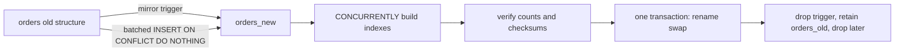

## 27.8 Rollback and roll-forward

#### Concept

Rollback of a database migration means returning the schema (and ideally the data) to the state before the migration. For structure-only changes that have not yet been used by data, it is possible. For anything that has changed or removed data, it is usually fiction: a dropped column's values are gone, a backfilled column cannot be "un-backfilled" without losing the writes that happened since, and a `down` that drops a column the new code just wrote to destroys real user data. The senior stance is **roll forward**: fix problems with a new migration, keep the old structure around until the new one is proven, and make switching behaviour a configuration change rather than a schema change.

#### Why does it exist?

Because deploys fail, and the instinct is "just roll back". Code can be rolled back in seconds with no loss. Databases cannot, because time has passed and rows have been written. A team that plans for database rollback the way it plans for code rollback will, one day, run a `down` migration in production and delete something. Roll-forward thinking replaces that instinct with concrete safety measures taken *before* the risky step.

#### Mental model

Imagine a printed newspaper. You can pull tomorrow's edition before it prints (roll back the code). Once today's edition is on the streets, you cannot un-print it; you print a correction tomorrow (roll forward). So you proofread carefully before printing, and you keep the old typesetting plates until the new edition has been out for a while, in case the correction needs them.

#### How it works

1. **Classify the migration.** *Additive and unused* (a new nullable column, a new table, a new index): reversible; `down` is safe. *Additive and used* (the new column has data): reversible only by losing that data. *Destructive* (drop, type change with narrowing, constraint that rejects existing rows): not reversible without a backup.
2. **Back up before destructive steps.** A logical dump of the affected table (`pg_dump -t users --data-only` is too big for a 30 M row table; instead `CREATE TABLE users_phone_backup AS SELECT id, phone FROM users` right before `DROP COLUMN phone`, which is fast and gives you a per-row restore path) or a database snapshot on RDS. Keep it for a defined period, then drop it.
3. **Keep old columns until the new code is proven.** The contract step waits a week or more after the last read of the old column. The old column costs a few bytes per row; a broken rollback costs the business.
4. **Flags for behaviour, migrations for structure.** Reads switch behind a flag; writes switch behind a flag if practical. Reverting behaviour is then instant and needs no migration.
5. **Code rollback with the schema ahead.** After a bad deploy of v3, you roll the code back to v2. The schema is at the v3 level. This works if and only if the migration was backward compatible (the N-1 rule from Part 28). Expand/contract guarantees it.
6. **Roll forward for real problems.** The backfill produced wrong values: write a corrective backfill. The new constraint rejects a legitimate case: drop the constraint in a new migration. Never edit the failed migration; add a new one.

#### PostgreSQL example

```sql
-- Right before the destructive contract step: a cheap, per-row recoverable backup.
CREATE TABLE users_phone_backup_20260921 AS SELECT id, phone FROM users;   -- seconds; no locks beyond ACCESS SHARE
ALTER TABLE users DROP COLUMN phone;

-- If a restore is ever needed (new forward migration, not a down):
ALTER TABLE users ADD COLUMN phone text;
UPDATE users u SET phone = b.phone FROM users_phone_backup_20260921 b WHERE b.id = u.id;  -- batched in reality

-- Retention: drop the backup after the agreed window.
DROP TABLE users_phone_backup_20260921;
```

TypeORM's `migration:revert` runs the last migration's `down`. Treat it as a development tool; in production wire the pipeline so that revert is a deliberate, approved, separate job that a human runs, never a step that "rollback" automation triggers.

#### Failure scenario

A deploy failed health checks and the pipeline's automatic rollback ran `migration:revert` as well as reverting the image. The last migration had added `orders.fulfilment_note` and the new code had, in the 6 minutes it was live, written 4,000 notes. The `down` dropped the column; the notes were gone; customer support spent a day asking customers to re-enter delivery instructions. The pipeline now never reverts migrations automatically, and the team's `down` methods for destructive steps deliberately throw (`throw new Error('irreversible: restore from users_phone_backup_20260921')`) so nobody can run them by accident.

#### Edge cases & failure modes

- **`down` for a data migration** cannot know which rows were changed since; it either does nothing or destroys new data.
- **Partial rollback across shards**: three shards reverted, five not; the app must tolerate both schema states (Part 28).
- **Backup table forgotten** for a year, holding personal data past its retention policy; schedule the drop when you create it.
- **Point-in-time restore** as a rollback: restores the entire database to before the migration, losing every write since. Only for catastrophes.

#### Interview questions

1. *Can you roll back a migration in production?* Expected: structure-only and unused, yes; anything with data, effectively no; plan for roll-forward, backups before destructive steps, flags for behaviour.
2. *What do you do if a backfill wrote wrong values?* Expected: new corrective backfill, not a revert; the old column is still there because contract was not done yet.
3. *Why should `down` for a `DROP COLUMN` throw?* Expected: it cannot restore data; failing loudly prevents accidental data loss by automation.

## 27.9 Backward-compatible schema changes: the catalogue

#### Concept

A schema change is backward compatible when the code version currently running keeps working after the change, and the next code version works before *and* after it. This section catalogues common changes as safe or unsafe and gives the safe recipe for each unsafe one. The lock behaviour of the statements themselves was covered in section 27.3; this section is about whether the *code* survives.

#### Why does it exist?

Because "does this migration lock the table?" and "does this migration break the running pods?" are different questions, and a change can pass one and fail the other. `RENAME COLUMN` is instant and breaks everything. `ADD COLUMN NOT NULL DEFAULT 0` is instant on PG11+ and breaks nothing. A catalogue lets reviewers decide fast.

#### How it works

| Change | Safe as one step? | Why | Safe recipe |
|---|---|---|---|
| Add nullable column | Yes | Old code ignores it | As is |
| Add column with constant default, nullable or NOT NULL (PG11+) | Yes | Old inserts get the default | As is |
| Add NOT NULL column without default | No | Old code inserts without it and fails | Add nullable, dual write, backfill, NOT NULL via CHECK once all writers set it |
| Drop column | No | Old code selects or writes it | Remove from code first, deploy, wait, then drop; back up first |
| Rename column | No | Old code uses the old name; new code the new | Expand/contract: new column, dual write, backfill, switch, drop |
| Rename table | No | Same | New table or, simpler, a view with the old name during transition; or keep the name and rename only in code via `@Entity({ name })` |
| Change column type, widening compatible (`varchar(50)` to `text`, `int` to `bigint` in the code's eyes) | Type-level yes; lock-level see 27.3 | Old code still reads it | `int` to `bigint` rewrites: new column + backfill + swap |
| Change column type, narrowing or incompatible (`text` to `jsonb`, `numeric` to `int`) | No | Old code writes values the new type rejects | New column, dual write, backfill, switch reads, switch writes, drop old |
| Add index | Yes | Invisible to code | `CONCURRENTLY` |
| Drop index | Yes for code | Invisible to code; watch query plans | `CONCURRENTLY`; check `pg_stat_user_indexes.idx_scan` first |
| Add CHECK constraint | Depends | Rejects old code's writes if they violate it | Ensure all live writers comply; `NOT VALID` + `VALIDATE` |
| Add unique constraint | Depends | Old code may insert duplicates | Deduplicate, ensure writers comply, unique index `CONCURRENTLY` |
| Change unique constraint columns | No | Old writers may violate the new one | Add new unique index concurrently, then drop the old constraint |
| Add foreign key | Depends | Old code may insert orphans | Clean orphans, `NOT VALID` + `VALIDATE` |
| Drop foreign key / constraint | Yes | Loosening never breaks code | As is |
| Add enum value | Yes for DB; risky for consumers | Old code that switches over the enum may hit an unknown value | Add value in its own migration; teach code to tolerate unknown values first (Part 28) |
| Remove enum value | No (and PostgreSQL cannot do it directly) | Rows may hold it | Stop writing it, migrate rows, recreate the type via new column |
| Change default | Yes | Affects only new rows | As is |
| Add table | Yes | Invisible | As is |
| Drop table | No | Old code may use it | Remove from code, deploy, wait, back up, drop |
| Split a table | No | Old code reads the wide table | New table, dual write, backfill, switch reads, switch writes, drop moved columns |
| Add a trigger | Depends | May reject writes or change values old code relies on | Deploy as no-op first, then enable behaviour |
| Change primary key | No | Everything depends on it | Rarely worth it; add a new unique key and migrate references over months |

The recipes for the harder rows:

**Renaming a table.** The expand/contract on a whole table is heavy. Two lighter options. Option 1: keep the physical name and change only what the code calls it (`@Entity({ name: 'legacy_name' })`), which is often all anyone wanted. Option 2: create a view with the old name pointing at the renamed table for the transition: `ALTER TABLE customers RENAME TO users; CREATE VIEW customers AS SELECT * FROM users;` in one transaction. Simple views in PostgreSQL are updatable, so old code's inserts and updates through the view still work. Drop the view after the old code is gone. This is a rare case where a rename is acceptable, because the view keeps the old name alive.

**Splitting a table** (`users` into `users` and `user_profiles`): create `user_profiles(user_id PK REFERENCES users, bio, avatar_url, ...)`; deploy code that writes profile fields to both places and reads from `users`; backfill `user_profiles` from `users`; switch reads to `user_profiles` behind a flag; stop writing the columns in `users`; remove them from the entity; drop them.

**Changing a column type** (`orders.total` numeric(12,2) to `total_cents` bigint): identical to the phone walkthrough with `total_cents = round(total * 100)` as the derivation, ideally in a trigger since it is pure SQL. Same for `int` to `bigint` on a huge table, where the direct `ALTER COLUMN TYPE` would rewrite for hours: new column, trigger, backfill, swap names in one transaction at the end (section 27.10) so the code's column name never changes.

**Adding an enum value.** Own migration, `ALTER TYPE order_status ADD VALUE IF NOT EXISTS 'partially_refunded'`, not inside a transaction on PostgreSQL 11 or older, and not used by any statement in the same transaction on 12+. Before writing the new value anywhere, deploy code that handles unknown enum values gracefully, because the old pods will read it. Many teams avoid PostgreSQL enums entirely for evolving sets and use `text` with a CHECK constraint (which can be replaced with `NOT VALID` + `VALIDATE`) or a lookup table.

**Changing a unique constraint** from `(email)` to `(tenant_id, email)`: the new one is looser (more rows allowed), so old writers cannot violate it; build the new unique index concurrently, add it as a constraint, drop the old. The reverse direction (tightening) requires deduplication and writer compliance first.

**Adding NOT NULL to a big table**: section 27.3's CHECK recipe, *after* every live writer sets the column.

**Dropping a column that old pods still read.** TypeORM and Sequelize always list columns explicitly in their generated `SELECT`, so an entity that still declares the column fails the moment the column is gone. Hand-written `SELECT *` fails differently: it succeeds, and code that reads `row.phone` gets `undefined`, which can silently become `null` in a downstream write. Both are reasons the entity change deploys first.

#### PostgreSQL example

```sql
-- Rename table with a compatibility view, one transaction.
BEGIN;
SET LOCAL lock_timeout = '3s';
ALTER TABLE customers RENAME TO users;
CREATE VIEW customers AS SELECT * FROM users;     -- updatable: old code keeps working
COMMIT;

-- Later, once no code references customers:
DROP VIEW customers;

-- Enum value: its own migration, outside a transaction on old versions.
ALTER TYPE order_status ADD VALUE IF NOT EXISTS 'partially_refunded';

-- Loosening a unique constraint safely.
CREATE UNIQUE INDEX CONCURRENTLY users_tenant_email_uniq ON users (tenant_id, lower(email));
ALTER TABLE users ADD CONSTRAINT users_tenant_email_unique UNIQUE USING INDEX users_tenant_email_uniq;
ALTER TABLE users DROP CONSTRAINT users_email_unique;   -- drops its index too
```

#### Edge cases & failure modes

- **View with `SELECT *` freezes the column list** at creation time; adding columns to the table later does not add them to the view. Recreate the view if needed.
- **Enum value added but old pods crash** on `switch` without default: a Part 28 problem, fix the code first.
- **Unique index build fails on duplicates** created by a race between the dedupe and the build; add the constraint with writers already enforcing it in code, and retry.
- **Split table and the N+1**: reads that used to be one row are now a join; index `user_profiles.user_id` (it is the PK) and load with `relations` or a join, not per row.

#### Interview questions

1. *Is adding a NOT NULL column with a default safe?* Expected: yes on PG11+ with a constant default; both for locks and for old writers.
2. *How do you rename a table without breaking old pods?* Expected: keep the physical name and change the entity mapping, or rename plus an updatable view with the old name for the transition.
3. *Why is dropping a column dangerous even though it is instant?* Expected: old pods select it explicitly via the ORM and fail; `SELECT *` code silently gets undefined.

## 27.10 Large table migrations

#### Concept

Some changes cannot be made in place on a large table without a rewrite: changing `int` to `bigint` on the primary key, converting a plain table into a partitioned one, reclaiming space from a bloated table, changing a column's storage or collation. The techniques are: build a new table (or partition) next to the old one, get its data in without blocking, then swap names in a single transaction; use `pg_repack` for rewrites that keep the same structure; attach pre-built partitions.

#### Why does it exist?

`ALTER TABLE orders ALTER COLUMN id TYPE bigint` on 300 million rows: 3 hours of `ACCESS EXCLUSIVE`. Converting `orders` to a partitioned table: PostgreSQL has no in-place command at all. `VACUUM FULL` on a bloated 200 GB table: hours of exclusive lock. All three are unacceptable on a live system; all three are routine with the copy-and-swap approach.

#### Mental model

Imagine replacing the engine of a running bus. You do not stop the bus for a day. You build a second bus with the new engine while the first keeps its route, mirror every ticket sold into the second bus's log, and at the end of the line ask passengers to step across in thirty seconds. The route was never interrupted; the name on the front of the bus stays the same.

#### How it works

**Copy-and-swap.**

1. Create `orders_new` with the desired structure (bigint id, or `PARTITION BY RANGE (created_at)` with partitions pre-created), without indexes other than the primary key.
2. Add a trigger on `orders` that mirrors every insert, update and delete into `orders_new` (or use logical replication from `orders` to `orders_new` on PostgreSQL 15+ with a publication for one table; a trigger is simpler for same-database copies).
3. Backfill `orders_new` from `orders` in keyset batches with `INSERT ... ON CONFLICT DO NOTHING` (the trigger already inserted rows changed after the copy started; the conflict clause skips them).
4. Build the remaining indexes on `orders_new` with `CONCURRENTLY`. Nobody is querying it, but concurrent builds avoid a `SHARE` lock that would block the mirror trigger's writes.
5. Verify: counts, checksums, and a comparison of rows updated in the last hour.
6. Swap in one transaction with a lock timeout: `ALTER TABLE orders RENAME TO orders_old; ALTER TABLE orders_new RENAME TO orders;` plus renaming the sequence and constraints so names match what the code and future migrations expect. Milliseconds.
7. Drop the mirror trigger (it fires on `orders_old` now, into nothing), keep `orders_old` for a retention window, then drop it.

The application never changes: same table name, same columns. The only things to double check are sequence ownership (`ALTER SEQUENCE orders_id_seq OWNED BY orders.id` and `setval` above the maximum), foreign keys from other tables (they still point at the old table by OID; they must be re-created against the new one with `NOT VALID` + `VALIDATE` before the swap or immediately after), and views that referenced the old table.

**`pg_repack`.** An extension plus a command-line tool that rebuilds a table (or an index) online to remove bloat or re-cluster it. It creates a shadow table, mirrors changes with a log table and trigger, copies data, builds indexes, and swaps in a brief `ACCESS EXCLUSIVE` at the start and end. `pg_repack -d shop -t orders` replaces `VACUUM FULL orders`. It needs free disk space equal to the table plus indexes, and it must not run concurrently with DDL on the same table. It is available on RDS.

**Partition attach.** To move a big existing table into a partitioned scheme without copying: create the partitioned parent, add a `CHECK` constraint on the old table matching the partition bounds it will occupy (validated with `NOT VALID` then `VALIDATE`, non-blocking), then `ATTACH PARTITION` (fast because the CHECK proves the bounds), then rename so the parent takes the old table's name. This is the trick for "we have 3 years of orders in one table and want monthly partitions going forward": attach the whole old table as one big partition covering the past, create monthly partitions for the future, and let the old partition age out on your retention schedule.



#### PostgreSQL example

Converting `orders` (unpartitioned, 300 M rows) to a partitioned table with the "attach the past as one partition" trick, which avoids copying entirely.

```sql
-- 1. New partitioned parent with the same columns; PK must include created_at.
CREATE TABLE orders_partitioned (LIKE orders INCLUDING DEFAULTS INCLUDING GENERATED)
  PARTITION BY RANGE (created_at);
ALTER TABLE orders_partitioned ADD PRIMARY KEY (id, created_at);

-- 2. Prove the old table's bounds without blocking: NOT VALID + VALIDATE.
ALTER TABLE orders ADD CONSTRAINT orders_bounds
  CHECK (created_at >= '2000-01-01' AND created_at < '2026-10-01') NOT VALID;
ALTER TABLE orders VALIDATE CONSTRAINT orders_bounds;   -- SHARE UPDATE EXCLUSIVE, reads and writes continue

-- 3. Future partitions, created ahead.
CREATE TABLE orders_2026_10 PARTITION OF orders_partitioned FOR VALUES FROM ('2026-10-01') TO ('2026-11-01');
CREATE TABLE orders_2026_11 PARTITION OF orders_partitioned FOR VALUES FROM ('2026-11-01') TO ('2026-12-01');

-- 4. The swap: attach the old table as the "history" partition and take over the name. Milliseconds.
BEGIN;
SET LOCAL lock_timeout = '3s';
ALTER TABLE orders RENAME TO orders_history;
ALTER TABLE orders_partitioned ATTACH PARTITION orders_history
  FOR VALUES FROM ('2000-01-01') TO ('2026-10-01');       -- fast: the CHECK already proves it
ALTER TABLE orders_partitioned RENAME TO orders;
COMMIT;

-- 5. Indexes on the parent propagate to future partitions; existing indexes on orders_history remain.
CREATE INDEX orders_user_created_idx ON ONLY orders (user_id, created_at DESC);
ALTER INDEX orders_user_created_idx ATTACH PARTITION orders_history_user_id_created_at_idx;  -- reuse the old index
-- then CREATE INDEX CONCURRENTLY on each new partition and attach, as in section 27.3.
```

Caveats: the old table's primary key was `(id)`; the parent's is `(id, created_at)`. Attaching requires the child to be *compatible*, and a child with a different PK is allowed (constraints on children may be stricter), but foreign keys from other tables to `orders(id)` cannot reference a partitioned parent whose key is `(id, created_at)`. Those foreign keys must be dropped and replaced by application-level checks or by including `created_at` in the referencing tables, which is a schema change of its own. This is the real cost of retro-fitting partitioning, and why Part 26 recommends designing it in early.

#### Production scenario

`int` to `bigint` on `events.id` (sequence at 1.9 billion, 2.1 billion is the ceiling): copy-and-swap ran as a two-day project. Trigger on Monday, backfill over Monday night at 20,000 rows per second, concurrent index builds Tuesday, verification Tuesday evening, swap Tuesday 23:00 with a 40 ms lock, `events_old` dropped the following Monday. The application changed nothing except the TypeScript type of `id` from `number` to `string` (bigint comes back as a string from `pg`), which shipped a week earlier.

#### Failure scenario

A team converted a 500 GB table with an in-place `ALTER COLUMN TYPE`, believing it would take "an hour or so" because a 5 GB staging copy took a minute. It held `ACCESS EXCLUSIVE` for 9 hours. Cancelling it after hour four would have rolled back four hours of rewrite (transactional DDL again), so they let it finish. The product was down for a working day. Copy-and-swap would have made it invisible.

#### Edge cases & failure modes

- **Disk space**: copy-and-swap and `pg_repack` need room for a second copy plus indexes; check `pg_database_size` against free space first.
- **Sequence ownership after swap**: the sequence still belongs to the old table's column; re-own it and `setval` past the max.
- **Foreign keys to the old table** keep pointing at it after rename (they reference OIDs); re-create them against the new table.
- **Mirror trigger and the backfill racing**: `ON CONFLICT DO NOTHING` handles inserts; for updates, the backfill must not overwrite a newer mirrored row: copy with `ON CONFLICT (id) DO UPDATE ... WHERE excluded.updated_at > target.updated_at`, or copy in ascending id order and rely on the trigger for anything after.
- **`pg_repack` interrupted** leaves a `repack` schema with temporary objects; clean with `pg_repack --no-order` rerun or drop the leftovers per its documentation.
- **Views, triggers, RLS policies** on the old table do not move to the new one; script their re-creation.

#### Interview questions

1. *Change `int` to `bigint` on a 300 M row PK without downtime.* Expected: new column or new table, trigger mirror, batched backfill, concurrent indexes, verify, rename swap in one transaction, fix sequence and FKs.
2. *How do you partition an existing huge table?* Expected: attach the old table as a history partition using a validated CHECK to avoid the scan, new partitions for the future, rename swap; beware FK implications.
3. *What is `pg_repack` for?* Expected: online rebuild to remove bloat or re-cluster, replacing `VACUUM FULL`, with brief locks and a full copy on disk.

#### Practical exercise

Take a 20 M row `events` table with `int` id and convert it to `bigint` id using copy-and-swap while a load generator inserts 500 rows per second and updates 50 rows per second. Acceptance criteria: the load generator sees no errors and no latency spike above 100 ms; after the swap, `SELECT max(id) FROM events` matches the generator's counter; the sequence continues without gaps larger than the generator's in-flight batch; `events_old` row count plus generator inserts after the trigger equals the new table's count.
