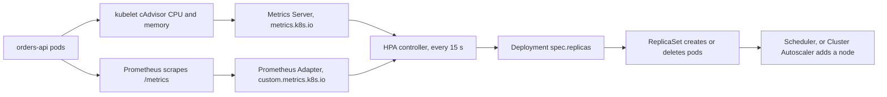

## 27.14 Horizontal Pod Autoscaler

#### Concept

The Horizontal Pod Autoscaler (HPA) is a controller that changes `spec.replicas` on a Deployment based on a metric. Every 15 seconds it reads the current value of the metric across all pods, compares it with a target, and computes a new replica count with one formula:

```text
desiredReplicas = ceil( currentReplicas * ( currentMetricValue / targetMetricValue ) )
```

If 6 pods average 78% CPU and the target is 60%, it wants `ceil(6 * 78/60) = 8`. That is the whole algorithm. Everything else (stabilisation windows, scaling policies, metric sources) exists to stop that formula from doing something stupid.

#### Why does it exist?

Traffic is not constant. An e-commerce API might serve 60 RPS at 04:00 and 900 RPS at 20:00, with a 4,000 RPS spike when a campaign email goes out. Sizing for the peak wastes 80% of your compute for 20 hours a day; sizing for the average means outages every evening. Scaling by hand means someone must be awake and paying attention.

#### Mental model

Imagine a restaurant manager who counts how busy each waiter is every fifteen seconds. If the average waiter is running at 80% when the target is 60%, she calls in more waiters, proportionally. She refuses to send anyone home for five minutes after a rush, because the rush might come back, and each new waiter takes two minutes to change and reach the floor. Her one blind spot: "how busy the waiter looks" is a poor measure when most of a waiter's time is spent *waiting at the kitchen window* rather than moving. That is a Node.js API waiting on the database.

#### How it works



1. Pod CPU and memory come from the kubelet's cAdvisor into **Metrics Server**, which serves the `metrics.k8s.io` API. No Metrics Server, no CPU-based HPA (`unknown` targets and no scaling).
2. Custom and external metrics come through an adapter that serves `custom.metrics.k8s.io` or `external.metrics.k8s.io`. The **Prometheus Adapter** is the common one; KEDA also registers as an external metrics provider.
3. The HPA controller reconciles every 15 seconds (`--horizontal-pod-autoscaler-sync-period`), applies a 10% tolerance (it ignores ratios between 0.9 and 1.1 to avoid churn), applies the `behavior` policies, and writes `spec.replicas`.
4. Pods that are not `Ready`, or are still in their initialisation window, are excluded from the average so a cold pod's 100% CPU does not trigger more scaling.

**Why CPU is a poor proxy for a Node.js API.** Take an endpoint that spends 4 ms on JSON parsing and serialisation and 90 ms waiting for PostgreSQL and Redis. At 200 RPS, that is 0.8 cores of actual CPU, but 18 concurrent requests in flight, all parked on I/O. Double the traffic and CPU roughly doubles (fine), but the thing that breaks first is usually not CPU: it is the connection pool (10 connections, now 36 requests queuing), or the database, or the event loop lag caused by a burst of GC. You will see p99 climb from 120 ms to 900 ms while CPU sits at 45%, comfortably below your 65% target, and the HPA does nothing.

CPU-based HPA is still the right *default*, because it is trivial to set up, it catches genuinely CPU-bound work, and it is better than nothing. But treat it as the floor, not the answer:

```yaml
apiVersion: autoscaling/v2
kind: HorizontalPodAutoscaler
metadata:
  name: orders-api
  namespace: shop
spec:
  scaleTargetRef:
    apiVersion: apps/v1
    kind: Deployment
    name: orders-api
  minReplicas: 3                     # never below 3: one per AZ, survives a node loss
  maxReplicas: 30                    # a real ceiling, sized against the DB connection budget
  metrics:
    - type: Resource
      resource:
        name: cpu
        target:
          type: Utilization
          averageUtilization: 65     # percentage of the CPU *request*, not of a core
  behavior:
    scaleUp:
      stabilizationWindowSeconds: 0        # react to load immediately
      policies:
        - type: Percent
          value: 100                       # at most double
          periodSeconds: 30
        - type: Pods
          value: 4                         # and at most 4 pods
          periodSeconds: 30
      selectPolicy: Max                    # whichever allows more
    scaleDown:
      stabilizationWindowSeconds: 300      # look back 5 minutes and use the highest recommendation
      policies:
        - type: Percent
          value: 25                        # remove at most a quarter
          periodSeconds: 60
```

`averageUtilization: 65` is **65% of the CPU request**, not of a core and not of the limit. With `requests.cpu: 250m`, the HPA scales when average usage crosses 162m. Getting this wrong is the most common HPA misconfiguration: a service with a tiny request scales at absurdly low real usage, and a service with a huge request never scales at all.

**Custom metrics through the Prometheus Adapter.** The metrics that actually describe a Node API's load are requests per second per pod and p95 latency. First, expose them (`prom-client` via `@willsoto/nestjs-prometheus` or a small module of your own). Then teach the adapter to serve them:

```yaml
# prometheus-adapter values: turn a Prometheus query into a Kubernetes metric
rules:
  - seriesQuery: 'http_requests_total{namespace!="",pod!=""}'
    resources:
      overrides:
        namespace: { resource: namespace }
        pod: { resource: pod }
    name:
      matches: "^http_requests_total$"
      as: "http_requests_per_second"
    metricsQuery: 'sum(rate(<<.Series>>{<<.LabelMatchers>>}[2m])) by (<<.GroupBy>>)'
```

```yaml
  metrics:
    - type: Pods
      pods:
        metric:
          name: http_requests_per_second
        target:
          type: AverageValue
          averageValue: "120"          # 120 RPS per pod; 900 RPS then wants 8 pods
    - type: Pods
      pods:
        metric:
          name: http_request_duration_p95_seconds
        target:
          type: AverageValue
          averageValue: "300m"         # 0.3 s; scale out when p95 exceeds it
    - type: Resource
      resource:
        name: cpu
        target: { type: Utilization, averageUtilization: 75 }   # safety net
```

With multiple metrics the HPA computes a desired count for each and **takes the largest**. That is the behaviour you want: RPS drives normal scaling, latency catches the case where each request became more expensive, and CPU is the backstop.

A warning on latency as a scaling metric: it is a *symptom*, and its cause is often not your pods. If p95 rises because PostgreSQL is saturated, adding pods adds connections and makes the database worse. Cap `maxReplicas` against your database connection budget (`maxReplicas * DB_POOL_MAX` must be comfortably below `max_connections` minus headroom for migrations and admin) and prefer RPS as the primary signal, with latency as a secondary.

**KEDA for workers.** Queue workers should not scale on CPU at all; they should scale on how much work is waiting. KEDA (Kubernetes Event Driven Autoscaling) provides scalers for Kafka, Redis, RabbitMQ, SQS, Postgres and dozens more, and creates and manages an HPA under the hood, including scale to zero.

```yaml
apiVersion: keda.sh/v1alpha1
kind: ScaledObject
metadata:
  name: orders-worker
  namespace: shop
spec:
  scaleTargetRef:
    name: orders-worker                  # the Deployment running the BullMQ worker
  pollingInterval: 15                    # how often KEDA checks the trigger
  cooldownPeriod: 300                    # wait after the last active trigger before scaling to min
  minReplicaCount: 1                     # 0 is possible; 1 keeps latency low for the first job
  maxReplicaCount: 25
  advanced:
    horizontalPodAutoscalerConfig:
      behavior:
        scaleDown:
          stabilizationWindowSeconds: 300
          policies:
            - { type: Percent, value: 25, periodSeconds: 60 }
  triggers:
    - type: redis
      metadata:
        addressFromEnv: REDIS_ADDRESS
        listName: "bull:orders:wait"     # BullMQ waiting list for the orders queue
        listLength: "50"                 # one pod per 50 waiting jobs
      authenticationRef:
        name: redis-auth
```

And for a Kafka consumer, where consumer lag is the honest measure of "are we behind?":

```yaml
  triggers:
    - type: kafka
      metadata:
        bootstrapServers: kafka-0.kafka.shop:9092,kafka-1.kafka.shop:9092
        consumerGroup: orders-projection
        topic: order-events
        lagThreshold: "1000"             # one pod per 1000 messages of lag
        offsetResetPolicy: latest
        allowIdleConsumers: "false"      # never exceed the partition count: extra pods idle
```

`allowIdleConsumers: false` encodes a hard truth about Kafka: a consumer group cannot have more useful consumers than the topic has partitions. If `order-events` has 12 partitions, scaling to 20 pods gives you 8 pods doing nothing while still holding database connections and memory. Partition count is the real ceiling on worker parallelism, and changing it later is a rebalance and a re-keying problem (see Part 25).

**`behavior` and flapping.** Without stabilisation, an HPA on a spiky metric oscillates: scale to 12, load drops as the new pods absorb it, scale to 6, latency climbs, scale to 12, forever. Each cycle costs pod startups, cold caches, connection churn and (with the cluster autoscaler) node churn. The asymmetry in the config above is deliberate and is the standard shape: **scale up fast, scale down slowly.** Scaling up late costs you an outage; scaling down late costs you a few euros of compute for five minutes.

**HPA, cluster autoscaler and startup time.** The full chain when a spike arrives:

```text
t+0 s    traffic doubles
t+15 s   HPA sees the metric cross the target, sets replicas 6 -> 12
t+16 s   6 new pods are Pending; 3 fit on existing nodes and start
t+20 s   3 pods remain Pending: insufficient cpu
t+50 s   Cluster Autoscaler (or Karpenter, usually faster) requests 2 nodes
t+110 s  nodes join the cluster, kubelet ready
t+118 s  images pull from ECR (cached layers help: 5 to 20 s)
t+130 s  containers start, NestJS boots (4 s), startup probe passes
t+140 s  readiness passes, endpoints updated, traffic flows
```

**Two minutes and twenty seconds** from spike to full capacity, and most of it is node provisioning and image pull, not the HPA. That is why `minReplicas` matters more than people expect: your floor must absorb the load until new capacity arrives. Ways to shorten the chain: keep images small and warm on nodes, over-provision with low-priority "balloon" pods that get evicted instantly to make room for real ones, use Karpenter instead of the cluster autoscaler for faster node provisioning, and set `minReplicas` from the traffic you must absorb in the first two minutes, not from your average.

**VPA in one paragraph.** The Vertical Pod Autoscaler recommends (and optionally applies) CPU and memory *requests* based on observed usage. In `Off` mode it is genuinely useful: it produces per-container recommendations you can review and copy into your manifests, which is the fastest way to fix a fleet of copy-pasted resource values. In `Auto` mode it evicts and recreates pods to change their requests, which conflicts with an HPA on CPU (both act on the same signal in opposite directions) and causes surprise restarts. Use VPA in recommendation mode for sizing, HPA for scaling, and never both actively on CPU for the same workload.

#### Practical example

`orders-api` runs `minReplicas: 4, maxReplicas: 24` with a primary metric of 120 RPS per pod and CPU at 75% as a backstop. Evening peak takes it to 14 pods; the campaign-email spike takes it to 22 within 90 seconds. `DB_POOL_MAX` is 10, so 24 pods is 240 connections; RDS `max_connections` is 500, leaving room for the workers (5 pods times 10) and admin sessions. That arithmetic is written in a comment in the values file, because the day someone raises `maxReplicas` to 60 without doing it is the day the database refuses connections.

#### NestJS example

The HPA can only use metrics your app exposes. A minimal, correct Prometheus setup:

```ts
// src/observability/metrics.module.ts
import { Module } from '@nestjs/common';
import { PrometheusModule, makeHistogramProvider } from '@willsoto/nestjs-prometheus';

@Module({
  imports: [
    PrometheusModule.register({
      path: '/internal/metrics',        // not /metrics: keep it off the public path prefix
      defaultMetrics: { enabled: true },// process CPU, heap, event loop lag, GC
    }),
  ],
  providers: [
    makeHistogramProvider({
      name: 'http_request_duration_seconds',
      help: 'HTTP request duration in seconds',
      labelNames: ['method', 'route', 'status'],
      buckets: [0.01, 0.025, 0.05, 0.1, 0.25, 0.5, 1, 2.5, 5],
    }),
  ],
  exports: [PrometheusModule],
})
export class MetricsModule {}
```

```ts
// src/observability/metrics.interceptor.ts
import { CallHandler, ExecutionContext, Injectable, NestInterceptor } from '@nestjs/common';
import { InjectMetric } from '@willsoto/nestjs-prometheus';
import { Histogram } from 'prom-client';
import { Observable, tap } from 'rxjs';

@Injectable()
export class MetricsInterceptor implements NestInterceptor {
  constructor(
    @InjectMetric('http_request_duration_seconds') private readonly hist: Histogram<string>,
  ) {}

  intercept(ctx: ExecutionContext, next: CallHandler): Observable<unknown> {
    const http = ctx.switchToHttp();
    const req = http.getRequest();
    const end = this.hist.startTimer();
    return next.handle().pipe(
      tap({
        // Label with the ROUTE PATTERN, never the raw URL: /orders/:id, not /orders/8f3a...
        // Raw URLs create unbounded label cardinality and will melt Prometheus.
        next: () => end({ method: req.method, route: req.route?.path ?? 'unknown', status: http.getResponse().statusCode }),
        error: (err) => end({ method: req.method, route: req.route?.path ?? 'unknown', status: err?.status ?? 500 }),
      }),
    );
  }
}
```

The one metric people forget and then wish they had: **event loop lag** (included in `defaultMetrics` as `nodejs_eventloop_lag_p99_seconds`). For a Node API it is a far better saturation signal than CPU. Lag above 100 ms means requests are queueing inside the process regardless of what CPU says, and it makes an excellent HPA metric and an even better alert.

#### PostgreSQL example

Autoscaling the API scales its demand on the database, and the database does not autoscale. Every new pod opens up to `DB_POOL_MAX` connections, each costing roughly 5 to 10 MB of server memory plus a backend process.

```sql
-- What headroom is left? Run this before raising maxReplicas.
SELECT
  (SELECT setting::int FROM pg_settings WHERE name = 'max_connections')      AS max_connections,
  (SELECT count(*) FROM pg_stat_activity)                                    AS current,
  (SELECT count(*) FROM pg_stat_activity WHERE state = 'idle')               AS idle,
  (SELECT count(*) FROM pg_stat_activity WHERE state = 'idle in transaction') AS idle_in_txn;
```

If `maxReplicas * DB_POOL_MAX` approaches `max_connections`, the honest answers are: put PgBouncer in transaction pooling mode between the pods and the database (hundreds of client connections multiplexed onto a few dozen server ones), lower `DB_POOL_MAX` per pod, or accept a lower `maxReplicas`. Scaling out an API into a saturated database converts a slow service into a broken one.

#### Production scenario

A shop's `orders-api` over 24 hours: 4 pods overnight (minReplicas), 7 by 09:00, 11 through the afternoon, 18 during the 20:00 peak, back to 4 by 01:00 with the 300-second scale-down window smoothing the descent into three steps. Total pod-hours: 218 versus 576 for a fixed fleet of 24, a 62% saving on that service's compute. Scale-up events per day: 9. Scale-down events: 6. Zero flapping, because scale-down is capped at 25% per minute and the stabilisation window is 5 minutes.

#### Failure scenario

At 12:00 a marketing push doubles traffic. `orders-api` has an HPA on CPU at 70% with `maxReplicas: 40` and `DB_POOL_MAX: 20`. CPU rises, the HPA scales 8 -> 16 -> 32 over four minutes, and each new pod opens up to 20 connections. At 31 pods the database hits `max_connections = 500` and starts rejecting: `FATAL: sorry, too many clients already`. Now every pod fails its readiness check (which pings the database), endpoints empty, the ingress returns 503, and the HPA, seeing CPU drop to near zero on the surviving pods, does nothing useful.

Recovery took 18 minutes: scale the Deployment down by hand to 8, wait for connections to drain, let readiness recover. The permanent fixes: PgBouncer in front of RDS, `DB_POOL_MAX` reduced to 8, `maxReplicas` capped at 24 with the connection arithmetic documented, and an alert on connection count above 70% of `max_connections`. The general lesson: **an autoscaler amplifies whatever is downstream of it.** Before raising `maxReplicas`, ask what else scales with pod count: database connections, Redis connections, third-party API rate limits, Kafka consumer group members, licence seats, and NAT gateway ports.

#### Edge cases & failure modes

- **No Metrics Server**: `kubectl get hpa` shows `<unknown>/65%` and nothing scales, silently.
- **No CPU request set**: utilisation is undefined; the HPA cannot function.
- **`replicas` in the manifest fighting the HPA**: every `kubectl apply` resets the count, the HPA scales back, and you get a sawtooth. Omit `replicas` from a manifest that an HPA owns.
- **HPA and VPA both acting on CPU**: opposing loops, constant eviction.
- **Scaling on memory**: Node processes hold heap they do not release, so memory rarely falls; the HPA scales up and never back down.
- **Slow pod startup** (a 60-second boot) makes any HPA reactive by a minute or more; fix the boot time before tuning the HPA.
- **Cold caches on new pods** temporarily raise latency and CPU, which can trigger more scaling: a self-reinforcing loop.
- **`maxReplicas` reached** with no alert, so you are throttled and do not know. Alert on `kube_horizontalpodautoscaler_status_current_replicas == spec.max_replicas`.
- **Scale to zero with KEDA** means the first message waits for a full pod start (5 to 30 s). Fine for batch, wrong for latency-sensitive work.
- **KEDA scaling beyond the partition count** creates idle consumers that still hold resources.
- **Metrics with high cardinality labels** (raw URLs, user ids) make Prometheus and the adapter slow and unreliable, which makes your autoscaler unreliable.
- **The HPA scales the Deployment, not the node pool.** Without cluster autoscaler headroom, new pods sit `Pending`.

#### How a Senior Backend Engineer thinks about this

They start with CPU because it is free, then move the primary signal to something that describes the work: requests per second for APIs, queue depth or consumer lag for workers, and event loop lag as a saturation guard. They set `minReplicas` from "what must I survive in the two minutes before new nodes arrive", not from the average.

They always ask what is downstream. An autoscaler is a load multiplier pointed at your database, your cache and your third-party rate limits; they compute the connection arithmetic and write it in the values file. They scale up fast and down slowly, and they treat flapping as a bug with a real cost, not as cosmetic noise.

And they know when not to autoscale: a service with a 90-second boot, a stateful workload, a singleton, or something whose bottleneck is downstream. In those cases they fix the bottleneck or over-provision, and they say so plainly rather than adding an HPA that cannot help.

#### Common mistakes

- Autoscaling on CPU for an I/O-bound API and concluding "the HPA does not work".
- Setting `averageUtilization` without understanding it is a percentage of the request.
- Leaving `replicas` in a manifest that an HPA manages.
- `maxReplicas` chosen without checking database connection limits.
- No stabilisation window, so pods flap every few minutes.
- Autoscaling on memory for Node.js.
- Scaling Kafka consumers past the partition count.
- Forgetting that the cluster autoscaler adds 60 to 120 seconds to every scale-up that needs a node.

#### Interview questions

1. *How does the HPA compute the desired replica count?* Expected: the ratio formula, 15-second sync, 10% tolerance, unready pods excluded, `behavior` policies applied.
2. *Why is CPU a bad autoscaling metric for a Node.js API?* Expected: I/O-bound work; the bottleneck is concurrency, pool size or the database; latency degrades while CPU stays low; use RPS, queue depth, event loop lag.
3. *How do you scale a queue worker?* Expected: KEDA on queue depth or consumer lag; partition count as a ceiling for Kafka; scale to zero considerations; cooldown.
4. *Your HPA flaps between 6 and 12 pods. What do you change?* Expected: `scaleDown.stabilizationWindowSeconds`, percentage policies, a less spiky metric, longer metric windows; check cold-start feedback loops.
5. *What happens when the HPA scales beyond what the database can accept?* Expected: connection exhaustion, readiness failures, cascade; PgBouncer, pool sizing, capped `maxReplicas`.
6. *HPA versus VPA versus cluster autoscaler?* Expected: replica count, request sizing, node count; HPA plus VPA on CPU conflict; the chain and its timing.

#### Practical exercise

Put a CPU-based HPA on `orders-api` with a 65% target and run a load test that is heavily I/O bound (an endpoint that queries PostgreSQL with a 100 ms artificial delay). Record RPS, p95 and pod count: you should see latency degrade with the pod count unchanged. Then add an RPS-based custom metric through the Prometheus Adapter and repeat, recording how quickly it reacts. Finally deploy a BullMQ worker with a KEDA `ScaledObject` on list length, push 5,000 jobs, and graph queue depth against replica count. Acceptance criteria: two labelled graphs showing the CPU HPA failing to react and the custom-metric HPA reacting within 45 seconds, the KEDA scale-up and cooldown observed, and the computed maximum database connections for your `maxReplicas`.

## 27.15 Scheduling controls

#### Concept

By default the scheduler puts pods wherever they fit. That is usually fine and occasionally catastrophic: all three replicas of your API can legitimately land on one node, and when that node dies you have a full outage from a "highly available" deployment. Scheduling controls are the four tools that let you say where pods may and may not go, and how many may be disrupted at once:

- **Pod anti-affinity**: keep replicas away from each other.
- **Topology spread constraints**: distribute replicas evenly across a dimension (node, zone).
- **Taints and tolerations**: reserve nodes for specific workloads.
- **PodDisruptionBudget**: limit how many pods voluntary operations may remove at once.

#### Why does it exist?

Node failures, node drains for upgrades, spot reclamations and availability-zone outages are routine. Each of them removes a set of nodes. If your replicas are not spread across those failure domains, your replica count is decoration. And when an operator drains a node for a kernel patch, nothing stops them draining all the nodes your pods happen to be on, in sequence and quickly, unless you have told the cluster what you can tolerate.

#### Mental model

Imagine a company with three servers in one rack, and someone unplugs the rack. Anti-affinity is the rule "never put two of our servers in the same rack". Topology spread is the stricter version: "spread our servers evenly across all three racks, and never let one rack hold two more than another". Taints are "this rack is reserved for the database team; nobody else may install here without an explicit pass". A PodDisruptionBudget is the contract with the facilities team: "you may switch off at most one of our servers at a time for maintenance, and you must wait for the replacement before touching the next".

#### How it works

**Pod anti-affinity** matches pods against pods, using a topology key that names the failure domain:

```yaml
    spec:
      affinity:
        podAntiAffinity:
          # REQUIRED across nodes: two orders-api pods may never share a node.
          requiredDuringSchedulingIgnoredDuringExecution:
            - labelSelector:
                matchLabels:
                  app.kubernetes.io/name: orders-api
              topologyKey: kubernetes.io/hostname
          # PREFERRED across zones: spread across AZs when possible, but do not
          # block scheduling if one zone is full.
          preferredDuringSchedulingIgnoredDuringExecution:
            - weight: 100
              podAffinityTerm:
                labelSelector:
                  matchLabels:
                    app.kubernetes.io/name: orders-api
                topologyKey: topology.kubernetes.io/zone
```

The failure it prevents: three replicas on one node, one node loss, 100% outage. The trap it introduces: `required` anti-affinity on `kubernetes.io/hostname` means **you can never have more pods than nodes**. An HPA scaling to 30 on a 12-node cluster leaves 18 pods `Pending` forever with `didn't match pod anti-affinity rules`. For anything that autoscales past your node count, use `preferred`, or use topology spread instead.

**Topology spread constraints** are the modern, better-behaved tool. Instead of "never together", they say "keep the difference between the fullest and emptiest domain within `maxSkew`":

```yaml
      topologySpreadConstraints:
        # Across availability zones: near-perfect balance, and refuse to schedule
        # rather than pile into one zone.
        - maxSkew: 1
          topologyKey: topology.kubernetes.io/zone
          whenUnsatisfiable: DoNotSchedule
          labelSelector:
            matchLabels:
              app.kubernetes.io/name: orders-api
          matchLabelKeys:
            - pod-template-hash          # spread each ReplicaSet independently during rollouts
        # Across nodes: prefer balance, but schedule anyway if it is not possible.
        - maxSkew: 1
          topologyKey: kubernetes.io/hostname
          whenUnsatisfiable: ScheduleAnyway
          labelSelector:
            matchLabels:
              app.kubernetes.io/name: orders-api
```

With 6 replicas and 3 zones, `maxSkew: 1` and `DoNotSchedule` gives you 2-2-2. Lose a zone and you lose exactly a third of capacity, which is what "multi-AZ" is supposed to mean. `matchLabelKeys: [pod-template-hash]` is important during rollouts: without it, the old and new ReplicaSets are counted together and the spread calculation gets confused, sometimes blocking the rollout.

**Taints and tolerations** work the other way: a taint on a node repels pods, and only pods with a matching toleration may land there. This is how you build dedicated node pools.

```bash
# Reserve a node group for memory-heavy workers.
kubectl taint nodes -l workload=workers dedicated=workers:NoSchedule
```

```yaml
    spec:
      tolerations:
        - key: dedicated
          operator: Equal
          value: workers
          effect: NoSchedule
      nodeSelector:
        workload: workers              # toleration allows, nodeSelector requires
```

Note that a toleration only *permits*; it does not attract. Without the `nodeSelector` (or a node affinity rule), a tolerating pod may still be scheduled anywhere else. The pair is what pins a workload to a pool.

The three taint effects: `NoSchedule` (no new pods without a toleration), `PreferNoSchedule` (a soft version), and `NoExecute` (also *evicts* existing pods that do not tolerate it, which is how node problem detectors drain a sick node). The failure it prevents: a batch job with a 6 GB working set landing on the node running your API and causing memory pressure and evictions for everyone.

**PodDisruptionBudget (PDB)** limits *voluntary* disruptions: `kubectl drain`, cluster autoscaler scale-down, node pool upgrades, and evictions from descheduling. It does not and cannot limit involuntary ones (a node dying, an OOMKill, a spot reclamation without notice).

```yaml
apiVersion: policy/v1
kind: PodDisruptionBudget
metadata:
  name: orders-api
  namespace: shop
spec:
  minAvailable: 2                    # or: maxUnavailable: 1
  selector:
    matchLabels:
      app.kubernetes.io/name: orders-api
```

The failure it prevents: an engineer runs `kubectl drain node-3` during a cluster upgrade; two of your three replicas are on that node; both are evicted at once; one pod serves your entire traffic and falls over. With `minAvailable: 2`, the drain evicts one pod, waits for the replacement to become Ready elsewhere, and only then evicts the second. The drain takes longer. That is the entire point.

Prefer `maxUnavailable: 1` over `minAvailable: N` for autoscaled workloads: `minAvailable: 2` on a service that scales down to 2 blocks all maintenance permanently, and a cluster upgrade that cannot proceed is its own kind of incident. A percentage (`minAvailable: 50%`) also works and tracks the replica count automatically.

A PDB with `minAvailable` equal to the replica count blocks every drain forever. Cluster administrators eventually notice, ask whose PDB it is, and delete it at 02:00 during an upgrade. Set budgets that permit maintenance.

#### Practical example

`orders-api`, 6 replicas across 3 availability zones on a 9-node cluster: topology spread `maxSkew: 1` on zone with `DoNotSchedule`, `maxSkew: 1` on hostname with `ScheduleAnyway`, `maxUnavailable: 1` PDB, no taints (it runs on the general pool). The BullMQ workers run on a `workload=workers` tainted pool with 8 vCPU / 32 GB nodes, because their PDF rendering step needs 2 GB per job and would otherwise evict API pods. Kafka runs on a third pool with local NVMe and its own taint.

#### Production scenario

A cluster upgrade from 1.28 to 1.29 replaces 24 nodes over 3 hours, draining them one at a time. Forty services have PDBs. The upgrade is fully automated and produces zero customer-visible errors, because for each node: the drain respects each PDB, evicted pods have `preStop` sleeps and graceful shutdown (27.13), topology spread ensures the replacements land in the right zones, and `maxUnavailable: 0` on the Deployments means the replacement is ready before the next eviction. Two services block the drain for 20 minutes each: one had `minAvailable: 3` with exactly 3 replicas (fixed to `maxUnavailable: 1`), and one had a single replica with a PDB (fixed by scaling to 2). Those two are found on every first upgrade.

#### Failure scenario

At 04:30 an availability zone in eu-west-1 loses network connectivity. A 12-node cluster has 5 nodes in that zone. `orders-api` has 6 replicas and no topology spread constraints, only `preferred` anti-affinity on hostname; by chance, 5 of the 6 pods were in the failed zone (the cluster autoscaler had added cheap capacity there earlier that week). One pod is left serving 100% of traffic; it saturates in 40 seconds and starts timing out. Replacement pods take 3 minutes to schedule and start in the surviving zones, and the database read replica in the failed zone also went away, adding latency.

Customer impact: 6 minutes of severe degradation, 90 seconds of it a hard outage. The fix was a five-line topology spread constraint with `maxSkew: 1` and `DoNotSchedule` on the zone key, which would have guaranteed 2-2-2 and left 4 of 6 pods serving. The cost of the fix: occasionally a pod stays `Pending` for a minute when one zone is full. That is a trade worth making every time for a customer-facing API.

#### Edge cases & failure modes

- **`required` anti-affinity on hostname** caps replicas at the node count; the HPA then leaves pods `Pending` with no obvious explanation except in `describe pod`.
- **Topology spread with `DoNotSchedule` and a single-zone cluster** blocks all scheduling beyond one pod.
- **Missing zone labels** on nodes (some bare-metal or older setups) make zone-based rules no-ops that silently do nothing.
- **PDB on a single-replica Deployment** blocks every node drain; `kubectl drain` hangs and eventually times out.
- **PDB does not protect against node failure**, only against voluntary eviction.
- **Anti-affinity is evaluated at scheduling time only** (`IgnoredDuringExecution`); pods already placed are not moved when the rule would now be violated. Use the descheduler if you need rebalancing.
- **Taint without toleration on a DaemonSet** means your log agent or CNI does not run on those nodes, so they have no logs and possibly no networking.
- **Node affinity plus cluster autoscaler**: the autoscaler must be able to model your constraints, or it adds nodes in the wrong zone and the pods stay `Pending`.
- **Scheduling constraints make evictions slower**, which lengthens node drains and cluster upgrades; budget for it.
- **Cost.** Spreading across zones means cross-AZ traffic between your pods and their dependencies, which is billed (see 27.21).

#### How a Senior Backend Engineer thinks about this

They name the failure domains first: process, pod, node, zone, region. Then they ask, for each customer-facing service, "which of these can I lose without an incident?" and set constraints that make the answer true. Zone spread with `DoNotSchedule` for anything user-facing; node spread as `ScheduleAnyway` so autoscaling still works; a PDB that permits maintenance while guaranteeing capacity.

They keep noisy or greedy workloads on their own node pools with taints, because "it only affects the batch job" stops being true the moment it shares a node with your API. And they test their constraints by actually draining a node in staging, because a constraint you have never exercised is a hypothesis.

#### Common mistakes

- Three replicas, one node, and calling it high availability.
- `required` anti-affinity on an autoscaled service.
- No PDB, so a routine upgrade takes out every replica.
- A PDB that makes drains impossible, which gets deleted by an administrator during an incident.
- Tolerations without a nodeSelector, so pods "allowed" on a dedicated pool run everywhere.
- Assuming a PDB protects against node crashes.

#### Interview questions

1. *How do you guarantee replicas are spread across availability zones?* Expected: topology spread constraints with `maxSkew: 1` and `DoNotSchedule` on the zone key; `matchLabelKeys` with `pod-template-hash` during rollouts; anti-affinity as the older alternative.
2. *What does a PodDisruptionBudget protect against, and what does it not?* Expected: voluntary disruptions (drains, autoscaler scale-down, upgrades) versus involuntary (node failure, OOMKill, unnotified spot reclamation).
3. *Why can `required` anti-affinity break autoscaling?* Expected: one pod per node; replicas capped at node count; `Pending` pods.
4. *How do you dedicate nodes to a workload?* Expected: taint the nodes, tolerate the taint, and add a nodeSelector or node affinity so the pod actually goes there.
5. *A node drain hangs. What do you check?* Expected: PDBs blocking eviction, pods without controllers, long grace periods, unready replacements; `kubectl get pdb` and its `ALLOWED DISRUPTIONS` column.

#### Practical exercise

Deploy `orders-api` with 6 replicas and no constraints on a 3-node, 3-zone cluster, then record the distribution across `kubectl get pods -o wide`. Repeat with the topology spread constraints above. Add the PDB, then run `kubectl drain` on the node with the most pods and time the drain in both configurations. Finally set `minAvailable` equal to the replica count and observe the drain blocking, and read what `kubectl get pdb` reports for allowed disruptions. Acceptance criteria: the pod distribution recorded for all cases, the drain duration compared, and the blocked drain reproduced and explained.

## 27.16 Security in the cluster

#### Concept

Cluster security for a backend engineer comes down to five questions with concrete answers: what can this pod talk to (NetworkPolicy), what can it do to the cluster (ServiceAccount and RBAC), what can it do in AWS (IRSA), what can it do inside its own container (security context and Pod Security Standards), and where does its image come from (registry credentials and image provenance).

#### Why does it exist?

The default posture of a Kubernetes cluster is wide open. Every pod can reach every other pod, in every namespace, on every port. Every pod gets a ServiceAccount token mounted into it. Containers run as root unless told otherwise, with a writable filesystem and a default set of Linux capabilities. That is fine for a demo and unacceptable in production, because an application vulnerability (an SSRF, a dependency compromise, a leaked deserialisation bug) becomes lateral movement across your entire estate.

#### Mental model

Imagine an office where every door is unlocked, every desk has a master key in the drawer, and every employee is an administrator. Security work is not adding a firewall at the front door; it is making each room open only for the people who need it, taking the master keys out of the drawers, and giving each employee exactly the permissions their job requires.

#### How it works

**NetworkPolicy: default deny, then explicit allow.** A NetworkPolicy is enforced by your CNI (Calico, Cilium; note that some CNIs ignore them entirely, which is a nasty surprise). The rule is simple: a pod selected by *any* policy is deny-by-default for the directions that policy mentions.

```yaml
# 1. Default deny everything in and out of the namespace.
apiVersion: networking.k8s.io/v1
kind: NetworkPolicy
metadata:
  name: default-deny-all
  namespace: shop
spec:
  podSelector: {}                 # every pod in the namespace
  policyTypes: [Ingress, Egress]
---
# 2. DNS must be allowed or nothing resolves. This is the step everyone forgets.
apiVersion: networking.k8s.io/v1
kind: NetworkPolicy
metadata:
  name: allow-dns
  namespace: shop
spec:
  podSelector: {}
  policyTypes: [Egress]
  egress:
    - to:
        - namespaceSelector:
            matchLabels:
              kubernetes.io/metadata.name: kube-system
          podSelector:
            matchLabels:
              k8s-app: kube-dns
      ports:
        - { protocol: UDP, port: 53 }
        - { protocol: TCP, port: 53 }
---
# 3. orders-api: accept traffic only from the ingress controller.
apiVersion: networking.k8s.io/v1
kind: NetworkPolicy
metadata:
  name: orders-api-ingress
  namespace: shop
spec:
  podSelector:
    matchLabels:
      app.kubernetes.io/name: orders-api
  policyTypes: [Ingress]
  ingress:
    - from:
        - namespaceSelector:
            matchLabels:
              kubernetes.io/metadata.name: ingress-nginx
      ports:
        - { protocol: TCP, port: 3000 }
---
# 4. orders-api egress: PostgreSQL (outside the cluster), Redis and Kafka only.
apiVersion: networking.k8s.io/v1
kind: NetworkPolicy
metadata:
  name: orders-api-egress
  namespace: shop
spec:
  podSelector:
    matchLabels:
      app.kubernetes.io/name: orders-api
  policyTypes: [Egress]
  egress:
    - to:
        - ipBlock:
            cidr: 10.0.32.0/20        # the RDS subnet
      ports:
        - { protocol: TCP, port: 5432 }
    - to:
        - podSelector:
            matchLabels:
              app.kubernetes.io/name: orders-redis
      ports:
        - { protocol: TCP, port: 6379 }
    - to:
        - podSelector:
            matchLabels:
              app.kubernetes.io/name: kafka
      ports:
        - { protocol: TCP, port: 9092 }
```

Two things that trip everyone up. **DNS**: without the `allow-dns` policy, every hostname lookup fails and your app reports `getaddrinfo ENOTFOUND postgres` while you stare at a perfectly correct database policy. **External services**: NetworkPolicy works on IP addresses, not DNS names, so allowing `api.stripe.com` means allowing an IP range that changes. In practice teams allow egress to `0.0.0.0/0` minus the internal RFC1918 ranges for internet access, or route external calls through an egress gateway, or use Cilium's DNS-aware policies.

**ServiceAccount and RBAC least privilege.** Most application pods need *zero* Kubernetes API access. Say so:

```yaml
apiVersion: v1
kind: ServiceAccount
metadata:
  name: orders-api
  namespace: shop
automountServiceAccountToken: false     # the app never calls the Kubernetes API
```

```yaml
    spec:
      serviceAccountName: orders-api
      automountServiceAccountToken: false
```

Without this, every pod carries a token for the namespace's `default` ServiceAccount at `/var/run/secrets/kubernetes.io/serviceaccount/token`. If an attacker gets code execution or a file-read primitive in your pod, that token is the first thing they take. Removing it costs nothing and closes a real path.

When a pod *does* need API access (a controller, a leader-election lock), give it a Role with the specific verbs on the specific resources, ideally with `resourceNames`:

```yaml
apiVersion: rbac.authorization.k8s.io/v1
kind: Role
metadata:
  name: orders-leader-election
  namespace: shop
rules:
  - apiGroups: ["coordination.k8s.io"]
    resources: ["leases"]
    resourceNames: ["orders-scheduler-lock"]     # one specific lease, nothing else
    verbs: ["get", "update"]
  - apiGroups: ["coordination.k8s.io"]
    resources: ["leases"]
    verbs: ["create"]                            # create cannot be name-scoped
```

**IRSA: AWS access without keys.** IAM Roles for Service Accounts lets a pod assume an IAM role using a projected OIDC token, so there are no AWS access keys anywhere: not in a Secret, not in an env var, not in the image.

```yaml
apiVersion: v1
kind: ServiceAccount
metadata:
  name: orders-api
  namespace: shop
  annotations:
    eks.amazonaws.com/role-arn: arn:aws:iam::123456789012:role/orders-api-prod
```

The trust policy on the IAM role restricts it to exactly this ServiceAccount in exactly this namespace:

```json
{
  "Version": "2012-10-17",
  "Statement": [{
    "Effect": "Allow",
    "Principal": { "Federated": "arn:aws:iam::123456789012:oidc-provider/oidc.eks.eu-west-1.amazonaws.com/id/EXAMPLED539D4633E53DE1B71EXAMPLE" },
    "Action": "sts:AssumeRoleWithWebIdentity",
    "Condition": {
      "StringEquals": {
        "oidc.eks.eu-west-1.amazonaws.com/id/EXAMPLED539D4633E53DE1B71EXAMPLE:sub": "system:serviceaccount:shop:orders-api",
        "oidc.eks.eu-west-1.amazonaws.com/id/EXAMPLED539D4633E53DE1B71EXAMPLE:aud": "sts.amazonaws.com"
      }
    }
  }]
}
```

The AWS SDK v3 picks this up automatically through the default credential chain; no code change. Credentials are short-lived and rotated by the SDK. The permission policy attached to that role should be scoped to specific resources (one S3 prefix, one Secrets Manager path), because "the pod can read every bucket in the account" is the failure this feature exists to prevent. EKS Pod Identity is the newer equivalent with simpler setup and the same model.

**Pod Security Standards and the security context.** PSS replaced PodSecurityPolicy; it is enforced by an admission controller configured per namespace with three levels: `privileged`, `baseline`, `restricted`.

```yaml
apiVersion: v1
kind: Namespace
metadata:
  name: shop
  labels:
    pod-security.kubernetes.io/enforce: restricted
    pod-security.kubernetes.io/enforce-version: latest
    pod-security.kubernetes.io/warn: restricted        # warn on kubectl apply
    pod-security.kubernetes.io/audit: restricted       # audit log entries
```

And the pod-level settings that satisfy `restricted`:

```yaml
    spec:
      securityContext:
        runAsNonRoot: true
        runAsUser: 1001                 # matches the USER in the Dockerfile
        runAsGroup: 1001
        fsGroup: 1001
        seccompProfile:
          type: RuntimeDefault          # blocks ~44 dangerous syscalls
      containers:
        - name: api
          securityContext:
            allowPrivilegeEscalation: false
            readOnlyRootFilesystem: true
            capabilities:
              drop: ["ALL"]             # a Node process on port 3000 needs none
          volumeMounts:
            - { name: tmp, mountPath: /tmp }              # writable scratch
            - { name: cache, mountPath: /app/.cache }
      volumes:
        - name: tmp
          emptyDir: { sizeLimit: 256Mi }
        - name: cache
          emptyDir: { sizeLimit: 128Mi }
```

Each line earns its place. `runAsNonRoot` means a container escape lands as an unprivileged user rather than as root on the node. `readOnlyRootFilesystem` means an attacker cannot drop a binary or modify your code in place; it requires `emptyDir` mounts for anything that writes (`/tmp` for uploads, sharp's cache, some npm tooling). `drop: ["ALL"]` removes capabilities like `NET_RAW` (used for packet crafting and ARP spoofing) and `CHOWN`; a web API needs none of them. `allowPrivilegeEscalation: false` blocks setuid binaries from gaining privileges.

**Image pull secrets and provenance.** For a private registry that is not ECR-with-IRSA:

```bash
kubectl -n shop create secret docker-registry regcred \
  --docker-server=registry.example.com \
  --docker-username=deploy \
  --docker-password="$TOKEN" \
  --docker-email=devops@example.com
```

```yaml
    spec:
      imagePullSecrets:
        - name: regcred
      containers:
        - name: api
          image: registry.example.com/orders-api@sha256:9f2b1c...   # digest, not tag
          imagePullPolicy: IfNotPresent
```

Pinning by **digest** rather than tag makes the deployed artifact immutable and verifiable; a tag can be repointed at different content. On EKS with ECR, the node's instance role usually grants pull access and no pull secret is needed at all, which is one fewer credential to rotate. Beyond that: scan images in CI (Trivy, Grype) and fail the build on fixable criticals, and consider signing with cosign and enforcing signatures with a policy controller (Kyverno, OPA Gatekeeper) so only images your pipeline built can run.

#### Practical example

`orders-api` in production: dedicated ServiceAccount with `automountServiceAccountToken: false` and an IRSA annotation for one S3 prefix and one Secrets Manager path; `restricted` Pod Security on the namespace; non-root UID 1001, read-only root filesystem with two `emptyDir` mounts; all capabilities dropped; default-deny NetworkPolicy with explicit allows for DNS, RDS, Redis, Kafka and the ingress controller; images pulled from ECR by digest, scanned in CI, and signed.

#### NestJS example

Application-level security must line up with the pod's constraints, or the pod will not start:

```ts
// src/main.ts (excerpt)
import helmet from 'helmet';
import { ValidationPipe } from '@nestjs/common';

const app = await NestFactory.create(AppModule);

app.use(helmet());                      // security headers at the app layer
app.useGlobalPipes(
  new ValidationPipe({
    whitelist: true,                    // strip unknown properties
    forbidNonWhitelisted: true,         // reject requests that send them
    transform: true,
  }),
);

// Bind on 3000, not 80: a non-root user cannot bind ports below 1024,
// and runAsNonRoot means the container would crash on startup.
await app.listen(3000, '0.0.0.0');
```

And the Dockerfile side must agree with `runAsUser`:

```dockerfile
# Part 26 covers this in depth; the numeric UID must match the securityContext.
RUN addgroup -g 1001 -S nodejs && adduser -u 1001 -S nestjs -G nodejs
USER 1001
CMD ["node", "dist/main.js"]
```

If the image's `USER` is root and the pod says `runAsNonRoot: true`, the kubelet refuses to start the container with `CreateContainerConfigError: container has runAsNonRoot and image will run as root`. That error message is exact and is the fastest security feedback loop you will get.

#### PostgreSQL example

Defence in depth from the database's side, so that a compromised pod is still limited:

```sql
-- Application role cannot change the schema (see 27.7) and cannot read other databases.
REVOKE ALL ON DATABASE orders FROM PUBLIC;
GRANT CONNECT ON DATABASE orders TO orders_app;

-- Restrict where the app role may connect from (RDS parameter groups and security
-- groups do the network half; this is the credential half).
ALTER ROLE orders_app CONNECTION LIMIT 240;   -- matches maxReplicas * pool size

-- Row level security for a multi-tenant table, so an SQL injection in one tenant's
-- request cannot read another tenant's rows.
ALTER TABLE orders ENABLE ROW LEVEL SECURITY;
CREATE POLICY tenant_isolation ON orders
  USING (tenant_id = current_setting('app.tenant_id')::uuid);
```

The security group on RDS should allow 5432 only from the cluster's node subnets, so even a NetworkPolicy bypass does not reach the database from elsewhere in the VPC.

#### Production scenario

A platform enforces this with policy rather than review: a Kyverno cluster policy rejects any pod without `runAsNonRoot`, with `privileged: true`, mounting `hostPath`, using the `default` ServiceAccount, or referencing an image by tag rather than digest in production namespaces. Violations fail at `kubectl apply` time with a message naming the rule, so developers find out in CI rather than in a quarterly audit. Rolling this out took three months, mostly spent fixing images that wrote to their root filesystem.

#### Failure scenario

A dependency in an internal admin service has a server-side request forgery bug. An attacker uses it to reach `169.254.169.254`, the EC2 instance metadata service, and retrieves credentials for the **node's** IAM role, which has broad permissions because it was created before IRSA and was never trimmed. From there they list S3 buckets across the account.

The three controls that would each have stopped it: IMDSv2 with a hop limit of 1 (so a pod cannot reach the node's metadata service at all), a NetworkPolicy denying egress to the link-local range, and a node role with no application permissions because every application uses IRSA. All three were implemented afterwards. The general lesson: **the blast radius of an application bug is decided by the cluster's configuration, before the bug exists.**

#### Edge cases & failure modes

- **CNI does not enforce NetworkPolicy.** Policies apply cleanly and do nothing. Verify with an actual connection test, not by reading YAML.
- **Forgetting DNS egress** in a default-deny namespace: everything fails with `ENOTFOUND` and the cause is not obvious.
- **`readOnlyRootFilesystem` without `emptyDir` for `/tmp`**: uploads, sharp, and some npm tooling fail with `EROFS`.
- **`runAsNonRoot` with a root image**: `CreateContainerConfigError`.
- **Binding to port 80 as non-root**: `EACCES`; use 3000 and let the Service map 80.
- **A wide IRSA policy** ("s3:*" on "*") is only marginally better than static keys.
- **The `default` ServiceAccount token mounted everywhere** because nobody set `automountServiceAccountToken: false`.
- **Secrets readable via `exec`** by anyone with debug permissions (27.8).
- **`hostNetwork` or `hostPID`** in a pod spec bypasses most isolation.
- **NetworkPolicy and health probes.** Probes come from the kubelet on the node, not from a pod; policies that only allow pod sources can break them on some CNIs.
- **Image pull secrets per namespace.** They are namespaced; a new namespace silently gets `ImagePullBackOff`.
- **Egress policies and third-party IPs** that change without notice, causing intermittent failures nobody attributes to the network policy.

#### How a Senior Backend Engineer thinks about this

They assume the application will be compromised eventually, and they design so that the compromise is boring: a pod that cannot become root, cannot write to its filesystem, cannot reach anything but its three dependencies, holds no Kubernetes token, and has AWS permissions covering one bucket prefix. They implement it once in the shared Helm chart so every service gets it by default, and they enforce it with admission policy rather than review, because review does not scale and does not run at 2 a.m.

They pin images by digest so the deployed artifact is the audited artifact. They keep the network policy for DNS in the base chart because everyone forgets it. And they measure this work in blast radius, not in checkbox counts: "if this pod is owned, what exactly can the attacker reach?" is the only question that matters.

#### Common mistakes

- No NetworkPolicy at all, so any compromised pod can scan the whole cluster.
- Default-deny without allowing DNS, then reverting the whole policy in frustration.
- Running containers as root because "it was easier".
- Using the `default` ServiceAccount with an auto-mounted token.
- Static AWS keys in a Secret instead of IRSA.
- Deploying by mutable tag, so what runs is not necessarily what was scanned.
- Treating cluster security as the platform team's problem while writing the pod spec yourself.

#### Interview questions

1. *Describe a default-deny NetworkPolicy and what you must explicitly allow.* Expected: empty podSelector with both policy types, then DNS to kube-dns, then the specific dependencies; IP-based rules for external services; the CNI must support it.
2. *How does a pod get AWS permissions without access keys?* Expected: IRSA (or EKS Pod Identity): OIDC provider, ServiceAccount annotation, trust policy conditioned on `system:serviceaccount:ns:name`, SDK default credential chain, short-lived credentials.
3. *What does `readOnlyRootFilesystem` break and how do you fix it?* Expected: temp writes; mount `emptyDir` at `/tmp` and any cache path; verify the app's write paths.
4. *Why is `automountServiceAccountToken: false` worth setting?* Expected: removes a cluster credential from the container filesystem; most apps never call the API; limits post-exploitation.
5. *What are Pod Security Standards and how are they applied?* Expected: privileged, baseline, restricted; namespace labels for enforce, audit and warn; replacement for PodSecurityPolicy.
6. *An attacker gets code execution in a pod. Walk through what they can reach in a well-configured cluster.* Expected: no root, read-only filesystem, no capabilities, no cluster token, NetworkPolicy limits to three dependencies, IRSA scoped to one prefix, IMDSv2 hop limit blocks node credentials.

#### Practical exercise

Apply the default-deny plus allow policies to the `shop` namespace and verify from a debug pod that PostgreSQL is reachable, `api.github.com` is not, and DNS works. Then remove the DNS policy and observe the failure mode from the application's logs. Add the restricted security context and fix whatever breaks (expect at least `EROFS` on `/tmp`). Finally, set up IRSA for a bucket read, then try to read a different bucket and capture the `AccessDenied`. Acceptance criteria: a written table of allowed and denied connections tested from inside a pod, the app running as UID 1001 with a read-only root filesystem, and the scoped IRSA denial captured.

## 27.17 Observability in Kubernetes

#### Concept

Observability in Kubernetes has two layers, and confusing them wastes hours during incidents. The **application layer** is your logs, metrics and traces, which are the same as anywhere else except that they must go to stdout and carry pod identity. The **platform layer** is what Kubernetes itself knows: events, pod states, restart counts, resource usage, scheduling decisions. Most incidents are diagnosed by looking at the platform layer first (why is this pod not running?) and the application layer second (why is this code slow?).

#### Why does it exist?

Pods are ephemeral. A crashed pod's filesystem is gone, its logs with it. There is no server to SSH into, no `/var/log/app.log` that persists, and the thing you want to look at was deleted 30 seconds ago by the controller that replaced it. Everything you will need must be shipped off the node before the pod dies.

#### Mental model

Imagine a courier company where vans are constantly replaced. You cannot inspect a van after it breaks down, because it has already been scrapped. So every van transmits its telemetry continuously to a central system, and the depot keeps a log of every event it ever caused: dispatched, refused entry, sent for repair. Debugging is reading those two streams, never examining the van.

#### How it works

**Logs: stdout, structured, shipped.** The container writes JSON lines to stdout. The container runtime writes them to `/var/log/pods/...` on the node. A DaemonSet agent (Fluent Bit, Vector, Promtail) reads those files, adds Kubernetes metadata (namespace, pod, container, labels) and ships them to Loki, Elasticsearch or CloudWatch.

The rules that follow from that pipeline:

- **Never write to a file inside the container.** It fills ephemeral storage, gets the pod evicted, and nobody can read it.
- **One JSON object per line.** A multi-line stack trace becomes ten unrelated log entries unless your agent is configured to join them, so serialise errors into a single line with the stack as a field.
- **Node-level rotation is real.** The kubelet rotates container logs at 10 MB by default and keeps 5 files; `kubectl logs` can only show what is still on disk.
- **Log volume costs money and CPU.** At 800 RPS, one access-log line per request is 69 million lines a day. Sample successful requests, keep all errors.

```ts
// src/observability/http-logger.middleware.ts
import { Injectable, NestMiddleware } from '@nestjs/common';
import { Request, Response, NextFunction } from 'express';
import { logger } from '../logging/logger.config';

@Injectable()
export class HttpLoggerMiddleware implements NestMiddleware {
  use(req: Request, res: Response, next: NextFunction): void {
    const start = process.hrtime.bigint();
    res.on('finish', () => {
      const ms = Number(process.hrtime.bigint() - start) / 1e6;
      // Sample: all errors and slow requests, 1 in 20 of the rest.
      const interesting = res.statusCode >= 400 || ms > 500;
      if (!interesting && Math.random() > 0.05) return;
      logger.info({
        method: req.method,
        route: (req as any).route?.path ?? req.path,
        status: res.statusCode,
        duration_ms: Math.round(ms),
        trace_id: req.header('x-request-id'),
        // pod, namespace, node and version come from the logger base (27.8)
      });
    });
    next();
  }
}
```

**Metrics: ServiceMonitor.** With the Prometheus Operator, you do not edit Prometheus configuration; you create a `ServiceMonitor` and the operator generates the scrape config:

```yaml
apiVersion: monitoring.coreos.com/v1
kind: ServiceMonitor
metadata:
  name: orders-api
  namespace: shop
  labels:
    release: kube-prometheus-stack     # must match the Prometheus instance's selector
spec:
  selector:
    matchLabels:
      app.kubernetes.io/name: orders-api    # selects the SERVICE, not the pods
  namespaceSelector:
    matchNames: [shop]
  endpoints:
    - port: http                            # the NAMED port on the Service
      path: /internal/metrics
      interval: 30s
      scrapeTimeout: 10s
      relabelings:
        - sourceLabels: [__meta_kubernetes_pod_name]
          targetLabel: pod
```

The two failures here are always the same: the `release` label does not match what the Prometheus instance selects (so the ServiceMonitor is ignored and no error appears anywhere), and `port` refers to a port *name* on the Service that does not exist. Check `Status -> Targets` in the Prometheus UI; a missing target is the symptom.

**`kubectl describe` and events are first-class debugging tools.** Events are the cluster telling you what it did and why it could not do something. They are, more often than not, the answer:

```bash
kubectl -n shop describe pod orders-api-b41c9d2-x7k2p     # events at the bottom: scheduling, pulls, probes, kills
kubectl -n shop get events --sort-by=.lastTimestamp | tail -40
kubectl -n shop get events --field-selector type=Warning,involvedObject.name=orders-api-b41c9d2-x7k2p
```

Events you should be able to recognise on sight: `FailedScheduling` (with the reason: insufficient cpu, node affinity, taints), `Failed` with `ErrImagePull` or `ImagePullBackOff`, `BackOff` (restarting failed container), `Unhealthy` (a probe failed, with the probe's response), `Killing`, `Evicted`, `FailedMount`, `FailedCreate` (quota). Note the trap: **events expire after one hour by default**. The event explaining last night's incident is gone by morning unless you ship events to your log store, which every mature platform does (Fluent Bit's `kubernetes_events` input, or the `event-exporter` project).

**`kubectl logs --previous` after a crash.** When a container restarts, its old logs are still on the node for one generation:

```bash
kubectl -n shop logs orders-api-b41c9d2-x7k2p --previous          # the CRASHED container's output
kubectl -n shop logs orders-api-b41c9d2-x7k2p -c api --previous --tail=200
kubectl -n shop logs -l app.kubernetes.io/name=orders-api --tail=50 --max-log-requests=10   # all pods
kubectl -n shop logs -f deployment/orders-api --since=10m         # follow one pod of a Deployment
```

`--previous` is the single most useful flag in `kubectl logs`, because the pod you are looking at is the *new* one and its logs are clean; the reason for the crash is in the previous container.

**`kubectl top` for a quick answer:**

```bash
kubectl -n shop top pods --sort-by=memory
kubectl top nodes
kubectl -n shop top pod orders-api-b41c9d2-x7k2p --containers
```

It reads Metrics Server, so it shows a smoothed 15-second-resolution value: good for "which pod is huge right now", useless for a 2-second spike that caused an OOMKill.

**The metrics that matter**, with the queries and the reason each one earns a dashboard panel:

| Signal | Query (kube-state-metrics / cAdvisor) | Why it matters |
|---|---|---|
| Restarts | `increase(kube_pod_container_status_restarts_total[15m]) > 0` | Any restart is either a crash or a liveness kill; both need explaining |
| OOMKills | `kube_pod_container_status_last_terminated_reason{reason="OOMKilled"}` | Memory is being exceeded; sizing or unbounded work (27.12) |
| CPU throttling | `rate(container_cpu_cfs_throttled_periods_total[5m]) / rate(container_cpu_cfs_periods_total[5m])` | Explains p99 latency that has no cause in the code |
| Pending pods | `kube_pod_status_phase{phase="Pending"} > 0 for 5m` | Capacity, quota, affinity or volume problem; the autoscaler is stuck |
| Ready endpoints | `kube_endpoint_address_available{endpoint="orders-api"}` | The number that says whether anyone can reach you at all |
| Replicas versus desired | `kube_deployment_status_replicas_available < kube_deployment_spec_replicas` | A rollout is stuck or pods are failing |
| HPA at max | `kube_horizontalpodautoscaler_status_current_replicas == kube_horizontalpodautoscaler_spec_max_replicas` | You are capacity-limited and nobody was told |
| Memory working set versus limit | `container_memory_working_set_bytes / container_spec_memory_limit_bytes > 0.9` | An OOMKill you can see coming |
| Node conditions | `kube_node_status_condition{condition="Ready",status="true"} == 0` | Node problems before they become pod problems |
| PVC usage | `kubelet_volume_stats_available_bytes / kubelet_volume_stats_capacity_bytes < 0.15` | Disk full is a slow, entirely predictable outage |

If you can only have five alerts, take: restarts, OOMKills, pending pods for over 5 minutes, available endpoints below expected, and available replicas below desired for over 10 minutes. Those five catch the overwhelming majority of Kubernetes-caused incidents.

#### Production scenario

A platform ships stdout to Loki via Fluent Bit (roughly 40 GB a day across 620 pods after sampling), scrapes 180 ServiceMonitors into Prometheus with 15-day local retention and a year in Thanos, exports Kubernetes events into Loki so post-mortems can look back past the one-hour window, and traces with OpenTelemetry to Tempo. The on-call dashboard for a service has exactly six panels: RPS and error rate, p50/p95/p99, pod count versus HPA bounds, restarts and OOMKills, CPU throttling, and ready endpoints. Mean time to identify a Kubernetes-level cause is under 4 minutes, because the first three questions (is it running, is it ready, is it being throttled or killed) are all on one screen.

#### Failure scenario

At 08:50 an API is slow: p99 has gone from 150 ms to 2.4 s. Application traces show the time is inside the service, not in the database. CPU is at 40%, memory is fine, no restarts, no errors in logs. Twenty minutes of dead ends.

The answer was on a panel nobody had: `container_cpu_cfs_throttled_periods_total` showed 34% of periods throttled. A `limits.cpu: 500m` had been added two days earlier by a well-meaning cleanup pull request that "added missing resource limits everywhere". CPU utilisation looked innocent at 40% because the average includes all the periods where the container was stopped and using nothing. Removing the CPU limit restored p99 within a minute.

The lesson: **the platform can degrade your application in ways that are invisible in application metrics.** Throttling, evictions, node pressure and network policy drops all produce symptoms that look like application problems. That is why the platform-layer panels sit on the same dashboard as the application ones.

#### Edge cases & failure modes

- **Events expire after an hour**, so the explanation for a nightly failure is gone by 09:00 unless exported.
- **`kubectl logs` only shows what is on the node.** After a pod is deleted and its node reclaimed, the logs exist only in your log store.
- **`--previous` fails** if the container has never restarted, or if two restarts have happened (only one generation is kept).
- **Logging to a file** fills ephemeral storage and gets the pod evicted with `The node was low on resource: ephemeral-storage`.
- **High-cardinality metric labels** (user id, order id, raw URL) will slowly kill Prometheus; the failure looks like a monitoring outage during an incident.
- **ServiceMonitor label mismatch**: no target, no error, no metrics, no alert.
- **`kubectl top` unavailable** because Metrics Server is not installed, which also means no CPU-based HPA.
- **Sidecar log duplication**: a mesh proxy logs every request too, doubling volume.
- **Timestamps.** Container logs carry the node's clock; clock skew across nodes makes cross-pod correlation confusing without a trace id.
- **Log agents lose data on node loss.** Buffered lines that were not yet shipped are gone with the node; for audit-critical events, write to the database, not to a log.

#### How a Senior Backend Engineer thinks about this

They instrument at both layers and put them on the same dashboard, because during an incident nobody has time to correlate two tools. They ship events and logs off the node immediately, and they treat "I could not find out what happened" as a bug to fix in the platform, not as bad luck.

Their debugging order is fixed and platform-first: is the pod running, is it ready, has it restarted, was it OOMKilled, is it throttled, is it scheduled at all. Only then do they open application logs. They keep cardinality under control deliberately, sample logs so the bill is proportional to value, and they alert on the small set of platform signals that are always actionable rather than on everything the cluster emits.

#### Common mistakes

- Writing logs to a file inside the container.
- Multi-line stack traces shipped as separate log entries.
- No structured logging, so you cannot filter by pod, route or trace id.
- Never looking at events, and debugging application code when the answer was `FailedScheduling`.
- Forgetting `--previous` and reading the healthy new container's logs after a crash.
- Unbounded label cardinality in Prometheus metrics.
- No alert on restarts or OOMKills, so pods flap for weeks unnoticed.

#### Interview questions

1. *A pod restarted an hour ago. How do you find out why?* Expected: `describe pod` last state and reason, `logs --previous`, events (and whether they have expired), OOMKill and exit code 137, restart count metric.
2. *Why must application logs go to stdout?* Expected: the runtime captures stdout; agents ship from the node; files inside containers are lost and fill ephemeral storage.
3. *How does Prometheus discover your pods?* Expected: ServiceMonitor or PodMonitor selecting a Service by label, named port, operator-generated scrape config, label matching the Prometheus instance.
4. *Which platform metrics do you alert on?* Expected: restarts, OOMKills, pending pods, available endpoints, available versus desired replicas, throttling, node conditions; each with a reason.
5. *p99 is bad but CPU looks fine. What do you check?* Expected: CFS throttling ratio, event loop lag, GC pauses, neighbour pressure on the node, network policy drops; average CPU hides throttled periods.
6. *How do you keep observability costs sane?* Expected: sample successful requests, keep errors, control label cardinality, tiered retention, drop noisy sidecar logs.

#### Practical exercise

Instrument `orders-api` with structured JSON logs including pod, namespace and node, plus Prometheus metrics with a route-pattern label. Create the ServiceMonitor and confirm the target appears in Prometheus. Then cause four failures and diagnose each using only `kubectl` and your dashboards, writing down the first command that revealed the cause: (1) a bad env var causing a boot crash, (2) a memory limit that OOMKills under load, (3) a CPU limit that throttles, (4) a readiness probe pointing at a wrong path. Finally set the log level to `debug` under load and measure the log volume per hour. Acceptance criteria: four causes each identified in under three commands, the throttling ratio graphed, and a log-volume estimate in GB per day at both log levels.
