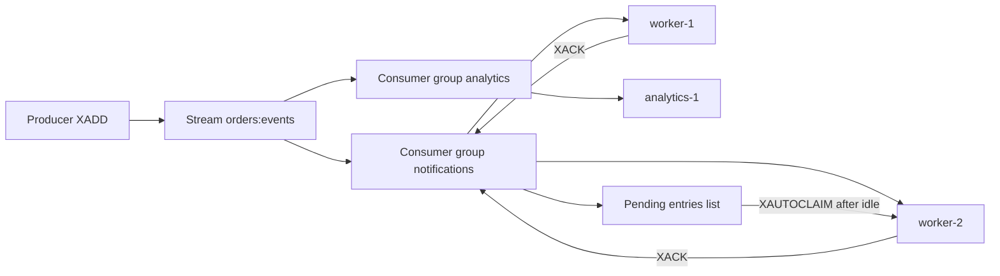

### 27.8.6 Streams

#### Concept

A Stream is an append-only log of entries, each with an auto-generated id (`1725600000000-0`, a millisecond timestamp plus a sequence) and a map of fields. Consumers read from a position; **consumer groups** let several workers share a stream, each entry delivered to one member of the group, with explicit acknowledgement and a record of pending (delivered but unacknowledged) entries. It is a lightweight Kafka inside Redis.

#### Why does it exist?

Lists as queues lose messages on consumer crash and cannot fan out to several independent consumers. Pub/Sub loses messages if nobody is listening. Streams give durable (as durable as your Redis persistence), replayable, acknowledged delivery with consumer groups, without running a broker. For moderate volumes (tens of thousands of messages per second) with modest retention, they are enough.

#### Mental model

Imagine a ticker tape in a newsroom. Every story is printed with a timestamp and stays on the tape. Each desk (consumer group) has a marker showing how far it has read. Inside a desk, several editors (consumers) each tear off the next story; the desk keeps a note of which editor has which story until they say "done". If an editor goes home with a story in their pocket, the desk can reassign it.

#### How it works



1. `XADD orders:events * type OrderPlaced orderId 123 MAXLEN ~ 100000` appends an entry and trims the stream to roughly 100,000 entries (the `~` makes trimming cheap).
2. `XGROUP CREATE orders:events notifications $ MKSTREAM` creates a group starting at the end (`0` to start from the beginning).
3. Each worker loops on `XREADGROUP GROUP notifications worker-1 COUNT 10 BLOCK 5000 STREAMS orders:events >`. The `>` means "entries never delivered to this group". Delivered entries go into the group's pending entries list (PEL) tagged with the consumer name and delivery time.
4. After processing, `XACK orders:events notifications <id>` removes the entry from the PEL.
5. If a worker dies, its entries stay in the PEL. `XPENDING` shows them; `XAUTOCLAIM orders:events notifications worker-2 60000 0-0` transfers entries idle for more than 60 seconds to `worker-2`, which processes them. A delivery counter in the PEL lets you detect poison messages and move them to a dead-letter stream after N attempts.
6. Different groups read the same stream independently: `notifications` and `analytics` each have their own last-delivered id and PEL.

#### NestJS example

A consumer as a long-running provider with graceful shutdown. Note the dedicated connection: `BLOCK` ties up the connection while waiting.

```ts
// events/order-events.consumer.ts
import { Injectable, Logger, OnModuleDestroy, OnModuleInit, Inject } from '@nestjs/common';
import Redis from 'ioredis';
import { REDIS_BLOCKING } from '../redis/redis.module';
import { NotificationsService } from '../notifications/notifications.service';

const STREAM = 'orders:events';
const GROUP = 'notifications';
const MAX_DELIVERIES = 5;

@Injectable()
export class OrderEventsConsumer implements OnModuleInit, OnModuleDestroy {
  private readonly logger = new Logger(OrderEventsConsumer.name);
  private running = true;
  private loop?: Promise<void>;
  private readonly consumer = `${process.env.HOSTNAME ?? 'local'}-${process.pid}`;

  constructor(
    @Inject(REDIS_BLOCKING) private readonly redis: Redis,
    private readonly notifications: NotificationsService,
  ) {}

  async onModuleInit(): Promise<void> {
    try {
      await this.redis.xgroup('CREATE', STREAM, GROUP, '$', 'MKSTREAM');
    } catch (err) {
      if (!(err as Error).message.includes('BUSYGROUP')) throw err; // group already exists
    }
    this.loop = this.run();
  }

  async onModuleDestroy(): Promise<void> {
    this.running = false;          // finish the in-flight batch, then stop
    await this.loop;
  }

  private async run(): Promise<void> {
    while (this.running) {
      // 1. Reclaim entries another worker abandoned (idle > 60 s).
      const [, claimed] = await this.redis.xautoclaim(STREAM, GROUP, this.consumer, 60_000, '0-0', 'COUNT', 10);
      await this.handleBatch(claimed as [string, string[]][]);

      // 2. Read new entries, blocking up to 5 s.
      const res = await this.redis.xreadgroup('GROUP', GROUP, this.consumer, 'COUNT', 10, 'BLOCK', 5000, 'STREAMS', STREAM, '>');
      if (!res) continue;
      for (const [, entries] of res as [string, [string, string[]][]][]) await this.handleBatch(entries);
    }
  }

  private async handleBatch(entries: [string, string[]][]): Promise<void> {
    for (const [id, fields] of entries) {
      const data = Object.fromEntries(fields.reduce<string[][]>((acc, v, i) => (i % 2 ? (acc[acc.length - 1].push(v), acc) : [...acc, [v]]), []));
      try {
        await this.notifications.handleOrderEvent(data);   // must be idempotent: redelivery is normal
        await this.redis.xack(STREAM, GROUP, id);
      } catch (err) {
        const [pending] = await this.redis.xpending(STREAM, GROUP, id, id, 1) as [string, string, number, number][];
        if (pending && pending[3] >= MAX_DELIVERIES) {
          await this.redis.multi().xadd(`${STREAM}:dlq`, '*', 'originalId', id, 'error', String(err), ...fields).xack(STREAM, GROUP, id).exec();
          this.logger.error(`moved ${id} to DLQ after ${pending[3]} deliveries`);
        } else {
          this.logger.warn(`entry ${id} failed, will be reclaimed: ${(err as Error).message}`);
        }
      }
    }
  }
}
```

#### Production scenario

An order service publishes 200 events per second to a Stream trimmed at 1 million entries (about 300 MB at 300 bytes per entry). Three consumer groups: notifications (3 workers), analytics (1 worker), search indexer (2 workers). Consumer lag is measured with `XINFO GROUPS` (the `lag` field in Redis 7) and alerted at 10,000 entries. AOF `everysec` persistence means a crash loses at most one second of events, which the team documents and accepts; anything needing stronger guarantees goes through the outbox and Kafka.

#### Edge cases & failure modes

- A consumer that processes but crashes before `XACK` causes redelivery. Handlers must be idempotent.
- `MAXLEN` trimming can delete entries a slow group has not read yet. Monitor lag against the trim size.
- `XAUTOCLAIM` on an entry that a slow (not dead) worker is still processing causes double processing. Set the idle threshold above the handler's p99.
- A stream with no `MAXLEN` grows until eviction or OOM.
- Entries in the PEL with a delivery count climbing forever and no DLQ logic are a silent poison-message loop.

### 27.8.7 Pub/Sub

#### Concept

`PUBLISH channel message` sends a message to every client currently subscribed to that channel. It is fire-and-forget: no persistence, no acknowledgement, no replay. A subscriber that is disconnected at the moment of publishing never sees the message.

#### How it works

- `SUBSCRIBE channel`, `PSUBSCRIBE pattern*`, `PUBLISH channel payload`. A subscribed connection is in a special mode and can only run subscribe-family commands, so it must be a dedicated `ioredis` instance.
- In Cluster, `PUBLISH` is broadcast to every node so any subscriber anywhere sees it; sharded Pub/Sub (`SPUBLISH`/`SSUBSCRIBE`, Redis 7) scopes it to a slot's shard for efficiency.
- Use it for: cache invalidation broadcasts (27.6), fan-out of WebSocket messages across pods (a chat message received by pod A must reach a user connected to pod B), live config reloads.
- Do not use it for: jobs, events that must be processed, anything where losing a message matters. Use Streams or a broker.

```ts
// chat/chat.gateway.ts (excerpt): fan out across pods with Pub/Sub
@WebSocketGateway()
export class ChatGateway implements OnGatewayInit {
  @WebSocketServer() server!: Server;
  constructor(
    @Inject(REDIS) private readonly pub: Redis,
    @Inject(REDIS_SUBSCRIBER) private readonly sub: Redis,
  ) {}

  async afterInit(): Promise<void> {
    await this.sub.subscribe('chat:messages');
    this.sub.on('message', (_ch, raw) => {
      const msg = JSON.parse(raw) as { roomId: string; text: string; userId: string };
      this.server.to(msg.roomId).emit('message', msg);   // deliver to sockets on THIS pod
    });
  }

  @SubscribeMessage('send')
  async onSend(@MessageBody() msg: { roomId: string; text: string; userId: string }): Promise<void> {
    await this.pub.publish('chat:messages', JSON.stringify(msg)); // every pod, including this one, receives it
  }
}
```

The `@socket.io/redis-adapter` package does this generically for Socket.IO rooms. The point stands: Pub/Sub is the right tool because a lost chat message during a pod restart is acceptable and a queued one arriving 30 seconds late is not.

### 27.8.8 TTL and expiry mechanics

#### Concept

A key with a TTL is removed by Redis after the TTL elapses. Removal happens in two ways: **lazily**, when a client accesses an expired key and Redis deletes it before answering "nil"; and **actively**, by a background task that samples keys with TTLs 10 times a second and deletes expired ones.

#### How it works

1. `EXPIRE key seconds`, `PEXPIRE key ms`, `EXPIREAT`, or the `EX`/`PX` options on `SET`. `TTL key` and `PTTL key` report remaining time; `-1` means no expiry, `-2` means the key does not exist. `PERSIST` removes the TTL.
2. The active expiry cycle takes 20 random keys from the set of keys with TTLs, deletes the expired ones, and repeats while more than 25 percent of the sample was expired, bounded by a time budget (about 25 ms per 100 ms by default). Under a mass expiry, expired keys can linger for seconds and still count toward memory; `INFO` shows `expired_keys` climbing.
3. `SET` on an existing key without `EX`/`PX` removes the TTL (`KEEPTTL` preserves it). `HSET`, `SADD`, `ZADD` on an existing key preserve the TTL. This asymmetry is a frequent bug: a "refresh the cached value" `SET` silently makes the key permanent.
4. Expiry uses the server clock. On replicas, keys are not expired independently; the primary sends explicit `DEL`s. A replica that has lost contact keeps serving logically expired keys (it returns them as expired for reads, but they occupy memory).
5. During a snapshot or AOF rewrite, expiry still runs on the main thread; it is not a source of blocking on its own.

The practical rules: always pass a TTL on every `SET` for cache data; use `GETEX` or `PEXPIRE` explicitly when you want to extend; and never rely on the exact millisecond of expiry for correctness.

### 27.8.9 HyperLogLog

#### Concept

A HyperLogLog (HLL) estimates the number of unique elements in a set using about 12 KB of memory, regardless of whether you add ten elements or ten billion, with a standard error of 0.81 percent. It cannot tell you whether a specific element was added; it only counts.

#### How it works

- `PFADD key element...` adds elements; returns 1 if the estimate changed.
- `PFCOUNT key...` returns the estimated cardinality (of the union if several keys are passed).
- `PFMERGE dest src...` merges HLLs, so daily HLLs can be combined into a monthly count.

```ts
// analytics/unique-visitors.service.ts
async recordVisitor(day: string, visitorId: string): Promise<void> {
  await this.redis.pfadd(`uv:${day}`, visitorId);          // 12 KB per day, forever
}

async uniqueVisitorsLast7Days(days: string[]): Promise<number> {
  return this.redis.pfcount(...days.map((d) => `uv:${d}`)); // union estimate, one command
}
```

Use it for dashboards, "seen by N people", unique IPs per endpoint. Do not use it where 1 percent error matters (billing, quotas).

### 27.8.10 Bitmaps

#### Concept

A bitmap is a string treated as an array of bits. `SETBIT key offset 1` sets one bit; `BITCOUNT` counts set bits; `BITOP` combines bitmaps with AND/OR/XOR. With user ids as offsets, a bitmap of 10 million users costs 1.25 MB.

#### How it works

- `SETBIT dau:2026-09-06 41 1` marks user 41 active today. `GETBIT` reads it. `BITCOUNT dau:2026-09-06` counts active users.
- `BITOP AND result dau:2026-09-05 dau:2026-09-06` finds users active both days; `BITCOUNT result` counts them. `BITOP OR` over 30 daily bitmaps gives monthly active users exactly.
- `BITPOS key 1` finds the first set bit. `BITFIELD` reads and writes integers of arbitrary width at bit offsets, useful for packed counters.
- Offsets must be integers, so this needs sequential integer user ids or a mapping. UUIDs need HLL or sets instead.

```ts
// analytics/dau.service.ts
markActive(userIntId: number, day: string): Promise<number> {
  return this.redis.setbit(`dau:${day}`, userIntId, 1);
}

async retained(dayA: string, dayB: string): Promise<number> {
  await this.redis.bitop('AND', `tmp:retained:${dayA}:${dayB}`, `dau:${dayA}`, `dau:${dayB}`);
  const n = await this.redis.bitcount(`tmp:retained:${dayA}:${dayB}`);
  await this.redis.unlink(`tmp:retained:${dayA}:${dayB}`);
  return n;
}
```

Also good for: feature flag rollouts by user id bucket, "has this user seen this onboarding step" flags (one bitmap per step), and daily check-in streaks.

### 27.8.11 Geo

#### Concept

Geo commands store members with a longitude and latitude (encoded as a geohash score inside a sorted set) and answer "what is within radius R of this point" in O(log N + M).

#### How it works

- `GEOADD drivers:online lon lat driverId` adds or updates a position. Because it is a ZSET underneath, `ZREM` removes a driver and `ZCARD` counts them.
- `GEOSEARCH drivers:online FROMLONLAT lon lat BYRADIUS 3 km ASC COUNT 20 WITHDIST` returns the 20 nearest drivers within 3 km with distances.
- `GEODIST key m1 m2 km`, `GEOPOS key member`.
- Positions update with the driver's location ping, typically every 3 to 5 seconds, so a ride-booking app with 50,000 online drivers does 10,000 to 16,000 `GEOADD`s per second, which one Redis instance handles easily.

```ts
// dispatch/driver-locations.service.ts
async updateLocation(driverId: string, lon: number, lat: number): Promise<void> {
  await this.redis.geoadd('drivers:online', lon, lat, driverId);
  await this.redis.set(`driver:lastseen:${driverId}`, Date.now(), 'PX', 30_000); // presence with its own TTL
}

async nearestDrivers(lon: number, lat: number, radiusKm = 3, limit = 20) {
  const rows = await this.redis.geosearch('drivers:online', 'FROMLONLAT', lon, lat, 'BYRADIUS', radiusKm, 'km', 'ASC', 'COUNT', limit, 'WITHDIST') as [string, string][];
  return rows.map(([driverId, dist]) => ({ driverId, distanceKm: Number(dist) }));
}
```

Members in a Geo ZSET have no individual TTL. A driver who goes offline without a clean disconnect stays in the set. The presence key with its own TTL handles that: a sweeper removes members whose presence key is gone, or the dispatcher checks presence for each candidate before offering a ride.

## 27.9 Distributed locks

#### Concept

A distributed lock lets one process among many claim exclusive rights to do something: run the nightly report, flush the view counters, process a specific order. Redis implements a simple lock with `SET key token NX PX ms`: the first caller sets the key and owns the lock; others see it already set; the TTL guarantees release if the owner dies.

#### Why does it exist?

Without a lock, every pod runs the cron job, three workers process the same order, and two requests both think they are the first to reserve the last item. A process-level mutex does not help across pods; you need shared state, and Redis is the cheapest shared state you have.

#### Mental model

Imagine a single key hanging on a hook by the storeroom door. Whoever takes the key has the room. The key has a note: "if not returned within 30 seconds, the janitor will cut a new one". That note is the TTL, and it is why the lock is not perfectly safe: if the holder is still inside when the janitor cuts a new key, two people are in the room.

#### How it works

1. **Acquire**: `SET lock:report:daily <random-token> NX PX 30000`. `OK` means acquired; `nil` means someone holds it.
2. **Do the work**, ideally in far less time than the TTL.
3. **Release with compare-and-delete** in Lua: `if GET == token then DEL`. A plain `DEL` could delete another holder's lock if yours had already expired and been re-acquired.
4. **TTL versus job duration**: if the job can run longer than the TTL, either extend the lock periodically from a heartbeat (a Lua `PEXPIRE` if the token matches) or design the job to be safe under duplicate execution. The lock alone does not guarantee mutual exclusion once its TTL passes.
5. **Fencing tokens**: a monotonically increasing number handed out with each lock acquisition (an `INCR` on a counter). The protected resource (say PostgreSQL) rejects writes carrying a token lower than the highest it has seen. This makes a stale lock holder's late write harmless, and it is the only way to make a TTL-based lock genuinely safe. Redis alone cannot fence; the store being protected must check the token.
6. **Redlock** is an algorithm that acquires the lock on a majority of N independent Redis nodes to survive a single node failure. Its safety has been criticized (Martin Kleppmann's analysis) because it relies on bounded clock drift and bounded pauses, neither of which a GC pause or a VM freeze respects. The honest position: Redlock is fine for efficiency locks (avoid doing work twice) and not sufficient for correctness locks (never do this twice) without fencing.
7. **When PostgreSQL is the better lock**: if the thing you are protecting lives in PostgreSQL, lock it there. `SELECT ... FOR UPDATE` on the order row gives you a lock that is released exactly at commit or rollback, with no TTL guessing, no token, and no second system. `pg_advisory_xact_lock(hashtext('report:daily'))` gives a named lock with the same properties. Redis locks are for coordinating work whose state is not in a database, or where holding a database transaction open for the duration would be too long.

#### NestJS example

```ts
// redis/redis-lock.service.ts
import { Injectable, Inject, Logger } from '@nestjs/common';
import Redis from 'ioredis';
import { randomUUID } from 'node:crypto';
import { REDIS } from './redis.module';

const RELEASE = `if redis.call('GET', KEYS[1]) == ARGV[1] then return redis.call('DEL', KEYS[1]) end return 0`;
const EXTEND  = `if redis.call('GET', KEYS[1]) == ARGV[1] then return redis.call('PEXPIRE', KEYS[1], ARGV[2]) end return 0`;

@Injectable()
export class RedisLockService {
  private readonly logger = new Logger(RedisLockService.name);
  constructor(@Inject(REDIS) private readonly redis: Redis) {
    this.redis.defineCommand('lockRelease', { numberOfKeys: 1, lua: RELEASE });
    this.redis.defineCommand('lockExtend', { numberOfKeys: 1, lua: EXTEND });
  }

  // Runs fn only if the lock is acquired. Heartbeats to extend while fn runs. Fails closed if Redis is down.
  async withLock<T>(name: string, ttlMs: number, fn: (fence: number) => Promise<T>): Promise<T | null> {
    const key = `lock:${name}`;
    const token = randomUUID();
    const got = await this.redis.set(key, token, 'PX', ttlMs, 'NX');
    if (got !== 'OK') return null;
    const fence = await this.redis.incr(`fence:${name}`);   // monotonically increasing fencing token

    const client = this.redis as Redis & {
      lockRelease(k: string, t: string): Promise<number>;
      lockExtend(k: string, t: string, ttl: number): Promise<number>;
    };
    const heartbeat = setInterval(async () => {
      const ok = await client.lockExtend(key, token, ttlMs).catch(() => 0);
      if (!ok) this.logger.error(`lost lock ${name} while working; results may be duplicated`);
    }, Math.floor(ttlMs / 3));

    try {
      return await fn(fence);
    } finally {
      clearInterval(heartbeat);
      await client.lockRelease(key, token).catch(() => undefined);
    }
  }
}
```

#### PostgreSQL example

The same coordination without Redis, for a job whose state is in the database. The advisory lock is released automatically at transaction end, even on crash, because the session dies.

```sql
BEGIN;
-- Returns immediately with false if another session holds it; no TTL needed.
SELECT pg_try_advisory_xact_lock(hashtext('report:daily')) AS acquired;
-- if acquired: do the work in this transaction
INSERT INTO daily_reports (report_date, total_cents)
SELECT current_date, sum(total_cents) FROM orders WHERE created_at::date = current_date - 1;
COMMIT;  -- lock released here, exactly when the work is durable
```

And the fencing token consumer side: a table that refuses stale writers.

```sql
UPDATE report_runs
   SET status = 'done', finished_at = now(), fence = $1
 WHERE report_date = $2 AND fence < $1;   -- a stale holder with a lower fence updates zero rows
```

#### Failure scenario

The nightly settlement job takes a Redis lock with a 60 second TTL and normally runs in 20 seconds. One night PostgreSQL is slow and the job runs for 95 seconds. At second 60 the lock expires; a second pod, retrying on its own schedule, acquires it and starts the same settlement. Both write settlement rows; finance sees doubled payouts. The fix was three things: a heartbeat that extends the lock, a fencing token checked by the `settlements` insert, and a unique constraint on `(merchant_id, settlement_date)` so that duplicate runs fail loudly instead of silently doubling. The unique constraint was the one that would have saved them on its own.

#### How a Senior Backend Engineer thinks about this

The first question is "what are we protecting, and where does it live?" If it lives in PostgreSQL, lock it in PostgreSQL. If the lock is for efficiency (do not run the same expensive job twice), a Redis `SET NX` with a TTL is fine and the occasional duplicate is a cost, not a bug. If the lock is for correctness, a lock is not enough by itself; the operation must be idempotent or fenced, because every lock with a timeout can be held by two parties. A senior never lets a lock be the only line of defense against a double payout.

#### Common mistakes

- Releasing with `DEL` instead of compare-and-delete.
- TTL shorter than the job's p99 and no heartbeat.
- Using a lock to protect a database row that `SELECT FOR UPDATE` would protect better.
- Failing open when Redis is down ("could not get lock, run anyway"). For locks, fail closed: skip the run and alert.

## 27.10 Atomic operations and the source-of-truth question

#### Concept

Because Redis executes one command at a time, every single command is atomic: `INCR` cannot lose an increment, `SETNX` cannot be won by two clients, `HINCRBY` on stock cannot interleave. Lua scripts extend atomicity to a sequence with logic: read, compare, write, all as one unit.

#### How it works

- `INCR`, `DECR`, `INCRBY`, `INCRBYFLOAT`: numeric read-modify-write in one step. Use for counters, quotas, sequence numbers.
- `SETNX` (or `SET ... NX`): claim a key once. Use for dedup and locks.
- `MULTI`/`EXEC`: queue several commands and run them without interleaving. No branching, but `WATCH key` gives optimistic concurrency: `EXEC` fails if a watched key changed. Rarely worth it versus a Lua script.
- Lua scripts: check-and-set. The canonical example is inventory reservation: "if stock >= qty then stock = stock - qty, return remaining, else return -1".

```ts
// inventory/redis-reservation.service.ts
// KEYS[1] = stock key, ARGV[1] = qty. Returns remaining stock or -1 if insufficient.
const RESERVE = `
  local stock = tonumber(redis.call('GET', KEYS[1]) or '0')
  local qty = tonumber(ARGV[1])
  if stock < qty then return -1 end
  return redis.call('DECRBY', KEYS[1], qty)
`;

async tryReserve(sku: string, qty: number): Promise<number> {
  const client = this.redis as Redis & { reserve(k: string, q: number): Promise<number> };
  return client.reserve(`stock:flash:${sku}`, qty);
}
```

#### The honest answer about source of truth

Reserving stock in Redis is fast (0.3 ms, 50,000 reservations per second on one core) and atomic. It is also volatile: a failover loses the last few writes, `noeviction` OOM rejects the decrement, an operator's `FLUSHALL` sets every stock to zero. If Redis says 0 left and PostgreSQL says 40, which is right? You must decide before you build.

The pattern that works in practice for a flash sale:

1. PostgreSQL holds `inventory.quantity_on_hand` as truth.
2. At sale start, load the sellable quantity into `stock:flash:{sku}` in Redis.
3. The hot path reserves in Redis with the Lua script. A `-1` returns "sold out" in under a millisecond without touching PostgreSQL; this is what protects the database from 100,000 people clicking at once.
4. A successful reservation creates an order in PostgreSQL inside a transaction that also decrements `quantity_on_hand` with a `CHECK (quantity_on_hand >= 0)` constraint. If that fails (Redis and PostgreSQL disagree), the request fails and a compensating `INCRBY` returns the Redis unit.
5. A reconciliation job compares Redis and PostgreSQL every minute and logs drift.

Redis is the gatekeeper; PostgreSQL is the judge. For normal traffic (tens of orders per second), skip Redis entirely and use `UPDATE inventory SET quantity_reserved = quantity_reserved + $1 WHERE product_id = $2 AND quantity_on_hand - quantity_reserved >= $1` with a row lock; it is simpler and cannot disagree with itself. See Part 21 — Database Transactions for the locking detail.

## 27.11 Rate limiting in Redis

#### Concept

A rate limiter bounds how many requests a caller may make in a time window. Redis is the natural place for it because the counter must be shared across pods and updated atomically under high concurrency.

#### How it works

Four algorithms, each with a Redis shape:

| Algorithm | Redis shape | Accuracy | Memory | Notes |
|---|---|---|---|---|
| Fixed window | `INCR rl:{key}:{windowStart}` + `EXPIRE` | Allows 2x burst at window edges | One int per key per window | Simplest; fine for coarse limits |
| Sliding window log | `ZADD` timestamp per request; `ZREMRANGEBYSCORE` old; `ZCARD` | Exact | One member per request in window | Costly at high limits (1,000 per minute means 1,000 members) |
| Sliding window counter | Two fixed windows weighted by overlap | Close to exact, no edge burst | Two ints | Best default for API limits |
| Token bucket | Lua: refill tokens by elapsed time, take one if available | Exact, allows configured bursts | Two fields in a hash | Best for smoothing and per-client burst allowances |

Sliding window log in Lua, exact and atomic:

```ts
// KEYS[1] = zset key, ARGV[1] = now ms, ARGV[2] = window ms, ARGV[3] = limit, ARGV[4] = unique member
const SLIDING_LOG = `
  redis.call('ZREMRANGEBYSCORE', KEYS[1], 0, ARGV[1] - ARGV[2])
  local count = redis.call('ZCARD', KEYS[1])
  if count >= tonumber(ARGV[3]) then return 0 end
  redis.call('ZADD', KEYS[1], ARGV[1], ARGV[4])
  redis.call('PEXPIRE', KEYS[1], ARGV[2])
  return 1
`;
```

Token bucket in Lua, the one to use for "100 requests per second with bursts of 200":

```ts
// KEYS[1] = hash key, ARGV[1] = now ms, ARGV[2] = capacity, ARGV[3] = refill per second, ARGV[4] = tokens requested
const TOKEN_BUCKET = `
  local b = redis.call('HMGET', KEYS[1], 'tokens', 'ts')
  local tokens = tonumber(b[1]) or tonumber(ARGV[2])
  local ts = tonumber(b[2]) or tonumber(ARGV[1])
  local elapsed = math.max(0, tonumber(ARGV[1]) - ts) / 1000
  tokens = math.min(tonumber(ARGV[2]), tokens + elapsed * tonumber(ARGV[3]))
  local allowed = 0
  if tokens >= tonumber(ARGV[4]) then tokens = tokens - tonumber(ARGV[4]); allowed = 1 end
  redis.call('HSET', KEYS[1], 'tokens', tokens, 'ts', ARGV[1])
  redis.call('PEXPIRE', KEYS[1], math.ceil(tonumber(ARGV[2]) / tonumber(ARGV[3]) * 2000))
  return allowed
`;
```

#### NestJS example

A guard using the token bucket, and `@nestjs/throttler` with Redis storage for the common case.

```ts
// rate-limit/token-bucket.guard.ts
import { CanActivate, ExecutionContext, HttpException, HttpStatus, Injectable, Inject } from '@nestjs/common';
import Redis from 'ioredis';
import { REDIS } from '../redis/redis.module';

@Injectable()
export class TokenBucketGuard implements CanActivate {
  constructor(@Inject(REDIS) private readonly redis: Redis) {
    this.redis.defineCommand('tokenBucket', { numberOfKeys: 1, lua: TOKEN_BUCKET });
  }

  async canActivate(ctx: ExecutionContext): Promise<boolean> {
    const req = ctx.switchToHttp().getRequest();
    const subject = req.user?.id ?? req.ip;                         // per user if authenticated, else per IP
    const client = this.redis as Redis & { tokenBucket(k: string, now: number, cap: number, rate: number, n: number): Promise<number> };
    let allowed: number;
    try {
      allowed = await client.tokenBucket(`rl:tb:${subject}`, Date.now(), 200, 100, 1);
    } catch {
      return true;                                                   // Redis down: fail open for public API, log it
    }
    if (!allowed) throw new HttpException('Too Many Requests', HttpStatus.TOO_MANY_REQUESTS);
    return true;
  }
}
```

```ts
// app.module.ts: @nestjs/throttler with Redis storage
import { ThrottlerModule, ThrottlerGuard } from '@nestjs/throttler';
import { ThrottlerStorageRedisService } from '@nest-lab/throttler-storage-redis';
import { APP_GUARD } from '@nestjs/core';
import Redis from 'ioredis';

@Module({
  imports: [
    ThrottlerModule.forRoot({
      throttlers: [{ name: 'default', ttl: 60_000, limit: 300 }],  // 300 per minute
      storage: new ThrottlerStorageRedisService(new Redis(process.env.REDIS_URL!)),
    }),
  ],
  providers: [{ provide: APP_GUARD, useClass: ThrottlerGuard }],
})
export class AppModule {}
```

`@nestjs/throttler` keys by IP through `getTracker` by default; override it in a subclass of `ThrottlerGuard` to key by user id or API key, otherwise every user behind one corporate NAT shares a limit.

#### Fail open or fail closed?

When Redis is unavailable, a rate limiter must choose. Fail open means unlimited traffic during the outage; for a public read API that is usually right, because the alternative is a full outage caused by a cache. Fail closed means rejecting everything; for a login endpoint, an OTP sender or a payment initiation, that is right, because unlimited attempts during an outage is an attack window. Make the choice per endpoint, in code, with a log line so the outage is visible.

#### Interview questions

1. **Why is a `SET NX` lock not sufficient for correctness, and what makes it sufficient?** Expected: TTL expiry lets two holders exist; fencing tokens checked by the protected resource.
2. **Reserve flash-sale stock in Redis or PostgreSQL?** Expected: Redis as gatekeeper for the burst, PostgreSQL as truth with a `CHECK` constraint, reconciliation between them; plain PostgreSQL for normal traffic.
3. **Compare sliding window log and token bucket.** Expected: log is exact but memory grows with the limit; bucket is O(1) memory and allows configured bursts.
4. **Redis dies during a rate-limited login flow. What should happen?** Expected: fail closed for auth-sensitive endpoints, fail open for public reads, decided per endpoint.
5. **Why does Redlock attract criticism?** Expected: it assumes bounded clock drift and process pauses; a GC pause can make a client believe it holds an expired lock. Efficiency yes, correctness only with fencing.
6. **Streams versus Pub/Sub versus Lists for a job queue?** Expected: Pub/Sub loses messages; Lists lack acks and groups; Streams have both; a broker when you need more retention, tooling or throughput.

#### Practical exercise

Implement a per-API-key token bucket rate limiter (capacity 50, refill 10 per second) as a NestJS guard, backed by the Lua script above. Acceptance criteria: (a) a burst of 50 requests in 10 ms all pass, the 51st returns 429 with a `Retry-After` header computed from the refill rate; (b) with two app instances behind a load balancer the limit is shared; (c) with Redis stopped, `/public/*` routes pass and `/auth/*` routes return 503 with a logged reason; (d) a Jest test with a fake clock proves the refill arithmetic.
