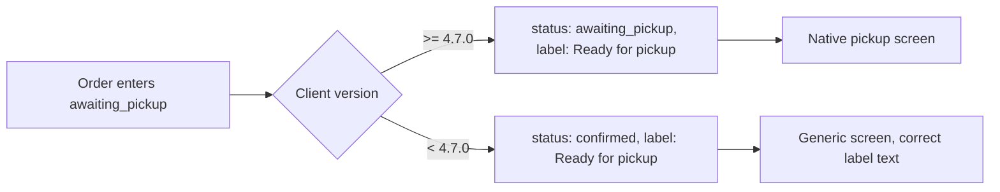
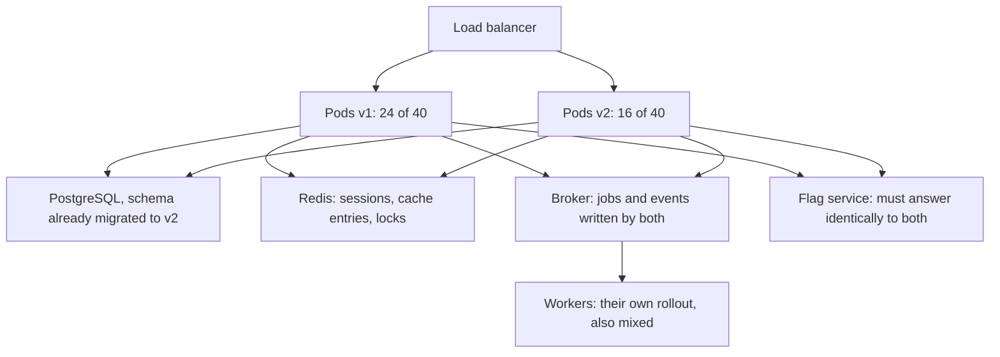
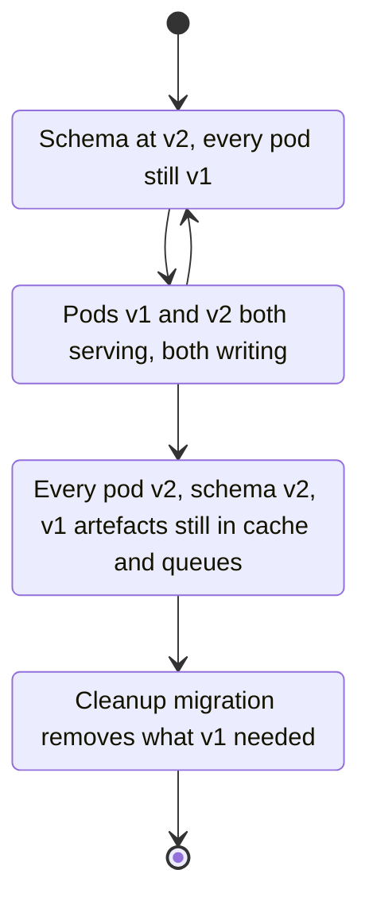
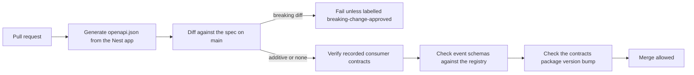

## 28.5 Mobile and third-party clients

#### Concept

A mobile app is a copy of your client code that you shipped to a device you do not own, that runs until the user chooses to replace it. A partner integration is a copy of your contract that somebody else implemented, possibly years ago, possibly by a contractor who has left. Both are consumers you cannot deploy. They are the hardest compatibility constraint in the system, and they are the reason the additive rules in 28.2 are rules and not preferences.

#### Why does it exist?

Because "just tell them to upgrade" is not a mechanism. App-store review takes hours to days. Users disable auto-update. Corporate devices are pinned by mobile device management. Some phones cannot run the OS version your new build requires. And a partner's integration is a line item in someone else's roadmap that competes with their own features.

The consequence: the set of clients calling your API today is not the set you designed for. It is the union of every version you have ever shipped that somebody still runs.

#### Mental model

Imagine you print a catalogue and mail it to two million homes. You cannot recall it. Whatever prices, product codes and order-form fields are printed in it are now a contract you must honour, because people will fill in that form and post it. You can print a *new* catalogue, but for the next two years you will receive orders on the old one. Everything you build to accept the old form is not technical debt; it is the cost of having customers.

#### How it works

**App version lifetimes.** Instrument the `X-App-Version` header and look at the distribution. A typical consumer app after two years of monthly releases looks roughly like this:

| Age of installed version | Share of active users | Notes |
|---|---|---|
| Current release | 55-70% | after 2-3 weeks of staged rollout |
| Under 3 months old | 20-25% | |
| 3-12 months old | 6-12% | users with auto-update off |
| 12-24 months old | 2-5% | old OS versions, MDM-pinned devices |
| Over 24 months | 0.5-2% | still real money at scale |

At 3 million monthly actives, "0.5%" is 15,000 people. A change that breaks them is an incident, not a rounding error.

**The forced-upgrade policy.** Every mobile client should call a small configuration endpoint at launch and be prepared to be told one of three things: `none` (carry on), `soft` (show a dismissible "update available" card), `hard` (show a blocking screen with a store link). A hard block is a deliberate act of breaking users, so it needs a written policy. It is justified when:

- a security vulnerability in the client is being actively exploited, or the client leaks data;
- the client sends requests that are dangerous to the backend (an unbounded retry loop, a request that costs 30 seconds of database time);
- a legal or regulatory requirement cannot be met by the old client;
- an underlying dependency is dead (a payment SDK the processor has switched off, a TLS version your load balancer no longer accepts).

It is *not* justified because maintaining two response shapes is annoying. The cost of a hard block is measured in uninstalls and support tickets; the cost of an extra field is measured in a code review.

Note that a hard block is itself a compatibility problem: the *oldest* clients must be able to understand the block. If version 1.0 does not know about the config endpoint at all, you cannot block it that way; you can only make its calls fail, which shows the user a generic error. That is why the config endpoint and the upgrade screen belong in version 1.0 of any app you expect to live for years. It is the single highest-leverage thing you can put in the first release.

**Feature flags keyed by app version.** Server-side flags let you turn a feature on for clients that can render it. The key insight is that the flag's audience is `(platform, version range, tenant, user cohort)`, not just `user`. A feature that requires client 4.7 is evaluated as "is this client at least 4.7 *and* is the flag on for this user".

**Server-driven configuration and layouts.** The escape hatch. Instead of the client hard-coding "home screen shows banner, then reorder, then categories", the server returns a list of section descriptors and the client renders the ones it knows, ignoring the rest. Now you can reorder sections, remove one, or add one that only new clients render, without shipping an app. The tolerant reader applied to UI. It has a real cost: the client becomes an interpreter, harder to test and debug, and the server now owns presentation decisions. Use it for ordering, visibility, copy and merchandising; do not use it to describe pixel layouts.

**Enum values: the sharpest edge.** Two separate rules, and people conflate them.

1. **Never change the meaning of an existing value.** If `status: "processing"` used to mean "payment captured, warehouse is picking" and you redefine it as "payment authorised only", every old client now shows "we are packing your order" for orders where no money has moved. Nothing crashes. Support tickets appear three weeks later and nobody connects them to the deploy. This is the worst class of change in the whole part.
2. **Adding a value is a breaking change for strict clients.** A Kotlin `when` without an `else`, a Swift `enum` decoded with a non-failable initializer, a TypeScript `switch` with `default: throw` - all of them crash or throw on a value they have never seen. Adding `awaiting_pickup` to `OrderStatus` is additive on paper and a crash in production.

Design for unknown values on **both** sides:

- *Client side:* every enum decoder maps unknown to an `unknown`/`other` case and the UI has a neutral rendering for it. Ship this in version 1.0 and you have bought yourself the freedom to add values forever.
- *Server side:* you cannot rely on clients you already shipped, so the server gates new enum values by client version and maps them down to the nearest safe older value. Pair the enum with a human-readable label field (`statusLabel`) that the client renders verbatim, so an old client shows correct text even for a state it does not model.



**API keys and unmaintained partner integrations.** Every partner integration eventually becomes nobody's job. Protect yourself with two habits. First, per-key attribution: every request is attributed to an API key, and the key record has a named human owner, a company, an email and a renewal date. Second, per-key usage telemetry at the *endpoint and field* level - not just "key K called `/v1/orders` 40,000 times" but "key K read `order.total` and `order.legacy_status`". Field-level usage is what turns "can we remove this field?" from a debate into a query. You can collect it cheaply by sampling responses and recording which fields a serializer actually emitted for that key, or by having partners declare a `fields=` parameter.

**The deprecation conversation and a sunset timeline that works.** Announcements alone do not move anyone. What moves people is a deadline that has already hurt once. The timeline that actually works:

| Phase | When | What happens |
|---|---|---|
| Announce | T | Changelog, direct email to every key owner that called the endpoint in the last 90 days, migration guide with a diff |
| Headers on | T | `Deprecation` and `Sunset` response headers on every affected response, plus a `Link` to the guide |
| Nag | T+1 and T+2 months | Automated email with that key's own call counts and the exact fields they use |
| Brownout 1 | T+4 months | 1 hour of `410 Gone`, announced two weeks ahead, in the partner's low-traffic window |
| Brownout 2 | T+5 months | 4 hours, same treatment |
| Sunset | T+6 months | Permanent `410 Gone` with a body pointing at the guide; keys can request a documented, time-boxed extension |

Six months is the floor for server-to-server partners. For mobile-facing endpoints the clock is longer: 18 to 24 months, because you are waiting for devices, not developers. The brownouts are the part people skip and the part that works: a partner who has ignored six emails will fix the integration within a day of their dashboard going blank for an hour.

#### NestJS example

Client context extracted once, then used for gating. Note that malformed version headers never cause a 400 - an old client sending garbage must still work.

```ts
// src/common/client-context.middleware.ts
import { Injectable, NestMiddleware } from '@nestjs/common';
import { Request, Response, NextFunction } from 'express';

export type Platform = 'ios' | 'android' | 'web' | 'partner';
export type Version = readonly [number, number, number];
export interface ClientContext { platform: Platform; version: Version; raw: string }

const SEMVER = /^(\d+)\.(\d+)\.(\d+)/;

export function atLeast(a: Version, b: Version): boolean {
  return a[0] !== b[0] ? a[0] > b[0] : a[1] !== b[1] ? a[1] > b[1] : a[2] >= b[2];
}

@Injectable()
export class ClientContextMiddleware implements NestMiddleware {
  use(req: Request & { client?: ClientContext }, _res: Response, next: NextFunction): void {
    const platform = (req.header('x-app-platform') ?? 'web').toLowerCase() as Platform;
    const raw = req.header('x-app-version') ?? '0.0.0';
    const m = SEMVER.exec(raw);
    // Unparseable version means "oldest possible client": the most conservative behaviour.
    const version: Version = m ? [Number(m[1]), Number(m[2]), Number(m[3])] : [0, 0, 0];
    req.client = { platform, version, raw };
    next();
  }
}
```

```ts
// src/orders/order-status.view.ts
import { ClientContext, atLeast, Version } from '../common/client-context.middleware';

export type OrderStatus =
  | 'pending' | 'confirmed' | 'packed' | 'shipped' | 'delivered'
  | 'cancelled' | 'awaiting_pickup' | 'returned';

// The version of the mobile client that first understood each value.
const INTRODUCED_IN: Record<OrderStatus, Version> = {
  pending: [1, 0, 0], confirmed: [1, 0, 0], packed: [1, 0, 0], shipped: [1, 0, 0],
  delivered: [1, 0, 0], cancelled: [1, 0, 0],
  awaiting_pickup: [4, 7, 0], returned: [5, 2, 0],
};

// The nearest older value that is not misleading. Chosen by product, written down, reviewed.
const DOWNGRADE_TO: Partial<Record<OrderStatus, OrderStatus>> = {
  awaiting_pickup: 'confirmed',
  returned: 'delivered',
};

export function statusForClient(status: OrderStatus, client: ClientContext): OrderStatus {
  if (client.platform === 'web' || atLeast(client.version, INTRODUCED_IN[status])) return status;
  return DOWNGRADE_TO[status] ?? 'confirmed';
}
```

```ts
// src/mobile/mobile-config.controller.ts
import { Controller, Get, Req } from '@nestjs/common';
import { Request } from 'express';
import { ClientContext, atLeast } from '../common/client-context.middleware';

@Controller({ path: 'mobile/config', version: '1' })
export class MobileConfigController {
  @Get()
  get(@Req() req: Request & { client: ClientContext }) {
    const c = req.client;
    const supported = atLeast(c.version, [3, 0, 0]);      // hard floor: security fix in 3.0.0
    const current = atLeast(c.version, [4, 9, 0]);        // soft nudge below this
    return {
      upgrade: !supported ? 'hard' : current ? 'none' : 'soft',
      storeUrl: c.platform === 'ios' ? 'https://apps.example.com/ios' : 'https://apps.example.com/android',
      // Capability flags: the client renders a feature only if the server says it may.
      features: {
        pickupOrders: atLeast(c.version, [4, 7, 0]),
        splitPayments: atLeast(c.version, [4, 9, 0]),
      },
      // Server-driven layout: unknown section types are ignored by the client.
      home: { sections: ['banner', 'reorder', 'categories', 'deals'] },
      // Polling and retry budgets pushed from the server so a bad client can be calmed remotely.
      network: { orderPollSeconds: 20, maxRetries: 3, timeoutMs: 8000 },
    };
  }
}
```

The `network` block is worth its own sentence. Shipping retry and polling budgets from the server is how you defuse a client-side retry storm without an app release. When an old version turns out to poll every 2 seconds, you set `orderPollSeconds` to 60 for that version range and the load drops within one app launch cycle.

#### PostgreSQL example

The API key registry that makes deprecation possible, and the usage table that answers "who still reads this field?".

```sql
CREATE TABLE api_keys (
  id            uuid PRIMARY KEY,
  key_hash      text NOT NULL UNIQUE,           -- never store the key itself
  partner_name  text NOT NULL,
  owner_email   text NOT NULL,                  -- a human, revalidated every 6 months
  owner_verified_at timestamptz NOT NULL,
  api_version   text NOT NULL DEFAULT 'v1',
  created_at    timestamptz NOT NULL DEFAULT now(),
  revoked_at    timestamptz
);

-- Rolled up hourly from access logs; small enough to keep for two years.
CREATE TABLE api_field_usage (
  hour        timestamptz NOT NULL,
  api_key_id  uuid NOT NULL REFERENCES api_keys(id),
  endpoint    text NOT NULL,
  field_path  text NOT NULL,                    -- 'order.legacy_status'
  calls       bigint NOT NULL,
  PRIMARY KEY (hour, api_key_id, endpoint, field_path)
);

-- "Can we remove order.legacy_status?"  This is the whole conversation.
SELECT k.partner_name, k.owner_email, sum(u.calls) AS calls_90d
  FROM api_field_usage u JOIN api_keys k ON k.id = u.api_key_id
 WHERE u.field_path = 'order.legacy_status' AND u.hour > now() - interval '90 days'
   AND k.revoked_at IS NULL
 GROUP BY 1, 2 ORDER BY calls_90d DESC;
```

#### Production scenario

A food-delivery platform with 4.2 million monthly actives adds curbside pickup. The new order state `awaiting_pickup` is gated at client 4.7.0. On rollout day 61% of users are on 4.7+, so 39% of pickup orders are served as `confirmed` with the label "Ready for pickup". Support sees no increase in tickets. Six months later 96% of users are on 4.7+, and the gate is removed in a one-line change with a comment recording the date. Total cost: 30 lines of mapping code and one product conversation about what the fallback should say.

#### Failure scenario

At 09:20 a backend release adds `returned` to `OrderStatus` because the returns team needs it. It ships without a version gate. The Android app decodes order status with a Kotlin `when` that has no `else` branch, wrapped in a coroutine that crashes the order-detail screen. Crash-free-sessions drops from 99.7% to 91.4% within 20 minutes. Only users with a returned order are affected, which is why it is not 100%, and which is also why it takes 50 minutes to correlate: the crash reports name a UI class, not the API.

Recovery: the backend maps `returned` to `delivered` for clients below 5.2.0, deployed at 10:35. Crash rate recovers in 15 minutes as apps re-fetch. The postmortem produces three rules: every response enum is declared in a shared contract file with an `introducedIn` version; a CI check fails when a value is added without one; and the next mobile release adds an `unknown` fallback case to every decoder so that this class of bug can never recur from the client side either.

#### Edge cases & failure modes

- **App-store staged rollout** means "released" does not mean "installed"; a version can be at 1% for days, so version gates must be based on measured distribution, not release dates.
- **A user reinstalls an old APK** from a third-party store; version numbers can go *down* in your telemetry.
- **MDM-pinned enterprise fleets** never upgrade; if you have enterprise customers, ask them for their pinned version before setting any floor.
- **The hard-block screen itself has bugs** - test it, including with no network and with a store URL that 404s.
- **Clock-based gates** (enable after a date) drift with device clocks; gate on version, evaluate on the server.
- **Partner integrations that parse by position** (CSV columns, XML element order) break when you add a field in the middle; see 28.10.
- **A partner mirrors your response into their own database** with a strict schema; your new field makes their ingest job fail, and you hear about it as "your API is broken".
- **Web clients are not exempt**: a single-page app cached in a service worker can be weeks old, and browser extensions can pin it longer.
- **Old clients that do not send a version header at all** must be treated as the oldest supported version, never as the newest.

#### How a Senior Backend Engineer thinks about this

They separate "clients I deploy" from "clients I do not", and apply completely different change budgets to each. For the second group, every change starts with "who is still calling this, and can I prove it?" - which means telemetry exists *before* the change is proposed. They put the config endpoint, the unknown-enum fallback and the server-driven layout into the first version of any long-lived client, because those three things are what make the next three years survivable. They treat a forced upgrade as a decision with a business cost, taken by a named person, not as an engineering shortcut. And when a partner has to change, they give a date, keep it, and use brownouts rather than pleading.

#### Common mistakes

- Assuming the app-store update prompt means anything. It does not.
- Adding an enum value and calling it additive.
- Building the upgrade-gate mechanism *after* you need it, so the clients that need blocking cannot be blocked.
- Removing a field because "the analytics say nobody uses it" when the analytics only cover the web client.
- Announcing a sunset by changelog only, with no per-partner email and no brownout.
- Letting API keys exist without a named owner, so deprecation has nobody to talk to.

#### Interview questions

1. *Why is adding a value to a response enum a breaking change?* Expected: strict client decoders throw or crash on unknown values; the fix is unknown-case handling on the client plus version-gated downgrade on the server.
2. *When is forcing an app upgrade justified?* Expected: exploited vulnerability, client behaviour dangerous to the backend, legal requirement, dead dependency. Follow-up: what must have shipped in version 1.0 for a force to be possible?
3. *A partner integration breaks after a change you consider additive. How do you investigate?* Expected: ask for their parser; look for positional parsing, strict schemas, `additionalProperties: false`, fixed-width or CSV assumptions.
4. *Design a deprecation timeline for a v1 endpoint used by 40 partners.* Expected: announce, headers, per-key usage emails, two brownouts, 410 at six months, documented extensions.
5. *How do you know which fields a partner actually reads?* Expected: field-level usage telemetry attributed to the API key, sampled if necessary; or an explicit sparse-fieldset parameter.
6. *What is server-driven UI and what does it cost?* Expected: server returns section descriptors, client ignores unknown ones; cost is a client that is an interpreter and a server that owns presentation.

#### Practical exercise

Add `X-App-Platform` and `X-App-Version` handling to a NestJS service, a `/mobile/config` endpoint with soft and hard upgrade states, and a version-gated enum downgrade for one status value. Acceptance criteria: a request with no version header receives the most conservative response; a request at 4.6.9 receives the downgraded status with the correct label; a request at 4.7.0 receives the new value; a Jest test asserts every enum value has an `introducedIn` entry, and fails when a new value is added without one.

## 28.6 Rolling deployments and the mixed-version window

#### Concept

During every rolling deployment, version N and version N+1 of your service run at the same time, serving the same traffic, against one database, one cache, one message broker and one identity provider. The mixed-version window is the period from the first N+1 pod becoming ready to the last N pod terminating. Everything both versions touch must be understood by both.

#### Why does it exist?

Because you cannot replace 40 pods atomically, and you would not want to: the whole point of a rolling deploy is that capacity never drops and a bad release can be halted halfway. The window is the price of zero-downtime deployment, and it is the price of being able to roll back.

#### Mental model

Imagine a restaurant changing its menu mid-service. New waiters take orders on the new menu; old waiters are still holding the old one. The kitchen receives tickets from both. If dish 14 means "risotto" on one menu and "ravioli" on the other, customers get the wrong food and nobody in the kitchen notices anything wrong. The fix is not to change dish numbers - it is to add dish 27 and leave 14 alone.

#### How it works



The window has four phases, and each one has a different set of live versions:



Note the arrow back from `Mixed` to `Migrated`: that is a rollback, and it is why "the new code works" is not sufficient. The old code must also work against everything the new code has already written.

What must be true for each piece of shared state:

**1. The schema serves both.** Covered by the N-1 rule in 28.3. In this window the schema is already at N+1 while pods are at N, so every migration must be additive from N's point of view: new columns nullable or defaulted, new tables unused by N, new constraints satisfiable by N's writes, no drops, no renames, no type narrowing.

**2. Message formats are readable by both.** Two directions. A job or event written by N must be processed by N+1 (upcasters, 28.4). A job or event written by N+1 must be processed by N, because N workers are still running and the broker does not care who consumes what. That second direction is the one people forget, and it means new fields must be optional *from the old consumer's point of view* and new message types must not be published until every consumer can at least ignore them. Practical rule: **deploy consumers before producers.**

**3. Cache keys and serialized shapes must not collide.** If N writes `{id, name, price}` under `product:42` and N+1 writes `{id, name, priceCents, currency}` under the same key, then N reads an object with no `price` and computes `undefined`, and N+1 reads an object with no `priceCents` and does the same. The fix is a *shape version* in the key: `product:v3:42`. When the serialized shape changes, bump the version. The old entries expire on their own TTL; the two versions never see each other's data. The cost is a cold cache for that key namespace at deploy time, which is why you bump the shape version only when the shape actually changes, and why you should not put the application version in the key (that would cold-start the cache on every deploy).

**4. Session and JWT formats are accepted by both.** A token minted by N+1 will be presented to an N pod on the very next request, because the load balancer does not know or care. So: never remove or restructure a claim in one release. Add the new claim, deploy the code that reads either, then in a later release stop writing the old one, then in a later one stop reading it. Key rotation follows the same shape and is easier because JWTs carry `kid`: publish the new key in JWKS, wait for every pod to have fetched it (cache TTL plus rollout time), then start signing with it, then retire the old one after the longest token lifetime.

**5. Feature flags are evaluated consistently.** Two pods must reach the same decision for the same user, or a user flips between old and new behaviour on consecutive requests. That means: deterministic bucketing (hash of `flagKey + userId`, not `Math.random()`), the same flag SDK version and the same rules snapshot, and a bounded staleness on the rules cache. A flag whose rollout percentage changes mid-deploy will legitimately move users; a flag whose *implementation* differs between N and N+1 will thrash them. Worse: a flag that gates a *write* path must be safe in both states, because a request can start under one decision and a retry can land under the other.

**Is it safe during a rolling deploy?** The reference table:

| Change | Safe in the window? | What makes it safe |
|---|---|---|
| Add a nullable column | Yes | N ignores it, N+1 uses it |
| Add a column with a default (PostgreSQL 11+) | Yes | Metadata-only, no rewrite |
| Add `NOT NULL` to an existing column | No | N's inserts omit it; two deploys |
| Drop a column | No | N's ORM lists it in `SELECT`; drop after N is gone |
| Rename a column | No | Expand/contract; add, backfill, dual-write, switch, drop |
| Add an index (`CONCURRENTLY`) | Yes | No exclusive lock, invisible to code |
| Add a new endpoint | Yes | N returns 404 for it; the client must tolerate that during the window |
| Remove an endpoint | No | Remove from clients first, then from the server |
| Add an optional response field | Yes | Tolerant readers ignore it |
| Change a response field's type | No | Both versions serve the same clients |
| Change a cache value's shape | Only with a new key version | Versioned key namespace |
| Change a cache key format | Yes, effectively | Old keys expire; expect a cold period |
| Add a field to a job payload | Yes, if optional | N workers ignore it |
| Change a job payload's shape | Only with a payload version field | N+1 upcasts; N must still handle its own |
| Add a new job type | Only after workers are deployed | Consumers before producers |
| Add a new event type | Yes, if consumers ignore unknown types | Never let an unknown `type` be a fatal error |
| Add a JWT claim | Yes | N ignores it |
| Restructure or remove a JWT claim | No | Write both, read either, retire later |
| Rotate a signing key | Yes, with `kid` and JWKS | Publish, wait, sign, retire |
| Add a required config value | Only with a default | N pods restarting must still boot |
| Change a flag's rollout percentage | Yes | Deterministic bucketing |
| Change what a flag *means* | No | New flag key instead |
| Change a Redis lock key or TTL semantics | No | Two versions would not exclude each other |

That last row deserves attention because it is invisible in code review: if N takes a lock at `lock:invoice:42` and N+1 takes it at `lock:invoice:v2:42`, then during the window two pods hold "the" lock simultaneously and your mutual exclusion is gone. Lock keys are a contract between versions, not an implementation detail.

#### NestJS example

A cache key factory that makes the shape version explicit and impossible to forget, plus a JWT strategy that accepts both claim shapes.

```ts
// src/cache/cache-keys.ts
// Bump the number when the SERIALIZED SHAPE of the value changes, never on every release.
// The comment history here is the changelog reviewers read.
export const CACHE_SHAPES = {
  product: 3,   // v3: price -> priceCents + currency  (2026-02-11)
  cart: 2,      // v2: added appliedPromotions[]       (2025-11-02)
  userProfile: 1,
} as const;

export type CacheEntity = keyof typeof CACHE_SHAPES;

export function cacheKey(entity: CacheEntity, tenantId: string, id: string): string {
  return `${entity}:v${CACHE_SHAPES[entity]}:${tenantId}:${id}`;
}
```

```ts
// src/auth/jwt.strategy.ts
import { Injectable, UnauthorizedException } from '@nestjs/common';
import { PassportStrategy } from '@nestjs/passport';
import { ExtractJwt, Strategy } from 'passport-jwt';

// v1 tokens: { sub, roles: ['admin','support'] }
// v2 tokens: { sub, authz: { roles: [...], scopes: [...] } }
// This strategy accepts both, so tokens minted by either pod version work everywhere.
interface RawClaims { sub: string; roles?: string[]; authz?: { roles?: string[]; scopes?: string[] } }

@Injectable()
export class JwtStrategy extends PassportStrategy(Strategy) {
  constructor() {
    super({
      jwtFromRequest: ExtractJwt.fromAuthHeaderAsBearerToken(),
      secretOrKeyProvider: jwksProvider,      // resolves by kid, so rotation is a non-event
      algorithms: ['RS256'],
      ignoreExpiration: false,
    });
  }

  validate(claims: RawClaims) {
    const roles = claims.authz?.roles ?? claims.roles;   // read either shape
    if (!claims.sub || !roles) throw new UnauthorizedException('malformed token');
    return { userId: claims.sub, roles, scopes: claims.authz?.scopes ?? [] };
  }
}
```

The rule embedded in `validate` is the whole technique: **write one shape, read both.** Three releases later, when no v1 token can still be alive (longest refresh lifetime plus a margin), the `?? claims.roles` fallback is deleted in a PR that touches one line and cites the date the old minting stopped.

#### PostgreSQL example

Advisory locks are shared across versions too. Deriving the lock id from a stable string keeps both versions in agreement.

```sql
-- Both v1 and v2 must compute the SAME bigint for the same logical resource.
-- hashtextextended is stable across releases; a hand-rolled hash in application code is not.
SELECT pg_advisory_xact_lock(hashtextextended('invoice:' || $1, 0));

-- Diagnostic during a deploy: are two different key formats holding locks at once?
SELECT pid, locktype, objid, classid, granted, state, left(query, 80)
  FROM pg_locks l JOIN pg_stat_activity a USING (pid)
 WHERE locktype = 'advisory' ORDER BY granted;
```

#### Production scenario

An orders service runs 40 pods with `maxSurge: 25%`, `maxUnavailable: 0` and a 30-second readiness probe plus a 20-second `preStop` drain. A full rollout takes about 6 minutes; at 15 deploys a day across the platform, roughly 90 minutes of every day is spent in some mixed-version window. The team's release checklist has one question above all others: *if we stop this rollout right now and leave it half done for two hours, does anything break?* If the answer is not an immediate "no", the change is split into two releases.

#### Failure scenario

At 14:02 a deploy ships a cache shape change: `Product.price` (a number in major units) becomes `priceCents` (an integer). The cache key is unchanged. Redis has a 30-minute TTL on product entries.

For the next six minutes, v1 pods read entries written by v2 pods. `product.price` is `undefined`. The price formatter renders `$NaN` on category pages. Worse, the cart service multiplies `undefined` by quantity and stores `NaN` in the cart total, which is then written to PostgreSQL as `NULL`, which the checkout endpoint interprets as "no items priced" and returns a 500.

Symptoms: a 40% error rate on `/checkout` that *does not correlate with the pod version serving the checkout request*, because the corruption happened earlier, in the cart. On-call spends 22 minutes looking at checkout before someone asks what changed in the cache.

Recovery: complete the rollout (which removes the v1 readers), then `SCAN` and delete the `product:*` namespace to purge the `NaN`-derived cart totals, then repair 1,900 carts. Total impact: 24 minutes of degraded checkout.

Fix adopted: `cacheKey()` above, with a lint rule banning raw template strings for cache keys, and a code-review question on every PR that changes a DTO used for caching.

#### Edge cases & failure modes

- **A paused or stuck rollout** extends the window from minutes to hours; `maxUnavailable: 0` with insufficient cluster capacity means N+1 pods never become ready and both versions run indefinitely.
- **Workers roll separately from the API**, so the window for jobs is longer and can start before or after the API's.
- **CronJobs and scheduled tasks** fire mid-window, possibly on the version you did not expect.
- **In-flight long requests** on a terminating pod still write with old code after new pods are serving; `terminationGracePeriodSeconds` defines how long.
- **Sticky sessions** hide the problem in staging (one user always hits one version) and expose it in production when a pod dies.
- **Canary deployments** make the window *deliberately long* - days, not minutes - which multiplies every risk in this section.
- **Blue/green** does not eliminate the window; it moves it to the shared database, cache and broker, which are still one of each.
- **Database connection poolers** in transaction mode can hand a v1 pod a session that a v2 pod prepared a statement on; use protocol-level care with `PREPARE`.
- **Clock skew between pods** turns "expires in 60 seconds" into "already expired" for tokens minted by another pod.

#### How a Senior Backend Engineer thinks about this

They read every PR twice: once as "does the new code work", once as "does the old code still work against what the new code writes". They keep a mental inventory of shared state - schema, cache, queue, broker, tokens, flags, locks, config - and walk it for every change. They design so that a rollback is always safe, because a rollback is the only lever available at 03:00. And they are suspicious of any change that is "safe as long as the deploy is fast", because deploys are not fast when something is wrong.

#### Common mistakes

- Testing only "new code against new schema" and never "old code against new schema".
- Changing a cached object's shape without a key version.
- Publishing a new message type before the consumers that must ignore it are deployed.
- Restructuring JWT claims in a single release.
- Using `Math.random()` or a per-pod seed for flag bucketing.
- Treating a rollback as impossible, so the team is afraid to use it.
- Sharing a Redis lock key format between versions and then changing it.

#### Interview questions

1. *What runs at the same time during a rolling deploy, and what do they share?* Expected: pods of N and N+1, one database, cache, broker, identity provider, flag service; every shared artefact must be readable by both.
2. *A deploy changed the shape of a cached object. What breaks and how do you fix it permanently?* Expected: cross-version reads of foreign shapes, silent `undefined`; versioned cache key namespace.
3. *Why must consumers be deployed before producers?* Expected: an old consumer must at least tolerate a new producer's output; publishing first guarantees a window where nothing can read it.
4. *How do you change a JWT claim structure with zero downtime?* Expected: write old, add new; read either; stop writing old; after max token lifetime, stop reading old.
5. *How do you make feature flags safe in a mixed-version window?* Expected: deterministic bucketing on a stable key, identical rules to both versions, and each flag state must be safe on both code versions, especially on write paths.
6. *What makes a rollback dangerous, and how do you design so it is not?* Expected: the new version wrote artefacts the old cannot read; keep every write additive until the old version can no longer run.

#### Practical exercise

Take a service with a cached DTO, a BullMQ job and a JWT. Ship a change that renames one DTO field, one job payload field and one JWT claim - safely. Acceptance criteria: a scripted test starts N pods, deploys N+1 to half of them, drives traffic through both for 60 seconds, and asserts zero errors and zero `undefined` values in responses; the same test passes when the rollout is reversed halfway.

## 28.7 Contract compatibility and enforcing it in CI

#### Concept

A contract is compatible when a machine can prove it, not when a reviewer believes it. This section is about turning the rules in 28.2 through 28.6 into automated checks: an OpenAPI specification generated from the code and diffed on every pull request, consumer-driven contract tests for internal services, a schema registry for events, generated clients, and versioned shared types.

#### Why does it exist?

Because compatibility rules are exactly the kind of rule humans break. They are contextual ("is anyone still using this?"), invisible in a diff (a `?` removed from a TypeScript property), and violated most often by people who joined last month. A reviewer catches maybe 70% of breaking changes. A spec diff catches 98% of the mechanical ones and never gets tired.

#### Mental model

Imagine a legal contract stored in version control. Any change to the document produces a redline. Some redlines are fine (adding a new optional clause). Some require the other party's signature (removing a clause they rely on). The CI check is the paralegal who reads the redline and refuses to file the amendment unless the second kind has been signed off. It does not understand the business; it understands which categories of edit need a signature.

#### How it works



**1. OpenAPI as the source of truth, generated from code.** Hand-written specs drift. The spec must be produced by the same decorators that produce the runtime behaviour, so `@nestjs/swagger` reading your DTOs *is* the contract. Commit the generated `openapi.json` to the repository so a diff is a plain file diff that reviewers can read, and regenerate it in CI to catch anyone who edited the file by hand.

**2. The breaking-change diff check.** Describe the check in terms of the categories, not the tool - the tools change, the categories do not. A spec diff is breaking when it contains any of:

*On the response side (server promises less):*
- a path or method removed;
- a response status code removed;
- a property removed from a response schema;
- a property that was required becoming optional (clients that assumed it exists now get `undefined`);
- a property's type narrowed or changed (`string` to `integer`, `number` to `string`);
- a value removed from a response enum;
- a value *added* to a response enum (a warning by default, an error for enums consumed by mobile - see 28.5);
- a `format` tightened (`date-time` where `string` was allowed);
- a response header removed.

*On the request side (server demands more):*
- a new required request property or parameter;
- a request property becoming required;
- a request enum losing a value;
- `maxLength`, `minimum`, `pattern` or similar constraints tightened;
- a security scheme added or made stricter on an existing operation;
- `additionalProperties` flipped from true to false.

*Not breaking:* new paths, new optional response properties, new optional request properties, loosened constraints, added request enum values, new response headers, documentation text.

The check runs `spec(main)` against `spec(HEAD)` and exits non-zero on a breaking category. The escape hatch is a labelled, human-approved override that writes the reason into the PR - because sometimes you genuinely are shipping v2 and the diff should be loud.

**3. Consumer-driven contract tests (Pact) for internal services.** The idea inverts the usual direction: the *consumer* writes a test describing exactly the request it sends and the fields it needs back, and that expectation becomes a machine-readable pact file published to a broker. The *provider's* CI replays every published pact against a running instance of itself and fails if any consumer's expectation is not met.

What that actually catches, in practice:
- a field a consumer relies on being removed or renamed - even when the provider's own tests still pass;
- a type change on a field the consumer parses;
- a status code change for an error case a consumer handles;
- a new required request field the consumer does not send;
- and, crucially, the *set of consumers*: the broker knows who depends on you.

What it does not catch: semantics (a `total` that changed meaning), performance, ordering, pagination behaviour under load, or anything a consumer did not think to assert. Pact is a safety net for field-level shape, not a substitute for design. It is also a coordination tool: `can-i-deploy` asks the broker whether the version you are about to ship is compatible with every consumer version currently in production.

Pact fits internal service-to-service calls where you can see both sides. For public APIs with unknown consumers, the spec diff is your only lever, which is why the spec diff must be strict.

**4. Event schemas with a registry.** Sections 28.4 covered the modes; here is what each one *permits*, in plain language, with a concrete edit:

- **BACKWARD** - *new readers can read old data.* You may **delete** a field, and you may **add a field that has a default**. Example: `OrderPlaced` v2 adds `currency` with default `"USD"`; a consumer running v2 reads a v1 message, finds no `currency`, and the default fills in. Deploy **consumers first**.
- **FORWARD** - *old readers can read new data.* You may **add** a field, and you may **delete a field that had a default**. Example: v2 adds `giftMessage`; a consumer still on v1 reads a v2 message and simply ignores the unknown field. Deploy **producers first**.
- **FULL** - both of the above at once, which in practice means: **add or remove optional fields with defaults, nothing else.** Example: v2 adds `couponCode` with default `null`. Any deployment order works.
- **`*_TRANSITIVE`** - the same check against *every* previous version rather than only the latest. Required for compacted topics and any topic you replay. Without it, three individually-backward steps can produce a v4 that cannot read v1.

The CI check is: run the candidate schema through the registry's compatibility endpoint in test mode before the code merges. The registry refuses at publish time anyway; checking at PR time turns a production surprise into a red build.

**5. Generated typed clients.** Generating a TypeScript client from the OpenAPI spec removes a whole class of hand-transcription bugs and, more importantly, makes the contract *the* build dependency. Two warnings. First, generated clients tend to be strict readers: many generators emit runtime validation that rejects unknown properties, which turns "server added a field" into a client crash. Configure the generator to ignore unknown properties, and test it by feeding a response with an extra field through the generated model. Second, the generated client's version must be pinned; regenerating on every build means a server change silently changes consumer behaviour with no diff to review.

**6. Versioning shared TypeScript types in a monorepo.** The tempting shortcut is for the consumer to `import { OrderDto } from '../../orders/dto'`. It compiles, it is type-safe, and it is wrong: it couples the consumer's *compile* to the provider's *source*, while production couples the consumer's *runtime* to whatever provider version is deployed. The types say the field exists; the running provider does not have it yet.

The discipline that works:

- a separate `@acme/contracts` package containing only interfaces, enums and constants - no logic, no imports from service code;
- semantic versioning enforced by the same diff rules as OpenAPI (removing a field is a major bump);
- consumers depend on a *published version range*, not on the workspace source, so upgrading is a deliberate PR;
- the provider's CI asserts that its DTOs still structurally satisfy the contracts version it claims to implement;
- and the rule that a consumer may only rely on a contract version the provider has actually deployed everywhere - which is what `can-i-deploy` checks.

#### NestJS example

Generating the spec from the application, without starting an HTTP server.

```ts
// scripts/generate-openapi.ts   (run in CI and committed as openapi.json)
import { NestFactory } from '@nestjs/core';
import { DocumentBuilder, SwaggerModule } from '@nestjs/swagger';
import { writeFileSync } from 'node:fs';
import { AppModule } from '../src/app.module';

async function main() {
  const app = await NestFactory.create(AppModule, { logger: false });
  app.enableVersioning({ type: 1 /* VersioningType.URI */ });
  const config = new DocumentBuilder()
    .setTitle('Orders API')
    .setVersion('2')
    .addBearerAuth()
    .build();
  const doc = SwaggerModule.createDocument(app, config);
  // Stable key order so the diff is a real diff and not noise.
  writeFileSync('openapi.json', JSON.stringify(doc, Object.keys(doc).sort(), 2) + '\n');
  await app.close();
}
main().catch((e) => { console.error(e); process.exit(1); });
```

DTOs must be decorated well enough that the spec is honest, especially `required` and enums:

```ts
// src/orders/dto/order.response.dto.ts
import { ApiProperty, ApiPropertyOptional } from '@nestjs/swagger';

export enum OrderStatus { Pending = 'pending', Confirmed = 'confirmed', Shipped = 'shipped' }

export class OrderResponseDto {
  @ApiProperty({ format: 'uuid' }) id!: string;
  @ApiProperty({ enum: OrderStatus, enumName: 'OrderStatus' }) status!: OrderStatus;
  @ApiProperty({ description: 'Net total in minor units' }) totalNetCents!: number;
  @ApiProperty({ description: 'Gross total in minor units, added 2026-02' }) totalGrossCents!: number;
  @ApiProperty({ example: 'USD', minLength: 3, maxLength: 3 }) currency!: string;
  // Optional in the spec means clients must not assume it: keep new fields optional for one release.
  @ApiPropertyOptional({ format: 'date-time' }) estimatedDeliveryAt?: string;
}
```

The CI job:

```yaml
# .github/workflows/contracts.yml
name: contracts
on: pull_request
jobs:
  spec:
    runs-on: ubuntu-latest
    steps:
      - uses: actions/checkout@v4
        with: { fetch-depth: 0 }
      - uses: actions/setup-node@v4
        with: { node-version: '22', cache: 'npm' }
      - run: npm ci
      - name: Regenerate the spec and fail if the committed one is stale
        run: |
          npx ts-node scripts/generate-openapi.ts
          git diff --exit-code openapi.json
      - name: Extract the base spec
        run: git show origin/${{ github.base_ref }}:openapi.json > /tmp/base.json
      - name: Fail on breaking categories
        run: npx ts-node scripts/spec-diff.ts /tmp/base.json openapi.json
      - name: Verify consumer contracts against this build
        run: npm run test:pact:provider
      - name: Check event schema compatibility in the registry
        run: npm run schemas:check
```

A consumer-side Pact test, so the shape of the thing is concrete:

```ts
// test/contracts/orders-api.consumer.pact.spec.ts
import { PactV3, MatchersV3 } from '@pact-foundation/pact';
const { like, uuid, eachLike } = MatchersV3;

const provider = new PactV3({ consumer: 'checkout-web', provider: 'orders-api', dir: './pacts' });

describe('checkout-web -> orders-api', () => {
  it('reads the fields it actually uses', async () => {
    await provider
      .given('an order exists with id 8f2e')
      .uponReceiving('a request for an order')
      .withRequest({ method: 'GET', path: '/v2/orders/8f2e', headers: { Accept: 'application/json' } })
      .willRespondWith({
        status: 200,
        // Only assert what this consumer reads. Asserting more makes the provider's life
        // harder for no benefit and produces false failures on harmless changes.
        body: {
          id: uuid('8f2e0c1a-6d3b-4a11-9f0e-2b7c5d9a1e44'),
          status: like('confirmed'),
          totalGrossCents: like(12990),
          currency: like('USD'),
          items: eachLike({ sku: like('SKU-1'), quantity: like(2) }),
        },
      })
      .executeTest(async (mock) => {
        const res = await fetch(`${mock.url}/v2/orders/8f2e`, { headers: { Accept: 'application/json' } });
        expect((await res.json()).totalGrossCents).toBe(12990);
      });
  });
});
```

And the Avro evolution the registry will accept under `FULL_TRANSITIVE`:

```json
{
  "type": "record", "name": "OrderPlaced", "namespace": "shop.orders",
  "fields": [
    { "name": "orderId", "type": "string" },
    { "name": "userId", "type": "string" },
    { "name": "totalNetCents", "type": "long" },
    { "name": "currency", "type": "string", "default": "USD" },
    { "name": "couponCode", "type": ["null", "string"], "default": null }
  ]
}
```

Every field added after v1 has a default and a nullable union. That single discipline is what makes the schema pass FULL_TRANSITIVE forever.

#### Production scenario

A platform with 11 internal services and one public API runs all four checks on every PR. Numbers after a year: the spec diff blocked 34 breaking changes, of which 5 were intentional and labelled; Pact blocked 19, mostly "removed a field the reporting service quietly relied on"; the registry check blocked 7, mostly missing defaults. Median added CI time: 95 seconds. Deploy-caused incidents attributable to contract breakage: two, both in areas not covered by any of the checks (a semantic change and a response ordering change). That last number is the honest one - automation moves the failures to the places automation cannot see.

#### Failure scenario

At 16:40 a PR marks `estimatedDeliveryAt` as required in the response DTO, because "it is always set now". The spec diff does not flag it: making a *response* field required is a promise of *more*, not less, so it is not in the breaking list. It ships.

Two weeks later a batch of orders from a warehouse without routing data has no ETA. The service returns `estimatedDeliveryAt: null`. The generated TypeScript client for the partner portal was regenerated after the "required" change, and its runtime validator now rejects the response outright. The partner portal shows an error page for 3% of orders.

The lesson is subtle and worth internalising: **tightening a promise is safe for the client and dangerous for you.** Once a field is documented as always present, consumers are entitled to assume it, and you have removed your own freedom to omit it. The rule the team adopted: a response field may only become required when there is a `NOT NULL` constraint or an equivalent invariant behind it, and the PR must name that invariant.

#### Edge cases & failure modes

- **The spec does not describe reality.** Undecorated DTOs, `any` types, hand-built responses in interceptors, and `@Res()` escape hatches all produce a spec that lies. Add a test that hits every endpoint and validates the real response against the spec.
- **Nullability is not the same as optionality**, and OpenAPI models them separately; a field can be required and `nullable: true`. Consumers frequently conflate them.
- **Pact tests that assert too much** turn every harmless provider change into a red build, and teams respond by deleting the tests.
- **Stale pacts** from consumer versions no longer deployed block provider changes forever; expire them by deployment status, not by age alone.
- **The registry check runs against the wrong subject** (topic-name vs record-name strategy) and passes while production would fail.
- **Generated clients with strict validation** convert additive server changes into client errors.
- **Monorepo type imports across service boundaries** bypass the contracts package entirely; enforce with an ESLint import-boundary rule, not with a wiki page.
- **A breaking change approved by label** with no expiry becomes the normal path within a quarter if nobody audits the labels.

#### How a Senior Backend Engineer thinks about this

They want the rule enforced by a machine at the earliest possible moment, because a rule enforced by discipline is a rule that fails at 5pm on a Friday. They keep the *categories* of breaking change written down in the repository so the check is reviewable and arguable. They accept that automation covers shape and not meaning, and they compensate with naming discipline: new meaning gets a new name, always. And they treat the contract as a product with a changelog, not as a build artefact.

#### Common mistakes

- A hand-maintained OpenAPI file next to the code, which drifts within a month.
- Running the spec diff as a warning instead of a failure.
- Asserting entire response bodies in Pact tests.
- Registry in `NONE` or `BACKWARD` when the topic is compacted or replayed.
- Regenerating clients on every build with no pinned version.
- Sharing DTOs by relative import between services in a monorepo and calling it a contract.
- Marking response fields required because they happen to be populated today.

#### Interview questions

1. *Why generate OpenAPI from code rather than write it?* Expected: the spec must be produced by the same source as the runtime behaviour, or it drifts; the diff is only meaningful if it is derived.
2. *List five spec changes that are breaking and five that are not.* Expected: removals, type narrowing, new required request fields, tightened constraints, removed enum values vs new paths, new optional fields, loosened constraints, added request enum values, docs.
3. *What do consumer-driven contract tests catch that provider tests do not?* Expected: the consumer's actual field-level expectations and the identity of the consumers; provider tests only assert what the provider team thought to assert.
4. *Explain BACKWARD, FORWARD and FULL with an example edit each, and the deploy order implied.* Expected: as above - delete or add-with-default and consumers first; add or delete-with-default and producers first; optional-with-default only and any order.
5. *Why is `_TRANSITIVE` needed for a compacted topic?* Expected: compaction keeps the latest message per key forever, so any version ever written may still be read; checking only against the latest schema is not enough.
6. *Why can making a response field required be dangerous?* Expected: it is a promise consumers may rely on; you lose the freedom to omit it, and strict generated clients will reject `null`.
7. *How do you prevent a monorepo consumer from depending on a provider's source types?* Expected: a published contracts package, import-boundary lint rules, versioned dependency ranges, provider conformance test.

#### Practical exercise

Add spec generation, a committed `openapi.json`, and a `spec-diff` script implementing the breaking categories above to a NestJS service. Then write one Pact consumer test and wire the provider verification into CI. Acceptance criteria: a PR that removes a response field fails; a PR that adds an optional response field passes; a PR that edits `openapi.json` by hand fails the staleness check; the Pact provider verification fails when the field the consumer asserts is renamed, and the failure message names the consumer.
