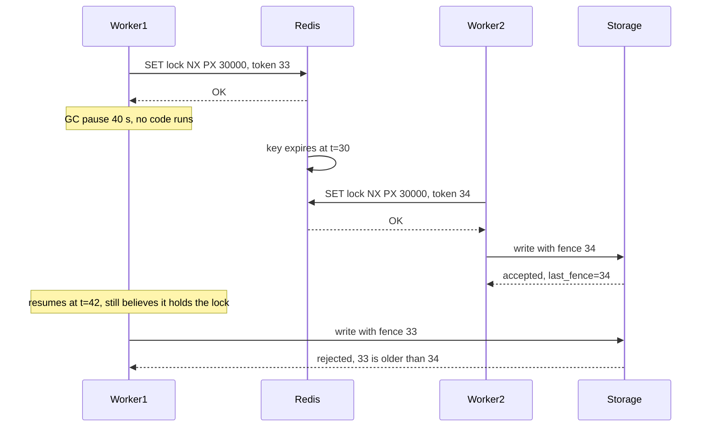
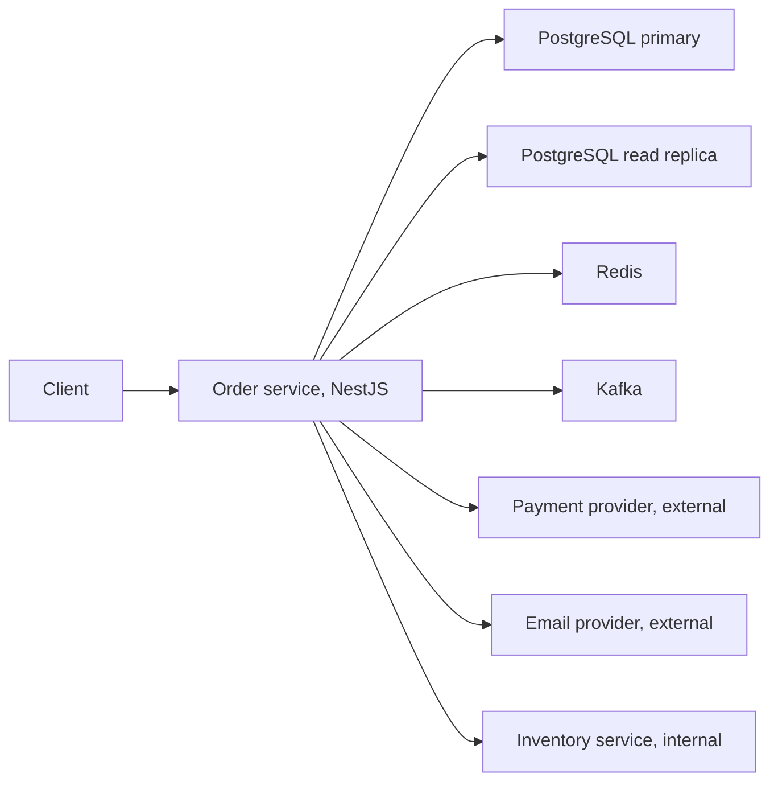

## 28.15 Distributed caching, locking and rate limiting

#### Concept

Three things almost every backend team builds in their first year are, without anyone calling them that, distributed systems problems: a **cache** (a second copy of the truth), a **lock** (agreement about who may act), and a **rate limiter** (agreement about how much has happened). Part 26 — Caching and Redis covers how to operate Redis and which data structures to use; Part 30 — Resilience Patterns covers rate limiting as a protection mechanism. This section looks at the same three through the lens of everything in Part 28: partial failure, asynchrony, clocks you cannot trust, and processes that pause without warning.

#### Why does it exist?

Because each of the three quietly assumes something the network does not provide. The cache assumes that "invalidate" happens. The lock assumes that "I hold it" is still true when the write lands. The rate limiter assumes that every node sees the same count. Each assumption is false during a partition, a GC pause, or a lost packet, and the failure is not a crash: it is a wrong answer that nobody notices for weeks.

#### Mental model

Imagine a shared whiteboard in a building with unreliable internal phones. The cache is a photocopy of the board that people keep on their desks: fast, and stale from the moment it is made. The lock is a "do not erase" sign on the board: useful until the person who put it there falls asleep for a minute and someone else, seeing the sign's timer expired, takes over, and then the first person wakes and starts writing as if nothing happened. The rate limiter is a tally of how many times the board has been used today, kept by whoever happens to be standing near it: exact if there is one tally and everyone walks to it, fast but approximate if everyone keeps their own.

#### How it works

**A cache is a second source of truth, and the window is the design.** When you write to PostgreSQL and then delete a Redis key, there is a moment between the commit and the delete when the two disagree. That window is normally 0.3–2 ms, and it is unbounded when the delete fails, when the Redis node is partitioned from that pod, or when a concurrent reader repopulates the key with the pre-commit value it read before your commit. The senior questions are always the same three:

1. **How stale can this be before it is wrong?** A product description: minutes. An inventory count on a product page: seconds. A payment authorization: never; it is not a cacheable read.
2. **What happens when invalidation is lost?** With a delete-only strategy, the key is stale until the TTL. So the TTL is not a performance knob, it is the **bound on your incorrectness**. A 24-hour TTL on a price is a promise that a price change can be wrong for a day.
3. **Who else writes this key?** Two writers plus a cache is a lost-update problem with an extra participant. A read-modify-write through the cache is the same anomaly as in Part 20 — Database Transactions, just harder to see.

The practical consequence: cache-aside with a delete on write and a short TTL is not "eventually consistent" in a comforting sense; it is "consistent within the TTL, and correct only if the delete succeeds". If you need better, you need versioned keys (write `product:42:v7` and bump the version pointer transactionally) or a change-data-capture stream driving invalidation, both of which are more machinery than most reads deserve.

**A distributed lock is not safe without fencing.** Here is the scenario in full, because every senior engineer should be able to draw it.

A worker wants exclusive access to update an order's fulfilment state. It takes a Redis lock: `SET lock:order:9001 <uuid> NX PX 30000` (30 second TTL). It gets the lock. Then the Node process enters a major garbage collection, or the container is CPU-throttled by its cgroup quota, or the underlying VM is live-migrated. It stops executing for 40 seconds. It has no idea; from inside the process, no time passed.

At t = 30 s the Redis key expires. A second worker takes the lock legitimately and starts working. At t = 42 s the first worker resumes, exactly at the instruction after the lock acquisition, believing it holds the lock, and writes to the database. Two workers have now written under a lock designed to allow one.



No lock TTL fixes this, because the pause can always exceed the TTL, and shortening the TTL makes false expiry more likely, not less. Adding more Redis nodes does not fix it either: the problem is not availability of the lock service, it is that the *holder* cannot know it still holds the lock at the moment its write lands.

What fixes it is a **fencing token**: a number that increases every time the lock is granted, carried with every write, and **checked by the storage that performs the write**. Worker 1 holds token 33; worker 2 holds token 34; the database has already seen 34, so it rejects 33. The stale write becomes harmless instead of invisible.

The critical part is the last clause: the *storage* must do the check. A fencing token that only the application compares is worthless, because the paused application is the thing that cannot be trusted. In PostgreSQL this is a `WHERE fence_token < $1` on the update, which is exactly optimistic concurrency control with a version column. Which leads to the honest senior conclusion: **if your protected resource is a PostgreSQL row, you probably do not need a distributed lock at all.** `SELECT ... FOR UPDATE`, a unique constraint, or a conditional `UPDATE ... WHERE version = $1` gives you mutual exclusion enforced by the same component that stores the data, with no clocks and no TTLs. Reach for a Redis lock when the protected resource is *outside* the database (a third-party API call you must not duplicate, a file in object storage, a singleton scheduler), and then accept that it is an optimization that reduces duplicate work, not a correctness guarantee, unless you can fence.

**A distributed rate limiter chooses between exact-and-slow and approximate-and-fast.**

*Exact:* one Redis instance holds the counter, every request from every pod does one atomic round trip (a Lua script or `INCR` plus `EXPIRE`). The limit is enforced precisely. Costs: 0.3–1 ms added to every request; a hard dependency on one node for every request (if Redis is unreachable you must decide fail-open or fail-closed, and for a security limit like login attempts the answer is fail-closed while for a capacity limit it is fail-open); and a hot key, because a per-tenant limit for your biggest tenant is a single key handling 20,000 operations per second on one Redis shard, which is fine, and a global limit key at 200,000 operations per second, which is not.

*Approximate:* each pod keeps a local token bucket sized to its share of the limit (limit ÷ pod count) and periodically syncs its consumption to Redis. Costs: no per-request round trip, so latency is unaffected and Redis being down degrades rather than breaks; but traffic is not evenly distributed across pods, so a tenant whose requests land on three of forty pods gets three-fortieths of their limit, and during a scale-up the divisor is wrong until the next sync. The overshoot is bounded by roughly `pods × per-pod bucket size` in the worst case, which you can compute and decide to accept.

*The hybrid that most teams end up with:* a local bucket for the common case plus a Redis check only when the local bucket is nearly exhausted, and a sync interval of 100 ms to 1 s. It costs a round trip for the few percent of requests near the limit, keeps the p99 clean for everyone else, and bounds the error at `pods × sync_interval × rate`.

| Approach | Accuracy | Added p99 | Redis down | Hot key risk | Use for |
|---|---|---|---|---|---|
| Single Redis, atomic script | Exact | +0.5–1 ms on every request | Fail-open or fail-closed decision | High on global or big-tenant keys | Security limits, billing quotas, small scale |
| Per-pod local buckets | Approximate, `pods ×` overshoot | 0 | No effect | None | Coarse capacity protection, very high RPS |
| Local bucket plus Redis near the limit | Near-exact at the boundary | +0.5 ms on a few percent | Degrades to local | Low | The default for a 40-pod API |

#### Practical example

An orders API limits each API key to 1,000 requests per minute across 40 pods at 3,000 RPS total. A pure Redis limiter adds 0.6 ms to every request (2 percent of a 30 ms p50, acceptable) and makes Redis a hard dependency for 100 percent of traffic. The team chose the hybrid: each pod holds a bucket of 25 tokens (1,000 ÷ 40), refilled locally, and calls Redis only when its local bucket drops below 20 percent, which happens for about 4 percent of requests. Measured overshoot during a load test was 6 percent above the nominal limit, and the product owner agreed that 1,060 requests per minute is not a business problem while 40 ms of added p99 would have been.

#### NestJS example

Fencing, done properly: the token comes from Redis, and PostgreSQL enforces it.

```ts
// fulfilment/fulfilment.service.ts
import { Injectable, Logger } from '@nestjs/common';
import { InjectDataSource } from '@nestjs/typeorm';
import { DataSource } from 'typeorm';
import Redis from 'ioredis';

@Injectable()
export class FulfilmentService {
  private readonly logger = new Logger(FulfilmentService.name);
  constructor(private readonly redis: Redis, @InjectDataSource() private readonly db: DataSource) {}

  /** Acquire a lock and a monotonically increasing fence token in one round trip. */
  private async acquire(orderId: string, ttlMs = 30_000): Promise<number | null> {
    // INCR gives a strictly increasing token per lock name; SET NX gives exclusivity.
    const ok = await this.redis.set(`lock:order:${orderId}`, '1', 'PX', ttlMs, 'NX');
    if (ok !== 'OK') return null;
    return this.redis.incr(`fence:order:${orderId}`);
  }

  async markShipped(orderId: string, carrierRef: string): Promise<'applied' | 'stale' | 'busy'> {
    const fence = await this.acquire(orderId);
    if (fence === null) return 'busy';

    // The database, not the application, rejects the stale writer. A paused process
    // cannot beat this check no matter how long it slept.
    const result = await this.db.query(
      `UPDATE orders
          SET status = 'shipped', carrier_ref = $2, fence_token = $3, updated_at = now()
        WHERE id = $1 AND fence_token < $3
        RETURNING id`,
      [orderId, carrierRef, fence],
    );

    if (result.length === 0) {
      this.logger.warn(`stale fenced write rejected order=${orderId} fence=${fence}`);
      return 'stale';                      // we were paused; someone newer already acted
    }
    return 'applied';
  }
}
```

Two details that matter. The `UPDATE` is the whole critical section, so there is no window between check and write. And we never release the lock by deleting the key blindly; if you do release early, compare the value you wrote (`SET lock <uuid> NX PX`) inside a Lua script so you cannot delete a lock someone else now holds.

#### PostgreSQL example

If the resource is a row, skip Redis entirely. This is mutual exclusion with no clock, no TTL and no second system:

```sql
-- Option 1: pessimistic, holds a row lock for the transaction
BEGIN;
SELECT id, status FROM orders WHERE id = $1 FOR UPDATE;
UPDATE orders SET status = 'shipped' WHERE id = $1 AND status = 'packed';
COMMIT;

-- Option 2: optimistic, no lock held across any I/O
UPDATE orders
   SET status = 'shipped', version = version + 1
 WHERE id = $1 AND version = $2;      -- 0 rows means someone else won; re-read and retry

-- Option 3: advisory lock for a non-row resource, scoped to the session or transaction
SELECT pg_try_advisory_xact_lock(hashtext('nightly-settlement'));   -- released at COMMIT
```

Advisory locks are held by a database session, so they are released automatically when the connection dies, which removes the TTL problem entirely. Their limitation is that they are per-database-cluster and do not survive a failover, so treat them as "prevent duplicate work", not "guarantee uniqueness".

#### Production scenario

A payouts worker ran with a Redis lock and no fencing for eighteen months. It processed 200 payouts a day and the lock "worked". A Kubernetes node under memory pressure caused a 55-second freeze in one pod; the lock TTL was 30 seconds; two workers submitted the same payout to the bank 41 seconds apart. The bank's idempotency key saved the company, because the payout request carried one. That is the real lesson: the thing that actually prevented the duplicate was idempotency at the destination, not the lock. The lock reduced the probability; idempotency made the outcome safe.

#### Failure scenario

At 21:05 a Redis failover took 8 seconds. During the failover the rate limiter (pure Redis, fail-open) let everything through, and a scraper that was normally capped at 100 RPS did 4,000 RPS for eight seconds, which pushed the database's connection pool to exhaustion and produced a two-minute outage that outlasted the Redis event by fifteen times. Fail-open was the right choice for availability and the wrong choice at that magnitude. The fix was a local per-pod backstop bucket at 3x the nominal limit that applies whenever Redis is unavailable: still fail-open relative to the precise limit, but not open to the world.

#### Edge cases & failure modes

- **Cache invalidation lost during a partition.** The delete never lands; the key is stale until TTL. Bound it with a TTL you have consciously chosen as the maximum acceptable wrongness.
- **Read-repopulate race.** A reader loads the old value, your writer commits and deletes, then the reader writes the stale value into the cache. It survives the full TTL. Mitigate with a short delayed second delete, versioned keys, or writes that set rather than delete.
- **Lock TTL shorter than the work.** Every long job silently runs twice. Either extend the lease from a heartbeat (and stop working if the extension fails) or make the work idempotent and stop pretending the lock is a guarantee.
- **Fencing token that only the application checks.** Useless: the paused application is the untrusted party.
- **Clock-based lock expiry with skewed clocks.** Redis expiry uses the Redis node's clock, so a client's view of "I still have 20 seconds" is a guess about someone else's clock plus network delay.
- **Rate limiter key cardinality.** A per-user-per-endpoint limit at 2 million users is 2 million Redis keys with TTLs; the memory and the expiry churn are real.
- **Fail-open under total dependency loss.** Correct for capacity limits, dangerous without a backstop; wrong for authentication throttles.
- **Counting in the wrong window.** A fixed-window counter allows 2x the limit across a window boundary; a sliding window log is exact and expensive; a sliding window counter is the usual compromise.

#### How a Senior Backend Engineer thinks about this

They ask, for the cache: what is the maximum time this may be wrong, and what happens if invalidation never arrives? For the lock: what enforces correctness if the holder is paused, and is that enforcement in the storage? For the limiter: what does exactness buy me, and what does it cost in latency and blast radius? They prefer the database's own mechanisms for anything the database stores, because those need no clocks. They treat distributed locks as an optimization and idempotency at the destination as the guarantee. And they write the chosen staleness and overshoot numbers into the design document, because a number someone agreed to is a decision, while an unwritten assumption is a future incident.

#### Common mistakes

- Treating a Redis lock as mutual exclusion rather than as duplicate-work reduction.
- Setting a lock TTL from the average job duration instead of far above the p99, or, worse, extending it forever.
- Deleting a lock key without checking that you still own it.
- Choosing a cache TTL for performance and never asking what it means for correctness.
- Building an exact rate limiter on the request path and only discovering the added p99 in production.
- Assuming more Redis nodes make a lock safe.

#### Interview questions

1. *Walk me through how a distributed lock can be violated with no bug in the lock service, and how a fencing token fixes it.* Expected: GC pause or throttle exceeding the TTL; second holder acquires; first resumes and writes; monotonic token checked by the storage rejects the stale write.
2. *Why does adding more Redis nodes not make a lock safe?* Expected: the problem is the holder's uncertainty at write time, not the lock service's availability.
3. *When would you not use a distributed lock at all?* Expected: when the resource is a database row; use `FOR UPDATE`, a unique constraint, or a version check.
4. *Design a rate limiter for 40 pods and a 1,000-per-minute limit. What are the two extremes and what would you ship?* Expected: single-Redis exact versus per-pod approximate; hybrid with a local bucket and a Redis check near the boundary; state the overshoot bound.
5. *What does your cache TTL actually promise the business?* Expected: it is the maximum duration of incorrectness when invalidation is lost.
6. *Fail-open or fail-closed when the limiter's store is down?* Expected: depends on whether the limit protects capacity or security; and either way, a local backstop bounds the blast radius.

#### Practical exercise

Build a fenced lock with Redis plus a `fence_token` column in PostgreSQL. Write a test that acquires the lock in process A, suspends it (`SIGSTOP` the process or `await` a 40 s sleep with a 5 s TTL), lets process B acquire and write, then resumes A and lets it write.

Acceptance criteria:

- Process A's write is rejected by the database, not by application code, and the rejection is logged with both fence tokens.
- The same test without the fence column shows the stale write succeeding, so you can demonstrate the difference.
- A rate-limit load test at 3,000 RPS across 20 workers reports measured overshoot for the exact and hybrid strategies, and the added p99 for each.

## 28.16 Designing for failure: the senior's interrogation

This is the practical payoff of Part 28. Take the mantra that runs through this book, and apply it to every dependency of one real service, one question at a time:

> *Can it timeout? Can it fail? Can it become slow? Can it duplicate? Can it return an incorrect response? Can it partially succeed?*

The service is a NestJS order service at 800 RPS. Its dependencies:



The exercise below is not theory. Run it in a design review with the table on screen and fill the empty cells; the empty cells are your backlog.

**PostgreSQL primary** — p50 1.5 ms, p99 8 ms, pool of 10 per pod, `statement_timeout = 3s` for the API role.

| Question | Concrete failure | Detection signal | Mitigation | What the user sees |
|---|---|---|---|---|
| Can it timeout? | Pool exhaustion: all 10 connections busy, `connectionTimeoutMillis` fires after 2 s | Pool wait-time metric, `pg_stat_activity` count near `max_connections` | Bounded pool, short `statement_timeout`, queue depth limit, shed load | `503` with `Retry-After`, not a hung request |
| Can it fail? | Failover: 30–90 s with no primary | `ECONNREFUSED`/`57P01` burst, RDS event, replica promotion | Reconnect with backoff, readiness `503` during the gap, retry idempotent writes only | Checkout unavailable for up to 90 s |
| Can it become slow? | A plan flip after `ANALYZE` makes one query 200x slower | p99 per query from `pg_stat_statements`, `auto_explain` | Per-role `statement_timeout`, circuit breaker on the pool, plan pinning as a last resort | Slow checkout, then fast failure rather than a hang |
| Can it duplicate? | A retried `INSERT` after a timeout creates two orders | Duplicate rate on a natural key | Unique constraint on `(customer_id, idempotency_key)`; `ON CONFLICT DO NOTHING` | One order, second attempt returns the first |
| Can it return an incorrect response? | Reading uncommitted-looking data across two transactions (write skew) | Invariant checks, reconciliation job | Correct isolation level, `SELECT ... FOR UPDATE`, database constraints as the last line | Correct totals; the anomaly never reaches them |
| Can it partially succeed? | Commit succeeds, the acknowledgement is lost on the wire | Orphaned idempotency records, client retries | Idempotency key written in the same transaction as the order | The retry returns the same order id |

**PostgreSQL read replica** — replication lag normally 50–200 ms.

| Question | Concrete failure | Detection signal | Mitigation | What the user sees |
|---|---|---|---|---|
| Can it timeout? | A long report holds the replica; reads queue | Replica `pg_stat_activity`, query timeouts | Separate pool and role, aggressive `statement_timeout` on the replica | Falls back to the primary or shows cached data |
| Can it fail? | Replica down or recovering | Health check, `pg_stat_replication` row missing | Route reads to the primary, with a capacity plan for it | Nothing, if primary headroom exists |
| Can it become slow? | Lag grows to 40 s under a bulk import | `replay_lag`, lag bytes | Cap acceptable lag; route to primary above the cap | Fresh data, at the cost of primary load |
| Can it duplicate? | Not applicable for reads | — | — | — |
| Can it return an incorrect response? | Stale read: user places an order then does not see it | "Read your writes" violations reported by support | Read-your-writes routing: read from the primary for N seconds after a write, or pass an LSN | Their own order always appears |
| Can it partially succeed? | Query cancelled by a recovery conflict mid-result | `pg_stat_database.conflicts` | Retry on the primary; `hot_standby_feedback` tradeoff | One retried request, no error |

**Redis** — p50 0.3 ms, used for cache, sessions and the rate limiter.

| Question | Concrete failure | Detection signal | Mitigation | What the user sees |
|---|---|---|---|---|
| Can it timeout? | Command timeout during a `BGSAVE` or a big `KEYS` from a script | Command latency histogram, `slowlog` | 200 ms command timeout, `enableOfflineQueue: false`, never `KEYS` | Cache miss path, slightly slower page |
| Can it fail? | Failover of 5–10 s, or full loss | Connection errors, Sentinel/cluster events | Treat every failure as a miss; protect the database from the resulting stampede with a single-flight lock or jittered TTLs | Slower pages, no errors |
| Can it become slow? | One hot key or a 50 MB value blocks the single thread | `INFO commandstats`, latency spikes on unrelated keys | Value size limits, key sharding, separate instances for cache and for limits | Latency on everything using that instance |
| Can it duplicate? | A retried `INCR` after a timeout double-counts | Rate-limit rejections that do not match traffic | Idempotent Lua scripts, or accept the drift for capacity limits | Slightly early rate limiting |
| Can it return an incorrect response? | Stale cache after a lost invalidation | Comparison job sampling cache against the database | TTL as the bound, versioned keys for critical values | Old price for at most the TTL |
| Can it partially succeed? | Pipeline of 5 commands: 3 applied before the socket dies | Partial state in a multi-key structure | Lua script for atomic multi-key work; design keys so partial writes are harmless | Nothing, if the design is idempotent |

**Kafka** — producer acks=all, p99 produce 15 ms.

| Question | Concrete failure | Detection signal | Mitigation | What the user sees |
|---|---|---|---|---|
| Can it timeout? | Broker slow, `send` exceeds 10 s | Producer request latency, buffer-full errors | Outbox table: commit the event with the order, publish asynchronously | Order succeeds; the event is delayed |
| Can it fail? | Partition leader unavailable | `NOT_LEADER_FOR_PARTITION`, ISR shrink | Retries with the idempotent producer; outbox as the durable buffer | Nothing |
| Can it become slow? | Consumer lag grows to 400,000 messages | Consumer group lag metric | Scale consumers, increase partitions, shed non-critical events | Delayed emails and analytics, not delayed orders |
| Can it duplicate? | Rebalance replays uncommitted offsets: at-least-once by design | Duplicate business effects | Idempotent consumers keyed on event id, dedupe table with a unique constraint | One email, not three |
| Can it return an incorrect response? | Out-of-order delivery across partitions | Events applied in the wrong sequence | Partition by aggregate id; carry a version and ignore older versions | Correct final state |
| Can it partially succeed? | Order committed, event never published (dual-write) | Reconciliation between orders and events | Transactional outbox, always | Nothing |

**Payment provider (external)** — p50 400 ms, p99 2.5 s, timeout 3 s.

| Question | Concrete failure | Detection signal | Mitigation | What the user sees |
|---|---|---|---|---|
| Can it timeout? | 3 s deadline hit with **unknown outcome**: charged or not | Timeout rate; unreconciled payments | Idempotency key on every attempt; park as `pending_unknown`; reconcile by query or webhook | "We are confirming your payment", never a silent double charge |
| Can it fail? | 502 from the provider's edge | Error rate by status class | One retry with the same idempotency key for retryable classes only | Retry or a clear failure with the cart intact |
| Can it become slow? | p99 goes to 12 s during their incident | Latency percentiles, breaker state | Circuit breaker (50 percent over 20 calls, 15 s reset), a hard deadline shorter than the client's | Fast `503` with `Retry-After` instead of a 30 s hang |
| Can it duplicate? | Your retry creates a second charge | Duplicate charges per idempotency key | Idempotency key generated before the first attempt and reused for every retry | One charge |
| Can it return an incorrect response? | `success` for a charge that later reverses; or a wrong currency | Settlement reconciliation daily | Never treat the synchronous response as final money; reconcile against settlement files | Correct final ledger |
| Can it partially succeed? | Charge captured, webhook never delivered | Orders stuck in `pending_payment` older than 15 minutes | Poll the provider for unknown outcomes; a sweeper job | Order completes late rather than never |

**Email provider (external)** — non-core by definition.

| Question | Concrete failure | Detection signal | Mitigation | What the user sees |
|---|---|---|---|---|
| Can it timeout? | 3 s timeout on send | Send latency | Never on the request path; always a queued job | Nothing |
| Can it fail? | Provider down for an hour | Job failure rate, DLQ depth | Retry with backoff for hours; secondary provider for transactional mail | Email arrives late |
| Can it become slow? | Throughput throttled to 10/s | Queue depth growth | Rate-limited worker, priority queue for password resets | Marketing mail delayed, resets not |
| Can it duplicate? | Job retried after a timeout: two emails | Complaints, provider dedupe metrics | Provider-side idempotency key per message id; dedupe table | One email |
| Can it return an incorrect response? | Accepted then bounced | Bounce webhooks | Treat acceptance as "queued", not "delivered"; track delivery separately | Accurate delivery status |
| Can it partially succeed? | Batch of 500 accepts 480 | Per-recipient results | Per-recipient jobs, not batches, for transactional mail | Everyone gets their email |

**Internal inventory service** — p50 20 ms, p99 120 ms, timeout 800 ms.

| Question | Concrete failure | Detection signal | Mitigation | What the user sees |
|---|---|---|---|---|
| Can it timeout? | 800 ms deadline hit during their GC | Timeout rate per upstream | Deadline propagation from the edge budget; bulkhead so it cannot consume all sockets | Reservation fails cleanly, cart preserved |
| Can it fail? | Their deploy has a bad readiness probe; zero healthy pods | 503s from their ALB, breaker open | Breaker; queue the reservation for retry if the product allows | "We could not confirm stock, try again" |
| Can it become slow? | Their database is slow; p99 goes to 4 s | Latency per dependency, event-loop lag on your side | Hard timeout well under yours; breaker; bulkhead of 30 sockets | Your other endpoints stay fast |
| Can it duplicate? | A retried reservation reserves twice | Reserved-but-unsold stock | Reservation id supplied by you; their endpoint idempotent on it | Correct stock |
| Can it return an incorrect response? | Stale stock count from their cache | Oversell rate | Treat display counts as advisory; make the reservation authoritative at checkout | Occasional "just sold out" at checkout, never a shipped oversell |
| Can it partially succeed? | Reserved 3 of 5 lines then failed | Orphaned reservations | Reservation with a TTL and an explicit cancel; a sweeper releases expired ones | Stock returns automatically within minutes |

Two patterns fall out of the completed table, and they are the summary of Part 28. First, **every "can it duplicate?" cell is answered by idempotency**, and every "can it partially succeed?" cell is answered by either a transactional outbox or a compensating sweeper. Second, **the user-visible column is a product decision**, not an engineering one. "Fast failure with the cart preserved" versus "queue it and email them later" is a conversation with the product owner, and the table is how you have that conversation with specifics instead of adjectives.

## 28.17 Edge cases and failure modes

- **A partition between the application and the database.** Your pods are healthy, the database is healthy, and they cannot talk. Every pod's readiness must fail (so the load balancer stops sending traffic), connections must be retried with backoff and jitter, and in-flight transactions have an unknown outcome. The dangerous variant is a one-way or intermittent partition where 30 percent of packets are lost: connections establish, queries hang, and nothing declares failure. Bound it with TCP keepalives, `statement_timeout` and pool acquisition timeouts.

- **A partition between two services where both keep serving.** Service A cannot reach B, so it uses its fallback and serves degraded results. B is fine and is being called by C with fresh data. Now two parts of your system are showing different answers to the same question. Decide in advance which side is authoritative, and make the degraded side's responses carry their staleness (a `stale-since` field, a cache-age header) so the client can decide.

- **Clock skew invalidating JWTs and lock TTLs.** A pod whose clock is 90 seconds ahead issues tokens that other services consider not-yet-valid (`nbf`), and rejects tokens that are valid. A pod whose clock is behind honours expired tokens. Same for lock leases and for `expires_at` comparisons done locally. Mitigations: NTP with monitoring and an alert on offset above 100 ms, a small `clockTolerance` on JWT verification, and never comparing timestamps produced by two different machines to decide ordering. Use monotonic clocks for durations and logical versions for ordering.

- **Duplicate deliveries.** At-least-once is the default everywhere: Kafka, SQS, webhooks, HTTP retries, and your own retry loop. There is no configuration that makes it exactly-once end to end; there is only idempotency at the point of effect. A dedupe table with a unique constraint on the event id and a retention window is the boring, correct answer.

- **Retry storms amplifying an outage.** A dependency slows down, every caller retries three times, offered load triples exactly when capacity is lowest, and the dependency cannot recover even after the original cause is gone. Requires: retry at one layer only, exponential backoff with jitter, a retry budget (for example, retries capped at 10 percent of requests), circuit breakers, and honouring `Retry-After`.

- **Split brain with two leaders writing.** A network partition leaves the old leader still accepting writes while a new one is elected on the other side. Both sides accept conflicting writes and the merge is a business decision nobody wants to make. Prevention: quorum-based election (a leader needs a majority, so only one side can have one), leases with fencing tokens checked by the storage, and STONITH-style demotion. Detection: two nodes reporting the leader role, or a monotonic term/epoch going backwards in the logs.

- **Stale reads after a failover with asynchronous replication.** The promoted replica was 300 ms behind, so committed transactions from the last 300 ms are gone. This is data loss, not a delay. The application must know: either use synchronous replication for the writes that matter (paying the latency), or accept a non-zero RPO, write it in the runbook, and have a reconciliation path (an outbox that has not been marked published, a payment provider you can re-query).

- **A GC pause causing a lease to expire while work continues.** Covered in 28.15. It is not exotic: a 2 GB Node heap can pause for seconds, and CPU throttling on a container with a low CPU limit produces the same effect without any garbage collection. Any design whose correctness depends on "my process will keep running" is wrong.

- **Messages reordered by a retry path.** Event v1 fails and is retried; event v2 succeeds immediately; the retry of v1 lands after v2 and overwrites the newer state. Fix: partition by aggregate id so a single consumer sees one key's events in order, carry a version or timestamp in the event, and make the consumer ignore anything not newer (`WHERE version < $1` on the update, which is the same fence as 28.15).

- **Thundering herd on recovery.** The dependency comes back and 40 pods, 12,000 queued requests and every expired cache key hit it in the same second, so it falls over again. Fix: jittered backoff, jittered cache TTLs, a half-open circuit breaker that admits a trickle, single-flight cache population, and warm-up rate limits on the recovering service.

- **Cascading failure when one slow dependency saturates every caller.** The recommendation service goes from 40 ms to 6 s. Your handler awaits it, so each request holds a socket, a request context and memory for 6 s; concurrency at 800 RPS × 6 s means 4,800 in-flight requests; the event loop lag climbs, readiness fails, pods are removed, the remaining pods get more traffic, and an outage in a non-essential widget takes down checkout. Fix: bulkheads (a bounded socket pool per dependency), deadlines shorter than the caller's, circuit breakers, and classifying every dependency as core or non-core before the incident, not during it.

- **Failure detectors that are right about the wrong thing.** A consumer heartbeats happily while its handler is stuck on a lock: alive by the detector, useless in fact. Watch progress (consumer lag, jobs completed, rows written), not just liveness.

- **Compensations that themselves fail.** A saga's compensating action (refund, release reservation, cancel shipment) is a distributed call and can time out, fail, duplicate or partially succeed exactly like the forward action. Compensations need idempotency keys, retries and a dead-letter path with a human at the end of it.

## Senior Checklist — Part 28

- [ ] I understand the concept
- [ ] I can explain it simply
- [ ] I can implement it
- [ ] I understand its failure modes
- [ ] I understand its scaling limitations
- [ ] I understand its security implications
- [ ] I understand its operational implications
- [ ] I can choose between alternatives
- [ ] I can explain the tradeoffs
- [ ] I can answer senior-level interview questions
- [ ] I can explain why partial failure, not total failure, is what makes a system distributed
- [ ] I know that a timeout means "unknown outcome" and I design every caller around that ambiguity
- [ ] I can state CAP correctly (it is about behaviour during a partition) and explain why PACELC is the more useful model day to day
- [ ] I can name and distinguish linearizable, sequential, causal, read-your-writes, monotonic-read and eventual consistency, and pick one per use case
- [ ] I can explain synchronous versus asynchronous replication in terms of RPO, RTO and write latency
- [ ] I can compute quorum reads and writes and explain when `W + R > N` does and does not give you freshness
- [ ] I can explain leader election, leases, terms and why a majority is required to avoid split brain
- [ ] I can describe what consensus (Raft) guarantees, what it costs, and when to use a system that provides it instead of building one
- [ ] I never order events by wall-clock timestamps from different machines, and I know what a monotonic clock is for
- [ ] I can explain clock skew's effect on JWTs, lock leases and TTL comparisons, and I monitor NTP offset
- [ ] I set heartbeat and timeout values from measured p99s, and I know what a false positive and a false negative cost for each detector
- [ ] I can explain how a GC pause breaks a lock, and I can implement fencing tokens enforced by the storage
- [ ] I know when a distributed lock is unnecessary because the resource is a database row
- [ ] I can choose between exact and approximate distributed rate limiting and state the overshoot and latency cost of each
- [ ] I treat a cache TTL as the bound on how long the system may be wrong, not as a performance knob
- [ ] I can run the six-question interrogation over every dependency of a service and produce the mitigation table
- [ ] I use a transactional outbox instead of dual writes, and idempotency keys instead of hoping retries do not duplicate
- [ ] I can explain retry storms, thundering herds and cascading failure, and I have the controls for each in place

## Part 28 — Key Takeaways

- Distributed does not mean "many machines"; it means partial failure is normal, and the network can be slow, lossy, one-way or reordered without telling anyone.
- A timeout is not a failure. It is an unknown outcome, and the only way to make an unknown outcome safe is idempotency at the destination.
- CAP is a statement about what you do *during* a partition. PACELC adds the question you face every other day: latency or consistency, when everything is fine.
- Asynchronous replication buys write latency and costs you an RPO. Synchronous replication buys RPO zero and costs write latency and availability. Pick knowingly and write the number down.
- Quorums give you overlap, not freshness. `W + R > N` guarantees you see a majority-acknowledged write, not that you see the latest write in wall-clock terms.
- Only a majority can elect a leader safely; anything else eventually gives you two leaders and a merge nobody can do.
- Wall-clock time is a coordination hazard. Use monotonic clocks for durations, logical versions for ordering, and NTP monitoring for everything that compares timestamps across machines.
- Every failure detector is guessing. Set its thresholds from measured p99s, keep readiness eager and liveness patient, and make every action it triggers safe if the "dead" node is alive.
- A distributed lock cannot be safe without a fencing token that the storage itself checks, because the lock holder can be paused for longer than any TTL you choose.
- If the protected resource is a PostgreSQL row, you do not need a distributed lock. `FOR UPDATE`, a unique constraint or a version check is simpler and has no clocks in it.
- A cache TTL is the maximum time your system is allowed to be wrong when an invalidation is lost. Choose it as a correctness decision.
- Exact distributed rate limiting costs a round trip on every request and a hot key; approximate costs bounded overshoot. Compute the overshoot, agree it with the product owner, and ship the hybrid.
- Ask of every dependency: can it timeout, fail, slow down, duplicate, lie, or half-succeed? The empty cells in that table are your reliability backlog.
- Retries, herds and shared thread pools turn one slow dependency into a full outage. Backoff with jitter, retry budgets, bulkheads and deadlines are not optional at scale.
- The user-visible consequence of each failure is a product decision. Bring the table, not adjectives.
