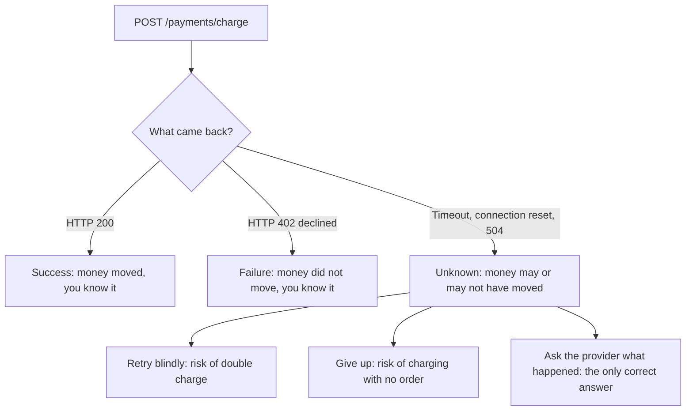
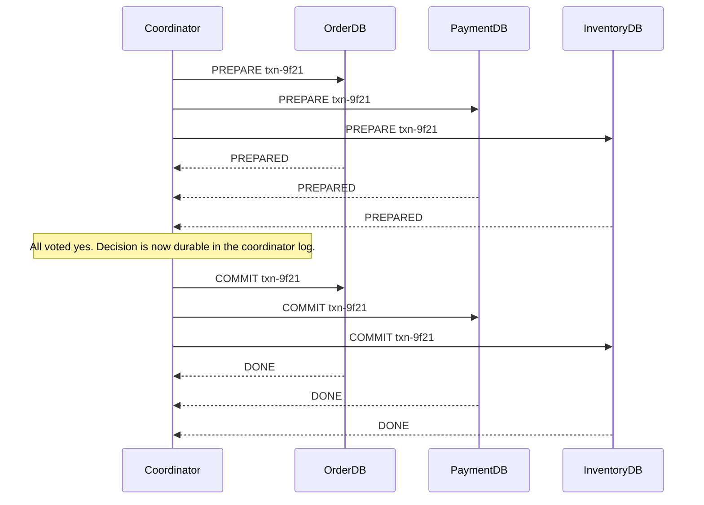
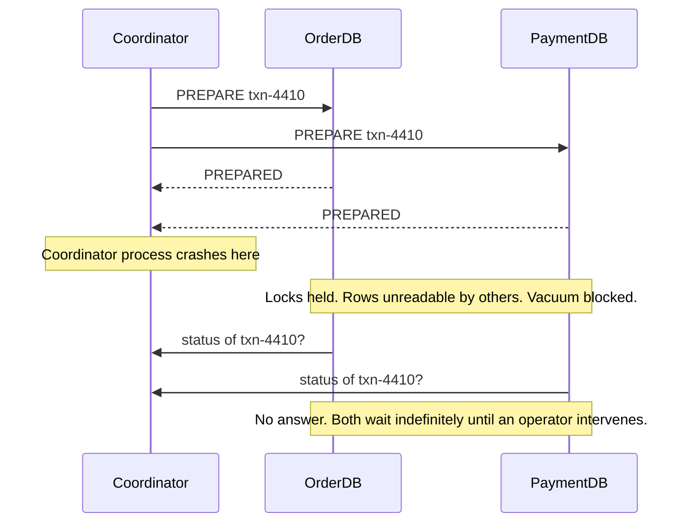

# Part 29 — Distributed Transactions: Sagas, Outbox, Inbox and Idempotency

## 29.1 Why one transaction is not enough

#### Concept

A **database transaction** gives you all-or-nothing across many rows in one database. `BEGIN`, do work, `COMMIT`, and either everything is there or nothing is. Part 20 — Database Transactions covered exactly that, and it works beautifully inside one PostgreSQL instance.

A **business transaction** is different. It is the whole thing the customer asked for. In this Part we will use one business transaction the entire way through:

```text
Order -> Payment -> Inventory -> Shipping
```

Placing an order means: create the order row, charge the customer's card, reserve four items from the warehouse, and book a courier pickup. Four steps. Four different systems. Four separate owners of truth. There is no `BEGIN` that spans them, and there never will be.

That gap is what this Part is about. Everything in it — sagas, compensations, the outbox, the inbox, idempotency keys — exists because a single ACID transaction cannot cover a business operation that leaves your database.

#### Why does it exist?

Look at where each step's truth actually lives.

| Step | Where the truth lives | Can it join your PostgreSQL transaction? |
|---|---|---|
| Order | `orders` table in your PostgreSQL | Yes |
| Payment | Stripe / Razorpay / Adyen servers | No. It is an HTTPS call to another company |
| Inventory | Inventory service, its own PostgreSQL, its own schema | No. Different database, possibly different cluster |
| Shipping | Delhivery / DHL partner API | No. Another company again, often with a 5 s p99 |

Three of the four steps are HTTP calls to processes you do not control. A PostgreSQL transaction can roll back rows. It cannot roll back an HTTP request that already reached Stripe. Once the card is charged, the money moved. `ROLLBACK` on your side does not reach into their ledger.

So the guarantee you are used to — "the whole operation happened or none of it did" — is simply not available. You have to build something that produces an acceptable approximation of it, and you have to be honest with yourself about where the approximation leaks.

#### Mental model

Imagine you are buying a flat. You need four things to happen: the bank releases the loan, the seller signs the deed, the registrar records the transfer, and the electricity account moves to your name.

There is no magic button that does all four at once. Each is a separate office, each with its own clerk, its own opening hours, its own way of failing. The bank can release the money and the registrar can be closed. The deed can be signed and the electricity transfer can be rejected because the seller owes 4,000 rupees.

What the real world does is not "roll back". The real world does **compensation**: the bank recalls the loan, the deed is annulled by a second deed, the electricity debt is settled from escrow. Every undo is itself a new action, recorded, visible, taking time.

That is exactly what a distributed transaction is. There is no undo. There are only forward actions that mean "undo".

#### How it works

The single most important sentence in this Part: **every remote call has three outcomes, not two.**

Part 28 — Distributed Systems established this (section 28.2 on partial failure). Here is what it costs you in an order flow.



Success and failure are easy. The third outcome, **unknown**, is the one that generates incidents, and it is not rare. A 3-second timeout on a payment gateway that normally answers in 400 ms happens several times a day at any real volume. The gateway may have processed the charge and lost the response on the way back. Your client has no way to tell the difference between "never arrived" and "arrived, processed, reply lost".

Now stack four steps, each with three outcomes. The state space is 81 combinations, and the interesting ones are all partial:

```text
Order  Payment  Inventory  Shipping     What the customer experiences
 OK      OK        OK         OK        Everything worked (the boring 97%)
 OK      OK        OK        FAIL       Paid, stock held, nothing ships
 OK      OK       FAIL        --        Paid, no stock, must refund
 OK    UNKNOWN     --         --        Maybe charged, order stuck
 OK     FAIL       --         --        Clean failure, tell the user
FAIL     --        --         --        Nothing happened, easy
```

**Partial completion is the normal state, not the exception.** At 500 orders per minute, if each remote step has a 99.9% success rate, you get roughly 1.5 partially completed orders per minute. Ninety per hour. If you have not designed a place for those orders to live, they live in your support inbox.

The four properties you lose the moment the operation crosses a process boundary:

1. **Atomicity** — no single commit covers all four steps. You get four commits at four different times.
2. **Consistency** — between step 2 and step 3 the world is inconsistent by design: money taken, stock not yet held. There is a window. Your job is to bound it, not to eliminate it.
3. **Isolation** — another request can read the order while it is half-done. There is no distributed `REPEATABLE READ`. The order is visible in state `PENDING_PAYMENT` and someone will screenshot it.
4. **Durability** — this one you keep, per system. Each system durably commits its own part. That is the only thing you can build on, and it is the foundation of the outbox pattern in section 29.10.

#### Practical example

Here is the naive implementation almost every team writes first. It looks reasonable. It is wrong in about six ways, and it is worth reading slowly.

```ts
// checkout.service.ts — the version that will page you at 02:00
@Injectable()
export class CheckoutService {
  constructor(
    private readonly dataSource: DataSource,
    private readonly payments: PaymentGatewayClient,
    private readonly inventory: InventoryClient,
    private readonly shipping: ShippingClient,
  ) {}

  async placeOrder(dto: PlaceOrderDto): Promise<Order> {
    return this.dataSource.transaction(async (manager) => {
      const order = await manager.save(Order, {
        customerId: dto.customerId,
        totalCents: dto.totalCents,
        status: 'PENDING',
      });

      // Each of these is an HTTPS call to another company or service.
      await this.payments.charge(order.id, dto.totalCents, dto.cardToken);
      await this.inventory.reserve(order.id, dto.items);
      await this.shipping.requestPickup(order.id, dto.address);

      order.status = 'COMPLETED';
      return manager.save(order);
    });
  }
}
```

What is wrong with it:

- **The transaction is held open across three network calls.** A PostgreSQL connection is pinned, plus row locks, for as long as the slowest partner takes. At 2 s per call that is a 6-second transaction. Two hundred concurrent checkouts exhaust a 20-connection pool instantly, and `idle in transaction` climbs until the database refuses new connections. Part 20 section 20.8 called this out; here it is fatal.
- **A rollback does not undo the charge.** If `inventory.reserve` throws, TypeORM rolls back the `orders` row. Stripe keeps the money. You now have a payment with no order — no order id to refund against, no row anyone can find.
- **A timeout on `charge` is treated as a failure.** The `await` throws, the transaction rolls back, the customer sees "payment failed". Then the gateway's charge lands. Money gone, order gone.
- **A retry of the whole method double-charges.** The user clicks "Place order" again because the first attempt spun and errored. Nothing prevents a second charge.
- **There is no record of how far it got.** If the pod is `OOMKilled` between `charge` and `reserve`, nothing anywhere says a charge happened for a cart that never became an order.
- **The order row is invisible until commit.** For 6 seconds the customer's order does not exist in any query. Support cannot see it. The customer refreshes and sees nothing.

#### NestJS example

The first correction is structural, and it is small: **commit the local work first, then do remote work outside the transaction, and record progress after every step.** This is not the final design (that is the saga, section 29.3), but it already removes the worst failure.

```ts
// checkout.service.ts — commit locally, then move forward step by step
@Injectable()
export class CheckoutService {
  private readonly log = new Logger(CheckoutService.name);

  constructor(
    private readonly dataSource: DataSource,
    @InjectRepository(Order) private readonly orders: Repository<Order>,
    private readonly payments: PaymentGatewayClient,
  ) {}

  async placeOrder(dto: PlaceOrderDto): Promise<Order> {
    // 1. Short local transaction: the order exists and is visible immediately.
    const order = await this.dataSource.transaction(async (manager) => {
      const created = manager.create(Order, {
        customerId: dto.customerId,
        totalCents: dto.totalCents,
        status: OrderStatus.PENDING_PAYMENT,
        idempotencyKey: dto.idempotencyKey,
      });
      return manager.save(created);
    });

    // 2. Remote work happens OUTSIDE the transaction, with a timeout and an
    //    idempotency key derived from the order id, never from a random value.
    try {
      const result = await this.payments.charge({
        idempotencyKey: `order-${order.id}-charge`,
        amountCents: order.totalCents,
        cardToken: dto.cardToken,
        timeoutMs: 4000,
      });
      await this.orders.update(
        { id: order.id, status: OrderStatus.PENDING_PAYMENT },  // conditional: safe to repeat
        { status: OrderStatus.PAID, paymentRef: result.chargeId },
      );
    } catch (err) {
      // We do NOT know whether the charge happened. Do not mark it failed.
      this.log.error({ orderId: order.id, err: String(err) }, 'charge outcome unknown');
      await this.orders.update({ id: order.id }, { status: OrderStatus.PAYMENT_UNKNOWN });
      throw new ServiceUnavailableException('Payment is being confirmed');
    }
    return order;
  }
}
```

Three things changed and each matters. The database transaction is now ~2 ms instead of ~6 s. The order row exists before any money moves, so there is always something to attach a refund to. And a timeout puts the order into an explicit `PAYMENT_UNKNOWN` state instead of lying about it — a background reconciler (section 29.15) will ask the gateway what really happened.

#### PostgreSQL example

The cost of the naive version is visible in `pg_stat_activity`. This is the query that tells you someone is holding a transaction open across a network call:

```sql
-- Transactions open longer than 2 seconds, and what they are waiting on.
SELECT pid,
       now() - xact_start        AS xact_age,
       state,
       wait_event_type,
       wait_event,
       left(query, 80)           AS query
FROM pg_stat_activity
WHERE xact_start IS NOT NULL
  AND now() - xact_start > interval '2 seconds'
ORDER BY xact_age DESC;
```

Typical output during the incident below:

```text
  pid  |   xact_age    |        state        | wait_event_type | wait_event |            query
-------+---------------+---------------------+-----------------+------------+------------------------------
 18422 | 00:00:06.914  | idle in transaction | Client          | ClientRead | INSERT INTO orders (...)
 18431 | 00:00:06.512  | idle in transaction | Client          | ClientRead | INSERT INTO orders (...)
 18455 | 00:00:05.980  | active              | Lock            | transactionid | UPDATE inventory SET ...
```

`idle in transaction` with `wait_event = ClientRead` means: PostgreSQL finished its work and is waiting for your application to say something. Your application is waiting for Stripe. Every one of those rows is a connection you cannot use and locks you cannot release. Defend against it globally:

```sql
-- Kill any transaction that sits idle for more than 10 seconds.
-- This turns a slow-partner outage into a fast application error instead of a database outage.
ALTER SYSTEM SET idle_in_transaction_session_timeout = '10s';
SELECT pg_reload_conf();
```

#### TypeORM example

If you must keep a `QueryRunner` open, keep it *short* and never let an HTTP client inside it. This is the shape to copy: transaction, commit, then remote call, then a second short transaction.

```ts
const runner = this.dataSource.createQueryRunner();
await runner.connect();
await runner.startTransaction('READ COMMITTED');
let order: Order;
try {
  order = await runner.manager.save(Order, { /* ... */ });
  await runner.manager.insert(OutboxEvent, {           // section 19.10
    aggregateType: 'order',
    aggregateId: order.id,
    eventType: 'OrderCreated',
    payload: { orderId: order.id, items: dto.items },
  });
  await runner.commitTransaction();                    // <- commit BEFORE any network call
} catch (e) {
  await runner.rollbackTransaction();
  throw e;
} finally {
  await runner.release();                              // always release, or the pool leaks
}
// Remote work starts here, with the order already durable.
```

The rule a senior engineer states out loud in code review: **no HTTP client, no Kafka producer, no S3 upload, and no `await sleep` inside a database transaction.** The only things allowed between `startTransaction` and `commitTransaction` are queries against that same connection.

#### Production scenario

An e-commerce backend doing 320 orders per minute at peak (Diwali sale, 5.3 orders/s). Four steps per order, so ~21 remote calls per second across payment, inventory and shipping. The partners' measured reliability over a week:

| Partner | p50 | p99 | Success | Timeout rate |
|---|---|---|---|---|
| Payment gateway | 380 ms | 2.4 s | 99.93% | 0.04% |
| Inventory service (internal) | 12 ms | 90 ms | 99.99% | 0.005% |
| Shipping partner | 700 ms | 6.1 s | 99.4% | 0.5% |

Do the arithmetic. At 320 orders/min the shipping partner alone times out on 1.6 orders per minute — roughly 96 orders per hour where you do not know whether a pickup was booked. Over an 8-hour sale that is 768 orders in an unknown shipping state. If your design has no state for that, those orders either silently never ship or get double-booked when a naive retry fires.

This is the number that convinces people. Partial failure is not an edge case at scale; it is a steady, predictable rate you can forecast.

#### Failure scenario

**02:14, the night of a flash sale.** The on-call engineer is paged for `payment_charged_without_order` = 47.

The shipping partner had degraded to 12-second responses. The checkout code held a database transaction open across the shipping call. The connection pool (20 per pod, 6 pods) drained in under a minute. New checkouts started failing at the pool acquire step with `TimeoutError: connection acquire timeout`.

Here is where it went from "slow" to "we owe people money". The `placeOrder` method had already called `payments.charge()` successfully. Then the shipping call timed out, the exception propagated, TypeORM issued `ROLLBACK`, and the `orders` row vanished. Stripe kept the money.

At 02:14 there were 47 charges in Stripe with no corresponding row in the `orders` table. There was no order id in the charge metadata (the id was generated inside the rolled-back transaction, so it referred to nothing). Reconciliation took two engineers six hours the next day, manually matching Stripe charges to customer emails and cart snapshots in the application logs. Eleven customers had already filed chargebacks. The chargeback fees alone were more than the sale's margin on those orders.

The post-mortem's three action items, all of which are sections in this Part:

1. Never hold a database transaction across a network call (this section).
2. Persist the intent before doing the irreversible thing, so there is always a row to reconcile against (section 29.5, saga state).
3. Every irreversible remote call carries a deterministic idempotency key derived from a durable identifier (section 29.12).

#### Edge cases & failure modes

- **Timeout with unknown outcome.** The default assumption in most codebases is "timeout means it did not happen". That assumption is wrong roughly half the time, and it is wrong precisely when it is most expensive.
- **Client retry.** The user double-clicks. The mobile app retries on network error. Your load balancer retries a 502. Three requests, one intent, three charges — unless there is an idempotency key.
- **Pod killed mid-flow.** Kubernetes evicts the pod between the charge and the inventory reservation. The in-memory `for` loop that was orchestrating the flow dies with it. Nothing resumes because nothing was persisted.
- **The compensating action fails.** You try to refund and the gateway is down. Now you need a queue of failed compensations and a human (section 29.7).
- **Partial success inside one step.** `inventory.reserve` reserves 3 of 4 SKUs and then hits a constraint on the fourth. Is that a failure? What did it leave behind?
- **Slow partner turns into a database outage.** As in the incident: `idle in transaction` exhausting connections. The blast radius of a partner's latency should be one endpoint, not the whole database.
- **Ordering.** Your "cancel shipment" message arrives before your "create shipment" message because they went through different queues.
- **Duplicate webhooks.** The payment gateway delivers `charge.succeeded` three times. Standard behaviour, documented, and it will break any handler that is not idempotent.

#### How a Senior Backend Engineer thinks about this

They start by drawing the boundary. On a whiteboard they draw a box around everything that lives in one PostgreSQL database, and they draw every arrow that leaves the box. Then they say: *inside the box I have ACID; every arrow that leaves is a place where I need a saga, an idempotency key, and a state to park in when the answer is unknown.*

They apply the mantra to each arrow, out loud: *Can it timeout? Can it fail? Can it become slow? Can it duplicate? Can it return a wrong response? Can it partially succeed?* For a payment charge the answers are yes, yes, yes, yes, rarely, and yes. Six yeses means six pieces of design, not one `await`.

They also push back on scope. A very common and very good senior move is to notice that two of the four "services" only exist because someone drew a microservice diagram. If `orders` and `inventory` can live in the same PostgreSQL database, they should, and then step 3 becomes part of the local transaction and disappears from this whole Part. Part 11 — Software Architecture makes the case; the point here is that **the cheapest distributed transaction is the one you deleted by putting two tables in the same database.**

To a product manager they say: "We cannot make payment, stock and shipping happen at the same instant, because three of them are other companies. What we can do is make sure the customer is never charged without a record, that anything half-done gets finished or refunded automatically within a few minutes, and that anything we cannot resolve automatically appears on a screen a human checks. That is a real guarantee. 'It all happens at once' is not."

#### Common mistakes

- Wrapping remote calls in `dataSource.transaction()` and believing rollback undoes them.
- Treating a timeout as a failure and telling the customer "payment failed" while the money is gone.
- Generating the correlating id (order id, idempotency key) *inside* the transaction that later rolls back, leaving the external system holding a reference to nothing.
- Retrying the whole business operation instead of the one step that failed.
- No explicit state for "we do not know" — every order forced into `SUCCESS` or `FAILED`.
- Assuming the internal services are reliable enough not to need any of this. Internal services get deployed, restarted and rebalanced; they are remote calls too.

#### Interview questions

1. *Why can't you use a database transaction across an order service and a payment provider?* Expected: the provider is a different process owned by another company with no shared transaction manager; a local `ROLLBACK` cannot undo an HTTP call that already landed. Follow-up: what would it take to make it possible, and why do we not do that? (2PC, section 29.2.)
2. *A payment call times out. What do you do?* Expected: do not assume failure; record an explicit unknown state with the idempotency key; either query the provider for that key or wait for the webhook; never blindly retry without the key. Follow-up: what does the customer see meanwhile?
3. *What is wrong with holding a transaction open across an HTTP call?* Expected: connection pinned, locks held, pool exhaustion, `idle in transaction`, blast radius jumps from one endpoint to the whole database. Follow-up: which PostgreSQL setting limits the damage?
4. *At 500 orders/minute with three remote steps at 99.9% each, how many orders per hour end up partially completed?* Expected: roughly 0.3% of orders, about 90/hour; the point is that it is a rate you can forecast, not an anomaly.
5. *How would you reduce the number of distributed steps in this flow?* Expected: collapse services that share a transactional boundary into one database; only payment and shipping are genuinely external.

#### Practical exercise

Take the naive `placeOrder` above and instrument it. Add a `step` column to `orders`, write the step name (`CREATED`, `CHARGING`, `CHARGED`, `RESERVING`, ...) before each remote call, and inject failures with a proxy (toxiproxy or a stub that sleeps 30 s) into the payment client.

Acceptance criteria: after killing the pod at each of the four steps, you can state from the database alone exactly what happened for every order; no `orders` row is ever missing for a charge that exists in the stub gateway's log; and `pg_stat_activity` never shows a transaction older than 100 ms during the run.

## 29.2 Two-phase commit (2PC)

#### Concept

**Two-phase commit** is the textbook answer to "how do I commit across several databases atomically". A **coordinator** asks every **participant** two questions in sequence:

1. *Phase 1, prepare:* "Can you commit this work? Promise me you will be able to."
2. *Phase 2, commit or abort:* "Everyone said yes, so commit." Or: "Someone said no, so abort."

The magic is in the promise. When a participant answers "prepared", it has written everything it needs to durable storage and taken every lock. It has given up the right to say no. Even if it crashes and restarts, it must still be able to commit when asked. That promise is what makes atomicity possible across systems.

#### Why does it exist?

Because sometimes you genuinely need atomicity across two resource managers and you cannot merge them. The classic case is not microservices at all: it is a bank moving money between two accounts held in two different database instances, or a system that must write to a database and enqueue to a message broker with no possibility of divergence. 2PC was standardised (X/Open XA, 1991) for exactly that world of enterprise databases and transaction monitors.

#### Mental model

Imagine four friends deciding whether to go to a film. The organiser phones each one: "Can you make 7 pm? Don't answer unless you're sure — if you say yes, you're committed, you must clear your evening now." Each friend cancels their other plans and says "ready".

Once all four have said ready, the organiser phones again: "Confirmed, 7 pm." Everyone goes.

Now the failure that defines 2PC: the organiser says "ready?" to everyone, gets four yeses, and then their phone dies. All four friends have cleared their evening. None of them knows whether the film is on. They cannot decide for themselves — maybe one of the others said no. They cannot call each other (in classic 2PC they only talk to the coordinator). So they sit there, evening blocked, waiting. That is the **blocking problem**, and it is not a bug in an implementation. It is inherent to the protocol.

#### How it works



Step by step, with what is on disk at each moment:

1. **Application does the work.** Each participant executes its statements in a normal local transaction. Rows are modified, locks are held, nothing is committed.
2. **Coordinator sends PREPARE.** Each participant flushes its WAL (so the changes survive a crash), keeps all locks, and writes a "prepared" record. It replies `PREPARED` or `ABORT`.
3. **Coordinator decides.** If every vote is `PREPARED`, it writes `COMMIT txn-9f21` to its own durable log. **This write is the point of no return.** Before it, the transaction can abort. After it, the transaction will commit, no matter how many crashes happen.
4. **Coordinator sends COMMIT.** Each participant makes the change visible, releases locks, and forgets the prepared record. If a participant is down, the coordinator retries forever until it acknowledges.

If any vote is `ABORT` (or times out) at step 3, the coordinator writes `ABORT` and tells everyone to roll back.

The critical property: between step 2 and step 4, a participant is **in doubt**. It has locks held and it cannot resolve on its own. If the coordinator dies in that window, the participant waits.

#### PostgreSQL example

PostgreSQL implements the participant side of 2PC directly. It is worth running once so the mechanism stops being abstract.

```sql
-- Off by default: prepared transactions cost shared memory and can hang your database.
-- Requires a restart.
ALTER SYSTEM SET max_prepared_transactions = 50;
-- (restart PostgreSQL here)
SHOW max_prepared_transactions;
```

Now the participant side of a transaction that is prepared but not yet committed:

```sql
BEGIN;
UPDATE accounts SET balance_cents = balance_cents - 25000 WHERE id = 'acc-1';
INSERT INTO ledger (account_id, delta_cents, ref) VALUES ('acc-1', -25000, 'order-7781');

-- Phase 1. This ends the session's transaction but does NOT release locks
-- and does NOT make the changes visible. The changes are now crash-safe.
PREPARE TRANSACTION 'order-7781-accounts';

-- The session is free now, but the transaction still exists in the cluster:
SELECT gid, prepared, owner, database FROM pg_prepared_xacts;
--          gid            |           prepared            | owner | database
-- -------------------------+-------------------------------+-------+----------
--  order-7781-accounts     | 2026-09-09 02:14:31.882+00    | api   | shop

-- Phase 2, when the coordinator decides:
COMMIT PREPARED 'order-7781-accounts';
-- or
ROLLBACK PREPARED 'order-7781-accounts';
```

Now see the damage a forgotten prepared transaction does. This is not theoretical; it is the number one reason DBAs refuse to enable `max_prepared_transactions`:

```sql
-- A prepared transaction holds its locks forever.
SELECT l.locktype, l.relation::regclass, l.mode, l.granted, a.gid
FROM pg_locks l
JOIN pg_prepared_xacts a ON a.transaction = l.transactionid
WHERE NOT l.granted OR l.mode LIKE '%Exclusive%';

-- Worse: it pins the transaction horizon, so autovacuum cannot clean up.
SELECT gid, prepared, age(transaction) AS xid_age FROM pg_prepared_xacts ORDER BY prepared;
--          gid          |          prepared           | xid_age
-- ----------------------+-----------------------------+-----------
--  order-7781-accounts  | 2026-09-01 11:04:02+00      | 214880412
```

An `xid_age` of 214 million means dead tuples from eight days of activity cannot be vacuumed anywhere in that database, tables bloat, and you are walking towards transaction ID wraparound protection shutting the database down. One orphaned prepared transaction from a coordinator that crashed and was never restarted can take a production database offline. The manual fix is `ROLLBACK PREPARED 'gid'`, and knowing which gids are safe to roll back requires the coordinator's log, which is exactly what you lost.

#### NestJS example

You *can* drive 2PC from a NestJS service across two PostgreSQL databases. Here is an honest implementation, including the part everyone skips: the recovery log.

```ts
// two-phase-commit.service.ts
@Injectable()
export class TwoPhaseCommitService {
  private readonly log = new Logger(TwoPhaseCommitService.name);

  constructor(
    @InjectDataSource('orders') private readonly ordersDs: DataSource,
    @InjectDataSource('ledger') private readonly ledgerDs: DataSource,
    @InjectRepository(CoordinatorLog) private readonly coordLog: Repository<CoordinatorLog>,
  ) {}

  async transfer(gid: string, work: TransferWork): Promise<void> {
    const runners = [this.ordersDs.createQueryRunner(), this.ledgerDs.createQueryRunner()];
    for (const r of runners) { await r.connect(); await r.startTransaction(); }

    try {
      await runners[0].query('UPDATE orders SET status = $1 WHERE id = $2', ['PAID', work.orderId]);
      await runners[1].query(
        'INSERT INTO ledger (order_id, delta_cents) VALUES ($1, $2)', [work.orderId, work.cents],
      );

      // Phase 1: every participant votes.
      for (const r of runners) await r.query(`PREPARE TRANSACTION '${gid}'`);

      // The point of no return. If this row is committed, the decision is COMMIT.
      await this.coordLog.insert({ gid, decision: 'COMMIT', decidedAt: new Date() });

      // Phase 2: retried by the recovery job if any of these fail.
      for (const r of runners) await r.query(`COMMIT PREPARED '${gid}'`);
      await this.coordLog.update({ gid }, { completedAt: new Date() });
    } catch (err) {
      this.log.error({ gid, err: String(err) }, '2PC failed, aborting');
      await this.coordLog.insert({ gid, decision: 'ABORT', decidedAt: new Date() }).catch(() => {});
      for (const r of runners) await r.query(`ROLLBACK PREPARED '${gid}'`).catch(() => {});
      throw err;
    } finally {
      for (const r of runners) await r.release();
    }
  }
}
```

And the part that makes it real rather than a demo — a recovery job that must run on every startup and periodically, or orphaned prepared transactions will eat the database:

```ts
// twopc-recovery.service.ts
@Injectable()
export class TwoPcRecoveryService implements OnApplicationBootstrap {
  @Cron('*/30 * * * * *')
  async recover(): Promise<void> {
    for (const ds of [this.ordersDs, this.ledgerDs]) {
      const orphans: Array<{ gid: string }> = await ds.query(
        `SELECT gid FROM pg_prepared_xacts WHERE prepared < now() - interval '60 seconds'`,
      );
      for (const { gid } of orphans) {
        const decision = await this.coordLog.findOne({ where: { gid } });
        // No decision recorded means the coordinator died before deciding: abort is safe.
        const stmt = decision?.decision === 'COMMIT' ? 'COMMIT PREPARED' : 'ROLLBACK PREPARED';
        await ds.query(`${stmt} '${gid}'`);
        this.log.warn({ gid, stmt }, 'recovered in-doubt transaction');
      }
    }
  }
  async onApplicationBootstrap() { await this.recover(); }
}
```

Notice how much machinery this is for two databases: a durable coordinator log, a recovery job, a decision rule, and monitoring on `pg_prepared_xacts`. And it still does not include the payment provider, because Stripe does not speak XA. This is the honest cost.

#### XA and the wider ecosystem

**XA** is the X/Open standard interface for 2PC: `xa_start`, `xa_end`, `xa_prepare`, `xa_commit`, `xa_rollback`. A **transaction manager** (WebLogic, JBoss/Narayana, Atomikos, MSDTC, Java's JTA) coordinates **resource managers** (Oracle, PostgreSQL, MySQL/InnoDB, IBM MQ, ActiveMQ) that implement the XA interface.

Where XA is still genuinely used, and it is worth knowing:

- Java enterprise applications with an application server that gives you `UserTransaction` almost for free.
- Database plus JMS broker in one atomic unit, so a message is enqueued exactly when the row is committed.
- Legacy banking and ERP integrations where the transaction manager was chosen twenty years ago and works.

Where it is not available to you:

- **Node.js has no mature XA transaction manager.** There is no `@nestjs/xa`. `node-postgres` gives you `PREPARE TRANSACTION` as raw SQL and nothing else. You would be writing the coordinator yourself, as above.
- **Kafka does not support XA.** Kafka has its own transactions (exactly-once between Kafka topics via `transactional.id`), but they do not span Kafka and PostgreSQL. Debezium and the outbox pattern exist precisely because that bridge does not.
- **No SaaS API supports it.** Stripe, Razorpay, Twilio, Delhivery — none of them will hold a prepared transaction open on your behalf.

#### The blocking problem, drawn



Why participants cannot decide for themselves: `OrderDB` voted yes, but it does not know what `PaymentDB` voted. If it commits and `PaymentDB` had voted abort, atomicity is broken. If it aborts and `PaymentDB` had voted yes and the coordinator had already decided commit, atomicity is broken. The only safe action is to wait. This is a proven result: **no protocol can be both non-blocking and safe with a single coordinator failure.** Three-phase commit (3PC) reduces blocking but breaks under network partitions, which is why nobody runs it. Consensus-based commit (Paxos Commit, or what Google Spanner does with Paxos groups per participant) fixes the coordinator by replicating it, at the cost of running a consensus system — see Part 28 section 28.12 on consensus.

#### Production scenario

Where 2PC is a perfectly good answer, in practice:

- **One PostgreSQL database, multiple schemas.** `orders`, `inventory` and `payments_local` as three schemas in one cluster. Here you do not need 2PC at all — one ordinary transaction covers all three. This is the best-kept secret of distributed transactions: most "distributed" transactions are two schemas that a diagram separated. Latency ~2 ms, full ACID, zero coordinator.
- **Database plus broker with a transaction manager.** A Java service writing a row and publishing to IBM MQ inside one XA transaction, run under JBoss, at 40 transactions per second in a bank. It works, it has worked for fifteen years, and the throughput is modest enough that the coordinator overhead (roughly 2 to 4 extra durable writes and network round trips per transaction, typically 3 to 10 times the latency of a local commit) is irrelevant.
- **A data pipeline moving batches between two PostgreSQL clusters** where a batch is a few large transactions per hour and a human is available if something goes in doubt.

Where it fails: microservices at scale. Fifty services, thousands of transactions per second, deploys every hour, pods restarting constantly. Every restart is a potential coordinator failure. Locks held across the network mean your slowest participant sets the lock duration for everyone. Availability multiplies downwards: with five participants each at 99.9%, the transaction succeeds 99.5% of the time, and every failure leaves in-doubt state somewhere.

#### Failure scenario

A payments team enabled `max_prepared_transactions = 200` on their main PostgreSQL to integrate a legacy XA-based reconciliation tool. The tool ran nightly and coordinated a prepare across the payments database and a partner's Oracle instance.

One night the tool's host was rebuilt by an infrastructure change and lost its coordinator log directory. Six prepared transactions were left in `pg_prepared_xacts`. Nobody noticed, because nothing errored — the application kept working normally.

Four days later, alerts fired for disk usage on the payments database. `pg_prepared_xacts` showed six entries with `xid_age` over 190 million. Autovacuum had been unable to remove a single dead tuple in the database since the night of the rebuild. The `payments` table had grown from 40 GB to 310 GB of bloat, index scans that took 4 ms were taking 900 ms, and the cluster was 10 million transactions from wraparound protection forcing a read-only shutdown.

The fix took thirty seconds (`ROLLBACK PREPARED` on all six, after confirming the partner side had aborted). The recovery took two days of `VACUUM FULL` in maintenance windows. The lasting change: `max_prepared_transactions` was set back to 0, an alert was added on `SELECT count(*) FROM pg_prepared_xacts WHERE prepared < now() - interval '5 minutes'`, and the reconciliation tool was rewritten to use idempotent batch upserts instead of XA.

#### Edge cases & failure modes

- **Coordinator dies after PREPARE, before deciding.** Participants block, locks held, vacuum blocked. Needs a human or a recovery job with access to the coordinator log.
- **Coordinator dies after deciding COMMIT, before telling anyone.** Correct behaviour is to replay the decision on restart. If the log is lost, you cannot know, and rolling back is *wrong* but is what most people do.
- **A participant crashes after voting PREPARED.** On restart it must reload the prepared transaction from its WAL and keep waiting. PostgreSQL does this correctly; check that every participant does.
- **Network partition between coordinator and one participant** after commit is decided: that participant stays in doubt while others have committed. The system is temporarily non-atomic from an observer's view.
- **`max_prepared_transactions` too low:** `PREPARE TRANSACTION` fails with "maximum number of prepared transactions reached" under load, and your coordinator must handle that as an abort.
- **Replication and prepared transactions:** prepared transactions replicate to standbys, so a failover inherits the in-doubt state. That is correct but surprising.
- **Long-held locks amplify deadlocks.** With locks held for the duration of a network round trip, deadlock probability rises sharply (Part 20 section 20.7).
- **Monitoring gap.** Almost nobody alerts on `pg_prepared_xacts`. If you enable `max_prepared_transactions`, that alert is mandatory, not optional.

#### How a Senior Backend Engineer thinks about this

They know 2PC exists, they know exactly why it is not the answer for services, and they can say so in one sentence: *2PC trades availability for atomicity by holding locks across a network under a single coordinator, and in a microservice environment that trade is a bad one because coordinator failure is common and lock duration is set by your slowest partner.*

Then they check whether the problem needs 2PC at all. Their order of preference:

| Option | When it is right | Cost |
|---|---|---|
| One transaction in one database | The data can live together. **Always check this first.** | None. This is the goal |
| Saga with compensations | The steps are genuinely in different systems | Eventual consistency, compensation logic, saga state to operate |
| Outbox plus idempotent consumers | You need "commit the row and publish the event" atomically | A relay to run, duplicates to handle |
| 2PC / XA | Two XA-capable resource managers, modest throughput, a real transaction manager, and a hard atomicity requirement | Blocking, operational burden, ~3 to 10 times commit latency |

And they refuse two things flatly: enabling `max_prepared_transactions` without an alert on orphans, and writing a homegrown coordinator for more than two participants.

#### The honest verdict

2PC is correct and it works. It is not a broken protocol; it is a protocol whose costs are wrong for the environment most of us work in. Use it when you have XA-capable resource managers, a real transaction manager you did not write, moderate throughput, and an operations team that monitors in-doubt transactions. Do not use it between microservices over HTTP, do not use it with a SaaS payment provider (you cannot, they do not offer it), and do not write your own coordinator to span three services.

For `Order -> Payment -> Inventory -> Shipping`, 2PC is unavailable at step 2 and step 4 and unwise at step 3. Which leaves sagas. That is section 29.3.

#### Common mistakes

- Enabling `max_prepared_transactions` "just in case" and never monitoring `pg_prepared_xacts`.
- Assuming ORM-level "distributed transaction" helpers give real 2PC. TypeORM and Sequelize do not implement XA; a "transaction" spanning two `DataSource`s is two independent transactions that can diverge.
- Writing a coordinator without a durable decision log, which makes recovery guesswork.
- Reaching for 2PC because it feels like "proper" transactions, without checking whether the two datasets could simply share a database.
- Confusing Kafka transactions with XA. Kafka transactions are exactly-once *within Kafka* (consume, process, produce) and do not include your database.

#### Interview questions

1. *Explain 2PC and what "prepared" means.* Expected: two rounds, prepare gathers durable votes and locks, commit is decided by the coordinator; prepared means the participant has flushed its changes and given up the right to abort. Follow-up: what is the point of no return?
2. *What is the blocking problem?* Expected: coordinator dies between prepare and commit; participants hold locks and cannot resolve alone because they do not know the other votes. Follow-up: does 3PC fix it? (Reduces it, breaks under partitions.)
3. *What does an orphaned prepared transaction do to PostgreSQL?* Expected: holds locks indefinitely, pins the xmin horizon so autovacuum cannot clean dead tuples, causes bloat and eventually wraparound risk. Follow-up: how do you detect and clear it?
4. *Why is 2PC rarely used between microservices?* Expected: no XA over HTTP or in SaaS APIs, coordinator is a single point of failure, availability multiplies down, lock duration set by the slowest participant, poor fit with frequent deploys.
5. *When would you still choose 2PC?* Expected: XA-capable resources with a real transaction manager, database plus broker, modest throughput, hard atomicity requirement, ops maturity.
6. *Your team wants 2PC across order and inventory services. What do you propose instead?* Expected: first ask whether they can share a database; if not, a saga with compensation plus the outbox for reliable event publication.

#### Practical exercise

Run two PostgreSQL containers with `max_prepared_transactions = 20`. Write a small Node script that prepares a transaction on both, then `process.exit(1)` before committing.

Acceptance criteria: you can show the rows in `pg_prepared_xacts` on both databases; you can show a second session blocking on a lock held by the prepared transaction; you can show `age(transaction)` growing and explain the vacuum consequence; and you can write a recovery routine that resolves both correctly given a durable decision log, plus the SQL for a Prometheus alert on orphans older than five minutes.
