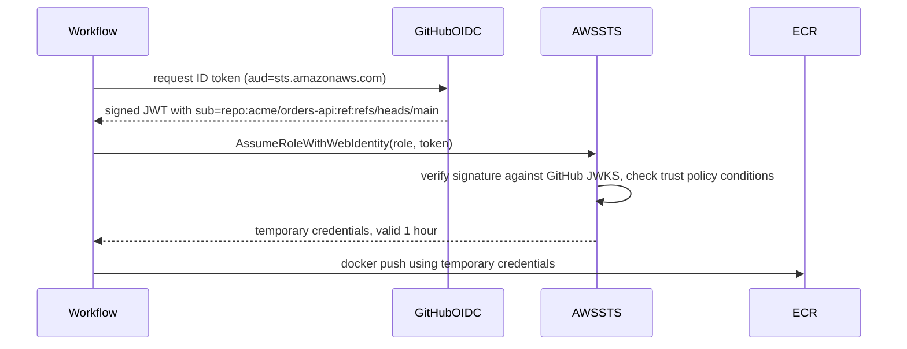
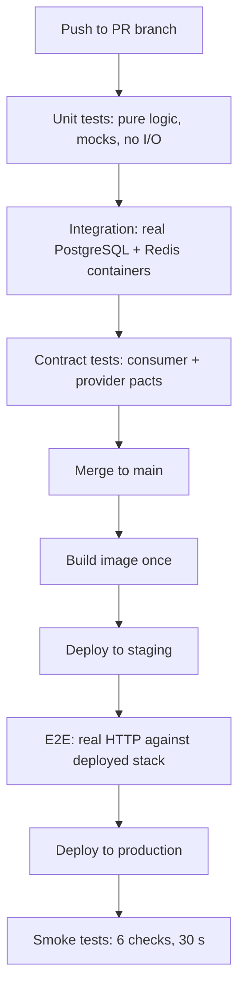

## 29.4 Secrets in CI

#### Concept

Your pipeline needs credentials: to push to a registry, to deploy to a cluster, to run migrations against a database. The naive approach is to store an AWS access key ID and secret in the CI system's secret store. The senior approach is to store nothing long-lived at all, and instead have the CI platform prove its identity to AWS at run time, receiving credentials that expire in an hour.

#### Why does it exist?

A long-lived AWS access key in CI is a permanent, exfiltratable, often over-privileged credential sitting in a system that runs arbitrary code from pull requests. It does not rotate. It does not expire. If it leaks, it works from anywhere on the internet until a human notices and revokes it, and the leak paths are numerous: an `echo $AWS_SECRET_ACCESS_KEY` in a debug line, a dependency with a postinstall script, a compromised third-party Action, a fork PR that a maintainer approved without reading.

OIDC federation removes the credential entirely. There is nothing to leak.

#### Mental model

Imagine a courier who needs to enter your office building. The old way is to give the courier company a permanent master key. Anyone who steals it walks in, forever, and you would not know.

OIDC is a different arrangement. The courier arrives, shows a badge issued by their employer that says "this is courier #42, working job #9981, today". Your security desk trusts that employer's badge system, checks that the job number matches an expected delivery, and issues a visitor pass valid for one hour, for floor 3 only. Nothing permanent changes hands.

#### How it works



Step by step:

1. You register GitHub's OIDC issuer (`https://token.actions.githubusercontent.com`) as an identity provider in your AWS account. This is a one-time setup that stores the issuer URL, the audience, and lets AWS fetch GitHub's public keys.
2. A workflow with `permissions: id-token: write` asks the GitHub runtime for a signed JWT. That token contains claims describing exactly what is running: `repository`, `ref`, `sha`, `workflow`, `environment`, `job_workflow_ref`, and a composite `sub`.
3. The workflow calls `sts:AssumeRoleWithWebIdentity` with that token and a role ARN.
4. AWS verifies the signature against GitHub's published keys, then evaluates the role's **trust policy** against the token claims.
5. If the conditions match, STS returns temporary credentials, typically valid for one hour.

The trust policy is where the security actually lives:

```json
{
  "Version": "2012-10-17",
  "Statement": [
    {
      "Effect": "Allow",
      "Principal": {
        "Federated": "arn:aws:iam::123456789012:oidc-provider/token.actions.githubusercontent.com"
      },
      "Action": "sts:AssumeRoleWithWebIdentity",
      "Condition": {
        "StringEquals": {
          "token.actions.githubusercontent.com:aud": "sts.amazonaws.com"
        },
        "StringLike": {
          "token.actions.githubusercontent.com:sub": "repo:acme/orders-api:environment:production"
        }
      }
    }
  ]
}
```

Read every line of that, because each one blocks a real attack:

- **`Principal.Federated`** names the specific OIDC provider in *your* account. Without it any identity provider could be used.
- **`aud` StringEquals `sts.amazonaws.com`** ensures the token was minted for AWS, not for some other service that also accepts GitHub OIDC tokens. A token issued for a different audience cannot be replayed here.
- **`sub` StringLike** is the critical one. `repo:acme/orders-api:environment:production` means: only a job in *that* repository, running in the *production environment*, can assume this role. Because GitHub environments can require reviewers and restrict branches, this transitively enforces "only approved deploys from `main`".

The condition patterns you will actually use:

| `sub` pattern | Grants access to |
|---|---|
| `repo:acme/orders-api:ref:refs/heads/main` | Jobs on the `main` branch only |
| `repo:acme/orders-api:environment:production` | Jobs targeting the `production` environment (best for deploy roles) |
| `repo:acme/orders-api:pull_request` | Jobs triggered by a PR (use only for read-only roles) |
| `repo:acme/*` | Any repository in the org (too broad; avoid) |
| `repo:acme/orders-api:*` | Any workflow, branch, or fork-triggered event in the repo (too broad) |

The two mistakes that make OIDC useless: using `StringLike` with a trailing `*` on the repo (`repo:acme/*`), which lets any repository in the organisation deploy anything; and omitting the `sub` condition entirely, which lets *any GitHub repository in the world* assume your role. That last one has happened to real companies. If your condition block does not name your repository, you have published a role to the internet.

**Least-privilege deploy roles.** Separate the roles by what they do, and never merge them into one "CI role":

| Role | Permissions | Trusted `sub` |
|---|---|---|
| `ci-read` | `ecr:GetAuthorizationToken`, pull only | `pull_request` |
| `ci-build-push` | ECR push to specific repositories | `ref:refs/heads/main` |
| `deploy-staging` | EKS describe, assume the staging cluster role | `environment:staging` |
| `deploy-production` | EKS describe on one cluster, one namespace | `environment:production` |

Constrain resources, not just actions: `ecr:PutImage` on `arn:aws:ecr:eu-west-1:123456789012:repository/orders-api`, not `*`. A deploy role that can write to every repository lets a compromised orders pipeline poison the payments image.

**The blast radius of a compromised CI runner.** Be honest about this, because it is the strongest argument for short-lived credentials. A runner executes code from your repository, your dependencies (including `postinstall` scripts), and third-party Actions. Any of those can read the runner's environment, memory and filesystem. So a compromised runner can:

- Read every secret and token the job was given, including the OIDC-derived credentials for their remaining lifetime.
- Push an image (if the job has push rights) containing arbitrary code, which then flows through your normal, trusted deploy path.
- Modify the artifact after tests pass but before push, if build and test are in the same job.
- Reach anything network-reachable from the runner, including self-hosted runners inside your VPC. This is why self-hosted runners must live in an isolated subnet with no route to production databases.
- With `contents: write`, push commits or move tags.

The mitigations that follow directly: default `permissions: contents: read` at workflow level and grant more only per job; pin third-party Actions to a full commit SHA (`actions/checkout@8ade135a41bc03ea155e62e844d188df1ea18608`) rather than a tag, because tags move; keep production deploy credentials in a separate job gated by an environment, so the code-execution-heavy jobs (tests, builds) never hold them; use ephemeral runners that are destroyed after one job; and never run untrusted fork PR code with `pull_request_target`, which gives it the base repository's secrets.

**Preventing secrets in logs.** GitHub masks known secret values in output, but only exact matches: a base64-encoded or JSON-embedded secret is not masked. Never `echo` a variable you have not verified, disable `set -x` in scripts that touch secrets, and add secret scanning (29.6) on both the repository and the CI logs. If a secret does appear in a log, treat it as compromised: rotate first, then delete the log. Deleting the log without rotating is the mistake, because the log may already have been read, cached, or replicated.

#### Production scenario

A company with 60 repositories has zero AWS access keys in GitHub. One OIDC provider, and roughly 120 roles generated by Terraform from a module that takes `repo`, `environment` and a policy document. The `deploy-production` roles are all scoped to `environment:production`, which requires two reviewers. Credential lifetime is one hour. When a third-party Action was compromised in a widely-reported incident, their exposure assessment took 20 minutes: the Action was used in a test job with `contents: read` and no cloud role, so nothing needed rotating. The team that had static keys in the same Action rotated 40 credentials over two days.

#### Failure scenario

At 09:12 a security alert fires: an AWS access key belonging to `ci-deploy-user` was used from an IP in a country the company does not operate in. The key had been in GitHub secrets for two years, had `AdministratorAccess` because "it needed to do a lot of things", and had been printed once into a workflow log in 2023 by a debug line that was reverted the same day. The log was public because the repository was open source for four months.

Containment took six hours: revoke the key, audit CloudTrail for every action it performed, rotate every downstream credential it could have read from Secrets Manager, and rebuild two EC2 instances it had touched. The remediation was OIDC, per-environment roles and resource-scoped policies — about two days of work that would have prevented the whole event.

#### Edge cases & failure modes

- **Trust policy too broad.** `repo:acme/*` or a missing `sub` condition; any repo, or any repo on GitHub, can assume the role.
- **Job longer than the credential lifetime.** A 90-minute deploy fails at minute 61 with `ExpiredToken`. Either shorten the job or refresh credentials.
- **Fork PRs get no secrets.** Correct and intentional, but it means a job written to always need a token will always fail for external contributors.
- **`pull_request_target` misuse.** Runs the workflow from the base branch with full secrets, but people then check out the fork's code, which executes untrusted code with secrets. This is the single most exploited GitHub Actions pattern.
- **Self-hosted runner reuse.** A non-ephemeral runner keeps files, caches and credentials from the previous job. One malicious PR poisons every job after it.
- **Action tag mutation.** `some-action@v3` is a tag the maintainer (or an attacker with their credentials) can move. Pin by SHA.
- **Secrets in the build context.** An `.env` copied into the Docker build context ends up in a layer and is shipped to the registry (Part 26 — Docker for Backend Engineers).
- **Environment secrets on the wrong environment.** Staging secrets available to a production job, or the reverse, because the job did not declare `environment:`.

#### How a Senior Backend Engineer thinks about this

They start from the assumption that the runner will be compromised eventually, and design so that the compromise is boring. Short-lived credentials, narrow trust conditions, resource-scoped policies, separation between jobs that run untrusted code and jobs that hold deploy rights.

They ask of every secret: *what is the worst thing that can be done with this, from anywhere on the internet, for as long as it exists?* A long-lived admin key scores catastrophically on all three axes. An OIDC-derived, environment-scoped, one-hour credential scores badly on none.

They also insist that rotation be routine rather than heroic. If rotating a credential requires a maintenance window and a wiki page, it will not happen after a suspected leak, which is exactly when it must.

Explained to a product manager: "Instead of giving the build system a permanent master key, we give it a way to prove who it is each time, and it gets a pass that expires in an hour and only opens one door."

#### Common mistakes

- Storing long-lived cloud access keys in CI secrets.
- A trust policy without a `sub` condition, or with an over-broad wildcard.
- One `AdministratorAccess` role used by every workflow.
- Third-party Actions pinned to tags rather than commit SHAs.
- `pull_request_target` combined with checking out the PR head.
- Deleting a leaked log without rotating the secret.
- Self-hosted runners on a network that can reach the production database.

#### Interview questions

1. *Walk me through how OIDC federation replaces an AWS access key in CI.* Expected: workflow requests a signed ID token, calls `AssumeRoleWithWebIdentity`, AWS verifies signature and trust policy conditions, returns 1-hour credentials. Follow-up: which claim stops another repository using your role?
2. *What is wrong with `"sub": "repo:acme/*"` in a trust policy?* Expected: any repository in the org, including a new low-trust one, can assume the role; scope to repo plus branch or environment.
3. *A CI runner is compromised. What can the attacker reach?* Expected: all job secrets, live cloud credentials for their remaining TTL, the ability to push artifacts through the trusted path, network reach from the runner. Follow-up: how do you shrink each of those?
4. *Why pin Actions to a commit SHA?* Expected: tags are mutable; a moved tag executes new code with your secrets.
5. *A secret was printed into a build log. What is your order of operations?* Expected: rotate first, then revoke downstream, then delete the log and audit usage; assume it has been read.

#### Practical exercise

Replace a static AWS key in one workflow with OIDC. Create the identity provider, a role whose trust policy is scoped to `repo:<org>/<repo>:environment:staging`, and a permissions policy limited to `ecr:PutImage` on one repository plus `ecr:GetAuthorizationToken`. Then prove the controls work: run the same workflow from a feature branch without the environment and confirm the role assumption is denied, and try assuming the role from a second repository and confirm it is denied. Acceptance criteria: no long-lived credential exists anywhere in the repository settings, both negative tests fail as expected, and the workflow's `permissions` block grants `contents: read` and `id-token: write` and nothing else.

## 29.5 Testing stages in the pipeline

#### Concept

A pipeline is a sequence of increasingly expensive, increasingly realistic filters. Each stage catches a class of bug the previous one could not, and costs more to run. The design goal is to catch each bug at the cheapest stage that can catch it, and to fail as early as possible so nobody waits 20 minutes to learn about a typo.

#### Why does it exist?

Because you cannot afford to run everything on every push, and you cannot afford to run nothing. A full end-to-end suite against a production-shaped environment might take 25 minutes and need a database seeded with 2 million rows. Running that on every push means a 25-minute feedback loop and an environment permanently occupied. Running only unit tests means you ship a query that works against a mock and deadlocks against real PostgreSQL.

Staging solves this: cheap deterministic tests gate every push, expensive realistic tests gate the release.

#### Mental model

Imagine airport security. The metal detector is fast, everyone goes through it, and it catches the obvious. The bag scanner is slower and catches more. A hand search is slow, invasive and reserved for the small number of cases that reach it. You would never hand-search every passenger, and you would never let someone board on the strength of the metal detector alone.

Your pipeline is the same shape. Unit tests are the metal detector: 40,000 of them, 3 minutes, every push. E2E is the hand search: 40 of them, 6 minutes, once per release candidate.

#### How it works



**Unit tests: every push.** No network, no database, no filesystem, no real timers. In a NestJS service these test services, domain logic, pipes, guards, mappers and pure functions, with repositories replaced by test doubles. Budget: 40,000 tests in under 3 minutes with four shards. They should be so fast that developers run them on save.

**Integration tests: every push, with service containers.** These are the tests that earn their keep, because most backend bugs live at the boundary: a unique constraint you forgot, a transaction that does not roll back the way you assumed, a `ON CONFLICT` clause that silently updates the wrong row, a Redis key that never expires. GitHub Actions `services:` starts real containers on the runner network:

```yaml
services:
  postgres:
    image: postgres:16.4-alpine
    env:
      POSTGRES_USER: test
      POSTGRES_PASSWORD: test
      POSTGRES_DB: orders_test
    ports: ["5432:5432"]
    # Without a health check the job races the database and fails
    # intermittently with ECONNREFUSED on the first test.
    options: >-
      --health-cmd "pg_isready -U test"
      --health-interval 5s
      --health-timeout 5s
      --health-retries 10
  redis:
    image: redis:7.4-alpine
    ports: ["6379:6379"]
    options: >-
      --health-cmd "redis-cli ping"
      --health-interval 5s
      --health-retries 10
```

Two details that cause most of the pain here. First, the health check is not optional: without it the job starts running tests while PostgreSQL is still initialising, and you get an `ECONNREFUSED` that looks exactly like flakiness and occurs on maybe one run in eight. Second, `services:` containers are only reachable on `localhost` when the job runs directly on the runner; if the job itself runs in a container, you address them by service name instead. That difference has cost more engineering hours than it should.

Isolation between tests is the other half. Three workable strategies:

| Strategy | Speed | Isolation | Notes |
|---|---|---|---|
| Truncate all tables between tests | Fast (5–15 ms) | Good | Must respect FK order or use `TRUNCATE ... CASCADE` |
| Wrap each test in a transaction and roll back | Fastest (1–3 ms) | Good | Breaks if the code under test manages its own transactions |
| A schema per Jest worker | Fast | Excellent | Enables parallel workers; costs a migration run per schema |

For a NestJS service with TypeORM, the schema-per-worker approach lets you drop `--runInBand` and run integration tests on four workers, which typically takes a 9-minute suite to 3 minutes.

**Contract tests.** When `orders-api` calls `payments-api`, integration tests in the orders repository usually mock the payments HTTP client. That mock encodes an assumption about the payments API, and nothing checks that the assumption stays true. Contract testing (Pact is the common tool) makes the assumption executable: the consumer's tests generate a contract file describing the requests it makes and the responses it expects; the provider's pipeline replays that contract against the real provider and fails if it no longer satisfies it. The provider learns it broke a consumer *in its own pipeline*, before deploying.

This is the cheapest way to get most of the value of end-to-end testing without an end-to-end environment. It scales: 12 consumers times 8 providers is 96 relationships that would be impossible to cover with E2E but are perfectly manageable as contracts. See Part 32 — Backward Compatibility for what the contracts should assert.

**E2E before production.** A small number (20 to 60) of tests that drive real HTTP against a deployed stack, covering the critical user journeys end to end: register, log in, browse products, add to cart, checkout with a sandbox payment provider, receive the confirmation. They run against staging after the image is deployed there, and they are the last gate before production.

Keep them few and keep them about journeys, not details. Every E2E test you add is a test that will eventually be flaky, because it depends on a network, a deployed environment, external sandboxes and timing. Sixty E2E tests with a 0.5% flake rate each means roughly a 26% chance that any given run is red for no reason. That is how teams end up ignoring E2E failures.

**Sharding.** For a suite of N tests across M runners, Jest's `--shard=i/M` partitions deterministically by file. Real numbers from a mid-size NestJS service: 4,100 unit tests, 11 min 40 s on one runner, 3 min 25 s on four shards, 2 min 40 s on eight. The eighth shard costs twice the runner minutes for 45 seconds of wall clock, because each shard pays about 80 seconds of fixed cost (checkout, `npm ci` from cache, Jest startup). Choose the point where the curve flattens, not the maximum.

Integration tests shard differently: each shard needs its own database, so you either run schema-per-shard against one PostgreSQL service or accept fewer shards. Two to four is usually right.

**Coverage gates that mean something.** A global "80% line coverage" threshold is nearly useless. It can be satisfied by tests that execute code without asserting anything, it says nothing about *which* 80%, and it creates an incentive to write tests for trivial getters while the payment reconciliation logic stays uncovered.

What works instead:

1. **Coverage on the diff, not the repository.** Require that lines added or changed in this PR are covered at, say, 85%. New code is where new bugs are. Tools: `jest --changedSince`, or a coverage service that computes patch coverage.
2. **Per-path thresholds.** Jest supports `coverageThreshold` per glob. Set 95% on `src/domain/**` and `src/payments/**`, 70% on `src/**`, and exempt generated code and DTOs.
3. **Ratchet, never lower.** Coverage may not decrease. If the number drops, the build fails; if it rises, the floor rises with it.
4. **Branch coverage, not just lines.** A `try/catch` where the catch is never executed shows 100% line coverage on the happy path and zero knowledge of the error path.

```js
// jest.unit.config.js
module.exports = {
  preset: 'ts-jest',
  testMatch: ['<rootDir>/src/**/*.spec.ts'],
  collectCoverageFrom: ['src/**/*.ts', '!src/**/*.module.ts', '!src/**/*.dto.ts'],
  coverageThreshold: {
    // Repository floor: low, and only there to catch collapse.
    global: { lines: 70, branches: 60 },
    // The code where a bug costs money gets a real gate.
    './src/payments/': { lines: 95, branches: 90 },
    './src/domain/': { lines: 92, branches: 85 },
  },
};
```

The deeper treatment of what to test and how to write tests that survive refactoring is in Part 23 — Testing Backend Systems with Jest and NestJS. This section is only about *where in the pipeline each kind runs and what gates on it*.

#### Practical example

`orders-api`, stage by stage, with real budgets:

| Stage | Trigger | Runs | Duration | Gates |
|---|---|---|---|---|
| Lint + typecheck | Every push | 1 job | 70 s | Merge |
| Unit | Every push | 4 shards | 3 min 25 s | Merge |
| Integration (pg + redis) | Every push | 2 shards | 5 min 50 s | Merge |
| Consumer contract publish | Merge to main | 1 job | 40 s | Nothing (publishes) |
| Provider contract verify | Merge to main of provider | 1 job | 2 min | Provider deploy |
| Migration dry-run | Every push touching migrations | 1 job | 45 s | Merge |
| E2E on staging | After staging deploy | 1 job | 6 min | Production deploy |
| Smoke on production | After production deploy | 1 job | 30 s | Rollback trigger |
| Load test | Nightly on main | 1 job | 22 min | Nothing (alerts) |

#### NestJS example

An integration test that would be impossible to write meaningfully with a mocked repository, because the behaviour under test belongs to PostgreSQL:

```ts
// src/orders/orders.service.int-spec.ts
import { Test } from '@nestjs/testing';
import { TypeOrmModule, getDataSourceToken } from '@nestjs/typeorm';
import { DataSource, QueryFailedError } from 'typeorm';
import { OrdersModule } from './orders.module';
import { OrdersService } from './orders.service';

describe('OrdersService (integration)', () => {
  let service: OrdersService;
  let dataSource: DataSource;

  beforeAll(async () => {
    const moduleRef = await Test.createTestingModule({
      imports: [
        TypeOrmModule.forRoot({
          type: 'postgres',
          url: process.env.DATABASE_URL, // points at the services: container
          autoLoadEntities: true,
          synchronize: false,             // migrations run first, like production
        }),
        OrdersModule,
      ],
    }).compile();

    service = moduleRef.get(OrdersService);
    dataSource = moduleRef.get(getDataSourceToken());
  });

  afterEach(async () => {
    await dataSource.query('TRUNCATE orders, order_items RESTART IDENTITY CASCADE');
  });

  afterAll(async () => dataSource.destroy());

  it('rejects a duplicate idempotency key with the real unique constraint', async () => {
    const key = 'idem-9f3c-0001';
    await service.placeOrder({ customerId: 'c-1', items: [], idempotencyKey: key });

    // A mocked repository would happily accept this. PostgreSQL will not.
    await expect(
      service.placeOrder({ customerId: 'c-1', items: [], idempotencyKey: key }),
    ).rejects.toBeInstanceOf(QueryFailedError);
  });
});
```

#### Production scenario

A payments team runs 6,200 unit tests, 480 integration tests and 28 E2E tests. Over one quarter, the bugs caught by each stage were: unit 61%, integration 31%, E2E 6%, production 2%. The integration tests, which cost the most runner minutes of the three gating stages, caught almost a third of everything and nearly all of the expensive class (constraint violations, transaction boundaries, lock ordering). The E2E stage caught only six bugs but two of them were configuration problems in the deployed environment that no other stage could have found: a missing environment variable and a service-to-service network policy.

That distribution is the argument for keeping all three, and for keeping the E2E suite small.

#### Failure scenario

A team's integration job started failing on 1 run in 6, always with a different test, always `ECONNREFUSED` on PostgreSQL. Two engineers spent three days chasing a suspected connection-pool leak. The actual cause: they had recently switched the job to run inside a container (`container: node:20`), and in that mode `services:` containers are addressed by hostname, not `localhost`. Their `DATABASE_URL` still said `localhost`, and it *sometimes* worked because a leftover port mapping was reachable on some runner images and not others.

The fix was one line. The lesson recorded in the postmortem was better: **when a CI failure is intermittent and infrastructural, stop debugging the application.** Print the resolved connection target, the container network, and the health-check status at the start of the job. Ten lines of diagnostics would have saved three days.

#### Edge cases & failure modes

- **Service container race.** No health check, tests start before PostgreSQL accepts connections.
- **Localhost vs service name.** Job in a container addresses services differently; see above.
- **Shared database between parallel workers.** Two workers truncate each other's rows mid-test.
- **Migrations not run in the test database.** Tests pass against `synchronize: true` and fail in production, because `synchronize` generates a schema your migrations never produce.
- **E2E against a shared staging environment.** Another team deploys mid-run; your tests fail for their reason.
- **Sandbox provider outage.** The payment sandbox is down; your E2E gate blocks all deploys including the fix for an unrelated incident. Have a documented, audited bypass.
- **Coverage gate satisfied by assertion-free tests.** 100% coverage, zero `expect` calls.
- **Coverage collapse hidden by a global threshold.** Payments drops from 96% to 40% while the global number stays above 70%.
- **Test data that grows.** A test that inserts and never cleans up makes the suite slower every week until someone notices at 40 minutes.
- **Sharding with unbalanced files.** One shard holds the 90-second file and finishes 4 minutes after the others.

#### How a Senior Backend Engineer thinks about this

They ask, for every proposed test: *what class of bug does this catch, and is there a cheaper stage that could catch it?* A test that mocks the database to check that a query "was called" catches nothing; the same test written against a real PostgreSQL catches constraint and transaction bugs and belongs in the integration stage.

They watch the ratio, not the count. If integration tests take 20 minutes, that usually means someone is writing integration tests for logic that is pure and should be a unit test. If production keeps finding bugs that integration tests should have caught, the mocks are too generous.

They defend the E2E suite's small size against pressure to add "just one more", because they know the flake maths. And they treat coverage as a conversation starter rather than a target: they will happily merge a PR at 68% coverage that tests the two things that can lose money, and reject one at 94% that asserts nothing.

Explained to a product manager: "We test in layers. Cheap tests run on every change and catch most things in three minutes. Expensive, realistic tests run before release and catch the rest. Adding more expensive tests everywhere would make every change slower without catching much more."

#### Common mistakes

- Mocking the database in tests whose entire purpose is database behaviour.
- Using `synchronize: true` in test setup so the tested schema differs from the migrated one.
- A single global coverage threshold, treated as the goal.
- Growing the E2E suite to hundreds of tests and then disabling it because it is flaky.
- Running integration tests against a shared, long-lived database instead of ephemeral containers.
- Sharding without measuring, and paying for eight runners to save 45 seconds.

#### Interview questions

1. *Which tests would you run on every push and which only before release, and why?* Expected: deterministic and fast gate the push (unit, integration, contract); slow and environment-dependent gate the release (E2E, load); reasoning about feedback time and flake risk.
2. *Why run integration tests against a real PostgreSQL instead of a mock?* Expected: constraints, transactions, isolation levels, lock behaviour, SQL correctness, JSON/type coercion — none of which a mock reproduces.
3. *What makes a coverage gate meaningful?* Expected: patch coverage, per-path thresholds on critical code, branch coverage, ratchet; and the acknowledgement that coverage measures execution, not assertion.
4. *Your integration job fails 1 in 6 runs with ECONNREFUSED. How do you debug it?* Expected: check service health checks, connection target resolution, container networking mode, startup ordering; add diagnostics rather than retries.
5. *How do contract tests reduce the need for end-to-end tests?* Expected: they verify the consumer-provider agreement in each side's own pipeline, catching breaking changes before deploy, without needing all services running together.

#### Practical exercise

Add an integration job to a service pipeline with `services:` containers for PostgreSQL and Redis, health checks, and migrations run before the tests. Then convert three existing unit tests that mock the repository into integration tests, and confirm at least one of them now catches a real behaviour the mock hid (a constraint, a cascade, an isolation effect). Finally, replace the global coverage threshold with a per-path configuration plus a patch-coverage check. Acceptance criteria: the integration job is green ten times in a row; one converted test fails when you deliberately drop a database constraint; and a PR that adds uncovered code to `src/payments/` is blocked while one that adds uncovered code to a DTO is not.

