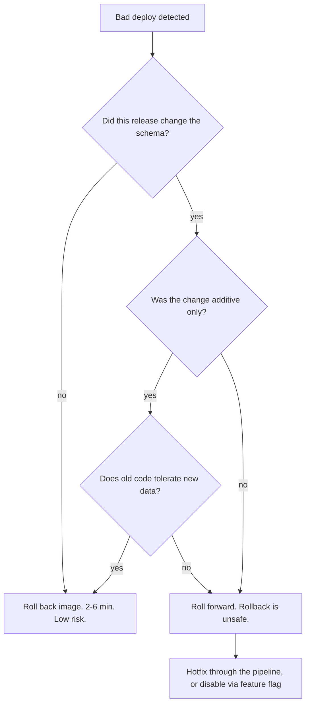

## 29.8 Feature flags

#### Concept

A feature flag is a runtime switch that changes application behaviour without changing the deployed artifact. The code for both paths ships together; a configuration value decides which path runs, and for whom.

#### Why does it exist?

To decouple **deploy** from **release**. Deploying is a technical event: new bytes are running. Releasing is a product event: customers can see a change. Tying them together means every product decision requires a deploy, every deploy carries product risk, and turning something off requires a rollback.

Separate them and everything gets easier. You merge to `main` daily even though the feature is half-finished, because it is behind a flag that is off. You ship the risky refactor and turn it on for 1% of users. When it misbehaves at 02:00, the on-call flips a switch in 10 seconds instead of running a deploy pipeline. And you stop needing long-lived feature branches, which is the single biggest cause of painful merges (Part 30 — Git).

#### Mental model

Imagine a new wing of a hospital. You build it, wire it, furnish it, and inspect it, all while the old wing operates normally. The doors stay locked. Then one morning you unlock one door for the outpatient clinic and watch. Then another. If something is wrong with the ventilation, you lock the doors again — you do not demolish the wing.

The flag is the door. Building the wing is the deploy; unlocking the door is the release.

#### How it works

Four types, with genuinely different lifecycles. Confusing them is the root of most feature-flag mess:

| Type | Purpose | Lifetime | Who changes it | Removal |
|---|---|---|---|---|
| **Release flag** | Hide unfinished work; gradual rollout | Days to weeks | Engineering | **Mandatory** once at 100% |
| **Ops / kill switch** | Disable an expensive or fragile subsystem under load | Permanent | On-call, at 3 a.m. | Never; it is infrastructure |
| **Experiment flag** | A/B test, measure variants | Length of the experiment | Product/data | Mandatory when the experiment concludes |
| **Permission / entitlement** | Gate by plan, role or tenant | Permanent | Product, billing | Never; it is a business rule |

Only two of the four are temporary, and those two are the ones that rot.

**The lifecycle and the discipline of deletion.** A release flag has a defined life: created with an owner and an expiry date, rolled out in steps (internal users, 1%, 10%, 50%, 100%), soaked at 100% for a week, then **the flag and the dead branch are deleted from the code**. That last step is the one teams skip, and the cost compounds: every unremoved flag doubles the number of code paths, and ten flags create up to 1,024 theoretical combinations, of which you test one. Bugs then appear only for the users whose flag combination nobody has ever exercised.

Enforce it mechanically, not by good intentions: every flag has an owner and an expiry in the flag system; a scheduled job opens a ticket (or fails a build) when a flag is past expiry; and a lint rule forbids adding a flag without registering it. A reasonable steady state for a service is under 15 active flags, most of them permanent ops and permission flags.

**Flag-driven read switches during migrations.** This is the highest-value use of flags for backend engineers. During an expand/contract schema migration you have a moment where both the old column and the new column exist and are being written, and you need to switch reads from one to the other — reversibly, instantly, without a deploy.

```ts
// src/orders/order-total.reader.ts
import { Injectable } from '@nestjs/common';
import { FeatureFlagService } from '../flags/feature-flag.service';
import { Order } from './order.entity';

@Injectable()
export class OrderTotalReader {
  constructor(private readonly flags: FeatureFlagService) {}

  // During the migration both columns are populated by dual writes.
  // The flag decides which one is authoritative for reads, so switching
  // back after a bad result takes seconds, not a deploy.
  async read(order: Order): Promise<bigint> {
    const useNewColumn = await this.flags.isEnabled('orders.read_total_minor_units', {
      tenantId: order.tenantId,
    });
    return useNewColumn ? order.totalMinorUnits : BigInt(Math.round(order.total * 100));
  }
}
```

The full migration pattern — add column, dual write, backfill, verify, switch reads by flag, stop writing the old column, drop it — is in Part 31 — Database Migrations and Zero-Downtime Schema Changes. The flag is what makes the "switch reads" step reversible.

**The evaluation-consistency problem.** This is the failure mode that catches people. Your service runs 24 pods. Each pod evaluates flags locally against a cached ruleset, refreshed by polling or streaming. That cache does not update everywhere at the same instant.

Consequences, concretely:

- A user's first request hits pod 7 (flag on, new checkout page) and their next request hits pod 12 (flag off, old checkout page). The session breaks.
- A kill switch flipped during an incident takes effect over 30 seconds as pods poll, so the graph does not drop instantly and someone flips it twice.
- A canary pod and a stable pod disagree about a flag, contaminating your canary analysis.

The mitigations:

1. **Deterministic bucketing.** Percentage rollouts must hash a stable identifier (`userId`, `tenantId`), not a random number: `hash(flagKey + userId) % 100 < rolloutPercentage`. Every pod computes the same answer for the same user with no coordination. Never use `Math.random()` for a rollout.
2. **Evaluate once per request, at the edge of the request.** Resolve all flags in a middleware or interceptor, attach the resolved set to the request context, and pass it down. Do not re-evaluate deep in a service, where a mid-request refresh can flip the value between two steps of the same transaction.
3. **Streaming updates over polling** where the provider supports it, cutting propagation from 30–60 seconds to under 1 second.
4. **Accept eventual consistency and design for it.** For anything where mid-flight inconsistency is unacceptable (a multi-step checkout), pin the resolved value into the session or the order record at the start.

**OpenFeature in one paragraph.** OpenFeature is a vendor-neutral specification and SDK for feature flag evaluation, with a stable API (`getBooleanValue`, `getStringValue`, evaluation context, hooks) and pluggable providers for LaunchDarkly, Flagsmith, Unleash, GrowthBook, ConfigCat or an in-house service. You write against the OpenFeature client once; swapping the backing provider becomes a configuration change instead of a refactor across 200 call sites. It also standardises evaluation *hooks*, which is how you get flag evaluations onto your traces and metrics automatically — genuinely useful when debugging "why did this user see the old page?". For a NestJS service, wrap the OpenFeature client in an injectable provider so tests can supply an in-memory provider with fixed values.

#### Production scenario

A ride-booking platform runs 9 services with 47 active flags: 6 release flags (each with an owner and an expiry under 30 days), 12 kill switches (surge pricing recalculation, driver ETA prediction model, promotional engine, real-time map updates), 21 entitlement flags (feature tiers per city and per partner), and 8 experiment flags. Flag evaluation is local and in-memory, refreshed by a streaming connection; p99 evaluation latency is under 0.1 ms because there is no network call in the request path.

During a Kafka partition incident, the on-call disabled the ETA prediction subsystem with a kill switch. Latency recovered in 20 seconds. The alternative — a deploy of a version without that call — would have taken 11 minutes.

#### Failure scenario

A team added a release flag, `checkout.new_tax_engine`, in March. It reached 100% in April. Nobody removed it. In September a config cleanup script "tidied up" flags with no recent changes and set several to their default value, which for this flag was `false`. The old tax engine had not been exercised in five months and had since drifted: a currency added in June was not handled by it. Checkout began throwing `Unsupported currency: RON` for Romanian customers.

It took 35 minutes to diagnose, because the deployed code had not changed and everyone was looking at the deploy log. The postmortem produced two rules the team now enforces: a release flag past its expiry fails the nightly build, and any code path behind a flag at 100% for more than 30 days is deleted along with the flag.

#### Edge cases & failure modes

- **Flag provider outage.** If your SDK fails open or closed at the wrong moment, a vendor incident becomes your incident. Always configure explicit defaults in code, cache the last known ruleset to disk, and test the provider-unavailable path.
- **`Math.random()` bucketing.** Users flip between variants on every request.
- **Flag read inside a loop.** 10,000 evaluations per request; even at 0.05 ms each that is half a second.
- **Flags controlling database writes.** Turning a flag off mid-transaction leaves half-written state.
- **Combinatorial explosion.** 12 boolean flags, 4,096 combinations, 1 tested.
- **A flag left on forever.** The dead path rots and eventually gets executed (see the story above).
- **Flag state not in the incident timeline.** You cannot correlate a spike with a flag change if flag changes are not an audited, timestamped event stream. Emit them like deploys.
- **Flags used as configuration.** Connection pool sizes and timeouts belong in config management, not the flag system.
- **Permission flags implemented as release flags.** Someone "cleans up" a flag and every customer gets the enterprise tier.

#### How a Senior Backend Engineer thinks about this

They treat flags as code with a shorter half-life. Every flag is technical debt with a due date; the discipline is not "have fewer flags" but "have an expiry on every temporary one and honour it".

They insist that risky changes ship behind a flag *and* that the off path is exercised. A rollback path nobody has run is not a rollback path.

They also draw a firm line: flags control *behaviour*, not *infrastructure*. Pool sizes, timeouts and endpoints belong to configuration management. Mixing them means the flag system becomes a second, unaudited config system, and eventually the thing that takes production down.

Explained to a product manager: "We can put the code in production with the feature switched off, then turn it on for a small group and watch. If it misbehaves we switch it off in seconds instead of doing an emergency release."

#### Common mistakes

- Never deleting flags, so the codebase accumulates untested branches.
- Random rather than deterministic bucketing.
- Evaluating flags deep in the call stack instead of once per request.
- No owner or expiry, so nobody knows if a flag is safe to remove.
- Using flags to hide a missing rollback plan rather than as a deliberate release control.
- Flag changes that are not audited, so they are invisible during incident review.

#### Interview questions

1. *What problem do feature flags solve that deployment strategies do not?* Expected: decoupling deploy from release; per-user targeting; sub-second reversal without a pipeline; merging unfinished work safely.
2. *Name the flag types and their lifecycles.* Expected: release (temporary, must be deleted), ops kill switch (permanent), experiment (until concluded), permission (permanent business rule).
3. *How do you keep 24 pods agreeing on a percentage rollout?* Expected: deterministic hashing of a stable id, evaluate once per request, streaming updates, accept eventual consistency and pin where needed.
4. *How do flags help during a schema migration?* Expected: a reversible read switch between old and new columns during expand/contract, without a deploy.
5. *What happens when your flag provider is unavailable?* Expected: in-code defaults, cached rulesets, fail to a known-safe value, and having tested that path.

#### Practical exercise

Introduce a flag-driven read switch for a field you are migrating. Implement deterministic bucketing by `tenantId`, resolve all flags in a NestJS interceptor and attach them to the request context, and emit a metric labelled with the resolved variant. Then simulate a provider outage by blocking the SDK's network access and confirm the service serves the in-code default without added latency. Acceptance criteria: the same tenant always gets the same variant across all pods; flag evaluation adds under 1 ms at p99; the provider-down path is covered by a test; and the flag is registered with an owner and an expiry date.

## 29.9 Rollbacks

#### Concept

A rollback is returning production to a previously known-good state. In practice it means two very different things: rolling back the *image*, which is fast and reliable, and rolling back the *database*, which usually is not possible at all.

#### Why does it exist?

Because your ability to recover matters more than your ability to avoid failure. Time to restore service is one of the four DORA metrics precisely because it is the one you control on your worst day. A team that deploys carefully but cannot undo is more fragile than a team that deploys casually and recovers in 90 seconds.

#### Mental model

Imagine a document with version history. Rolling back the code is pressing undo on the text: instant, complete. Rolling back the database is trying to un-send the emails that the document generated while it existed. The text goes back. The consequences do not.

#### How it works

**Image rollback is easy.** Your previous image still exists in the registry with an immutable tag. `kubectl rollout undo deployment/orders-api` or `helm rollback orders-api 41` or, better, re-running your deploy pipeline pinned to the previous SHA. Two to six minutes for a rolling update; seconds for blue/green or a canary abort. This works because containers are immutable and the registry is durable — which is exactly why 29.3 insists on immutable tags and retention. `latest` breaks this completely: there is nothing to roll back to.

**Database rollback usually is not.** A "down migration" that reverses a schema change is a comforting fiction in most real cases:

- `DROP COLUMN` cannot be undone. The data is gone. A down migration that re-adds the column gives you an empty column.
- A backfill that transformed 40 million rows cannot be reversed unless you kept the original values.
- A migration that ran halfway and failed leaves the schema in a state neither version expects.
- The old code may not tolerate rows the new code wrote, even with the schema unchanged (the enum story in 29.7).

This is why the professional default is **roll forward, not back**. Fix the problem in a new commit, ship it through the normal pipeline (which for a hotfix should take under 15 minutes), and reserve true rollback for the case where the new code is catastrophically broken and the schema change was purely additive.

The decision, as an algorithm:



**Keeping N-1 compatibility so rollback is even possible.** The rule: **version N must be able to run against the schema and data produced by version N+1.** Concretely, that means every release must satisfy:

- Only additive DDL at deploy time: new nullable columns, new tables, new indexes (`CREATE INDEX CONCURRENTLY`), constraints added `NOT VALID` then validated.
- No column, table or enum value removed until the release *after* the last code that referenced it.
- New enum values, new event types and new status codes must be tolerated by the previous version — usually meaning the previous version must already have a default branch that ignores unknown values. This is why "accept unknown values gracefully" ships one release *before* the values themselves (Part 32 — Backward Compatibility).
- API responses may add fields but not remove or retype them.

Enforce it, do not hope for it. A CI check that inspects migration files and fails on `DROP COLUMN`, `DROP TABLE`, `ALTER COLUMN ... TYPE` or `ALTER TABLE ... SET NOT NULL` unless the file carries an explicit, reviewed `-- destructive: approved-by` marker costs an afternoon and prevents the whole class.

**Automated rollback on SLO breach.** The pipeline should not need a human. After a deploy, watch a small set of signals for a defined window and roll back automatically if they breach:

| Signal | Threshold | Window |
|---|---|---|
| HTTP 5xx rate | > 2x the 1-hour baseline, or > 1% absolute | 3 min sustained |
| p99 latency | > 1.5x baseline | 5 min sustained |
| Pod restarts / CrashLoopBackOff | Any new pod restarting more than twice | 2 min |
| Readiness failures | More than 25% of new pods unready | 3 min |
| Domain metric (orders/min, payment success) | > 3 standard deviations below forecast | 5 min |

The domain metric is the one that catches the failures technical metrics miss: a deploy where every request returns 200 OK and every order silently fails validation shows a perfect error rate and a cliff in orders per minute.

Argo Rollouts and Flagger implement this as `AnalysisTemplate` resources querying Prometheus. In a plain GitHub Actions pipeline you can do a simpler version: after `kubectl rollout status` succeeds, poll your metrics endpoint for 5 minutes and call `kubectl rollout undo` on breach. The mechanics of defining the SLOs and the queries are in Part 25 — Observability.

**Practising rollbacks deliberately.** A rollback path that has never been executed is a hypothesis. Run a game day: pick a low-traffic hour, deploy a deliberately broken version to production behind a canary, and let the automation catch it. Measure time to detect and time to restore. The first time a team does this they usually discover something concrete and embarrassing — the previous image was garbage-collected, the rollback script referenced a tag that no longer exists, the on-call did not have permission to run it, or `kubectl rollout undo` restored the deployment but not the ConfigMap.

#### Production scenario

A team deploys 12 times a day with a 4% change failure rate, so roughly one bad deploy every two days. Their automated analysis catches 80% of those within 4 minutes and rolls back without human involvement; median time to restore is 3 minutes 40 seconds. The remaining 20% are subtler (a report that produces wrong numbers, a webhook that stops firing) and are caught by alerting within 20 to 90 minutes, then fixed by rolling forward. Their migration policy is strictly expand-only at deploy time, with contractions batched into a monthly cleanup release, which is what makes the automated rollback safe to run without a human judging the schema question.

#### Failure scenario

At 21:40 a deploy of `inventory-api` included a migration that renamed `stock_count` to `available_quantity` — done "properly", they thought, with a down migration that renamed it back. At 21:52 an unrelated bug in the same release caused 500s and the on-call ran `helm rollback`.

The old image came back in 90 seconds and immediately failed on every query: `column "stock_count" does not exist`. The rename had not been reverted, because `helm rollback` rolls back Kubernetes resources, not database state. The on-call then ran the down migration manually. It renamed the column back — and dropped the 3,100 rows that the new code had inserted using a column list that included two new columns, because the down migration also dropped those columns.

Total outage: 41 minutes. The two lessons: never rename in a single step (add, dual write, backfill, switch reads, drop later), and never assume a deployment tool's rollback touches the database.

#### Edge cases & failure modes

- **Previous image deleted by a retention policy.** Rollback target does not exist. Keep at least 10.
- **Registry outage during a rollback.** Nodes cannot pull the old image. Mitigate by keeping the previous image on nodes (do not aggressively prune), or by rolling back to a running replica set that has not been scaled to zero.
- **Rollback to an image incompatible with the new schema.** The central problem of this section.
- **Config not rolled back with the code.** ConfigMaps, secrets and feature flags are separate objects with their own history.
- **Rollback during an in-progress rollout.** Kubernetes handles it, but you can end up with three replica sets alive at once; verify the final state explicitly.
- **Messages already published.** Events with a new schema are in Kafka and the old consumer cannot parse them (Part 32).
- **Cache poisoned by the bad version.** Rolling back the code leaves wrong values in Redis with a 24-hour TTL. Include a targeted cache invalidation in the runbook.
- **Rollback that succeeds technically and fails operationally.** The deployment reports Available with the old image while a sidecar or an init container still runs the new one.
- **Nobody has permission.** The person on call at 03:00 cannot run the rollback because production access requires an approval from someone asleep.

#### How a Senior Backend Engineer thinks about this

They design every release around the question *how do we undo this?* before the question *how do we ship this?* If the honest answer is "we cannot", the release gets restructured until it can be — usually by splitting it into an additive schema change, a flag-gated behaviour change, and a later cleanup.

They prefer roll-forward as the stated default, because it is honest: it acknowledges that state is not reversible and directs energy at making the hotfix path fast (which is the same investment that makes ordinary deploys fast).

They also treat the rollback runbook as production code: version controlled, reviewed, and executed on a schedule. A rollback that is only ever run during an incident is run for the first time by a stressed person at 3 a.m.

Explained to a product manager: "We can always put yesterday's software back in minutes. We usually cannot put yesterday's data back, so we design changes so that today's data still works with yesterday's software."

#### Common mistakes

- Believing a down migration is a rollback plan.
- Retention policies that delete the images you would roll back to.
- Rolling back code without rolling back configuration or flags.
- No automated rollback, so recovery depends on someone being awake.
- Never practising, so the runbook is fiction.
- Destructive migrations shipped in the same release as the code that stops using the old shape.

#### Interview questions

1. *Why is rolling back the database harder than rolling back the code?* Expected: state is not reversible, dropped data is gone, backfills are one-way, partial migrations leave unexpected states; hence expand/contract and roll-forward.
2. *What is N-1 compatibility and how do you enforce it?* Expected: version N runs against version N+1's schema and data; enforced by additive-only DDL at deploy time, deferred contractions, tolerant readers, and a CI check on migration files.
3. *When would you roll back instead of rolling forward?* Expected: catastrophic breakage, no schema change or purely additive, hotfix would take longer than the rollback, blast radius growing.
4. *Design an automated rollback trigger.* Expected: small set of signals (5xx rate, p99, restarts, a domain metric), thresholds relative to baseline, sustained windows to avoid flapping, and a manual override.
5. *Your rollback fails because the previous image is gone. What went wrong upstream?* Expected: retention policy too aggressive, or mutable tags, or building per environment; fix at the artifact layer.

#### Practical exercise

Run a rollback game day on a staging environment that mirrors production. Deploy a version that returns 500 on 30% of requests, and measure: time until your automated analysis detects it, time until traffic is fully back on the good version, and whether configuration and flags returned to their previous state. Then repeat with a release that included an additive migration, and confirm the old code runs correctly against the new schema. Acceptance criteria: detection under 4 minutes, restore under 6 minutes, a written runbook that a new team member could execute, and evidence that the previous 10 images are retained and pullable.

