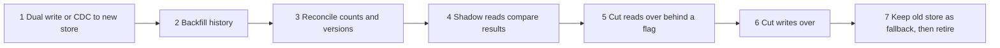

## 29.10 Polyglot persistence and store migrations in practice

#### Concept

29.6 set the rule: one source of truth, every other store derived and eventually consistent. In practice that means three pieces of code you must own: a **relay** that propagates changes idempotently, a **reconciliation job** that proves the stores agree, and a **migration playbook** for the day you move a workload between stores.

#### How it works — an idempotent outbox relay

The order service writes the order and an outbox row in one PostgreSQL transaction (see Part 33 — Distributed Transactions: Sagas, Outbox, Inbox and Idempotency, 33.10). A relay reads the outbox and writes a read model into DynamoDB. Because the relay can crash and resend, and events can arrive out of order, every write carries the source row's **version** and is conditional on being newer.

```ts
// outbox-relay.service.ts -- PostgreSQL outbox -> DynamoDB read model, safe to replay
@Injectable()
export class OutboxRelay {
  constructor(
    private readonly dataSource: DataSource,
    @Inject(DYNAMO) private readonly db: DynamoDBDocumentClient,
  ) {}

  @Interval(500)
  async drain() {
    await this.dataSource.transaction(async (em) => {
      const rows: OutboxRow[] = await em.query(
        `SELECT id, aggregate_id, version, payload FROM outbox
          WHERE published_at IS NULL ORDER BY id LIMIT 100
          FOR UPDATE SKIP LOCKED`,                       // several relay pods never take the same rows
      );
      for (const r of rows) {
        try {
          await this.db.send(new PutCommand({
            TableName: 'order_read_model',
            Item: { PK: `ORDER#${r.aggregate_id}`, SK: 'META', version: r.version, ...r.payload },
            ConditionExpression: 'attribute_not_exists(PK) OR version < :v',   // older or duplicate events lose
            ExpressionAttributeValues: { ':v': r.version },
          }));
        } catch (e) {
          if (!(e instanceof ConditionalCheckFailedException)) throw e;          // stale event: ignore, still mark done
        }
        await em.query('UPDATE outbox SET published_at = now() WHERE id = $1', [r.id]);
      }
    });
  }
}
```

The same shape works for MongoDB (`updateOne({ _id, version: { $lt: v } }, { $set: ... }, { upsert: true })`, with a duplicate-key error on upsert meaning "a newer version exists") and for OpenSearch (`version_type: 'external'` with the source version). At larger scale, CDC from the PostgreSQL WAL replaces the polling relay (see Part 42 — Data Engineering for Backend Engineers).

A nightly **reconciliation** job samples or scans ids updated in the last day from PostgreSQL, fetches the same ids from the derived store with `BatchGetCommand`, compares `version`, and re-enqueues mismatches. Without it, a bug in the relay is discovered by customers.

#### How it works — the operational cost of each extra store

| Store added | Typical monthly infra (small production) | Ongoing people cost | New failure modes |
|---|---|---|---|
| Redis (managed) | $200-800 | Low | Stale cache, eviction, failover blips |
| OpenSearch (managed, 3 nodes) | $1,000-3,000 | Medium: mappings, reindexing, shard sizing | Index lag, mapping explosions |
| MongoDB Atlas (M40-class replica set) | $1,500-3,000 | Medium | Schema drift, index builds, failover |
| DynamoDB (on-demand) | Pay per request; $100s to $10,000s | Low ops, high design effort | Hot keys, GSI lag, missing access patterns |
| Cassandra (self-hosted, 6-9 nodes) | $4,000-10,000 | High: repair, compaction, upgrades | Tombstones, repair debt, node replacement |

The infrastructure line is the small part. Each store also needs backups and restore drills (see Part 54 — Backup, Restore and Disaster Recovery), access control, monitoring dashboards, a runbook and on-call knowledge. A useful rule: a new store must save more than one engineer's time per year, or it is a cost, not an optimisation.

#### How it works — migrating between stores



1. **Start propagation first**, then backfill, so nothing written during the backfill is missed. Prefer CDC or an outbox over application dual writes, which can partially fail (see Part 33).
2. **Backfill** with idempotent, versioned writes so the backfill and live changes can overlap safely.
3. **Reconcile** counts per day and versions per id.
4. **Shadow reads**: serve from the old store, query the new one too, log differences.
5. **Cut reads**, then writes, behind flags that can flip back in seconds (see Part 91 — Large-Scale Migrations and Legacy Modernization).
6. Keep the old store warm for a rollback window before retiring it.

#### Failure scenario

A team moved order history from MongoDB to PostgreSQL. They started the backfill on Monday and turned on dual writes on Wednesday, intending to "catch up the gap later". The gap job ran with a timezone bug and skipped 6 hours of updates. Reconciliation was "count rows per day", which matched, because the orders existed; their **statuses** did not. After the read cutover, 4,100 customers saw paid orders as pending, and 300 paid twice. The rollback flag worked in 2 minutes, but the cleanup took a week. The fixes they adopted: propagation before backfill, versions in every row, reconciliation that compares versions and not just counts, and a day of shadow reads before any cutover.

#### Interview questions

1. **How do you keep a derived store correct when events can be duplicated or reordered?** Carry the source version and make every write conditional on being newer; add a reconciliation job that compares versions.
2. **Why start propagation before the backfill when migrating?** So changes made during the backfill are captured; versioned writes let backfill and live changes overlap without regressions.
3. **What does adding a store cost beyond the bill?** Backups and restore drills, security, monitoring, runbooks, on-call skills, and a new class of consistency bugs.

#### Practical exercise

Implement the relay against DynamoDB Local, then replay the same outbox rows twice and in reverse order. Acceptance criteria: the read model ends with the newest version of every order, and a reconciliation script reports zero mismatches.

## 29.11 Worked example: ride-booking trip history in DynamoDB versus PostgreSQL

We model the same feature twice, honestly, and decide.

### 29.11.1 Requirements and access patterns

- 2 million trips per day, peaking at 150 trip completions per second on Friday evenings.
- Each trip is written about 4 times (requested, accepted, started, completed) and is about 2 KB.
- Retention: 3 years online, about 2.2 billion trips, about 4.4 TB of trip data.
- Rider app opens history often: 800 history reads per second on average, 3,000 at peak.

| # | Access pattern | Volume | Consistency need |
|---|---|---|---|
| A1 | Rider's trips, newest first, 20 per page | Very high | A trip may appear a second late |
| A2 | Trip by id (receipt, support) | High | Read-your-write after completion |
| A3 | Driver's trips for one day (earnings) | Medium | Eventual is fine |
| A4 | Rider's single active trip; at most one at a time | High | Strong: must prevent two active trips |
| A5 (later) | Finance: fares by city per day | Nightly batch | Eventual is fine |

### 29.11.2 The DynamoDB design

| Item | PK | SK | GSI1PK / GSI1SK | GSI2PK / GSI2SK |
|---|---|---|---|---|
| Trip | `TRIP#<id>` | `TRIP` | `RIDER#<riderId>` / `<requestedAt>#<id>` | `DRIVER#<driverId>` / `<requestedAt>` |
| Active-trip lock | `RIDER#<riderId>` | `ACTIVE` | - | - |

- A2 is a `GetItem` on the base table with `ConsistentRead: true`.
- A1 is a `Query` on GSI1, newest first; GSI1 projects only summary attributes (`INCLUDE`: pickup and drop labels, fare, status), so each history item in the index is about 0.4 KB and a 20-item page costs 2 read units.
- A3 is a `Query` on GSI2 with `GSI2SK BETWEEN :dayStart AND :dayEnd`.
- A4 is enforced by a conditional write in a transaction:

```ts
// request-trip.ts -- create a trip and claim the rider's single active slot atomically
await this.db.send(new TransactWriteCommand({
  ClientRequestToken: dto.idempotencyKey,
  TransactItems: [
    { Put: { TableName: 'trips',
        Item: { PK: `RIDER#${dto.riderId}`, SK: 'ACTIVE', tripId },
        ConditionExpression: 'attribute_not_exists(PK)' } },          // fails if a trip is already active
    { Put: { TableName: 'trips',
        Item: { PK: `TRIP#${tripId}`, SK: 'TRIP', status: 'requested', riderId: dto.riderId,
                cityCode: dto.cityCode, requestedAt: now,
                GSI1PK: `RIDER#${dto.riderId}`, GSI1SK: `${now}#${tripId}` } } },
  ],
}));
// On completion: Update the trip (status, fare, GSI2 keys) and Delete the ACTIVE item in one transaction.
```

Hot partitions: riders and drivers are high-cardinality keys and no single rider writes more than a few times per minute. GSI eventual consistency is acceptable for A1 and A3 by the requirements table.

### 29.11.3 The PostgreSQL design

```sql
CREATE TABLE trips (
  id            uuid        NOT NULL,
  rider_id      uuid        NOT NULL,
  driver_id     uuid,
  city_code     text        NOT NULL,
  status        text        NOT NULL CHECK (status IN ('requested','accepted','in_progress','completed','cancelled')),
  requested_at  timestamptz NOT NULL,
  completed_at  timestamptz,
  fare_cents    integer     CHECK (fare_cents >= 0),
  currency      char(3)     NOT NULL,
  route         jsonb,                                    -- pickup/drop labels and coordinates
  PRIMARY KEY (id, requested_at)                          -- must include the partition key
) PARTITION BY RANGE (requested_at);

CREATE TABLE trips_2026_11 PARTITION OF trips
  FOR VALUES FROM ('2026-11-01') TO ('2026-12-01');        -- created ahead by a scheduled job

CREATE INDEX trips_rider_history ON trips (rider_id, requested_at DESC, id DESC);   -- A1 keyset
CREATE INDEX trips_driver_day    ON trips (driver_id, requested_at);               -- A3

-- A4: a unique index on a partitioned table must include requested_at, which would not
-- enforce "one active trip per rider". So the invariant lives in a small unpartitioned table.
CREATE TABLE active_trips (
  rider_id uuid PRIMARY KEY,
  trip_id  uuid NOT NULL
);
```

A1 is a keyset query (see Part 18 — API Design (REST first), 18.5 Pagination), bounded to the last 13 months for the default screen so old partitions are pruned:

```sql
EXPLAIN (ANALYZE, BUFFERS)
SELECT id, status, fare_cents, requested_at, route->>'dropLabel' AS drop_label
  FROM trips
 WHERE rider_id = $1
   AND requested_at > now() - interval '13 months'
   AND (requested_at, id) < ($2, $3)
 ORDER BY requested_at DESC, id DESC
 LIMIT 20;
```

```text
Limit  (actual time=0.09..0.61 rows=20 loops=1)
  ->  Merge Append  (actual time=0.09..0.59 rows=20 loops=1)
        Sort Key: trips.requested_at DESC, trips.id DESC
        Subplans Removed: 23
        ->  Index Scan using trips_2026_11_rider_id_requested_at_id_idx on trips_2026_11
              (actual time=0.03..0.11 rows=6 loops=1)
              Index Cond: ((rider_id = $1) AND (requested_at > (now() - '13 mons'::interval)))
              Filter: (ROW(requested_at, id) < ROW($2, $3))
              Buffers: shared hit=9
        ->  ... 13 more partition index scans, most returning 0-3 rows ...
Planning Time: 0.84 ms
Execution Time: 0.72 ms
```

Under a millisecond, with 23 of 37 partitions removed at startup. Without the time bound, every partition's index is probed: still about 2 ms, but it grows with every month of retention. (The row comparison appearing as a `Filter` rather than in the `Index Cond` is common on partitioned indexes and is cheap here because the leading columns already narrow the scan to one rider.)

```ts
// trip.entity.ts + history query in TypeORM
@Entity('trips')
@Index('trips_rider_history', ['riderId', 'requestedAt', 'id'])
export class Trip {
  @PrimaryColumn('uuid') id: string;
  @PrimaryColumn({ name: 'requested_at', type: 'timestamptz' }) requestedAt: Date;
  @Column({ name: 'rider_id', type: 'uuid' }) riderId: string;
  @Column({ name: 'driver_id', type: 'uuid', nullable: true }) driverId: string | null;
  @Column({ name: 'city_code' }) cityCode: string;
  @Column() status: string;
  @Column({ name: 'fare_cents', type: 'integer', nullable: true }) fareCents: number | null;
  @Column({ type: 'jsonb', nullable: true }) route: Record<string, unknown> | null;
}

history(riderId: string, cursor?: { at: Date; id: string }) {
  const qb = this.trips.createQueryBuilder('t')
    .where('t.riderId = :riderId', { riderId })
    .andWhere("t.requestedAt > now() - interval '13 months'")
    .orderBy('t.requestedAt', 'DESC').addOrderBy('t.id', 'DESC')
    .limit(20);
  if (cursor) qb.andWhere('(t.requestedAt, t.id) < (:at, :id)', cursor);
  return qb.getMany();
}
```

(The partitioned table itself is created by a migration, not by TypeORM synchronization, which does not understand `PARTITION BY`.)

### 29.11.4 Cost, operations and the new access pattern

| | DynamoDB | PostgreSQL |
|---|---|---|
| Storage (4.4 TB + indexes) | ~$1,100 base table + ~$550 for two projected GSIs | ~$600 for gp3 storage on primary, same again per replica |
| Compute / requests | ~$600 writes + ~$500 reads (on-demand) | Primary + 1 replica, 8 vCPU / 64 GB each: ~$1,800 |
| Rough monthly total | ~$2,800 | ~$3,000 |
| A1 latency p99 | ~8-10 ms | ~5 ms on a warm replica |
| Ops burden | Very low; capacity per key, GSI lag | Partitions, vacuum, upgrades, failover |
| Multi-region active-active | Global tables | Not built in |
| Joins to payments, refunds, support | No; duplicate data or call another service | Yes, one query |

At this scale the bills are similar (list prices at time of writing, approximate). The difference is the shape of future work. Then finance asks for **A5: fares by city per day**.

- **PostgreSQL**: one query on a replica, `GROUP BY city_code, date_trunc('day', completed_at)`, pruned to yesterday's partition; if it becomes frequent, an index or a rollup table. Hours of work.
- **DynamoDB**: a new GSI keyed `CITY#<code>#<day>` is possible (Bengaluru's 300,000 trips a day are only about 3.5 writes per second on that key, well within limits), but every existing trip must be rewritten to carry the new attribute: 2.2 billion updates, about $2,750 in write units and days of throttled backfill. The better answer is not a GSI at all: export to S3 with the managed table export or Streams, and run the report in a warehouse (see Part 42 — Data Engineering for Backend Engineers). That is a second system for a question PostgreSQL answers in place.

#### Failure scenario

In the DynamoDB version, at 21:40 on launch day support tickets arrived: "my trip disappeared". Riders finishing a trip were sent to the history screen, which reads GSI1. The GSI lagged the base table by 300-900 ms under load, so the just-completed trip was missing on first render. The data was fine; the read path ignored the consistency column of the requirements table. The fix: after completion the app opens the receipt with A2 (a strongly consistent `GetItem` on the base table) and prepends that trip to the history list locally.

### 29.11.5 Decision

| Requirement | PostgreSQL | MongoDB | DynamoDB | Cassandra | Redis | TimescaleDB |
|---|---|---|---|---|---|---|
| A1-A4 at this scale | Yes | Yes | Yes | Yes, with more ops | Cache only | Overkill |
| One-active-trip invariant | Yes (table + PK) | Yes (unique index) | Yes (conditional transaction) | Lightweight transaction, costly | No | Yes |
| Ad-hoc finance and support queries | Strong | Moderate (aggregation) | Weak (export needed) | Weak | No | Strong |
| Multi-region active-active | Weak | Moderate | Strong (global tables) | Strong | Weak | Weak |
| Ops burden for a 6-person team | Moderate | Moderate | Low | High | Low | Moderate |

**Choice for most teams: PostgreSQL**, with a Redis cache in front of A1 for the first page. Trip history joins with payments and support, and new questions arrive every quarter. **Choose DynamoDB** when the company is AWS-first, needs active-active writes across regions, has stable access patterns, and already exports data to a warehouse for analytics. Write the decision as an ADR (see Part 68 — Architecture Decision Framework) listing A1-A5, so the next access pattern is evaluated against the same table.

#### Interview questions

1. **Model rider trip history in DynamoDB. How do you enforce one active trip per rider?** A conditional `Put` of `RIDER#<id>/ACTIVE` with `attribute_not_exists(PK)` inside the transaction that creates the trip; delete it on completion.
2. **Why can't a unique index on a partitioned PostgreSQL table enforce it?** Unique indexes on partitioned tables must include the partition key, so uniqueness is only per partition; use a separate unpartitioned table or a constraint on the current partition only.
3. **What happens in each design when finance needs a new query?** PostgreSQL: a query or index. DynamoDB: a GSI plus a backfill of every item, or an export to a warehouse.
4. **Why is the history list sometimes missing a just-finished trip in DynamoDB?** GSIs are eventually consistent; read the base table for read-your-write paths.

#### Practical exercise

Build both designs, load 10 million synthetic trips for 200,000 riders, and implement A1-A4. Acceptance criteria: A1 returns 20 trips in under 10 ms p99 in both, a second concurrent trip request for the same rider fails in both, and you write a one-page ADR that chooses one store for your stated context and lists what A5 would cost in each.

## Senior Checklist — Part 29

- [ ] I understand the concept
- [ ] I can explain it simply
- [ ] I can implement it
- [ ] I understand its failure modes
- [ ] I understand its scaling limitations
- [ ] I understand its security implications
- [ ] I understand its operational implications
- [ ] I can choose between alternatives
- [ ] I can explain the tradeoffs
- [ ] I can answer senior-level interview questions
- [ ] I can state the honest cases for NoSQL, and show when PostgreSQL `jsonb` already covers a "document" need
- [ ] I can model documents with the right embed-vs-reference choices and bound every embedded array
- [ ] I can design MongoDB compound indexes with ESR and verify them with `explain('executionStats')`
- [ ] I can use MongoDB transactions with `withTransaction`, `w: 'majority'` and idempotent callbacks
- [ ] I can build a DynamoDB single-table design from an access-pattern table, with sparse and sharded GSIs
- [ ] I can do DynamoDB capacity arithmetic per key, and diagnose a hot partition
- [ ] I can explain Cassandra's write and read paths, compaction strategies, tombstones and `LOCAL_QUORUM`
- [ ] I can use TimescaleDB hypertables, continuous aggregates, compression and retention
- [ ] I can recognise a deep-traversal workload that justifies a graph database
- [ ] I can keep derived stores correct with versioned, idempotent propagation and reconciliation
- [ ] I can plan a store migration: propagate, backfill, reconcile, shadow-read, cut over, roll back
- [ ] I can model the same feature in DynamoDB and PostgreSQL and defend the choice in an ADR

## Part 29 — Key Takeaways

- PostgreSQL is the right default; leave it only for a specific, measured requirement, and remember that `jsonb` with GIN already covers most "flexible schema" arguments.
- Document stores reward document-shaped data: embed bounded, parent-owned data, reference shared data, and validate the schema at the server anyway.
- In MongoDB, design compound indexes with ESR, use `w: 'majority'`, and treat frequent multi-document transactions as a sign the data is relational.
- In DynamoDB the access-pattern table is the schema: every pattern is a `GetItem` or `Query`, and any `Scan` in a request path is a design bug.
- DynamoDB capacity is per key as well as per table: about 1,000 WCU and 3,000 RCU per partition, so global counters and low-cardinality keys throttle no matter how much capacity you buy.
- Cassandra writes are cheap appends and reads merge SSTables; bound partitions with time buckets, pick compaction by data shape, and avoid delete-heavy patterns that breed tombstones.
- Time-series belongs in time-partitioned storage with retention by dropping chunks and rollups that are refreshed for late data.
- Graph databases earn their place for deep, variable-depth traversals; one or two hops are ordinary SQL joins.
- Keep exactly one source of truth; propagate with versioned, idempotent writes and prove consistency with reconciliation.
- Every extra store is a permanent tax in backups, security, monitoring and on-call skill; count it before adding one.
- Migrate between stores by propagating first, backfilling, reconciling versions, shadow-reading, and cutting over behind a flag you can flip back.
- For trip history at 2 million trips a day, both DynamoDB and PostgreSQL work; the decision turns on future queries, joins and multi-region needs, not raw scale.
