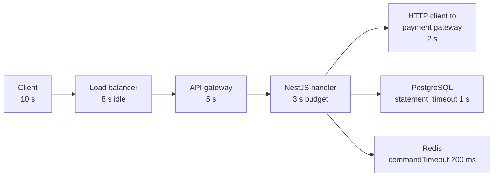

# Part 30 — Reliability Engineering: Timeouts, Retries, Circuit Breakers and Backpressure

Every backend system is a chain of things that can break. Your NestJS process talks to PostgreSQL, to Redis, to Kafka, to a payment gateway, to an email provider, and to three other services owned by other teams. Each of those calls crosses a network. Each one can hang, fail, slow down, run twice, lie, or do half of what you asked. Reliability engineering is the discipline of assuming all of that will happen and designing the code so that the system stays up anyway.

This part is deliberately practical. Every pattern comes with the NestJS code you would actually ship, the PostgreSQL settings you would actually set, the numbers you would actually pick, and the incident that taught someone why the pattern exists. Most of these patterns are small. A timeout is one line. A retry is ten. A circuit breaker is a library and twenty lines of wiring. The hard part is not the code; it is knowing which pattern to reach for, what values to choose, and how the patterns interact when everything goes wrong at once.

One idea runs through the whole part: **failure is not an exception, it is an input.** A senior engineer does not write the happy path and then bolt on error handling. They write the failure paths first, because that is where the money is lost.

## 30.1 The dependency interrogation

#### Concept

Before you write a single line that calls something over a network, you interrogate that dependency. Six questions, every time, no exceptions:

```text
Can it timeout?
Can it fail?
Can it become slow?
Can it duplicate?
Can it return an incorrect response?
Can it partially succeed?
```

The answer to every one of them is "yes" for every network dependency you will ever use. The point of asking is not to discover the answer; it is to force yourself to decide, per dependency, what the code will do when each one happens.

#### Why does it exist?

Without this habit, code is written for the case where the network is a function call. `await paymentGateway.charge(order)` looks like local code. It is not. Between your process and that gateway sit a DNS lookup, a TCP handshake, a TLS handshake, a load balancer, a queue in their process, their database, and the return trip. Any of those can stall for thirty seconds. If your code has no plan for that, the plan is "hold a connection, hold a database transaction, hold a Kubernetes pod's worth of memory, and wait." Multiply by a thousand concurrent requests and your service is down because someone else's service is slow.

#### Mental model

Imagine you are sending a courier to pick up a signed contract from another office. Before they leave you would naturally ask: how long do I wait before assuming they got lost? What if the office is closed? What if they get stuck in traffic? What if two couriers were sent by mistake and the contract gets signed twice? What if they come back with the wrong document? What if they come back with only page one? You would have an answer for each before the courier left. Network calls deserve exactly the same care, and they deserve it in code, not in a wiki.

#### How it works

For each dependency, you fill in a small table. Here is the interrogation applied to the dependencies of a typical NestJS checkout service.

| Dependency | Can it timeout? | Can it fail? | Can it become slow? | Can it duplicate? | Wrong response? | Partial success? |
|---|---|---|---|---|---|---|
| PostgreSQL (primary) | Yes: lock waits, long scans, failover | Yes: `ECONNREFUSED` during failover, pool exhausted | Yes: vacuum, bloat, bad plan, contention | Yes: client retry of a committed-but-unacked `INSERT` | Yes: stale reads from a replica | Yes: multi-statement without a transaction |
| Redis | Yes: slow `KEYS`, big values, fork for RDB | Yes: OOM eviction, failover | Yes: hot key, network | Yes: retried `INCR` | Yes: stale cache | Yes: pipeline partially applied |
| Kafka producer | Yes: broker leader election | Yes: `NOT_ENOUGH_REPLICAS` | Yes: ISR shrink | Yes: producer retry without idempotence | No, but message may land on wrong partition | Yes: batch of 100 with 3 failed |
| Payment gateway | Yes: 30 s on card networks | Yes: 5xx, 429 | Yes: p99 of 8 s at month end | Yes: your retry charged twice | Yes: `200 OK` with `status: "pending"` | Yes: authorized but capture failed |
| Email provider | Yes | Yes | Yes | Yes: duplicate email | Yes: accepted then bounced | Yes: 3 of 5 recipients |
| Another microservice | Yes | Yes: deploy, crash | Yes: its own dependencies | Yes: its retry logic | Yes: bug in their code | Yes: batch endpoints |

Each "Yes" maps to a pattern in this part:

- Timeout -> **Timeouts** and **timeout budgets** (30.2)
- Fail -> **Retries** (30.3), **Circuit breakers** (30.5), **Fallbacks** (30.10), **Failover** (30.11)
- Slow -> **Timeouts**, **Bulkheads** (30.6), **Load shedding** (30.8), **Backpressure** (30.9)
- Duplicate -> **Idempotency** (30.14, and Part 29 — Distributed Transactions: Sagas, Outbox, Inbox and Idempotency)
- Wrong response -> **Response validation** (30.17)
- Partial success -> **Per-item result handling**, **compensation** (30.17, and Part 29 — Distributed Transactions: Sagas, Outbox, Inbox and Idempotency)

#### Practical example

A junior engineer writes:

```ts
async placeOrder(dto: PlaceOrderDto): Promise<Order> {
  const order = await this.orders.save(this.orders.create(dto));
  await this.payments.charge(order.id, order.total);
  await this.inventory.reserve(order.items);
  await this.mailer.sendConfirmation(order);
  return order;
}
```

Run the interrogation on `payments.charge`:

- Timeout: no timeout is set. The HTTP client default (axios) is *no timeout at all*. A hung gateway hangs this request forever.
- Fail: a 503 throws; the order row is already saved with no payment; nobody compensates.
- Slow: at 500 concurrent checkouts and an 8 s gateway, 500 Node requests are parked, 500 pool connections may be held, and the event loop is fine but the DB pool is not.
- Duplicate: the client's "Pay" button fires twice; two charges.
- Wrong response: the gateway returns `200` with `{ status: "requires_action" }`; the code treats any 2xx as paid.
- Partial success: charge succeeds, inventory reserve fails; the customer is charged for goods you cannot ship.

The rest of this part turns each of those into a concrete fix, and section 30.16 rebuilds this method properly.

#### How a Senior Backend Engineer thinks about this

A senior engineer treats the interrogation as a code review checklist. When they see a new `HttpService` injection, a new `ClientKafka`, or a new `Redis` client, the review comment is the six questions. They also ask two more: *what is the blast radius if this dependency is down for an hour?* and *does the business consider this call core or non-core?* Those two answers decide whether the call gets a fallback, a breaker, or just a timeout and an error.

#### Common mistakes

- Assuming a library has sensible timeout defaults. Most do not. `axios` default timeout is `0` (infinite). `pg` has no statement timeout by default. `ioredis` has no command timeout by default.
- Interrogating only third parties. Your own database is the dependency that takes you down most often.
- Writing the answers in a design doc instead of in code. Only code runs at 02:00.

#### Interview questions

1. *Name the six questions you ask about every network dependency, and give one example of each for a payment gateway.* Expected: the list above with examples like "duplicate: my retry after a timeout double-charges". Why it matters: it shows the candidate designs for failure by default. Follow-up: which of the six is the hardest to handle and why? (Partial success, because it needs compensation, not just retry.)
2. *Why is "can it return an incorrect response" a separate question from "can it fail"?* Expected: a 200 with wrong or unexpected content is not caught by error handling; you need schema validation and business-rule validation on responses.

#### Practical exercise

Take one service you own. List every network dependency (grep for `HttpService`, `axios`, `fetch`, `undici`, `Redis`, `ClientKafka`, `DataSource`). For each, fill in the six-column table honestly. Acceptance criteria: every cell has a concrete answer, and for each "Yes" you can point at the line of code that handles it or at a ticket to add one.

## 30.2 Timeouts

#### Concept

A timeout is a decision, made in advance, about how long you are willing to wait for something before you give up and do something else. It is the single most important reliability control you have, because it is the only thing that converts an *unbounded* wait into a *bounded* one. Every other pattern (retries, breakers, fallbacks) can only run *after* a timeout fires. Without timeouts, nothing else in this part works.

There are three different timeouts hiding inside "a timeout", and you need to know which one you are setting:

- **Connect timeout**: how long to wait to establish the TCP (and TLS) connection. Typically short: 1–3 s. If the host is unreachable you find out fast.
- **Read timeout** (also called socket, idle, or headers/body timeout): how long to wait between bytes once connected. Catches a server that accepted the connection and then stalled.
- **Total (deadline) timeout**: the wall-clock limit for the whole operation, including DNS, connect, request, response and any retries. This is the one the caller cares about.

#### Why does it exist?

Without a timeout, a slow dependency becomes an outage of *your* service. Here is the mechanism. Your NestJS process can handle, say, 2,000 concurrent requests before memory and the DB pool run out. A downstream service normally responds in 50 ms, so at 500 requests per second you have about 25 requests in flight. Now the downstream starts taking 30 s. Requests arrive at 500 per second and each stays in flight for 30 s: 15,000 in flight. Your pool of 20 PostgreSQL connections is exhausted in the first 40 ms, the Node heap grows until the pod is OOMKilled, Kubernetes restarts it, and it happens again. The downstream's slowness has become your crash loop. A 2 s timeout caps in-flight requests at 1,000, and your service stays up while returning errors for the affected feature.

#### Mental model

Imagine calling a restaurant to book a table and being put on hold. Without a limit you might sit there for an hour with the phone pressed to your ear, unable to do anything else. With a rule ("if nobody picks up in two minutes, hang up and try the other restaurant") the wait is bounded and you can plan around it. A timeout is that rule. It does not make the restaurant answer faster; it makes *your* behaviour predictable.

#### How it works

1. The caller starts a timer when it begins the operation.
2. The operation proceeds: DNS lookup, TCP connect, TLS, send request, wait for response headers, stream body.
3. If the timer fires first, the caller aborts the operation (closes the socket, cancels the promise) and receives a timeout error.
4. The caller then decides: retry, fall back, or fail the request upward.

The crucial and often-missed step is 3: the abort must actually **cancel** the underlying work, not just stop waiting for it. A `Promise.race([call(), sleep(2000)])` stops *waiting* but the HTTP request keeps running, the socket stays open, and the DB query keeps executing. Modern Node gives you `AbortSignal.timeout(ms)` and every serious client (`undici`, `fetch`, `axios`, `pg` via `statement_timeout`) supports cancellation.

**Timeouts at every layer.** A request that enters your system passes through many layers, and each has its own timer. If they do not agree, the outer layer gives up while the inner one keeps working, and you get the worst of both: an error to the client *and* wasted work.



The budgets **shrink as you go inward**. The edge waits 5 s. The service gives itself 3 s so it can still return a clean error within the gateway's 5 s. Each DB call gets 1 s so that three sequential DB calls fit in the 3 s. This is a **timeout budget**: the total time is allocated down the chain, and each callee's timeout is strictly less than its caller's remaining budget. If you invert it (service 10 s, gateway 5 s), the gateway returns `504` to the client at 5 s while your service happily works for another 5 s, commits a payment at second 8, and the client, having seen an error, retries and pays again.

**Where each timeout is configured in our stack:**

| Layer | Setting | Typical value |
|---|---|---|
| Browser / mobile client | `AbortSignal.timeout` / OkHttp `callTimeout` | 10–30 s |
| AWS ALB | `idle_timeout.timeout_seconds` | 60 s default; set 10–30 s for APIs |
| NGINX / gateway | `proxy_connect_timeout`, `proxy_read_timeout` | 2 s / 5–10 s |
| Node HTTP server | `server.requestTimeout`, `server.headersTimeout`, `server.keepAliveTimeout` | 30 s, 60 s, 65 s |
| NestJS handler | `TimeoutInterceptor` (RxJS `timeout`) | 3–5 s |
| HTTP client (`undici`) | `connectTimeout`, `headersTimeout`, `bodyTimeout`, `signal` | 1 s / 2 s / 5 s |
| HTTP client (`axios`) | `timeout` (response), `signal`, agent `timeout` | 2–5 s |
| PostgreSQL | `connectionTimeoutMillis`, `statement_timeout`, `lock_timeout`, `idle_in_transaction_session_timeout` | 1 s / 1–5 s / 500 ms / 10 s |
| Redis (`ioredis`) | `connectTimeout`, `commandTimeout` | 1 s / 200–500 ms |
| Kafka (`kafkajs`) | `connectionTimeout`, `requestTimeout`, producer `timeout` | 3 s / 10 s / 5 s |
| BullMQ job | `Worker` `lockDuration`, job-level `AbortSignal` in your handler | 30 s / per job |

One more subtlety: **`keepAliveTimeout` on the Node server must be longer than the load balancer's idle timeout**. If Node closes an idle keep-alive socket at 5 s and the ALB reuses it at 5.1 s, the ALB sees a reset and returns a `502`. Set Node's `keepAliveTimeout` to ALB idle + a few seconds, and `headersTimeout` above `keepAliveTimeout`.

#### Practical example

A NestJS `OrdersService.placeOrder` runs within a 3 s budget. It performs one PostgreSQL transaction (budget 1 s), one call to the inventory service (budget 800 ms), and one call to the payment gateway (budget 2 s, since it is slow by nature and runs last). If the inventory call takes 800 ms and times out, we have 2.2 s left and can still return a clean `503` to the client with a `Retry-After`. If the payment call takes its full 2 s, we return at about 2.9 s, still inside the gateway's 5 s.

#### NestJS example

First, a handler-level timeout using RxJS. This bounds the *handler*, but note it does **not** cancel the inner calls; each of those needs its own timeout (which is the point of budgets).

```ts
import {
  CallHandler, ExecutionContext, Injectable, NestInterceptor,
  RequestTimeoutException,
} from '@nestjs/common';
import { Observable, throwError, TimeoutError } from 'rxjs';
import { catchError, timeout } from 'rxjs/operators';

@Injectable()
export class TimeoutInterceptor implements NestInterceptor {
  constructor(private readonly ms = 3_000) {}

  intercept(_ctx: ExecutionContext, next: CallHandler): Observable<unknown> {
    return next.handle().pipe(
      timeout(this.ms),
      catchError((err) =>
        err instanceof TimeoutError
          ? throwError(() => new RequestTimeoutException('handler budget exceeded'))
          : throwError(() => err),
      ),
    );
  }
}
```

Second, a small `Deadline` value that carries the remaining budget through the call chain, and an `undici`-based HTTP client that honours it with real cancellation.

```ts
import { Injectable } from '@nestjs/common';
import { request, Agent } from 'undici';

export class Deadline {
  private constructor(private readonly expiresAt: number) {}
  static in(ms: number) { return new Deadline(Date.now() + ms); }
  remainingMs() { return Math.max(0, this.expiresAt - Date.now()); }
  /** Child budget: never more than what is left, minus a safety margin. */
  child(maxMs: number, marginMs = 50) {
    return Math.min(maxMs, this.remainingMs() - marginMs);
  }
}

@Injectable()
export class InventoryClient {
  // Separate agent = separate socket pool (a bulkhead, see 20.6).
  private readonly agent = new Agent({
    connections: 50,                 // max sockets to this host
    connect: { timeout: 1_000 },     // connect timeout
    headersTimeout: 2_000,           // time to first response header
    bodyTimeout: 2_000,              // idle time between body chunks
  });

  async reserve(items: ReserveItem[], deadline: Deadline): Promise<ReserveResult> {
    const budget = deadline.child(800);
    if (budget <= 0) throw new DependencyTimeoutError('inventory', 0);

    try {
      const res = await request('http://inventory.svc/reservations', {
        method: 'POST',
        dispatcher: this.agent,
        headers: { 'content-type': 'application/json' },
        body: JSON.stringify({ items }),
        signal: AbortSignal.timeout(budget), // total timeout, cancels the socket
      });
      if (res.statusCode >= 500) throw new DependencyUnavailableError('inventory', res.statusCode);
      return (await res.body.json()) as ReserveResult;
    } catch (err) {
      if ((err as Error).name === 'TimeoutError' || (err as Error).name === 'AbortError') {
        throw new DependencyTimeoutError('inventory', budget);
      }
      throw err;
    }
  }
}
```

`AbortSignal.timeout(ms)` (Node 17.3+) rejects with an error whose `name` is `'TimeoutError'`, and `undici` closes the socket when the signal fires. With `axios` the equivalent is `{ timeout: budget, signal: AbortSignal.timeout(budget) }`; `axios.timeout` alone covers the response wait but a signal is what reliably cancels.

#### PostgreSQL example

PostgreSQL has three timeouts you should set on every application connection:

```sql
-- Per-role defaults: every connection from the app inherits these.
ALTER ROLE app_api SET statement_timeout = '2s';           -- kill any statement over 2 s
ALTER ROLE app_api SET lock_timeout = '500ms';             -- do not queue behind a lock for long
ALTER ROLE app_api SET idle_in_transaction_session_timeout = '10s'; -- kill idle-in-tx sessions

-- Batch jobs get a different role with a longer budget.
ALTER ROLE app_batch SET statement_timeout = '5min';

-- Per-transaction override for a specific hot path.
BEGIN;
SET LOCAL statement_timeout = '500ms';
SET LOCAL lock_timeout = '100ms';
UPDATE inventory SET reserved = reserved + 2
 WHERE product_id = 'p_123' AND (on_hand - reserved) >= 2;
COMMIT;
```

When `statement_timeout` fires, PostgreSQL cancels the statement and returns SQLSTATE `57014` (`canceling statement due to statement timeout`). When `lock_timeout` fires you get `55P03` (`lock_not_available`). `idle_in_transaction_session_timeout` is the one that saves you from the classic bug of a transaction left open while the code awaits an HTTP call: PostgreSQL terminates the session, the locks are released, and the connection is returned to the pool as broken (the pool will discard it).

#### TypeORM example

```ts
import { DataSource } from 'typeorm';

export const AppDataSource = new DataSource({
  type: 'postgres',
  host: process.env.PG_HOST,
  port: 5432,
  username: process.env.PG_USER,
  password: process.env.PG_PASSWORD,
  database: 'shop',
  extra: {
    // These go straight to node-postgres (pg.Pool).
    max: 20,                                    // pool size
    connectionTimeoutMillis: 1_000,             // waiting for a free connection
    idleTimeoutMillis: 30_000,
    statement_timeout: 2_000,                   // server-side statement timeout
    query_timeout: 2_500,                       // client-side guard, slightly larger
    idle_in_transaction_session_timeout: 10_000,
  },
  maxQueryExecutionTime: 500, // logs (does not cancel) queries slower than 500 ms
});
```

For a per-call budget inside a transaction, use `SET LOCAL` through a `QueryRunner`:

```ts
const qr = this.dataSource.createQueryRunner();
await qr.connect();
await qr.startTransaction();
try {
  await qr.query(`SET LOCAL statement_timeout = ${Math.floor(deadline.child(1_000))}`);
  await qr.manager.increment(Inventory, { productId }, 'reserved', qty);
  await qr.commitTransaction();
} catch (e) {
  await qr.rollbackTransaction();
  throw e;
} finally {
  await qr.release();
}
```

#### Sequelize example

```ts
import { Sequelize } from 'sequelize';

export const sequelize = new Sequelize(process.env.DATABASE_URL!, {
  dialect: 'postgres',
  pool: { max: 20, min: 2, acquire: 1_000, idle: 30_000 }, // acquire = wait for a free conn
  dialectOptions: {
    statement_timeout: 2_000,
    idle_in_transaction_session_timeout: 10_000,
    connectionTimeoutMillis: 1_000,
  },
});
```

`pool.acquire` is the Sequelize name for "how long may a request wait for a free connection". When it expires you get `SequelizeConnectionAcquireTimeoutError`, which is your early warning that the pool is saturated (see Part 31 for pool sizing).

#### Production scenario

A food-delivery API runs 40 NestJS pods, 300 RPS each. Restaurant availability comes from a partner API whose p50 is 120 ms and p99 is 900 ms. The client timeout for that call is set to 1.5 s (comfortably above p99), inside a 4 s handler budget, behind an ALB with a 10 s idle timeout. One evening the partner API degrades to a p50 of 6 s. Each pod's calls now time out at 1.5 s. In-flight requests per pod rise from ~36 to ~450, well within capacity. The `restaurant_availability_timeout_total` metric spikes, the fallback (show cached availability from 5 minutes ago, see 30.10) kicks in, and customers keep ordering. Nobody is paged; the next morning's report shows 2.1% of availability calls served from cache. That is what a correctly placed timeout looks like: a metric, not an incident.

#### Failure scenario

At 02:14 the on-call gets paged: `checkout-api` is in CrashLoopBackOff on all 12 pods. Memory graphs show heap climbing to 1.8 GB and the pod being OOMKilled every 4 minutes. The payment gateway's status page says "elevated latency". Post-mortem findings: the axios client for the gateway had no `timeout` (default infinite). When gateway latency went from 400 ms to 45 s, each pod accumulated 45 s worth of requests, each holding a request object, a response promise and, worst of all, an open PostgreSQL transaction (the order row was inserted before the charge, in the same transaction). `idle_in_transaction_session_timeout` was not set, so PostgreSQL kept 20 connections per pod busy and `pg_stat_activity` showed 240 sessions in `idle in transaction`. New checkouts could not get a connection and queued in `pg.Pool` with `connectionTimeoutMillis: 0` (wait forever). Everything stalled until memory ran out. Fix: a 3 s gateway timeout, `idle_in_transaction_session_timeout = 10s`, and moving the charge *outside* the DB transaction. Total time to fix after diagnosis: 20 minutes. Time to diagnose: 2 hours, because nothing was timing out, so nothing was logging errors.

#### Edge cases & failure modes

- **The unknown-outcome problem.** When a timeout fires, you do not know whether the operation happened. The charge may have gone through at second 2.1 while you gave up at 2.0. Treat a timeout as "unknown", not as "failed". For writes this means: only retry with an idempotency key, and reconcile later (query the gateway by your reference id).
- **Timeout shorter than the dependency's p99.** You will time out 1% of healthy calls, then retry them, adding load to a dependency that was fine. Set timeouts from measured latency: usually a little above p99 for the *normal* state, and never below p50.
- **Timeouts that do not cancel.** `Promise.race` with a sleep leaks the underlying operation. Use `AbortSignal` or server-side timeouts (`statement_timeout`).
- **Retries inside the budget.** If your handler budget is 3 s and your client does 3 attempts of 2 s each, the client can take 6 s. Attempts must share the budget (the `Deadline` object above).
- **DNS is inside the budget.** A slow resolver adds 1–5 s before connect even starts. Cache DNS in-process (or use a service mesh) and count it in the total.
- **Keep-alive mismatch** between Node and the ALB causes intermittent `502`s that look like random failures. Node `keepAliveTimeout` must exceed the ALB idle timeout.
- **Streaming responses** need per-chunk idle timeouts, not total timeouts; a 10-minute file download is not a hang.
- **Clock jumps.** `Date.now()` can jump on NTP corrections; for deadlines prefer `performance.now()` or `process.hrtime.bigint()` when precision matters.

#### How a Senior Backend Engineer thinks about this

The senior question is never "what timeout should I set" in isolation; it is "what is the *budget* for this request, and how is it split". They start at the edge (what does the client tolerate?), subtract the gateway hop, and then allocate the remainder across the sequential calls in the handler, giving the largest slice to the slowest, most valuable call. They set the DB timeouts *per role* so that a batch job cannot accidentally hold a 5-minute statement timeout on an API connection. They insist that timeouts be observable: every timeout increments a counter labelled with the dependency, because a rising timeout rate is the earliest signal of a downstream problem. And they refuse to ship a network call without a timeout, even in a prototype, because prototypes become production.

To a product manager: "A timeout means we stop waiting on a slow partner and either use a backup plan or tell the customer to try again, instead of freezing the whole app for everyone."

#### Common mistakes

- Setting one big timeout at the top and none underneath. The top-level timer fires, but the DB query and HTTP call continue and consume resources.
- Making inner timeouts *longer* than outer ones. The client sees an error while the server keeps working and possibly commits.
- Setting `statement_timeout` globally on the database (`postgresql.conf`) so that migrations and batch jobs fail. Set it per role.
- Treating a timeout as a failure and retrying a non-idempotent write.
- Picking round numbers (30 s) without looking at latency histograms.

#### Interview questions

1. *What is the difference between connect, read and total timeouts, and which one should the caller reason about?* Expected: connect bounds connection setup, read bounds idle gaps, total bounds the whole operation; callers reason in totals and budgets. Follow-up: why is a read timeout alone insufficient for a slow-drip response?
2. *Explain a timeout budget with concrete numbers for a request that goes gateway -> service -> two sequential DB calls -> one HTTP call.* Expected: numbers that shrink inward and sum correctly, with a margin.
3. *Your handler times out at 3 s. What happens to the PostgreSQL query it started?* Expected: it keeps running unless `statement_timeout` or client cancellation is in place; leads to pool exhaustion.
4. *After a timeout on a payment call, what do you do?* Expected: treat as unknown; idempotency key; retry once within budget; otherwise mark payment pending and reconcile asynchronously.
5. *Why must Node's `keepAliveTimeout` be larger than the load balancer's idle timeout?* Expected: to avoid the LB reusing a socket that Node has just closed, which surfaces as `502`.

#### Practical exercise

Instrument a NestJS service that calls one HTTP dependency and PostgreSQL. Add: a `TimeoutInterceptor` (3 s), an `undici` client with connect/headers/body timeouts and an `AbortSignal` budget, and `statement_timeout`/`idle_in_transaction_session_timeout` on the app role. Use `toxiproxy` (see 30.15) to add 5 s latency to the HTTP dependency. Acceptance criteria: the API returns a `503` or fallback within 3.2 s, `pg_stat_activity` never shows more than 2 sessions in `idle in transaction`, and a Prometheus counter `dependency_timeouts_total{dependency="inventory"}` increases.
