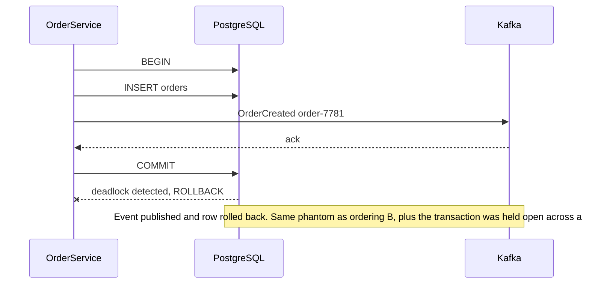
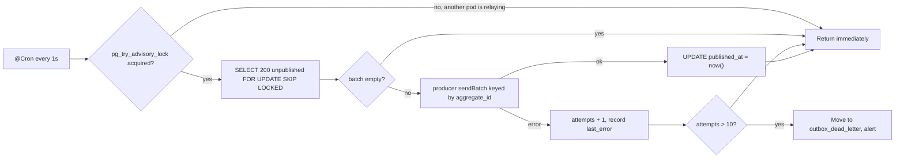

## 30.9 The dual-write problem

#### Concept

A **dual write** is when one logical operation writes to two systems that cannot commit together. The canonical example, and the one every backend eventually writes:

```ts
await this.orders.save(order);                  // write 1: PostgreSQL
await this.kafka.emit('orders.events', event);  // write 2: Kafka
```

Two writes. Two systems. No shared transaction. There is no ordering of those two lines that is correct, and that is not a figure of speech — it is provable by enumerating the interleavings.

#### Why does it exist?

It exists because the code looks obviously fine. Save the order, tell the world. Every team writes it, most teams ship it, and it works 99.9% of the time. The 0.1% is where orders exist that nobody downstream ever heard about, or events exist for orders that do not.

At 500 orders per minute, 0.1% is 30 broken orders per hour. In our flow, an `OrderCreated` event that never gets published means the payment service never charges, and the order sits in `PENDING_PAYMENT` forever with no error anywhere.

#### Mental model

Imagine posting a cheque and separately phoning the bank to say "I've posted a cheque." If your phone dies after posting, the bank does not know. If the postbox is emptied late but you already phoned, the bank expects a cheque that has not arrived. The only reliable design is to put the note *inside the same envelope* as the cheque, and let the person who opens the envelope handle both. That envelope is the outbox.

#### How it works

There are exactly two orderings, and both are broken. Here is each one, with the failure drawn.

**Ordering A: database first, then Kafka.**

```mermaid
sequenceDiagram
  participant S as OrderService
  participant PG as PostgreSQL
  participant K as Kafka
  S->>PG: BEGIN; INSERT orders; COMMIT
  PG-->>S: committed
  Note over S: Pod is OOMKilled here
  S--xK: OrderCreated never published
  Note over PG,K: Order exists but the payment service never hears about it, so it sits in PENDING_PAYMENT forever
```

Failure: **lost event**. The order is real; nothing downstream happens. No error is logged because the process died. The order is invisible to every metric except "orders stuck in PENDING_PAYMENT", which you only have if you built it.

**Ordering B: Kafka first, then database.**

```mermaid
sequenceDiagram
  participant S as OrderService
  participant K as Kafka
  participant PG as PostgreSQL
  participant P as PaymentSvc
  S->>K: OrderCreated order-7781
  K-->>S: ack
  K-->>P: OrderCreated order-7781
  P->>P: charge the customer
  S->>PG: BEGIN; INSERT orders; COMMIT
  PG--xS: constraint violation, rollback
  Note over PG,P: Customer charged and the order row does not exist. This is the 02:14 incident from section 19.1
```

Failure: **phantom event**. Downstream acted on something that never became real. This is strictly worse than ordering A, because money moved.

**Ordering C: the "clever" one — publish inside the transaction.**



Failure: **phantom event, plus the connection-pinning problem from section 30.1**. Kafka has no `ROLLBACK` you can call from a PostgreSQL transaction. Publishing inside a transaction does not make the publish transactional; it just makes the transaction longer.

The three interleavings side by side:

| Ordering | Crash point | Result | Severity |
|---|---|---|---|
| A: DB then Kafka | After commit, before publish | Order exists, no event. Flow stalls silently | High: silent stall |
| A: DB then Kafka | Kafka broker unavailable | Same as above, but you get an error you can log and retry in-process (which fails on pod death) | High |
| B: Kafka then DB | After publish, before commit | Event exists, no order. Downstream acts on nothing | Critical: money moves |
| C: publish inside txn | Commit fails after publish | Same as B, plus pool exhaustion | Critical |

Retrying does not fix it. If you retry the publish in a `catch` block, the retry loop dies with the pod. If you retry with a background job, you have just started building an outbox — you simply have not persisted the intent yet, which is the whole trick.

#### Practical example

The three "solutions" teams try before finding the outbox, and why each fails:

```ts
// Attempt 1: try/catch and log. Loses the event on pod death, and the log line
// helps nobody because there is no process that reads logs and republishes.
try { await this.kafka.emit(topic, event); }
catch (e) { this.log.error({ e, event }, 'failed to publish'); }

// Attempt 2: in-memory retry queue. Dies with the pod. Also unbounded memory.
this.pendingEvents.push(event);
setInterval(() => this.drain(), 1000);

// Attempt 3: publish first, "compensate" the database. Now you need a compensating
// event, and the compensating publish has exactly the same problem, recursively.
await this.kafka.emit(topic, event);
try { await this.orders.save(order); }
catch (e) { await this.kafka.emit(topic, { ...event, type: 'OrderCreationFailed' }); }
```

Every attempt fails for the same reason: **the intent to publish is not durable.** Fix that one thing and everything else follows.

#### How a Senior Backend Engineer thinks about this

They spot a dual write in code review from the shape alone: an `await` to an external system immediately after or before a database write, with no durable record connecting them. The review comment is one line: *"this is a dual write; use the outbox."*

They also apply the test in reverse. When someone proposes any cross-system consistency mechanism, the senior asks: *what is the single atomic thing that makes this reliable?* For the outbox the answer is "one PostgreSQL transaction writes both rows". If a proposal has no such single atomic thing, it is a dual write wearing a costume.

#### Common mistakes

- Believing a `try/catch` around the publish makes it reliable.
- Believing Kafka's producer `acks=all` helps. It guarantees the broker stored the message; it says nothing about whether your database committed.
- Believing Kafka transactions solve it. Kafka transactions give exactly-once *within Kafka* (consume-process-produce). They do not span PostgreSQL.
- Reordering the two writes and thinking the problem is now solved because the failure changed shape.

#### Interview questions

1. *What is the dual-write problem?* Expected: one logical operation, two systems, no shared transaction; every ordering has a crash window that loses or fabricates an event.
2. *Which ordering is worse, database-first or broker-first?* Expected: broker-first, because downstream acts on something that never became real; database-first only stalls.
3. *Does `acks=all` or a Kafka transaction fix it?* Expected: no; both are about durability and atomicity inside Kafka, not across Kafka and your database.

## 30.10 The transactional outbox

#### Concept

The **transactional outbox** removes the second write. Instead of publishing to Kafka, you `INSERT` the event into an `outbox` table **in the same transaction** as the business row. One transaction, one commit, atomic.

A separate process — the **relay** — reads unpublished outbox rows and publishes them to Kafka, then marks them published. If the relay crashes, the rows are still there. If Kafka is down, the rows wait. Nothing is ever lost, because the intent was committed with the data.

```text
BEGIN
  INSERT INTO orders (...)                 <- business fact
  INSERT INTO outbox (...)                 <- intent to tell the world
COMMIT                                     <- both or neither

[relay, separate process]
  SELECT unpublished FROM outbox FOR UPDATE SKIP LOCKED
  publish to Kafka
  UPDATE outbox SET published_at = now()
```

#### Why does it exist?

Because your database already has exactly one thing you can trust absolutely: atomic local commit. The outbox pattern is the trick of routing *all* cross-system communication through that one trustworthy mechanism. It is the single most valuable pattern in this Part, and it is about forty lines of code.

#### Mental model

Imagine a busy office. Instead of each employee running to the post office whenever they write a letter (and sometimes forgetting, or dropping it in the rain), they put finished letters in a tray on their desk. Once a letter is in the tray, it is going to be sent — the office runner comes by every few minutes and takes everything.

The employee's job ends at the tray. The runner's job is to get things posted, retrying if the post office is closed. Two simple jobs instead of one unreliable one.

#### PostgreSQL example

The table, with every column justified:

```sql
CREATE TABLE outbox (
  id             bigserial PRIMARY KEY,      -- monotonic: preserves insertion order
  aggregate_type text        NOT NULL,       -- 'order', 'payment', 'shipment'
  aggregate_id   uuid        NOT NULL,       -- the Kafka message key -> per-aggregate ordering
  event_type     text        NOT NULL,       -- 'OrderCreated', 'PaymentCaptured'
  payload        jsonb       NOT NULL,
  headers        jsonb       NOT NULL DEFAULT '{}',  -- traceparent, correlation id, schema version
  created_at     timestamptz NOT NULL DEFAULT now(),
  published_at   timestamptz,                -- NULL means not yet published
  attempts       int         NOT NULL DEFAULT 0,
  last_error     text
);

-- THE index. Partial, so it only contains unpublished rows: typically a few hundred
-- entries even when the table holds 200 million rows. Keeps the relay's claim query at ~0.3 ms.
CREATE INDEX idx_outbox_unpublished ON outbox (id)
  WHERE published_at IS NULL;

-- For cleanup and for "did event X for order Y ever go out?" support questions.
CREATE INDEX idx_outbox_published_at ON outbox (published_at) WHERE published_at IS NOT NULL;
CREATE INDEX idx_outbox_aggregate ON outbox (aggregate_type, aggregate_id, id);
```

`bigserial` rather than `uuid` for the primary key is deliberate: the relay reads in `id` order, which is insertion order, which is what preserves per-aggregate ordering. A random UUID primary key would destroy that and also produce a badly fragmented index under high insert rates.

The claim query. This is the heart of the polling relay:

```sql
-- Claim a batch. SKIP LOCKED lets N relay instances run without ever colliding.
SELECT id, aggregate_type, aggregate_id, event_type, payload, headers, attempts
FROM outbox
WHERE published_at IS NULL
ORDER BY id
LIMIT 200
FOR UPDATE SKIP LOCKED;
```

And the plan you want to see:

```text
EXPLAIN (ANALYZE, BUFFERS) SELECT ... ;

 Limit  (cost=0.29..18.44 rows=200 width=248) (actual time=0.031..0.284 rows=200 loops=1)
   Buffers: shared hit=14
   ->  LockRows  (cost=0.29..96.12 rows=1058 width=248) (actual time=0.029..0.248 rows=200 loops=1)
         Buffers: shared hit=14
         ->  Index Scan using idx_outbox_unpublished on outbox
               (cost=0.29..85.54 rows=1058 width=248) (actual time=0.021..0.118 rows=200 loops=1)
               Buffers: shared hit=12
 Planning Time: 0.094 ms
 Execution Time: 0.341 ms
```

14 buffer hits and 0.34 ms on a table with 180 million rows. That is what the partial index buys you. Without `WHERE published_at IS NULL` on the index, the same query is a 4-second index scan wading through published rows, and it degrades every day.

#### NestJS example

First, the service used *inside* the business transaction. It must take the `EntityManager`, not inject its own — that is the whole point.

```ts
// outbox.service.ts
export interface OutboxEventInput {
  aggregateType: string;
  aggregateId: string;
  eventType: string;
  payload: Record<string, unknown>;
  headers?: Record<string, string>;
}

@Injectable()
export class OutboxService {
  /**
   * Must be called with the SAME EntityManager as the business write.
   * That is what makes the write atomic. Do not inject a repository here.
   */
  async publish(manager: EntityManager, event: OutboxEventInput): Promise<void> {
    await manager.insert(OutboxRow, {
      aggregateType: event.aggregateType,
      aggregateId: event.aggregateId,
      eventType: event.eventType,
      payload: event.payload,
      headers: {
        traceparent: trace.getActiveSpan()?.spanContext()?.traceId ?? '',
        schemaVersion: '1',
        ...event.headers,
      },
    });
  }
}
```

Used in the order service — one transaction, two inserts, nothing else:

```ts
// order.service.ts
async createOrder(dto: PlaceOrderDto): Promise<Order> {
  return this.dataSource.transaction(async (manager) => {
    const order = await manager.save(Order, {
      customerId: dto.customerId,
      totalCents: dto.totalCents,
      status: OrderStatus.PENDING_PAYMENT,
      idempotencyKey: dto.idempotencyKey,
    });
    await manager.save(OrderSaga, {
      orderId: order.id, state: 'STARTED', step: 'AUTHORIZE_PAYMENT',
      stepDeadline: new Date(Date.now() + 10_000),
    });
    await this.outbox.publish(manager, {
      aggregateType: 'order',
      aggregateId: order.id,
      eventType: 'OrderCreated',
      payload: { orderId: order.id, customerId: order.customerId, items: dto.items },
    });
    return order;                             // commit here: order, saga and event together
  });
}
```

Three rows, one commit, about 2.5 ms. Either all three exist or none do. There is no interleaving in which an order exists without its event, and none in which an event exists without its order.

#### The relay



```ts
// outbox-relay.service.ts
@Injectable()
export class OutboxRelay {
  private readonly log = new Logger(OutboxRelay.name);
  private static readonly LOCK_KEY = 88_120_001;   // arbitrary but fixed; document it

  constructor(
    private readonly dataSource: DataSource,
    private readonly producer: KafkaProducer,
    private readonly metrics: MetricsService,
  ) {}

  @Cron(CronExpression.EVERY_SECOND)
  async relay(): Promise<void> {
    const runner = this.dataSource.createQueryRunner();
    await runner.connect();
    try {
      // Session-level advisory lock: exactly one pod relays at a time, so global
      // ordering by id is preserved. Non-blocking: other pods return instantly.
      const [{ locked }] = await runner.query(
        'SELECT pg_try_advisory_lock($1) AS locked', [OutboxRelay.LOCK_KEY],
      );
      if (!locked) return;

      try {
        let drained = 0;
        // Drain in batches so a backlog clears in one tick rather than 1 batch/second.
        for (let i = 0; i < 25; i++) {
          const n = await this.publishBatch(runner, 200);
          drained += n;
          if (n < 200) break;
        }
        if (drained > 0) this.log.debug({ drained }, 'outbox drained');
      } finally {
        await runner.query('SELECT pg_advisory_unlock($1)', [OutboxRelay.LOCK_KEY]);
      }
    } finally {
      await runner.release();
    }
  }

  private async publishBatch(runner: QueryRunner, limit: number): Promise<number> {
    await runner.startTransaction();
    try {
      const rows: OutboxRow[] = await runner.query(
        `SELECT id, aggregate_type, aggregate_id, event_type, payload, headers, attempts
           FROM outbox WHERE published_at IS NULL
          ORDER BY id LIMIT $1 FOR UPDATE SKIP LOCKED`, [limit],
      );
      if (rows.length === 0) { await runner.commitTransaction(); return 0; }

      try {
        await this.producer.sendBatch(rows.map((r) => ({
          topic: `${r.aggregate_type}.events`,
          key: r.aggregate_id,                     // partition key = per-aggregate ordering
          value: JSON.stringify({ eventType: r.event_type, ...r.payload }),
          headers: { ...r.headers, messageId: String(r.id) },  // messageId drives the inbox
        })));
      } catch (err) {
        await runner.query(
          `UPDATE outbox SET attempts = attempts + 1, last_error = $2 WHERE id = ANY($1)`,
          [rows.map((r) => r.id), String(err).slice(0, 500)],
        );
        await runner.commitTransaction();          // persist the attempt count, then back off
        this.metrics.increment('outbox_publish_failures_total', { count: rows.length });
        throw err;
      }

      await runner.query(
        'UPDATE outbox SET published_at = now() WHERE id = ANY($1)', [rows.map((r) => r.id)],
      );
      await runner.commitTransaction();
      this.metrics.increment('outbox_published_total', { count: rows.length });
      return rows.length;
    } catch (e) {
      await runner.rollbackTransaction().catch(() => {});
      return 0;
    }
  }
}
```

Read the ordering carefully, because it encodes a deliberate choice: **publish first, then mark published.** If the relay crashes between those two operations, the rows are still unpublished and will be sent again. That produces a duplicate. The alternative ordering (mark first, then publish) would produce a *lost event* on the same crash. Duplicates are recoverable with an inbox; losses are not. So the outbox is deliberately **at-least-once**, and duplicates are not a bug you will fix — they are the guarantee you chose.

#### Leader election for the relay

`pg_try_advisory_lock` gives you single-writer behaviour with no extra infrastructure. It is worth knowing precisely what it does:

```sql
-- Non-blocking. Returns true if acquired, false if another SESSION holds it.
SELECT pg_try_advisory_lock(88120001);

-- Held until explicitly unlocked or the session ends. A crashed pod's connection
-- closes, PostgreSQL releases the lock, and another pod takes over within one tick.
SELECT pg_advisory_unlock(88120001);

-- Who holds it right now?
SELECT pid, objid, granted FROM pg_locks WHERE locktype = 'advisory';
```

The failover story is genuinely good: if the relay pod is `OOMKilled`, its TCP connection dies, PostgreSQL releases the advisory lock, and the next pod's 1-second tick acquires it. Worst-case failover is about one second plus the TCP timeout.

Two cautions. First, use `pg_try_advisory_lock`, never `pg_advisory_lock` — the blocking version will pile up connections waiting forever. Second, do not run it through PgBouncer in transaction pooling mode: a session-level advisory lock taken on one pooled backend and released on another simply does not work. Either use a dedicated direct connection for the relay (what the `createQueryRunner` above gives you) or use the transaction-scoped `pg_try_advisory_xact_lock` instead.

Do you even need the lock? Only if you need **global** ordering. `FOR UPDATE SKIP LOCKED` alone lets ten relay pods run safely with no duplicates and no lost rows; the only thing you lose is that events for *different* aggregates may reach Kafka slightly out of `id` order. Since Kafka only guarantees ordering per partition anyway, and your key is `aggregate_id`, per-aggregate ordering is preserved either way. The honest recommendation: **start with the advisory lock for simplicity of reasoning, drop it when throughput demands more than one relay.**

#### Polling versus CDC (Debezium)

The second way to get rows out of the outbox is to not read the table at all, and instead read PostgreSQL's write-ahead log.

```text
POLLING RELAY                          CDC RELAY (Debezium)
app -> outbox table                    app -> outbox table
        ^                                      |
        | SELECT every 1s                      | logical decoding of the WAL
   relay process                          Debezium connector
        |                                      |
        v                                      v
      Kafka                                  Kafka
```

Debezium reads the WAL through a logical replication slot with `pgoutput`, decodes each `INSERT` into the outbox table, and produces it to Kafka. Its **Outbox Event Router** SMT is built exactly for this table shape: it routes by `aggregate_type`, keys by `aggregate_id`, and unwraps `payload` so consumers see the event rather than a database change record.

```json
{
  "name": "outbox-connector",
  "config": {
    "connector.class": "io.debezium.connector.postgresql.PostgresConnector",
    "plugin.name": "pgoutput",
    "slot.name": "outbox_slot",
    "publication.autocreate.mode": "filtered",
    "table.include.list": "public.outbox",
    "transforms": "outbox",
    "transforms.outbox.type": "io.debezium.transforms.outbox.EventRouter",
    "transforms.outbox.route.by.field": "aggregate_type",
    "transforms.outbox.table.field.event.key": "aggregate_id",
    "transforms.outbox.table.field.event.payload": "payload",
    "tombstones.on.delete": "false"
  }
}
```

An honest comparison:

| Dimension | Polling relay | CDC with Debezium |
|---|---|---|
| Infrastructure | None. A `@Cron` in your existing app | Kafka Connect cluster, connector config, a replication slot |
| Latency | Poll interval, typically 200 ms to 1 s | 5 to 50 ms; it follows the WAL |
| Database load | A query per tick. With the partial index: ~0.3 ms, negligible | Near zero query load; logical decoding costs some primary CPU |
| Throughput ceiling | ~5,000 to 20,000 events/s per relay with batching | 50,000+ events/s |
| Ordering | Global by `id` with a single relay; per-aggregate with several | Strict WAL order, always |
| Table growth | You must mark published and delete | You can `DELETE` immediately after insert. Debezium reads the WAL, so the row need not persist |
| Failure mode you must watch | Relay down: backlog grows, alert on oldest unpublished age | Slot not consumed: **WAL accumulates and fills the disk**. This can take a database down |
| Schema changes | Trivial; it is your code | Connector restarts, SMT config, careful with `payload` shape |
| Debugging | `SELECT * FROM outbox WHERE ...`. Any engineer can do it | Connect logs, slot lag, SMT behaviour. Needs someone who knows Kafka Connect |
| Multi-tenant / many databases | One relay per database, trivial | A slot per database; slots are a limited resource |
| Team skill required | Low | Medium to high |

The senior recommendation, stated plainly: **start with polling.** It is forty lines, it needs no new infrastructure, and at 500 events per second it is completely fine. Move to Debezium when you cross roughly 5,000 events per second, when you need sub-50 ms propagation, or when you already run Kafka Connect for other pipelines. Do not adopt Debezium as the first implementation of your first outbox — you will be debugging replication slots during your first incident instead of debugging your business logic.

The Debezium warning deserves emphasis. A replication slot that no consumer is reading pins the WAL. `pg_wal` grows without bound. Disk fills. PostgreSQL stops accepting writes. Set `max_slot_wal_keep_size` and alert on it:

```sql
SELECT slot_name, active,
       pg_size_pretty(pg_wal_lsn_diff(pg_current_wal_lsn(), restart_lsn)) AS retained
FROM pg_replication_slots;
--   slot_name   | active | retained
-- --------------+--------+----------
--  outbox_slot  | f      | 42 GB      <- this is an outage in progress

ALTER SYSTEM SET max_slot_wal_keep_size = '20GB';   -- slot is dropped rather than filling the disk
```

#### At-least-once and guaranteed duplicates

Be precise about what the outbox promises: **every committed event will be published at least once.** Not exactly once. Duplicates arise from at least four places:

1. The relay publishes, then crashes before `UPDATE published_at`. Republished on the next tick.
2. The Kafka producer's own internal retry after a timeout where the broker actually stored the message (mitigated but not eliminated by `enable.idempotence=true`, which only covers a single producer session).
3. Two relays running because the advisory lock was misconfigured through PgBouncer.
4. An operator resets `published_at = NULL` to replay events.

Therefore **every consumer of outbox events must be idempotent.** That is section 30.11 (inbox) and section 30.12 (idempotency). The outbox and the inbox are two halves of one design; shipping the outbox alone just moves the problem downstream.

#### Table growth, cleanup and partitioning

An outbox at 500 events/s produces 43 million rows a day. Left alone, it becomes the largest table in your database and the partial index stays fast while everything else about the table gets slower (`VACUUM`, backups, disk).

Two strategies:

```sql
-- Strategy 1: delete published rows older than the replay window.
-- Run in small batches so you never hold a long lock or generate a huge WAL burst.
DELETE FROM outbox
WHERE id IN (
  SELECT id FROM outbox
  WHERE published_at IS NOT NULL AND published_at < now() - interval '7 days'
  ORDER BY id LIMIT 10000
);
-- Loop until 0 rows affected. Schedule every 5 minutes, not once a night.
```

```sql
-- Strategy 2: partition by day and DROP old partitions. Instant, no bloat, no vacuum cost.
CREATE TABLE outbox (
  id bigserial, aggregate_type text NOT NULL, aggregate_id uuid NOT NULL,
  event_type text NOT NULL, payload jsonb NOT NULL, headers jsonb NOT NULL DEFAULT '{}',
  created_at timestamptz NOT NULL DEFAULT now(), published_at timestamptz,
  attempts int NOT NULL DEFAULT 0, last_error text,
  PRIMARY KEY (id, created_at)
) PARTITION BY RANGE (created_at);

CREATE TABLE outbox_2026_09_09 PARTITION OF outbox
  FOR VALUES FROM ('2026-09-09') TO ('2026-09-10');
CREATE INDEX ON outbox_2026_09_09 (id) WHERE published_at IS NULL;

-- Retention: a metadata operation, milliseconds, no bloat.
DROP TABLE outbox_2026_09_02;
```

Partitioning wins above roughly 10 million rows a day, because bulk `DELETE` at that volume generates enormous WAL and leaves dead tuples that autovacuum struggles to keep up with. Below that, batched deletes are simpler. Keep at least 7 days so you can replay after an incident.

#### Production scenario

A marketplace: 900 outbox events/s at peak (orders, payments, inventory, shipping, notifications). One relay pod holds the advisory lock, ticking every 500 ms, draining up to 25 batches of 200. Measured: p50 propagation from commit to Kafka is 240 ms, p99 is 810 ms. The relay's database cost is 0.4% of total query time. The outbox table is daily-partitioned with 7 days retained, about 540 million rows, 96 GB, dropped one partition at a time.

Four dashboards and one alert:

```sql
-- The single most important outbox metric: how stale is the oldest unpublished event?
SELECT COALESCE(EXTRACT(EPOCH FROM now() - min(created_at)), 0) AS oldest_unpublished_seconds
FROM outbox WHERE published_at IS NULL;
```

Exposed as a Prometheus gauge, alerting at 60 s (warning) and 300 s (page). During a 25-minute Kafka broker outage this gauge climbed to 1,480 s and 1.3 million events queued in the table. When Kafka returned, the relay drained the backlog in 4 minutes at ~5,400 events/s. Zero events lost. The inbox on every consumer absorbed the small number of duplicates from the relay's own retries.

#### Failure scenario

A team deployed the outbox correctly and the relay incorrectly. Their relay marked rows published *before* sending to Kafka, reasoning that it kept the transaction shorter:

```ts
// The bug. Looks tidier. Loses events.
await runner.query('UPDATE outbox SET published_at = now() WHERE id = ANY($1)', [ids]);
await runner.commitTransaction();
await this.producer.sendBatch(messages);   // <- pod dies here: events gone forever
```

During a routine node drain, one relay pod was `SIGTERM`ed mid-batch. 180 events were marked published and never sent. The 180 orders were stuck in `PENDING_PAYMENT`. Nobody noticed for four hours, because the `oldest_unpublished_seconds` gauge was zero — the rows *said* they were published.

Two lessons. **Publish before marking, always** — a duplicate is cheap, a loss is not. And the health of a pipeline must be measured end to end, not by the pipeline's own bookkeeping. They added a second check: orders in `PENDING_PAYMENT` older than 5 minutes, which catches lost events regardless of what the outbox table claims.

#### Edge cases & failure modes

- **Relay down.** Events accumulate; nothing is lost. Alert on `oldest_unpublished_seconds`. The system degrades into "delayed" rather than "broken", which is the whole point.
- **Relay crashes after publish, before marking.** Duplicate on the next tick. Handled by the consumer's inbox.
- **Poison event.** One row whose payload breaks the producer (a 3 MB payload exceeding `max.request.size`, or an unserialisable value). With batch publishing, that one row blocks the entire batch and therefore the whole outbox. Fix: on batch failure, retry the batch **row by row** to isolate the offender, then move it to `outbox_dead_letter` after `attempts > 10` and alert. Without this, one bad row stops all events for every aggregate.
- **Kafka unavailable.** Publishing fails, `attempts` increments, rows stay. Add backoff so you are not hammering a dead broker every second. The outbox table becomes your buffer, which is exactly what you want.
- **Outbox grows faster than the relay drains.** Check batch size, tick interval and whether one slow topic is blocking others. Consider a relay per `aggregate_type`.
- **Two relays without the lock and without `SKIP LOCKED`.** Both claim the same rows and both publish. Duplicates at scale.
- **Advisory lock through PgBouncer in transaction mode.** Silently ineffective. Use a direct connection or `pg_try_advisory_xact_lock`.
- **Long transactions in the application delay visibility.** A row inserted in a transaction that stays open for 30 s is invisible to the relay for 30 s, and can be published *after* a later row with a higher id, breaking global ordering. Another reason to keep transactions short.
- **`published_at` reset by an operator to replay** republishes everything, including events whose side effects are not idempotent. Replay is a dangerous button; see section 30.18.
- **Payload schema drift.** The event is written today and published today, but replayed next month when consumers expect v2. Always include `schemaVersion` in headers.

#### How a Senior Backend Engineer thinks about this

They make the outbox the *only* way events leave the service. Direct `producer.send()` calls from business code are banned in review, because one exception recreates the dual-write problem in a place nobody will look. Some teams enforce it with a lint rule; that is not overkill.

They keep the relay boring: no filtering, no enrichment, no business logic. Its only job is to move committed rows to Kafka, so its failure modes stay countable.

They size the guarantee honestly when talking to other teams: "Events are guaranteed to be published, at least once, typically within 300 ms, worst case delayed by however long Kafka is down. You must handle duplicates. If you do not deduplicate, you have a bug, not us."

And they resist the Debezium upgrade until there is a number that justifies it. The polling relay handles more load than most teams will ever have, and it is debuggable with `SELECT`.

#### Common mistakes

- Marking published before publishing.
- No partial index, so the claim query slows down every day until it becomes the top query in `pg_stat_statements`.
- No cleanup, so the outbox becomes a 400 GB table nobody dares to touch.
- No dead-letter path, so a single poison row stops all events.
- Assuming the outbox gives exactly-once and not building an inbox.
- Publishing without a key, losing per-aggregate ordering.
- Injecting a repository into `OutboxService` instead of taking the `EntityManager`, which quietly puts the outbox insert in its own transaction and reintroduces the dual write.

#### Interview questions

1. *Explain the transactional outbox.* Expected: business row and event row in one local transaction; a separate relay publishes and marks; converts a dual write into a single atomic write plus an at-least-once pipeline.
2. *Why publish before marking published, rather than after?* Expected: a crash between the two must produce a duplicate (recoverable via the inbox) rather than a loss (unrecoverable).
3. *How do you stop two relay instances from double-publishing?* Expected: `FOR UPDATE SKIP LOCKED` prevents claiming the same rows; `pg_try_advisory_lock` gives a single relay for global ordering; and consumers must be idempotent regardless.
4. *Polling versus Debezium: when do you choose which?* Expected: polling by default for simplicity and debuggability; CDC above roughly 5,000 events/s, for sub-50 ms latency, or where Kafka Connect already exists. Follow-up: what is the main operational risk of CDC? (Unconsumed replication slot filling the disk with WAL.)
5. *What index does the outbox need and why?* Expected: partial index on unpublished rows, so the claim query stays sub-millisecond regardless of table size.
6. *A single event breaks the producer. What happens to everything behind it?* Expected: with naive batch publishing, everything stalls; you need per-row isolation on batch failure plus a dead-letter table and an alert.
7. *How do you keep the outbox table from growing forever?* Expected: batched deletes of published rows past the replay window, or daily partitions with `DROP TABLE`; keep about 7 days.

#### Practical exercise

Implement the outbox end to end: table with partial index, `OutboxService` used inside the order transaction, a `@Cron` relay with `pg_try_advisory_lock`, batch publishing keyed by `aggregate_id`, retry with `attempts`, a dead-letter table, and a Prometheus gauge for `oldest_unpublished_seconds`.

Acceptance criteria: killing the relay pod mid-batch produces duplicates but never a loss; stopping Kafka for two minutes queues events and drains them automatically; a deliberately oversized payload lands in the dead-letter table without blocking other events; `EXPLAIN (ANALYZE, BUFFERS)` on the claim query shows an index scan on the partial index with fewer than 30 buffer hits after inserting 5 million published rows; and the retention job keeps the table under a fixed size while the system runs.
