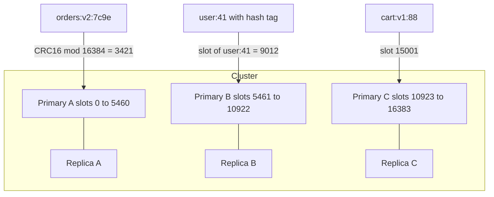

## 30.7 Redis fundamentals

You cannot operate a cache you do not understand. This section is the Redis internals a senior engineer needs: how commands execute, where memory goes, how data survives (or does not) a restart, how eviction chooses victims, and how Redis scales from one process to a cluster.

### 30.7.1 Single-threaded command execution

#### Concept

Redis executes commands on a single thread, one at a time, in the order they arrive. Newer versions use extra threads for network I/O and for freeing memory, but the command itself, the part that reads or mutates a data structure, is always serialized. There are no locks inside Redis because there is no concurrency to lock against.

#### Why does it exist?

A single thread with no locks is why Redis is fast and predictable: no contention, no context switches, and every command is atomic by construction. `INCR` cannot race with another `INCR`. A Lua script sees a frozen world. The price is that one slow command delays every other client.

#### Mental model

Imagine a single very fast bank teller with one queue. Each customer's transaction takes a millisecond, so the queue never builds. Then one customer asks for a printout of every transaction since 1998. Everyone behind them waits, and the queue out the door is the incident.

#### How it works

1. Clients send commands over TCP. I/O threads (Redis 6 and later, if enabled) read and parse them.
2. The main thread takes commands from the parsed queue and executes them one at a time.
3. A `GET` on a string is O(1) and takes microseconds. `KEYS *` on 10 million keys is O(N) and takes seconds. `SMEMBERS` on a 5 million member set is O(N) and allocates a 5 million element reply. `DEL` on a huge hash is O(N) to free.
4. While the main thread runs a slow command, every other connection's commands sit in the socket buffer. Your NestJS app sees `commandTimeout` errors on trivial `GET`s and concludes "Redis is slow", when actually one command was slow.

The rules that follow:

- Never run `KEYS` in production. Use `SCAN` with a cursor and `COUNT`; it walks the keyspace in small steps and lets other commands interleave.
- Never read a whole large collection. `SSCAN`, `HSCAN`, `ZSCAN`, `LRANGE` with bounds.
- Use `UNLINK` rather than `DEL` and enable lazy freeing.
- Keep Lua scripts short. A script that loops 100,000 times blocks Redis for the duration.
- Watch the slowlog (`SLOWLOG GET 25`) and treat any entry over 10 ms as a bug.

```ts
// redis/scan.util.ts: the correct way to find keys by pattern in production
export async function scanKeys(redis: Redis, pattern: string, onBatch: (keys: string[]) => Promise<void>) {
  const stream = redis.scanStream({ match: pattern, count: 500 });
  for await (const keys of stream as AsyncIterable<string[]>) {
    if (keys.length) await onBatch(keys);   // e.g. redis.unlink(...keys)
  }
}
```

### 30.7.2 Memory

#### Concept

Everything in Redis lives in RAM. Memory is the capacity dimension you plan for, and `maxmemory` is the ceiling you must set. Without it Redis grows until the kernel OOM-kills it.

#### How it works

- `INFO memory` reports `used_memory` (bytes of data plus overhead), `used_memory_rss` (what the OS sees), and `mem_fragmentation_ratio` (`rss / used`). A ratio of 1.0 to 1.5 is healthy. Above 1.5 means fragmentation: memory freed in small pieces that the allocator cannot reuse; `activedefrag yes` helps. Below 1.0 means Redis is swapping, which is an emergency.
- Per-key overhead is about 50 to 100 bytes for the key object, the dictionary entry and the expiry entry. A million tiny keys costs 100 MB before any values. Hashes with fewer than 128 small fields are stored as a compact "listpack" that is far cheaper than a million separate string keys, which is why `HSET user:41 name ... email ...` beats `SET user:41:name`, `SET user:41:email`.
- Reply buffers count too. A client that requests a 100 MB `SMEMBERS` allocates 100 MB of output buffer. `client-output-buffer-limit` protects against that.
- Plan for `maxmemory` at 60 to 70 percent of the instance RAM when using RDB persistence, because the fork for a snapshot uses copy-on-write pages and a write-heavy workload can double memory during the save.

### 30.7.3 Persistence: RDB versus AOF

#### Concept

Redis can write its data to disk two ways. **RDB** is a point-in-time snapshot of the whole dataset, taken periodically. **AOF** (append-only file) logs every write command as it happens, and is replayed on restart.

#### How it works

| Property | RDB | AOF |
|---|---|---|
| What is written | Compact binary snapshot | Every write command, in order |
| When | On a schedule (`save 300 100`: every 5 min if 100 keys changed) or `BGSAVE` | Continuously; fsync policy `always`, `everysec` (default) or `no` |
| Data loss on crash | Everything since the last snapshot: minutes | Up to 1 second with `everysec`; near zero with `always` at a big throughput cost |
| Restart time | Fast (load one file) | Slower (replay commands); Redis 7 uses a base RDB plus incremental AOF to speed this up |
| Runtime cost | A `fork()` per snapshot; copy-on-write memory spike | Constant small write I/O; periodic rewrite to compact |
| Best for | Cache, where losing minutes is fine and restart speed matters | Sessions, queues, counters, anything you would be sad to lose |

For a pure cache, many teams disable persistence entirely (`save ""`, `appendonly no`) and accept that a restart means a cold cache. For anything that is a store rather than a cache (sessions, rate limit counters, idempotency keys, Streams used as a queue), turn on AOF with `everysec` and accept up to one second of loss, and then ask whether the data belongs in PostgreSQL instead.

### 30.7.4 Eviction policies and maxmemory

#### Concept

When `used_memory` reaches `maxmemory`, Redis must either refuse writes or evict keys. `maxmemory-policy` decides which.

#### How it works

| Policy | Behaviour | Use when |
|---|---|---|
| `noeviction` | Writes fail with `OOM command not allowed when used memory > 'maxmemory'`; reads keep working | Redis is a store (sessions, queues) and losing keys silently is worse than failing writes |
| `allkeys-lru` | Evict the approximately least-recently-used key, from all keys | Pure cache; the default choice |
| `allkeys-lfu` | Evict the least-frequently-used | Cache with a stable hot set and long-tail noise; also enables `--hotkeys` |
| `volatile-lru` | LRU among keys that have a TTL only | Mixed store and cache in one instance; keys without TTL are never evicted |
| `volatile-ttl` | Evict keys with the nearest expiry first | Mixed instance where soon-to-expire keys are the cheapest loss |
| `allkeys-random`, `volatile-random` | Random victim | Rarely |

Two things surprise people. First, "LRU" is approximate: Redis samples `maxmemory-samples` keys (default 5) and evicts the oldest of the sample, which is close enough and far cheaper than a true LRU list. Second, `volatile-*` policies with no keys carrying a TTL behave exactly like `noeviction`, and your first OOM error is how you find out.

The senior rule: one Redis instance per role. A cache instance with `allkeys-lru` and no persistence; a store instance with `noeviction` and AOF. Mixing them means your session store evicts sessions when the product cache grows, or your cache refuses writes because the session store filled the memory.

### 30.7.5 Replication, Sentinel and Cluster

#### Concept

A single Redis process is a single point of failure and a single core's worth of throughput. **Replication** copies data from a primary to one or more replicas. **Sentinel** watches a primary and promotes a replica when it dies. **Cluster** splits the keyspace across many primaries (each with replicas) so that data and throughput scale horizontally.

#### How it works

**Replication** is asynchronous. The primary acknowledges a write to the client, then streams it to replicas. If the primary dies before the stream catches up, those writes are lost when a replica is promoted. `WAIT numreplicas timeout` lets a client block until N replicas have the write, which narrows the window but does not close it. Replicas serve reads (`READONLY` in Cluster, or by connecting directly) with replication lag of typically under a millisecond in the same availability zone.

**Sentinel** is a set of three or more processes that ping the primary. When a quorum agrees it is down, they elect a replica, promote it, and reconfigure the other replicas. Clients (`ioredis` with `sentinels: [...]`, `name: 'mymaster'`) ask Sentinel for the current primary address. Failover takes about 10 to 30 seconds by default, during which writes fail. Sentinel gives high availability, not horizontal scaling: the dataset must still fit on one primary.

**Cluster** divides the keyspace into 16,384 hash slots. Each key maps to a slot by `CRC16(key) mod 16384`, and each primary owns a range of slots. Clients learn the slot map and send each command to the right node. Add a node, move slots to it, and both memory and throughput scale.



Cluster constraints that bite application code:

- **Multi-key commands must hit one slot.** `MGET a b`, `SUNION s1 s2`, a Lua script touching two keys, a `MULTI` block: all fail with `CROSSSLOT` unless every key hashes to the same slot. The fix is **hash tags**: only the part of the key inside `{...}` is hashed. `cart:{user:41}:items` and `wishlist:{user:41}` share a slot, so a script can update both atomically.
- **`MOVED` and `ASK` redirections.** When a slot migrates, a node replies `MOVED 3421 10.0.0.5:6379` and the client must retry there. `ioredis` in cluster mode (`new Redis.Cluster([...])`) handles this and refreshes its slot map; a plain `Redis` client pointed at a cluster node does not, and you see `MOVED` errors in your logs.
- **No `SELECT` database numbers** (only db 0), no cross-slot transactions, `KEYS` and `SCAN` are per node.
- **Failover per shard.** If Primary B dies, Replica B is promoted within seconds; slots 5461 to 10922 are unavailable meanwhile; the other two thirds of the keyspace keep serving.

#### Production scenario

A single Redis primary at 80,000 ops per second and 40 GB of data with a 64 GB machine. RDB snapshots cause 20 second latency spikes because the fork copies page tables for 40 GB. The options: move to AOF only, or split into a 6 shard Cluster where each shard holds 7 GB and forks in under a second. The team picks Cluster, adds hash tags to the two multi-key flows, switches `ioredis` to cluster mode, and the p99 drops from 21 ms to 1.1 ms. They also lose the ability to run a pipeline across arbitrary keys in one round trip, which cost one endpoint 3 ms and was worth it.

### 30.7.6 Pipelining and Lua scripts

#### Concept

**Pipelining** sends many commands without waiting for each reply, then reads all replies at once. It removes the per-command network round trip, which is most of the cost of a Redis call. **Lua scripts** run several commands atomically on the server, so no other client can interleave between them, and the script's logic (compare, branch, compute) happens next to the data.

#### How it works

- Fetching 50 product keys one at a time costs 50 round trips, about 15 ms at 0.3 ms each. A pipeline sends all 50 in one write and reads 50 replies in one read: about 0.6 ms. `MGET` does the same for strings in one command (single slot in Cluster, or `ioredis` cluster mode splits it for you).
- A pipeline is not atomic; other clients' commands can interleave. `MULTI ... EXEC` is atomic (all commands run together) but cannot branch on intermediate results. A Lua script is atomic and can branch, which makes it the tool for check-and-set logic: "if the lock token matches, delete", "if stock is at least N, decrement and return the new value".
- `EVALSHA` sends a SHA of a script already loaded; `ioredis` `defineCommand` handles loading and falls back to `EVAL` if the script is missing after a restart.
- Scripts must be deterministic and fast. No calls out, no randomness that affects writes, no loops over unbounded data.

```ts
// A pipeline for a product listing: 20 keys, one round trip.
const pipeline = this.redis.pipeline();
for (const id of ids) pipeline.get(`products:v3:${id}`);
const results = await pipeline.exec();               // [[err, value], ...]
const hits = new Map<string, string>();
results?.forEach(([err, value], i) => { if (!err && value) hits.set(ids[i], value as string); });
const missingIds = ids.filter((id) => !hits.has(id)); // load these from PostgreSQL in one query
```

### 30.7.7 Latency numbers to remember

| Operation | Typical latency | Notes |
|---|---|---|
| `GET`/`SET` same AZ | 0.2 to 0.5 ms | Dominated by network |
| `GET` via loopback (same host) | 0.05 to 0.1 ms | Rare in production |
| Pipeline of 100 `GET`s | 1 to 2 ms | Versus 30 to 50 ms unpipelined |
| `ZADD` / `ZRANGEBYSCORE` on a 1M member ZSET | 0.3 to 1 ms | O(log N) |
| `SMEMBERS` on 1M members | 100 to 300 ms | Blocks everyone; do not |
| Cross-AZ Redis | 1 to 2 ms | Plan for it in multi-AZ deployments |
| Cross-region Redis | 50 to 150 ms | Never put Redis cross-region on the request path |
| Sentinel failover | 10 to 30 s | Writes fail during it |
| Cluster shard failover | 1 to 5 s | One shard's slots unavailable |

#### Interview questions

1. **Why is `KEYS *` dangerous, and what do you use instead?** Expected: O(N) on a single thread blocks all clients; `SCAN` with cursor and `COUNT`.
2. **Your app's Redis p99 jumped from 1 ms to 40 ms with no traffic change. First three things you check?** Expected: slowlog for a blocking command, `INFO` for a running `BGSAVE` fork or AOF rewrite, and memory (evictions, fragmentation, swapping).
3. **What happens when Redis reaches `maxmemory` with `noeviction`?** Expected: writes fail with OOM errors, reads work; the app must handle write failures. Follow-up: which policy for a session store versus a product cache?
4. **Why do multi-key operations fail in Cluster and how do you fix it?** Expected: keys hash to different slots; hash tags `{...}` force co-location.
5. **What data can you lose during a Sentinel failover and why?** Expected: writes acknowledged by the old primary but not yet replicated; replication is asynchronous.
6. **When is a pipeline the wrong tool and a Lua script the right one?** Expected: when the second command depends on the first's result, or when the sequence must be atomic.

## 30.8 Redis data structures and their backend uses

Redis is not a key-value store; it is a server of data structures. Choosing the right one is the difference between a 0.3 ms answer and a design that does not work. For each structure: what it is, the commands that matter, the backend use, the NestJS code, and the trap.

### 30.8.1 Strings

#### Concept

A string is a byte sequence up to 512 MB: a serialized object, a number, a flag. It is the structure behind the plain cache, counters and locks.

#### How it works

- `SET key value PX ms` / `GET`: the cache. `SET ... NX` sets only if absent (locks, dedup). `SET ... XX` sets only if present.
- `INCR`, `INCRBY`, `DECR`, `INCRBYFLOAT`: atomic counters; the string is parsed as an integer or float. A new key starts at 0.
- `MGET`, `MSET`: batch reads and writes.
- `GETEX key PX ms`: read and refresh the TTL in one command (sliding sessions).
- `SETRANGE`/`GETRANGE`, `APPEND`: rarely useful in backends.

#### Practical example

Three backend uses in one service: a serialized cache, a request counter per API key, and a `SET NX` guard that makes a webhook handler ignore duplicates.

```ts
// webhooks/webhook-dedup.service.ts
import { Injectable, Inject } from '@nestjs/common';
import Redis from 'ioredis';
import { REDIS } from '../redis/redis.module';

@Injectable()
export class WebhookDedupService {
  constructor(@Inject(REDIS) private readonly redis: Redis) {}

  // Returns true the first time a webhook id is seen within 24 h, false on replays.
  async claim(provider: string, eventId: string): Promise<boolean> {
    const result = await this.redis.set(`webhook:seen:${provider}:${eventId}`, '1', 'PX', 86_400_000, 'NX');
    return result === 'OK';
  }

  // Per-API-key daily counter for usage billing; INCR is atomic across all pods.
  async countCall(apiKey: string, day: string): Promise<number> {
    const key = `usage:${day}:${apiKey}`;
    const n = await this.redis.incr(key);
    if (n === 1) await this.redis.pexpire(key, 3 * 86_400_000); // set TTL on first increment only
    return n;
  }
}
```

The `incr` then `pexpire` pair is a classic small race: if the process dies between them, the key never expires. Wrap both in a Lua script or use `SET key 0 PX ttl NX` before `INCR` when it matters.

### 30.8.2 Hashes

#### Concept

A hash is a map of field to value under one key: `user:41 -> { name, email, plan }`. It is the right structure for an object whose fields you read or update individually, and it is far more memory-efficient than one key per field.

#### How it works

- `HSET key f1 v1 f2 v2`, `HGET key f`, `HMGET key f1 f2`, `HGETALL key` (careful on large hashes; `HSCAN` instead).
- `HINCRBY key field n`: atomic per-field counter. `HINCRBYFLOAT` for decimals.
- `HSETNX`, `HDEL`, `HEXISTS`, `HLEN`.
- TTL applies to the whole key, not to individual fields (Redis 7.4 adds per-field expiry with `HEXPIRE`; check your version before relying on it).

#### Practical example

A user profile cache where the write path updates one field without rewriting the whole object, and an "inventory-ish" counter map per warehouse. Note the word "ish": `HINCRBY` on stock is fine for a display estimate or a soft reservation with a PostgreSQL reconciliation; it is not the source of truth for "did we sell it" (30.10).

```ts
// users/profile-cache.service.ts
async cacheProfile(u: { id: string; name: string; email: string; plan: string }): Promise<void> {
  const key = `user:v1:${u.id}`;
  await this.redis.multi()
    .hset(key, { name: u.name, email: u.email, plan: u.plan })
    .pexpire(key, 3_600_000)
    .exec();
}

async updatePlan(userId: string, plan: string): Promise<void> {
  // After the PostgreSQL commit: touch one field, keep the rest.
  await this.redis.hset(`user:v1:${userId}`, 'plan', plan);
}

// inventory/soft-counts.service.ts
async decrementDisplayStock(warehouseId: string, sku: string, qty: number): Promise<number> {
  return this.redis.hincrby(`stock:display:${warehouseId}`, sku, -qty); // can go negative; the DB is truth
}
```

### 30.8.3 Sets

#### Concept

A set is an unordered collection of unique strings. It answers "is X a member", "how many members", and set algebra (union, intersection, difference) in one command.

#### How it works

- `SADD`, `SREM`, `SISMEMBER`, `SMISMEMBER` (many members at once), `SCARD`.
- `SINTER`, `SUNION`, `SDIFF` and their `*STORE` variants; O(N) across the sets, so keep them small or run them offline.
- `SRANDMEMBER`, `SPOP` for random selection.
- `SSCAN` to iterate.

#### Practical example

Unique visitors per product per day (exact counting; see HyperLogLog in 30.8.9 for the approximate version), product tags for filtering, and a deduplication set for a batch job.

```ts
// analytics/visitors.service.ts
async recordVisit(productId: string, visitorId: string, day: string): Promise<void> {
  const key = `visitors:${day}:${productId}`;
  await this.redis.multi().sadd(key, visitorId).expire(key, 3 * 86_400).exec();
}

async uniqueVisitors(productId: string, day: string): Promise<number> {
  return this.redis.scard(`visitors:${day}:${productId}`);
}

// products/tags.service.ts: products tagged both 'vegan' and 'gluten-free'
async intersectTags(tags: string[]): Promise<string[]> {
  if (tags.length > 3) throw new Error('At most 3 tags per query'); // bound the O(N) work
  return this.redis.sinter(...tags.map((t) => `tag:v1:${t}`));
}
```

The memory trap: a set of a million visitor UUIDs is about 60 MB. A thousand products times 30 days of that is not a cache, it is a data warehouse in RAM. Use HyperLogLog for counts and keep exact sets only where you need membership.

### 30.8.4 Sorted sets

#### Concept

A sorted set (ZSET) is a set where each member has a floating-point score, and members are kept ordered by score. It supports rank queries, range-by-score queries and range-by-rank queries, all in O(log N). It is the most versatile Redis structure for backends.

#### How it works

- `ZADD key score member`, `ZINCRBY key delta member`.
- `ZRANGE key start stop` by rank; `ZRANGE key min max BYSCORE` by score; add `REV` for descending, `WITHSCORES` for scores, `LIMIT` for paging.
- `ZRANK` / `ZREVRANK` (position), `ZSCORE`, `ZCARD`, `ZCOUNT min max`.
- `ZREMRANGEBYSCORE`, `ZREMRANGEBYRANK` for trimming.
- `ZPOPMIN` / `BZPOPMIN` to pop the lowest-score member (with blocking).

#### Practical example

Four uses that cover most backend needs:

1. **Leaderboard**: score is points, `ZREVRANK` gives a player's position, `ZRANGE ... REV LIMIT 0 10` gives the top 10.
2. **Sliding-window rate limiter**: score is a timestamp; count members in the last 60 seconds (full code in 30.11).
3. **Delayed job scheduling**: score is the time the job should run; a worker polls `ZRANGE key 0 now BYSCORE LIMIT 0 100` and removes what it claims.
4. **Recently active / ranking**: score is `last_seen` epoch, trim with `ZREMRANGEBYRANK key 0 -1001` to keep the top 1,000.

```ts
// jobs/delayed-jobs.service.ts: schedule a payment retry for later
import { Injectable, Inject } from '@nestjs/common';
import Redis from 'ioredis';
import { REDIS } from '../redis/redis.module';

const QUEUE = 'delayed:payment-retry';

// Atomically claim due jobs: read them and remove them in one script so two workers never take the same job.
const CLAIM_DUE = `
  local due = redis.call('ZRANGE', KEYS[1], '-inf', ARGV[1], 'BYSCORE', 'LIMIT', 0, ARGV[2])
  if #due > 0 then redis.call('ZREM', KEYS[1], unpack(due)) end
  return due
`;

@Injectable()
export class DelayedJobsService {
  constructor(@Inject(REDIS) private readonly redis: Redis) {
    this.redis.defineCommand('claimDue', { numberOfKeys: 1, lua: CLAIM_DUE });
  }

  schedule(paymentId: string, runAtMs: number): Promise<number> {
    return this.redis.zadd(QUEUE, runAtMs, paymentId);
  }

  async claimDue(limit = 100): Promise<string[]> {
    const client = this.redis as Redis & { claimDue(k: string, now: number, limit: number): Promise<string[]> };
    return client.claimDue(QUEUE, Date.now(), limit);
  }
}
```

For anything beyond a small delayed queue, use BullMQ (`@nestjs/bullmq`), which implements exactly this on top of ZSETs and Lists with retries, concurrency and a UI. Writing your own is a good way to learn and a poor way to run production.

### 30.8.5 Lists

#### Concept

A list is a doubly linked sequence of strings with O(1) push and pop at either end. It is a queue (`LPUSH` + `BRPOP`), a stack, or a capped "recent items" log.

#### How it works

- `LPUSH` / `RPUSH`, `LPOP` / `RPOP`, `BLPOP` / `BRPOP` (block until an item arrives, with a timeout).
- `LRANGE key 0 9` for the first 10; `LTRIM key 0 99` to cap length.
- `LMOVE src dst RIGHT LEFT` (formerly `RPOPLPUSH`): pop from one list and push to another atomically, which is the "reliable queue" pattern: move the item to a processing list, delete it after success, re-queue it from the processing list if the worker dies.

#### Practical example

Recently viewed products per user, capped at 20, and a simple work queue for thumbnail generation where losing a job on Redis restart is acceptable.

```ts
// users/recently-viewed.service.ts
async push(userId: string, productId: string): Promise<void> {
  const key = `recent:v1:${userId}`;
  await this.redis.multi()
    .lrem(key, 0, productId)      // remove any older occurrence
    .lpush(key, productId)        // newest first
    .ltrim(key, 0, 19)            // keep 20
    .expire(key, 30 * 86_400)
    .exec();
}

// media/thumbnail-queue.service.ts
enqueue(job: { uploadId: string }): Promise<number> {
  return this.redis.lpush('q:thumbnails', JSON.stringify(job));
}

async dequeueBlocking(timeoutSec = 5): Promise<{ uploadId: string } | null> {
  // Move to a processing list so a crash between pop and completion is recoverable.
  const raw = await this.redis.blmove('q:thumbnails', 'q:thumbnails:processing', 'RIGHT', 'LEFT', timeoutSec);
  return raw ? JSON.parse(raw) : null;
}
```

The limits of a List as a queue: no consumer groups, no acknowledgement, no replay, no per-message metadata, and the "processing" list needs a janitor to re-queue stuck items. When you find yourself building those, you want Streams (next section) or a real broker (Part 31 — Messaging).

#### Common mistakes across structures

- Storing JSON blobs in a hash field and updating the whole blob, which throws away the reason to use a hash.
- Using a set for a count you never need membership for; HyperLogLog is 12 KB regardless of cardinality.
- A ZSET of every event ever with no trimming, which grows until eviction takes it and the "leaderboard" disappears.
- A List queue read with `RPOP` in a `setInterval` loop instead of `BRPOP`, which either burns CPU or adds latency; `BRPOP` blocks that one connection, so give it a dedicated `ioredis` instance.

#### Practical exercise

Implement a "trending products" feature: increment a product's score on each view, decay all scores every 10 minutes, and expose `GET /products/trending` returning the top 20. Acceptance criteria: (a) uses a ZSET with `ZINCRBY`; (b) decay uses `ZUNIONSTORE` with a weight of 0.5 rather than iterating members; (c) the ZSET is trimmed to 10,000 members; (d) the read endpoint costs one Redis command plus one `MGET` for product details; (e) the endpoint keeps working, returning an empty list, when Redis is down.
