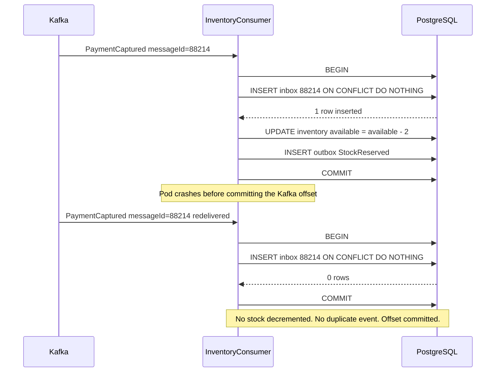
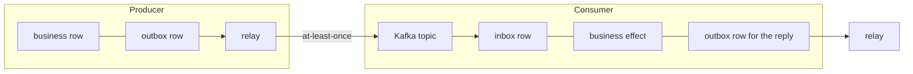

## 30.11 The inbox pattern

#### Concept

The outbox guarantees that every event is published **at least once**. The **inbox** is the other half: it guarantees that every event is *acted on* at most once, by recording the message id in the consumer's own database, in the same transaction as the business effect.

```text
Producer side (19.10)          Consumer side (19.11)
  business row + outbox row      inbox row + business effect
  one transaction                one transaction
  at-least-once delivery         at-most-once effect
                    -> exactly-once EFFECT
```

That last line is the point of the whole design, and it is worth reading carefully. You do not get exactly-once *delivery* — that is not achievable over a network. You get exactly-once *effect*, which is what the business actually needs.

#### Why does it exist?

Because duplicates are guaranteed, not hypothetical. Part 28 section 28.7 covered the delivery semantics; here is the concrete list of ways our `PaymentCaptured` event reaches the inventory service twice:

- The outbox relay crashed after publishing and before marking published.
- The Kafka producer retried after a timeout where the broker had already stored the message.
- The consumer processed the message, then crashed before committing its offset. Kafka redelivers from the last committed offset.
- A consumer group rebalance (a deploy, a pod restart, a `max.poll.interval.ms` breach) reassigned the partition and replayed from the last commit.
- An operator replayed a topic from an earlier offset to recover from a bug.

Without an inbox, that duplicate decrements stock twice. Your warehouse now shows 2 units held for an order that needs 1, and you undersell the difference silently.

#### Mental model

Imagine a warehouse worker with a clipboard. Every picking slip has a number. Before picking anything, they check the clipboard: *have I already done slip 4471?* If yes, they bin it and do nothing. If no, they write 4471 on the clipboard **and** pick the items, in one motion.

The critical detail is "in one motion". If they write the number first and then get called away before picking, the order never ships. If they pick first and get called away before writing, they may pick twice. The clipboard entry and the picking must be a single indivisible act. In our world, that is one database transaction.

#### PostgreSQL example

```sql
CREATE TABLE inbox (
  message_id   text        NOT NULL,      -- from the producer: outbox id, Kafka header, provider event id
  consumer     text        NOT NULL,      -- 'inventory', 'shipping', 'notifications'
  processed_at timestamptz NOT NULL DEFAULT now(),
  PRIMARY KEY (message_id, consumer)
);

-- Retention scan support.
CREATE INDEX idx_inbox_processed_at ON inbox (processed_at);
```

The composite primary key `(message_id, consumer)` matters. Several consumers legitimately process the same message, each for its own purpose. Keying on `message_id` alone would let the inventory consumer's row block the notification consumer.

The short-circuit is one statement:

```sql
-- Returns 1 row if this is the first time; 0 rows if it is a duplicate.
INSERT INTO inbox (message_id, consumer)
VALUES ($1, 'inventory')
ON CONFLICT (message_id, consumer) DO NOTHING
RETURNING message_id;
```

`ON CONFLICT DO NOTHING` is not merely convenient; it is **race-safe**. If two consumer threads process the same message at the same instant, PostgreSQL serialises them on the unique index: one gets the row, the other gets zero rows and skips. No `SELECT` then `INSERT` window, no application-level lock.

The whole consumer transaction, in SQL, to make the boundary unmistakable:

```sql
BEGIN;
  INSERT INTO inbox (message_id, consumer) VALUES ('outbox-88214', 'inventory')
  ON CONFLICT DO NOTHING RETURNING message_id;
  -- if that returned 0 rows: ROLLBACK (or COMMIT, it does not matter) and ack the message.

  UPDATE inventory SET available = available - 2 WHERE sku = 'BX-19' AND available >= 2;
  INSERT INTO stock_reservations (order_id, sku, qty, status) VALUES ('...', 'BX-19', 2, 'RESERVED');
  INSERT INTO outbox (aggregate_type, aggregate_id, event_type, payload)
    VALUES ('order', '...', 'StockReserved', '{"orderId":"..."}');
COMMIT;
```

One commit covers: I have seen this message, I did the work, and I told the world. Any crash before `COMMIT` leaves none of it and the message is redelivered. Any crash after `COMMIT` leaves all of it and the redelivery is a no-op. There is no interleaving that produces a wrong result.

#### NestJS example

A complete Kafka consumer with the transaction boundary made explicit. Note the manual offset commit and where it sits relative to the transaction.

```ts
// inventory.consumer.ts
@Controller()
export class InventoryConsumer {
  private readonly log = new Logger(InventoryConsumer.name);

  constructor(
    private readonly dataSource: DataSource,
    private readonly outbox: OutboxService,
    private readonly metrics: MetricsService,
  ) {}

  @EventPattern('order.events')
  async handle(@Payload() msg: OrderEvent, @Ctx() ctx: KafkaContext): Promise<void> {
    const messageId = ctx.getMessage().headers?.messageId?.toString();
    if (!messageId) throw new Error('message without messageId header: reject at the edge');
    if (msg.eventType !== 'PaymentCaptured') return;

    const handled = await this.dataSource.transaction('READ COMMITTED', async (manager) => {
      // 1. Claim the message. Zero rows means someone already did this work.
      const claim = await manager
        .createQueryBuilder()
        .insert().into(InboxMessage)
        .values({ messageId, consumer: 'inventory' })
        .orIgnore()                                   // ON CONFLICT DO NOTHING
        .returning('message_id')
        .execute();

      if (claim.raw.length === 0) {
        this.metrics.increment('inbox_duplicates_total', { consumer: 'inventory' });
        return false;                                 // duplicate: do nothing, still ack
      }

      // 2. The business effect, same transaction.
      const reserved = await this.reserve(manager, msg.orderId, msg.items);

      // 3. The reply event, same transaction (outbox, section 19.10).
      await this.outbox.publish(manager, {
        aggregateType: 'order',
        aggregateId: msg.orderId,
        eventType: reserved ? 'StockReserved' : 'StockUnavailable',
        payload: { orderId: msg.orderId, items: msg.items },
      });
      return true;
    });

    // 4. Offset commit happens AFTER the transaction. If the pod dies before this,
    //    Kafka redelivers and the inbox turns the redelivery into a no-op.
    if (handled) this.log.debug({ messageId, orderId: msg.orderId }, 'processed');
  }

  private async reserve(manager: EntityManager, orderId: string, items: Item[]): Promise<boolean> {
    for (const item of items) {
      const res = await manager.query(
        `UPDATE inventory SET available = available - $2 WHERE sku = $1 AND available >= $2`,
        [item.sku, item.qty],
      );
      if (res[1] === 0) return false;
      await manager.insert(StockReservation, { orderId, sku: item.sku, qty: item.qty, status: 'RESERVED' });
    }
    return true;
  }
}
```

The ordering in the comments is the entire design:

```text
message arrives
   |
   v
BEGIN ---------------------------------------+
  INSERT inbox ON CONFLICT DO NOTHING         |  atomic
  if duplicate -> return, do nothing          |
  do the business effect                      |
  INSERT outbox (reply event)                 |
COMMIT ---------------------------------------+
   |
   v
commit Kafka offset      <- crash here = redelivery = harmless no-op
```

Crash anywhere before `COMMIT`: nothing happened, message redelivered, processed properly. Crash between `COMMIT` and the offset commit: work is done, message redelivered, the inbox short-circuits it. Both windows are safe. That is the guarantee.

#### The dedup sequence, drawn



#### Where the message id comes from

The inbox is only as good as the id. Rules:

- **It must be stable across redeliveries.** The Kafka offset is not — a rebalance or a topic rebuild changes it. Use an id generated by the producer.
- **From your own outbox:** the `outbox.id` (a `bigserial`), sent as a Kafka header. Guaranteed unique, monotonic, free.
- **From a third party:** the provider's own event id. Stripe sends `evt_1P9x...` in the body and `Stripe-Signature` in the header. Razorpay sends `x-razorpay-event-id`. Use those; never generate an id on receipt, which would make every redelivery look new.
- **From a producer that gives you nothing:** derive a deterministic id from the content, for example `sha256(aggregateId + eventType + businessTimestamp)`. Weaker (two genuinely distinct events with identical content collide) but far better than nothing.

#### Combining outbox and inbox



Read the diagram as two atomic units joined by an unreliable pipe. On the left, "row plus intent" commit together. On the right, "seen plus effect plus next intent" commit together. The pipe in the middle may lose nothing, duplicate freely and reorder across aggregates — and the result is still correct.

**Why the phrase matters.** People say "we have exactly-once with Kafka" and mean different things. Say it precisely:

| Phrase | What it actually means | Achievable? |
|---|---|---|
| Exactly-once delivery | The network delivers each message exactly once | **No.** Impossible over an unreliable network with independent failures |
| Exactly-once processing (Kafka EOS) | Consume-transform-produce within Kafka is atomic via `transactional.id` | Yes, but only for Kafka-to-Kafka. Your PostgreSQL write is outside it |
| Exactly-once **effect** | The observable business result is as if the message were handled once | **Yes**, via outbox plus inbox plus idempotent handlers |

Kafka's EOS is genuinely useful for stream processing where source and sink are both Kafka. It does nothing for "consume an event and write to PostgreSQL", which is what almost every service in our flow does. The inbox is the tool for that job.

#### Inbox growth and retention

At 900 events/s across five consumers, the inbox gains about 4 million rows per hour. It must be pruned, and the retention window is a real decision:

**How long must you keep a message id?** Long enough to cover the maximum possible redelivery gap. That is bounded by your Kafka topic retention plus the longest a consumer can be down and still resume, plus any manual replay window. For most systems, 7 days is right; below 24 hours you risk a replay after a long incident re-executing effects.

```sql
-- Batched cleanup, every 5 minutes. Keeps locks short and WAL bursts small.
DELETE FROM inbox
WHERE ctid IN (
  SELECT ctid FROM inbox WHERE processed_at < now() - interval '7 days' LIMIT 20000
);
```

Above roughly 5 million rows a day, partition it and drop partitions instead:

```sql
CREATE TABLE inbox (
  message_id text NOT NULL, consumer text NOT NULL,
  processed_at timestamptz NOT NULL DEFAULT now(),
  PRIMARY KEY (message_id, consumer, processed_at)
) PARTITION BY RANGE (processed_at);

CREATE TABLE inbox_2026_09_09 PARTITION OF inbox
  FOR VALUES FROM ('2026-09-09') TO ('2026-09-10');
```

Note the cost of partitioning here: the primary key must include `processed_at`, which means **the uniqueness guarantee is per partition, not global**. A duplicate arriving 25 hours later, across a partition boundary, will not be caught. That is usually acceptable (redeliveries are typically seconds apart) but it must be a conscious decision, not a surprise. If you cannot accept it, keep a single unpartitioned table and use batched deletes.

#### Production scenario

An inventory service consumes 1,200 events/s across 12 partitions with 6 pods. Inbox table: 7-day retention, about 720 million rows, 61 GB, daily partitions. The insert costs about 0.15 ms and roughly 8% of the transaction's time — a real cost, and unambiguously worth it.

Measured duplicate rate over a quiet month: 0.003% (about 30 duplicates per million). During a rolling deploy with a consumer group rebalance, it spikes to 0.4% for about 40 seconds. During one Kafka broker replacement it hit 2.1% for four minutes. Every one of those was absorbed silently by the inbox. Without it, the broker replacement alone would have double-decremented stock on roughly 6,000 orders.

The `inbox_duplicates_total` counter is on a dashboard next to the deploy markers, and the correlation is visible to the eye. That graph is the best argument for the pattern you will ever show a sceptical team.

#### Failure scenario

A team implemented the inbox but put the `INSERT` in a **separate** transaction from the business effect, because a code reviewer worried about "holding the transaction longer":

```ts
// The bug: two transactions. The gap between them is where correctness dies.
await this.inboxRepo.insert({ messageId, consumer: 'inventory' });   // txn 1
await this.reserveStock(msg);                                        // txn 2
```

For six weeks it looked perfect: no duplicates. Then a node was drained and pods were `SIGKILL`ed between the two transactions. 74 messages were recorded as processed with no stock reserved. Those 74 orders sat in `PAID` with no reservation. Kafka never redelivered, because the offset had been committed and, even if it had not, the inbox would have short-circuited the retry.

The failure is silent and permanent. The fix is one line — pass the `EntityManager` through so both writes share a transaction — and the lesson is worth stating as a rule: **the inbox insert and the business effect must share a transaction, or the inbox is worse than not having one**, because it converts a recoverable duplicate into an unrecoverable loss.

#### Edge cases & failure modes

- **Inbox insert in a separate transaction.** Lost work, as above. The single most dangerous way to get this wrong.
- **The business effect is not in your database.** If the handler calls a third-party API, the inbox cannot cover it transactionally. Fall back to a provider-side idempotency key (section 30.13) and treat the inbox as a fast-path optimisation, not a guarantee.
- **Missing or unstable message id.** Using the Kafka offset, a timestamp or a locally generated UUID makes the inbox decorative.
- **Inbox retention shorter than the replay window.** An operator replays a topic from 10 days ago; the inbox has 3 days; every effect re-executes.
- **Partitioned inbox with a partition-scoped key.** Cross-boundary duplicates slip through. Acceptable, but decide it deliberately.
- **`ON CONFLICT DO NOTHING` on the wrong constraint.** If the conflict target does not match your unique index, PostgreSQL swallows conflicts you did not intend. Name the target explicitly.
- **Poison message.** The business effect throws every time, the transaction rolls back including the inbox row, and the message is redelivered forever, blocking the partition. Needs an attempt counter and a dead-letter topic (Part 28 section 28.6).
- **Consumer lag from the extra insert.** At very high volume the insert plus index maintenance is measurable. Partition, and keep the row narrow: two text columns and a timestamp, no payload.
- **Two consumer groups sharing an inbox row** because someone keyed on `message_id` only. The second consumer silently never runs.

#### How a Senior Backend Engineer thinks about this

They make the inbox part of a shared base class or interceptor so no consumer can be written without one. If deduplication is opt-in, some consumer will opt out, and that consumer will be the one handling money.

They are precise in conversation. When someone says "we need exactly-once", the senior asks: *once delivered, or once in effect?* The first is impossible; the second is a Tuesday afternoon of work. Naming the difference resolves the argument.

They also check the inbox's blast radius: it lives in the consumer's own database, so it adds no cross-service dependency and no new failure mode. That is a large part of why it is the right tool — a Redis-based dedup cache looks similar and is not, because Redis can lose the key (eviction, restart, failover) and it cannot join the transaction.

#### Common mistakes

- Separate transactions for the inbox row and the business effect.
- Deduplicating in Redis with a TTL and calling it exactly-once. Redis eviction under memory pressure silently disables it.
- No retention job, so the inbox becomes the largest table in the database.
- Deduplicating on business identity (`orderId`) instead of message identity, so a legitimate second event for the same order is dropped.
- Forgetting that the reply event must also go through the outbox, reintroducing the dual write on the consumer side.

#### Interview questions

1. *What is the inbox pattern and what problem does it solve?* Expected: record the message id in the same transaction as the effect; converts at-least-once delivery into an at-most-once effect.
2. *Why must the inbox insert and the business effect share a transaction?* Expected: otherwise a crash between them records the message as handled without doing the work, and the redelivery is suppressed. Loss, not duplication.
3. *Can you get exactly-once delivery?* Expected: no. You get exactly-once effect via idempotency. Kafka's EOS covers Kafka-to-Kafka only.
4. *What do you use as the message id and why not the Kafka offset?* Expected: a producer-generated stable id (outbox id, provider event id); offsets change on rebuild and are not stable identity.
5. *How do you keep the inbox from growing forever, and what is the risk of partitioning it?* Expected: batched deletes or daily partitions with a 7-day window; partitioning makes uniqueness partition-scoped, so very late duplicates can slip through.

## 30.12 Idempotency as the universal tool

#### Concept

An operation is **idempotent** if performing it once and performing it many times produce the same observable result. It is the single most useful property in distributed systems, and every other pattern in this Part is a specific application of it.

The inbox is idempotency for messages. The provider idempotency key is idempotency for API calls. A guarded `UPDATE` is idempotency built into the data model. Learn to see all three as the same idea.

#### Why does it exist?

Because retries are unavoidable. Part 31 — Reliability Engineering covers retries, backoff and jitter in depth; here is the consequence: **if you retry, you must be idempotent, and if you cannot be idempotent, you must not retry.** There is no third option, and teams that skip this rule discover it through double charges.

#### Mental model

A light switch set to "on" is idempotent: flip it to on ten times, the light is on. A light switch you *toggle* is not: ten toggles leave it in a state that depends on how many times you pressed. Design your operations as "set to this state", not as "change by this much".

That single reframing removes most idempotency bugs. `balance = balance - 100` is a toggle. `INSERT a ledger entry with a unique id, then recompute the balance` is a switch.

#### API idempotency keys

The client sends a key it generates once per intent and reuses on every retry:

```text
POST /orders
Idempotency-Key: 8f14e45f-ea6f-4a1b-9f0e-2d3c4b5a6d7e
Content-Type: application/json

{"items":[{"sku":"BX-19","qty":2}],"addressId":"addr-91"}
```

The storage table, which is more subtle than it looks:

```sql
CREATE TABLE idempotency_keys (
  key            text        NOT NULL,
  scope          text        NOT NULL,      -- 'POST /orders'; keys are per endpoint
  actor_id       uuid        NOT NULL,      -- keys are per customer: no cross-tenant collisions
  request_hash   text        NOT NULL,      -- sha256 of the canonical request body
  status         text        NOT NULL,      -- 'IN_PROGRESS' | 'COMPLETED'
  response_code  int,
  response_body  jsonb,
  created_at     timestamptz NOT NULL DEFAULT now(),
  expires_at     timestamptz NOT NULL DEFAULT now() + interval '24 hours',
  PRIMARY KEY (actor_id, scope, key)
);

CREATE INDEX idx_idem_expiry ON idempotency_keys (expires_at);
```

Three columns carry the design. `request_hash` detects a client reusing a key for a different request. `status` handles the concurrent-duplicate case. `(actor_id, scope, key)` as the primary key means one customer's key can never collide with another's, and the same key on two endpoints is two independent operations.

The concurrent-duplicate case is where most implementations break. Two identical requests arrive 5 ms apart, before the first has finished. A naive `SELECT` then `INSERT` lets both through. The unique constraint is what saves you:

```ts
// idempotency.interceptor.ts
@Injectable()
export class IdempotencyInterceptor implements NestInterceptor {
  constructor(private readonly dataSource: DataSource) {}

  async intercept(ctx: ExecutionContext, next: CallHandler): Promise<Observable<unknown>> {
    const req = ctx.switchToHttp().getRequest<Request>();
    const key = req.header('Idempotency-Key');
    if (!key) return next.handle();                       // key optional; required on money endpoints

    const scope = `${req.method} ${req.route.path}`;
    const actorId = req.user.id;
    const hash = createHash('sha256').update(canonicalJson(req.body)).digest('hex');

    // Atomic claim. Winner proceeds; loser reads the existing row.
    const claim = await this.dataSource
      .createQueryBuilder()
      .insert().into(IdempotencyKey)
      .values({ key, scope, actorId, requestHash: hash, status: 'IN_PROGRESS' })
      .orIgnore()
      .returning('key')
      .execute();

    if (claim.raw.length === 0) {
      const existing = await this.repo.findOneOrFail({ where: { key, scope, actorId } });

      // Same key, DIFFERENT body: the client has a bug. Do not guess which one they meant.
      if (existing.requestHash !== hash) {
        throw new ConflictException({
          error: 'idempotency_key_reuse',
          message: 'This Idempotency-Key was used with a different request body',
        });
      }
      // Same key, same body, still running: tell the client to come back.
      if (existing.status === 'IN_PROGRESS') {
        throw new ConflictException({ error: 'request_in_progress', retryAfterMs: 500 });
      }
      // Same key, same body, finished: replay the stored response byte for byte.
      return of(existing.responseBody);
    }

    return next.handle().pipe(
      tap(async (body) => {
        await this.repo.update({ key, scope, actorId }, {
          status: 'COMPLETED', responseCode: 200, responseBody: body as object,
        });
      }),
      catchError(async (err) => {
        // 5xx: release the key so a retry can genuinely retry.
        // 4xx: keep it, because the same bad request should keep failing the same way.
        if (err instanceof HttpException && err.getStatus() < 500) {
          await this.repo.update({ key, scope, actorId }, {
            status: 'COMPLETED', responseCode: err.getStatus(), responseBody: err.getResponse() as object,
          });
        } else {
          await this.repo.delete({ key, scope, actorId });
        }
        throw err;
      }),
    );
  }
}
```

The **same key, different body** rule deserves emphasis because it is the one people get wrong. Two plausible-looking wrong answers:

- *Process it as a new request.* Now the key means nothing and a client bug becomes a double order.
- *Return the first response.* The client asked for something different and got a receipt for something else. Worse, it is silent.

The right answer is `409 Conflict` with an explicit error code. The client has a bug; tell them. Stripe returns exactly this, and so should you.

| Situation | Response |
|---|---|
| New key | Process normally, store the response |
| Same key, same body, completed | Replay the stored response, same status code |
| Same key, same body, in progress | `409` with a retry hint, or `202` if your client handles it |
| Same key, different body | `409 idempotency_key_reuse`. Never process |
| Expired key, same body | Treated as new. This is why expiry must exceed the client's retry window |
| Missing key on a money endpoint | `400`. Make the header mandatory where it matters |

#### Natural idempotency

The cheapest idempotency needs no extra table at all: make the state transition itself the guard.

```sql
-- Idempotent by construction. Run it 100 times: the row is PAID once, and the
-- rowCount tells you whether YOU were the one who changed it.
UPDATE orders
   SET status = 'PAID', paid_at = now(), payment_ref = $2
 WHERE id = $1 AND status = 'PENDING_PAYMENT';
```

The returned row count is a value you can genuinely trust:

- `1` means this call performed the transition. **You** own the side effects: send the confirmation email, publish the event, advance the saga.
- `0` means either the order does not exist, or it was already `PAID`, or it is in a state that cannot become `PAID`. Distinguish those with one extra read, but never treat 0 as an error by default.

```ts
// order.service.ts
async markPaid(orderId: string, chargeId: string): Promise<'transitioned' | 'already'> {
  const res = await this.orders.update(
    { id: orderId, status: OrderStatus.PENDING_PAYMENT },
    { status: OrderStatus.PAID, paymentRef: chargeId, paidAt: new Date() },
  );
  if (res.affected === 1) return 'transitioned';           // exactly one caller gets this
  const current = await this.orders.findOneByOrFail({ id: orderId });
  if (current.status === OrderStatus.PAID) return 'already';  // duplicate: fine, no side effects
  throw new ConflictException(`order ${orderId} is ${current.status}, cannot mark PAID`);
}
```

This pattern — **conditional update returning an affected count** — is worth more than any framework. It is atomic, it needs no lock, no extra table and no coordination, and it works identically under concurrency. Whenever you can express "do X only if the state is Y", you have idempotency for free.

The same idea in the other three places it appears in our flow:

```sql
-- Inventory: release only what is reserved (from section 19.7).
UPDATE stock_reservations SET status = 'RELEASED'
 WHERE order_id = $1 AND status = 'RESERVED';

-- Shipping: book only if no pickup exists. The unique index does the work.
INSERT INTO shipments (order_id, pickup_id) VALUES ($1, $2)
ON CONFLICT (order_id) DO NOTHING;

-- Payment: record the charge once, whichever path learns about it first
-- (the synchronous response or the webhook, racing each other).
INSERT INTO payments (order_id, charge_id, amount_cents, status)
VALUES ($1, $2, $3, 'CAPTURED')
ON CONFLICT (charge_id) DO UPDATE SET status = EXCLUDED.status
RETURNING (xmax = 0) AS inserted;   -- true if this call inserted, false if it updated
```

That last trick is worth remembering: `xmax = 0` in the `RETURNING` clause of an upsert tells you whether the row was inserted or updated, which is exactly the "did I cause this?" signal you need for deciding whether to fire side effects.

#### Idempotent event handlers and compensations

Handlers get idempotency from three layers, and you want all three:

1. **The inbox** catches redeliveries of the same message.
2. **The conditional update** catches a *different* message that would apply the same transition (a webhook and a poll both discovering the same charge).
3. **The provider idempotency key** catches a repeated outbound call.

Compensations get the same treatment. From section 30.7, the release is guarded by `status = 'RESERVED'` and the refund carries the key `${orderId}:REFUND_PAYMENT`. Both can run any number of times.

#### Key scope and expiry

- **Scope by actor and endpoint.** `(actor_id, scope, key)`. Never a global key space: a client that generates sequential keys will collide with another client.
- **Expiry must exceed the client's total retry window.** If mobile clients retry for up to 6 hours on a bad connection, a 1-hour expiry means the 7th retry creates a second order. 24 hours is a common, safe default; Stripe uses 24 hours.
- **Do not expire while `IN_PROGRESS`.** A stuck row must be reaped by a separate job that checks whether the underlying operation actually finished, not by a blanket TTL.
- **Store the response, not just the key.** Replaying the exact original response (status code and body) is what makes the retry invisible to the client.

#### Production scenario

A payments API at 240 requests/s with mandatory idempotency keys on `POST /payments`. Measured over a month: 3.1% of requests carried a key that had been seen before. Breakdown: 2.4% mobile clients retrying on flaky networks, 0.6% the API gateway retrying on 502, 0.1% genuine user double-taps. Every one of those would have been a double charge.

The `idempotency_keys` table holds about 20 million rows with 24-hour retention, 2.8 GB, cleaned in batches every 5 minutes. The interceptor adds 0.9 ms p50 and 3 ms p99 to every request. The team's summary: *one millisecond per request to never double-charge anyone.*

#### Failure scenario

A team scoped idempotency keys globally, with `PRIMARY KEY (key)` and no `actor_id`. One integration partner generated keys as an incrementing integer starting from 1.

The partner's key `1042` collided with another customer's key `1042` from a different integration. The second customer's `POST /orders` returned the **first customer's stored response**, including their order id and address. Two customers, one order id, and a data leak in the response body.

It was caught by a customer who noticed a stranger's postcode on their confirmation page. The fix was `PRIMARY KEY (actor_id, scope, key)` plus a migration. The broader lesson: **an idempotency key is client-supplied input and must be scoped like any other client-supplied identifier.** Never trust it to be globally unique, and never let it index into data across a tenant boundary.

#### Edge cases & failure modes

- **Concurrent duplicates.** Two identical requests in flight. Solved by the unique constraint, not by `SELECT` then `INSERT`.
- **Same key, different body.** `409`. Never process, never replay silently.
- **Key expiry shorter than the retry window.** Silent duplicates, hardest class of bug to find because it only occurs on slow networks.
- **Storing the response only on success.** A retry after a 500 returns a different result than the original. Store enough to make behaviour deterministic, and delete the key on 5xx so a retry can genuinely retry.
- **Idempotency on a non-idempotent handler.** The key protects the endpoint, not the three downstream side effects the handler fires. Each of those needs its own key.
- **Client generating the key per attempt.** Common bug: `Idempotency-Key: randomUUID()` inside the retry loop. The key must be generated once per *intent*, outside the loop.
- **Keys in Redis with a TTL and no persistence.** A Redis restart loses the whole key space and re-enables duplicates for the retry window.
- **Very large stored responses.** Capping `response_body` matters, or one endpoint returning a 4 MB document bloats the table.

#### How a Senior Backend Engineer thinks about this

They ask one question of every write endpoint: *if this is called twice with the same input, what happens?* If the answer is anything other than "the same as calling it once", the endpoint needs a key or a conditional update. That question in code review catches more production bugs than any static analysis tool.

They prefer natural idempotency over a key table, always. A conditional `UPDATE` or a unique constraint costs nothing, cannot be forgotten, and cannot expire. The key table is for when the operation genuinely creates something new and there is no natural unique identity.

They also treat idempotency as an API contract, documented: which endpoints accept `Idempotency-Key`, whether it is required, how long keys live, and exactly what a 409 means. Clients cannot retry safely against an undocumented contract.

#### Common mistakes

- `SELECT` then `INSERT` instead of a unique constraint, losing under concurrency.
- Global key scope.
- Regenerating the key on each retry attempt.
- Treating `affected === 0` as an error rather than as "already done".
- Additive updates (`balance = balance - 100`) where a guarded transition would do.
- Idempotency on the HTTP layer only, leaving the event handlers and outbound calls unprotected.

#### Interview questions

1. *Design idempotent `POST /orders`.* Expected: client-supplied key, table keyed by actor plus scope plus key, atomic claim via unique constraint, request hash comparison, stored response replay, 409 on body mismatch, expiry longer than the client retry window.
2. *Two identical requests arrive simultaneously. Walk me through it.* Expected: both attempt the insert, one wins on the unique index, the loser reads the row and gets `IN_PROGRESS`, so it receives a 409 with a retry hint rather than executing.
3. *Same key, different body: what do you return and why?* Expected: 409; processing it defeats the key, replaying the old response returns a receipt for a different request.
4. *What is natural idempotency? Give three examples from an order flow.* Expected: guarded `UPDATE ... WHERE status = 'PENDING'`, `INSERT ... ON CONFLICT DO NOTHING` on a unique business key, `DELETE WHERE`; the affected count is the signal for firing side effects.
5. *Why not use Redis for idempotency keys?* Expected: eviction and restart lose keys silently, no transactional tie to the business write; acceptable only as a fast-path cache in front of a durable table.

## 30.13 External providers and the unknown outcome

#### Concept

Everything so far assumed you control both sides. With a payment gateway you control neither the retry behaviour nor the delivery guarantees, and the operation moves real money. This section is the set of rules for that case.

#### The absolute rule

**Never retry a charge without an idempotency key.** Not "prefer not to". Never. If the key is missing, do not retry — mark the outcome unknown and resolve it by querying, because a blind retry has a real chance of taking money twice from someone.

Every serious provider supports this:

| Provider | Mechanism | Retention |
|---|---|---|
| Stripe | `Idempotency-Key` header on any POST | 24 hours |
| Razorpay | `X-Payment-Idempotency` / unique `receipt` on orders | Varies by product |
| Adyen | `Idempotency-Key` header | 7 days |
| PayPal | `PayPal-Request-Id` header | 72 hours |
| Braintree | Deduplication on a client-supplied `transaction id` | Varies |

Note the retention column. Beyond that window the provider forgets the key, and a retry becomes a new charge. Your retry policy must be shorter than the provider's key retention, or you must switch from retrying to querying.

```ts
// payment-gateway.client.ts
@Injectable()
export class PaymentGatewayClient {
  private readonly log = new Logger(PaymentGatewayClient.name);

  async charge(input: ChargeInput): Promise<ChargeResult> {
    // Deterministic. The same order and step always produce the same key,
    // across processes, across pods, across restarts, across weeks.
    const key = `${input.orderId}:CAPTURE_PAYMENT`;

    try {
      const res = await this.http.post('/v1/charges', {
        amount: input.amountCents, currency: 'INR', source: input.cardToken,
        metadata: { order_id: input.orderId },       // ALWAYS put your id in their metadata
      }, {
        headers: { 'Idempotency-Key': key },
        timeout: 8000,
      });
      return { status: 'CAPTURED', chargeId: res.data.id };

    } catch (err) {
      if (isDeclined(err)) return { status: 'DECLINED', reason: declineCode(err) };

      // Timeout, 5xx, connection reset: the outcome is UNKNOWN, not failed.
      this.log.warn({ orderId: input.orderId, key, err: String(err) }, 'charge outcome unknown');
      return { status: 'UNKNOWN', idempotencyKey: key };
    }
  }

  /** Resolve an unknown outcome by asking the provider, never by retrying blindly. */
  async resolveUnknown(orderId: string): Promise<ChargeResult> {
    const res = await this.http.get('/v1/charges', {
      params: { 'metadata[order_id]': orderId, limit: 5 },
    });
    const charge = res.data.data.find((c: any) => c.metadata?.order_id === orderId);
    if (!charge) return { status: 'NOT_FOUND' };
    return { status: charge.captured ? 'CAPTURED' : 'AUTHORIZED', chargeId: charge.id };
  }
}
```

The line `metadata: { order_id: input.orderId }` is small and load-bearing. It is what lets you search the provider by *your* identifier during an incident. Without it, reconciling 47 orphaned charges means matching amounts and timestamps by hand — exactly the six-hour job from section 30.1.

#### Resolving the unknown: two paths, use both

**Path 1: poll by key or metadata.** After a timeout, wait a moment (the charge may still be settling) and query. A resolver on a short cron:

```ts
// payment-reconciler.service.ts
@Injectable()
export class PaymentReconciler {
  @Cron(CronExpression.EVERY_30_SECONDS)
  async resolveUnknowns(): Promise<void> {
    const stuck = await this.orders.find({
      where: {
        status: OrderStatus.PAYMENT_UNKNOWN,
        updatedAt: LessThan(new Date(Date.now() - 20_000)),   // give the provider 20 s to settle
      },
      take: 100,
    });

    for (const order of stuck) {
      const result = await this.gateway.resolveUnknown(order.id);
      if (result.status === 'CAPTURED') {
        await this.orderService.markPaid(order.id, result.chargeId);   // conditional UPDATE
      } else if (result.status === 'NOT_FOUND' && this.olderThan(order, 10 * 60_000)) {
        // Only after 10 minutes do we conclude no charge exists.
        await this.orderService.markPaymentFailed(order.id, 'no charge found at provider');
      }
      // else: leave it, try again in 30 s. After 1 hour, escalate to manual review.
    }
  }
}
```

The 20-second delay and the 10-minute NOT_FOUND threshold are both deliberate. Provider APIs are often eventually consistent: a charge created 300 ms ago may not appear in a list query yet. Concluding "no charge" too early creates exactly the orphaned charge you were trying to avoid.

**Path 2: webhooks.** The provider tells you when it happens. Webhooks are the faster path and the more reliable one, and they come with their own rules:

- **Verify the signature.** Stripe's `Stripe-Signature`, Razorpay's HMAC. An unverified webhook endpoint is an unauthenticated write endpoint for anyone who guesses the URL.
- **Deduplicate on the provider's event id.** Providers retry aggressively; Stripe retries with backoff for up to 3 days. Duplicates are the norm.
- **Handle out-of-order arrival.** `charge.refunded` can arrive before `charge.succeeded`. Apply by the provider's own event timestamp, not by arrival order.
- **Respond 2xx fast, do the work asynchronously.** Providers time out webhook deliveries in 5 to 20 seconds and treat slowness as failure, which triggers retries and can get your endpoint disabled.
- **Never trust the body's amount without re-verifying.** Fetch the object from the provider's API if the amount drives money movement.

```ts
// payment-webhook.controller.ts
@Controller('webhooks/payments')
export class PaymentWebhookController {
  @Post()
  @HttpCode(200)
  async handle(@Req() req: RawBodyRequest<Request>, @Headers('stripe-signature') sig: string) {
    const event = this.gateway.verifyAndParse(req.rawBody!, sig);   // throws on bad signature

    // Durable, deduplicated, and fast: just record it and return.
    await this.dataSource.transaction(async (manager) => {
      const claim = await manager.createQueryBuilder()
        .insert().into(InboxMessage)
        .values({ messageId: event.id, consumer: 'payment-webhook' })
        .orIgnore().returning('message_id').execute();
      if (claim.raw.length === 0) return;                  // duplicate delivery, ignore

      await manager.insert(WebhookEvent, {
        providerEventId: event.id, type: event.type,
        payload: event.data, providerCreatedAt: new Date(event.created * 1000),
      });
      await this.outbox.publish(manager, {
        aggregateType: 'payment', aggregateId: event.data.object.metadata.order_id,
        eventType: event.type, payload: event.data,
      });
    });
    return { received: true };                             // 200 in ~4 ms
  }
}
```

Receive, verify, deduplicate, persist, acknowledge. Processing happens later from the outbox. This handler cannot be slow, cannot double-apply, and cannot lose an event.

#### The webhook that arrives before the transaction commits

The race that surprises everyone. Your service calls the provider; the provider fires the webhook so fast that it arrives and is processed **before** your own transaction (the one that records the charge attempt) has committed.

```mermaid
sequenceDiagram
  participant S as OrderService
  participant PG as PostgreSQL
  participant G as Gateway
  participant W as WebhookHandler
  S->>PG: BEGIN; UPDATE orders SET status = PENDING_PAYMENT
  S->>G: POST /charges idempotency-key order-7781
  G-->>S: 200 charge ch_71c
  G->>W: webhook charge.succeeded order-7781
  W->>PG: SELECT order 7781
  PG-->>W: not visible, the other transaction has not committed
  W->>W: order not found, drop the event
  S->>PG: COMMIT
  Note over PG,W: Order is now PAID at the gateway and PENDING_PAYMENT in your database, forever
```

Three fixes, in order of preference:

1. **Commit before calling the provider.** The order row and its `PENDING_PAYMENT` status are committed *before* the charge request goes out. This is the same rule as section 30.1 and it removes the race entirely. Prefer this.
2. **Make the webhook handler store-then-process.** Persist every webhook by `provider_event_id` unconditionally, even when the referenced order is unknown, then process from the outbox with retries. The handler above does this: it never looks up the order.
3. **Retry unmatched webhooks.** If the handler must resolve the order, park unmatched events in a pending table and re-attempt with backoff for a few minutes before treating them as genuinely unknown.

What you must never do is the thing the diagram shows: silently drop a webhook because the referenced entity is not found. That is a lost payment notification, and it is invisible.

#### The double-charge post-mortem

**14:22.** The gateway's p99 rose from 900 ms to 11 s. The checkout client had a 5-second timeout and an axios retry interceptor with `retries: 2`.

The interceptor was added six months earlier for a different endpoint. It applied to every request from that client, including `POST /v1/charges`. The charge call had **no idempotency key**, because the key was added on the saga's command envelope, not on the outbound HTTP request itself.

For 26 minutes, every charge that took longer than 5 s was sent up to three times. The gateway processed each as a distinct charge. 1,180 customers were charged twice; 214 were charged three times. Total over-charge: 4.7 million rupees.

Detection: not by monitoring. By Twitter, at 14:51, and by the support queue at 14:55. The dashboard showed *charge success rate rising*, because three attempts produced three successes.

Remediation: charges were reversed over the following four days. 340 customers had their cards declined for genuine purchases in the meantime, because the duplicate charges exhausted their limits. The gateway placed the account under review.

The five changes that came out of it, in the order they were shipped:

1. Idempotency key on the HTTP request itself, deterministic, derived from the order id. Enforced by a lint rule that fails the build on any `httpClient.post` to the gateway host without an `Idempotency-Key` header.
2. Retries removed from the generic HTTP client for money-moving endpoints. Retries live in the saga runner, which has the key.
3. Timeout raised to 15 s for charges, matched to the gateway's own processing window, so a slow success is a success rather than a timeout.
4. A new alert: `charges_created_total` divided by `orders_created_total`. It should sit at about 1.0. It hit 2.4 during the incident and would have paged in under two minutes.
5. `PAYMENT_UNKNOWN` state plus the resolver, so a timeout no longer needs a retry at all.

The single-sentence lesson the team wrote on the wall: **a retry without an idempotency key is not a retry, it is a second request.**

#### Edge cases & failure modes

- **Provider idempotency key expiry.** A retry 25 hours later with the same key is a new charge. Cap your retry window well below the provider's retention.
- **Provider's list API is eventually consistent.** A charge created 200 ms ago may not appear. Give the resolver a minimum age before concluding NOT_FOUND.
- **Webhook and poll resolve the same charge simultaneously.** Both must go through the conditional `UPDATE`, so exactly one fires the side effects.
- **Webhook signature verification against a parsed body.** The signature is over the raw bytes. Enable `rawBody` in NestJS or verification fails intermittently after any body-parser change.
- **Webhook endpoint disabled by the provider** after repeated non-2xx responses. Monitor delivery success from the provider's dashboard, not only from your side.
- **Provider retries a webhook for 3 days.** Your inbox retention must exceed that, or a day-3 retry re-executes the effect.
- **Partial capture and multi-capture.** Some providers allow capturing less than the authorized amount, or capturing twice. Model the payment as a set of transactions, not a single status.
- **Currency mismatch on refund.** Refund in the original charge's currency and exact amount; converted refunds leave unreconcilable differences.
- **The provider's own idempotency has an error.** Rare, but a repeated key with a *different* body returns an error rather than the original response. Keep your keys and bodies in lockstep.

#### How a Senior Backend Engineer thinks about this

They treat every money-moving call as having three outcomes and design for the third one first. Before writing the happy path they write down: what state does the order enter on a timeout, what process resolves it, on what schedule, and what happens if that process cannot resolve it in an hour.

They also insist on the ratio metric. `charges_created / orders_created` is one number that catches an entire class of catastrophic bug in under two minutes, and nobody thinks of it until after their first double-charge incident. Add it before yours.

To a product manager: "If the payment provider goes slow, we will not charge anyone twice. Some customers will see 'confirming your payment' for up to a minute while we check with the bank what actually happened. That is a deliberate choice: a minute of uncertainty is much cheaper than a double charge and a chargeback."

#### Common mistakes

- Generic retry middleware applied to money-moving endpoints.
- Idempotency key on the wrong layer (the internal command, not the outbound HTTP request).
- Random key per attempt.
- Treating a timeout as a decline and telling the customer "payment failed".
- Dropping webhooks whose referenced entity is not found yet.
- Not putting your own order id in the provider's metadata.
- No ratio alert between charges and orders.

#### Interview questions

1. *A charge times out. What are the possible states and what do you do?* Expected: succeeded, failed, or in flight; record `PAYMENT_UNKNOWN`; resolve by querying with the idempotency key or metadata, or by webhook; never blind-retry.
2. *Why must the idempotency key be deterministic rather than random?* Expected: a random key per attempt makes each retry a distinct operation at the provider; deterministic keys derived from durable identity collapse retries into one.
3. *What are the rules for a webhook endpoint?* Expected: verify the signature over the raw body, deduplicate on the provider event id, respond 2xx fast, process asynchronously, handle out-of-order by provider timestamp, retain dedup ids longer than the provider's retry window.
4. *A webhook arrives before your transaction commits. What breaks and how do you fix it?* Expected: the handler cannot see the order and drops the event; commit before calling the provider, and make the handler store-then-process rather than lookup-then-process.
5. *What single metric would have caught the double-charge incident fastest?* Expected: charges created divided by orders created, alerting on deviation from 1.0.

#### Practical exercise

Build a stub payment gateway you can command to: succeed, decline, hang for 30 s, succeed but return a 504, deliver duplicate webhooks, and deliver webhooks out of order. Wire your checkout flow to it.

Acceptance criteria: no scenario produces two charges for one order; every hang resolves to a correct final status within 60 seconds without human action; duplicate webhooks change nothing; an out-of-order `refunded` before `succeeded` yields the correct final state; and a test proves that removing the `Idempotency-Key` header causes a double charge, so the protection is demonstrably load-bearing.
