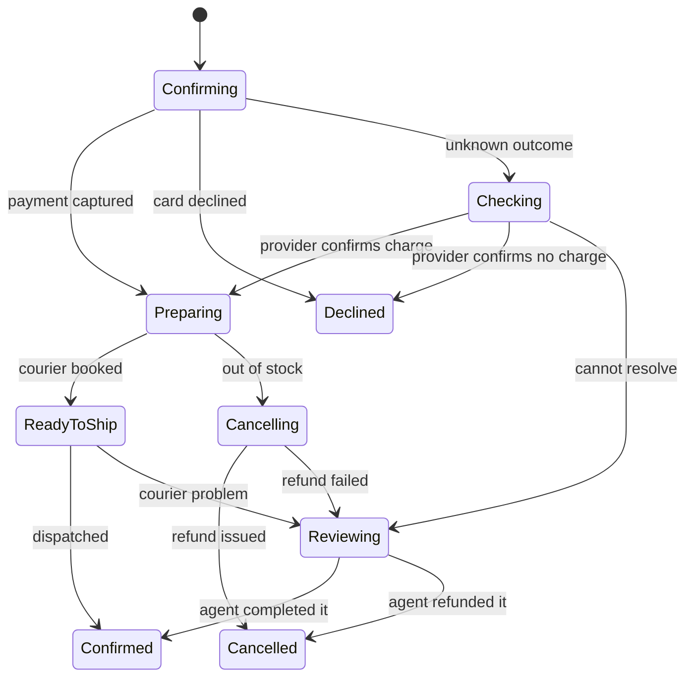

## 30.14 Designing the states your users can see

#### Concept

A distributed transaction takes time. Between "place order" and "shipment booked" there are seconds, sometimes minutes, occasionally an hour when a partner is down. During that window the order is in a real, legitimate, intermediate state — and your users, your support team and your finance team all need a name for it.

The status enum is therefore not an implementation detail. It is a **product surface**. Design it with the same care as an API contract.

#### Why does it exist?

Because the alternative is lying. A UI that shows "Order confirmed!" the instant the row is inserted is lying if the payment has not been captured. A UI that shows a spinner until every step completes is lying about how long that takes. Both produce support tickets, and the second produces abandoned checkouts.

An explicit state machine lets the interface tell the truth at every moment, which is both more honest and — this surprises product people — measurably better for conversion, because "Payment confirmed, preparing your order" reads as progress while a spinner reads as broken.

#### Mental model

Imagine tracking a parcel. "Order received", "Payment confirmed", "Picked and packed", "Handed to courier", "Out for delivery", "Delivered". Nobody complains that these are separate steps. Nobody demands the parcel teleport. The states *are* the product experience.

The mistake is treating your internal saga states as embarrassing plumbing to hide. They are the same thing as parcel tracking, and users already understand the idea perfectly.

#### How it works

The enum from section 30.8, now with what each state means to a human:

| Status | Engineering meaning | What the UI shows | Actions offered | Typical duration |
|---|---|---|---|---|
| `PENDING_PAYMENT` | Order row committed, charge not yet confirmed | "Confirming your payment..." with a spinner and the order number | None. Order number is visible and copyable | 0.4 to 3 s |
| `PAYMENT_UNKNOWN` | Charge call timed out, resolver is asking the provider | "Confirming your payment with your bank. This can take a minute." | "Contact support" with the order number | 20 s to 10 min |
| `PAYMENT_FAILED` | Declined. Nothing moved | "Payment declined: insufficient funds. Try another card." | "Retry payment" pre-filled with the same cart | Terminal |
| `PAID` | Captured, reserving stock | "Payment confirmed. Preparing your order." | "Cancel order" | 50 ms to 5 s |
| `STOCK_RESERVED` | Items held, booking the courier | "Preparing your order." (same copy: users do not need this distinction) | "Cancel order" | 0.2 to 20 s |
| `SHIPPING_REQUESTED` | Pickup booked | "Ready for dispatch. Tracking will appear shortly." | "Cancel order" (with a warning) | Minutes to hours |
| `COMPLETED` | All four steps done | "Confirmed. Arriving Thursday." plus tracking link | "Track", "Return" | Terminal |
| `COMPENSATING` | Unwinding: refund and release in progress | "Cancelling your order and issuing your refund." | None | 1 to 30 s |
| `CANCELLED` | Unwound cleanly | "Cancelled. Refund of 4,299 issued on 9 Sep, arrives within 5 to 7 working days. Ref RF-7781." | "Reorder" | Terminal |
| `FAILED` | Terminal, nothing left behind, no money moved | "We couldn't place this order. You have not been charged." | "Try again" | Terminal |
| `NEEDS_MANUAL_REVIEW` | Automation gave up | "We're checking something with your order. We'll email you within 2 hours." | "Contact support" | Until a human resolves it |

Two rules that carry most of the value:

**Rule 1: not every internal state needs a distinct user-facing message.** `PAID` and `STOCK_RESERVED` both show "Preparing your order". Collapsing them in the UI while keeping them distinct in the database is correct: engineering needs the granularity, users need the meaning.

**Rule 2: `NEEDS_MANUAL_REVIEW` must have honest copy with a time commitment.** "We're checking something, we'll email you within 2 hours" is enormously better than a spinner or a generic error, and it converts an angry ticket into a patient one. It also gives operations a service-level target that the manual queue's alert threshold can be derived from.



That is the *user's* state machine. It is deliberately smaller than the engineering one. Keeping both, and knowing which is which, is the skill.

#### NestJS example

Never let the UI translate raw enum values. Map them server-side, so copy changes ship without a client release and so every channel (web, iOS, Android, email) says the same thing.

```ts
// order-presentation.service.ts
interface OrderView {
  status: OrderStatus;                 // raw, for clients that want it
  displayState: string;                // 'confirming' | 'preparing' | 'cancelled' ...
  headline: string;
  detail: string;
  actions: Array<'cancel' | 'retry_payment' | 'track' | 'contact_support' | 'reorder'>;
  pollIntervalMs: number | null;       // null means terminal, stop polling
}

const VIEW: Record<OrderStatus, Omit<OrderView, 'status' | 'detail'>> = {
  PENDING_PAYMENT:     { displayState: 'confirming', headline: 'Confirming your payment',   actions: [],                       pollIntervalMs: 1000 },
  PAYMENT_UNKNOWN:     { displayState: 'confirming', headline: 'Confirming with your bank', actions: ['contact_support'],      pollIntervalMs: 3000 },
  PAYMENT_FAILED:      { displayState: 'failed',     headline: 'Payment declined',          actions: ['retry_payment'],        pollIntervalMs: null },
  PAID:                { displayState: 'preparing',  headline: 'Preparing your order',      actions: ['cancel'],               pollIntervalMs: 2000 },
  STOCK_RESERVED:      { displayState: 'preparing',  headline: 'Preparing your order',      actions: ['cancel'],               pollIntervalMs: 2000 },
  SHIPPING_REQUESTED:  { displayState: 'ready',      headline: 'Ready for dispatch',        actions: ['cancel', 'track'],      pollIntervalMs: 30000 },
  COMPLETED:           { displayState: 'confirmed',  headline: 'Order confirmed',           actions: ['track', 'reorder'],     pollIntervalMs: null },
  COMPENSATING:        { displayState: 'cancelling', headline: 'Cancelling your order',     actions: [],                       pollIntervalMs: 2000 },
  CANCELLED:           { displayState: 'cancelled',  headline: 'Order cancelled',           actions: ['reorder'],              pollIntervalMs: null },
  FAILED:              { displayState: 'failed',     headline: 'Order could not be placed', actions: ['retry_payment'],        pollIntervalMs: null },
  NEEDS_MANUAL_REVIEW: { displayState: 'reviewing',  headline: 'We are checking your order',actions: ['contact_support'],      pollIntervalMs: 60000 },
};

@Injectable()
export class OrderPresentationService {
  toView(order: Order, refund?: Refund): OrderView {
    const base = VIEW[order.status];
    return {
      status: order.status,
      ...base,
      detail: this.detailFor(order, refund),   // includes the refund date and reference
    };
  }
}
```

`pollIntervalMs` is the small detail that removes an entire category of client bug. The server tells the client how often to ask and when to stop, so a terminal order never gets polled forever and a fast-moving one is not polled once a minute.

#### Talking to product about eventual consistency

The conversation goes badly when framed as a technical limitation and well when framed as a choice with numbers. What works:

- **Lead with the guarantee, not the caveat.** "You will never be charged without an order, and you will never be charged twice." That is what they actually care about.
- **Give the distribution, not the worst case.** "97% of orders reach 'confirmed' in under 3 seconds. 2.9% take up to a minute because we are double-checking with the bank. About 0.1% need a person, and we commit to 2 hours for those." Real percentages end the argument.
- **Name the alternative honestly.** "We could show 'confirmed' immediately and fix problems afterwards. That means occasionally telling a customer their confirmed order is cancelled, which is a worse experience and a chargeback risk."
- **Make the intermediate states a feature.** Parcel tracking is not an apology; it is a feature people like. Order progress is the same thing.
- **Ask for the copy.** Product writes better microcopy than engineers, and involving them in the state table makes them co-owners of the design rather than critics of it.

#### Optimistic UI and processing states

Optimistic UI means showing the result before the server confirms. It is right for cheap, reversible, high-frequency actions and wrong for money.

| Action | Optimistic? | Why |
|---|---|---|
| Add to cart | Yes | Reversible, no money, instant feel matters |
| Apply a coupon | Partly. Show it applied, verify the price at checkout | Correction is cheap and expected |
| Place an order | **No** | Showing "confirmed" then cancelling is the worst outcome |
| Cancel an order | Yes, show "Cancelling..." immediately | The state is honest and the action is nearly always allowed |
| Like a post | Yes | Trivially reversible |

For placing an order, the honest pattern is a **processing state with progress**, not a spinner:

```text
[==========          ] Confirming payment...
[====================] Payment confirmed
[==========          ] Reserving your items...
```

Each tick corresponds to a real saga state, delivered by polling `GET /orders/:id` or by a WebSocket. Users tolerate 8 seconds of visible progress far better than 3 seconds of an undifferentiated spinner, and the difference shows up in checkout abandonment metrics.

#### Common mistakes

- Two states, `SUCCESS` and `FAILED`, forcing every intermediate reality into a lie.
- Exposing raw enum names to the client and translating them there, so copy changes need an app release.
- No copy for `NEEDS_MANUAL_REVIEW`, so those users see a generic error.
- Polling forever after a terminal state.
- Optimistic UI on order placement.
- Not telling the customer the refund takes 5 to 7 working days, generating one ticket per refund.

#### Interview questions

1. *How do you design order statuses for an eventually consistent checkout?* Expected: explicit intermediate states, server-side mapping to user-facing copy, a distinct state for unknown payment outcomes and for manual review, honest refund timelines.
2. *How would you explain eventual consistency to a product manager?* Expected: lead with the guarantee, give the real distribution of durations, name the alternative and its cost, treat progress states as a feature.
3. *When is optimistic UI appropriate?* Expected: cheap, reversible, high-frequency actions; never for money movement where a reversal is user-visible and damaging.

## 30.15 Operating sagas

#### Concept

A saga you cannot observe is a saga you cannot trust. Operating sagas means five concrete things: per-step timeouts, a reconciliation job, dashboards, alerts, and an admin API. Every one of them is a small amount of code and all five are mandatory.

#### Per-step timeouts

Covered mechanically in section 30.5; here is how to choose the numbers. The timeout is not "how long the step usually takes" — it is **the p99.9 of the step plus a margin, capped by how long the business can wait.**

| Step | p50 | p99 | Timeout | Max attempts | Total budget |
|---|---|---|---|---|---|
| `AUTHORIZE_PAYMENT` | 380 ms | 2.4 s | 10 s | 3 | ~40 s |
| `RESERVE_STOCK` | 12 ms | 90 ms | 5 s | 5 | ~2 min |
| `CAPTURE_PAYMENT` | 420 ms | 2.8 s | 15 s | 5 | ~5 min |
| `REQUEST_SHIPPING` | 700 ms | 6.1 s | 20 s | 12 | ~60 min |
| `REFUND_PAYMENT` | 500 ms | 3.2 s | 15 s | 10 | ~25 min |

Read the "total budget" column: it is the answer to "how long before a human hears about this?" Shipping gets an hour because courier APIs have short outages routinely and a human cannot help; refunds get 25 minutes because a stuck refund is money the customer is waiting for.

A timeout that is too short converts a slow success into a retry (and possibly a duplicate). A timeout that is too long converts a dead partner into a stuck saga. Both are worse than a correct number, so measure before choosing.

#### The reconciliation job

The safety net that catches everything the happy path missed. Three queries, one cron:

```ts
// saga-reconciler.service.ts
@Injectable()
export class SagaReconciler {
  private readonly log = new Logger(SagaReconciler.name);

  @Cron(CronExpression.EVERY_MINUTE)
  async reconcile(): Promise<void> {
    await this.nudgeStuckSagas();
    await this.resolveUnknownPayments();
    await this.findOrphanedEffects();
  }

  /** 1. Sagas whose step deadline has passed but which nothing retried. */
  private async nudgeStuckSagas(): Promise<void> {
    const stuck: OrderSaga[] = await this.dataSource.query(
      `SELECT * FROM order_sagas
        WHERE step_deadline < now() - interval '2 minutes'
          AND state NOT IN ('COMPLETED','CANCELLED','FAILED','NEEDS_MANUAL_REVIEW')
        ORDER BY step_deadline LIMIT 200 FOR UPDATE SKIP LOCKED`,
    );
    for (const saga of stuck) {
      this.metrics.increment('saga_reconciler_nudge_total', { step: saga.step });
      await this.orchestrator.timeoutStep(saga);   // retry, compensate, or escalate per the step table
    }
  }

  /** 2. Orders in PAYMENT_UNKNOWN: ask the provider what really happened (section 19.13). */
  private async resolveUnknownPayments(): Promise<void> { /* PaymentReconciler from 19.13 */ }

  /** 3. Effects with no owner: reservations for cancelled orders, charges with no PAID order. */
  private async findOrphanedEffects(): Promise<void> {
    const orphans = await this.dataSource.query(`
      SELECT r.order_id, r.sku, r.qty
        FROM stock_reservations r
        JOIN orders o ON o.id = r.order_id
       WHERE r.status = 'RESERVED'
         AND o.status IN ('CANCELLED','FAILED')
         AND o.updated_at < now() - interval '10 minutes'
       LIMIT 500`);
    for (const o of orphans) {
      this.log.warn(o, 'orphaned reservation, releasing');
      await this.inventory.release(o.order_id, { idempotencyKey: `${o.order_id}:RELEASE_STOCK` });
      this.metrics.increment('reconciler_orphan_released_total');
    }
  }
}
```

The third query is the one people forget, and it is the most valuable. It compares two systems' views of reality and fixes the difference. **Any counter it increments should be near zero; if it is not, something upstream is broken and the reconciler is quietly hiding it.** Alert on the reconciler's own repair rate, not just on its failures.

#### Dashboards

Six panels. This is the whole dashboard, and it fits on one screen:

```sql
-- 1. Saga state counts (the shape of the system at a glance).
SELECT state, count(*) FROM order_sagas
WHERE updated_at > now() - interval '1 hour' GROUP BY state;

-- 2. Sagas past their deadline, by step (where is it stuck?).
SELECT step, count(*) FROM order_sagas
WHERE step_deadline < now()
  AND state NOT IN ('COMPLETED','CANCELLED','FAILED','NEEDS_MANUAL_REVIEW')
GROUP BY step ORDER BY count DESC;

-- 3. Manual review queue depth and age.
SELECT count(*) AS open,
       COALESCE(EXTRACT(EPOCH FROM now() - min(created_at)), 0) AS oldest_seconds,
       COALESCE(sum(money_at_risk_cents), 0) AS money_at_risk_cents
FROM manual_interventions WHERE status <> 'RESOLVED';

-- 4. Outbox freshness (section 19.10).
SELECT COALESCE(EXTRACT(EPOCH FROM now() - min(created_at)), 0) AS oldest_unpublished_seconds
FROM outbox WHERE published_at IS NULL;

-- 5. Saga duration percentiles, completed in the last hour.
SELECT percentile_disc(0.50) WITHIN GROUP (ORDER BY updated_at - created_at) AS p50,
       percentile_disc(0.99) WITHIN GROUP (ORDER BY updated_at - created_at) AS p99
FROM order_sagas WHERE state = 'COMPLETED' AND updated_at > now() - interval '1 hour';

-- 6. Compensation rate: what fraction of orders had to be unwound?
SELECT count(*) FILTER (WHERE state IN ('COMPENSATING','CANCELLED'))::float
       / NULLIF(count(*), 0) AS compensation_rate
FROM order_sagas WHERE created_at > now() - interval '1 hour';
```

Expose them as Prometheus gauges from a small `@Cron` that runs every 15 seconds. Do not put these queries in the alerting system's SQL exporter with a 1-second interval; they are cheap but not free.

#### Alerts

Five alerts, each with a reason to exist and an owner:

| Alert | Condition | Severity | Why |
|---|---|---|---|
| Saga backlog | Non-terminal sagas past deadline > 50 for 5 min | Page | A partner is down or a consumer is stopped |
| Manual review growth | Open interventions > 20, or oldest > 2 h | Page | Automation gave up at scale, or the queue is unstaffed |
| Money at risk | `sum(money_at_risk_cents)` > 100000 | Page | Real customer money is stuck |
| Outbox stale | `oldest_unpublished_seconds` > 300 | Page | Events are not reaching consumers |
| Reconciler repairs | `reconciler_orphan_released_total` rate > 1/min | Ticket | The reconciler is masking an upstream bug |

The last one is the mature alert. A safety net that catches things every minute is not a safety net, it is a workaround. Alerting on the net's activity keeps the primary path honest.

#### Replay tooling and the admin API

When a saga needs human help, the human needs a screen and three buttons. Not a database console.

```ts
// saga-admin.controller.ts
@Controller('admin/sagas')
@UseGuards(JwtAuthGuard, RolesGuard)
@Roles('ops', 'support-lead')
export class SagaAdminController {
  @Get()
  async list(@Query() q: ListSagasDto) {
    // Filter by state, step, age, money at risk. Sorted by money at risk descending.
    return this.sagas.findStuck(q);
  }

  @Get(':orderId')
  async detail(@Param('orderId', ParseUUIDPipe) orderId: string) {
    // Saga row, order row, payment records, reservations, shipments, the outbox events
    // emitted for this aggregate, and the audit trail. One screen, whole story.
    return this.sagaQuery.fullPicture(orderId);
  }

  /** Retry the current step now, resetting the backoff. */
  @Post(':orderId/resume')
  @HttpCode(202)
  async resume(@Param('orderId') orderId: string, @Body() dto: AdminActionDto, @Req() req) {
    await this.audit.record({ actor: req.user.id, action: 'resume', orderId, reason: dto.reason });
    return this.orchestrator.resume(orderId);
  }

  /** Force compensation: unwind everything and refund. */
  @Post(':orderId/cancel')
  @HttpCode(202)
  async cancel(@Param('orderId') orderId: string, @Body() dto: AdminActionDto, @Req() req) {
    await this.audit.record({ actor: req.user.id, action: 'cancel', orderId, reason: dto.reason });
    return this.orchestrator.startCompensation(orderId, dto.reason);
  }

  /** Mark one step done without running it: for when the effect happened out of band. */
  @Post(':orderId/skip-step')
  @HttpCode(202)
  async skip(@Param('orderId') orderId: string, @Body() dto: SkipStepDto, @Req() req) {
    await this.audit.record({ actor: req.user.id, action: 'skip', orderId, step: dto.step, reason: dto.reason });
    return this.orchestrator.forceAdvance(orderId, dto.step, dto.reason);
  }
}
```

Four non-negotiable properties of this API:

1. **`reason` is mandatory on every mutating action.** It is the only way the next incident review understands what happened.
2. **Every action is audited** with actor, timestamp, before-state and after-state.
3. **Role-gated.** `skip-step` in particular can hide a real problem and must be restricted.
4. **It calls the same orchestrator methods as the automated path.** An admin API with its own private logic will drift and eventually corrupt state. Everything goes through the state machine.

#### Production scenario

A team's operating setup after two years: the saga dashboard is the first thing on the checkout on-call runbook. Median manual-review queue depth is 3; the alert threshold is 20. During a 90-minute courier API outage, `REQUEST_SHIPPING` backed up to 2,400 sagas. The backlog alert paged at minute 6. The on-call engineer confirmed from the dashboard that it was a single step and a single partner, raised the max attempts for that step from 12 to 40 via config (no deploy), and went back to bed. When the partner recovered, the backlog drained in 11 minutes with zero manual interventions and zero refunds.

That is the payoff. The system degraded into "slow" rather than "broken", and the human action required was one config change.

#### Failure scenario

A different team had every mechanism except the alert on manual-review depth. Over a public holiday weekend, a shipping partner silently started rejecting a specific pin-code range. 1,900 orders escalated to `NEEDS_MANUAL_REVIEW` across three days. The queue was a page in the admin UI that nobody had a reason to open.

On Tuesday morning, customers who had ordered on Saturday started calling. The oldest item was 61 hours old. The refund window commitment in their terms was 24 hours, which they had missed on 1,900 orders.

The fix was one alert rule and one dashboard panel. The lesson: **building the manual queue is half the work; someone being told about it is the other half.** A queue with no alert is a log file with better formatting.

#### Edge cases & failure modes

- **The reconciler itself is down.** Its last-run timestamp needs a heartbeat metric and an alert; a silent reconciler removes your safety net without any signal.
- **The reconciler fights the orchestrator**, both retrying the same step. Use `FOR UPDATE SKIP LOCKED` and a grace period (2 minutes past deadline) so the primary path always goes first.
- **Alert fatigue.** A backlog alert that fires on every deploy will be muted. Tune thresholds to real behaviour and use "for 5 minutes" windows.
- **Admin API used as a substitute for fixing bugs.** If `skip-step` is used more than a handful of times a month, the underlying step is broken.
- **Dashboards on a replica with lag.** A 40-second-lagged replica makes "stuck for 30 seconds" invisible. Run operational queries on the primary or account for the lag.
- **Metrics cardinality explosion.** Do not label saga metrics with `order_id`. Label with `step` and `state` only.

#### How a Senior Backend Engineer thinks about this

They build the dashboard and the admin API **in the same sprint as the saga**, not later. A saga without operations tooling is a system that only works while it works.

They review the manual queue weekly, looking not at the items but at the *categories*. Three refunds failing for the same decline reason is a code change waiting to be written. The queue is a bug backlog sorted by customer pain.

And they treat one number as the health of the whole design: **non-terminal orders older than 15 minutes.** If that is zero, everything in this Part is working. If it climbs, exactly one mechanism has failed, and the dashboard says which.

#### Common mistakes

- Building the saga, shipping it, and adding the dashboard "next quarter".
- A manual queue with no alert.
- Retry counts and timeouts hard-coded, so tuning during an incident needs a deploy.
- Admin actions with no audit trail and no mandatory reason.
- Reconciler that silently repairs without a metric, hiding an upstream bug for months.

#### Interview questions

1. *How do you find a saga that is stuck?* Expected: `step_deadline` in the past and a non-terminal state; a reconciliation job scanning for it every minute; a dashboard panel grouped by step.
2. *What alerts would you put on a saga system?* Expected: backlog past deadline, manual queue depth and age, money at risk, outbox staleness, reconciler repair rate.
3. *What does an admin API for sagas need?* Expected: list and detail views, resume, cancel/compensate, skip-step; mandatory reason, full audit, role gating, and reuse of the same orchestrator code path.
4. *Why alert on the reconciler's repair rate?* Expected: the reconciler is a safety net; frequent activity means the primary path is broken and the net is hiding it.

## 30.16 CQRS and event sourcing in one page

#### Concept

**CQRS** (Command Query Responsibility Segregation) means using different models for writing and for reading. Commands change state through the domain model; queries read from purpose-built read models updated from events.

**Event sourcing** means the events *are* the source of truth. Instead of storing the current order row, you store every event that ever happened to the order and derive the current state by replaying them.

They are independent. You can do CQRS without event sourcing (and most teams should), and event sourcing without CQRS (rarely useful).

#### Why does it exist?

CQRS exists because the shape that is good for writing is often bad for reading. Our order write model is normalised across `orders`, `order_items`, `payments`, `stock_reservations`, `shipments`. The support screen wants one row with everything on it. A read model built from events gives you that row without a five-table join on every page load.

You already have the machinery. The outbox publishes events; a consumer builds the read model. That is CQRS, and it costs you one consumer.

```ts
// order-read-model.consumer.ts
@Controller()
export class OrderReadModelConsumer {
  @EventPattern('order.events')
  async project(@Payload() e: OrderEvent, @Ctx() ctx: KafkaContext): Promise<void> {
    const messageId = ctx.getMessage().headers?.messageId?.toString();
    await this.dataSource.transaction(async (manager) => {
      const claim = await manager.createQueryBuilder().insert().into(InboxMessage)
        .values({ messageId, consumer: 'order-read-model' }).orIgnore()
        .returning('message_id').execute();
      if (claim.raw.length === 0) return;

      // Denormalised row: one SELECT serves the support screen and the order page.
      await manager.query(
        `INSERT INTO order_read_model (order_id, customer_email, status, total_cents,
                                       payment_ref, tracking_url, updated_at, event_seq)
         VALUES ($1,$2,$3,$4,$5,$6, now(), $7)
         ON CONFLICT (order_id) DO UPDATE
           SET status = EXCLUDED.status, payment_ref = COALESCE(EXCLUDED.payment_ref, order_read_model.payment_ref),
               tracking_url = COALESCE(EXCLUDED.tracking_url, order_read_model.tracking_url),
               updated_at = now(), event_seq = EXCLUDED.event_seq
         WHERE order_read_model.event_seq < EXCLUDED.event_seq`,   // out-of-order protection
        [e.orderId, e.customerEmail, e.status, e.totalCents, e.paymentRef, e.trackingUrl, e.seq],
      );
    });
  }
}
```

The `WHERE order_read_model.event_seq < EXCLUDED.event_seq` clause is the whole out-of-order defence: a late-arriving older event cannot overwrite a newer state. This is the same principle as section 30.8's rule about never deriving state from arrival order.

#### When event sourcing genuinely pays for itself

Three situations, and they are narrow:

1. **The audit trail is a legal requirement and must be complete and immutable.** Banking ledgers, trading, medical records, regulated insurance. If a regulator can ask "what did this account look like on 14 March at 09:12?", event sourcing answers it natively.
2. **The history has business value beyond audit.** "How many customers added this item and removed it before checkout?" is unanswerable from a current-state cart table and trivial from cart events.
3. **You genuinely need temporal queries or retroactive corrections.** Insurance policies where a backdated change must recompute everything downstream.

If your reason is "it seems cleaner" or "it decouples nicely" or "we might want the history someday", that is not one of the three.

#### The honest warning

Event sourcing is usually over-engineering, and the costs are real and permanent:

- **Every read needs a projection.** You can no longer `SELECT * FROM orders WHERE status = 'PAID'`. Every query needs a read model that someone builds and maintains.
- **Schema evolution is forever.** An event written in 2024 must still be replayable in 2029. Versioned events, upcasters, and a rule that events are never changed. This is a genuine ongoing tax.
- **Snapshots become necessary.** Replaying 40,000 events to load one aggregate is slow, so you add snapshots, which is a cache, which has invalidation.
- **Debugging is harder for everyone.** "Why is this order in this state?" becomes an event replay rather than a `SELECT`.
- **The team must all understand it.** One enthusiast and five confused colleagues is a bad outcome, and it is the common outcome.

The pragmatic middle ground almost everyone should take: **keep current state in normal tables, keep the events too (your outbox already has them), and build read models where they pay.** You get audit, projections and query flexibility without the replay tax. Part 62 — Real-World Architecture Patterns covers the full pattern, including snapshots, upcasting and when the tradeoff genuinely flips.

#### Common mistakes

- Adopting event sourcing to solve a distributed transaction problem. It does not; you still need sagas, outbox and idempotency on top.
- Event-sourcing the whole system rather than the one aggregate that needed it.
- Read models with no rebuild path, so a projection bug is unrecoverable.
- Projections that are not idempotent, corrupting on redelivery.

#### Interview questions

1. *What is CQRS and do you need event sourcing for it?* Expected: separate read and write models; no, they are independent and CQRS alone is far cheaper.
2. *When does event sourcing pay for itself?* Expected: legal audit requirements, business value in history, temporal queries and retroactive corrections. Otherwise it is usually over-engineering.
3. *How do you protect a read model from out-of-order events?* Expected: a monotonic sequence or version per aggregate and a conditional update that ignores older events.

## 30.17 Testing sagas

#### Concept

A saga's happy path is the least interesting 3% of its behaviour. Testing a saga means systematically injecting every failure from section 30.8 and asserting the final state and the absence of money discrepancies.

#### How it works

Four layers, each catching a different class of bug:

**Layer 1: unit tests on the state machine.** Pure, fast, no infrastructure. Assert the transition table itself.

```ts
describe('ORDER_SAGA transitions', () => {
  it('compensates when stock is unavailable after capture', () => {
    expect(ORDER_SAGA.CAPTURE_PAYMENT.onFailure).toBe('RELEASE_STOCK');
    expect(ORDER_SAGA.RELEASE_STOCK.onSuccess).toBe('REFUND_PAYMENT');
    expect(ORDER_SAGA.REFUND_PAYMENT.onSuccess).toBe('CANCEL_ORDER');
  });

  it('never compensates after the pivot: shipping failure escalates', () => {
    expect(ORDER_SAGA.REQUEST_SHIPPING.onFailure).toBe('NEEDS_MANUAL_REVIEW');
  });

  it('every step has a timeout and a bounded attempt count', () => {
    for (const [name, def] of Object.entries(ORDER_SAGA)) {
      expect(def.timeoutMs).toBeGreaterThan(0);
      expect(def.maxAttempts).toBeGreaterThan(0);
      expect(def.maxAttempts).toBeLessThanOrEqual(50);   // nothing retries forever
    }
  });
});
```

That last test is a genuine bug-catcher: it makes "someone added a step with no timeout" a build failure rather than a 3 a.m. discovery.

**Layer 2: integration tests with controllable stubs.** The 32 rows of section 30.8, each as a test, against real PostgreSQL (Testcontainers) and stub services you can command.

```ts
// checkout.saga.e2e-spec.ts
describe('order saga failure matrix', () => {
  it.each([
    ['payment declines',            () => stubs.payment.declineNext()],
    ['payment times out',           () => stubs.payment.hangNext(30_000)],
    ['payment succeeds, ack lost',  () => stubs.payment.succeedThenDropResponse()],
    ['payment webhook duplicated',  () => stubs.payment.duplicateWebhook(3)],
    ['stock unavailable',           () => stubs.inventory.outOfStockNext()],
    ['stock reserve times out',     () => stubs.inventory.hangNext(20_000)],
    ['shipping rejects address',    () => stubs.shipping.rejectNext('BAD_PINCODE')],
    ['shipping times out then ok',  () => stubs.shipping.hangOnce(25_000)],
    ['refund fails 5 times',        () => stubs.payment.failRefunds(5)],
  ])('handles: %s', async (_name, arrange) => {
    arrange();
    const order = await api.placeOrder(cart);
    await waitForTerminalState(order.id, { timeoutMs: 90_000 });

    const final = await db.getOrder(order.id);
    expect(TERMINAL_STATES).toContain(final.status);

    // The invariant that matters more than any individual assertion.
    const held = await stubs.payment.netAmountHeldFor(order.id);
    const expected = ['PAID','COMPLETED','SHIPPING_REQUESTED'].includes(final.status)
      ? cart.totalCents : 0;
    expect(held).toBe(expected);
  });
});
```

The money invariant at the end is the test that matters: **the provider's net held amount must match what the order status implies, in every scenario.** If a test only asserts the status, it will pass while money is stranded.

**Layer 3: chaos in staging.** Failure injection on real infrastructure, on a schedule, with real traffic shape. Use toxiproxy or a service-mesh fault filter:

```yaml
# toxiproxy: 30% of payment-gateway calls hang for 40 s for 15 minutes
- name: payment-gateway
  listen: 0.0.0.0:8474
  upstream: gateway.internal:443
  toxics:
    - name: latency-spike
      type: latency
      toxicity: 0.3
      attributes: { latency: 40000, jitter: 5000 }
```

Run the game day with an audience. What you are testing is not only the code: it is whether the dashboard shows the problem, whether the alert fires, whether the on-call runbook is correct, and whether the manual queue is usable. Failures found in a game day are cheap; the same failures found at 02:14 are not.

Standard staging chaos scenarios worth automating:

- Kill the orchestrator pod mid-saga, repeatedly, for 10 minutes.
- Stop Kafka for 5 minutes; confirm the outbox buffers and drains.
- Make the payment stub return 504 after processing successfully.
- Introduce 200 ms of clock skew between pods.
- Trigger a consumer group rebalance during peak by scaling from 3 to 6 pods.
- Fill the manual queue with 100 items and time how long a support agent takes to clear ten.

**Layer 4: replaying recorded event streams.** Capture a day of production events (with PII masked), replay them into a staging environment, and assert that the final state distribution matches production. This catches ordering bugs and rare real-world sequences that no hand-written test would invent.

```ts
// replay.spec.ts
it('replays 2026-09-01 production events to the same terminal states', async () => {
  const events = await loadFixture('prod-events-2026-09-01-masked.ndjson');  // 84,000 events
  const expected = await loadFixture('prod-final-states-2026-09-01.json');

  await replayer.feed(events, { preserveOrder: true, speedup: 50 });
  await waitForQuiescence();

  for (const [orderId, expectedStatus] of Object.entries(expected)) {
    expect((await db.getOrder(orderId)).status).toBe(expectedStatus);
  }
});
```

Run this before any change to the saga definition. It is the only test that will catch "the new step ordering breaks the 0.02% of orders that use split payments".

#### Edge cases & failure modes

- **Tests that only assert the status** and miss stranded money or held stock. Always assert the external invariant.
- **Flaky tests from real timeouts.** Make timeouts configurable and set them to 200 ms in tests, or your suite takes an hour.
- **Stubs that are too kind.** A stub that always answers instantly tests nothing. It must be able to hang, duplicate, reorder and lie.
- **Chaos only in staging with no traffic.** Failure injection against an idle system proves very little.
- **Replay fixtures with real PII.** Mask at capture time, never after.
- **No test for the reconciler.** It is the safety net and it needs its own tests, ideally by deliberately breaking the primary path.

#### Interview questions

1. *How do you test a saga?* Expected: unit tests on the transition table, integration tests for each failure-matrix row with controllable stubs, chaos in staging, replay of recorded production events.
2. *What invariant should every saga test assert?* Expected: external state matches the order status. Money held at the provider, stock held in the warehouse, shipments booked.
3. *How do you test that duplicates are handled?* Expected: a stub that delivers the same message with the same id two or three times; assert exactly one business effect and that the duplicate counter increments.

## 30.18 Edge cases and failure modes

The comprehensive list. Each entry is a real production failure, with the mechanism and the fix.

**Duplicate events.** Guaranteed by at-least-once delivery, relay retries, consumer rebalances and manual replays. *Fix:* inbox table keyed on `(message_id, consumer)` in the same transaction as the effect, plus natural idempotency in the effect itself. Two layers, because the inbox is bypassed by any effect that is not in your database.

**Out-of-order events where the release arrives before the reserve.** Different partitions, a retry that overtakes the original, or two producers. The release finds nothing to release and succeeds; the reserve then holds stock forever for a cancelled order. *Fix:* a tombstone row written by the release (`status='RELEASED'` with the order id) that the later reserve checks and refuses; or a monotonic per-aggregate version so any handler can reject an older event. Never derive state from arrival order.

**Compensation racing the original step.** The charge timed out, the saga started compensating, and the original charge lands while the refund is being issued. Depending on ordering, the refund can fail with "charge not found" and then the charge appears — money taken, refund never issued. *Fix:* compensations must be retried, not abandoned, on "not found"; and the compensation must re-check the forward step's state through the provider before concluding. Give the refund step a minimum of 5 attempts over 10 minutes before escalating.

**A saga stuck forever because no step had a timeout.** The single most common saga bug. A reply event is lost, nothing is waiting, and the order sits in `PAID` for three weeks until a customer complains. *Fix:* `step_deadline` on every step, enforced by the unit test in section 30.17 that fails the build for any step without one; plus the reconciler as a backstop.

**The relay publishing twice.** Crash between publish and mark, two relays without the advisory lock, or an operator resetting `published_at`. Not a bug to fix — it is the chosen guarantee. *Fix:* consumers must be idempotent. If you find yourself trying to eliminate relay duplicates, you are solving the wrong problem.

**The inbox table growing unbounded.** At 900 events/s across 5 consumers that is 4 million rows an hour. Left alone it becomes the largest table in the database, autovacuum falls behind, and inserts slow down enough to cause consumer lag. *Fix:* batched deletes past a 7-day window, or daily partitions with `DROP TABLE`; alert on table size. Remember that partitioning makes uniqueness partition-scoped.

**A webhook arriving before the transaction that created the order committed.** The handler looks up the order, finds nothing, and drops the event. Payment confirmed at the provider, never recorded by you. *Fix:* commit the order before calling the provider; make the webhook handler store-then-process by provider event id without any lookup; process from the outbox with retries. Diagram in section 30.13.

**Payment captured after the order was cancelled.** The charge call timed out, the saga compensated and cancelled, then the charge landed. You now hold money for a cancelled order. *Fix:* the webhook handler checks the order status; if terminal-cancelled, it starts an automatic refund saga rather than ignoring the event. This path must exist and must be tested, because it is invisible when it is missing — no error, no alert, just money you should not have.

**Two orchestrator instances processing the same saga.** A rolling deploy, a rebalance, or a reconciler racing the primary path. Both read the same state, both advance, both dispatch. *Fix:* `SELECT ... FOR UPDATE` on the saga row inside the transaction, an optimistic `@VersionColumn` as a second line of defence, `FOR UPDATE SKIP LOCKED` on the claim query, and deterministic idempotency keys on every command so a duplicate dispatch is harmless. Belt, braces and a third belt, because this one produced double courier bookings in a real incident.

**A schema change deployed mid-flight.** Sagas started on v1 are running when v2 deploys with a renamed step or a changed payload shape. The orchestrator looks up `ORDER_SAGA['RESERVE_STOCK']` and gets `undefined` because it is now `RESERVE_INVENTORY`. Every in-flight saga throws and stalls. *Fix:* never rename or remove a step in one deploy. Add the new step, keep the old one as an alias that maps to the new behaviour, wait until no sagas reference the old name (a query you can run), then remove it. Version the saga definition and store `definition_version` on the row so an old saga runs the old table. Treat the saga definition with the same discipline as a database migration.

**Replaying historical events and re-triggering side effects.** An engineer replays a topic from a week ago to rebuild a read model. The notification consumer is also subscribed and sends 40,000 week-old order confirmations. *Fix:* replays go to a dedicated topic or consumer group that only projection consumers read; side-effecting consumers are never part of a replay; inbox retention must exceed the replay window; and events carry an `occurredAt` that side-effecting handlers check against a staleness threshold ("do not email about anything older than 1 hour").

**Poison message blocking a partition.** A message whose handler throws every time. The transaction rolls back including the inbox row, so it is redelivered forever and the partition never advances. Everything behind it stops. *Fix:* an attempt counter (outside the rolled-back transaction, in Redis or a separate committed table), a dead-letter topic after N attempts, and an alert. Part 28 section 28.6 covers the mechanics.

**Clock skew between services affecting deadlines.** `step_deadline` computed on a pod whose clock is 90 seconds ahead means the step appears timed out immediately, or never. *Fix:* compute deadlines in the database with `now() + interval`, never with `new Date()` in application code. One expression, and the whole class of bug disappears. Part 29 section 29.13 covers clocks.

**Long transactions delaying outbox visibility.** A row inserted inside a 30-second transaction is invisible to the relay for 30 seconds and may be published after rows with higher ids, breaking global ordering. *Fix:* keep transactions short (section 30.1); if strict global ordering matters, have the relay wait for `pg_snapshot_xmin` to advance past the batch, or accept per-aggregate ordering only.

**The reconciler masking a broken primary path.** Everything works, but only because the safety net repairs 400 orders an hour. *Fix:* alert on the reconciler's repair rate, not just on its errors. Near-zero is the target.

**Money at risk with no owner.** Items in `NEEDS_MANUAL_REVIEW` with no assignee, no service-level target and no alert. *Fix:* queue depth and age alerts, `money_at_risk_cents` for prioritisation, and a named team that owns it.

**The saga table becoming a hot row.** Very high-frequency updates to a single saga row (a step retrying every second) cause bloat and lock contention. *Fix:* backoff so retries slow down; write attempts to a separate append-only `saga_attempts` table if you need a full history; make sure autovacuum settings for `order_sagas` are aggressive (`autovacuum_vacuum_scale_factor = 0.02`).

**Compensation for a step whose service was decommissioned.** An old saga needs to release stock in a warehouse system that was retired. *Fix:* drain all in-flight sagas before decommissioning, and keep a `NEEDS_MANUAL_REVIEW` escalation path that a human can resolve out of band. Check for non-terminal sagas referencing a service as part of every decommission runbook.

## Senior Checklist — Part 30

- [ ] I understand the concept
- [ ] I can explain it simply
- [ ] I can implement it
- [ ] I understand its failure modes
- [ ] I understand its scaling limitations
- [ ] I understand its security implications
- [ ] I understand its operational implications
- [ ] I can choose between alternatives
- [ ] I can explain the tradeoffs
- [ ] I can answer senior-level interview questions
- [ ] I can explain why a local ACID transaction cannot span an order database, a payment provider and a shipping partner
- [ ] I never hold a database transaction open across a network call, and I can show the `pg_stat_activity` query that proves it
- [ ] I can explain 2PC, what "prepared" means, the blocking problem, and what an orphaned `pg_prepared_xacts` entry does to autovacuum
- [ ] I can say honestly when 2PC is still the right answer and when it is not
- [ ] I can identify the compensatable steps, the pivot step and the retryable steps in any flow I own
- [ ] I know that saga state must be persisted, and I can resume a saga after killing the pod at any step
- [ ] I can choose between choreography and orchestration and state my tripwire for switching
- [ ] I have written the full failure matrix for my flow: fails fast, times out, ack lost, partial, duplicate, late, out of order, compensation fails
- [ ] Every compensation I write is idempotent, and I can demonstrate it by running it ten times
- [ ] I have a manual-intervention queue with money at risk, an alert, and a named owner
- [ ] I can explain the dual-write problem and draw all three broken interleavings
- [ ] I have implemented a transactional outbox with a partial index, a relay, retry, dead-lettering and a retention strategy
- [ ] I know why the relay publishes before marking published, and I can explain what breaks if it does not
- [ ] I can compare polling and Debezium honestly, including the unconsumed replication slot filling the disk
- [ ] Every consumer I write has an inbox row committed in the same transaction as the business effect
- [ ] I can explain "exactly-once effect on top of at-least-once delivery" without saying "exactly-once delivery"
- [ ] Every money-moving outbound call carries a deterministic idempotency key derived from durable identity
- [ ] I return 409 for the same idempotency key with a different request body, and I can say why the other two answers are wrong
- [ ] I have an explicit state for "we do not know", and a resolver that asks the provider rather than guessing
- [ ] My webhook handlers verify signatures over the raw body, deduplicate on the provider event id, and respond 2xx in milliseconds
- [ ] I have a dashboard with saga state counts, stuck sagas by step, manual queue depth and outbox freshness
- [ ] I have an admin API to resume, cancel and skip, with mandatory reasons and a full audit trail
- [ ] I can name the one number that tells me the whole design is healthy: non-terminal orders older than 15 minutes

## Part 30 — Key Takeaways

- A local ACID transaction stops at your database boundary; every arrow that leaves it needs a saga, an idempotency key, and a state to park in when the answer is unknown.
- Every remote call has three outcomes, not two, and "unknown" is the one that generates incidents. Never map a timeout to "failed".
- Partial completion is a forecastable rate, not an anomaly: at 500 orders/minute with three remote steps at 99.9%, about 90 orders an hour end up half-done.
- Never hold a database transaction open across a network call. It turns a slow partner into a database outage.
- 2PC is correct and mostly wrong for microservices: it holds locks across a network under a single coordinator, and an orphaned prepared transaction can take a PostgreSQL cluster down through vacuum starvation.
- A saga is a sequence of local commits with compensations. Compensation is semantic, not a rollback: you cannot un-send an email, you send an apology.
- Identify the pivot step. Everything before it must be compensatable; everything after it must be retryable. That single decision determines your step order.
- Saga state lives in a table, never in memory. If a pod restart loses your in-flight orders, you do not have a saga.
- Choreography for two or three steps; orchestration the moment a human needs to answer "where is order 7781 stuck?".
- Write the failure matrix before the code: fails fast, times out, acknowledgement lost, partially succeeds, duplicates, arrives late, arrives out of order, compensation fails. Then make each row a test.
- The dual write is unfixable by reordering. The transactional outbox converts it into one atomic commit plus an at-least-once pipeline.
- The relay publishes first and marks second, on purpose: a duplicate is recoverable, a lost event is not.
- Outbox plus inbox gives exactly-once *effect* on top of at-least-once *delivery*. Exactly-once delivery does not exist; stop asking for it.
- Prefer natural idempotency: `UPDATE ... WHERE status = 'PENDING'` returning an affected count you can trust, over any key table.
- A retry without an idempotency key is not a retry, it is a second request. Deterministic keys derived from durable identity, never random per attempt.
- Design the states your users can see. `COMPENSATING` and `NEEDS_MANUAL_REVIEW` are product surfaces, and honest copy converts an angry ticket into a patient one.
- A manual-intervention queue with no alert is a log file with better formatting.
- Event sourcing is usually over-engineering; keep current state in tables, keep events too, and build read models where they pay.
- The cheapest distributed transaction is the one you deleted by putting two tables in the same database. Always check that first.
