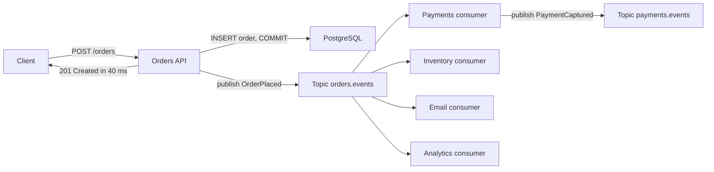
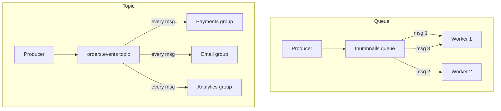

# Part 31 — Messaging: Queues, Topics, Kafka, RabbitMQ and SQS

## 31.1 Why asynchronous messaging exists

Every backend starts synchronous. A request comes in, the handler does everything it needs to do, and a response goes out. That model is simple and it works until the "everything" grows: `POST /orders` must charge the card, reserve stock, send an email, notify the warehouse, update analytics, and refresh the recommendation model. Each of those is a network call that can be slow, can fail, and has nothing to do with whether the customer's order was accepted. Messaging is how we take "the order was placed" and let the rest of the system react to it on its own time, at its own pace, with its own retries.

This part teaches the engineering under queues and topics first, then goes deep on the three brokers you will actually meet (Kafka, RabbitMQ, SQS), then spends most of its length on the thing that decides whether your system is correct: what happens when a message is delivered twice.

### 31.1.1 The four reasons to go asynchronous

#### Concept

Asynchronous messaging means a producer writes a message to a broker and moves on; a consumer reads it later. The producer does not wait for the consumer, does not know whether the consumer exists, and does not fail because the consumer failed.

#### Why does it exist?

Four distinct engineering problems, each solved by the same mechanism:

1. **Decoupling.** The order service should not import the email service's client, know its URL, or break when it deploys. With a topic in between, the order service knows only the shape of `OrderPlaced`. Consumers can be added (a fraud check next quarter) without touching the producer.
2. **Buffering bursts.** A flash sale produces 5,000 orders per minute for ten minutes. The warehouse system handles 500 per minute. Without a queue the warehouse call times out and orders fail. With a queue, orders are accepted instantly, the queue grows to 45,000 messages, and the warehouse drains it over ninety minutes. The queue is a shock absorber.
3. **Retry ownership.** If the email provider is down, who retries? In a synchronous design, the order handler, which means the customer waits, or the retry is lost when the handler returns. With a queue, the consumer retries with backoff for as long as it takes, and the order was already accepted.
4. **Fan-out.** One event, five interested parties. Synchronous fan-out means five calls in the handler and five ways to fail. A topic delivers the same message to each subscriber independently.

#### Mental model

Imagine a restaurant kitchen. The waiter (API handler) does not cook. They write the order on a ticket, clip it to the rail (the queue), and go back to the dining room. Cooks (consumers) pull tickets in order. If the grill is backed up, tickets wait on the rail; nobody stops taking orders. If a cook drops a plate, they remake it from the ticket; the waiter is not involved. A copy of the ticket also goes to the cashier and the inventory clerk (fan-out). The rail is the broker; the ticket is the message; the fact that the waiter never waits for the cook is asynchrony.

#### How it works



1. The API validates the request and writes the order to PostgreSQL. This is the only thing the customer is waiting for.
2. The API publishes `OrderPlaced` to a topic. (How to do that without losing or duplicating the event is the outbox pattern; see 31.11 and Part 33 — Distributed Transactions: Sagas, Outbox, Inbox and Idempotency.)
3. The API responds. Total time: one database transaction plus one publish, about 40 ms.
4. Each consumer group reads the event independently. Payments captures the card and publishes its own event. Inventory reserves stock. Email sends a confirmation. Analytics records the sale. If email is down for an hour, three of the four still happen, and email catches up later.

#### Practical example

Before messaging, the same `POST /orders` handler at a food-delivery company called payment (300 ms), the restaurant's tablet API (200 ms, 2 percent failure rate), a push notification service (150 ms) and an analytics HTTP endpoint (100 ms) in sequence. p50 was 800 ms, p99 was 4 seconds when the tablet API was slow, and 2 percent of orders failed because the tablet API failed after the card had been charged. After messaging, the handler writes the order and the outbox row in one transaction and responds in 35 ms; the tablet notification is a consumer with a retry policy; the failure rate on order placement dropped to under 0.01 percent; and the charged-but-failed case disappeared because the payment consumer is idempotent and the tablet consumer retries independently.

#### How a Senior Backend Engineer thinks about this

Asynchrony is not free. You trade a simple request-response for eventual consistency (the email arrives a second or a minute later), for a second infrastructure component to run, and for the duplicate-delivery problem that fills the second half of this part. A senior asks: does the caller need the result now? If yes (a price quote, a login), stay synchronous. If the caller needs only to know the request was accepted (an order, an upload, a report), go asynchronous. They also refuse to introduce a broker for one producer and one consumer in the same process; `@nestjs/event-emitter` or a BullMQ queue on the Redis they already run is enough until there is a second service.

## 31.2 Core concepts

The vocabulary in this section is shared across every broker. Learn it once and the differences between Kafka, RabbitMQ and SQS become configuration details.

### 31.2.1 Queue versus topic

#### Concept

A **queue** delivers each message to exactly one of its consumers. Many workers read the same queue, and each message is processed once (in principle). This is work distribution: "someone, generate this thumbnail".

A **topic** delivers each message to every subscriber. Each subscriber (or subscriber group) gets its own copy. This is publish/subscribe: "everyone who cares, an order was placed".

#### Mental model

A queue is the ticket rail in the kitchen: one cook takes each ticket. A topic is the announcement over the PA: everyone hears it, and each department decides what to do.

#### How it works



In Kafka, a topic with consumer groups gives both: within a group, partitions are split among members (queue behaviour); across groups, every group sees every message (topic behaviour). In RabbitMQ, an exchange fans out to queues (topic behaviour) and each queue is consumed competitively (queue behaviour). In AWS, SNS is the topic and SQS is the queue, and you wire them together. Every broker is these two ideas composed.

### 31.2.2 Event, command and message

#### Concept

A **message** is the envelope: bytes plus metadata that a broker moves from producer to consumer. What the bytes mean is up to you, and the two meanings that matter are:

- An **event** states that something happened: `OrderPlaced`, `PaymentCaptured`, `StockDepleted`. Past tense. The producer does not know or care who listens. Events go on topics.
- A **command** asks a specific party to do something: `ReserveStock`, `SendEmail`, `GenerateInvoice`. Imperative. The producer expects exactly one handler to act. Commands go on queues.

#### Why does it exist?

The distinction decides ownership. An event's producer owns the fact; consumers own their reactions. A command's sender owns the intent; the handler owns the execution and its failure. Mixing them causes design rot: an "event" called `SendWelcomeEmail` published by the user service means the user service has decided what email should do, which is coupling wearing an event costume.

#### Practical example

The order service publishes `OrderPlaced` (event). The inventory service consumes it and, inside its own logic, decides to enqueue `ReserveStock` (command) to its own worker queue, then publishes `StockReserved` or `StockReservationFailed` (events). The order service consumes those to move the order to `confirmed` or `cancelled`. Every arrow has an owner.

Naming rule: events are `Noun` + past-tense `Verb` (`OrderPlaced`); commands are `Verb` + `Noun` (`ReserveStock`). Topic names are dotted, lowercase, owned by the producer: `orders.events`, `payments.events`. Queue names say who consumes and why: `inventory.reserve-stock`.

### 31.2.3 Producer, consumer, broker, partition, consumer group, offset

#### Concept

- **Producer**: the code that writes messages. It chooses the topic, the key and the payload.
- **Broker**: the server that stores messages and hands them to consumers. Kafka brokers, RabbitMQ nodes, the SQS service.
- **Consumer**: the code that reads and processes messages.
- **Partition**: a topic split into independent, ordered logs. It is the unit of parallelism (one consumer per partition at a time within a group) and the unit of ordering (messages in one partition are read in the order written; across partitions there is no order).
- **Consumer group**: a named set of consumers that share a topic's partitions between them. The broker tracks the group's position. Two groups on one topic each get every message.
- **Offset**: a consumer's position in a partition, an integer that increases with each message. Committing an offset tells the broker "I have finished everything before this".

#### Mental model

Imagine a library of logbooks (partitions) for one subject (topic). Each logbook is written front to back and never edited. A reading club (consumer group) assigns one member per logbook; each member keeps a bookmark (offset). Two clubs read the same logbooks independently with their own bookmarks. If a member leaves, their logbooks and bookmarks are handed to someone else in the club.

#### How it works

```text
topic: orders.events   (3 partitions, key = orderId hashed to partition)

partition 0: [ 0 | 1 | 2 | 3 | 4 | 5 | 6 ]   <- group "email" committed offset 5
partition 1: [ 0 | 1 | 2 | 3 ]               <- group "email" committed offset 4 (caught up)
partition 2: [ 0 | 1 | 2 | 3 | 4 | 5 | 6 | 7 | 8 ]   <- group "email" committed offset 2 (lag 7)

group "email" has 2 consumers: consumer A owns partitions 0 and 1, consumer B owns partition 2
group "analytics" has 1 consumer owning all three, with its own offsets
```

The **commit semantics** decide correctness:

- **Auto-commit** (the default in most clients): the client commits the highest offset it has *fetched* on a timer (every 5 seconds in the Java client, configurable in kafkajs). If the process crashes after the commit but before the handler finished, those messages are lost (at-most-once). If it crashes after the handler finished but before the commit, they are reprocessed (at-least-once). Auto-commit gives you one or the other depending on timing, which is the worst of both.
- **Manual commit after processing**: the handler finishes (including the database write), then the offset is committed. A crash in between means reprocessing, never loss. This is at-least-once and it is what you want, paired with an idempotent handler.
- **Manual commit before processing**: at-most-once. Acceptable only for data you can afford to lose (metrics samples).

### 31.2.4 Ordering

#### Concept

Ordering is the promise that consumers see messages in the sequence they were produced. Brokers give it only within a partition (Kafka), a queue with a single consumer (RabbitMQ), or a message group (SQS FIFO). There is no global ordering across partitions, and there is no ordering once you introduce retries or parallel consumers.

#### Why does it exist as a problem?

`OrderPlaced` then `OrderCancelled` for the same order must be processed in that order, or the consumer cancels nothing and then creates a live order. Global ordering across all orders is neither needed nor possible at scale. Per-order ordering is both, and it is achieved by keying: every message about order 123 uses key `123`, hashes to the same partition, and is read by the same consumer in sequence.

#### How it works

1. The producer sets the key (`orderId`, `userId`, `accountId`: the entity whose history must be sequential).
2. The broker hashes the key to a partition. Same key, same partition, always (as long as the partition count does not change).
3. One consumer in the group owns that partition and reads it in order.
4. Ordering breaks if: the consumer processes messages from one partition concurrently; a failed message is retried later while newer ones proceed (31.13); the partition count changes (keys re-hash); or the producer retries create an out-of-order duplicate (fixed by the idempotent producer, 31.3).

The design consequence: a consumer must tolerate out-of-order arrival for anything that goes through a retry path. Version numbers on the entity (`orderVersion: 7`) let the consumer ignore an event older than what it has already applied.

### 31.2.5 Retry

#### Concept

A retry re-attempts a failed message. Where the retry happens (in the consumer's memory, back on the same queue, on a separate retry queue with a delay) and how many times decide whether a failing message blocks its neighbours and whether a downstream outage becomes a retry storm.

#### How it works

- **Immediate in-process retry** (2 to 3 attempts, tens of milliseconds apart): for blips such as a connection reset. Cheap; preserves ordering because nothing else moves meanwhile.
- **Delayed retry** (seconds to minutes with exponential backoff and jitter): for downstream outages. In RabbitMQ, a retry queue with a TTL and a dead-letter exchange back to the main queue (31.4). In Kafka, retry topics (`orders.retry.1m`, `orders.retry.10m`) each consumed with a delay. In SQS, the visibility timeout is the delay.
- **Blocking retry** (pause the partition and keep retrying the same message): preserves order at the cost of head-of-line blocking. Right for strictly ordered streams (a ledger), wrong for independent tasks.
- **Attempt counting** lives in a header (`x-retry-count`, `x-death` in RabbitMQ, `ApproximateReceiveCount` in SQS). After N attempts the message goes to the dead-letter queue.

### 31.2.6 Dead-letter queue

#### Concept

A dead-letter queue (DLQ) is where messages go when they cannot be processed after the retry budget is exhausted, or when they fail in a way retries cannot fix (malformed payload, unknown type, a business rule violation). It is a parking lot, not a graveyard: someone must look at it.

#### How it works

1. The consumer decides the message is dead (retry count exceeded, or a permanent error class).
2. It publishes the original message plus diagnostic headers (error message, stack summary, consumer name, first and last failure time, original topic and partition and offset) to `orders.events.dlq`, then acknowledges the original.
3. An alert fires when the DLQ depth exceeds zero for longer than a few minutes, or exceeds a threshold. A DLQ nobody watches is data loss with extra steps.
4. Replay tooling reads from the DLQ and republishes to the original topic after a fix is deployed. Replayed messages carry a `replayedAt` header; consumers must still be idempotent because the original may have partially succeeded.

#### NestJS example

A minimal envelope for dead-lettering that every consumer in the codebase shares, so the DLQ is uniform and replayable.

```ts
// messaging/dead-letter.service.ts
import { Injectable, Logger } from '@nestjs/common';
import { Producer } from 'kafkajs';

export interface DeadLetterMeta {
  sourceTopic: string;
  partition: number;
  offset: string;
  consumerGroup: string;
  attempts: number;
  error: string;
}

@Injectable()
export class DeadLetterService {
  private readonly logger = new Logger(DeadLetterService.name);
  constructor(private readonly producer: Producer) {}

  async park(key: string | null, value: Buffer | null, headers: Record<string, string>, meta: DeadLetterMeta): Promise<void> {
    await this.producer.send({
      topic: `${meta.sourceTopic}.dlq`,
      messages: [{
        key,
        value,
        headers: {
          ...headers,
          'x-dlq-source-topic': meta.sourceTopic,
          'x-dlq-partition': String(meta.partition),
          'x-dlq-offset': meta.offset,
          'x-dlq-consumer-group': meta.consumerGroup,
          'x-dlq-attempts': String(meta.attempts),
          'x-dlq-error': meta.error.slice(0, 1000),
          'x-dlq-parked-at': new Date().toISOString(),
        },
      }],
    });
    this.logger.error(`parked message ${meta.sourceTopic}/${meta.partition}/${meta.offset}: ${meta.error}`);
  }
}
```

#### PostgreSQL example

Many teams keep a DLQ mirror in PostgreSQL for searchability and a replay UI. The table is also where an operator marks a message as "resolved manually".

```sql
CREATE TABLE dead_letters (
  id            bigserial PRIMARY KEY,
  source_topic  text        NOT NULL,
  partition     int         NOT NULL,
  "offset"      bigint      NOT NULL,
  message_key   text,
  message_id    uuid,
  payload       jsonb       NOT NULL,
  headers       jsonb       NOT NULL,
  error         text        NOT NULL,
  attempts      int         NOT NULL,
  parked_at     timestamptz NOT NULL DEFAULT now(),
  status        text        NOT NULL DEFAULT 'parked' CHECK (status IN ('parked', 'replayed', 'discarded')),
  resolved_at   timestamptz,
  resolved_by   text,
  UNIQUE (source_topic, partition, "offset")
);
CREATE INDEX dead_letters_parked_idx ON dead_letters (status, parked_at) WHERE status = 'parked';
```

#### Production scenario

An e-commerce platform runs 40 consumer groups across 25 topics. The DLQ alert threshold is "any message parked for more than 10 minutes" in business hours, "more than 100 messages" overnight. A typical week sees 5 to 20 dead letters, almost all from one of three causes: a payload the consumer cannot parse after a producer deployed a breaking change (31.10), a downstream API that returned 4xx for a specific record (bad address for a shipping label), or a bug in a new consumer. The weekly ritual is to review the DLQ table, fix, replay and close.

#### Failure scenario

At 02:14 the on-call is paged for "inventory reservations behind by 40 minutes". The inventory consumer processes messages in order per partition. A single `ReserveStock` message for a product that was hard-deleted throws a `NotFoundException`; the consumer's retry policy is "retry forever with a 5 second delay", written by someone who wanted to be safe. Partition 3 has been stuck on that message for 40 minutes; 11,000 reservations behind it wait. The fix at 02:30: classify `NotFoundException` as permanent, dead-letter it, resume. The permanent fix: a retry policy by error type (31.13) and a maximum attempt count on everything.

#### Edge cases & failure modes

- A queue consumed by two services that both think it is theirs: each gets half the messages. Queues have one consuming service; use a topic for multiple.
- A consumer group name reused by a new, unrelated service: it inherits the old group's committed offsets and either skips or reprocesses history. Group names are owned and unique.
- A partition count increased on a live topic: keys re-hash, and events for the same order now land in two partitions with two consumers. Set the partition count with headroom at creation and treat changing it as a migration.
- A DLQ with a retention shorter than the time it takes anyone to look at it (Kafka topics default to 7 days): messages vanish silently. Set DLQ retention to 30 days or more.
- A retry topic consumed with the same group id as the main topic: the same consumer instance handles both and the delay logic breaks. Separate groups per retry tier.

#### How a Senior Backend Engineer thinks about this

The senior sees a topic as a contract with strangers: everything published is a public API of the producing team, versioned and documented. They insist on keys for anything that needs order, on manual commits after processing, on a maximum attempt count for every consumer, and on a DLQ with an owner and an alert. They ask "what happens to this message if the consumer is down for six hours?" before anything is deployed, and they refuse to run a consumer whose handler is not idempotent, because 31.8 will show them why.

#### Common mistakes

- Publishing commands to a topic with many subscribers, so three services all "send the email".
- Relying on auto-commit and discovering during an incident that messages were lost or doubled.
- No key on the producer, so events for one order arrive out of order across partitions.
- Retrying forever, blocking a partition on one bad message.
- Treating the DLQ as a log rather than a work queue for humans.

#### Interview questions

1. **Queue or topic for `OrderPlaced`, and why?** Expected: topic; several independent consumers each need every event. Follow-up: queue or topic for `GenerateInvoice`? Queue; exactly one handler.
2. **What is the ordering guarantee of Kafka, precisely?** Expected: per partition; achieved by keying; broken by concurrent processing, retries and partition count changes.
3. **What does committing an offset mean, and when should you commit?** Expected: "everything before this is done"; after processing, manually; auto-commit gives neither guarantee reliably.
4. **A consumer is stuck retrying one message. What went wrong in the design?** Expected: no maximum attempts, no error classification, no DLQ.
5. **Why must a DLQ have an alert?** Expected: unmonitored DLQ equals silent data loss; retention will eventually delete the messages.
6. **Explain event versus command to a product manager.** Expected: an event is a fact ("the order was placed"); a command is a request ("reserve this stock"). Facts have many listeners; requests have one doer.

#### Practical exercise

Design the messaging topology for a ride-booking flow: `RideRequested`, `DriverAssigned`, `RideStarted`, `RideCompleted`, `PaymentCaptured`, `ReceiptSent`. Acceptance criteria: (a) a diagram showing which are events on topics and which are commands on queues; (b) the key for each topic and the reason; (c) the consumer groups with their retry policy and DLQ; (d) a written answer to "what happens if the payment service is down for two hours", covering the customer experience and the recovery; (e) which one of these you would build without a broker if the company had one service and ten rides a day.
