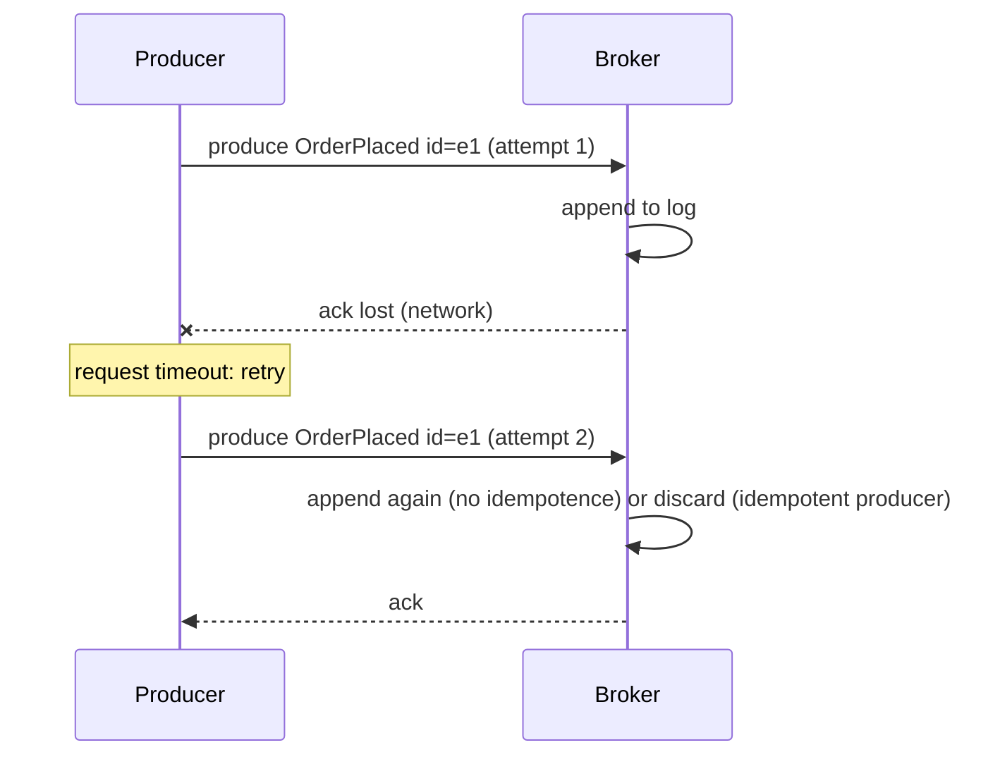
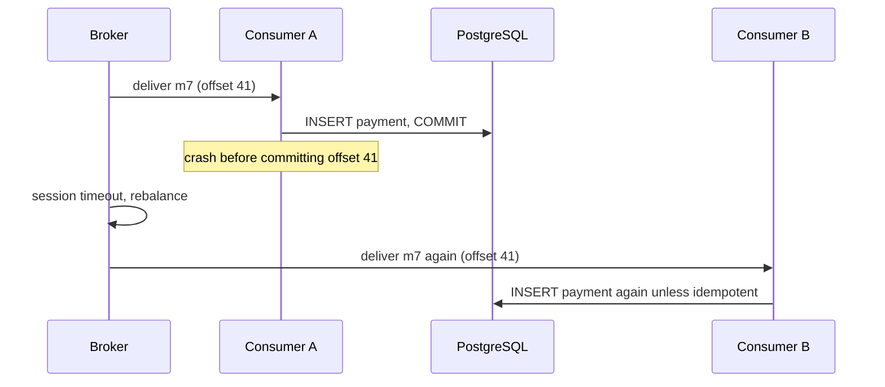
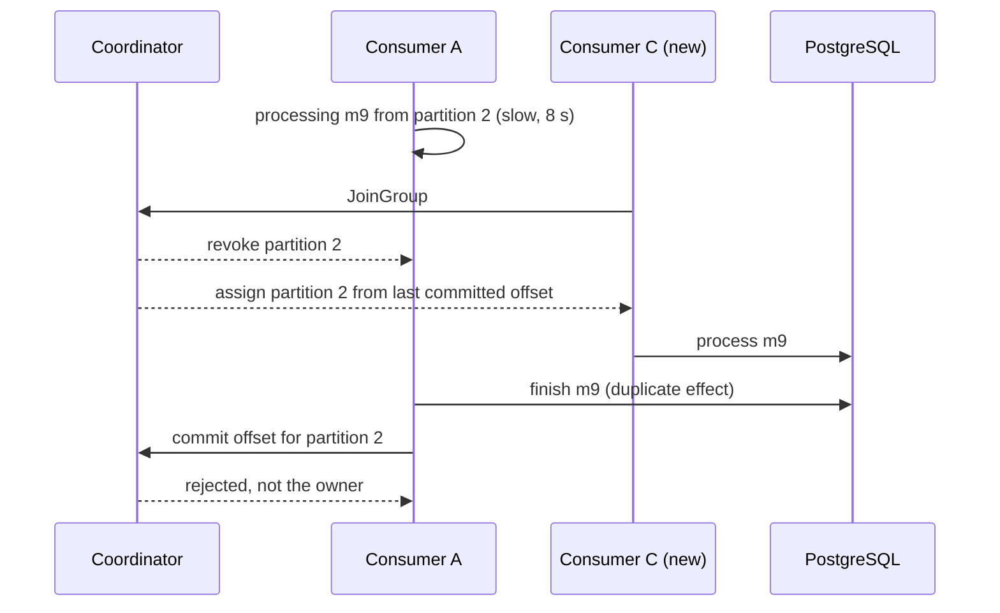
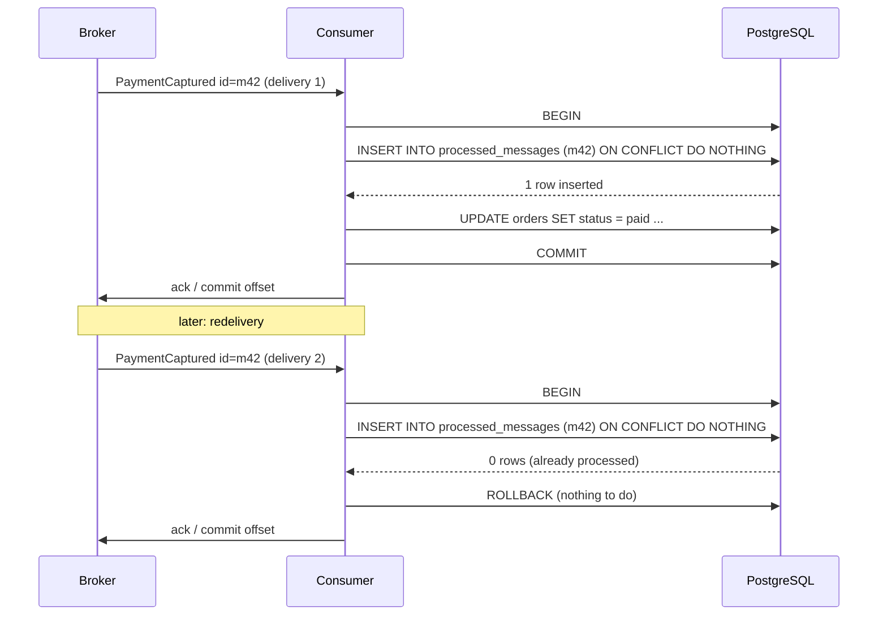

## 31.7 Delivery semantics

Everything in this section and the next two exists because of one sentence: **a message broker cannot know whether your consumer finished its work.** It can know that it sent the message, and it can know that the consumer said "done". Between those two events the consumer can crash, the network can drop the acknowledgement, or the broker can reassign the work. The semantics you get are decided by what the consumer does in that gap.

### 31.7.1 At-most-once, at-least-once, exactly-once

#### Concept

- **At-most-once**: each message is delivered zero or one times. Achieved by acknowledging (committing the offset, deleting from SQS, acking in RabbitMQ) *before* processing. A crash after the ack loses the message.
- **At-least-once**: each message is delivered one or more times. Achieved by acknowledging *after* processing. A crash after processing but before the ack causes redelivery.
- **Exactly-once**: each message's *effect* happens once. No broker can deliver this across arbitrary systems, because delivery and effect happen in different places. It is achievable in narrow scopes and simulated everywhere else by making duplicates harmless.

#### Why does it exist as a distinction?

Because the default of most clients, auto-commit on a timer, gives you neither reliably: it commits whatever was fetched, so a crash can lose messages fetched but not processed, or redeliver messages processed but not yet committed. Choosing at-least-once deliberately, and then engineering the consumer to tolerate duplicates, is the only combination that is both correct and achievable.

#### Mental model

Imagine a postal worker delivering signed-for parcels. At-most-once: they leave the parcel on the step and mark it delivered; if it is stolen, it is gone. At-least-once: they will not mark it delivered until you sign; if you sign but the pen fails, they come back tomorrow with the same parcel. Exactly-once: you would need the parcel and the signature to be one physical act, which is only possible when the parcel and the signature book live in the same place.

### 31.7.2 What Kafka's exactly-once actually covers

#### How it works

Kafka's exactly-once semantics (EOS) combine three mechanisms:

1. The **idempotent producer** (31.3.3) removes duplicates from producer retries within a partition.
2. **Transactions** let a producer write to several partitions and commit the consumer group's offsets *in the same atomic unit* (`sendOffsetsToTransaction` in Java; `transaction.sendOffsets` in kafkajs). Either the output records and the offset commit all become visible, or none do.
3. **`isolation.level=read_committed`** on downstream consumers hides records from uncommitted or aborted transactions.

Together they make a **read-process-write loop that stays inside Kafka** (consume from topic A, produce to topic B, commit offsets) exactly-once: a crash mid-loop aborts the transaction, the output is invisible, and the offsets are not advanced, so the retry produces the output once. This is what stream processors (Kafka Streams, Flink with Kafka sinks) rely on.

What EOS does not cover is anything outside Kafka. If the "process" step writes to PostgreSQL, calls Stripe, or sends an email, the Kafka transaction knows nothing about those. The database write can commit and the Kafka transaction can abort; the email can be sent and the offset can fail to commit. The phrase "exactly-once with Kafka" in a design that touches a database and an email provider is a myth. The senior phrase is **effectively-once**: at-least-once delivery plus an idempotent consumer, so that duplicates change nothing.

```ts
// kafkajs transactional read-process-write, Kafka to Kafka only
const producer = kafka.producer({ transactionalId: 'enrich-orders-1', idempotent: true, maxInFlightRequests: 1 });
await consumer.run({
  autoCommit: false,
  eachBatch: async ({ batch }) => {
    const tx = await producer.transaction();
    try {
      for (const m of batch.messages) {
        await tx.send({ topic: 'orders.enriched', messages: [{ key: m.key, value: enrich(m.value) }] });
      }
      await tx.sendOffsets({
        consumerGroupId: 'enrich-orders',
        topics: [{ topic: batch.topic, partitions: [{ partition: batch.partition, offset: (Number(batch.lastOffset()) + 1).toString() }] }],
      });
      await tx.commit();       // output and offsets become visible together
    } catch (err) {
      await tx.abort();        // neither is visible; the batch will be re-read
      throw err;
    }
  },
});
```

## 31.8 Why duplicate messages are normal

A team that has never seen a duplicate has not looked. Every broker in this part delivers duplicates under ordinary conditions. This section shows the four paths with sequence diagrams so that when you see a double email in production you recognize which one you are looking at.

### 31.8.1 Producer retry after a timeout

#### How it works



The producer cannot distinguish "the broker never got it" from "the broker got it and the ack was lost", so it must retry, and retrying may duplicate. Kafka's idempotent producer and SQS FIFO's deduplication id close this path at the broker. RabbitMQ has no producer-side dedup; the consumer's idempotency handles it. An application-level re-send after a process crash (the outbox relay publishes, crashes before marking the row as sent, republishes on restart) is the same path one level up, and no broker feature closes it.

### 31.8.2 Consumer crash after processing, before commit

#### How it works



This is the canonical at-least-once duplicate, and it is the one you are choosing when you commit after processing. The window is the time between the business write and the offset commit, plus the rebalance. It cannot be closed by ordering the two operations differently; commit-first turns it into message loss. It is closed by making the second `INSERT` a no-op (31.9).

### 31.8.3 Rebalance while a message is in flight

#### How it works



Nothing crashed. A pod started, the group rebalanced, and the same message was processed by two consumers concurrently. The old owner's commit fails, which is correct, but its side effect already happened. Cooperative rebalancing and static membership reduce how often this occurs; only idempotency makes it harmless.

### 31.8.4 Redelivery after the SQS visibility timeout

The SQS sequence in 31.5.2 is the same path with different names: the lease expired while the consumer was still working, another consumer received the message, both processed it. RabbitMQ has an equivalent: a consumer's connection drops (a network blip, a heartbeat missed during a GC pause), the broker requeues its unacked messages, and the consumer, unaware, finishes processing them.

### 31.8.5 The senior conclusion

Every path above has the same shape: the effect happened, the acknowledgement did not, the system redelivered. There is no ordering of operations, no broker feature, and no timeout tuning that removes all four paths. There is exactly one design that makes all four harmless: the consumer must produce the same end state whether it sees a message once or five times. That is the next section.

## 31.9 Idempotent consumers

### 31.9.1 Idempotency by dedup table in PostgreSQL

#### Concept

An idempotent consumer records which message ids it has processed, in the same database transaction as the business write. On redelivery, the record already exists, the transaction does nothing, and the consumer acknowledges. Because the dedup record and the business effect commit atomically, there is no window where one exists without the other.

#### Why does it exist?

This is the only mechanism that closes every duplicate path from 31.8 with no timing assumptions. It requires that the message carries a stable, unique id assigned by the producer (31.10), and that the consumer's side effect is in the same database as the dedup table. It is also the receiving half of the inbox pattern; see Part 33 — Distributed Transactions: Sagas, Outbox, Inbox and Idempotency for the full treatment, including deferring the actual processing to a worker that reads the inbox.

#### Mental model

Imagine a bouncer with a guest list who stamps each guest's hand as they enter. A guest who leaves and comes back shows the stamp; the bouncer waves them through without counting them twice. The stamp and the count are one motion. If the stamp were applied at the door but the count kept in another building, the two could disagree.

#### How it works



1. Begin a transaction.
2. `INSERT INTO processed_messages (message_id, consumer) VALUES ($1, $2) ON CONFLICT DO NOTHING`. If zero rows were inserted, the message has been processed: commit or roll back the empty transaction, acknowledge, return.
3. Perform the business write.
4. Commit. The dedup row and the business change are durable together.
5. Acknowledge to the broker. If the process dies before this step, the redelivery hits step 2 and stops.

The row lock taken by the `INSERT` also serializes two consumers processing the same message concurrently (the rebalance path): the second blocks on the first's uncommitted row and, after the first commits, sees the conflict.

#### PostgreSQL example

```sql
CREATE TABLE processed_messages (
  message_id   uuid        NOT NULL,
  consumer     text        NOT NULL,        -- one consumer group may see the same id as another; scope per consumer
  processed_at timestamptz NOT NULL DEFAULT now(),
  PRIMARY KEY (consumer, message_id)
);

-- Retention: messages older than the broker's retention cannot be redelivered; prune beyond that.
-- Run nightly; partition by month if volume is high.
DELETE FROM processed_messages WHERE processed_at < now() - interval '14 days';
```

```sql
-- The consumer transaction, as executed
BEGIN;
INSERT INTO processed_messages (consumer, message_id)
VALUES ('orders-payment-status', 'b1a7c9e2-3d4f-4a5b-9c6d-7e8f9a0b1c2d')
ON CONFLICT DO NOTHING;              -- returns "INSERT 0 0" on a duplicate
UPDATE orders SET status = 'paid', paid_at = '2026-09-06T10:15:02Z', version = version + 1
 WHERE id = '7c9e6679-7425-40de-944b-e07fc1f90ae7' AND status = 'pending_payment';
COMMIT;
```

#### NestJS example

A reusable wrapper so no consumer forgets the pattern.

```ts
// messaging/idempotent-handler.ts
import { Injectable, Logger } from '@nestjs/common';
import { InjectDataSource } from '@nestjs/typeorm';
import { DataSource, EntityManager } from 'typeorm';

@Injectable()
export class IdempotentHandler {
  private readonly logger = new Logger(IdempotentHandler.name);
  constructor(@InjectDataSource() private readonly db: DataSource) {}

  // Runs work(manager) exactly once per (consumer, messageId). Returns false if it was a duplicate.
  async once(consumer: string, messageId: string, work: (manager: EntityManager) => Promise<void>): Promise<boolean> {
    return this.db.transaction(async (manager) => {
      const result: { rowCount?: number } | unknown[] = await manager.query(
        `INSERT INTO processed_messages (consumer, message_id) VALUES ($1, $2) ON CONFLICT DO NOTHING RETURNING message_id`,
        [consumer, messageId],
      );
      const inserted = Array.isArray(result) ? result.length : (result.rowCount ?? 0);
      if (inserted === 0) {
        this.logger.debug(`duplicate ${messageId} for ${consumer}; skipping`);
        return false;
      }
      await work(manager);                 // same transaction, same connection
      return true;
    });
  }
}
```

```ts
// orders/payment-events.consumer.ts (Kafka transport handler using it)
@EventPattern('payments.events')
async onPaymentEvent(@Payload() env: Envelope<PaymentCaptured>, @Ctx() ctx: KafkaContext): Promise<void> {
  if (env.type !== 'PaymentCaptured') { await this.commit(ctx); return; }
  await this.idempotent.once('orders-payment-status', env.id, async (manager) => {
    await manager.createQueryBuilder().update(Order)
      .set({ status: 'paid', paidAt: new Date(env.occurredAt), version: () => 'version + 1' })
      .where('id = :id AND status = :status', { id: env.payload.orderId, status: 'pending_payment' })
      .execute();
  });
  await this.commit(ctx);
}
```

#### Sequelize example

```ts
await this.sequelize.transaction(async (t) => {
  const [, inserted] = await this.sequelize.query(
    `INSERT INTO processed_messages (consumer, message_id) VALUES (:consumer, :id) ON CONFLICT DO NOTHING`,
    { replacements: { consumer: 'orders-payment-status', id: env.id }, transaction: t, type: QueryTypes.INSERT },
  );
  if (!inserted) return;               // duplicate: the transaction commits empty
  await Order.update(
    { status: 'paid', paidAt: new Date(env.occurredAt) },
    { where: { id: env.payload.orderId, status: 'pending_payment' }, transaction: t },
  );
});
```

### 31.9.2 Redis `SET NX` dedup and its window

#### Concept

`SET dedup:{consumer}:{messageId} 1 NX PX ttl` claims a message id in Redis. If the claim fails, skip. It is fast, needs no database, and it is not atomic with the business write.

#### How it works

The gaps:

1. **Claim, then crash before the write.** The id is claimed; the redelivery is skipped; the effect never happens. Message lost. Mitigation: delete the claim on failure, but a hard crash cannot delete anything.
2. **Write, then Redis is unavailable for the claim.** The effect happens; the claim fails; the redelivery happens again.
3. **TTL shorter than the redelivery window.** A DLQ replay a week later is not detected.
4. **Redis failover** loses recent claims (asynchronous replication).

Use it where a duplicate is a minor cost and the effect is not in a database you control: sending a push notification, calling a third-party webhook, emitting a metric. Set the TTL to at least the broker's retention. Prefer the PostgreSQL table for anything that changes money, stock or status.

```ts
async claim(consumer: string, messageId: string, ttlMs = 7 * 86_400_000): Promise<boolean> {
  try {
    return (await this.redis.set(`dedup:${consumer}:${messageId}`, '1', 'PX', ttlMs, 'NX')) === 'OK';
  } catch {
    return true;   // Redis down: process anyway (at-least-once) rather than drop (at-most-once); log it
  }
}
```

### 31.9.3 Natural idempotency

#### Concept

Some operations are idempotent by construction and need no dedup record: setting a value (not incrementing it), an upsert keyed by a natural id, a conditional update guarded by a version or a state.

#### How it works

- **Upsert**: `INSERT INTO shipments (order_id, carrier, tracking) VALUES (...) ON CONFLICT (order_id) DO UPDATE SET carrier = EXCLUDED.carrier, tracking = EXCLUDED.tracking`. Processing twice writes the same row twice.
- **Conditional state transition**: `UPDATE orders SET status = 'shipped' WHERE id = $1 AND status = 'paid'`. The second attempt updates zero rows.
- **Version guard**: the event carries `orderVersion: 7`; `UPDATE orders SET ... WHERE id = $1 AND version < 7`. This also handles out-of-order arrival: an older event never overwrites a newer state.
- **Unique constraint as the guard**: `INSERT INTO payments (order_id, provider_charge_id)` with a unique index on `provider_charge_id`; a duplicate raises a unique violation that the consumer catches and treats as success.

Not naturally idempotent, and therefore needing a dedup record: `UPDATE wallets SET balance = balance + 500`, `INSERT INTO order_items` without a unique key, sending an email, calling `POST /charges` at a payment provider without an idempotency key.

#### Production scenario

A payments consumer processes 400 `PaymentCaptured` events per second with the PostgreSQL dedup table. Cost per message: one `INSERT ... ON CONFLICT` (0.3 ms) inside a transaction that was happening anyway. The `processed_messages` table grows by 35 million rows per day; it is partitioned by day and old partitions are dropped after 14 days (longer than the 7 day topic retention plus DLQ replay window). Measured duplicate rate in normal operation: about 0.02 percent, almost all from deploys. During a broker incident with repeated rebalances it briefly reached 3 percent, and nothing downstream noticed, which is the point.

#### Failure scenario

At 02:14 a customer emails: "I was charged twice." The consumer that calls the payment provider used Redis `SET NX` dedup with a 1 hour TTL. A Kafka partition was replayed 90 minutes later during an incident (an operator reset offsets by 2 hours to recover from a different bug). Every charge in the window was re-sent to the provider; the Redis claims had expired. Two fixes: the provider call now carries an idempotency key (`Idempotency-Key: charge:{orderId}`), which the provider honours for 24 hours, and the dedup moved to PostgreSQL with 30 day retention. The replay was legitimate; the design was not replay-safe.

#### Edge cases & failure modes

- Message id missing or not unique (a producer reuses ids per batch): dedup silently drops real messages. Validate the envelope and reject messages without an id to the DLQ.
- Two consumer groups sharing one dedup table without the `consumer` column: the second group sees "already processed".
- Dedup table pruned before broker retention plus replay window: late redeliveries slip through.
- The business write and the dedup insert in different databases (orders in PostgreSQL, dedup in DynamoDB): the atomicity is gone; this is the Redis case with a different name.
- A dedup insert inside a transaction that later rolls back for an unrelated reason: the row is gone too, which is correct; the redelivery will retry the whole unit.
- Idempotent consumer, non-idempotent downstream: the consumer skips the duplicate, but the first attempt called the email provider and then crashed before commit; the retry sends the email again. Every external side effect needs its own idempotency key passed to the provider.

#### How a Senior Backend Engineer thinks about this

The senior's first question for any consumer is "what happens if this runs twice?" and the second is "what happens if it runs twice concurrently?" They put the dedup row and the business write in one transaction, they pass idempotency keys to every external provider, they set dedup retention from the replay window rather than from table size, and they test the duplicate path explicitly. They explain it to product as: "the system will occasionally receive the same event twice; we have made sure that changes nothing you can see."

#### Common mistakes

- Dedup in application memory (a `Set` of seen ids) that vanishes on restart and is per pod.
- Committing the offset in a `finally` block regardless of success, which converts failures into loss.
- Believing "exactly-once" in the client docs means the email will not be sent twice.
- Incrementing counters from events (`views = views + 1`) without dedup, then wondering why analytics drift upward by 0.5 percent a week.

#### Interview questions

1. **Why can no broker deliver exactly-once to your database?** Expected: the effect and the acknowledgement are in different systems; a crash between them is always possible; only an idempotent consumer makes redelivery harmless.
2. **Show the four duplicate paths.** Expected: producer retry, consumer crash before commit, rebalance in flight, visibility timeout or connection loss redelivery.
3. **Why must the dedup insert be in the same transaction as the business write?** Expected: atomicity; otherwise there is a window where one exists without the other, producing loss or duplication.
4. **When is Redis `SET NX` acceptable for dedup?** Expected: non-critical side effects, long TTL, accepting the crash and failover windows.
5. **An event arrives out of order after a retry. How does the consumer cope?** Expected: version guards or conditional state transitions; ignore events older than current state.
6. **What does Kafka EOS cover?** Expected: Kafka-to-Kafka read-process-write with transactions and read_committed; not external systems.

#### Practical exercise

Build a `PaymentCaptured` consumer with the PostgreSQL dedup table and a chaos test. Acceptance criteria: (a) a Jest test using Testcontainers (Kafka and PostgreSQL) publishes 1,000 events and, using a hook that kills the consumer process after a random 5 percent of business writes but before the offset commit, proves that `orders.paid_at` is set exactly once per order and `processed_messages` has exactly 1,000 rows; (b) a second test runs two consumer instances in the same group and forces a rebalance mid-run, with the same assertions; (c) a third test replays the topic from offset zero and asserts zero additional effects; (d) the consumer rejects an envelope without an `id` to the DLQ with a clear reason header.
