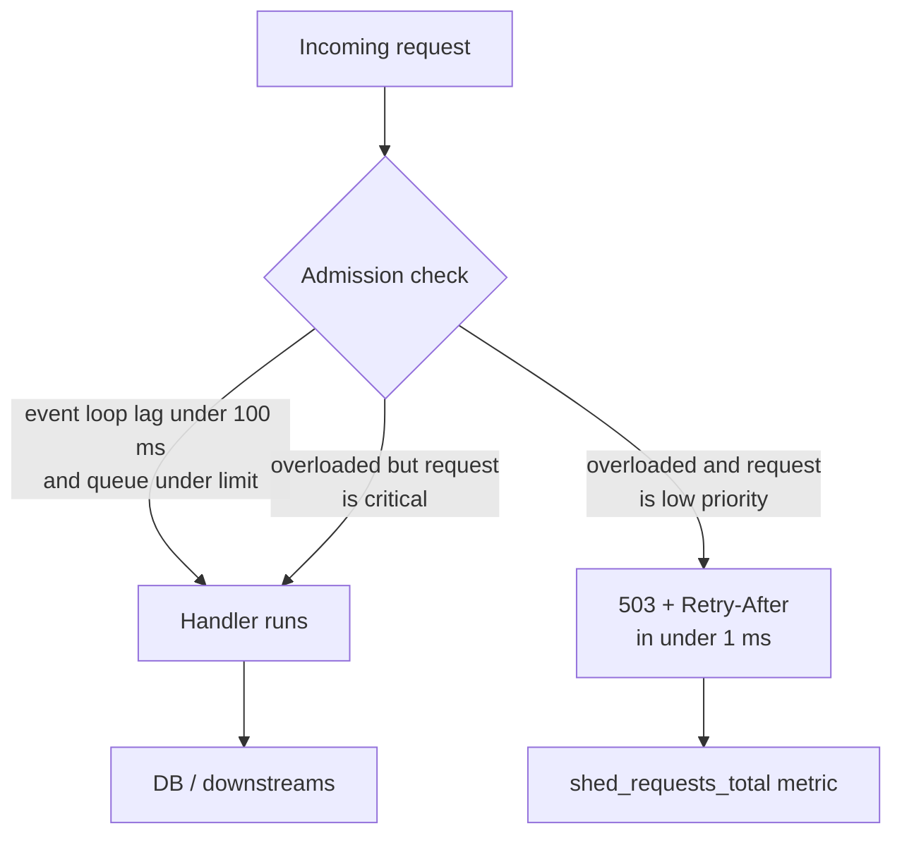

## 31.7 Rate limiting

#### Concept

Rate limiting caps how many operations a caller may perform in a time window. It appears in two directions. **Inbound** rate limiting protects *you* from clients (abusive, buggy, or simply enthusiastic). **Outbound** (client-side) rate limiting protects *downstreams* from you, and protects you from being cut off by a third party whose contract says "100 requests per second".

Part 15 — API Design (REST first) covers token bucket and sliding window in detail; here we recap just enough to place rate limiting in the reliability toolbox.

#### Why does it exist?

Capacity is finite. A NestJS pod can serve maybe 1,500 simple requests per second; a PostgreSQL primary maybe 20,000 small queries per second; a payment gateway contract may allow 50 charges per second. Without a limit, one client's loop, one misconfigured retry, or one scraper decides how the rest of your capacity is spent. Rate limiting makes the decision yours, and makes it *before* the expensive work happens.

#### Mental model

Imagine a nightclub with a bouncer counting people in. The room holds 300; the bouncer lets in 300 and then admits one for each person who leaves. Nobody inside notices the queue outside. The alternative, letting everyone in, is a fire hazard for the people already inside and a worse night for everyone. Rate limiting is the bouncer, and the point is that the people *inside* keep having a good time.

#### How it works

- **Token bucket**: a bucket of capacity `B` refills at `R` tokens per second; each request takes one token; empty bucket means reject. Allows bursts up to `B`, sustained rate `R`. This is what most APIs want.
- **Sliding window log/counter**: count requests in the last `W` seconds; reject above `N`. Smoother than fixed windows (no double-burst at window edges), a little more memory.
- **Where the counter lives**: in-process (per pod, fast, inconsistent across pods) or in Redis (shared, one `INCR` + `EXPIRE` or a Lua script per request, roughly 0.3–1 ms). Use in-process limits for coarse self-protection and Redis for per-user quotas that must be consistent.
- **What to key on**: user id or API key for authenticated traffic, IP as a fallback, tenant for multi-tenant, route for expensive endpoints.
- **What to return**: `429 Too Many Requests` with `Retry-After` and `X-RateLimit-Remaining`, so well-behaved clients back off correctly (31.4).

#### Practical example

An e-commerce API applies three inbound limits: 600 requests per minute per user for general endpoints, 10 per minute per user for `POST /orders`, and 5 per minute per IP for `POST /auth/login`. Outbound, it limits calls to the SMS provider to 20 per second globally (their contract) using a Redis-backed limiter shared across pods, and calls to the tax SaaS to 50 per second.

#### NestJS example

Inbound, with `@nestjs/throttler` and a Redis storage so the count is shared across pods:

```ts
import { Module } from '@nestjs/common';
import { APP_GUARD } from '@nestjs/core';
import { ThrottlerModule, ThrottlerGuard, seconds } from '@nestjs/throttler';
import { ThrottlerStorageRedisService } from '@nest-lab/throttler-storage-redis';
import Redis from 'ioredis';

@Module({
  imports: [
    ThrottlerModule.forRoot({
      throttlers: [
        { name: 'default', ttl: seconds(60), limit: 600 },
        { name: 'strict',  ttl: seconds(60), limit: 10 },
      ],
      storage: new ThrottlerStorageRedisService(new Redis(process.env.REDIS_URL!)),
    }),
  ],
  providers: [{ provide: APP_GUARD, useClass: ThrottlerGuard }],
})
export class AppModule {}

// orders.controller.ts
@Controller('orders')
export class OrdersController {
  @Post()
  @Throttle({ strict: { limit: 10, ttl: seconds(60) } })   // override for this route
  create(@Body() dto: CreateOrderDto) { /* ... */ }
}
```

`ThrottlerGuard` keys on IP by default; override `getTracker(req)` in a subclass to key on the authenticated user id, which is what you want behind a load balancer where many users share an egress IP. When the limit is hit the guard throws `ThrottlerException` (HTTP `429`) and sets `Retry-After`.

Outbound, a client-side limiter honouring a third-party contract, shared across pods through Redis:

```ts
import Bottleneck from 'bottleneck';

@Injectable()
export class SmsClient {
  // 20 per second across ALL pods: Bottleneck's Redis datastore coordinates the reservoir.
  private readonly limiter = new Bottleneck({
    id: 'sms-provider',
    datastore: 'ioredis',
    clientOptions: { host: process.env.REDIS_HOST, port: 6379 },
    reservoir: 20,                       // tokens available now
    reservoirRefreshAmount: 20,          // refill to 20...
    reservoirRefreshInterval: 1_000,     // ...every second
    maxConcurrent: 10,
    highWater: 500,                      // bounded queue: beyond this, reject
    strategy: Bottleneck.strategy.OVERFLOW,
  });

  send(to: string, body: string): Promise<void> {
    return this.limiter.schedule(() => this.http.post('/messages', { to, body }));
  }
}
```

#### PostgreSQL example

Rate limiting inside PostgreSQL is not a thing you should build, but PostgreSQL gives you a related protection: per-role connection limits and `statement_timeout` (31.2), which bound the *cost* a role can impose. For per-user quotas that must survive Redis being down, some teams keep a small `api_quota` table updated with `UPDATE ... SET used = used + 1 WHERE used < quota RETURNING used`; it works, and it costs a row lock per request, so use it only for low-rate, high-value limits (e.g. 100 exports per day).

#### Production scenario

A public API gets 4,000 RPS. In-process token buckets (per pod, keyed on API key, 200 tokens, 100/s refill) reject 0.8% of traffic from two keys running unthrottled scrapers, and cost about 5 microseconds per request. Redis-backed per-user quotas for `POST /orders` cost 0.6 ms per call on the 30 RPS that reach that route. Outbound, the SMS limiter queues about 400 messages during a promotion burst and drains them over 20 s, well inside the "delivered within a minute" SLA, while never exceeding the provider's 20/s.

#### Failure scenario

A team added a Redis-backed rate limiter to every route with no fallback for Redis failures. When Redis had a 40 s failover, every request waited on a Redis `INCR` that timed out after 5 s (the client had no `commandTimeout`), then the guard threw and returned `500`. An availability control took availability to zero. Fix: `commandTimeout: 200` on the limiter's Redis client, and a **fail-open** policy for the limiter (if Redis is unreachable, allow the request and increment a `rate_limiter_fail_open_total` metric). Fail-open is the right default for a limiter guarding *capacity*; fail-closed is right for a limiter guarding *security* (login attempts).

#### Edge cases & failure modes

- **Limiter depends on Redis with no timeout** (above).
- **Keying on IP behind a NAT** rate-limits an entire office or mobile carrier.
- **Fixed windows** allow 2x bursts at the boundary; prefer token bucket or sliding window.
- **Per-pod limits multiplied by pod count**: "100/s per pod" becomes 4,000/s after a scale-out.
- **Unbounded outbound queue**: a client-side limiter with no `highWater` turns a downstream slowdown into memory growth.
- **`429` without `Retry-After`** leaves clients guessing and retrying too soon.

#### How a Senior Backend Engineer thinks about this

They separate *self-protection* limits (cheap, in-process, generous, fail-open) from *business quota* limits (Redis, exact, fail-open for capacity and fail-closed for security). They key on identity, not IP, wherever there is identity. They put outbound limiters on every third party with a contract, because being cut off by a provider is an outage nobody can fix quickly. And they make `429` responses helpful: `Retry-After`, remaining counts, and a documented policy.

#### Common mistakes

- Rate limiting *after* doing the expensive work (the guard is placed after a database call in a service method).
- Fail-closed on Redis failure for a capacity limit.
- Forgetting outbound limits and getting the company's API key revoked by a provider.

#### Interview questions

1. *Token bucket vs sliding window: how do they differ in burst behaviour and memory?* Expected: bucket allows bursts up to capacity with O(1) state; sliding window is smoother, slightly more state.
2. *Where should a rate limiter fail open and where fail closed?* Expected: capacity protection fails open; security limits (login, OTP) fail closed.
3. *How do you enforce a third party's "50 requests per second" across 30 pods?* Expected: shared limiter in Redis (reservoir) or a single outbound proxy; bounded queue; metrics.

#### Practical exercise

Add `@nestjs/throttler` with Redis storage keyed on user id to an existing API, plus a `Bottleneck` outbound limiter (20/s, Redis datastore) around a fake SMS provider. Acceptance criteria: two pods together never exceed 20 SMS calls per second under a 200 RPS burst; a user exceeding 10 `POST /orders` per minute receives `429` with `Retry-After`; stopping Redis causes the inbound limiter to fail open (requests succeed, metric increments) within 200 ms.

## 31.8 Load shedding

#### Concept

Load shedding is deliberately rejecting some requests when the system is overloaded, so that the requests you *do* accept complete within their deadline. It is rate limiting driven by *your own health* rather than by a caller's quota. The name comes from power grids: when demand exceeds supply, the grid cuts power to some neighbourhoods so it does not collapse for everyone.

#### Why does it exist?

Every server has a throughput cliff. Below capacity, latency is flat. Just above capacity, queues form: requests wait for the event loop, wait for a DB connection, wait for a socket. Latency climbs, clients time out, clients retry, load rises further, and goodput (requests that complete *usefully*, within their deadline) falls to zero even though the server is 100% busy. This is **congestion collapse**. Shedding at the door keeps the queues short, so the requests inside finish on time and goodput stays near capacity. Rejecting 10% of traffic quickly is far better than serving 100% of traffic 10 s late, because the 10 s late responses are worthless to a client that gave up at 5 s.

#### Mental model

Imagine a bakery with one oven. Orders arrive faster than loaves can be baked. Option A: take every order, tell everyone "30 minutes", and watch the queue grow to three hours while customers leave without paying for loaves that are still baking. Option B: put up a sign, "we are full, back in 15 minutes", once the queue reaches 20 minutes. Option B sells the same number of loaves and disappoints fewer people. Load shedding is the sign.

#### How it works



Signals you can shed on, cheapest first:

1. **Event-loop lag.** In Node, `perf_hooks.monitorEventLoopDelay()` gives a histogram of how late timers are firing; p99 above 50–100 ms means the loop is saturated. This is the best single overload signal for a Node process.
2. **In-flight request count** per pod, compared to a known limit.
3. **Queue depth**: pending DB pool acquisitions (`pool.waitingCount`), pending outbound calls, BullMQ queue length.
4. **Memory** (`process.memoryUsage().heapUsed` approaching the limit).
5. **Gateway-level admission control**: the load balancer or gateway drops or queues requests when the backend reports unhealthy, or based on concurrency limits per backend.

And **what** to shed: low-priority first. Classify requests (a header from the gateway, the route, or the client type): `critical` (checkout, payment webhooks, auth), `normal` (browse, search), `bulk` (analytics events, prefetching, bots). Shed `bulk` at mild overload, `normal` at severe overload, `critical` never (or only when the process is about to die).

The rejection itself must be **cheap** (no DB calls, no logging per request beyond a counter) and **informative** (`503` with `Retry-After` and a stable error code), otherwise shedding costs almost as much as serving.

#### Practical example

A ride-booking API distinguishes `POST /rides` (critical), `GET /drivers/nearby` (normal, polled every 3 s by the app), and `POST /telemetry` (bulk, sent every second by driver phones). During a stadium-exit surge the event-loop lag on the API pods hits 120 ms. Telemetry is shed first (the phones buffer and resend later); if lag stays above 200 ms, nearby-driver polls get a `503` with `Retry-After: 5` and the app shows the last known map. Ride creation keeps working throughout.

#### NestJS example

A middleware that sheds based on event-loop delay and a request priority header. It runs before routing, before guards, before any database access.

```ts
import { Injectable, NestMiddleware, Logger } from '@nestjs/common';
import { Request, Response, NextFunction } from 'express';
import { monitorEventLoopDelay, IntervalHistogram } from 'node:perf_hooks';
import { Counter } from 'prom-client';

const shed = new Counter({ name: 'shed_requests_total', help: 'requests shed', labelNames: ['priority'] });

type Priority = 'critical' | 'normal' | 'bulk';

@Injectable()
export class LoadShedMiddleware implements NestMiddleware {
  private readonly log = new Logger(LoadShedMiddleware.name);
  private readonly h: IntervalHistogram = monitorEventLoopDelay({ resolution: 20 });
  private lagMs = 0;
  private inFlight = 0;

  constructor() {
    this.h.enable();
    // Sample every 500 ms; the histogram is in nanoseconds.
    setInterval(() => { this.lagMs = this.h.percentile(99) / 1e6; this.h.reset(); }, 500).unref();
  }

  use(req: Request, res: Response, next: NextFunction) {
    const priority = (req.header('x-priority') as Priority) ?? this.classify(req);
    const limit = this.lagLimitFor(priority);

    if (this.lagMs > limit || this.inFlight > this.inFlightLimitFor(priority)) {
      shed.inc({ priority });
      res.setHeader('Retry-After', priority === 'bulk' ? '30' : '5');
      res.status(503).json({ code: 'OVERLOADED', message: 'try again shortly' });
      return;
    }

    this.inFlight++;
    res.on('finish', () => this.inFlight--);
    res.on('close', () => { if (!res.writableFinished) this.inFlight--; });
    next();
  }

  private classify(req: Request): Priority {
    if (req.path.startsWith('/rides') || req.path.startsWith('/payments')) return 'critical';
    if (req.path.startsWith('/telemetry') || req.path.startsWith('/events')) return 'bulk';
    return 'normal';
  }
  private lagLimitFor(p: Priority) { return p === 'critical' ? 500 : p === 'normal' ? 150 : 60; }
  private inFlightLimitFor(p: Priority) { return p === 'critical' ? 2_000 : p === 'normal' ? 800 : 200; }
}
```

Register it first in `AppModule` (`consumer.apply(LoadShedMiddleware).forRoutes('*')`). Note two details: the histogram is reset every sample so the reading reflects the last 500 ms, not the process lifetime; and in-flight accounting handles aborted connections via the `close` event, otherwise the counter drifts upward and the middleware sheds forever.

Also give Kubernetes a way to help: report `503` from the readiness probe (31.12) when the pod is shedding `normal` traffic for more than a few seconds, so the Service stops routing new connections to it until it recovers. Do this cautiously: if every pod is overloaded, marking them all unready removes all capacity.

#### PostgreSQL example

The database sheds on your behalf if you let it: a short `connectionTimeoutMillis` (1 s) on the pool turns "wait forever for a connection" into a fast error you can map to `503`; `lock_timeout` turns "queue behind a lock" into an error; `statement_timeout` bounds the cost of any one query. Check pool pressure explicitly before expensive work:

```ts
// pg.Pool exposes counts you can shed on.
const pool = (this.dataSource.driver as { master: Pool }).master;
if (pool.waitingCount > 10) {
  throw new ServiceUnavailableException('database busy'); // shed before joining the queue
}
```

#### Production scenario

A social-media feed API is provisioned for 12,000 RPS and receives 30,000 RPS after a celebrity post. Without shedding: p99 climbs to 20 s, the mobile app's 10 s timeout fires for most requests, users pull-to-refresh, load doubles again, and the service serves nothing useful for 15 minutes. With event-loop-lag shedding: 55% of `GET /feed` requests receive a `503` in under a millisecond, the app shows a "busy, tap to retry" banner honouring `Retry-After: 5`, and the remaining 45% complete with p99 of 350 ms. Goodput stays at roughly 12,000 RPS throughout. The incident is a graph, not a page.

#### Failure scenario

A team shipped load shedding keyed on CPU usage from `os.loadavg()`. On a 32-core node with 8 pods each pinned to one core, load average reflected the whole node and the shedder fired whenever a *neighbouring* pod was busy. Their API returned `503` for 30% of requests while its own event loop was idle. Post-mortem: shed on per-process signals (event-loop lag, own in-flight count), never on host-wide signals a container cannot interpret.

#### Edge cases & failure modes

- **Shedding the wrong traffic**: rejecting payment webhooks while serving analytics. Priority classification must be explicit and reviewed.
- **Shedding too late**: measuring lag over 60 s averages; by the time it triggers, the queue is already enormous. Use short windows (500 ms to 2 s).
- **Shedding that costs as much as serving**: logging a full request per shed, or computing priority via a database lookup.
- **All pods unready at once** because readiness reflects overload; the service loses all capacity. Prefer `503` on the request path over unready status for pure overload.
- **Oscillation**: shed at 100 ms lag, recover at 99 ms, shed again. Add hysteresis (start shedding at 100, stop at 60).
- **Clients that ignore `Retry-After`** and retry immediately, keeping you overloaded. Combine with per-client rate limits.

#### How a Senior Backend Engineer thinks about this

They know that a system without load shedding has a shedding policy anyway: it sheds *everything*, by falling over. They would rather choose. They classify traffic by business value and make the classification a first-class concept (a header set at the gateway, propagated downstream). They shed as early as possible (gateway, then middleware) and as cheaply as possible. And they load-test past capacity on purpose, because the shape of the latency curve *beyond* the cliff is what determines whether an incident lasts 2 minutes or 2 hours.

#### Common mistakes

- No shedding at all; discovering the cliff in production.
- Shedding on host metrics inside a container.
- Shedding without priorities, so critical traffic is dropped at the same rate as bulk.
- Returning `500` instead of `503` with `Retry-After`, so clients treat it as a bug and retry aggressively.

#### Interview questions

1. *What is congestion collapse and how does load shedding prevent it?* Expected: queues grow past deadlines, goodput falls to zero; shedding keeps queues short so accepted work completes.
2. *Which signal would you shed on in a Node process and why?* Expected: event-loop lag via `monitorEventLoopDelay`; it reflects the process's own saturation.
3. *How do you decide what to shed?* Expected: explicit priorities by business value; bulk first, critical never.
4. *What is the danger of using readiness probes to shed load?* Expected: all pods unready removes all capacity; use it only as a last resort and prefer request-level `503`.

#### Practical exercise

Add the `LoadShedMiddleware` to a NestJS app with a CPU-heavy route (e.g. bcrypt with cost 12). Drive it with `autocannon -c 500`. Acceptance criteria: with shedding disabled, p99 exceeds 5 s; with shedding enabled, p99 for accepted `critical` requests stays under 500 ms, `shed_requests_total{priority="bulk"}` rises first, and no `critical` request is shed.

## 31.9 Backpressure

#### Concept

Backpressure is the mechanism by which a slow consumer tells a fast producer to slow down. Load shedding rejects work at the edge; backpressure *propagates* the "I'm full" signal upstream so that producers stop generating work faster than it can be handled. In Node it shows up as stream `highWaterMark` and `drain`, as bounded queues that block or reject when full, as Kafka consumers that pause fetching, and as concurrency limiters that make a loop wait for a slot.

#### Why does it exist?

Without backpressure, the only place for excess work to go is memory. `Promise.all(tenThousandItems.map(x => db.query(...)))` fires 10,000 queries at once: 20 get a connection, 9,980 wait in the pool's queue, each holding its closure, its promise, and its parameters in memory. If the items were 1,000,000 the process dies. Reading a 4 GB CSV with `fs.readFileSync` and splitting it puts 4 GB in the heap. Consuming Kafka at 50,000 messages per second while your handler manages 5,000 per second grows an in-memory backlog by 45,000 per second until OOM. Backpressure ties the *rate of intake* to the *rate of completion*.

#### Mental model

Imagine a sink. The tap is the producer; the drain is the consumer. If the tap runs faster than the drain, the sink fills and eventually overflows onto the floor. A sink with backpressure has a float valve: when the water reaches a line, the tap closes until the level drops. Nothing overflows, and the tap simply runs in bursts at the rate of the drain.

#### How it works

1. **Bounded buffers.** Every hand-off between a producer and a consumer has a buffer with a maximum size (stream `highWaterMark` in bytes or objects; a queue with `maxSize`; a limiter's `highWater`).
2. **A full signal.** When the buffer is full, `writable.write()` returns `false`; `queue.push()` rejects or blocks; `consumer.pause()` stops fetching.
3. **The producer waits or stops.** It listens for `drain` (streams), awaits a slot (`p-limit`), or resumes fetching when depth drops (`consumer.resume()`).
4. **Batching** reduces per-item overhead so the consumer drains faster: 1,000 single-row `INSERT`s cost about 1 s; one `INSERT ... VALUES` with 1,000 rows costs about 20 ms.

Concrete forms in our stack:

| Layer | Backpressure mechanism |
|---|---|
| Node streams | `highWaterMark`, `write()` returning `false`, `drain`, `pipeline()`, `for await` |
| Async loops | `p-limit`/`p-map` with `concurrency`, bounded in-memory queues |
| PostgreSQL reads | Cursors (`pg-query-stream`), `LIMIT`/keyset pagination instead of `SELECT *` |
| PostgreSQL writes | Batched inserts, `COPY`, pool `max` as the hard ceiling |
| Kafka consumer | `consumer.pause()`/`resume()`, `maxBytesPerPartition`, `eachBatch` with manual commit |
| BullMQ | Worker `concurrency`, queue `limiter`, producers checking `queue.count()` |
| HTTP | `429`/`503` with `Retry-After` (backpressure across a network boundary) |

#### Practical example

A nightly job exports every order of the day (2 million rows) to a warehouse. The naive version loads all rows with `find()`, maps them, and `Promise.all`s 2 million HTTP `PUT`s. The correct version streams rows from PostgreSQL with a cursor in batches of 1,000, transforms them, and uploads with concurrency 8 via `p-limit`; memory stays flat at about 60 MB, and the warehouse sees a steady 8 concurrent uploads instead of a wall of 2 million.

#### NestJS example

Bounded concurrency over a large set with `p-limit` and batching:

```ts
import pLimit from 'p-limit';

@Injectable()
export class OrderExportService {
  private readonly limit = pLimit(8);   // at most 8 uploads in flight

  async exportDay(day: Date): Promise<void> {
    const pageSize = 1_000;
    let lastId = '00000000-0000-0000-0000-000000000000';
    for (;;) {
      // Keyset pagination: bounded memory per page, no OFFSET scans.
      const page = await this.orders.createQueryBuilder('o')
        .where('o.created_at >= :from AND o.created_at < :to', { from: day, to: nextDay(day) })
        .andWhere('o.id > :lastId', { lastId })
        .orderBy('o.id', 'ASC').take(pageSize).getMany();
      if (page.length === 0) break;

      // One upload per 100 orders (batching), at most 8 uploads concurrently (bounded).
      const chunks = chunk(page, 100);
      const results = await Promise.allSettled(
        chunks.map((c) => this.limit(() => this.warehouse.putBatch(c))),
      );
      for (const r of results) if (r.status === 'rejected') this.log.error(r.reason);

      lastId = page[page.length - 1].id;
    }
  }
}
```

Streams with real backpressure, reading a large upload, parsing, and writing to PostgreSQL through a `Transform` with bounded concurrency:

```ts
import { pipeline } from 'node:stream/promises';
import { Transform } from 'node:stream';
import { parse } from 'csv-parse';

async importProducts(file: NodeJS.ReadableStream): Promise<void> {
  const batch: ProductRow[] = [];
  const flush = async () => {
    if (batch.length === 0) return;
    await this.products.createQueryBuilder().insert().values(batch.splice(0)).orIgnore().execute();
  };

  await pipeline(
    file,                                              // network read, 64 KB highWaterMark
    parse({ columns: true }),                          // one object per row
    new Transform({
      objectMode: true,
      highWaterMark: 500,                              // at most 500 rows buffered here
      transform: async (row, _enc, cb) => {
        batch.push(toProductRow(row));
        if (batch.length >= 500) await flush();        // awaiting here is backpressure:
        cb();                                          // upstream pauses until we call cb()
      },
      flush: async (cb) => { await flush(); cb(); },
    }),
  );
}
```

`pipeline` wires up `drain` handling and error propagation for you; because the transform does not call `cb()` until the batch insert completes, the CSV parser and the socket read stop when the database is the bottleneck. Memory stays bounded by `highWaterMark` at each stage regardless of file size.

Kafka consumer backpressure with `@nestjs/microservices`:

```ts
@Controller()
export class OrderEventsConsumer {
  private paused = false;

  @EventPattern('orders.created')
  async onOrderCreated(@Payload() event: OrderCreatedEvent, @Ctx() ctx: KafkaContext) {
    const consumer = ctx.getConsumer();
    const depth = await this.enrichmentQueue.count();    // BullMQ queue depth downstream

    if (depth > 10_000 && !this.paused) {
      consumer.pause([{ topic: 'orders.created' }]);       // stop fetching; offsets are not advanced
      this.paused = true;
      this.scheduleResume(consumer);
    }
    await this.enrichmentQueue.add('enrich', event, { jobId: event.orderId });
  }

  private scheduleResume(consumer: Consumer) {
    const t = setInterval(async () => {
      if ((await this.enrichmentQueue.count()) < 2_000) {
        consumer.resume([{ topic: 'orders.created' }]);
        this.paused = false;
        clearInterval(t);
      }
    }, 1_000);
    t.unref();
  }
}
```

Pausing a Kafka consumer is safe: the broker keeps the messages, the consumer keeps its partitions (as long as it keeps heartbeating, which `kafkajs` does in the background), and lag grows in Kafka rather than in your heap. That is exactly where lag belongs.

#### PostgreSQL example

Streaming reads with a cursor keep memory flat for arbitrarily large results:

```ts
import QueryStream from 'pg-query-stream';

const qr = this.dataSource.createQueryRunner();
await qr.connect();
const client = (await (qr as any).connect()) as import('pg').PoolClient; // underlying pg client
const stream = client.query(new QueryStream(
  'SELECT id, total_cents, created_at FROM orders WHERE created_at >= $1 ORDER BY id',
  [since], { batchSize: 1_000 },                     // rows fetched per round trip
));
for await (const row of stream) { await this.sink.write(row); }
await qr.release();
```

For writes, the equivalent is batching: `INSERT ... VALUES (...), (...)` in groups of 500–1,000, or `COPY ... FROM STDIN` through `pg-copy-streams` for bulk loads (10–50x faster than row-by-row inserts).

#### Production scenario

An analytics ingest consumes a Kafka topic at 40,000 events per second and writes to PostgreSQL. Row-by-row inserts managed 6,000 per second and the in-memory backlog grew until pods were OOMKilled every 20 minutes. Rewritten with `eachBatch`, 1,000-row multi-value inserts, `p-limit(4)` around the inserts, and `consumer.pause()` when more than 5 batches are pending: throughput 55,000 per second, memory flat at 180 MB, and during a PostgreSQL maintenance window the consumer simply paused, Kafka lag grew to 12 million, and it drained in 6 minutes afterward with no data loss.

#### Failure scenario

At 03:20 a "resend all failed notifications" admin action loaded 480,000 notification rows and ran `Promise.all(rows.map(r => this.push.send(r)))`. Within 2 s the push provider's socket pool (`maxSockets: 50`) had 50 in flight and 479,950 queued in the `http.Agent` request queue, each holding a serialized payload. Heap hit 2 GB, the pod was OOMKilled, and because the job was not idempotent and had no checkpoint, the retry started from row 1 and OOMKilled again. Three iterations later someone killed the job. Fix: `p-limit(20)`, batches of 500 marked as sent per batch, and a checkpoint column so a restart resumes where it stopped.

#### Edge cases & failure modes

- **`Promise.all` over unbounded input** (the canonical Node memory bug).
- **Backpressure that stops at a boundary.** A stream with proper backpressure feeding a function that pushes into an unbounded array.
- **Pausing Kafka but not heartbeating** (custom consumers) leads to a rebalance and duplicate delivery; `kafkajs` handles heartbeats while paused.
- **Batches that partially fail**: a 1,000-row insert with one bad row fails the whole statement; use `ON CONFLICT DO NOTHING` for duplicates and validate rows before batching.
- **Cursor held open across an `await` of an external call** keeps a transaction open; consume the cursor into bounded batches, then call out.
- **`highWaterMark` in object mode counts objects, not bytes**; 500 objects of 1 MB each is 500 MB.
- **Consumer paused forever** because the resume condition never triggers (downstream queue stuck). Add a maximum pause duration and an alert.

#### How a Senior Backend Engineer thinks about this

They look at every loop over data of unknown size and ask "what bounds the memory here?" If the answer is "nothing", it is a bug even if it works today. They think in *pipelines with bounded buffers* between stages, and they place the buffer where the cheapest waiting happens: in Kafka, in the database cursor, in a bounded queue, never in an unbounded JavaScript array. They batch to make the consumer faster before they add concurrency to make the producer slower. And they know that `Promise.all` is a fan-out, not a queue; it belongs on a handful of things, never on a list from the database.

#### Common mistakes

- `Promise.all` over a database result set.
- `find()` with no `take` followed by processing in memory.
- Reading a whole file into memory to "parse it".
- Adding more consumers instead of batching, which just moves the bottleneck to the database.
- Ignoring `write()` returning `false` on a stream.

#### Interview questions

1. *What is backpressure and how does Node implement it in streams?* Expected: bounded buffers with `highWaterMark`; `write()` returns `false`; wait for `drain`; `pipeline` handles it.
2. *Why does `Promise.all` over 10,000 DB calls hurt the pool, and what do you use instead?* Expected: all 10,000 queue in memory for 20 connections; use `p-limit`/`p-map` with bounded concurrency and batching.
3. *How do you apply backpressure to a Kafka consumer whose downstream is slow?* Expected: `pause()`/`resume()` based on downstream depth; lag stays in Kafka.
4. *A batch insert of 1,000 rows fails because of one bad row. What now?* Expected: validate before batching; `ON CONFLICT` for duplicates; fall back to smaller batches or per-row for the failing batch.

#### Practical exercise

Write a NestJS job that reads 1 million orders via a cursor, groups them into batches of 500, and uploads each batch to a stub HTTP endpoint with `p-limit(8)`. Run it under `node --max-old-space-size=256`. Acceptance criteria: the job completes without OOM; `process.memoryUsage().heapUsed` never exceeds 150 MB (log it every 5 s); the stub never sees more than 8 concurrent connections; killing the stub mid-run causes the job to pause (not crash) and resume when the stub returns.
