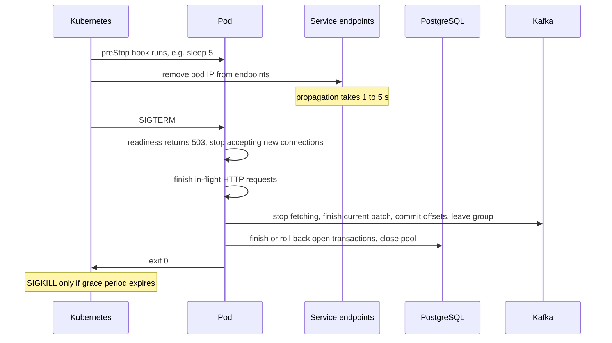

## 31.12 Health checks

#### Concept

A health check is an endpoint (or command) that the platform calls to ask your process a question. Kubernetes asks three different questions, and confusing them is the source of most health-check incidents:

- **Liveness**: "Are you alive at all, or should I kill and restart you?" A failing liveness probe causes a **restart**.
- **Readiness**: "Can you take traffic right now?" A failing readiness probe removes the pod from the Service's endpoints; traffic stops, but the pod keeps running.
- **Startup**: "Have you finished booting?" Until the startup probe passes, liveness and readiness are not evaluated, which protects slow-starting processes from being killed mid-boot.

#### Why does it exist?

A process can be running and useless: deadlocked event loop, out of file descriptors, unable to reach its database, still loading a 2 GB model. Without health checks the load balancer keeps sending traffic to it and every request fails. With health checks the platform can route around a sick pod (readiness) and replace a dead one (liveness). The distinction matters because the two remedies have very different blast radii: removing a pod from rotation is cheap and reversible; restarting it destroys in-flight work and, if the cause is external, restarts *every* pod in a loop.

#### Mental model

Imagine a taxi rank. Liveness asks the driver "are you conscious?" If not, tow the car away. Readiness asks "are you free to take a passenger right now?" If not (refuelling, on a break), skip them for this fare but leave them in the rank. You would never tow a car because the driver is refuelling. And you would never decide a driver is unconscious because the *petrol station* is closed, which is exactly what a liveness check that pings the database does.

#### How it works

1. Kubernetes calls the probe on a schedule (`periodSeconds`), with its own `timeoutSeconds`, and counts consecutive failures against `failureThreshold`.
2. Your endpoint runs a set of **indicators** and returns `200` if all pass, `503` otherwise, with a JSON body describing each.
3. Readiness failure: the endpoint controller removes the pod IP from the Service; the pod continues running; when the probe passes again the pod is re-added.
4. Liveness failure: the kubelet kills the container (SIGTERM, then SIGKILL after the grace period) and restarts it, with `CrashLoopBackOff` delays if it keeps failing.

**What each probe must and must not check:**

| Probe | Must check | Must NOT check | Why |
|---|---|---|---|
| Liveness | The process can respond at all: event loop responsive, no fatal internal state | Database, Redis, any network dependency | If the DB is down and liveness pings it, every pod restarts forever; restarts do not fix the DB |
| Readiness | Things without which this pod cannot serve *anything*: DB pool can get a connection (fast ping, short timeout), required config loaded, warm caches if mandatory | Third-party APIs, non-core dependencies, replicas, anything with a fallback | A readiness check on the payment gateway marks all pods unready when the gateway is down, taking the whole site down instead of just checkout |
| Startup | Migrations applied, config loaded, first DB connection made | Anything slow that happens repeatedly | It only runs at boot |

The rule of thumb: **liveness checks the process, readiness checks the pod's ability to do its core job, and neither checks anything you have a fallback for.** If the readiness probe includes something, a failure of that thing removes *all* your capacity. Ask for each indicator: "when this is down, do I want zero pods in rotation?" Usually the answer is no.

#### Practical example

A NestJS orders API exposes `/health/live` (returns `200` if the event loop responds; nothing else), `/health/ready` (PostgreSQL ping with a 300 ms timeout on the API pool, plus "migrations are at the expected version", plus "not shutting down"), and `/health/startup` (same as ready, but Kubernetes gives it 60 s x 5 attempts). Redis, Kafka and the payment gateway are *not* in readiness, because the service has fallbacks for Redis (cache miss), buffers for Kafka (outbox), and a `503` path for payments.

#### NestJS example

Using `@nestjs/terminus` with built-in indicators and one custom indicator via `HealthIndicatorService`:

```ts
import { Controller, Get, Injectable } from '@nestjs/common';
import {
  HealthCheck, HealthCheckService, TypeOrmHealthIndicator,
  MemoryHealthIndicator, HealthIndicatorService, HealthIndicatorResult,
} from '@nestjs/terminus';
import { ShutdownState } from './shutdown-state';

@Injectable()
export class AppStateIndicator {
  constructor(private readonly hi: HealthIndicatorService, private readonly shutdown: ShutdownState) {}

  notShuttingDown(): HealthIndicatorResult {
    const ind = this.hi.check('app_state');
    return this.shutdown.isShuttingDown ? ind.down({ reason: 'draining' }) : ind.up();
  }
}

@Controller('health')
export class HealthController {
  constructor(
    private readonly health: HealthCheckService,
    private readonly db: TypeOrmHealthIndicator,
    private readonly memory: MemoryHealthIndicator,
    private readonly appState: AppStateIndicator,
  ) {}

  /** Liveness: is the process able to respond at all? No dependencies. */
  @Get('live')
  live() { return { status: 'ok' }; }

  /** Readiness: can this pod do its core job right now? */
  @Get('ready')
  @HealthCheck()
  ready() {
    return this.health.check([
      () => this.db.pingCheck('postgres', { timeout: 300 }),          // fast ping on the API pool
      () => this.memory.checkHeap('heap', 900 * 1024 * 1024),           // shed traffic near the limit
      () => this.appState.notShuttingDown(),                           // fail fast during drain
    ]);
  }
}
```

`HealthCheckService.check` runs the indicators, returns `{ status: 'ok' | 'error', info, error, details }`, and Terminus sets the HTTP status to `503` when any indicator is down. `TerminusModule.forRoot({ gracefulShutdownTimeoutMs: 5000 })` makes readiness fail for 5 s before the app closes on SIGTERM, which is what lets Kubernetes stop routing before the server stops listening (next section).

The Kubernetes side, with values that match the probes:

```yaml
containers:
  - name: app
    ports: [{ containerPort: 3000 }]
    startupProbe:
      httpGet: { path: /health/ready, port: 3000 }
      periodSeconds: 5
      failureThreshold: 24            # up to 120 s to boot (migrations, warmup)
    readinessProbe:
      httpGet: { path: /health/ready, port: 3000 }
      periodSeconds: 5
      timeoutSeconds: 2
      failureThreshold: 3             # 15 s of failures before removal from the Service
      successThreshold: 1
    livenessProbe:
      httpGet: { path: /health/live, port: 3000 }
      periodSeconds: 10
      timeoutSeconds: 2
      failureThreshold: 3             # 30 s of no response before restart
```

The liveness timeout is the important part: a Node process whose event loop is blocked (a synchronous 5 s JSON parse, a CPU-bound loop) will fail to answer in 2 s, and *that* is the condition you actually want a restart for.

#### PostgreSQL example

The readiness ping should be the cheapest possible statement on the pool the API actually uses, with a server-side timeout so it cannot hang:

```sql
-- What Terminus' TypeOrmHealthIndicator runs:
SELECT 1;

-- A slightly richer readiness check that also detects "I am connected to a replica by mistake"
-- and "migrations are behind", both in one cheap round trip:
SELECT pg_is_in_recovery() AS in_recovery,
       (SELECT max(id) FROM migrations) AS migration_version;
```

Never put an expensive query in readiness (`SELECT count(*) FROM orders`). At `periodSeconds: 5` across 40 pods that is 8 count-scans per second, forever.

#### Production scenario

A payments service with 20 pods runs readiness every 5 s, with a 300 ms DB ping. During a PostgreSQL primary failover (60 s), readiness fails on all pods for the duration: the Service has zero endpoints, and the gateway returns `503` for the payments route for 60 s. That is acceptable *for payments*, because payments cannot work without the database. The catalog service, on the same database, has a replica pool and a read-only mode, so its readiness only checks the *replica* ping; it stays in rotation and serves browsing throughout. Same infrastructure event, two correct and different readiness policies.

#### Failure scenario

At 14:02 the entire e-commerce site went down for 25 minutes because of a health check. The readiness probe on the `api` deployment included an `HttpHealthIndicator.pingCheck('reviews', 'http://reviews.svc/health')` added by a well-meaning engineer "to make sure the whole system is healthy". The reviews service had a slow deploy: its own readiness took 8 s. The API's readiness probe had `timeoutSeconds: 3`, so it failed on every pod, every pod was removed from the Service, and the gateway had nothing to route to. Reviews were a non-core feature with a fallback that already worked. The check had turned a 0% impact event into a 100% outage. Post-mortem rule, now enforced in code review: **readiness may only include dependencies the pod cannot serve any traffic without, and every one of them needs a timeout under 500 ms.**

#### Edge cases & failure modes

- **Liveness that pings a dependency**: restart loop across all pods for an external cause.
- **Readiness that includes a non-core dependency**: total outage from a partial failure.
- **Probe timeout longer than the probe interval**: overlapping probes pile up on a slow pod.
- **Flapping readiness** (DB ping at exactly its timeout): pods bounce in and out of the Service, connection churn everywhere. Add hysteresis via `failureThreshold` and `successThreshold`.
- **Expensive readiness** multiplies with pod count.
- **Health endpoint behind auth or rate limiting**: the kubelet gets `401`/`429` and restarts the pod. Exclude `/health/*` from guards and throttling.
- **Health endpoint that allocates** (creates a new DB connection per probe instead of using the pool): pool exhaustion caused by monitoring.
- **Liveness during garbage collection pauses** longer than the timeout on huge heaps; raise the timeout or shrink the heap.
- **Startup probe missing**: slow boots (migrations) get killed by liveness before they finish, and the migration is left half-applied unless it is transactional.

#### How a Senior Backend Engineer thinks about this

They design health checks from the *remedy* backward: "if this check fails, Kubernetes will do X; is X the right response to this condition?" Restarting a pod is the right response to a hung event loop and to nothing else. Removing a pod from rotation is the right response to "this pod cannot get a database connection", and the wrong response to "a partner API is slow". They keep the probes fast, dependency-light and unauthenticated, and they review every added indicator with the question "when this is down, do I want zero pods?"

#### Common mistakes

- One `/health` endpoint used for both liveness and readiness.
- Checking every dependency because "more checks is more safety".
- No startup probe on a service that runs migrations at boot.
- Health checks that hit the primary database when the pod could serve from a replica.

#### Interview questions

1. *Explain liveness, readiness and startup probes and what Kubernetes does when each fails.* Expected: restart / remove from Service / defer other probes.
2. *Should a readiness probe check the payment gateway? Why not?* Expected: no; a gateway outage would remove all pods; checkout has its own `503` path.
3. *Why should liveness never check the database?* Expected: an external failure becomes a restart loop; restarts cannot fix it.
4. *Tell me about a health check that caused an outage.* Expected: the non-core dependency in readiness story or similar; rule derived.

#### Practical exercise

Add `/health/live`, `/health/ready`, and `/health/startup` to a NestJS app with `@nestjs/terminus`. Deploy to a local Kubernetes (kind or minikube) with the probe configuration above. Acceptance criteria: blocking the event loop for 40 s (a synchronous loop triggered by a debug endpoint) causes a restart within 45 s; stopping PostgreSQL removes the pod from the Service within 20 s without a restart; adding 3 s latency to a third-party dependency with `toxiproxy` changes nothing about the pod's readiness.

## 31.13 Graceful shutdown

#### Concept

Graceful shutdown is the sequence a process follows when asked to stop, so that no in-flight work is lost, no client sees a connection reset, and no resource (database connection, Kafka partition, lock) is left dangling. The platform asks by sending `SIGTERM`. The process has a grace period (Kubernetes `terminationGracePeriodSeconds`, default 30 s) to finish; then it is killed with `SIGKILL`, which cannot be caught.

#### Why does it exist?

Pods stop all the time: every deploy, every scale-down, every node upgrade, every spot-instance reclaim. If stopping a pod loses the 40 requests it was serving, the 3 Kafka messages it was processing, and the transaction it had open, then every deploy is a small incident. At 10 deploys a day across 30 services, that is 300 small incidents a day. Graceful shutdown makes stopping a pod a non-event, which is the precondition for deploying often.

#### Mental model

Imagine closing a shop for the night. You do not turn off the lights with customers still at the till. You lock the front door (stop accepting new customers), serve everyone already inside (finish in-flight work), close the registers (commit and close connections), and *then* turn off the lights (exit). If the landlord gives you 30 minutes to be out, you plan to be done in 20.

#### How it works



Step by step, in a NestJS process:

1. **Kubernetes decides to stop the pod.** It runs the `preStop` hook *and* starts removing the pod from Service endpoints *in parallel*. Endpoint removal takes a few seconds to propagate to every kube-proxy and ingress. A `preStop` of `sleep 5` gives that propagation time before the process is told anything; during those 5 s the pod is still serving normally.
2. **`SIGTERM` arrives.** NestJS, with `app.enableShutdownHooks()`, catches it and begins `app.close()`.
3. **Stop accepting new work.** The readiness endpoint starts returning `503` (`ShutdownState`, or Terminus' `gracefulShutdownTimeoutMs`). The HTTP server stops listening. Keep-alive connections that are idle are closed; ones with a request in progress are allowed to finish.
4. **Finish in-flight work.** HTTP requests complete. BullMQ workers finish their active jobs (`worker.close()` waits). Kafka consumers stop fetching, finish the current `eachMessage`/`eachBatch`, commit offsets, and leave the group (`consumer.disconnect()`), which triggers a rebalance so other pods pick up the partitions.
5. **Release resources.** `OnModuleDestroy` -> `BeforeApplicationShutdown(signal)` -> `OnApplicationShutdown(signal)` run in that order across modules (destroy hooks run in reverse dependency order). Close the `DataSource` (returns pooled connections cleanly, so PostgreSQL does not log connection resets), quit Redis, close the Kafka producer.
6. **Exit 0.** Well within the grace period. If you cannot finish (a 5-minute job is running), you have two choices: make the grace period long enough, or make the work resumable and abort it cleanly.

#### Practical example

An orders API with a Kafka consumer and a BullMQ worker in the same process (not ideal, but common). Deploy rolls 12 pods one at a time. Each old pod: `preStop sleep 5`; `SIGTERM`; readiness `503`; HTTP server closes (in-flight p99 is 800 ms, so this takes under a second); the Kafka consumer finishes its current batch of 100 messages (about 2 s), commits, leaves the group; the BullMQ worker finishes its 1–2 active jobs (up to 10 s); the pool closes; exit. Total: 8–18 s, under a 30 s grace period. Zero `502`s during the deploy, zero duplicate Kafka processing beyond the at-least-once baseline, zero lost jobs.

#### NestJS example

Bootstrap with shutdown hooks and correct HTTP server timeouts, plus a `ShutdownState` provider the health check reads:

```ts
// main.ts
async function bootstrap() {
  const app = await NestFactory.create(AppModule, { bufferLogs: true });
  app.enableShutdownHooks();                       // listen for SIGTERM/SIGINT and call app.close()

  const server = app.getHttpServer() as import('node:http').Server;
  server.keepAliveTimeout = 65_000;                // > ALB idle timeout (60 s)
  server.headersTimeout = 66_000;                  // > keepAliveTimeout
  server.requestTimeout = 30_000;

  await app.listen(3000);
}
bootstrap();

// shutdown-state.ts
@Injectable()
export class ShutdownState implements BeforeApplicationShutdown {
  isShuttingDown = false;
  private readonly log = new Logger(ShutdownState.name);

  async beforeApplicationShutdown(signal?: string) {
    this.isShuttingDown = true;                    // readiness now returns 503
    this.log.warn({ msg: 'shutdown started', signal });
    // Give the load balancer a moment to see the failing readiness probe
    // before the HTTP server actually closes (in addition to the preStop sleep).
    await new Promise((r) => setTimeout(r, 2_000));
  }
}
```

Draining the Kafka consumer and BullMQ worker, and closing the database, in the right order:

```ts
@Injectable()
export class KafkaConsumerLifecycle implements OnModuleInit, OnApplicationShutdown {
  private readonly log = new Logger(KafkaConsumerLifecycle.name);
  constructor(@Inject(KAFKA_CONSUMER) private readonly consumer: Consumer) {}

  async onModuleInit() {
    await this.consumer.connect();
    await this.consumer.subscribe({ topic: 'orders.created' });
    await this.consumer.run({ eachMessage: (p) => this.handle(p) });
  }

  async onApplicationShutdown(signal?: string) {
    this.log.warn({ msg: 'draining kafka consumer', signal });
    // kafkajs: stops the fetch loop, waits for the in-flight handler to return,
    // commits offsets, leaves the group. Bounded by the caller's grace period.
    await this.consumer.disconnect();
  }
}

@Injectable()
export class WorkerLifecycle implements OnApplicationShutdown {
  constructor(private readonly worker: Worker) {}                 // BullMQ Worker
  async onApplicationShutdown() {
    await this.worker.close();      // waits for active jobs to finish; close(true) would abort them
  }
}

@Injectable()
export class DatabaseLifecycle implements OnApplicationShutdown {
  constructor(@InjectDataSource() private readonly ds: DataSource) {}
  async onApplicationShutdown() {
    if (this.ds.isInitialized) await this.ds.destroy();   // returns connections cleanly, closes pool
  }
}
```

Order matters: consumers and workers stop *before* the database closes, otherwise a job finishes its last step against a closed pool. NestJS runs `onApplicationShutdown` hooks module by module; put the database module at the root so its hook runs last, or explicitly sequence the drain inside one lifecycle provider.

The Kubernetes side:

```yaml
spec:
  terminationGracePeriodSeconds: 45          # must exceed preStop + drain + close
  containers:
    - name: app
      lifecycle:
        preStop:
          exec:
            command: ["sh", "-c", "sleep 5"] # let endpoint removal propagate before SIGTERM
```

`terminationGracePeriodSeconds` counts from the moment termination starts, *including* the `preStop` sleep. With `sleep 5` and a 45 s period, the process has 40 s after `SIGTERM`.

Two Node details that bite people: `SIGTERM` has no default handler that runs your cleanup (the default is to exit immediately), which is why `enableShutdownHooks()` is required; and `process.exit()` anywhere in your shutdown path skips every pending `await`. Let the event loop drain and exit naturally.

#### PostgreSQL example

What a graceful close looks like versus an abrupt one, from the database's point of view:

```sql
-- Abrupt (SIGKILL, or process.exit before pool.end()): server log shows
-- LOG:  could not receive data from client: Connection reset by peer
-- LOG:  unexpected EOF on client connection with an open transaction
-- Open transactions are rolled back; locks are released; but only after TCP notices, which
-- can take tcp_keepalives_idle (default 2 h!) if the client vanished without a FIN.

-- Protect yourself server-side regardless of client behaviour:
ALTER SYSTEM SET tcp_keepalives_idle = 60;             -- detect dead clients in ~1–2 minutes
ALTER SYSTEM SET tcp_keepalives_interval = 10;
ALTER SYSTEM SET tcp_keepalives_count = 3;
ALTER ROLE app_api SET idle_in_transaction_session_timeout = '10s';

-- During a drain, watch for stuck sessions from the pod being terminated:
SELECT pid, state, now() - xact_start AS tx_age, left(query, 60)
  FROM pg_stat_activity
 WHERE usename = 'app_api' AND state <> 'idle'
 ORDER BY tx_age DESC;
```

#### Production scenario

A deploy of 30 pods with a 4 s p99 request, a Kafka consumer, and a `terminationGracePeriodSeconds` of 30. Before graceful shutdown was implemented: each deploy produced 200–400 `502`s at the ALB (requests on connections Node had already closed), and Kafka consumer lag spiked for 90 s per pod because partitions were reassigned only after the session timeout (`sessionTimeout: 30000`) expired for the dead consumer. After: `502`s per deploy fell to 0–3 (all from clients with their own broken keep-alive handling), and lag during deploys became invisible because the consumer *left* the group explicitly, triggering an immediate rebalance.

#### Failure scenario

At 16:45 a routine deploy of the billing worker double-charged 212 customers. The worker processed "capture payment" jobs in batches of 50 and marked them as captured only at the end of the batch. The deploy sent `SIGTERM`; the process had no shutdown hooks, so Node exited immediately mid-batch; the batch was 30 jobs in, so 30 captures had happened at the gateway and none were marked. The new pod re-ran the batch. Two fixes: per-job completion marking inside the same transaction as the capture record (so a restart resumes at job 31), and graceful shutdown that finishes the current job and stops. A third, from Part 30: an idempotency key on every capture call so that even an ungraceful exit cannot double-charge.

#### Edge cases & failure modes

- **Shutdown killing in-flight transactions**: `process.exit()` or a missing hook. Transactions roll back; the client sees an error for work that must be redone.
- **Draining longer than the grace period**: a 5-minute job; Kubernetes sends `SIGKILL`. Either raise the period (up to a few minutes is fine), or make jobs resumable and abort on `SIGTERM` via an `AbortSignal` passed into the job.
- **Readiness still passing during drain**: the LB keeps sending requests to a server that is closing; `502`s. Flip readiness first, wait a beat, then close.
- **Keep-alive connections not closed**: Node's `server.close()` waits for idle keep-alive connections until they time out. Node 19+ closes idle connections in `close()`; on older versions call `server.closeIdleConnections()`.
- **Consumer leaves without committing**: at-least-once redelivery of the last batch; handlers must be idempotent (Part 30).
- **Pool closed before workers finish**: "Cannot use a pool after calling end on the pool". Order the hooks.
- **Two `SIGTERM` handlers** (yours and Nest's) racing; use Nest's hooks only.
- **Health probe removed pod, but a sticky ingress still routes to it**: some ingress controllers hold connections; the `preStop` sleep plus draining covers most; for stubborn cases, return `Connection: close` on responses once draining starts.
- **CronJobs and one-shot pods** that ignore `SIGTERM` during a node drain.

#### How a Senior Backend Engineer thinks about this

They treat "can this pod be killed at any moment without harm?" as a requirement, because it is the property that makes autoscaling, spot instances, node upgrades and frequent deploys safe. They implement the drain once, in a shared lifecycle module, and they test it: `kubectl delete pod` during a load test, watching `502` counts and consumer lag. They size the grace period from the measured drain time with margin. And they combine graceful shutdown with idempotency, because graceful shutdown is what makes deploys clean and idempotency is what makes crashes survivable; you need both.

#### Common mistakes

- No `enableShutdownHooks()`; the process dies instantly on `SIGTERM`.
- `process.on('SIGTERM', () => process.exit(0))`, which is the same as no handler.
- No `preStop` sleep, so the server closes before the load balancer stops sending.
- Closing the database pool first.
- Grace period shorter than the longest job.

#### Interview questions

1. *Walk through what happens from `kubectl rollout restart` to the old pod exiting, and what your NestJS app must do at each step.* Expected: endpoint removal + preStop, SIGTERM, readiness 503, server close, drain consumers/workers, close pools, exit.
2. *Why is a `preStop` sleep needed even though the app handles `SIGTERM` correctly?* Expected: endpoint removal propagates asynchronously; without the sleep, traffic arrives at a closing server.
3. *How do you drain a Kafka consumer safely?* Expected: stop fetching, finish the in-flight batch, commit, leave the group (`disconnect()`), before closing the database.
4. *A job takes 5 minutes; your grace period is 30 s. What do you do?* Expected: make the job resumable and abort on SIGTERM, or extend the grace period; never let SIGKILL cut it.

#### Practical exercise

Implement graceful shutdown in a NestJS app with an HTTP server, a BullMQ worker and a TypeORM `DataSource`, deployed to kind with a `preStop` sleep and a 45 s grace period. Drive 100 RPS with `autocannon` and a steady stream of 3 s jobs, then `kubectl rollout restart` three times. Acceptance criteria: zero non-2xx responses at the client during rollouts; every job completes exactly once (verify with a unique constraint on `job_results.job_id`); PostgreSQL logs show no "connection reset by peer" from the app; each old pod exits within 20 s.
