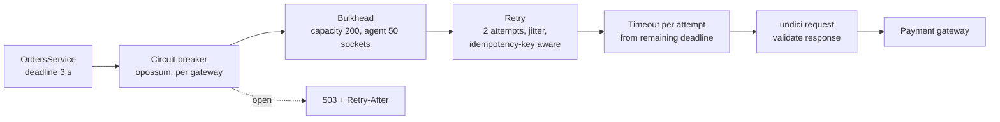

## 31.14 Idempotency as a reliability primitive

#### Concept

An operation is idempotent when doing it twice has the same effect as doing it once. In reliability terms, idempotency is what makes *every other pattern in this part safe*. Timeouts leave you with unknown outcomes; retries re-send; failover reconnects mid-write; graceful shutdown re-delivers the last Kafka batch; degradation queues work for later replay. Every one of those produces duplicates, and idempotency is the property that turns a duplicate from a double charge into a no-op. Part 30 — Distributed Transactions: Sagas, Outbox, Inbox and Idempotency covers the mechanics in depth; this section places it in the reliability toolbox.

#### Why does it exist?

Because "exactly once" does not exist across a network. A request either arrives zero, one, or many times, and the sender cannot tell which. The only way to get exactly-once *effects* is at-least-once delivery plus idempotent processing. Without it, a senior engineer cannot safely enable retries on any write, and without retries the system's user-visible error rate is the raw transient failure rate of every dependency.

#### Mental model

Imagine a light switch versus a "toggle" button. Pressing "on" twice leaves the light on. Pressing "toggle" twice leaves it off. Reliability patterns keep pressing buttons on your behalf; make the buttons switches.

#### How it works

1. The caller generates a unique key per *logical* operation (`Idempotency-Key: order_8842_capture`), once, before the first attempt, and reuses it on every retry.
2. The callee records the key with the outcome, atomically with the side effect (same transaction, or a unique constraint that fails the duplicate insert).
3. A repeated key returns the recorded outcome instead of re-executing.
4. For your own writes, prefer *naturally* idempotent statements: `INSERT ... ON CONFLICT DO NOTHING`, `UPDATE ... SET status = 'paid' WHERE status = 'pending'`, upserts keyed by a business id.

#### NestJS example

A minimal idempotency guard for `POST /orders/:id/capture`, backed by a PostgreSQL table so that it survives Redis outages and pod restarts:

```ts
@Injectable()
export class IdempotencyService {
  constructor(@InjectDataSource() private readonly ds: DataSource) {}

  /** Returns the stored response if this key was already completed; otherwise claims it. */
  async claim(key: string, scope: string): Promise<{ replay?: unknown }> {
    const rows = await this.ds.query(
      `INSERT INTO idempotency_keys (key, scope, status, created_at)
       VALUES ($1, $2, 'in_progress', now())
       ON CONFLICT (key, scope) DO UPDATE SET key = EXCLUDED.key   -- no-op update to RETURNING
       RETURNING status, response, (xmax = 0) AS inserted`,
      [key, scope],
    );
    const row = rows[0];
    if (row.inserted) return {};                                        // first time: proceed
    if (row.status === 'completed') return { replay: row.response };    // duplicate: replay
    throw new ConflictException('request with this key is still in progress');
  }

  async complete(key: string, scope: string, response: unknown): Promise<void> {
    await this.ds.query(
      `UPDATE idempotency_keys SET status = 'completed', response = $3, completed_at = now()
        WHERE key = $1 AND scope = $2`, [key, scope, JSON.stringify(response)],
    );
  }
}
```

#### PostgreSQL example

```sql
CREATE TABLE idempotency_keys (
  key          text NOT NULL,
  scope        text NOT NULL,                 -- e.g. 'capture', so keys cannot collide across operations
  status       text NOT NULL CHECK (status IN ('in_progress', 'completed')),
  response     jsonb,
  created_at   timestamptz NOT NULL DEFAULT now(),
  completed_at timestamptz,
  PRIMARY KEY (key, scope)
);
-- Expire old keys with a nightly job: DELETE ... WHERE created_at < now() - interval '7 days'.
```

#### How a Senior Backend Engineer thinks about this

They refuse to enable retries on a write until the write is idempotent, and they refuse to accept a webhook without deduplicating on the provider's event id. They design idempotency keys from *business* identity (order id + operation) rather than random UUIDs, so that a client that crashed and restarted still produces the same key. And they see idempotency as the foundation, not a feature: it is what allows the rest of this part to be switched on safely.

#### Interview questions

1. *Why is idempotency a reliability concern and not just an API-design concern?* Expected: every reliability pattern introduces duplicates; idempotency makes them harmless.
2. *How do you make a payment capture idempotent end-to-end?* Expected: business-derived key, sent to the gateway and stored locally atomically with the outcome; replay on duplicate.

## 31.15 Chaos testing

#### Concept

Chaos testing (or chaos engineering) is deliberately injecting failures into a running system to verify that the reliability patterns actually work. You kill a pod and check that requests are not lost. You add 3 s of latency to the payment gateway and check that the timeout, breaker and fallback behave. You partition Redis and check that the cache degrades to misses instead of errors. A **game day** is a scheduled exercise where the team runs several of these against staging (or, carefully, production) and practises the response.

#### Why does it exist?

Every pattern in this part is a hypothesis: "if the gateway hangs, the breaker opens in 10 s and checkout returns a friendly 503." Hypotheses that have never been tested are usually wrong in some detail: the timeout is on the wrong client, the breaker's error filter counts the wrong errors, the health check includes the dependency, the fallback depends on the failed thing. Chaos testing finds these in the afternoon instead of at 02:14.

#### Mental model

Imagine a fire drill. Everyone *knows* where the exits are, in theory. The drill reveals that one exit is locked, the alarm cannot be heard in the basement, and nobody knows who counts heads. Chaos testing is the fire drill for your reliability design.

#### How it works

1. **State the hypothesis.** "With inventory-service latency at 3 s, checkout p99 stays under 4 s and returns `503 INVENTORY_UNAVAILABLE` for the affected requests; no request exceeds 5 s; no pod restarts."
2. **Pick the smallest blast radius** that tests it: one dependency, one pod, staging first.
3. **Inject the failure.** Tools:
   - **Kill pods**: `kubectl delete pod` (tests graceful shutdown, consumer rebalancing, retries), or a chaos controller (Chaos Mesh, LitmusChaos) for scheduled random kills.
   - **Latency and faults**: `toxiproxy` sits between your app and a dependency as a TCP proxy; you add "toxics" (latency, bandwidth limit, connection reset, slow close, timeout) at runtime via its API.
   - **Resource pressure**: `stress-ng` in a sidecar for CPU/memory; `tc netem` for packet loss.
   - **Dependency outage**: scale a service to zero; block a security group; stop Redis.
4. **Observe** with the same dashboards and alerts you would use in a real incident. If an alert should have fired and did not, that is a finding.
5. **Fix, then repeat.** Keep a runbook of the experiments and their last result.

#### Practical example

`toxiproxy` in `docker-compose` for local and CI chaos, proxying PostgreSQL and the payment gateway stub:

```yaml
services:
  toxiproxy:
    image: ghcr.io/shopify/toxiproxy:2.9.0
    ports: ["8474:8474", "15432:15432", "18080:18080"]
  app:
    environment:
      PG_HOST: toxiproxy
      PG_PORT: "15432"
      PAYMENT_URL: http://toxiproxy:18080
```

```bash
# Create proxies (once), then inject failures on demand.
toxiproxy-cli create -l 0.0.0.0:15432 -u postgres:5432 pg
toxiproxy-cli create -l 0.0.0.0:18080 -u payment-stub:8080 payment

# 2 s latency with 500 ms jitter on responses from the payment gateway
toxiproxy-cli toxic add -t latency -a latency=2000 -a jitter=500 payment
# Reset connections to PostgreSQL after 1 KB (simulates a failover mid-query)
toxiproxy-cli toxic add -t limit_data -a bytes=1024 pg
# Full outage
toxiproxy-cli toggle payment
# Remove all toxics
toxiproxy-cli toxic remove -n latency_downstream payment
```

#### NestJS example

A Jest integration test that turns a reliability hypothesis into an assertion, using the `toxiproxy-node-client` API:

```ts
import { Toxiproxy, Toxic } from 'toxiproxy-node-client';

describe('checkout under payment gateway latency', () => {
  const tp = new Toxiproxy('http://localhost:8474');
  let proxy: Awaited<ReturnType<typeof tp.get>>;

  beforeAll(async () => { proxy = await tp.get('payment'); });
  afterEach(async () => { for (const t of await proxy.getToxics()) await t.remove(); });

  it('opens the breaker and returns 503 within the budget', async () => {
    await proxy.addToxic(new Toxic(proxy, {
      name: 'slow', type: 'latency', stream: 'downstream', toxicity: 1, attributes: { latency: 5_000, jitter: 0 },
    }));

    // 30 requests: enough to cross volumeThreshold=20 with 100% failures.
    const results = await Promise.all(
      Array.from({ length: 30 }, () => request(app.getHttpServer()).post('/orders/o1/capture').send({})),
    );
    expect(results.every((r) => r.status === 503)).toBe(true);
    expect(Math.max(...results.map((r) => Number(r.header['x-response-time'])))).toBeLessThan(3_200);

    const metrics = await request(app.getHttpServer()).get('/metrics');
    expect(metrics.text).toMatch(/circuit_breaker_state\{name="payment-gateway"\} 1/);
  });
});
```

#### Production scenario

A quarterly game day for a ride-booking platform, run in staging with production-shaped load: (1) delete 3 of 12 API pods during a load test; (2) add 4 s latency to the maps provider; (3) stop Redis for 2 minutes; (4) trigger an RDS reboot with failover; (5) fill the notifications queue with 500,000 jobs. Findings from the last one: experiment 2 revealed that the maps fallback (cached ETAs) had a bug that returned ETAs for the wrong city; experiment 4 revealed that one service's DNS cache was 5 minutes; experiment 5 revealed that the queue consumer had no `p-limit` and OOMKilled. Three real bugs, no customers involved.

#### Failure scenario

A team ran its first chaos experiment *in production* with a "random pod killer" at 10% of pods per hour, without first testing graceful shutdown. Every kill dropped 30–50 in-flight requests and caused a Kafka rebalance that reprocessed the last batch, which was not idempotent. Customers received duplicate order confirmations for a week before anyone connected the two. Chaos testing found the problem, as designed, but in the wrong environment. Blast radius first, always.

#### Edge cases & failure modes

- **Chaos in production without a kill switch.** Every experiment needs a one-command abort.
- **Chaos that tests the wrong layer**: adding latency at the proxy when the real failure is a slow *TLS handshake* that a proxy hides.
- **Latency injection that also delays the health check** (same proxy), so the pod is removed from rotation and the experiment measures nothing.
- **Staging that does not resemble production** (1 pod, no load): experiments pass trivially.
- **No observability during the experiment**: you cannot tell if the system did the right thing.
- **Experiments that never get repeated** after fixes, so regressions return silently.

#### How a Senior Backend Engineer thinks about this

They see every reliability control as untested until chaos has exercised it. They automate the cheap experiments into CI (a `toxiproxy` latency test per critical dependency) and schedule the expensive ones as game days with the on-call rotation present, because the drill is as much about people as about code. They start in staging, they start small, and they write down the hypothesis before injecting anything.

#### Common mistakes

- Skipping chaos because "we have unit tests for the retry logic".
- Running chaos in production before staging.
- Injecting failures without watching the dashboards.
- Testing only outages, never *slowness* (slowness is more common and more damaging).

#### Interview questions

1. *How would you verify that your circuit breaker actually works?* Expected: inject latency or errors with toxiproxy under load; assert state metric and response times.
2. *What is a game day and what makes a good one?* Expected: scheduled, hypothesis-driven, bounded blast radius, on-call participates, findings become tickets.
3. *Why is latency injection more valuable than outage injection?* Expected: slow dependencies cause resource exhaustion and cascades; outages fail fast.

#### Practical exercise

Add `toxiproxy` to your local `docker-compose`, route PostgreSQL and one HTTP dependency through it, and write three Jest integration tests: (a) 5 s latency on the HTTP dependency opens the breaker; (b) a PostgreSQL connection reset mid-transaction results in a rollback and a `503`, never a `500` or a partial write; (c) killing the app process (`SIGTERM`) mid-request completes the in-flight request. Acceptance criteria: all three pass in CI and each asserts on a metric as well as on the HTTP response.

## 31.16 Putting it together: a resilient PaymentGatewayClient

#### Concept

This section assembles the patterns into one production-grade client for the most sensitive dependency in an e-commerce system: the payment gateway. The client applies, in order from the outside in: **deadline** (the caller's remaining budget), **circuit breaker** (fail fast when the gateway is down), **bulkhead** (bounded concurrency and a dedicated socket pool), **retry with jitter** (only when an idempotency key makes it safe), **timeout** (per attempt, from the remaining deadline), **response validation** (a 200 with the wrong shape is a failure), plus **metrics** and **structured logs** on every path.



#### How it works

The order of layers is deliberate. The breaker is outermost so that when the gateway is down we do not even consume a bulkhead slot or wait for a retry. The bulkhead is next so that an open-for-business gateway cannot hold more than 200 of our requests. Retries sit inside the bulkhead so that one logical call occupies one slot regardless of attempts. The timeout is innermost and is recomputed per attempt from the deadline, so that attempts never overrun the caller's budget. Validation happens on every successful response before it is returned or counted as a success.

#### NestJS example

Types, errors and the response DTO with validation:

```ts
import { IsIn, IsInt, IsString, Min, validateOrReject } from 'class-validator';
import { plainToInstance } from 'class-transformer';

export interface ChargeRequest {
  orderId: string;
  amountCents: number;
  currency: string;
  paymentMethodId: string;
  idempotencyKey?: string;      // present => retries are safe
}

export class ChargeResponseDto {
  @IsString() id!: string;
  @IsIn(['succeeded', 'pending', 'failed']) status!: 'succeeded' | 'pending' | 'failed';
  @IsInt() @Min(0) amountCents!: number;
  @IsString() currency!: string;
}

export class GatewayError extends Error {
  constructor(message: string, readonly statusCode?: number, readonly code?: string,
              readonly retryAfterMs?: number, readonly outcome: 'failed' | 'unknown' = 'failed') {
    super(message);
  }
}

export async function parseChargeResponse(json: unknown, expected: ChargeRequest): Promise<ChargeResponseDto> {
  const dto = plainToInstance(ChargeResponseDto, json);
  await validateOrReject(dto, { whitelist: true });                   // shape check
  if (dto.amountCents !== expected.amountCents || dto.currency !== expected.currency) {
    throw new GatewayError('response does not match request', 200, 'MISMATCH'); // business check
  }
  return dto;
}
```

The HTTP layer: dedicated agent (bulkhead), per-attempt timeout from the deadline, error classification and response validation:

```ts
import { Injectable } from '@nestjs/common';
import { Agent, request } from 'undici';
import { Deadline } from '../reliability/deadline';

@Injectable()
export class PaymentGatewayHttp {
  private readonly agent = new Agent({
    connections: 50, connect: { timeout: 1_000 }, headersTimeout: 2_500, bodyTimeout: 2_500,
  });

  constructor(private readonly baseUrl = process.env.PAYMENT_URL!, private readonly apiKey = process.env.PAYMENT_KEY!) {}

  async charge(req: ChargeRequest, deadline: Deadline): Promise<ChargeResponseDto> {
    const budget = deadline.child(2_500);
    if (budget <= 0) throw new GatewayError('no time left', undefined, 'DEADLINE');

    let res: Awaited<ReturnType<typeof request>>;
    try {
      res = await request(`${this.baseUrl}/v1/charges`, {
        method: 'POST', dispatcher: this.agent, signal: AbortSignal.timeout(budget),
        headers: {
          'content-type': 'application/json', authorization: `Bearer ${this.apiKey}`,
          ...(req.idempotencyKey ? { 'idempotency-key': req.idempotencyKey } : {}),
        },
        body: JSON.stringify({ amount: req.amountCents, currency: req.currency,
                               payment_method: req.paymentMethodId, metadata: { orderId: req.orderId } }),
      });
    } catch (err) {
      const e = err as { name?: string; code?: string };
      if (e.name === 'TimeoutError' || e.name === 'AbortError')
        throw new GatewayError('timeout', undefined, 'TIMEOUT', undefined, 'unknown'); // may have charged
      if (e.code === 'ECONNREFUSED' || e.code === 'ENOTFOUND')
        throw new GatewayError(e.code, undefined, e.code, undefined, 'failed');         // never reached
      throw new GatewayError(String(err), undefined, e.code, undefined, 'unknown');
    }

    const body = (await res.body.json()) as Record<string, unknown>;
    if (res.statusCode >= 500 || res.statusCode === 429) {
      const ra = res.headers['retry-after'];
      throw new GatewayError(`gateway ${res.statusCode}`, res.statusCode, String(body.code ?? ''),
        ra ? Number(ra) * 1000 : undefined, res.statusCode === 429 ? 'failed' : 'unknown');
    }
    if (res.statusCode >= 400) throw new GatewayError(String(body.message ?? 'rejected'), res.statusCode, String(body.code ?? ''));
    return parseChargeResponse(body, req);
  }
}
```

The client: breaker, bulkhead, idempotency-aware retry, metrics and logs:

```ts
import { Injectable, Logger, OnModuleDestroy } from '@nestjs/common';
import CircuitBreaker from 'opossum';
import { Counter, Histogram } from 'prom-client';
import { computeBackoff } from '../reliability/backoff';

const latency = new Histogram({ name: 'payment_gateway_seconds', help: 'charge latency',
  labelNames: ['outcome'], buckets: [0.05, 0.1, 0.25, 0.5, 1, 2, 3] });
const attempts = new Counter({ name: 'payment_gateway_attempts_total', help: 'attempts', labelNames: ['result'] });

@Injectable()
export class PaymentGatewayClient implements OnModuleDestroy {
  private readonly log = new Logger(PaymentGatewayClient.name);
  private readonly breaker = new CircuitBreaker(
    (req: ChargeRequest, deadline: Deadline) => this.chargeWithRetry(req, deadline),
    { name: 'payment-gateway', errorThresholdPercentage: 50, volumeThreshold: 20, rollingCountTimeout: 10_000,
      resetTimeout: 15_000, capacity: 200,
      // 4xx (except 429) and validation mismatches are not gateway health signals.
      errorFilter: (e: GatewayError) => (e.statusCode ?? 500) >= 400 && (e.statusCode ?? 500) < 500 && e.statusCode !== 429 });

  constructor(private readonly http: PaymentGatewayHttp) {
    this.breaker.on('open', () => this.log.error({ msg: 'payment breaker open' }));
    this.breaker.on('close', () => this.log.warn({ msg: 'payment breaker closed' }));
  }

  async charge(req: ChargeRequest, deadline: Deadline): Promise<ChargeResponseDto> {
    try {
      return await this.breaker.fire(req, deadline);
    } catch (err) {
      if ((err as { code?: string }).code === 'EOPENBREAKER')
        throw new GatewayError('breaker open', 503, 'BREAKER_OPEN', 15_000, 'failed');
      throw err;
    }
  }

  private async chargeWithRetry(req: ChargeRequest, deadline: Deadline): Promise<ChargeResponseDto> {
    const maxAttempts = req.idempotencyKey ? 2 : 1;                // no key => never retry a charge
    for (let attempt = 1; ; attempt++) {
      const end = latency.startTimer();
      try {
        const res = await this.http.charge(req, deadline);
        end({ outcome: 'success' }); attempts.inc({ result: 'success' });
        this.log.log({ msg: 'charge ok', orderId: req.orderId, chargeId: res.id, status: res.status, attempt });
        return res;
      } catch (err) {
        const e = err as GatewayError;
        end({ outcome: e.outcome }); attempts.inc({ result: e.code ?? 'error' });
        const retryable = e.code === 'TIMEOUT' || e.code === 'ECONNREFUSED' || e.statusCode === 503 || e.statusCode === 429;
        const delay = e.retryAfterMs ?? computeBackoff(attempt, 200, 1_500, 'equal');
        if (attempt >= maxAttempts || !retryable || delay > deadline.remainingMs() - 300) {
          this.log.warn({ msg: 'charge failed', orderId: req.orderId, code: e.code, status: e.statusCode, outcome: e.outcome, attempt });
          throw e;
        }
        await new Promise((r) => setTimeout(r, delay));
      }
    }
  }

  onModuleDestroy() { this.breaker.shutdown(); }
}
```

And the caller, handling the three outcomes correctly (success, known failure, unknown):

```ts
@Injectable()
export class OrdersService {
  async capture(orderId: string): Promise<CaptureResult> {
    const deadline = Deadline.in(3_000);
    const order = await this.orders.findOneByOrFail({ id: orderId, status: 'pending_payment' });
    const req: ChargeRequest = { orderId, amountCents: order.totalCents, currency: order.currency,
      paymentMethodId: order.paymentMethodId, idempotencyKey: `capture:${orderId}` };

    try {
      const res = await this.gateway.charge(req, deadline);
      await this.orders.update({ id: orderId }, { status: res.status === 'succeeded' ? 'paid' : 'payment_pending', chargeId: res.id });
      return { status: res.status };
    } catch (err) {
      const e = err as GatewayError;
      if (e.outcome === 'unknown') {
        // Do NOT mark failed: the charge may exist. Park it and let the reconciler query by idempotency key.
        await this.orders.update({ id: orderId }, { status: 'payment_unknown' });
        await this.reconcileQueue.add('reconcile', { orderId }, { delay: 30_000, jobId: `reconcile:${orderId}` });
        throw new ServiceUnavailableException({ code: 'PAYMENT_PENDING', retryAfter: 30 });
      }
      if (e.statusCode === 503 || e.code === 'BREAKER_OPEN')
        throw new ServiceUnavailableException({ code: 'PAYMENTS_UNAVAILABLE', retryAfter: Math.ceil((e.retryAfterMs ?? 15_000) / 1000) });
      await this.orders.update({ id: orderId }, { status: 'payment_failed', failureCode: e.code });
      throw new UnprocessableEntityException({ code: e.code ?? 'PAYMENT_DECLINED' });
    }
  }
}
```

Notice what is *not* here: the charge is not inside a database transaction (a transaction held across an HTTP call is the classic pool killer), the order is never marked failed on an unknown outcome, and the reconciler (a BullMQ job that queries the gateway by `idempotency-key`) is what eventually resolves `payment_unknown` orders, which in practice is a handful per day.

#### Production scenario

With this client in front of a gateway at 200 charges per second: p50 380 ms, p99 1.4 s; timeouts 0.05%; retries 0.08% of calls (nearly all timeouts, all safe under the idempotency key); breaker opened 4 times in a quarter, each for under 3 minutes; `payment_unknown` orders averaged 6 per day and all reconciled within 2 minutes. The dashboard shows `payment_gateway_seconds` by outcome, `payment_gateway_attempts_total` by result, and `circuit_breaker_state`. The alert is "breaker open for 2 minutes" or "unknown outcome rate above 0.5%".

## 31.17 Edge cases & failure modes across the reliability toolbox

The patterns interact. Each of these is a real failure mode of the *combination*, with the mechanism and the fix:

- **Retry storm.** Retries at multiple layers multiply load on a struggling dependency (3 layers x 3 attempts = 27x). Retry at one layer, cap attempts at 2–3, enforce a retry budget, and make the deepest layer fail fast with `503 + Retry-After`.
- **Thundering herd on recovery.** When a dependency comes back, every waiting client and every open breaker probes at once; the dependency falls over again. Jittered backoff, one probe per breaker, `resetTimeout` jitter per instance, and rate-limited replay of queued work.
- **Circuit breaker flapping.** A partially failing dependency crosses the threshold, opens, half-opens, closes, and repeats, taking the healthy 80% down with the failing 20%. Filter deterministic errors out of the count, raise the volume threshold, lengthen `resetTimeout`, and consider per-operation breakers.
- **Half-open probes overwhelming a recovering service.** 60 pods x N probes at the same instant. Keep probes to one per instance, jitter the reset, and let the dependency's own `Retry-After` slow you down.
- **Timeout shorter than the downstream's p99.** You cancel 1% of healthy calls, retry them, and add 1–2% load to a healthy system; under mild slowness this becomes a self-inflicted outage. Set timeouts from latency histograms, above p99 for the normal state, and revisit them when the dependency's latency profile changes.
- **Retries of non-idempotent calls.** A `POST /charges` timed out and was retried without a key: double charge. Never retry writes without idempotency keys; classify timeouts as unknown, not failed.
- **Health checks flapping causing restart loops.** A liveness probe that touches a dependency, or a readiness probe with a timeout near its own latency; pods restart or bounce in and out of rotation. Liveness checks only the process; readiness checks only core dependencies with sub-500 ms timeouts; add `failureThreshold` hysteresis.
- **Load shedding rejecting the wrong traffic.** No priorities, or priorities derived from something expensive: payment webhooks are shed while analytics gets through. Explicit, reviewed priority classes propagated in a header; critical never shed.
- **Shutdown killing in-flight transactions.** `SIGTERM` handled by immediate exit; transactions rolled back; half-finished jobs re-run. Shutdown hooks, readiness `503` first, drain, close pools last, grace period sized from measured drain time.
- **Cascading failure across services.** Service A's slowness exhausts B's pool, B's slowness exhausts C's, and the whole graph stalls. Every hop needs a timeout budget that shrinks inward, bulkheads per dependency, and shedding at each layer; the first service to fail fast stops the cascade.
- **Dependency returning `200` with wrong data.** A schema change, a bug, or a proxy error page with a `200`. Validate every response's shape and its business content (amount, currency, ids) before acting on it; treat validation failure as a dependency error for logging but *not* for the breaker's count unless it is systematic.
- **Partial success in batch calls.** A batch of 100 items returns `207` or `200` with per-item results; 97 succeeded and 3 failed; the caller treats the whole batch as success or as failure. Process per-item results, retry only the failed items (idempotently), and never re-send the whole batch.

**Dependency decision table.** The values below are starting points for an e-commerce API; measure and adjust.

| Dependency | Timeout | Retries | Breaker | Fallback |
|---|---|---|---|---|
| PostgreSQL primary (API pool) | connect 1 s, statement 2 s, lock 500 ms, idle-in-tx 10 s | Transaction-level for `40001`/`40P01` only, 3 attempts; connection errors once for reads | No (nothing to fall back to); fail fast via pool timeout | Read-only mode via replica pool |
| PostgreSQL replica | connect 1 s, statement 2 s | Once on connection error | Yes, fallback to primary or another replica | Route to primary |
| Redis cache | connect 1 s, command 200–300 ms, `enableOfflineQueue: false` | 1 per command (client-level) | Optional; the cache-miss path is the fallback | Treat as miss; guard the DB against stampede |
| Redis for locks or rate limits | command 200 ms | 1 | No | Fail open for capacity limits; fail closed for security limits |
| Kafka producer | connection 3 s, request 10 s, producer `timeout` 5 s | Built-in with idempotent producer | No | Outbox table; produce later |
| Payment gateway | per attempt 2.5 s inside a 3 s deadline | 2 attempts, only with idempotency key, timeouts treated as unknown | Yes, 50% over 20 calls, 15 s reset, capacity 200 | None; `503 + Retry-After`; unknown outcomes parked for reconciliation |
| Email or SMS provider | 3 s | 3 attempts with jitter (idempotent by message id) | Yes | Queue via outbox, retry for hours |
| Inventory service (internal) | 800 ms | 2 attempts (idempotent reservation id) | Yes | None for reservation; stale count for display |
| Recommendations or search | 300–500 ms | 0–1 | Yes | Bestsellers from cache; hide widget; DB `ILIKE` with a bound |
| Tax or address SaaS | 1.5 s | 1 | Yes | Last known table with max age 24 h, flag for review |

## Senior Checklist — Part 31

- [ ] I understand the concept
- [ ] I can explain it simply
- [ ] I can implement it
- [ ] I understand its failure modes
- [ ] I understand its scaling limitations
- [ ] I understand its security implications
- [ ] I understand its operational implications
- [ ] I can choose between alternatives
- [ ] I can explain the tradeoffs
- [ ] I can answer senior-level interview questions
- [ ] I run the six-question dependency interrogation on every network call in code review
- [ ] I can design a timeout budget that shrinks from the edge to each DB call, and I set timeouts at every layer including `statement_timeout` and `idle_in_transaction_session_timeout`
- [ ] I can classify errors into retryable and non-retryable, and I never retry a non-idempotent write without an idempotency key
- [ ] I can implement full, equal and decorrelated jitter and explain when each applies
- [ ] I can wire an `opossum` breaker with correct error filtering, volume thresholds and state metrics
- [ ] I can isolate dependencies with separate socket pools, separate DB pools and roles, and separate deployments
- [ ] I can implement load shedding on event-loop lag with explicit priorities and `Retry-After`
- [ ] I can bound memory in any loop over unknown-size data with cursors, batching and `p-limit`, and pause a Kafka consumer under backpressure
- [ ] I can classify features as core or non-core with product and design bounded-staleness fallbacks with metrics
- [ ] I know what my pods see during a database failover and how they must respond
- [ ] I can write liveness, readiness and startup probes that never include a non-core dependency
- [ ] I can implement graceful shutdown in NestJS with `preStop`, readiness `503`, drain order and a sized grace period
- [ ] I have exercised at least one reliability control with `toxiproxy` or a pod kill

## Part 31 — Key Takeaways

- Every network dependency can time out, fail, slow down, duplicate, lie, or half-succeed; the code must answer all six before it ships.
- A timeout is a budget, not a number: it shrinks from the edge inward, and each layer's timeout must be shorter than its caller's remaining time.
- A timeout means "unknown outcome"; only idempotency turns unknown into safe-to-retry.
- Retries multiply load; retry at one layer, cap at 2–3 attempts, enforce a retry budget, and honour `Retry-After`.
- Exponential backoff spaces retries out; jitter de-synchronizes clients; you need both.
- A circuit breaker turns slow failure into fast failure and probes for recovery; feed it only errors that mean the dependency is unhealthy.
- Bulkheads make sure a dead dependency can hold a number of your resources that you chose, not all of them.
- A system without load shedding sheds anyway, by falling over; choose what to reject and reject it cheaply with `503 + Retry-After`.
- Unbounded `Promise.all` is a memory bug waiting for a large input; bound concurrency, batch, and let lag live in Kafka or the database, not in the heap.
- Degrade non-core features first, with stale data that carries its age, and alert on fallback rates, not just errors.
- Liveness checks the process, readiness checks the pod's core job, and neither checks anything you have a fallback for.
- Graceful shutdown (readiness off, drain, close pools last) is what makes deploys, scale-downs and spot instances safe; idempotency is what makes crashes safe.
- Reliability controls are hypotheses until chaos testing has exercised them.
