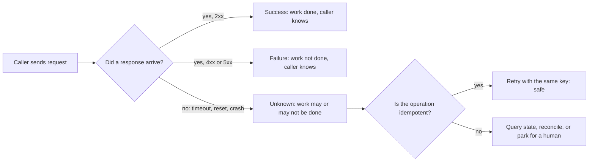
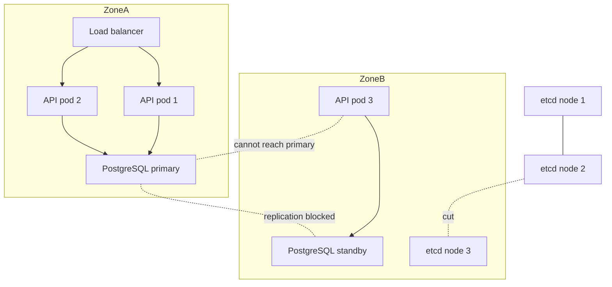

# Part 32 — Distributed Systems Fundamentals

## 32.1 What makes a system "distributed", and why it is hard

Imagine two friends, Asha and Ben, who share one notebook of orders for their small bakery. While the notebook sits on one table, life is easy: whoever holds the pen writes, and the page always shows the truth. Now Asha takes the notebook home and Ben keeps a photocopy at the shop. A customer phones Ben to cancel order 41. Ben crosses it out on his copy. Asha, at home, bakes order 41. Nobody lied and nobody made a mistake; the two copies simply stopped being one notebook. Every hard problem in this Part is a version of that story.

#### Concept

A system is **distributed** when its parts run on different machines and can only talk to each other by sending messages over a network. That is the whole definition, and it hides three consequences that change everything:

1. **Parts fail independently.** Machine A can be dead while machine B is fine and does not know it.
2. **There is no shared memory.** The only way B learns about A's state is by A sending a message, which takes time and may never arrive.
3. **There is no global clock.** Each machine has its own clock, and the clocks disagree by milliseconds on a good day and by seconds or minutes on a bad one.

Your NestJS service talking to PostgreSQL is already a distributed system. Add Redis, Kafka, three replicas of the API pod behind a load balancer, a payment gateway and a mobile client with a flaky connection, and you have a system with a dozen independently failing parts and no single place where "the truth" lives.

#### Why does it exist?

We do not build distributed systems because they are fun. We build them because a single machine has limits: it can only hold so much memory, serve so many requests, and it will eventually crash, lose its disk or need a reboot. We split the work across machines to get **more capacity** and to **survive the failure of any one part**. The price is that we now own all the problems of the two-notebook bakery: partial knowledge, delayed messages, and disagreement about what happened and when.

The mistake many teams make is paying that price without needing to. A single PostgreSQL primary with a hot standby, behind three stateless NestJS pods, is a distributed system you can reason about. Fifteen microservices with their own databases is a distributed system that will teach you every lesson in this Part the expensive way. The senior instinct is: the simplest architecture that meets the requirement wins, and every network hop you add must earn its place.

#### Mental model

Think of every network call as **posting a letter**. You put it in the box and walk away. Maybe it arrives in a minute; maybe it arrives tomorrow; maybe it is lost; maybe it arrives twice because the post office duplicated it; maybe it arrives *after* a letter you posted later. If you get no reply, you cannot tell whether your letter was lost, whether the reply was lost, or whether the recipient is simply slow. Everything in distributed systems is a technique for doing useful, correct work while only ever being able to post letters.

#### How it works: the eight fallacies

In 1994 Peter Deutsch (later extended by James Gosling) listed the assumptions that engineers new to distributed systems make, and that reality punishes. Each one shows up in a backend within its first year of production.

| # | Fallacy | What is actually true | How you meet it in a NestJS backend |
|---|---|---|---|
| 1 | The network is reliable | Packets are dropped, connections reset, switches reboot | A `fetch` to the inventory service throws `ECONNRESET` once per 10,000 calls. Without a retry policy, 0.01% of orders fail for no reason the customer can see. |
| 2 | Latency is zero | Every hop costs time; cross-AZ ~1 ms, cross-region 80–150 ms | A loop that calls the pricing service once per cart item turns a 12-item cart into 12 x 40 ms = 480 ms before any work is done. |
| 3 | Bandwidth is infinite | Links saturate; big payloads queue behind each other | A `GET /orders?include=items,customer,history` returning 4 MB per call chokes a 1 Gbps link at 30 requests per second. |
| 4 | The network is secure | Anyone on the path can read or alter traffic | Service-to-service HTTP without TLS inside the cluster lets a compromised pod read customer PII off the wire. Use mTLS or at least TLS everywhere. |
| 5 | Topology does not change | Pods move, IPs change, nodes drain | A NestJS service that resolves `inventory-svc` once at startup and caches the IP keeps calling a dead pod after a rolling deploy. Resolve through the service DNS name or a client-side load balancer every time. |
| 6 | There is one administrator | Different teams own different parts with different rules | The payments team sets a 5 s timeout on their gateway; your team sets 3 s on the call to them. Every slow charge becomes an "unknown outcome" for you. |
| 7 | Transport cost is zero | Serialization, TLS handshakes and connection setup cost CPU and time | Opening a new TLS connection per request to Redis costs ~2 ms and a burst of CPU; the actual `GET` costs 0.2 ms. Pool connections. |
| 8 | The network is homogeneous | Different libraries, versions, encodings and MTUs coexist | Service A sends `Content-Type: application/json` with a UTF-16 body from a legacy library; service B assumes UTF-8 and stores garbage names. |

Three further truths sit under all eight fallacies:

- **Independent failure.** When the inventory pod dies, the order pod does not die with it; it keeps sending requests into the void. Contrast this with a monolith: if the inventory module crashes, the whole process crashes and nobody keeps calling it.
- **No global clock.** If order service logs `12:00:00.100 created` and inventory logs `12:00:00.090 reserved`, the reservation did not happen before the order. The clocks are simply 30 ms apart. Section 32.13 covers this in depth.
- **No shared memory.** A JavaScript `Map` of "orders being processed" in pod 1 is invisible to pod 2. Any in-process state is per-pod state, which is why sections 32.8 and 32.11 exist.

#### Practical example

An e-commerce checkout in NestJS calls, in order: Redis (cart), PostgreSQL (create order), the payment gateway (charge), Kafka (publish `OrderPlaced`). Four network dependencies. On one machine, "create order then charge" is one line after another. Distributed, every line has three possible endings (success, failure, unknown), so four lines have 3^4 = 81 combinations of endings, and about 60 of them leave the system in a state that a naive implementation never considered. Most of Part 33 is about handling those 60.

#### NestJS example

The most common junior mistake is a call with no timeout. Node's `fetch` will wait for the OS TCP timeout (often 2 minutes) if the far side vanishes without sending a reset. Here is the minimum a senior would accept for a service-to-service call:

```ts
// inventory.client.ts
import { Injectable, Logger } from '@nestjs/common';
import { ConfigService } from '@nestjs/config';

export type RemoteOutcome<T> =
  | { kind: 'ok'; value: T }
  | { kind: 'failed'; status: number; body: string }   // the far side answered "no"
  | { kind: 'unknown'; reason: string };                // we do not know what happened

@Injectable()
export class InventoryClient {
  private readonly log = new Logger(InventoryClient.name);
  private readonly baseUrl: string;

  constructor(config: ConfigService) {
    this.baseUrl = config.getOrThrow<string>('INVENTORY_BASE_URL'); // never hard-code hosts
  }

  async reserve(orderId: string, sku: string, qty: number): Promise<RemoteOutcome<{ reservationId: string }>> {
    try {
      const res = await fetch(`${this.baseUrl}/reservations`, {
        method: 'POST',
        headers: { 'content-type': 'application/json', 'idempotency-key': `reserve:${orderId}:${sku}` },
        body: JSON.stringify({ orderId, sku, qty }),
        signal: AbortSignal.timeout(2_000), // fallacy 2: latency is not zero, bound it
      });
      if (res.ok) return { kind: 'ok', value: (await res.json()) as { reservationId: string } };
      return { kind: 'failed', status: res.status, body: await res.text() };
    } catch (err) {
      // Timeout or connection error: the request MAY have been applied on the far side.
      this.log.warn(`reserve unknown outcome order=${orderId} reason=${(err as Error).message}`);
      return { kind: 'unknown', reason: (err as Error).message };
    }
  }
}
```

Notice the return type. It refuses to collapse "the call threw" into "the reservation did not happen". That single design decision is the difference between code that survives a network blip and code that double-books stock.

#### PostgreSQL example

PostgreSQL is a network dependency too. Every fallacy applies to the app-to-database link:

```sql
-- Bound how long a statement may run before the server gives up (fallacy 2).
ALTER ROLE api_user SET statement_timeout = '5s';

-- Bound how long a transaction may sit idle holding locks if the app pod
-- vanished mid-transaction (fallacy 1: the client can disappear).
ALTER ROLE api_user SET idle_in_transaction_session_timeout = '30s';

-- See who is connected and from where; topology changes (fallacy 5).
SELECT client_addr, state, wait_event_type, now() - query_start AS running_for
FROM pg_stat_activity
WHERE datname = 'shop' AND state <> 'idle'
ORDER BY running_for DESC;
```

Without `idle_in_transaction_session_timeout`, a pod that was OOM-killed while inside `BEGIN ... UPDATE orders ...` leaves a row lock that every other pod waits on until the TCP keepalive finally notices the client is gone, which can be 10 minutes or more with default kernel settings.

#### Production scenario

A food-delivery platform runs 40 NestJS pods, one PostgreSQL primary (16 vCPU, 64 GB), two async replicas, a 6-node Redis Cluster and a 9-broker Kafka cluster, handling 3,000 requests per second at peak. A typical order request touches Redis twice (0.3 ms each), PostgreSQL three times (2–4 ms each), the payment gateway once (400–900 ms) and Kafka once (5 ms). The p50 latency is 520 ms; almost all of it is the one external dependency. The p99 is 2.8 s, and almost all of that is the same dependency being slow. The internal network is not the problem on an average day. It becomes the problem on the day a top-of-rack switch drops 3% of packets and every service's retry logic decides to help.

#### Failure scenario

At 02:14 the on-call gets paged: checkout error rate 18%. Nothing was deployed. The PostgreSQL dashboard is green, Redis is green, Kafka is green. It takes forty minutes to find that a Kubernetes node was rescheduling pods and, for eight minutes, half of the `inventory-svc` endpoints listed in the cluster DNS pointed to pods that no longer existed (fallacy 5). Order pods that had cached the resolved address kept sending to dead IPs and waiting for the full 60 s timeout, which exhausted their HTTP agent's socket pool, which made *all* calls from those pods slow, including calls to healthy services. The fix was three lines: shorter timeouts, resolve through the service name each time, and cap concurrent outbound requests. The lesson was bigger: the failure of a part you did not call took down the part you did.

#### Edge cases & failure modes

- A DNS change propagates to some pods and not others; two versions of the topology coexist for minutes.
- A request that is fine at 2 KB is dropped at 70 KB because a proxy in the path has a smaller body limit than your service.
- A load balancer keeps sending traffic to a pod whose process is alive but whose event loop is blocked (alive is not the same as healthy).
- TLS certificates expire on one side only; half of the fleet cannot talk to the other half.
- Clock skew between a token issuer and a verifier rejects every fresh JWT as "issued in the future".
- A single slow dependency exhausts a shared connection or socket pool and slows unrelated calls.

#### How a Senior Backend Engineer thinks about this

Before adding any network boundary a senior asks: what do I gain (scaling, isolation, team autonomy) and what do I now own (timeouts, retries, idempotency, partial failure, observability)? If the answer to the first is "cleaner code", the boundary is not worth it; a module boundary inside one process gives you clean code for free. They also explain it to product managers plainly: "Every arrow on this architecture diagram is a place where the answer can be *I don't know*. We have to write code for each of those, and it costs time."

#### Common mistakes

- Treating a remote call like a local function call: no timeout, no retry policy, no thought about duplicates.
- Caching a resolved IP address or a single long-lived connection to a specific pod.
- Trusting timestamps from two machines to tell you which event happened first.
- Keeping "in-flight" state in a process-level `Map` and being surprised when the second replica does not see it.
- Assuming the internal network is private and skipping TLS and authentication between services.

#### Interview questions

1. *Name four of the fallacies of distributed computing and give a concrete backend example for each.* Expected: any four from the table with a real consequence. Follow-up: which fallacy caused the most incidents in your experience?
2. *Why is "a NestJS app plus PostgreSQL" already a distributed system?* Expected: two processes on different machines communicating by messages; they fail independently; a write can commit while the acknowledgement is lost.
3. *What changes when you move a module call into an HTTP call?* Expected: latency, the "unknown" outcome, the need for idempotency and timeouts, versioning, independent deployment.
4. *How would you explain to a PM why microservices are slower to build?* Expected: every boundary needs failure handling that a monolith gets for free.

#### Practical exercise

Take one service-to-service call in a project you know. Write down what happens if the call (a) times out, (b) returns HTTP 500, (c) returns 200 but the response is lost, (d) is executed twice. Acceptance criteria: for each case you can name the exact state the database ends in and what the customer sees, and you have added a timeout and an idempotency key if either was missing.

## 32.2 Partial failure: the three outcomes of every remote call

#### Concept

Every remote call has exactly three possible outcomes, and only three:

1. **Success**: the far side did the work and you received the answer.
2. **Failure**: the far side told you it did not do the work (HTTP 4xx/5xx with a clear body, a rejected message, a database constraint error).
3. **Unknown**: you got a timeout, a connection reset, or your own process crashed while waiting. The work may or may not have been done.

Most bugs in distributed backends come from code that only knows two outcomes. It treats "unknown" as "failure" and retries, or treats it as "success" and moves on. Both are wrong half the time.

#### Why does it exist?

On a single machine, a function either returns or throws; there is no third state because the caller and callee share one process that lives or dies together. Across a network the caller and callee live separately, and the message that would have told you the truth can be lost on the way back. The **unknown** outcome is not a bug in your library. It is a property of the universe, and no amount of clever code removes it. What clever code does is make the unknown outcome *safe*: it makes repeating the request harmless. That property is called **idempotency**, and this section is where it is born; Part 33 builds the full machinery.

#### Mental model

Imagine a bank branch that cannot phone head office. A customer asks to withdraw 500. The teller sends a runner to head office with the request. The runner does not come back. Did head office debit the account? The teller has two bad options: hand over the cash (maybe head office never got the request, and the bank loses 500) or refuse (maybe head office debited the account, and the customer is furious). The only good option is to give the runner a numbered slip, "withdrawal request #7718", and send a second runner with the *same* slip. Head office, seeing #7718 twice, does the debit once. That numbered slip is an idempotency key.

#### How it works



Where the unknown outcome comes from, step by step, for a `POST /charges` call to a payment gateway with a 3 s timeout:

1. Your pod opens a connection and sends the request bytes (5 ms).
2. The gateway receives it, validates, and starts talking to the card network (300–2,000 ms).
3. The gateway commits the charge to its database at t = 2,900 ms.
4. Your `AbortSignal.timeout(3000)` fires at t = 3,000 ms and your code throws.
5. The gateway's response arrives at t = 3,050 ms into a socket you already closed.

The charge exists. Your code saw an exception. If the exception handler says "payment failed, tell the user to try again", the user will try again, and you will charge them twice. That is not a rare edge case; at 1,000 charges per hour with a p99.9 of 3 s, it happens once an hour.

The same three outcomes apply to every dependency:

| Dependency | "Unknown" looks like | What may have happened anyway |
|---|---|---|
| PostgreSQL `COMMIT` | Connection dropped after sending `COMMIT` | The transaction committed; your app thinks it failed |
| Redis `SET key NX PX 30000` | Timeout | The lock was acquired; nobody will release it until the TTL |
| Kafka `producer.send` | `acks=all` timeout | The record was written to the leader and replicas; you will send it again |
| HTTP call to another service | `ETIMEDOUT`, `ECONNRESET`, `socket hang up` | The handler ran to completion |
| Email/SMS provider | 504 from their gateway | The message was sent |

#### Practical example

Order service creates an order and then calls the payment service. The payment call times out. Three designs:

- **Naive**: catch the error, mark the order `PAYMENT_FAILED`, tell the user. Risk: user was charged; order says failed. Support ticket, refund, angry customer.
- **Better**: catch the error, mark the order `PAYMENT_UNKNOWN`, and run a reconciliation job that asks the gateway "what is the status of the charge with idempotency key `order:8813`?" and moves the order to `PAID` or `PAYMENT_FAILED`.
- **Best**: send the charge with an idempotency key from the start, so the timeout handler can simply retry the same request a few times with backoff, and only fall back to reconciliation if retries also fail. Part 33 builds exactly this.

#### NestJS example

A payment client that treats the three outcomes as first-class values, and records every attempt so a reconciliation job can find the unknowns:

```ts
// payment.client.ts
import { Injectable, Logger } from '@nestjs/common';
import { InjectRepository } from '@nestjs/typeorm';
import { Repository } from 'typeorm';
import { PaymentAttempt } from './payment-attempt.entity';

type ChargeOutcome = { kind: 'ok'; chargeId: string } | { kind: 'declined'; code: string } | { kind: 'unknown' };

@Injectable()
export class PaymentClient {
  private readonly log = new Logger(PaymentClient.name);
  constructor(@InjectRepository(PaymentAttempt) private readonly attempts: Repository<PaymentAttempt>) {}

  async charge(orderId: string, amountCents: number, currency: string): Promise<ChargeOutcome> {
    const idempotencyKey = `charge:${orderId}`;          // same key on every retry for this order
    await this.attempts.upsert({ idempotencyKey, orderId, status: 'SENT' }, ['idempotencyKey']);

    try {
      const res = await fetch(`${process.env.PAYMENT_URL}/v1/charges`, {
        method: 'POST',
        headers: { 'content-type': 'application/json', 'idempotency-key': idempotencyKey },
        body: JSON.stringify({ amount: amountCents, currency, reference: orderId }),
        signal: AbortSignal.timeout(5_000),
      });
      if (res.status === 201) {
        const body = (await res.json()) as { id: string };
        await this.attempts.update({ idempotencyKey }, { status: 'OK', chargeId: body.id });
        return { kind: 'ok', chargeId: body.id };
      }
      if (res.status === 402) {                            // gateway says: declined, definitely not charged
        const body = (await res.json()) as { code: string };
        await this.attempts.update({ idempotencyKey }, { status: 'DECLINED', errorCode: body.code });
        return { kind: 'declined', code: body.code };
      }
      // 5xx: the gateway is unwell; we do not know if the charge landed
      await this.attempts.update({ idempotencyKey }, { status: 'UNKNOWN' });
      return { kind: 'unknown' };
    } catch (err) {
      this.log.warn(`charge unknown order=${orderId}: ${(err as Error).message}`);
      await this.attempts.update({ idempotencyKey }, { status: 'UNKNOWN' });
      return { kind: 'unknown' };                          // never "declined": we do not know
    }
  }
}
```

#### PostgreSQL example

The attempts table that makes "unknown" visible and reconcilable:

```sql
CREATE TABLE payment_attempts (
  idempotency_key text PRIMARY KEY,           -- one row per logical charge, however many retries
  order_id        uuid NOT NULL,
  status          text NOT NULL CHECK (status IN ('SENT', 'OK', 'DECLINED', 'UNKNOWN')),
  charge_id       text,
  error_code      text,
  created_at      timestamptz NOT NULL DEFAULT now(),
  updated_at      timestamptz NOT NULL DEFAULT now()
);

-- The reconciliation job only ever needs the unknowns, so index exactly those.
CREATE INDEX payment_attempts_unknown_idx
  ON payment_attempts (updated_at)
  WHERE status IN ('SENT', 'UNKNOWN');

-- What the reconciler runs every minute: unknowns older than 2 minutes.
SELECT idempotency_key, order_id
FROM payment_attempts
WHERE status IN ('SENT', 'UNKNOWN') AND updated_at < now() - interval '2 minutes'
ORDER BY updated_at
LIMIT 200;
```

Note `SENT` is itself an unknown state: if the pod crashed between writing `SENT` and getting a response, the row stays `SENT` forever, and the reconciler picks it up. This is the "your own process crashed while waiting" case, which most teams forget.

#### Production scenario

A marketplace processing 120,000 payments per day measures how often each outcome occurs against their gateway: 97.1% success, 2.7% declined, 0.2% unknown. That 0.2% is 240 unknown outcomes per day. Before they added idempotency keys and a reconciler, roughly a third of those became double charges or lost payments, which is 80 support tickets a day and a chargeback rate that got their account flagged. After: zero double charges, and the reconciler resolves 95% of unknowns within 3 minutes automatically.

#### Failure scenario

A ride-booking service published `RideCompleted` to Kafka after the trip ended, then charged the rider. During a broker rolling upgrade, `producer.send` timed out for 0.5% of events, the code caught the error and re-published. Kafka had already written most of those records. Downstream, the invoicing consumer received two `RideCompleted` events for the same ride and issued two invoices. The pager went off not because of the duplicates (nobody noticed for a day) but because the finance dashboard showed revenue 0.5% above what the payments table said. The eventual fix was an inbox table in the consumer (Part 33), but the root cause was the producer assuming "timeout means not sent".

#### Edge cases & failure modes

- The far side succeeded, then crashed before writing its own record of success; both sides believe different things.
- Timeouts nested inside timeouts: the caller gives up at 3 s while the callee is still retrying its own dependency with a 10 s budget; the callee finishes the work at 8 s into a call nobody is waiting for.
- The unknown outcome happens on `COMMIT` itself; the app retries the whole transaction and inserts a second order. Unique constraints on a client-supplied key are the only defense.
- A load balancer retries a `POST` on its own after an idle-timeout (some do, by default), so your service receives two requests for one client click.
- A process crash after the request was sent but before the attempt row was written; the row never says `SENT`, so nothing reconciles it. Write the attempt row *before* sending.

#### How a Senior Backend Engineer thinks about this

A senior designs every write-side call with three questions: what key makes a repeat harmless, where do I record that I tried, and who cleans up the unknowns. They refuse to write `catch (e) { markFailed() }` for any call that changes money or stock. They explain to product: "There is a 0.2% of calls where the network does not tell us the answer. We have two choices: build a system that finds the answer later, or accept double charges. We are building the first one; it costs a week."

#### Common mistakes

- Mapping every exception to "failed" and showing "please try again", which trains users to create duplicates.
- Retrying a non-idempotent call because "it's probably fine".
- Not recording the attempt before sending, so a crash mid-call leaves no trace.
- Using a fresh idempotency key on each retry (usually by generating it inside the retry loop), which makes the key useless.

#### Interview questions

1. *A payment call times out. What are the possible states of the world and what do you do?* Expected: charged or not charged; retry with the same idempotency key; if still unknown, query the gateway by that key; never tell the user "failed" until you know. Follow-up: what if the gateway does not support idempotency keys?
2. *Why is the unknown outcome the reason idempotency exists?* Expected: because the only safe response to "I don't know" is to repeat, and repeating is only safe if repeats are harmless.
3. *Where can the unknown outcome happen inside a single PostgreSQL transaction?* Expected: on `COMMIT`; the transaction may have committed even though the client got an error.
4. *How do you find the requests whose outcome you never learned?* Expected: write an attempt record before sending; a reconciler queries old attempts still in `SENT`/`UNKNOWN`.

#### Practical exercise

Wrap one write-side external call in your codebase with an attempt table and an idempotency key. Kill the process (SIGKILL) while a call is in flight, restart it, and run a reconciler. Acceptance criteria: the attempt row exists in a non-final state after the crash, the reconciler resolves it without human help, and repeating the original request creates no second side effect.

## 32.3 Network partitions and split brain

#### Concept

A **network partition** is a period during which some machines can talk to each other and some cannot, while all of them keep running. It is not "the network is down". It is "the network is down *between* A and B, but fine between B and C". Partitions are dangerous precisely because each side is healthy from its own point of view and keeps working, possibly on the same data.

**Split brain** is the worst result of a partition: two parts of the system both believe they are in charge (two PostgreSQL primaries, two schedulers running the same cron, two Kafka controllers), and both accept writes that will conflict when the partition heals.

#### Why does it exist?

Nobody designs partitions; they happen because the network is many physical things (cables, switches, routers, firewalls, DNS, cloud fabric) that fail independently. Typical causes: a switch firmware bug, a misconfigured security group, a saturated link that drops 40% of packets (a "partial partition", even nastier), an availability zone losing connectivity to another, a Kubernetes node losing its network plugin. AWS publishes zone-level networking events a few times a year; within your own cluster, brief partitions happen far more often than that.

Your architecture cannot prevent partitions. It can only decide what to do during one. That decision is the subject of CAP (section 32.4).

#### Mental model

Back to the bakery. Asha and Ben each keep a copy of the order book and normally phone each other after every change. One afternoon the phone line is dead. Both keep taking orders. Both are right to do so from their own point of view: the customers are standing in front of them. When the line comes back, they discover they both sold the last chocolate cake. The partition did not create the problem; the decision to keep selling during the partition did. The alternative, "stop selling until the phone works", is also a decision, and also has a cost.

#### How it works



What actually happens, in order, when the link between the two zones dies at t = 0:

1. **t = 0–2 s: nothing looks wrong.** In-flight TCP connections just stall. No error yet.
2. **t = 2–5 s: timeouts start.** Pod 3's connection pool to the primary begins returning `ETIMEDOUT`. Pod 3 is healthy, its process is fine, and every request it serves fails. The load balancer, which lives in zone A and can still reach pod 3's health endpoint (or cannot, depending on the exact cut), may or may not stop sending traffic to it.
3. **t = 5–30 s: retries amplify load.** Clients of pod 3 retry. Pod 3's outbound requests retry. Each retry holds a socket and a pool slot. Pod 3 runs out of pool connections; now even health checks that touch the database fail; now it is finally taken out of rotation, having served errors for 30 s.
4. **t = 10–30 s: the cluster manager reacts.** Patroni on the standby (zone B) cannot see the primary. It asks etcd: is the primary's lease still valid? etcd node 3 in zone B is cut off from nodes 1 and 2, so it has no majority and refuses to answer. The standby correctly *does not* promote itself. Meanwhile the primary in zone A can still reach etcd nodes 1 and 2 (a majority), renews its lease, and keeps serving. That is a partition handled correctly: one side keeps writing, the other side stops, no split brain.
5. **What split brain would look like**: if the standby had a simpler rule, "promote yourself when you cannot see the primary for 10 s", you now have two primaries. Pods in zone B write to the new one, pods in zone A write to the old one. Both accept `UPDATE inventory SET stock = stock - 1`. When the partition heals there is no way to merge those two histories; one of them is lost, and the order that was accepted from the lost history has no row.
6. **Healing is its own incident.** When the link returns, every queued retry fires at once (a retry storm, Part 34, section 34.3), replication has a backlog to stream, and any caches on the cut-off side hold stale values.

Why "just retry" makes partitions worse: a retry during a partition cannot succeed (the path is cut) but it *does* consume resources on both sides, holds connections, fills queues, and when the partition heals it arrives as a burst. Retries need a **budget** (say, at most 10% of requests may be retries), **backoff with jitter**, and a **circuit breaker** that stops calling a dependency that has failed N times in a row. Part 34 covers the mechanics; here the point is that retries are a tool for *transient* errors, and a partition is not transient from the retrier's point of view.

#### Practical example

Your NestJS service runs in two availability zones with a single PostgreSQL primary in zone A. During a zone-B-to-zone-A partition:

- Zone B pods cannot write. They can read from the zone B standby, which stops receiving new data, so those reads get staler by the second.
- The right behavior for zone B pods is usually: fail readiness fast, so the load balancer sends users to zone A, where things work. Serving stale reads for a product catalogue is fine; serving stale account balances is not.
- The wrong behavior is: keep accepting requests and time out one by one, or, worse, promote the standby.

#### NestJS example

A readiness check that reflects the database's reachability, so a partitioned pod takes itself out of rotation quickly instead of serving timeouts. Note that this must be *readiness*, not *liveness*: restarting a pod does not fix a network partition, and a liveness probe that fails on database errors makes Kubernetes restart every pod in a loop during the incident (CrashLoopBackOff on top of a partition).

```ts
// health.controller.ts
import { Controller, Get } from '@nestjs/common';
import { HealthCheck, HealthCheckService, TypeOrmHealthIndicator } from '@nestjs/terminus';

@Controller('health')
export class HealthController {
  constructor(
    private readonly health: HealthCheckService,
    private readonly db: TypeOrmHealthIndicator,
  ) {}

  // Liveness: is the process itself alive? Never touch the network here.
  @Get('live')
  live() {
    return { status: 'ok' };
  }

  // Readiness: can this pod do useful work right now? Bounded to 1.5 s so a
  // partition makes us unready quickly instead of hanging the probe.
  @Get('ready')
  @HealthCheck()
  ready() {
    return this.health.check([() => this.db.pingCheck('postgres', { timeout: 1_500 })]);
  }
}
```

With `readinessProbe.periodSeconds: 5` and `failureThreshold: 2`, a partitioned pod stops receiving traffic within ~10–12 s instead of serving errors for the whole incident.

#### PostgreSQL example

The tools PostgreSQL gives you to see and control behavior during a partition:

```sql
-- On the primary: is the standby still streaming? During a partition this row disappears
-- or its state changes and the lag columns grow.
SELECT application_name, state, sync_state,
       pg_wal_lsn_diff(pg_current_wal_lsn(), replay_lsn) AS replay_lag_bytes,
       write_lag, flush_lag, replay_lag
FROM pg_stat_replication;

-- With a synchronous standby, a partition makes every COMMIT wait for an ack that cannot come.
-- This is the "choose consistency" behavior: writes block rather than proceed unreplicated.
SHOW synchronous_standby_names;   -- e.g. 'FIRST 1 (standby_b)'
SHOW synchronous_commit;          -- 'on' means wait for the standby to flush

-- On the standby: am I still receiving WAL? A growing gap means I am cut off.
SELECT now() - pg_last_xact_replay_timestamp() AS time_since_last_replayed_txn,
       pg_is_in_recovery() AS is_standby;
```

If `synchronous_standby_names` names exactly one standby and that standby is cut off, the primary stops committing. That is correct if your priority is "never lose an acknowledged write", and catastrophic if nobody planned for it. The usual answer is `ANY 1 (standby_b, standby_c)` with standbys in two zones, which is a quorum (section 32.10), or a tool like Patroni that can temporarily switch to async mode by policy.

#### Production scenario

A payments platform runs PostgreSQL with Patroni across three zones, etcd with three members (one per zone), and API pods in all three zones. They ran a game day and cut zone C from A and B. Measured results: zone C pods went unready in 9 s; the zone C etcd member lost quorum immediately and stopped answering; the primary in zone A kept its lease; write latency rose from 4 ms to 6 ms because the sync standby in zone C was replaced by the one in zone B via `ANY 1`; zero split brain; 0.3% of requests failed during the 9 s window. When they reconnected zone C, a burst of 14,000 retried requests arrived within 2 s and briefly pushed the primary to 95% CPU. They added retry budgets after that.

#### Failure scenario

At 11:40 a SaaS company's ops team applied a security-group change that accidentally blocked port 5432 between one subnet and the database subnet. Half of the API pods lost the database. They were on a managed load balancer with health checks pointing at `/health`, which returned 200 as long as the process was up. For 22 minutes, half of all requests failed with a 30 s timeout, and users who got a working pod on retry then hit a failing one on their next request. The incident review found two mistakes: the readiness check did not reflect dependency health, and the timeout was 30 s where 2 s would have made the failure fast and cheap. The security group was the trigger; the design was the cause.

#### Edge cases & failure modes

- **Partial partitions**: 30% packet loss looks like "slow", not "down"; timeouts fire randomly; retries succeed sometimes; the system limps at 5x latency and nobody's alarm has a rule for "slow but alive".
- **Asymmetric partitions**: A can send to B but B cannot send to A. Heartbeats in one direction succeed; the other side declares A dead.
- **Load balancer on one side of the cut**: it sees pods on the far side as healthy (if health does not touch the database) and keeps sending them traffic that will fail.
- **Cache on the cut-off side** serves values that are correct at the moment of the cut and increasingly wrong afterwards, with no error to alert on.
- **Client-side partitions**: a mobile app in a tunnel is partitioned from you. If it queues writes and replays them later, you are running a multi-leader system whether you planned to or not (section 32.9).
- **Healing storms**: queued retries, replication catch-up and cache refills all hit at once; the recovery can page you harder than the partition did.

#### How a Senior Backend Engineer thinks about this

The senior question is never "how do we prevent partitions" but "for each dependency, which side keeps working during a partition, and what do the other side's users see?" They insist on readiness probes that reflect dependency reachability, timeouts measured in low seconds, retry budgets, and a rule that no component promotes itself to leader without a majority agreeing (section 32.11). They also insist on a game day: cut a zone on purpose, in staging first, then in production at a quiet hour, because the first real partition should not be the first time anyone sees the behavior.

#### Common mistakes

- Health checks that only say "process is up" while the pod cannot reach anything.
- Liveness probes that touch the database, so a partition triggers restart loops.
- Failover rules based on "I cannot see the leader" rather than "a majority agrees the leader is gone".
- Unbounded retries with no backoff, which turn a 10 s partition into a 5-minute recovery storm.
- Assuming a single-zone deployment is immune: partitions happen between racks, nodes and even between a pod and its own node's network plugin.

#### Interview questions

1. *What is split brain and how do you prevent it in a PostgreSQL high-availability setup?* Expected: two primaries accepting writes after a partition; prevent with leader leases stored in a majority-based store (etcd/Consul/ZooKeeper), fencing of the old primary, and never promoting without quorum. Follow-up: what does Patroni do when it cannot reach the DCS?
2. *Why can retries make a partition worse?* Expected: they cannot succeed, they consume resources, and they arrive as a burst when the partition heals. Follow-up: describe a retry budget.
3. *Should a readiness probe check the database? Should a liveness probe?* Expected: readiness yes (bounded timeout), liveness no.
4. *Describe a partial partition and why it is harder to handle than a clean one.* Expected: packet loss looks like slowness; timeouts and retries behave erratically; alerts based on "down" do not fire.

#### Practical exercise

Using Docker Compose with a NestJS app, PostgreSQL and a network tool such as Toxiproxy (or `iptables` inside the containers), inject a full partition between the app and the database for 30 s, then a 40% packet-loss partition for 60 s. Acceptance criteria: the app's readiness endpoint fails within 5 s of the full partition; no request waits longer than 3 s; retries are capped and jittered; when the partition heals, database CPU does not spike above 2x its normal level; and you can describe, from logs alone, which requests ended in each of the three outcomes.
