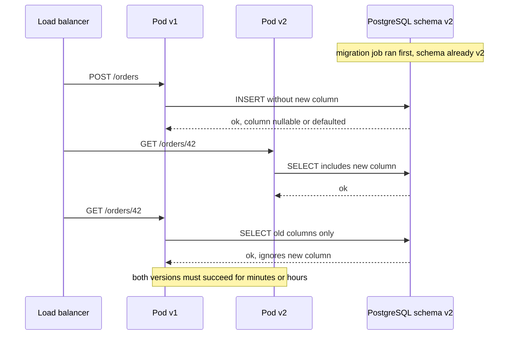
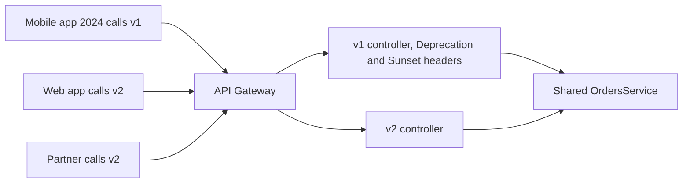

# Part 32 — Backward Compatibility: APIs, Schemas, Events and Clients

Two questions define this part. *How do you change a production database without breaking old application versions?* And *how do you change an API or an event without breaking old clients?* The two questions have the same answer, because they are the same problem: at every moment, more than one version of something is alive, and each version must understand what the others produce.

Old code and new code run side by side during every rolling deployment. A mobile app installed two years ago is still calling your API today. A Kafka consumer that was down for six hours will replay events written by three different producer versions. A Redis cache holds objects serialised by last week's code. A JWT issued by the previous release is presented to the next one. None of these can be "just upgraded"; all of them must be tolerated.

This part gives the rules and the recipes: additive-only changes, the tolerant reader, the N-1 schema rule and its link to expand/contract from Part 31 — Database Migrations, event schema evolution and registry compatibility modes, mobile client realities, contract testing in CI, and a decision table for every kind of change you will be asked to make. The senior mantra applies here as *can it return a wrong response?*, because the most dangerous incompatibility is not a crash; it is a field that silently means something different.

## 32.1 Why compatibility matters

#### Concept

Backward compatibility means a newer version of a producer (server, schema, event publisher) still works with older consumers (clients, pods, subscribers). Forward compatibility means an older consumer can cope with output from a newer producer. In a running system you need both, because deploys are not instantaneous and clients are not under your control.

#### Why does it exist?

Three facts of production life make compatibility mandatory rather than nice-to-have.

1. **Rolling deployments run mixed versions.** A Kubernetes rollout with 40 pods, `maxSurge: 25%` and `maxUnavailable: 0`, takes several minutes during which pods of version N and N+1 both serve traffic against one database, one Redis, one Kafka. The migration job ran before any N+1 pod started, so the schema is at N+1 while every pod is still N. If a rollout is paused or rolled back, that mixed state can last hours.
2. **Mobile apps live for years.** App-store updates are optional; a meaningful fraction of users run versions that are 6 to 24 months old. Every endpoint, field and enum value those versions use is frozen until you are willing to force an upgrade.
3. **Event consumers replay.** A consumer that was down for maintenance, crashed, or was rebuilt from scratch will read events written days or weeks ago, by producer versions that no longer exist, mixed with brand-new ones. The topic is a history book; every page must remain readable.

#### Mental model

Imagine a railway that runs trains from several decades on the same tracks. New track must accept old wheels; new signals must be readable by old drivers; old stations must not confuse new trains. You never close the line to replace everything at once. Every change is made so that whatever is on the tracks right now keeps running, and only later is the oldest stock retired.

#### How it works



The compatibility window is not a moment; it is a period with a defined start and end, and every artefact that crosses it (rows, cache entries, queued jobs, events, tokens, HTTP responses) must be understood by both ends. Part 15 and Part 31 covered the database mechanics; this part covers the rules that keep the window safe for everything else.

#### Production scenario

An e-commerce platform deploys 15 times a day across 8 services. Each deploy has a 4-minute mixed-version window. That is an hour a day during which any incompatible change would show up as errors for a fraction of users. The team's rule, enforced in review and CI: every change must be safe if version N+1 is fully deployed, if version N is fully deployed, and if both are half deployed, against the same database, cache and topics. They have not had a deploy-caused incident in two years, not because deploys are rare but because incompatibility is designed out.

#### Failure scenario

At 11:40 a deploy renamed the JSON field `deliveryEta` to `estimatedDeliveryAt` in the order response and shipped a new web client that read the new name. Web users saw an empty ETA for four minutes, which was annoying. The mobile app, which nobody had updated, showed no ETA for three weeks until a new version was approved and, even then, 30% of users had not upgraded a month later. The change was reverted by adding the old field back; it now returns both names indefinitely.

#### Interview questions

1. *Why is backward compatibility required even for an internal API you control both sides of?* Expected: rolling deploys, rollbacks, replayed events, cached data; both sides are never upgraded at the same instant.
2. *What is the difference between backward and forward compatibility?* Expected: new producer with old consumer vs old consumer with new producer output; you need both in practice.

## 32.2 API compatibility and versioning

#### Concept

An API is compatible with its existing clients when every request they already send still succeeds with the same meaning, and every response they receive still contains every field they rely on, with the same type and semantics. Versioning is the mechanism for offering a different contract to clients that opt in, while keeping the old contract alive for those that do not. Part 8 — REST API Design covered versioning mechanics; this section looks at them through the compatibility lens.

#### Why does it exist?

Because clients are code you do not deploy. The rule "never break a client" is not idealism; it is the direct consequence of not controlling when the client changes. Versioning exists so that breaking changes can be made *somewhere* (a new version) without being made *to anyone who did not ask*.

#### Mental model

Imagine a bank's paper forms. The bank can add an optional box to a form and old customers who ignore it are fine. The bank cannot remove the "account number" box, rename "amount" to "sum", or change "amount" from dollars to cents, without every customer who memorised the form filling it in wrong. If the bank wants a radically different form, it issues "Form 2" and keeps accepting "Form 1" for years, printing a notice on Form 1 saying when it will stop.

#### How it works

The rules of additive change, in order of importance:

1. **Add, never remove or rename.** New response fields are safe if clients ignore unknown fields (which they must; see the tolerant reader below). New optional request fields are safe with sensible defaults. Removing or renaming a field breaks every reader of it.
2. **Never change a type or a meaning.** `total` from number to string, `createdAt` from epoch seconds to ISO string, `price` from net to gross with the same name: each is a break, and the semantic one is the worst because nothing crashes; numbers are just wrong. New meaning gets a new name (`totalGross`) and the old field keeps its old meaning until sunset.
3. **Loosen validation freely; tighten it only with a version.** Accepting a wider range of input breaks nobody. Rejecting input that used to be accepted breaks whoever sent it.
4. **Default new required inputs.** If the server needs a new value, it must be able to compute a default when an old client omits it, or the field is not required in this version.
5. **Enum values are additive for producers only.** Adding a value to something the *server returns* breaks strict clients that switch over the enum; adding a value the *client may send* is safe for the server. Design clients to treat unknown values as "other" (section 32.5).
6. **The tolerant reader.** Every consumer, server-side included, ignores fields it does not understand and does not fail on extra data. In NestJS this means `ValidationPipe({ whitelist: true })` to strip unknown properties, and *not* `forbidNonWhitelisted: true` on public endpoints, otherwise a newer client sending a new optional field to an older server gets a 400.
7. **Deprecate with dates and headers.** RFC 9745 defines the `Deprecation` header (a `@` followed by a Unix timestamp), RFC 8594 the `Sunset` header (an HTTP date after which the endpoint may stop working), and `Link: <...>; rel="deprecation"` points to documentation. Clients and gateways can log and alert on them.
8. **Support N-1 versions at minimum.** When v3 ships, v2 keeps working for a published period (six months to two years for mobile-facing APIs); v1 may be sunset. Version negotiation: URI (`/v2/orders`), header (`X-API-Version: 2`), or media type (`Accept: application/vnd.shop.v2+json`). URI versioning is the most visible and cache-friendly; header versioning keeps URLs stable. Pick one and keep it.



#### NestJS example

URI versioning with a deprecated v1 and a v2 that changed a field's meaning (net to gross), plus an interceptor that adds deprecation headers to every v1 response.

```ts
// src/main.ts
import { NestFactory } from '@nestjs/core';
import { ValidationPipe, VersioningType } from '@nestjs/common';
import { AppModule } from './app.module';

async function bootstrap(): Promise<void> {
  const app = await NestFactory.create(AppModule);
  app.enableVersioning({ type: VersioningType.URI, defaultVersion: '1' });   // /v1/orders, /v2/orders
  app.useGlobalPipes(new ValidationPipe({
    whitelist: true,                 // tolerant reader: strip unknown properties silently
    forbidNonWhitelisted: false,     // never 400 a client for sending a field we do not know yet
    transform: true,
  }));
  await app.listen(3000);
}
void bootstrap();
```

```ts
// src/orders/dto/order-v1.response.ts and order-v2.response.ts
export class OrderV1Response {
  id!: string;
  status!: string;
  total!: number;            // v1 meaning: net amount in major units, e.g. 42.5. Frozen forever.
  deliveryEta!: string | null;
}

export class OrderV2Response {
  id!: string;
  status!: string;
  totalNetCents!: number;    // new names carry the new meaning; nothing is reused with a different meaning
  totalGrossCents!: number;
  estimatedDeliveryAt!: string | null;
}
```

```ts
// src/orders/orders-v1.controller.ts
import { Controller, Get, Param, UseInterceptors } from '@nestjs/common';
import { OrdersService } from './orders.service';
import { OrderV1Response } from './dto/order-v1.response';
import { DeprecationInterceptor } from '../common/deprecation.interceptor';

@Controller({ path: 'orders', version: '1' })
@UseInterceptors(new DeprecationInterceptor({
  deprecatedAt: new Date('2026-06-01T00:00:00Z'),
  sunsetAt: new Date('2027-06-01T00:00:00Z'),
  docs: 'https://developers.shop.example/deprecations/orders-v1',
}))
export class OrdersV1Controller {
  constructor(private readonly orders: OrdersService) {}

  @Get(':id')
  async get(@Param('id') id: string): Promise<OrderV1Response> {
    const o = await this.orders.getById(id);
    return {
      id: o.id, status: o.status,
      total: o.totalNetCents / 100,            // v1 contract preserved exactly
      deliveryEta: o.estimatedDeliveryAt?.toISOString() ?? null,
    };
  }
}
```

```ts
// src/orders/orders-v2.controller.ts
@Controller({ path: 'orders', version: '2' })
export class OrdersV2Controller {
  constructor(private readonly orders: OrdersService) {}

  @Get(':id')
  async get(@Param('id') id: string): Promise<OrderV2Response> {
    const o = await this.orders.getById(id);
    return {
      id: o.id, status: o.status,
      totalNetCents: o.totalNetCents, totalGrossCents: o.totalGrossCents,
      estimatedDeliveryAt: o.estimatedDeliveryAt?.toISOString() ?? null,
    };
  }
}
```

```ts
// src/common/deprecation.interceptor.ts
import { CallHandler, ExecutionContext, Injectable, NestInterceptor } from '@nestjs/common';
import { Observable } from 'rxjs';
import { Response } from 'express';

export interface DeprecationOptions { deprecatedAt: Date; sunsetAt: Date; docs: string }

@Injectable()
export class DeprecationInterceptor implements NestInterceptor {
  constructor(private readonly opts: DeprecationOptions) {}

  intercept(ctx: ExecutionContext, next: CallHandler): Observable<unknown> {
    const res = ctx.switchToHttp().getResponse<Response>();
    // RFC 9745: Deprecation is "@" + Unix seconds. RFC 8594: Sunset is an HTTP-date.
    res.setHeader('Deprecation', `@${Math.floor(this.opts.deprecatedAt.getTime() / 1000)}`);
    res.setHeader('Sunset', this.opts.sunsetAt.toUTCString());
    res.setHeader('Link', `<${this.opts.docs}>; rel="deprecation"`);
    return next.handle();
  }
}
```

A metric per version (`http_requests_total{version="1"}`) tells you when v1 traffic has fallen low enough to sunset, and *who* is still calling it (by API key or user agent) so you can contact them before the date.

#### Production scenario

A payments API serves 2,000 RPS across v1 (12%), v2 (85%) and v3 (3%, new). v1 has been deprecated for 9 months with a sunset in 3 months; its callers are two partner integrations and mobile versions older than 18 months. The team emailed the partners, added an in-app "please update" banner for old mobile versions, and will return `410 Gone` with a JSON body pointing to migration docs after the sunset date. The cost of keeping v1 alive was one controller and a mapping function; the cost of breaking it would have been two partner escalations.

#### Failure scenario

A "harmless cleanup" changed `amount` in the refund response from a string (`"42.50"`, a decimal preserved as text to avoid float issues) to a number (`42.5`). Same name, same value, different JSON type. A partner's strongly typed client (generated from the old OpenAPI file) threw on deserialisation; refunds appeared to fail on their side; they retried; the idempotency key saved the money but their support queue filled up. The lesson: type is part of the contract, and generated clients are strict.

#### Edge cases & failure modes

- **Gateway rewriting versions**: an API gateway that maps `/v2/*` to the backend's `/v1/*` for "compatibility" hides which version clients really use and breaks when the backend's v1 changes. Version at one layer only.
- **Default version drift**: `defaultVersion: '1'` today, `'2'` after a config change, and every unversioned caller silently changes contract. Never change the default; require explicit versions from new clients.
- **Response shape depends on a flag**: a feature flag that adds fields is additive; a flag that removes or renames is a break behind a switch.
- **Error format changes** (`{ message }` to `{ error: { code, message } }`) are breaking for clients that parse errors; version them like anything else or return both shapes during a transition.
- **Pagination changes** (offset to cursor) are breaking; introduce cursor pagination as new parameters and keep offset working, or version.
- **Header case and duplicates**: a client that sends `X-Api-Version` and a server that checks `X-API-Version` are fine (HTTP headers are case-insensitive), but a proxy that strips unknown headers is not.

#### How a Senior Backend Engineer thinks about this

They treat the public contract as a promise with a date. Additive change is the default and is free; anything else needs a version, a deprecation header, a sunset date, a metric showing who is affected, and a communication plan. They refuse to reuse a field name with a new meaning under any circumstances. They ask "which client versions will read this, and what will each do with it?" before approving a response change.

#### Common mistakes

- Renaming a field for "consistency".
- Changing a type "because it was wrong"; it was, and it still must stay until a version ends.
- `forbidNonWhitelisted: true` on public endpoints, making the server intolerant of newer clients.
- Deprecating without a date, so nothing ever gets removed and nothing ever gets migrated.

#### Interview questions

1. *Which API changes are backward compatible?* Expected: add optional fields, add endpoints, loosen validation, add enum values a client may send; not remove, rename, retype, tighten, or change meaning.
2. *How do you deprecate an endpoint properly?* Expected: `Deprecation` and `Sunset` headers, docs link, per-version metrics, communication, then `410`.
3. *A field must change from net to gross. How?* Expected: new field name, keep the old with its old meaning, deprecate, remove in a later version.
4. *What is the tolerant reader and how do you implement it in NestJS?* Expected: ignore unknown fields; `whitelist: true` without `forbidNonWhitelisted`.

#### Practical exercise

Take an existing `GET /orders/:id` and introduce v2 with cents-based totals and a renamed ETA field, keeping v1 byte-for-byte identical. Add the deprecation interceptor to v1 and a Prometheus counter by version. Acceptance criteria: a snapshot test of the v1 response fails if any byte changes; v1 responses carry the three headers; the counter distinguishes v1 and v2 traffic; `ValidationPipe` accepts a v1 request carrying an unknown field.
