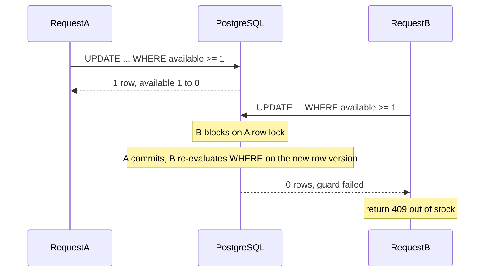
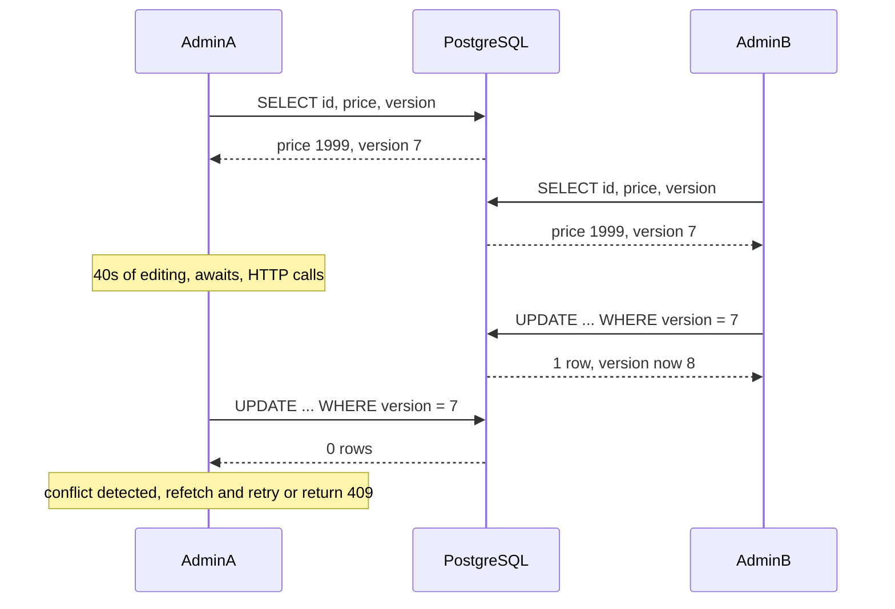

## 32.6 Atomic operations

#### Concept

An operation is **atomic** when no other actor can observe it half-done and no other actor can slip between its parts. The read, the decision and the write happen as one indivisible step.

This is the single most useful concurrency tool in a backend, and it is almost always the *cheapest* one, because you do not build it: PostgreSQL and Redis already serialise operations on the same row or the same key. Your job is to phrase the operation so that the decision happens inside the database instead of inside your JavaScript.

The whole of 32.2 was one bug: the decision (`if (inv.stock < qty)`) lived in Node, separated from the write by an `await`. Atomic operations fix that by moving the `if` into the `WHERE` clause.

#### Why does it exist?

Because in a distributed system, "read then decide then write" has an unavoidable gap, and any number of actors can act in that gap. Locks close the gap by excluding others. Optimistic concurrency closes it by detecting interference. Atomic operations close it by **never opening it**: there is only one statement, and the database executes statements on the same row one at a time.

The other reason is cost. A row lock plus a transaction is three round trips (`BEGIN`, `SELECT FOR UPDATE`, `UPDATE`, `COMMIT` — four, in fact). A conditional update is one. At 2,000 RPS on a hot SKU, that difference is the whole latency budget.

#### Mental model

Imagine a vending machine. You do not "check that a can is available, walk away, come back and take one". You put in a coin and press the button, and the machine either gives you a can or refuses. The check and the dispense are the same mechanical action. Two people pressing at the same instant do not both get the last can, because the machine has one mechanism and it moves once.

`UPDATE inventory SET available = available - 1 WHERE sku = 'x' AND available >= 1` is that mechanism. The row is the machine.

#### How it works

PostgreSQL takes a row-level exclusive lock for the duration of an `UPDATE` on a row, and under `READ COMMITTED` a second `UPDATE` targeting the same row **blocks, then re-evaluates its `WHERE` clause against the newly committed version of the row**. That re-evaluation is the entire trick. It is why the guard works and why an application-side `if` does not.

Step by step, with two requests for the last unit:

1. Request A: `UPDATE ... SET available = available - 1 WHERE sku='s1' AND available >= 1`. Row lock acquired, `available` goes 1 -> 0, one row affected.
2. Request B issues the identical statement 0.3 ms later. It blocks on A's row lock.
3. A commits.
4. B wakes, **re-reads the row** (this is `READ COMMITTED`'s "EvalPlanQual" behaviour), sees `available = 0`, re-checks `available >= 1`, and finds it false.
5. B updates **zero rows**.

The return value is the answer. `result.affected === 0` means "the guard failed" — someone else got there first, or the row does not exist. You do not need to know which happened; you need to know you did not get the stock.



**Trusting the row count is the discipline.** Every ORM gives it to you and most code throws it away. `affected`, `rowCount`, `[affectedCount]` — these are not diagnostics, they are the result of your business decision.

#### Practical example

The canonical inventory reservation, in raw SQL:

```sql
-- One statement. One round trip. Correct on 1 pod or 100.
UPDATE inventory
   SET available = available - $1,
       reserved  = reserved  + $1,
       updated_at = now()
 WHERE sku = $2
   AND available >= $1
RETURNING available, reserved;
```

`RETURNING` gives you the post-update values for free, so you can log the remaining stock or emit a low-stock event without a second query. If zero rows come back, the reservation failed.

Add a constraint as a backstop, so that even a future code path that forgets the guard cannot corrupt the data:

```sql
ALTER TABLE inventory
  ADD CONSTRAINT inventory_available_non_negative CHECK (available >= 0),
  ADD CONSTRAINT inventory_reserved_non_negative  CHECK (reserved  >= 0);
```

A `CHECK` constraint is cheap (evaluated per row modification, microseconds) and it converts a silent data-corruption bug into a loud `23514 check_violation`. Every invariant that can be expressed as a constraint should be one.

#### NestJS example

```ts
import { Injectable, ConflictException, NotFoundException } from '@nestjs/common';
import { InjectRepository } from '@nestjs/typeorm';
import { Repository } from 'typeorm';

@Injectable()
export class InventoryService {
  constructor(@InjectRepository(Inventory) private readonly repo: Repository<Inventory>) {}

  async reserve(sku: string, qty: number): Promise<{ remaining: number }> {
    const result = await this.repo
      .createQueryBuilder()
      .update(Inventory)
      // Raw expression so the arithmetic happens in PostgreSQL, not in Node.
      .set({
        available: () => 'available - :qty',
        reserved: () => 'reserved + :qty',
      })
      .where('sku = :sku AND available >= :qty', { sku, qty })
      .returning(['available'])
      .execute();

    // The row count IS the business answer. Never ignore it.
    if (result.affected === 0) {
      const exists = await this.repo.existsBy({ sku });
      if (!exists) throw new NotFoundException(`unknown sku ${sku}`);
      throw new ConflictException(`insufficient stock for ${sku}`);
    }
    return { remaining: result.raw[0].available as number };
  }
}
```

The extra `existsBy` runs only on the failure path, so it costs nothing in the common case and turns an ambiguous 409 into an accurate 404 or 409.

#### Upsert: `INSERT ... ON CONFLICT DO UPDATE`

The second most useful atomic statement. It replaces "select, if missing insert, else update" — a check-then-act race with three round trips — with one.

```sql
-- Daily per-user counter. Concurrent increments from many pods are safe.
INSERT INTO api_usage (user_id, day, calls)
VALUES ($1, current_date, 1)
ON CONFLICT (user_id, day)
DO UPDATE SET calls = api_usage.calls + EXCLUDED.calls
RETURNING calls;
```

Three details that matter:

- **`ON CONFLICT` needs a unique index** on exactly those columns. Without it you get `42P10 there is no unique or exclusion constraint matching the ON CONFLICT specification`. The index is the arbiter.
- **`EXCLUDED`** is the row you tried to insert. `api_usage.calls + EXCLUDED.calls` reads "the stored value plus the increment I brought", which is what you want; `EXCLUDED.calls` alone would overwrite.
- **`DO NOTHING` returns zero rows** when the row existed. That is how you implement "claim this, and tell me if I won":

```sql
-- Claim-before-act: only the pod that inserts a row may send the email.
INSERT INTO digest_sends (user_id, day)
VALUES ($1, current_date)
ON CONFLICT (user_id, day) DO NOTHING
RETURNING id;
-- 1 row  -> I won the claim, send the email
-- 0 rows -> someone else already claimed it, skip
```

This one pattern eliminates most duplicate-notification bugs in a fleet of workers. It is the fix from the 32.3 failure scenario, and it costs one statement.

For a status transition, put the current state in the `WHERE` and you get a race-free state machine:

```sql
-- Only PENDING orders may become PAID. Two concurrent webhooks: one wins.
UPDATE orders
   SET status = 'PAID', paid_at = now(), payment_id = $2
 WHERE id = $1
   AND status = 'PENDING'
RETURNING id;
```

Zero rows means "it was not `PENDING`" — already paid, or cancelled. That is exactly the duplicate-webhook guard you want, and it needs no lock and no idempotency table.

#### Redis atomics

Single Redis commands are atomic because Redis executes commands one at a time on one thread.

```ts
// Counters: INCR/DECR/INCRBY are atomic and return the new value.
const used = await redis.incr(`quota:${userId}:${hourBucket}`);
if (used === 1) await redis.expire(`quota:${userId}:${hourBucket}`, 3600);
if (used > 1000) throw new ThrottledException();
```

Note the gap: `INCR` then `EXPIRE` is two commands, and a crash between them leaves a key with no TTL. For anything that must be one decision, use a Lua script. Redis runs a script atomically end to end.

```ts
// Atomic check-and-set: reserve from a Redis-held stock counter, refusing to go negative.
const RESERVE = `
local stock = tonumber(redis.call("GET", KEYS[1]) or "0")
local qty = tonumber(ARGV[1])
if stock < qty then
  return -1
end
redis.call("DECRBY", KEYS[1], qty)
return stock - qty`;

const remaining = await redis.eval(RESERVE, 1, `stock:${sku}`, String(qty));
if (remaining === -1) throw new ConflictException('out of stock');
```

```ts
// Sliding-window rate limit in one atomic script: trim, count, add, expire.
const LIMIT = `
local now = tonumber(ARGV[1])
local windowMs = tonumber(ARGV[2])
local max = tonumber(ARGV[3])
redis.call("ZREMRANGEBYSCORE", KEYS[1], 0, now - windowMs)
local count = redis.call("ZCARD", KEYS[1])
if count >= max then return 0 end
redis.call("ZADD", KEYS[1], now, ARGV[4])
redis.call("PEXPIRE", KEYS[1], windowMs)
return 1`;
```

Redis is the right home for high-frequency counters (rate limits, quotas, view counts) because a Redis round trip is ~0.2-1 ms and it does not consume database connections. It is the *wrong* home for money and stock, because it is not durable in the same way your database is: an `AOF everysec` fsync policy can lose up to a second of writes on a crash, and a failover can lose more. A common production shape is Redis as a fast pre-filter (reject 95% of oversell attempts in 0.3 ms) with PostgreSQL as the authority (the conditional `UPDATE` that actually decides).

#### `Atomics` and `SharedArrayBuffer`

Inside one Node process, `worker_threads` are real OS threads with real parallelism, and they can share memory through a `SharedArrayBuffer`. Here `x++` genuinely is a data race at the CPU level, and `Atomics` is the primitive that makes it safe.

```ts
// main.ts: a shared counter across 4 workers, e.g. images processed.
import { Worker } from 'node:worker_threads';

const shared = new SharedArrayBuffer(8);       // 2 x Int32
const counters = new Int32Array(shared);       // [0] = processed, [1] = failed

for (let i = 0; i < 4; i++) {
  new Worker('./image-worker.js', { workerData: { shared } });
}

setInterval(() => {
  // Atomics.load reads a consistent value even while workers are writing.
  console.log('processed', Atomics.load(counters, 0), 'failed', Atomics.load(counters, 1));
}, 1000);
```

```ts
// image-worker.ts
import { workerData } from 'node:worker_threads';
const counters = new Int32Array(workerData.shared as SharedArrayBuffer);

async function handle(job: ImageJob) {
  try {
    await resize(job);
    Atomics.add(counters, 0, 1);      // atomic read-modify-write, no lock needed
  } catch {
    Atomics.add(counters, 1, 1);
  }
}
```

`Atomics.add`, `Atomics.sub`, `Atomics.compareExchange`, `Atomics.wait` and `Atomics.notify` are the full toolkit. Be honest about when you need it: for the vast majority of backend services, cross-worker state belongs in Redis or PostgreSQL, and `SharedArrayBuffer` is reserved for genuinely hot in-process data (a shared metrics buffer, a shared bitmap, a lock-free ring buffer for a worker pool). Reaching for it because it sounds fast is how you get an untestable bug.

#### The principle

**Push the decision into the layer that serialises it for you.**

You do not need to invent mutual exclusion. PostgreSQL already applies one `UPDATE` at a time per row. Redis already applies one command at a time. A unique index already refuses the second insert. Every time you can express your invariant as a `WHERE` clause, a constraint, or a single Redis command, you get correctness for free, with no lock to expire, no version to compare, and no retry to write.

Order of preference, always:

1. A constraint (unique, check, exclusion) — cannot be bypassed by any code path, ever.
2. A single atomic statement whose row count is the answer.
3. Optimistic concurrency with a version column (32.7).
4. A pessimistic row lock (32.8).
5. A distributed lock (32.5).

Each step down costs more round trips, more code, and more ways to be wrong.

#### Sequelize example

```ts
// Atomic decrement with a guard. Note the Op.gte in the WHERE.
const [affected] = await Inventory.update(
  {
    available: Sequelize.literal(`available - ${Number(qty)}`),
    reserved: Sequelize.literal(`reserved + ${Number(qty)}`),
  },
  { where: { sku, available: { [Op.gte]: qty } } },
);
if (affected === 0) throw new ConflictException('insufficient stock');

// Sequelize also ships a first-class atomic increment/decrement:
await Inventory.increment({ available: -qty, reserved: qty }, { where: { sku } });
// but note: `increment` has no conditional guard, so it CAN go negative.
// Use it only where a CHECK constraint or a guarded update backs it up.

// Upsert with a returned "did I create it" flag:
const [row, created] = await DigestSend.findOrCreate({
  where: { userId, day: today },
  defaults: { userId, day: today },
});
if (!created) return;   // someone else claimed it
```

`findOrCreate` runs inside a transaction and relies on the unique constraint; without the unique index on `(user_id, day)` it degrades into a check-then-act race. The constraint is doing the work, not the method name.

#### Production scenario

A ticketing platform sells 40,000 seats for a concert. At sale open, 180,000 requests arrive in 90 seconds, peaking at 6,500 RPS across 24 pods. Every reservation is one statement:

```sql
UPDATE ticket_pools SET remaining = remaining - $1
 WHERE pool_id = $2 AND remaining >= $1 RETURNING remaining;
```

Because they all target a handful of `pool_id` rows, those rows are **hot**: PostgreSQL serialises updates on the same row, so the maximum throughput per pool row is roughly `1 / row_update_duration`. Measured at ~0.35 ms per update including WAL, that is about 2,800 updates/s per pool. With 12 pools it comfortably handles the load; with one pool it would not, and the wait times would show up as `Lock:transactionid` wait events.

The mitigation for a single hot row is **sharding the counter**: split `remaining` into 16 rows (`pool_id, shard_id`), have each request pick a random shard, and fall back to scanning other shards when the chosen one is empty. The sum across shards is the true remaining count. Throughput multiplies by 16; the cost is that "how many are left" becomes a `SUM` and the last few units need a fallback loop. Do this only when you have measured the hot row, because it is real complexity.

Zero oversells across the sale. p99 for the reservation statement: 4 ms.

#### Failure scenario

At 11:03 a "gift card balance" endpoint started returning negative balances. The code looked atomic:

```ts
await this.repo.increment({ id: cardId }, 'balanceCents', -amountCents);   // no guard!
```

`increment` is atomic in the sense that the arithmetic happens in the database, so no update is lost. But it has **no condition**, so it happily takes a balance of 500 to -1,500. Two concurrent redemptions of a 5,000-cent card for 4,000 cents each both succeeded: the total was correct arithmetic on wrong business rules.

Two fixes shipped together. The statement became a guarded update returning a row count, and a `CHECK (balance_cents >= 0)` constraint was added so that no future code path can reproduce it. The constraint caught two more places in the codebase during the migration, which is the real argument for constraints: they audit your entire codebase for you.

#### Edge cases & failure modes

- **Ignoring the row count** turns a correct statement into a silent no-op. This is the number-one mistake in this section.
- **Atomic arithmetic without a guard** (`increment`, `INCRBY`) prevents lost updates but not invalid states.
- **`ON CONFLICT` without the matching unique index** fails at runtime with `42P10`.
- **`ON CONFLICT DO NOTHING` used as a claim without checking `RETURNING`** — you think you won when you did not.
- **Hot row serialisation**: one row updated 5,000 times a second is a queue. Watch `Lock:transactionid` waits; consider shard counters.
- **Two atomic statements are not atomic together.** Decrementing stock and inserting an order line are two decisions; wrap them in a transaction, or the pod can die between them.
- **String interpolation into `literal()`** is a SQL-injection hole unless the value is validated as a number. Note the `Number(qty)` in the Sequelize example, and validate `qty` as `@IsInt() @Min(1)` in the DTO.
- **`REPEATABLE READ` changes the semantics**: instead of re-evaluating the `WHERE` on the new row version, PostgreSQL raises `40001 could not serialize access due to concurrent update`. Your atomic update now needs a retry.
- **Redis durability**: a counter is not a ledger. `INCR` can be lost on failover.
- **`SharedArrayBuffer` requires care with `Atomics.wait`**, which blocks the calling thread — never call it on the main thread of a Node server.

#### How a Senior Backend Engineer thinks about this

They reach for an atomic statement first and treat every lock as an admission that the invariant could not be phrased in one statement. In code review, the trigger phrase is any `if` on a value that came from the database and is about to be written back.

They express invariants as constraints wherever possible, because a constraint is enforced against code that has not been written yet. They know that the row count is the return value of a business decision and they check it every time. And they know where the serialisation point is: for a hot SKU, the throughput ceiling is one row's update rate, and that number is measurable and plannable.

They are also honest about the limits: atomic statements work when the invariant is *local to one row*. "Do not let this customer's total open orders exceed 5" spans rows, and then you need a lock, a constraint over an aggregate (an `EXCLUDE` constraint, or a summary row updated in the same transaction), or serialisation by key.

To a product manager: "We ask the database to take the last item only if it is still there. It answers either 'done' or 'gone'. There is no in-between, so two customers can never both get it."

#### Common mistakes

- `findOne` then `save` for any counter or balance.
- Using `increment` without a guard or a `CHECK` constraint.
- Discarding `affected` / `rowCount`.
- `ON CONFLICT DO NOTHING` without checking whether a row came back.
- Putting money in Redis counters.
- Two separate atomic statements without a transaction around them.
- Sharding a counter before measuring that the row is actually hot.

#### Interview questions

1. *Write the atomic version of "reserve N units if available".* Expected: `UPDATE ... SET available = available - $1 WHERE sku = $2 AND available >= $1`, check row count. Follow-up: *what does zero rows mean, and how do you distinguish "not found" from "insufficient"?*
2. *Why does the `WHERE available >= qty` guard work under `READ COMMITTED` when an application-side `if` does not?* Expected: the second `UPDATE` blocks on the row lock and re-evaluates its predicate against the newly committed row version; an application `if` evaluated a value it read before the lock existed.
3. *What is `EXCLUDED` in `ON CONFLICT DO UPDATE`?* Expected: the proposed row; used to combine incoming and stored values.
4. *How would you implement "send this digest exactly once" across 5 worker pods?* Expected: `INSERT ... ON CONFLICT DO NOTHING RETURNING id` as a claim before the side effect; only the winner sends.
5. *What is the throughput ceiling for updates to a single row, and what do you do about it?* Expected: roughly `1 / update duration`, a few thousand per second; shard the counter, or batch, or move the counter to Redis with periodic reconciliation.
6. *When is `Atomics` with `SharedArrayBuffer` the right tool?* Expected: only for shared memory between `worker_threads` in one process; for cross-process state use Redis or PostgreSQL.
7. *Your atomic statement is correct but a pod crashes between it and the next statement. What now?* Expected: transactions for multi-statement atomicity; outbox for side effects; idempotency keys for retries.

#### Practical exercise

Seed `inventory(sku='s1', available=10)` and add `CHECK (available >= 0)`. Implement three versions of `reserve(sku, qty)`: (a) `findOne` + `save`, (b) unguarded `increment`, (c) guarded conditional `UPDATE` with a row-count check. Fire 50 concurrent requests for 1 unit each against each version.

Acceptance criteria: version (a) succeeds more than 10 times or throws optimistic errors; version (b) fails with `23514 check_violation` on some requests (proving arithmetic atomicity is not business correctness); version (c) succeeds exactly 10 times and returns 409 exactly 40 times, over 20 repeated runs, with p99 under 15 ms. Then repeat with `available = 100000` and 2,000 requests to measure the per-row throughput ceiling and observe `Lock:transactionid` wait events in `pg_stat_activity`.

## 32.7 Optimistic concurrency

#### Concept

Optimistic concurrency control (OCC) assumes conflicts are rare. You do not lock anything. You read the data along with a **version marker**, do your work, and when you write you say "apply this only if the version is still what I read". If someone else changed the row in between, the version has moved, your update affects zero rows, and you have *detected* the conflict instead of silently overwriting.

Then you decide what to do about it: retry with fresh data, or tell the user "someone else changed this, here is what it looks like now".

The contrast with pessimistic locking is about *when* you pay. Pessimistic pays a lock cost on every operation to prevent conflicts. Optimistic pays nothing on the happy path and pays a retry cost only when a conflict actually happens.

#### Why does it exist?

Because holding a lock across human thinking time is unacceptable. An admin opens a product edit form, gets a coffee, and saves 4 minutes later. A pessimistic lock would block every other write to that product for 4 minutes — and if the admin closes the tab, forever. Optimistic concurrency lets everyone read freely and only arbitrates at write time.

It also exists because most rows are not contended. In a catalogue of 200,000 products, the probability that two edits land on the same product in the same second is tiny. Paying a lock cost on all 200,000 to protect against the rare collision is bad economics.

#### Mental model

Imagine editing a shared document by taking a photocopy, marking it up, and handing it back with the note "this was revision 7". The clerk checks: if the master is still revision 7, they accept your changes and it becomes revision 8. If the master is already revision 9, they hand your copy back: "someone else edited this, take a fresh copy and redo your changes."

Nobody was blocked while you wrote. The arbitration happened at the counter.

#### How it works

1. Add an integer `version` column to the table, defaulting to 1.
2. Read the row, keeping the version.
3. Do the work in the application (validation, pricing, whatever), possibly across several `await`s.
4. Write with the version in the `WHERE` clause and increment it in the `SET`.
5. If the row count is zero, someone else wrote first. Retry or surface a conflict.

```sql
UPDATE products
   SET price_cents = $1,
       title       = $2,
       version     = version + 1,
       updated_at  = now()
 WHERE id = $3
   AND version = $4          -- the version we read
RETURNING version;
-- 1 row  -> our write applied, new version returned
-- 0 rows -> stale; someone else won
```



Compare that diagram with the oversell sequence in 32.2. It is the same interleaving — both actors read the same value, both act across an `await`, both write. The only difference is the `AND version = 7`, and it converts a silent lost update into a detected conflict.

**The version can be many things.** An integer counter is clearest. `updated_at` works but is dangerous: two updates within the same clock tick (and `now()` is constant for a whole transaction in PostgreSQL) compare equal. A content hash works and additionally makes "no actual change" a non-conflict. Use an integer unless you have a reason.

#### NestJS example

The retry loop is the part people get wrong, so here it is properly, with jitter and a bounded attempt count:

```ts
import { Injectable, ConflictException, Logger } from '@nestjs/common';
import { InjectRepository } from '@nestjs/typeorm';
import { Repository } from 'typeorm';

@Injectable()
export class ProductPricingService {
  private readonly log = new Logger(ProductPricingService.name);

  constructor(@InjectRepository(Product) private readonly repo: Repository<Product>) {}

  async applyDiscount(productId: string, percent: number): Promise<Product> {
    const maxAttempts = 4;

    for (let attempt = 1; attempt <= maxAttempts; attempt++) {
      // 1. Read fresh state, including the version.
      const product = await this.repo.findOneByOrFail({ id: productId });

      // 2. Compute. This may involve awaits; the row is NOT locked meanwhile.
      const newPrice = Math.round(product.priceCents * (1 - percent / 100));
      if (newPrice < product.floorPriceCents) {
        throw new ConflictException('discount would breach floor price');
      }

      // 3. Conditional write on the version we read.
      const result = await this.repo
        .createQueryBuilder()
        .update(Product)
        .set({ priceCents: newPrice, version: () => 'version + 1' })
        .where('id = :id AND version = :version', { id: productId, version: product.version })
        .execute();

      if (result.affected === 1) return { ...product, priceCents: newPrice, version: product.version + 1 };

      // 4. Conflict. Back off a little so two retriers do not collide again.
      this.log.debug(`optimistic conflict on ${productId}, attempt ${attempt}`);
      await new Promise((r) => setTimeout(r, Math.random() * 10 * attempt));
    }

    throw new ConflictException('product is being modified concurrently, please retry');
  }
}
```

The critical detail: **the retry must re-read**. A retry that reuses the stale `product` object just fails again forever. And the loop must be bounded — under heavy contention an unbounded optimistic retry loop is a livelock that burns CPU and connections while making no progress. When you hit the bound, that is a signal that this row is contended and should have used a pessimistic lock or an atomic statement.

#### TypeORM example

TypeORM has first-class support via `@VersionColumn`:

```ts
import { Entity, PrimaryGeneratedColumn, Column, VersionColumn } from 'typeorm';

@Entity('products')
export class Product {
  @PrimaryGeneratedColumn('uuid') id: string;
  @Column() title: string;
  @Column('int') priceCents: number;
  @Column('int') floorPriceCents: number;

  // TypeORM increments this on every save() and uses it in the WHERE clause.
  @VersionColumn() version: number;
}
```

```ts
import { OptimisticLockVersionMismatchError } from 'typeorm';

try {
  const product = await this.repo.findOneByOrFail({ id });
  product.priceCents = newPrice;
  await this.repo.save(product);             // UPDATE ... WHERE id = ? AND version = ?
} catch (err) {
  if (err instanceof OptimisticLockVersionMismatchError) {
    throw new ConflictException('the product was modified by someone else');
  }
  throw err;
}
```

You can also assert an expected version explicitly, which is how you wire an HTTP `If-Match` header to the database:

```ts
// Throws OptimisticLockVersionMismatchError if the stored version is not 7.
await this.repo.findOne({ where: { id }, lock: { mode: 'optimistic', version: 7 } });
```

Two things to know about `@VersionColumn`. First, it only applies to `save()` on a loaded entity — a `createQueryBuilder().update()` bypasses it entirely, so a codebase that mixes both styles has a hole. Second, `save()` on an entity with no changes still bumps the version in some configurations, which manufactures conflicts. Decide on one style per entity and be consistent.

#### Sequelize example

```ts
import { Model, DataTypes } from 'sequelize';

Product.init(
  { title: DataTypes.STRING, priceCents: DataTypes.INTEGER },
  {
    sequelize,
    // Adds a `version` column and appends `AND version = ?` to every instance update.
    version: true,
    tableName: 'products',
  },
);

import { OptimisticLockError } from 'sequelize';

try {
  const product = await Product.findByPk(id, { rejectOnEmpty: true });
  product.priceCents = newPrice;
  await product.save();
} catch (err) {
  if (err instanceof OptimisticLockError) {
    throw new ConflictException('the product was modified by someone else');
  }
  throw err;
}
```

`version: true` also names the column `version` by default; you can rename it with `version: 'revision'`. As with TypeORM, `Product.update({...}, { where })` at the model level does **not** apply the version check — only instance `save()` does.

#### HTTP ETags and `If-Match`: the same idea at the API layer

Optimistic concurrency is not a database technique that happens to be useful over HTTP; it is the *same protocol*, and HTTP standardised it first.

```text
GET /products/p-123
200 OK
ETag: "7"

PUT /products/p-123
If-Match: "7"

-> 200 OK   ETag: "8"        (nobody else wrote; your update applied)
-> 412 Precondition Failed   (someone else wrote; refetch and retry)
-> 428 Precondition Required (you sent no If-Match; we refuse blind writes)
```

Wiring it end to end in NestJS is a small interceptor plus a check in the service:

```ts
@Injectable()
export class ETagInterceptor implements NestInterceptor {
  intercept(ctx: ExecutionContext, next: CallHandler): Observable<unknown> {
    const res = ctx.switchToHttp().getResponse<Response>();
    return next.handle().pipe(
      tap((body) => {
        const version = (body as { version?: number })?.version;
        if (version !== undefined) res.setHeader('ETag', `"${version}"`);
      }),
    );
  }
}
```

```ts
@Put(':id')
async update(
  @Param('id') id: string,
  @Headers('if-match') ifMatch: string | undefined,
  @Body() dto: UpdateProductDto,
) {
  if (!ifMatch) throw new HttpException('If-Match required', HttpStatus.PRECONDITION_REQUIRED); // 428
  const expected = Number(ifMatch.replace(/"/g, ''));
  const result = await this.repo.createQueryBuilder().update(Product)
    .set({ ...dto, version: () => 'version + 1' })
    .where('id = :id AND version = :v', { id, v: expected })
    .execute();
  if (result.affected === 0) throw new HttpException('stale', HttpStatus.PRECONDITION_FAILED); // 412
  return this.repo.findOneByOrFail({ id });
}
```

Returning **428 when `If-Match` is missing** is the part most APIs skip, and it is what turns the mechanism from advisory into enforced. Without it, an old client that does not send the header silently gets last-write-wins. (See Part 11 — Networking and HTTP, for ETag semantics; strong versus weak validators matter for caching but not for this use.)

#### Production scenario

A product-information system serves 1,200 internal users editing a catalogue of 340,000 SKUs. Peak write rate: 40 edits per second. Median time a form is open: 95 seconds. Pessimistic locking here would be a disaster — a lock held for 95 seconds at 40 writes/s means enormous queueing, plus abandoned tabs holding locks indefinitely.

With versions and `If-Match`, the measured conflict rate is 0.08% of saves, about 2 per hour. Those 2 get a clear "this changed while you were editing, here is a diff" dialogue rather than a silent overwrite. Total cost: one integer column, one header, one 412 handler. Total lock contention: zero.

#### Failure scenario

At 14:40 the warehouse team reported that stock adjustments were "disappearing". A bulk-adjustment tool applied deltas to 2,000 SKUs with an optimistic retry loop, running concurrently with the normal reservation traffic.

The reservation traffic used the atomic `UPDATE ... SET available = available - $1 WHERE sku = $2 AND available >= $1` and did **not** touch the version column. The bulk tool read a SKU, computed `available = read + delta`, and wrote with `AND version = $v`. Because reservations never bumped the version, the bulk tool's version check always passed — and its write of an absolutely-computed `available` silently discarded every reservation that had happened in between.

The lesson: **optimistic concurrency only works if every writer participates.** One writer that bypasses the version column invalidates the scheme for all of them. Two fixes: a database trigger that bumps `version` on every `UPDATE` regardless of the statement, and changing the bulk tool to relative arithmetic (`available = available + $delta`), which is atomic and does not need a version at all.

```sql
CREATE OR REPLACE FUNCTION bump_version() RETURNS trigger AS $$
BEGIN NEW.version := OLD.version + 1; RETURN NEW; END;
$$ LANGUAGE plpgsql;

CREATE TRIGGER inventory_bump_version BEFORE UPDATE ON inventory
FOR EACH ROW EXECUTE FUNCTION bump_version();
```

#### Edge cases & failure modes

- **A writer that bypasses the version** breaks the scheme silently. Enforce with a trigger.
- **Unbounded retry loops** livelock under contention and burn connections.
- **Retrying without re-reading** fails forever.
- **Retrying non-idempotent work** duplicates side effects; the retried block must be pure.
- **`updated_at` as the version** collides within one transaction's `now()`.
- **High contention** turns OCC into a throughput disaster: at 60% conflict rate you do 2.5 attempts per success. Switch to pessimistic.
- **Version overflow** on `int4` after 2.1 billion updates — irrelevant for most rows, real for a hot counter row. Use `bigint` there, or do not use OCC for counters.
- **Lost `If-Match`** from a proxy that strips headers silently downgrades to last-write-wins.
- **Weak ETags** (`W/"7"`) are not usable for `If-Match`; use strong validators.
- **Conflict resolution UX**: returning 409/412 with no information forces the user to redo work. Return the current representation so the client can diff.

#### How a Senior Backend Engineer thinks about this

They pick optimistic when they can estimate the conflict rate and it is low. The rule of thumb they carry: if more than about 10% of writes conflict, the retry cost exceeds the lock cost and pessimistic is better. Between 1% and 10%, either works and the deciding factor is how long the read-to-write window is; over human think-time, optimistic always wins because you cannot hold a lock through a coffee break.

They insist that the version discipline be total, enforced at the database level, because partial adoption is worse than none. They design the *conflict experience* deliberately — a 412 with the current representation and a diff is a feature; a 500 is a bug. And they treat a rising conflict rate as a monitoring signal that a row has become hot and the design needs to change.

They also know when to skip both: if the update is relative (`+= delta`) rather than absolute (`= value`), the atomic statement from 32.6 is better than either, because it composes instead of conflicting.

To a product manager: "Two people edited the same product. Instead of the second save quietly wiping out the first, we stop and show them what changed. It costs us a rare extra click and saves us silently losing someone's work."

#### Common mistakes

- Adding a version column but leaving one write path that ignores it.
- Retrying without refetching.
- Unbounded retries.
- Using optimistic concurrency for a hot counter (use atomic arithmetic).
- Returning 409 without the current state.
- Not sending 428 for a missing `If-Match`, so old clients silently overwrite.
- Mixing TypeORM `save()` (version-checked) and query-builder `update()` (not) on the same entity.

#### Interview questions

1. *Explain optimistic concurrency and write the SQL.* Expected: version column, `UPDATE ... WHERE id = ? AND version = ?`, `SET version = version + 1`, check row count.
2. *When is optimistic better than pessimistic, and where is the crossover?* Expected: low conflict rate, long read-to-write window, human think-time; crossover around 10% conflicts; measure it.
3. *How do ETags and `If-Match` relate to a version column?* Expected: the same protocol at the HTTP layer; ETag carries the version; 412 on mismatch; 428 when the client omits the precondition.
4. *A team added a version column but still lost updates. What went wrong?* Expected: a write path that does not check or bump the version; enforce with a trigger.
5. *Your optimistic retry loop is spinning at 8 attempts per success. What do you do?* Expected: the row is hot; switch to a pessimistic lock, an atomic relative update, or serialisation by key through a queue.
6. *Why must the retried block be side-effect free?* Expected: at-least-once execution; the block runs multiple times; emails and charges must be outside it or idempotent.

#### Practical exercise

Add `@VersionColumn` to a `Product` entity. Build `PUT /products/:id` with `If-Match`/ETag returning 200, 412 and 428 correctly. Write an integration test that reads a product in two "sessions", writes from session B, then writes from session A.

Acceptance criteria: A gets 412; the response body contains the current representation including the new version; a request without `If-Match` gets 428; after A refetches and retries, it gets 200 with version incremented by exactly 1. Then add a second write path using the query builder that forgets to bump the version, prove that A's stale write now succeeds, and fix it with a `BEFORE UPDATE` trigger.

## 32.8 Pessimistic concurrency

#### Concept

Pessimistic concurrency control assumes conflicts are likely, so it prevents them rather than detecting them. You take an exclusive lock on the rows you are about to change, do your work while holding it, and release it at commit. Anyone else who wants those rows waits.

In PostgreSQL this is `SELECT ... FOR UPDATE` inside a transaction. The lock is held from the moment the `SELECT` returns until `COMMIT` or `ROLLBACK`. There is no way to hold it longer and no way to leak it past the transaction, which makes it much safer to operate than a distributed lock.

#### Why does it exist?

Because some critical sections have several steps and must not be retried. Moving money is the canonical case: read both balances, verify sufficiency, apply limits, write both rows, write a ledger entry. That is five decisions across two rows, and "detect the conflict and redo it" is both slower and more dangerous than "hold the rows for 3 milliseconds".

It also exists because under high contention, optimistic retries do worse than useless work. A lock queue at least makes progress in order; a retry storm burns CPU and connections to accomplish the same serialisation, badly.

#### Mental model

Imagine a bank vault with a sign-in sheet. Before touching account records, you sign in and take the key. Anyone else who arrives waits at the door in the order they came. You do your work, put the records back, and hand over the key.

Nobody's work is ever thrown away and redone. The cost is that the queue is real, and if you take twenty minutes inside the vault, everyone else waits twenty minutes.

#### How it works

```sql
BEGIN;

-- Locks the row exclusively until COMMIT/ROLLBACK. Other transactions'
-- SELECT ... FOR UPDATE and UPDATE on this row will block here.
SELECT id, balance_cents
  FROM wallets
 WHERE id = $1
   FOR UPDATE;

-- Now nothing can change the row underneath us. The check is safe.
-- (application decides: sufficient funds? limits? fraud rules?)

UPDATE wallets SET balance_cents = balance_cents - $2 WHERE id = $1;
INSERT INTO ledger (wallet_id, delta_cents, reason) VALUES ($1, -$2, 'purchase');

COMMIT;   -- lock released here
```

The variants, and when each matters:

| Clause | Lock strength | Use it when |
|---|---|---|
| `FOR UPDATE` | strongest row lock; blocks other `FOR UPDATE`, `FOR NO KEY UPDATE`, `FOR SHARE`, and updates | you will modify the row, including any key columns |
| `FOR NO KEY UPDATE` | weaker; still blocks writers but permits `FOR KEY SHARE` | you will update non-key columns; lets concurrent inserts of child rows referencing this row proceed |
| `FOR SHARE` | shared read lock; blocks writers, allows other readers to share | you must guarantee the row does not change while you read related data |
| `FOR KEY SHARE` | weakest; only blocks key changes and deletes | taken implicitly by foreign-key inserts |
| `NOWAIT` | do not queue; raise `55P03 lock_not_available` immediately | a fast API where waiting is worse than failing |
| `SKIP LOCKED` | silently skip rows another transaction has locked | job queues: give me any unclaimed row |

`FOR NO KEY UPDATE` deserves a mention because it prevents a real class of deadlock: inserting a child row (an `order_lines` row referencing `orders`) takes `FOR KEY SHARE` on the parent. A parent update using `FOR UPDATE` blocks those inserts; using `FOR NO KEY UPDATE` does not. If your `UPDATE` does not touch the primary key or any column referenced by a foreign key, PostgreSQL actually chooses `FOR NO KEY UPDATE` for you on a plain `UPDATE` — but an explicit `SELECT ... FOR UPDATE` takes the stronger lock.

`NOWAIT` is how you keep a user-facing endpoint fast under contention:

```sql
SELECT * FROM orders WHERE id = $1 FOR UPDATE NOWAIT;
-- ERROR: 55P03 could not obtain lock on row in relation "orders"
```

Map `55P03` to `409 Conflict` or `503` with a `Retry-After`. A 20 ms failure the client can retry is usually better than a 30-second queue that ends in a gateway timeout anyway.

`SKIP LOCKED` is the job-queue primitive and gets its full treatment in 32.14:

```sql
-- Each worker claims a different row. No worker ever waits.
WITH claimed AS (
  SELECT id FROM jobs
   WHERE status = 'PENDING' AND run_after <= now()
   ORDER BY priority DESC, run_after
   FOR UPDATE SKIP LOCKED
   LIMIT 20
)
UPDATE jobs SET status = 'RUNNING', claimed_at = now(), claimed_by = $1
  FROM claimed WHERE jobs.id = claimed.id
RETURNING jobs.*;
```

Without `SKIP LOCKED`, twenty workers all queue on the same top-priority row and process the queue serially. With it, they fan out perfectly.

#### TypeORM example

```ts
await this.dataSource.transaction(async (manager) => {
  // Repository API
  const wallet = await manager.findOne(Wallet, {
    where: { id: walletId },
    lock: { mode: 'pessimistic_write' },       // SELECT ... FOR UPDATE
  });
  if (!wallet) throw new NotFoundException();
  if (wallet.balanceCents < amountCents) throw new ConflictException('insufficient funds');

  wallet.balanceCents -= amountCents;
  await manager.save(wallet);
  await manager.insert(LedgerEntry, { walletId, deltaCents: -amountCents, reason });
});
```

```ts
// Query builder, with the finer-grained modes and SKIP LOCKED
const jobs = await manager
  .createQueryBuilder(Job, 'j')
  .where('j.status = :s AND j.runAfter <= now()', { s: 'PENDING' })
  .orderBy('j.priority', 'DESC')
  .limit(20)
  .setLock('pessimistic_write')
  .setOnLocked('skip_locked')      // FOR UPDATE SKIP LOCKED
  .getMany();
```

TypeORM's lock modes map as: `pessimistic_read` -> `FOR SHARE`, `pessimistic_write` -> `FOR UPDATE`, `pessimistic_partial_write` -> `FOR UPDATE SKIP LOCKED`, `pessimistic_write_or_fail` -> `FOR UPDATE NOWAIT`, `for_no_key_update` -> `FOR NO KEY UPDATE`. In recent versions `setLock('pessimistic_write')` combined with `setOnLocked('skip_locked' | 'nowait')` is the clearer form.

**A lock outside a transaction is an error, not a silent no-op** — TypeORM throws `PessimisticLockTransactionRequiredError`. That is a good design; a lock that is released immediately would be worse than useless.

#### Sequelize example

```ts
await sequelize.transaction(async (t) => {
  const wallet = await Wallet.findByPk(walletId, {
    transaction: t,
    lock: t.LOCK.UPDATE,          // FOR UPDATE
    rejectOnEmpty: true,
  });
  if (wallet.balanceCents < amountCents) throw new ConflictException('insufficient funds');
  await wallet.decrement('balanceCents', { by: amountCents, transaction: t });
  await LedgerEntry.create({ walletId, deltaCents: -amountCents }, { transaction: t });
});
```

```ts
// Job claiming with SKIP LOCKED
const jobs = await Job.findAll({
  where: { status: 'PENDING' },
  order: [['priority', 'DESC']],
  limit: 20,
  lock: t.LOCK.UPDATE,
  skipLocked: true,
  transaction: t,
});
```

`t.LOCK.UPDATE`, `t.LOCK.SHARE`, `t.LOCK.NO_KEY_UPDATE` and `t.LOCK.KEY_SHARE` are the available modes. As with TypeORM, `lock` without `transaction` is meaningless — Sequelize will not apply it.

#### Consistent lock ordering

This is the rule that keeps pessimistic locking from turning into 32.4's deadlocks. When a transaction locks more than one row, **always lock in a deterministic global order**, and the primary key is the obvious choice.

```ts
// Transfer between two wallets. Locking in id order makes deadlock impossible:
// two concurrent transfers A->B and B->A both lock the lower id first.
await this.dataSource.transaction(async (manager) => {
  const ids = [fromId, toId].sort();          // THE fix, in one line

  const wallets = await manager.find(Wallet, {
    where: { id: In(ids) },
    order: { id: 'ASC' },                     // ORDER BY matters: it fixes the lock sequence
    lock: { mode: 'pessimistic_write' },
  });

  const from = wallets.find((w) => w.id === fromId)!;
  const to = wallets.find((w) => w.id === toId)!;
  if (from.balanceCents < amountCents) throw new ConflictException('insufficient funds');

  await manager.decrement(Wallet, { id: fromId }, 'balanceCents', amountCents);
  await manager.increment(Wallet, { id: toId }, 'balanceCents', amountCents);
  await manager.insert(Transfer, { fromId, toId, amountCents });
});
```

Note that `ORDER BY id` on the locking `SELECT` is doing real work: PostgreSQL acquires row locks in the order rows are produced, so an unordered `SELECT ... WHERE id IN (...) FOR UPDATE` can lock them in either order depending on the plan. Both the JavaScript `sort()` and the SQL `ORDER BY` should be there; the SQL one is what actually binds.

#### Production scenario

A wallet service at 900 RPS with 4.2 million wallets. Every debit uses `FOR UPDATE`. Because the key space is wide, contention per wallet is essentially zero: the lock is held for a measured p50 of 2.1 ms and p99 of 8 ms (two statements plus commit), and the endpoint's p99 is 19 ms end to end.

The exception is 40 "merchant settlement" wallets that receive thousands of credits per minute. Those rows *are* hot: throughput per row is bounded by `1 / hold_time`, about 470/s at 2.1 ms. When one merchant's Black Friday traffic pushed past that, `Lock:transactionid` wait events appeared and p99 for that merchant's credits went to 900 ms.

The fix was not a bigger lock or a smaller one. It was to stop updating the merchant balance synchronously: credits became inserts into a `ledger` table (no contention at all, inserts do not conflict), and the merchant balance became a materialised aggregate refreshed every 5 seconds plus a real-time `SUM` over the last 5 seconds when exact numbers were needed. Contention went to zero because the hot row stopped existing.

That is the senior move: when a row is hot, the best lock is often no row.

#### Failure scenario

At 16:20 checkout latency went from 40 ms to 8 seconds and the error rate hit 18%. `pg_stat_activity` showed 90 sessions in `Lock` wait, all blocked by a single PID that had been `idle in transaction` for 6 minutes.

The blocker was a new "apply promo code" step. It did:

```ts
await this.dataSource.transaction(async (manager) => {
  const cart = await manager.findOne(Cart, { where: { id }, lock: { mode: 'pessimistic_write' } });
  const promo = await this.promoApi.validate(dto.code);      // external HTTP, p99 4s, no timeout
  // ...
});
```

The promo provider had degraded to 6-second responses. Every checkout held its cart row lock — and a pool connection — for 6 seconds. The pod's pool of 20 emptied in under a second at 40 RPS, and then even requests that touched nothing waited for a connection.

Fixes, in the order they were applied: a 800 ms timeout on the promo client (mitigation, 16:28); moving the promo validation *before* the transaction and passing the result in (real fix, next deploy); a lint rule banning `this.<anything>Api` calls inside a `transaction()` callback; and an alert on `idle in transaction` sessions older than 5 seconds. The one-line summary in the post-mortem: **a transaction is a lock, and an external call inside one gives a third party the ability to lock your database.**

#### Edge cases & failure modes

- **Locking a row that does not exist locks nothing.** `SELECT ... FOR UPDATE WHERE id = $1` on a missing row returns zero rows and no lock, so two concurrent inserts still race. Use a unique constraint, or `INSERT ... ON CONFLICT`, or an advisory lock on the key.
- **Inconsistent lock order** -> deadlock (32.4). Sort by primary key, and put `ORDER BY` on the locking select.
- **Long transactions** hold locks and connections, block `VACUUM`, and grow table bloat.
- **External calls inside the transaction** — the incident above.
- **`FOR UPDATE` with a `JOIN`** locks rows in every table involved unless you use `FOR UPDATE OF <table>`; this surprises people badly.
- **`FOR UPDATE` on a `LEFT JOIN`'s nullable side** raises an error in PostgreSQL.
- **Lock waits are invisible** unless `log_lock_waits = on`.
- **Replica reads cannot take row locks**; `FOR UPDATE` on a hot standby raises an error. Route locking reads to the primary.
- **`NOWAIT` returns `55P03`**, which must be mapped to a retryable HTTP status or it looks like a 500.
- **`SKIP LOCKED` breaks ordering guarantees**: workers get *some* pending row, not necessarily the highest priority one, if the top rows are locked.
- **Lock escalation does not exist in PostgreSQL** (unlike SQL Server), but locking 50,000 rows still consumes memory and time; batch it.
- **PgBouncer in transaction pooling mode** is fine with row locks (they are transaction-scoped) but breaks session-level advisory locks.

#### How a Senior Backend Engineer thinks about this

They choose pessimistic when the operation is short, contended, and must not be redone — money movement, seat assignment, state machines with side effects. They choose it deliberately, not by default, and they measure the hold time, because hold time is the throughput ceiling.

Their non-negotiables inside a locked transaction: no HTTP calls, no queue publishes, no `sleep`, no user interaction, no unbounded loops. Everything that can be computed before the lock is computed before the lock. The critical section is read, decide, write, commit.

They lock in primary-key order every time, without waiting for a deadlock to teach them. They know `SKIP LOCKED` exists and use it for every claim-a-job pattern. And when a row becomes hot, they ask whether the row needs to exist at all — appending to a ledger and aggregating later removes contention that no locking strategy can.

To a product manager: "For money we make everyone queue for a few milliseconds. It's slower than the alternative by an amount nobody can perceive, and it means we can never pay out the same balance twice."

#### Optimistic versus pessimistic: the decision table

| Factor | Choose optimistic | Choose pessimistic |
|---|---|---|
| Conflict rate | under ~5% | over ~10% |
| Read-to-write window | long (human think time, external calls) | short (single-digit ms) |
| Cost of redoing the work | low, pure computation | high, or has side effects |
| Consequence of a lost update | recoverable, user-visible conflict is acceptable | unacceptable, e.g. money |
| Number of rows | one row, simple write | several rows in one invariant |
| Client type | browser form, mobile app, admin UI | server-to-server, worker, ledger |
| Typical example | product edit, profile update, CMS | wallet debit, seat booking, stock at a hot SKU |

And above both: if the write is *relative* rather than absolute, use the atomic statement from 32.6 and choose neither.

#### Common mistakes

- `SELECT ... FOR UPDATE` outside a transaction (a no-op or an error).
- Calling an external API while holding a row lock.
- Locking rows in whatever order the client sent them.
- Forgetting that locking a nonexistent row locks nothing.
- Using `FOR UPDATE` where a conditional atomic `UPDATE` would do.
- Using `FOR UPDATE` in a job poller instead of `FOR UPDATE SKIP LOCKED`, serialising all workers.
- Holding a lock across a queue publish, so a slow broker becomes a database problem.
- No timeout, so a lock wait becomes a gateway timeout with the connection still held.

#### Interview questions

1. *When do you choose pessimistic over optimistic locking?* Expected: high contention, short transactions, work that must not be redone, money movement. Follow-up: *what is the crossover conflict rate, and how would you measure it?*
2. *What is the difference between `FOR UPDATE`, `FOR NO KEY UPDATE` and `FOR SHARE`?* Expected: strength, and specifically that `FOR NO KEY UPDATE` does not block foreign-key inserts referencing the row.
3. *What does `SKIP LOCKED` do and why is it essential for job queues?* Expected: skips rows locked by other transactions so each worker claims different rows instead of queueing on the same one; the cost is losing strict ordering.
4. *Two transfers, A to B and B to A, run concurrently. What happens and how do you prevent it?* Expected: deadlock; lock in primary-key order with `ORDER BY id` on the locking select.
5. *Why is `SELECT ... FOR UPDATE` on a row that does not exist dangerous?* Expected: it locks nothing; two inserts race; you need a unique constraint or advisory lock on the key.
6. *What breaks if you make an HTTP call inside a locked transaction?* Expected: hold time becomes the third party's latency; row locks and a pool connection are held; contention and pool exhaustion; a dependency's slowness becomes your outage.
7. *How do you keep a user-facing endpoint responsive when a row is contended?* Expected: `NOWAIT` mapped to 409/503 with `Retry-After`, plus shortening the critical section; or removing the hot row entirely with an append-and-aggregate design.

#### Practical exercise

Build a `POST /transfers` endpoint that moves money between two wallets inside a transaction with `pessimistic_write` locks. Write an integration test that fires 200 concurrent transfers among 4 wallets in random directions.

Acceptance criteria: (a) without id-ordered locking you can reproduce `40P01` deadlocks; (b) with id-ordered locking and `ORDER BY id` on the locking select, zero deadlocks over 20 runs of 200 transfers; (c) the sum of all wallet balances is unchanged after every run; (d) the ledger row count equals the number of successful transfers exactly. Then add `NOWAIT`, measure the failure rate under 200 concurrent transfers against 2 wallets, and compare p99 latency with and without it.
