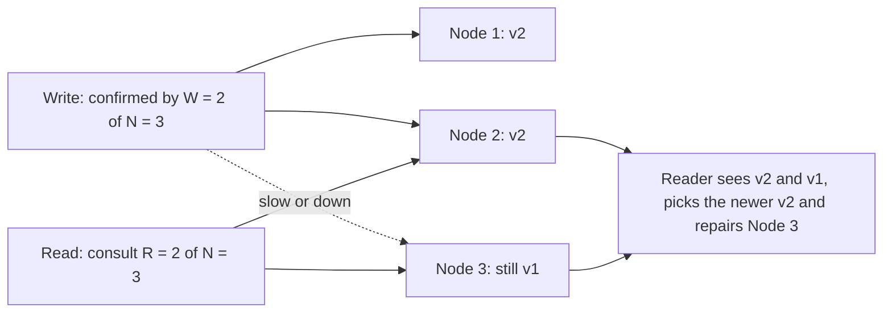

## 32.8 Distributed state: where state lives and why services should not hold it

#### Concept

**State** is anything the system remembers between two requests: an order, a session, a counter, a lock, a queue of jobs, "which step of checkout this user is on". In a distributed system, state has to live *somewhere specific*, and the choice of where decides what survives a crash, what other pods can see, and what happens during a partition.

The four places state can live:

| Place | Survives pod restart? | Visible to other pods? | Cost per access | Typical use |
|---|---|---|---|---|
| Database (PostgreSQL) | Yes, durably | Yes | 1–5 ms | Source of truth: orders, users, balances, saga state |
| Cache (Redis) | Depends (usually treated as no) | Yes | 0.2–1 ms | Sessions, rate limits, locks, hot reads, short-lived coordination |
| Queue / log (Kafka, RabbitMQ) | Yes | Yes, to consumers | 2–10 ms | Work to be done, events that happened |
| Client (JWT, cookie, local storage) | Yes, on that device | No | 0 ms | Identity claims, UI preferences, cart drafts |
| Process memory (a `Map` in the pod) | No | No | ~0 | Only for caches that may be lost and for per-request scratch |

A **stateless service** is one that keeps nothing important in process memory between requests: every request carries or looks up everything it needs. Stateless does not mean "no state"; it means the state lives in one of the first four rows, not the fifth.

#### Why does it exist?

If a pod holds state in memory, then only that pod can serve requests that need it. That breaks horizontal scaling (you cannot add pods freely), breaks rolling deploys (killing the pod loses the state), breaks failure recovery (a crash loses in-flight work), and forces the load balancer into **sticky sessions**: routing each user to "their" pod. Sticky sessions sound harmless and cause: uneven load (one pod gets the busy users), slow drains on deploy (you must wait for sessions to end or lose them), broken failover (a pod death logs out thousands of users), and cache invalidation nightmares (the sticky pod's in-memory copy is the only copy). Avoid them; put the session in Redis or in a signed token.

#### Mental model

Imagine a call centre where each agent keeps customer notes on their own desk. If you always get the same agent, it works, until that agent is sick. A well-run centre keeps notes in a shared system, and any agent can pick up any call. The agents are stateless; the notes system is the state.

#### How it works

The senior rule for state: **every piece of state has exactly one owner and one home.** For a checkout:

1. The order row in PostgreSQL is the truth about the order. Its `status` column is a **persisted state machine**: a fixed set of states and a fixed set of allowed transitions, enforced by the database, not by hoping the code is correct.
2. The cart, before checkout, lives in Redis keyed by user id (fast, shared across pods, acceptable to lose after 30 days).
3. The "payment in progress" fact lives in the order row (`PENDING_PAYMENT`), never in a pod's memory, so any pod can answer "what is happening with order 8813" and any pod can pick up the next step.
4. Work that must happen later ("send confirmation email") lives in a queue, not in a `setTimeout`.
5. The user's identity lives in a signed JWT the client sends; the pod verifies it without any per-pod memory.

Transitions are applied with **compare-and-set**: `UPDATE orders SET status = 'PAID' WHERE id = $1 AND status = 'PENDING_PAYMENT'`. If zero rows are updated, another pod got there first (or the order was cancelled), and the code reacts instead of blindly overwriting.

#### Practical example

Five NestJS pods handle a payment webhook that can arrive twice (providers retry). Pod 2 and pod 4 each receive a copy at the same time. Both run the compare-and-set update; exactly one changes a row; the other sees `affected = 0` and stops. No lock, no coordination between pods, no in-memory "already processed" set that would only exist in one pod.

#### NestJS example

A state machine service that owns the transition table and applies transitions with compare-and-set:

```ts
// order-state.service.ts
import { ConflictException, Injectable } from '@nestjs/common';
import { InjectRepository } from '@nestjs/typeorm';
import { Repository } from 'typeorm';
import { Order, OrderStatus } from './order.entity';

const TRANSITIONS: Record<OrderStatus, OrderStatus[]> = {
  PENDING_PAYMENT: ['PAID', 'PAYMENT_FAILED', 'CANCELLED'],
  PAID: ['STOCK_RESERVED', 'COMPENSATING'],
  STOCK_RESERVED: ['SHIPPING_REQUESTED', 'COMPENSATING'],
  SHIPPING_REQUESTED: ['COMPLETED', 'COMPENSATING'],
  COMPENSATING: ['FAILED'],
  PAYMENT_FAILED: [], CANCELLED: [], COMPLETED: [], FAILED: [],
};

@Injectable()
export class OrderStateService {
  constructor(@InjectRepository(Order) private readonly orders: Repository<Order>) {}

  // Returns true if THIS call performed the transition; false if it had already happened
  // (idempotent replay). Throws only on an illegal transition.
  async transition(orderId: string, from: OrderStatus, to: OrderStatus): Promise<boolean> {
    if (!TRANSITIONS[from].includes(to)) {
      throw new ConflictException(`Illegal transition ${from} -> ${to} for order ${orderId}`);
    }
    const result = await this.orders
      .createQueryBuilder()
      .update(Order)
      .set({ status: to, updatedAt: () => 'now()' })
      .where('id = :orderId AND status = :from', { orderId, from })   // compare-and-set
      .execute();
    if (result.affected === 1) return true;

    const current = await this.orders.findOneOrFail({ where: { id: orderId } });
    if (current.status === to) return false;                          // already done by another pod
    throw new ConflictException(`Order ${orderId} is ${current.status}, expected ${from}`);
  }
}
```

No pod remembers anything. Any pod, any replica, any time.

#### PostgreSQL example

Make the state machine a database fact, so a bug in any service cannot produce an impossible state:

```sql
CREATE TYPE order_status AS ENUM (
  'PENDING_PAYMENT', 'PAID', 'PAYMENT_FAILED', 'STOCK_RESERVED',
  'SHIPPING_REQUESTED', 'COMPLETED', 'COMPENSATING', 'FAILED', 'CANCELLED'
);

CREATE TABLE orders (
  id          uuid PRIMARY KEY,
  customer_id uuid NOT NULL,
  status      order_status NOT NULL DEFAULT 'PENDING_PAYMENT',
  version     int NOT NULL DEFAULT 0,
  updated_at  timestamptz NOT NULL DEFAULT now()
);

-- Every transition is recorded: who moved it, from what, to what. This is your audit trail
-- and your debugging tool when a saga goes wrong at 3 a.m.
CREATE TABLE order_status_history (
  id         bigserial PRIMARY KEY,
  order_id   uuid NOT NULL REFERENCES orders(id),
  from_status order_status,
  to_status  order_status NOT NULL,
  reason     text,
  actor      text NOT NULL,        -- 'payment-webhook', 'saga-orchestrator', 'support:alice'
  created_at timestamptz NOT NULL DEFAULT now()
);
CREATE INDEX order_status_history_order_idx ON order_status_history (order_id, id);

-- Compare-and-set in one statement. affected = 0 means "someone else moved it first".
UPDATE orders
SET status = 'PAID', version = version + 1, updated_at = now()
WHERE id = $1 AND status = 'PENDING_PAYMENT';
```

Finding stuck state is a query, not a mystery: `SELECT id FROM orders WHERE status = 'PENDING_PAYMENT' AND updated_at < now() - interval '15 minutes'`.

#### TypeORM example

Optimistic locking with `@VersionColumn` protects whole-row updates where a compare-and-set on one column is not enough:

```ts
// order.entity.ts
import { Column, Entity, PrimaryColumn, VersionColumn } from 'typeorm';

@Entity('orders')
export class Order {
  @PrimaryColumn('uuid') id: string;
  @Column({ type: 'enum', enum: [...] }) status: OrderStatus;
  @VersionColumn() version: number;        // TypeORM adds "AND version = :v" and increments it
}

// Saving an entity read earlier throws OptimisticLockVersionMismatchError if another pod
// changed it in between. Catch it and reload, or retry the whole operation.
```

#### Sequelize example

```ts
// order.model.ts
import { DataTypes, Model, Sequelize } from 'sequelize';

export class Order extends Model {}
Order.init(
  { id: { type: DataTypes.UUID, primaryKey: true }, status: DataTypes.STRING, version: DataTypes.INTEGER },
  { sequelize, tableName: 'orders', version: true },   // version: true enables optimistic locking
);

// order.save() throws OptimisticLockError when the row's version changed since it was loaded.
```

#### Production scenario

A ride-booking backend once kept "driver is currently being offered ride X" in memory in the matching service. With one instance, fine. They scaled to three instances behind a load balancer; drivers started receiving two offers at once because instance 2 did not know instance 1 had already offered. The fix moved the offer into a Redis key `offer:driver:{id}` set with `NX` and a 20 s TTL, plus an `offers` table in PostgreSQL for the durable record. Throughput rose from 400 to 1,100 matches per second with three instances, and offers stopped duplicating.

#### Failure scenario

At 09:00 on a deploy day, a SaaS app with sticky sessions and in-memory session storage rolled out a new version. Kubernetes terminated old pods with a 30 s grace period. Every user on an old pod was logged out mid-work; 14,000 sessions lost; a spreadsheet import that had been running for 20 minutes in one user's session vanished. The post-mortem action items were: sessions to Redis, long-running imports to a queue with progress in PostgreSQL, sticky sessions removed. Deploys became invisible to users.

#### Edge cases & failure modes

- Two pods apply the same transition from a duplicate message; without compare-and-set the second overwrites a later state with an earlier one.
- A pod caches "current order status" in memory for 60 s "for performance" and serves a cancelled order as active from one pod only; users see different answers on refresh.
- Redis restarts and all sessions vanish; if that is unacceptable, persist sessions or use signed tokens.
- A JWT carries a role claim; the role is revoked in the database; the client keeps the old claim until expiry. Client-held state is stale by design; bound its lifetime.
- Sticky sessions plus autoscaling: new pods sit idle because all sessions are pinned to the old ones.

#### How a Senior Backend Engineer thinks about this

They ask, for every field: who owns it, where is the single durable copy, which copies are caches, and how long may a cache be wrong? They refuse in-process state that another pod would need. They model every long-running business process as a persisted state machine with recorded transitions, because that turns "what happened to order 8813?" from a debugging session into a `SELECT`.

#### Common mistakes

- Storing "in progress" flags in a module-level variable or `Map`.
- Using sticky sessions to paper over in-memory state instead of removing the in-memory state.
- Modelling status as a free-text column with no constraint and no history.
- Updating status with `SET status = 'PAID'` and no `WHERE status = ...` guard, so replays and races overwrite later states.

#### Interview questions

1. *What does "stateless service" actually mean, and where does the state go?* Expected: nothing needed across requests lives in process memory; state goes to the database, cache, queue or client depending on durability and sharing needs.
2. *Why are sticky sessions a smell?* Expected: uneven load, deploy pain, failover logs users out, pinned in-memory state. Follow-up: when are they acceptable? (WebSocket affinity for connection state, with the real state still in Redis.)
3. *How do you make state transitions safe across multiple pods without locks?* Expected: compare-and-set on the status column plus a history table; treat `affected = 0` as "already done or conflict".
4. *What state can live in a JWT and what cannot?* Expected: identity and coarse claims with a short lifetime; never anything that must be revocable immediately or that changes often.

#### Practical exercise

Find every module-level variable or in-memory `Map` in a NestJS service that holds data across requests. Classify each as: safe cache (may be lost, never authoritative) or hidden state (other pods would need it). Move every hidden-state item to Redis or PostgreSQL. Acceptance criteria: the service runs correctly with three replicas and a load balancer without session affinity; a pod can be killed at any moment with no lost work.

## 32.9 Replication

#### Concept

**Replication** keeps copies of the same data on multiple machines. It exists for three reasons: **durability** (a disk dies, the data survives), **availability** (a node dies, another serves), and **read scaling** (reads spread across copies). Every replication design must answer two questions: *who is allowed to write?* and *when does a write count as done?*

#### Why does it exist?

A single copy of your orders table on a single disk has a measurable annual chance of disappearing, and a single node has planned and unplanned downtime. Replication is the only way to make data survive hardware, and the only way to keep serving during maintenance. The costs: writes take longer (or become unsafe), copies can disagree, and you now have failover, which is a whole class of incidents on its own.

#### Mental model

Asha and Ben again. **Leader-based**: only Asha writes in the master notebook; Ben copies from her and only answers questions. **Multi-leader**: both write in their own notebooks and swap pages every hour; sometimes they wrote conflicting things. **Leaderless**: there are five notebooks around town; to record a sale you write it into any three; to check a fact you read any three and take the newest entry.

#### How it works

**Leader-based (single-leader) replication.** One node, the leader (primary), accepts all writes and streams them to followers (replicas, standbys). PostgreSQL streaming replication ships the WAL; MySQL ships the binlog; Redis ships the replication stream; each Kafka partition has a leader broker and in-sync replicas. Followers can serve reads. Failover means promoting a follower, and the danger is promoting one that is behind (lost writes) or promoting two (split brain, section 32.3).

**Multi-leader replication.** Two or more nodes accept writes and exchange them. Used for multi-region active-active setups, for offline clients (mobile apps that sync later), and for collaborative editing. The cost: two leaders can accept conflicting writes to the same row at the same time, and *somebody* must decide which wins. PostgreSQL logical replication can be configured in both directions, and tools like pglogical and BDR exist for this, but the conflict problem is yours.

**Leaderless replication.** Any node accepts writes and reads; the client (or a coordinator) sends each write to several nodes and reads from several nodes, using quorums (section 32.10) to get overlap. Cassandra, Riak and DynamoDB's internal design follow this. Stale copies are repaired by **read repair** (the reader notices a stale copy and updates it) and **anti-entropy** (background comparison of copies).

**When is a write done?**

| Mode | Leader acknowledges when | Durability if leader dies right after ack | Commit latency cost |
|---|---|---|---|
| Asynchronous | Its own WAL is flushed | Recent writes may be lost | None |
| Synchronous | At least one follower has written/flushed/applied | Acknowledged writes survive | One round trip to the follower (~1–2 ms same zone, 80–150 ms cross-region) |
| Semi-synchronous / quorum | Any one (or K) of several followers confirmed | Survives, and a single slow follower does not block | Round trip to the fastest K followers |

PostgreSQL's `synchronous_commit` levels, weakest to strongest: `off` (do not even wait for local flush), `local` (local flush only), `remote_write` (follower received and handed to OS), `on` (follower flushed to disk), `remote_apply` (follower applied, so reads there see it).

**Conflicts in multi-leader systems and how to resolve them.**

- **Last-writer-wins (LWW)**: each write carries a timestamp; the highest timestamp wins. Simple, and it silently discards the other write. It also depends on clocks that disagree (section 32.13). Cassandra uses LWW per cell; Redis Enterprise CRDBs use it for some types. Acceptable for "user's display name"; unacceptable for "cart items" or "balance".
- **Version vectors**: each replica keeps a counter per replica; a write carries the vector. Two writes are concurrent when neither vector dominates the other; the system keeps *both* (Riak calls them siblings) and asks the application to merge. Correct, and it pushes work to you.
- **CRDTs (Conflict-free Replicated Data Types)**: data structures designed so that any two concurrent updates merge automatically and deterministically: a grow-only counter (each replica counts its own increments; the total is the sum), an observed-remove set (add and remove with unique tags), an LWW-register. Used in collaborative editors (Yjs, Automerge), Redis Enterprise, and by hand in "merge the cart as a union of items with per-item quantities as max". If you can express your data as a CRDT, multi-leader becomes safe; if not, avoid multi-leader for that data.

#### Practical example

A cart shared between a user's phone and laptop, both possibly offline. Model it as a set of `(sku, quantity, lastChangedAt, deviceId)` entries. Merge rule: union of SKUs; for a SKU on both sides, take the entry with the later `lastChangedAt`, and treat an explicit "removed" tombstone as a change. This is a small LWW-element-set CRDT. It will never lose an item silently, and the only "loss" is choosing between two quantities for the same SKU, which the user can fix in one tap.

#### NestJS example

Making a Redis write semi-synchronous when it matters. Redis replication is asynchronous by default; the `WAIT` command blocks until N replicas have acknowledged the preceding writes, or the timeout passes:

```ts
// seat-hold.service.ts
import { Injectable, ServiceUnavailableException } from '@nestjs/common';
import Redis from 'ioredis';

@Injectable()
export class SeatHoldService {
  constructor(private readonly redis: Redis) {}

  async hold(eventId: string, seatId: string, userId: string): Promise<boolean> {
    const key = `hold:${eventId}:${seatId}`;
    const acquired = await this.redis.set(key, userId, 'PX', 120_000, 'NX'); // atomic set-if-absent
    if (acquired !== 'OK') return false;

    // Ask Redis to confirm at least 1 replica has the write, waiting at most 50 ms.
    // Returns the number of replicas that acknowledged.
    const replicas = await this.redis.wait(1, 50);
    if (replicas < 1) {
      await this.redis.del(key);   // do not hand out a hold that a failover could forget
      throw new ServiceUnavailableException('Seat hold not replicated; try again');
    }
    return true;
  }
}
```

`WAIT` does not make Redis strongly consistent (a failover can still pick a replica that missed the write), but it turns "definitely lost on failover" into "lost only if the replica that acknowledged also dies". Use it for holds and locks, not for every write.

#### PostgreSQL example

Streaming replication essentials and a check that tells you whether you are one disk failure away from data loss:

```sql
-- On the primary: create a physical replication slot so WAL is retained until the
-- standby has consumed it. Without a slot, a standby that falls behind cannot catch up.
SELECT pg_create_physical_replication_slot('standby_b');

-- Danger check: a slot whose consumer is gone retains WAL forever and fills the disk.
SELECT slot_name, active,
       pg_size_pretty(pg_wal_lsn_diff(pg_current_wal_lsn(), restart_lsn)) AS retained_wal
FROM pg_replication_slots;

-- Semi-synchronous: commit waits for any ONE of two standbys. A single slow standby
-- does not block commits; both being unreachable does.
ALTER SYSTEM SET synchronous_standby_names = 'ANY 1 (standby_b, standby_c)';
ALTER SYSTEM SET synchronous_commit = 'on';
SELECT pg_reload_conf();

-- Logical replication for selective or bidirectional copies (multi-leader building block).
CREATE PUBLICATION orders_pub FOR TABLE orders, order_items;
-- On the other node:
-- CREATE SUBSCRIPTION orders_sub CONNECTION 'host=... dbname=shop' PUBLICATION orders_pub;
```

An inactive slot with 300 GB of retained WAL is one of the classic 3 a.m. pages: the standby was decommissioned, nobody dropped the slot, the primary's disk filled, PostgreSQL stopped accepting writes.

#### Production scenario

A payments company runs a primary in zone A, a synchronous standby in zone B (`ANY 1` with a third async standby in zone C). Commit latency: 3.8 ms p50 (vs 1.9 ms async). Write throughput: 4,000 transactions per second at peak, well within limits. Read replicas serve 70% of reads. During a zone-B maintenance the sync standby was `remote_write`-lagging for 20 minutes; `ANY 1` transparently used zone C; nobody noticed except the dashboard. Their rule: the money tables run sync; the analytics database is an async logical subscriber, 30 s behind on a bad day.

#### Failure scenario

A team ran PostgreSQL with one async replica and a script that promoted the replica if the primary was unreachable for 15 s. A network blip triggered promotion while the old primary was alive and 1.2 s (about 900 transactions) ahead. Applications reconnected to the new primary via DNS; the old primary kept accepting writes from pods whose DNS cache had not expired. For 4 minutes there were two primaries (split brain). Merging the two histories took two days of manual work and some orders were lost. Lessons: never promote without quorum agreement, fence the old primary (Patroni does both), and if writes must never be lost, replication must be synchronous.

#### Edge cases & failure modes

- Async replica promoted after leader failure: acknowledged writes disappear; customers who saw "order placed" have no order.
- Sync standby down and no alternative: commits block; the app looks "down" though the primary is healthy.
- Replica lag spikes during `VACUUM FULL`, bulk loads or long-running queries on the replica (which can pause replay); "eventual" becomes minutes.
- Multi-leader with LWW and clock skew: the write that happened first "wins" because its clock was ahead.
- Logical replication does not replicate DDL; a migration on one node breaks the subscription on the other.
- Replication slot with a dead consumer fills the primary's disk.

#### How a Senior Backend Engineer thinks about this

They decide per dataset how much acknowledged data they are willing to lose (zero for money, seconds for events) and set replication mode from that, not from a benchmark. They never run multi-leader for data without a written merge rule. They monitor replica lag, slot retention and sync-standby health as first-class alerts. And they run failover on purpose, quarterly, because a failover you have never tested is not high availability, it is hope.

#### Common mistakes

- Running async replication and assuming failover is lossless.
- Enabling "active-active" for convenience and letting last-writer-wins silently discard updates.
- Forgetting replication slots when a standby is removed.
- Sending all reads to replicas without a read-your-writes plan (section 32.6).

#### Interview questions

1. *Compare leader-based, multi-leader and leaderless replication. When would you use each?* Expected: single-leader for most transactional systems; multi-leader for multi-region or offline clients with CRDT-friendly data; leaderless for high-availability key-value workloads with quorum reads.
2. *What is the difference between `synchronous_commit = on` and `remote_apply`?* Expected: `on` waits for the standby's flush; `remote_apply` waits until the standby has applied, which makes reads there see the commit.
3. *What is a CRDT and where would you use one?* Expected: a data type whose concurrent updates merge deterministically; carts, counters, collaborative documents.
4. *How can an async replica setup lose data, and how do you prevent it?* Expected: promotion of a lagging replica; prevent with sync or quorum replication and quorum-based failover.

#### Practical exercise

Build a two-node PostgreSQL setup in Docker with streaming replication and a replication slot. Measure commit latency under `synchronous_commit = local`, `on` and `remote_apply` with `pgbench`. Then stop the standby under `on` and observe the primary. Acceptance criteria: you can state the latency cost of each level in milliseconds; you can explain what happened to commits while the standby was down; and you can show the retained WAL growing in `pg_replication_slots`.

## 32.10 Quorum

#### Concept

A **quorum** is the minimum number of nodes that must agree for an operation to count. With N copies of a value, a write that must be confirmed by W nodes and a read that must consult R nodes are guaranteed to overlap in at least one node whenever **W + R > N**. That overlap is what lets a read find the latest write without asking every node.

#### Why does it exist?

Waiting for every replica on every write (W = N) means one slow or dead node stops the world. Waiting for none (W = 1) means a write can be lost the moment that one node dies. Quorums give a middle path with a mathematical guarantee: as long as fewer than a certain number of nodes fail, no acknowledged write is lost and no read misses it.

#### Mental model

Five friends share a notebook policy: to record a fact you must write it into at least three of the five notebooks; to check a fact you must read at least three. Any three you write and any three you read must share at least one notebook (3 + 3 > 5), and that shared notebook has the fact. If two friends are away, you can still write and read. If three are away, you stop, rather than risk missing something.

#### How it works



With N = 3, W = 2, R = 2:

1. A write goes to all three nodes; the client waits for two acknowledgements. Node 3 is slow, so the write is acknowledged with nodes 1 and 2 holding version 2.
2. A read goes to two nodes: say 2 and 3. Node 2 returns v2, node 3 returns v1. The client picks the newest (by version number, not wall clock) and, in a leaderless store, sends v2 back to node 3 (read repair).
3. Because 2 + 2 > 3, *any* pair of nodes read overlaps with *any* pair that acknowledged the write, so v2 is always among the answers.

Common settings: N = 3, W = 2, R = 2 (balanced); W = 3, R = 1 (fast reads, slow writes, any single node has everything); W = 1, R = 3 (fast writes, and a single node death can lose acknowledged data, so rarely chosen for important data).

**Strict versus sloppy quorum.** A strict quorum counts only the N "home" nodes for a key. A **sloppy quorum** (Dynamo, Cassandra with hinted handoff) lets a write be accepted by *other* nodes when home nodes are unreachable, storing a "hint" to forward it later. It raises availability during partitions and weakens the overlap guarantee: a read may consult the home nodes while the write sits on a stand-in node, so W + R > N no longer promises the read sees the write until the hint is delivered.

**Quorums you already run.**

- PostgreSQL `synchronous_standby_names = 'ANY 1 (standby_b, standby_c)'`: a write is acknowledged when the primary plus any one of the two standbys have it. That is W = 2 out of N = 3 copies. `FIRST 1 (b, c)` is priority-based (wait for b unless b is down), which is not a quorum in the same sense.
- Kafka `acks=all` with `min.insync.replicas=2` and replication factor 3: a produce is acknowledged when at least 2 in-sync replicas have it; reads always come from the leader, so consistency comes from the ISR mechanism rather than a read quorum.
- etcd, ZooKeeper, Raft in general: a write commits when a majority (floor(N/2) + 1) of members have logged it; reads served by the leader are linearizable.
- Cassandra `QUORUM` consistency level: floor(RF / 2) + 1 replicas, per query, for both reads and writes.

#### Practical example

A geo-distributed order-status service keeps three copies across three zones. With W = 2, R = 2, losing one zone changes nothing: writes and reads proceed with the other two. Losing two zones stops both, on purpose. With W = 1, R = 1 it would keep working with one zone but could return a status that a lost zone alone knew about.

#### NestJS example

Configuring the producer so a Kafka write is a quorum write, and treating a quorum failure as "unknown" rather than "failed":

```ts
// kafka-producer.provider.ts
import { Injectable, Logger, OnModuleDestroy, OnModuleInit } from '@nestjs/common';
import { Kafka, Producer } from 'kafkajs';

@Injectable()
export class OrderEventsProducer implements OnModuleInit, OnModuleDestroy {
  private readonly log = new Logger(OrderEventsProducer.name);
  private readonly producer: Producer;

  constructor() {
    const kafka = new Kafka({ clientId: 'order-service', brokers: process.env.KAFKA_BROKERS!.split(',') });
    this.producer = kafka.producer({ idempotent: true, maxInFlightRequests: 1 }); // dedup on broker side
  }
  async onModuleInit() { await this.producer.connect(); }
  async onModuleDestroy() { await this.producer.disconnect(); }

  async publish(orderId: string, type: string, payload: unknown): Promise<void> {
    // acks: -1 means "all in-sync replicas"; combined with the topic's min.insync.replicas=2
    // the write must reach a quorum before the broker acknowledges.
    await this.producer.send({
      topic: 'orders.events',
      acks: -1,
      timeout: 5_000,
      messages: [{ key: orderId, value: JSON.stringify({ type, orderId, payload }) }],
    });
    this.log.debug(`published ${type} for ${orderId}`);
  }
}
```

If `send` rejects with a timeout, the record may still be on the brokers; the idempotent producer and, downstream, an inbox table (Part 33) make the retry harmless.

#### PostgreSQL example

Quorum commit and how to confirm it is really in effect:

```sql
ALTER SYSTEM SET synchronous_standby_names = 'ANY 1 (standby_b, standby_c)';
SELECT pg_reload_conf();

-- sync_state shows 'quorum' for members of an ANY group, 'sync' for FIRST members,
-- 'potential' for FIRST standbys not currently chosen, 'async' for the rest.
SELECT application_name, sync_state, sync_priority, replay_lag
FROM pg_stat_replication;

-- A commit that must not be acknowledged unless the quorum has it:
BEGIN;
SET LOCAL synchronous_commit = 'on';
INSERT INTO ledger_entries (account_id, amount_cents, order_id) VALUES ($1, $2, $3);
COMMIT;
```

#### Production scenario

An analytics platform ingests 60,000 events per second into Kafka with replication factor 3 and `min.insync.replicas=2`. During a broker's disk failure, partitions led by that broker moved leaders within 10 s; producers with `acks=-1` saw a burst of timeouts and retried with idempotence on; no events were lost and no duplicates were written. The same platform once ran `acks=1` "for throughput" and lost 40,000 events in a leader failover, which is the incident that made them switch.

#### Failure scenario

A team set `synchronous_standby_names = 'FIRST 1 (standby_b)'` (a single named sync standby) for durability. During a routine standby reboot, every commit on the primary blocked for 9 minutes. The API returned 504s across the board while the database was, technically, perfectly healthy. Moving to `ANY 1 (standby_b, standby_c)` gave them the same durability with tolerance for one standby being away.

#### Edge cases & failure modes

- W + R > N assumes nodes count versions correctly; with wall-clock LWW, the "newest" answer can be an older write from a fast clock.
- Sloppy quorums can return stale data until hints are delivered; a partition of a few minutes makes "quorum reads" eventual.
- A quorum write that times out may have reached the quorum; the client must treat it as unknown.
- Membership changes (adding a node) temporarily change what "majority" means; do it through the system's proper reconfiguration, never by editing config on some nodes.
- Read repair and anti-entropy add background load that shows up as mysterious latency spikes after a partition heals.

#### How a Senior Backend Engineer thinks about this

They can say, for every durable store in the system, "how many copies, how many must confirm a write, and what happens when one copy is down". They choose `ANY 1 of 2` over `FIRST 1` for PostgreSQL, `min.insync.replicas=2` for Kafka topics that carry business events, and they know that quorum settings do not remove the unknown outcome; they only shrink the window in which data can be lost.

#### Common mistakes

- Believing `acks=all` alone is a quorum; without `min.insync.replicas >= 2` the ISR can shrink to just the leader, and `acks=all` then means "the leader alone".
- A single named synchronous standby that turns maintenance into downtime.
- Treating a quorum-write timeout as a failure and re-sending without idempotence.
- Confusing "quorum" with "majority": PostgreSQL's `ANY 1 (b, c)` is 2 of 3 copies including the primary, and the system still has a single leader; it is a durability quorum, not a leader-election quorum.

#### Interview questions

1. *Explain W + R > N with a three-node example. What does R = 1, W = 3 give you?* Expected: overlap guarantee; W = 3 means every node has every write so a single-node read is complete, at the cost of writes blocking when any node is down.
2. *What is a sloppy quorum and what does it cost?* Expected: writes accepted by stand-in nodes with hints; higher availability; weaker read guarantee until hints deliver.
3. *How is PostgreSQL's `synchronous_standby_names = 'ANY 1 (a, b)'` a quorum, and how does it differ from `FIRST 1`?* Expected: any one of the listed standbys satisfies the commit; `FIRST` waits for a specific priority order.
4. *Kafka: what combination of settings gives you "no acknowledged message is lost when one broker dies"?* Expected: replication factor 3, `acks=all`, `min.insync.replicas=2`, unclean leader election disabled.

#### Practical exercise

Write a small TypeScript simulation of N = 5 nodes with versioned values, a `write(W)` and `read(R)` function, random node unavailability, and a test that asserts reads always return the latest acknowledged version when W + R > N and sometimes do not when W + R <= N. Acceptance criteria: the test passes for (3, 3), (4, 2), (2, 4) and demonstrably fails for (2, 2) and (1, 3) over 10,000 random runs.
