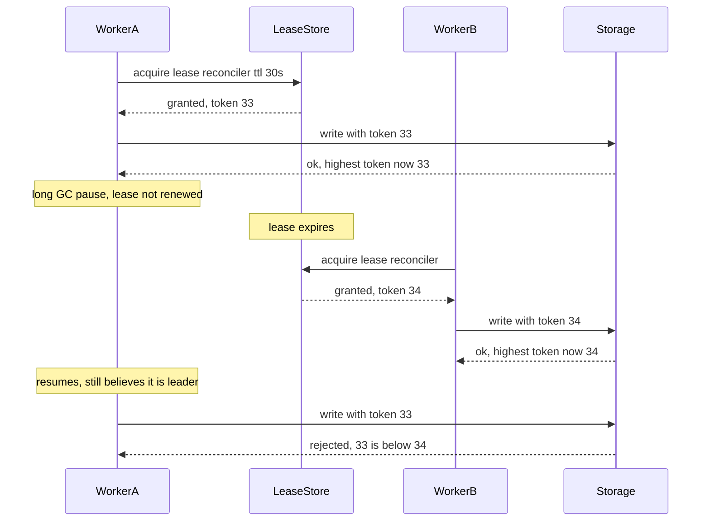
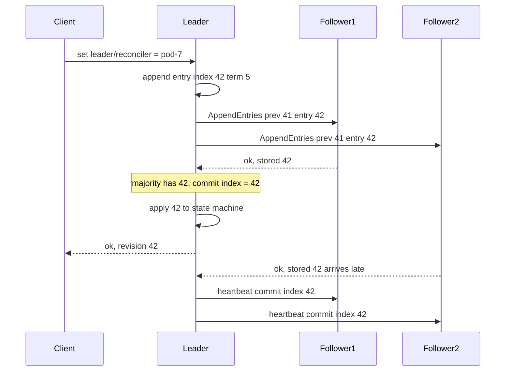

## 32.11 Leader election: one writer at a time

#### Concept

**Leader election** is how a group of identical nodes agrees that exactly one of them is, for now, allowed to do a particular job: be the PostgreSQL primary, run the nightly reconciliation, own a Kafka partition, drive a saga. The chosen node holds a **lease**: permission that expires after a TTL unless renewed. When the leader dies or is cut off, the lease expires and another node takes over.

#### Why does it exist?

Some jobs are unsafe or wasteful when two nodes do them at once. Two primaries corrupt data. Two cron runners send every customer two invoices. Two saga drivers issue two refunds. Yet you want more than one node *available* to do the job, so that a crash does not stop it. Leader election gives you both: many candidates, one active.

The NestJS version of this problem is the singleton cron. You write `@Cron('0 * * * *')` on a method that reconciles payments, deploy five replicas for the API, and at the top of every hour five pods reconcile the same payments concurrently. Every scheduled job in a horizontally scaled service is a leader-election problem.

#### Mental model

Asha and Ben's bakery, with five staff and one pen for the master notebook. The pen sits in a box with a timer. Whoever takes the pen must press the timer every 30 seconds; if the timer runs out the box unlocks and someone else may take the pen. Now a subtle problem: Asha takes the pen, gets distracted for two minutes, the timer runs out, Ben takes a second pen from the box, and then Asha comes back and keeps writing with hers. Two pens, two writers. The fix is that each pen has a serial number stamped on it, and the notebook refuses any entry whose pen number is lower than the highest number it has already seen. That serial number is the **fencing token**.

#### How it works



The mechanism, step by step:

1. **Acquire**: a candidate tries to create the lease record if it does not exist or has expired. Exactly one candidate can succeed, because the store makes the check-and-set atomic.
2. **Renew**: the leader refreshes `expires_at` every TTL / 3 or so. If it fails to renew (network, crash, pause), it must *stop acting as leader* as soon as it notices, ideally before the lease actually expires.
3. **Expire**: after the TTL, any candidate may acquire. The TTL is the time the job can be leaderless after a crash; a shorter TTL means faster failover and more risk of false expiry during pauses.
4. **Fence**: each acquisition increments a monotonic token. Every side effect the leader performs carries the token, and the thing being written (database row, file, external API) rejects tokens lower than the highest it has seen. Without fencing, a paused old leader that wakes up after expiry can still write. With fencing, its writes bounce.

Where the lease can live:

| Store | Mechanism | Fencing token | Use when |
|---|---|---|---|
| PostgreSQL advisory lock | `pg_try_advisory_lock(key)`, held by the session; released on disconnect | None built in; add a `leases` table if you need one | The job already uses PostgreSQL; simplest possible singleton cron |
| PostgreSQL lease table | `UPDATE ... WHERE expires_at < now() OR holder = me RETURNING token` | Yes, a `bigint` column | You need fencing or want to see the leader in a table |
| Redis `SET key value NX PX ttl` | Atomic set-if-absent with expiry | No; you must add a counter, and Redis failover can hand out the same lock twice | Short critical sections where a rare double-execution is tolerable |
| etcd / ZooKeeper / Consul | Leases with revisions, ephemeral nodes, sessions | Yes (etcd revision, ZooKeeper zxid, Consul lock index) | Real leadership for infrastructure (database failover, partition ownership) |
| Kubernetes `Lease` object | `coordination.k8s.io/v1 Lease` with `holderIdentity` and `leaseDurationSeconds` | Via `resourceVersion` | Controllers and operators; it is what `kube-controller-manager` uses |

Advisory-lock caveat: the lock belongs to the *session*. If your app connects through PgBouncer in transaction-pooling mode, the session changes between queries and the lock silently does not do what you think. Use `pg_try_advisory_xact_lock` inside one transaction that lasts the whole job, or use a lease table.

#### Practical example

Five NestJS pods, an hourly job that marks unpaid orders as expired and releases their stock. Requirement: run once per hour, keep running if any pod is alive, never run twice concurrently. Solution: each pod fires the cron; each tries `pg_try_advisory_xact_lock(hashtext('expire-orders'))` inside a transaction; the one that gets it runs the job in that transaction and commits; the others log "not leader" and return. Failover is automatic (the next hour, any pod can win). Cost: one cheap query per pod per hour.

#### NestJS example

Singleton cron with a transaction-scoped advisory lock (safe behind PgBouncer), then a lease-table variant with fencing for longer jobs:

```ts
// expire-orders.job.ts
import { Injectable, Logger } from '@nestjs/common';
import { Cron, CronExpression } from '@nestjs/schedule';
import { InjectDataSource } from '@nestjs/typeorm';
import { DataSource } from 'typeorm';

@Injectable()
export class ExpireOrdersJob {
  private readonly log = new Logger(ExpireOrdersJob.name);
  constructor(@InjectDataSource() private readonly ds: DataSource) {}

  @Cron(CronExpression.EVERY_HOUR)
  async run(): Promise<void> {
    const runner = this.ds.createQueryRunner();
    await runner.connect();
    await runner.startTransaction();
    try {
      // Transaction-level advisory lock: released automatically at COMMIT/ROLLBACK,
      // and correct even through PgBouncer transaction pooling.
      const [{ locked }] = await runner.query(
        `SELECT pg_try_advisory_xact_lock(hashtext('expire-orders')) AS locked`,
      );
      if (!locked) {
        this.log.debug('another pod holds expire-orders; skipping');
        await runner.rollbackTransaction();
        return;
      }
      const result = await runner.query(`
        UPDATE orders SET status = 'CANCELLED', updated_at = now()
        WHERE status = 'PENDING_PAYMENT' AND created_at < now() - interval '30 minutes'
        RETURNING id`);
      this.log.log(`expired ${result.length} orders`);
      await runner.commitTransaction();               // lock released here
    } catch (err) {
      await runner.rollbackTransaction();
      throw err;
    } finally {
      await runner.release();
    }
  }
}
```

For a job that runs for minutes and calls external systems, hold a lease with a fencing token and pass the token to every side effect:

```ts
// lease.service.ts
import { Injectable } from '@nestjs/common';
import { InjectDataSource } from '@nestjs/typeorm';
import { DataSource } from 'typeorm';

@Injectable()
export class LeaseService {
  constructor(@InjectDataSource() private readonly ds: DataSource) {}

  // Returns the fencing token if acquired or renewed, or null if someone else holds it.
  async acquireOrRenew(name: string, holder: string, ttlSeconds: number): Promise<bigint | null> {
    const rows = await this.ds.query(
      `UPDATE leases
       SET holder = $2,
           expires_at = now() + make_interval(secs => $3),
           fencing_token = CASE WHEN holder = $2 AND expires_at > now() THEN fencing_token ELSE fencing_token + 1 END
       WHERE name = $1 AND (expires_at < now() OR holder = $2)
       RETURNING fencing_token`,
      [name, holder, ttlSeconds],
    );
    return rows.length ? BigInt(rows[0].fencing_token) : null;
  }
}
```

The job renews every `ttl / 3` seconds while it works; if a renewal returns `null`, it stops immediately. Every write it makes includes `WHERE last_fencing_token <= $token` (or a check in the receiving service), so a stale leader's writes are rejected.

#### PostgreSQL example

```sql
CREATE TABLE leases (
  name          text PRIMARY KEY,
  holder        text,
  expires_at    timestamptz NOT NULL DEFAULT '-infinity',
  fencing_token bigint NOT NULL DEFAULT 0
);
INSERT INTO leases (name) VALUES ('reconcile-payments');

-- Protected resource remembers the highest token it has accepted.
ALTER TABLE payment_reconciliations ADD COLUMN applied_by_token bigint NOT NULL DEFAULT 0;

-- A leader's write is fenced: zero rows affected means a newer leader has been here.
UPDATE payment_reconciliations
SET status = 'DONE', applied_by_token = $2
WHERE id = $1 AND applied_by_token <= $2;

-- Session-level advisory lock alternative for simple cases. Key is a bigint; hashtext gives one.
SELECT pg_try_advisory_lock(hashtext('expire-orders'));   -- true = you are leader for this session
SELECT pg_advisory_unlock(hashtext('expire-orders'));
-- Inspect who holds what:
SELECT pid, objid, granted FROM pg_locks WHERE locktype = 'advisory';
```

`expires_at` is compared with the database's `now()`, never with the application's clock, so five pods with skewed clocks still agree on whether the lease is expired.

#### Sequelize example

```ts
await sequelize.transaction(async (t) => {
  const [[{ locked }]] = await sequelize.query(
    `SELECT pg_try_advisory_xact_lock(hashtext('expire-orders')) AS locked`, { transaction: t },
  );
  if (!locked) return;
  await Order.update({ status: 'CANCELLED' }, {
    where: { status: 'PENDING_PAYMENT', createdAt: { [Op.lt]: new Date(Date.now() - 30 * 60_000) } },
    transaction: t,
  });
});
```

#### Production scenario

A subscription-billing service runs 8 pods. The daily invoice run takes 25 minutes and calls the payment gateway 40,000 times. It holds a lease with a 60 s TTL, renewed every 15 s, and every charge request carries an idempotency key that includes the invoice id (not the fencing token, because the gateway does not understand tokens, and the idempotency key already prevents double charges). Over a year: three leader failovers mid-run (two deploys, one node failure), each resumed within 90 s on another pod, zero duplicate invoices. The team's rule: fencing for internal writes, idempotency keys for external ones.

#### Failure scenario

A team used a Redis lock (`SET NX PX 30000`) for the leader of a report-generation job that took up to 40 s under load. At 03:00 the job ran long. The lock expired at 30 s; a second pod acquired it and started generating the same report; the first pod finished at 38 s and uploaded its file; the second finished at 70 s and overwrote it with an identical file. Harmless that night. Two weeks later the same race happened with a job that *appended* to a ledger; the ledger got every row twice. The lock had no fencing and the TTL was shorter than the job. Fixes: TTL renewal from the running job, a fencing token, and idempotent appends keyed by ledger entry id.

#### Edge cases & failure modes

- **GC or event-loop pause longer than the TTL**: the leader wakes up believing it still leads. Only fencing protects the data.
- **Clock skew**: a lease store that compares the *client's* clock with `expires_at` breaks; always compare inside the store.
- **Redis failover**: the lock key may not have replicated; the new primary grants it again; two leaders. Use `WAIT` or a consensus store for anything that matters.
- **Advisory lock through a transaction-pooling proxy**: session locks evaporate between statements.
- **Holder crashes without releasing**: session locks release on disconnect (once TCP notices, which can take minutes without keepalives); lease rows expire after TTL; Redis keys expire after PX. Every mechanism has a "dead leader" window equal to its detection time.
- **Leader renews but is partitioned from the resource it leads**: it holds the lease and cannot do the job; nobody else can either. Renewal should be conditional on being able to do useful work (a health check inside the renew loop).
- **Job runs longer than the cron interval**: the next tick tries to acquire while the previous run holds the lock; with try-lock semantics it correctly skips; with blocking lock semantics runs pile up.

#### How a Senior Backend Engineer thinks about this

They ask two questions about any "only one should do this" requirement: what is the cost of *two* doing it, and what is the cost of *none* doing it for T seconds? If two is merely wasteful, an advisory lock or Redis `NX` is fine. If two corrupts data, they insist on fencing or on making the work idempotent so a double run is harmless (idempotency is often the better answer than leadership). If none is expensive, they lower the TTL and accept more false failovers. They avoid building "real" leader election themselves and use PostgreSQL for app-level singletons, etcd or Kubernetes leases for infrastructure.

#### Common mistakes

- `@Cron` on a service with replicas and no lock at all.
- Session-level advisory locks behind PgBouncer transaction pooling.
- A Redis lock whose TTL is shorter than the job, with no renewal.
- Relying on lock expiry without fencing for writes that must not be duplicated.
- Comparing lease expiry using `Date.now()` in the application.
- Assuming "I acquired the lock" means "I still hold it" ten minutes later.

#### Interview questions

1. *You have five replicas of a NestJS service and a nightly cron. How do you make it run exactly once?* Expected: advisory lock or lease in PostgreSQL, try-lock semantics, skip if not acquired; discuss PgBouncer and TTLs. Follow-up: what if the job takes 40 minutes and the pod is killed halfway?
2. *What is a fencing token and what problem does it solve?* Expected: a monotonic number issued with each lease; storage rejects lower tokens; solves the paused-leader-wakes-up problem.
3. *Why is a Redis `SET NX` lock not a safe leader election for critical work?* Expected: async replication can grant the lock twice on failover; expiry without fencing; the Redlock debate.
4. *Where should lease expiry be evaluated, and why?* Expected: in the store (`now()` in PostgreSQL, the Redis server for TTLs), because client clocks disagree.

#### Practical exercise

Implement a lease table with fencing tokens, a `@Cron` job that holds and renews the lease, and a fake "resource" table that rejects stale tokens. Run three instances. Pause one instance with `kill -STOP` for longer than the TTL, then resume it with `kill -CONT`. Acceptance criteria: another instance takes over within TTL + renewal interval; the resumed instance's next write is rejected and it logs that it lost leadership; the resource table contains no writes from a stale token.

## 32.12 Consensus: how machines agree

#### Concept

**Consensus** is the problem of getting a group of nodes to agree on a single value (or a single ordered sequence of values) even when some nodes crash and messages are delayed or lost. Leader election, cluster membership, configuration, "which replica has the latest data", and a replicated log are all consensus problems. The famous algorithms are **Paxos** and **Raft**; you will use them through etcd, ZooKeeper, Consul, Kafka's KRaft mode, and Patroni, and you should never write one yourself.

#### Why does it exist?

Without consensus, "who is the leader" is an opinion each node holds separately, and opinions diverge under partition (section 32.3). Consensus turns it into a fact: a value that a majority has durably recorded and that no future majority can contradict. That property is what makes split brain impossible in systems built on it.

There is also a hard limit to know about: the FLP result (Fischer, Lynch, Paterson, 1985) proves that no deterministic algorithm can guarantee consensus in a fully asynchronous system with even one faulty node. Practical algorithms get around it with timeouts and randomization; the cost is that they can *stall* (for example during repeated leader elections) but never decide wrongly. Safety is guaranteed; liveness depends on the network behaving reasonably.

#### Mental model

Five bakery branches must agree on today's special. Each round has a number (a term). One branch proposes; it is accepted when a majority (three of five) have written it in their books. Any later proposal must first ask a majority what they already wrote, and a majority always includes at least one branch that saw the earlier decision, so the decision cannot be reversed. If the proposing branch goes silent, after a random wait another branch starts a new round with a higher number. Two branches proposing at once just waste a round; they never produce two different specials.

#### How it works

**Paxos in one paragraph.** Nodes play proposers and acceptors. A proposer picks a ballot number higher than any it has used and asks acceptors to *promise* not to accept lower ballots (phase 1). Acceptors reply with the highest-ballot value they have already accepted, if any. The proposer must then propose *that* value (or, if none, its own) and asks acceptors to accept it (phase 2). A value accepted by a majority is chosen. Because every majority overlaps every other, once a value is chosen every later proposer learns it in phase 1 and re-proposes it. Paxos is correct, minimal and notoriously hard to turn into a working system; Multi-Paxos, which elects a stable leader to skip phase 1, is what real systems use, and it is what Raft describes in an understandable way.

**Raft, simply.** Raft chooses a leader and replicates a log through it.

1. **Terms.** Time is divided into numbered terms. Each term has at most one leader. A node that sees a higher term than its own immediately updates and steps down if it was a leader.
2. **Election.** Followers expect heartbeats from the leader. If a follower hears nothing for a randomized election timeout (say 150–300 ms), it becomes a candidate, increments the term, votes for itself and requests votes. A node grants one vote per term, and only to a candidate whose log is at least as up to date as its own. A majority of votes makes a leader. Randomized timeouts make split votes rare.
3. **Log replication.** Clients send commands to the leader. The leader appends each to its log and sends `AppendEntries` to followers, including the index and term of the previous entry so followers can check consistency. A follower whose log does not match rejects, and the leader walks back until they agree, then overwrites the follower's divergent tail.
4. **Commit.** When a majority has stored an entry, the leader marks it committed, applies it to its state machine, replies to the client, and tells followers the new commit index in the next heartbeat. Followers apply committed entries in order.
5. **Safety.** Because a candidate needs votes from a majority, and a majority always includes a node that has every committed entry, a leader always has all committed entries (leader completeness). Committed entries are never lost or reordered.



Note that the client got its answer after *two of three* nodes had the entry; the slow follower catches up without holding anything back. That is a quorum write (section 32.10) with a leader enforcing a single order.

**Where you meet consensus:**

| System | Uses consensus for | Notes |
|---|---|---|
| etcd | Everything: it is a Raft-replicated key-value store | Kubernetes stores all cluster state in it; Patroni can use it as its DCS |
| ZooKeeper | Its Zab protocol (Paxos-like) replicates a hierarchical namespace | Used by older Kafka, HBase, many lock services |
| Consul | Raft for the KV store and service catalogue | Also a Patroni DCS option |
| Kafka KRaft | Raft among controller nodes for metadata (topics, partitions, leaders) | Replaces ZooKeeper in modern Kafka; data replication itself is not Raft but the ISR protocol |
| Patroni | Does not implement consensus; stores the leader lock in etcd/Consul/ZooKeeper and trusts their consensus | The primary must renew its lock within `ttl`; a primary that cannot reach the DCS demotes itself |
| CockroachDB, TiKV, YugabyteDB | Raft per data range | Consensus per shard of your data |

**Why you should never implement it.** Raft's paper is readable, and a weekend implementation will pass its own tests. Production consensus also needs: log compaction and snapshots, membership changes without losing quorum, disk fsync discipline, handling of clock and pause anomalies, pre-vote to avoid disruptive nodes, read-index for linearizable reads, and years of bug reports. etcd has had serious correctness bugs found by Jepsen after years of use. Use etcd, a managed equivalent, or PostgreSQL-based leases for application singletons, and let consensus experts run the consensus.

#### Practical example

Kubernetes itself. Every `kubectl apply` writes to etcd through the API server; etcd's Raft leader replicates to a majority; the write is acknowledged; controllers watching etcd react. When you lose an etcd member, nothing changes. When you lose a majority (two of three), the API server becomes read-only: pods keep running but no new deployments, no scaling, no leader changes. That behavior is CP, on purpose, and every platform team should have experienced it in a drill.

#### NestJS example

Using etcd directly from a NestJS worker for leadership, which is appropriate when the job coordinates infrastructure rather than application rows (for application singletons, prefer section 32.11's PostgreSQL lease):

```ts
// etcd-leader.service.ts
import { Injectable, Logger, OnModuleDestroy, OnModuleInit } from '@nestjs/common';
import { Etcd3, Lease } from 'etcd3';

@Injectable()
export class EtcdLeaderService implements OnModuleInit, OnModuleDestroy {
  private readonly log = new Logger(EtcdLeaderService.name);
  private readonly client = new Etcd3({ hosts: process.env.ETCD_HOSTS!.split(',') });
  private lease?: Lease;
  isLeader = false;
  private readonly key = 'leaders/partition-rebalancer';
  private readonly podId = process.env.HOSTNAME ?? `pid-${process.pid}`;

  async onModuleInit() {
    this.lease = this.client.lease(15);                        // 15 s TTL, auto-kept-alive by the client
    this.lease.on('lost', () => { this.isLeader = false; this.log.warn('lease lost; stepping down'); });
    // Atomic: create the key only if it does not exist, attached to our lease.
    const txn = await this.client
      .if(this.key, 'Create', '==', 0)
      .then(this.client.put(this.key).value(this.podId).lease(this.lease))
      .commit();
    this.isLeader = txn.succeeded;
    this.log.log(this.isLeader ? 'became leader' : 'standing by');
    // Followers watch the key so they can try again when the leader's lease expires.
    if (!this.isLeader) {
      const watcher = await this.client.watch().key(this.key).create();
      watcher.on('delete', () => this.onModuleInit());
    }
  }

  async onModuleDestroy() { await this.lease?.revoke(); await this.client.close(); }
}
```

etcd's Raft guarantees that the `if ... then ... commit` transaction succeeds for exactly one client, and the `revision` of the write serves as a fencing token if you need one.

#### PostgreSQL example

PostgreSQL does not contain a consensus algorithm; Patroni borrows one. The settings that decide how a Patroni primary behaves when it cannot reach the consensus store:

```yaml
# patroni.yml (excerpt)
ttl: 30              # leader lock TTL in the DCS; primary must renew within this
loop_wait: 10        # how often Patroni runs its loop
retry_timeout: 10    # how long DCS/PG operations may retry
# Rule: ttl > loop_wait + 2 * retry_timeout, or the primary can lose its lock while healthy.
```

When the DCS is unreachable for longer than `ttl`, the primary demotes itself to read-only, because it can no longer prove it is the only primary. The application sees `ERROR: cannot execute UPDATE in a read-only transaction`. That is consensus protecting your data, and it is also a page at 3 a.m. if nobody planned for a DCS outage.

#### Production scenario

A platform team runs a 3-node etcd cluster for Kubernetes and Patroni across three zones. Write latency to etcd: 2–4 ms. A zone outage removed one member; nothing changed. A misconfigured upgrade once took two members down at once; for 11 minutes Kubernetes could not schedule and Patroni demoted the PostgreSQL primary to read-only. The API served reads and failed writes cleanly (section 32.4's per-endpoint choices earned their keep). They moved to 5 etcd members across three zones afterwards, so that losing a zone plus one node still leaves a majority.

#### Failure scenario

At 02:14 the on-call was paged: "orders API 100% write errors". PostgreSQL was healthy, CPU idle, disks fine. The logs said `read-only transaction`. It took 25 minutes to discover that a certificate on the etcd cluster had expired at 02:00, Patroni could not renew its leader lock, and it demoted the primary as designed. Renewing the certificate restored writes in 30 s. The post-mortem noted that consensus did exactly what it promised (no split brain) and that the team had never listed "etcd is a dependency of the database" in their runbooks.

#### Edge cases & failure modes

- Loss of majority makes the cluster read-only; that is correct and must be in the runbook.
- Repeated leader elections under a flaky network (election storm) stall progress without ever breaking safety.
- A node with a slow disk delays every commit because fsync is on the critical path; consensus stores need fast, dedicated disks.
- Membership changes done by editing config on some nodes can create two clusters that each think they have a majority; always use the reconfiguration API.
- Clock jumps do not break Raft safety but can break clients that compare lease TTLs with local time.
- Large values or many watchers make etcd slow; it is a coordination store, not a database.

#### How a Senior Backend Engineer thinks about this

They know which components in their stack contain a consensus store (etcd under Kubernetes, KRaft under Kafka, the DCS under Patroni) and treat those as tier-zero dependencies: monitored, backed up, sized for majority loss, with certificates on a calendar. They use consensus for infrastructure and small coordination state, never as an application database, and they never write consensus code. To a product manager: "There is a small, very reliable committee that decides who is in charge of the database. If more than half the committee is unreachable, the database goes read-only rather than risk two bosses. That is a feature."

#### Common mistakes

- Running a 2-member etcd or a 4-member one (even numbers add cost without adding fault tolerance).
- Placing all consensus members in one zone.
- Treating etcd as a general key-value store for application data.
- Not knowing that a Patroni primary depends on the DCS being reachable.
- Writing a "simple" leader election with timestamps and hoping.

#### Interview questions

1. *Explain Raft to a colleague in five minutes.* Expected: terms, randomized election timeouts, leader-only writes, AppendEntries, majority commit, leader completeness. Follow-up: why must a candidate's log be at least as up to date as the voter's?
2. *What happens to Kubernetes when etcd loses quorum?* Expected: API becomes read-only; running pods continue; no scheduling or updates.
3. *Why does Patroni demote a healthy primary when it cannot reach etcd?* Expected: it cannot prove uniqueness; demotion prevents split brain.
4. *Should you implement Raft for your service's leader election?* Expected: no; use etcd/Kubernetes leases for infrastructure, PostgreSQL leases or advisory locks for application singletons.

#### Practical exercise

Run a 3-node etcd cluster in Docker. Write a script that performs the compare-and-put leadership transaction from three processes, then kill the leader and observe takeover time. Then stop two of the three etcd nodes and observe what the remaining node does with reads and writes. Acceptance criteria: exactly one process is leader at any time (verified by a shared counter that each leader increments only while holding the lease); takeover happens within the lease TTL plus a few seconds; with two etcd nodes down, writes fail and you can explain why that is correct.
