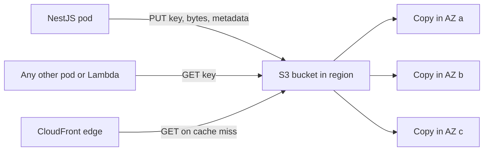
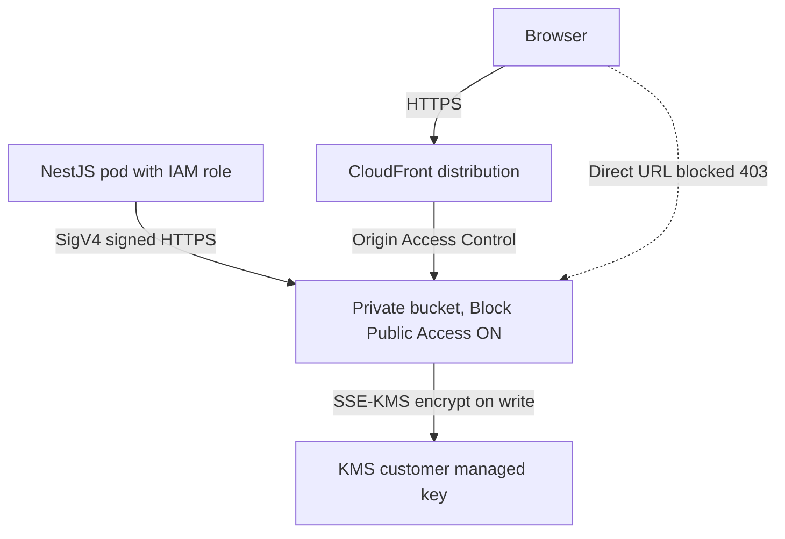

# Part 33 — File Storage and Uploads

## 33.1 Why file storage is its own discipline

Every product eventually stores files. Profile pictures, invoices as PDF, product images, KYC documents, CSV imports, chat attachments, voice notes. Most developers meet this the same way: `multer` writes the upload to `./uploads`, a column stores the path, and it works on the laptop. Then the app gets a second pod and half the images return 404.

Files are different from rows. A row is 200 bytes and lives in PostgreSQL where transactions, backups and replication are already solved. A file is 5 MB to 5 GB, it is written once and read many times, it must survive pod restarts, it must be served fast from anywhere in the world, and it is the most common way attackers get executable content into your system. Files need their own storage tier, their own upload path, their own metadata, their own lifecycle and their own security review.

This part follows the life of a file through a NestJS system: where the bytes live, how they get there without going through your API pods, how the database tracks them, how they are processed and delivered, and every way the whole thing goes wrong.

## 33.2 The local filesystem

#### Concept

Local file storage means the NestJS process writes uploaded bytes to a directory on the disk of the machine (or container) it is running on, and reads them back from the same path later. The database stores the path.

It is the simplest possible storage: `fs.createWriteStream('/data/uploads/abc.jpg')`. No SDK, no credentials, no network. That simplicity is exactly why it breaks in production.

#### Why does it exist?

Local storage exists because it is the default. Every language has a filesystem API, every tutorial uses it, and for a single-server application it is genuinely fine. The engineering problem it fails to solve is *sharing*: the moment two processes on two machines must see the same file, a local disk is the wrong abstraction.

#### Mental model

Imagine a shop where each cashier keeps customer receipts in the drawer of their own till. It works with one cashier. Hire a second cashier and a customer who paid at till 1 cannot get a copy of their receipt from till 2. Replace till 1 overnight and every receipt in its drawer is gone. The fix is not a better drawer; it is a filing cabinet in the back office that every cashier walks to.

#### How it works

1. The HTTP request carries `multipart/form-data`. A parser (`multer`, `busboy`) reads the body stream and writes the file part to disk.
2. The service records the path (`/data/uploads/2026/09/abc.jpg`) in PostgreSQL.
3. A download request looks up the path and streams the file back with `res.sendFile` or a read stream.

Where it fails:

| Situation | What happens |
|---|---|
| Two or more pods behind a load balancer | Upload lands on pod A; download request hits pod B; 404 |
| Container restart or redeploy | Container filesystem is ephemeral; every upload since the last deploy is gone |
| Kubernetes node failure | The pod is rescheduled elsewhere; the volume, if any, may not follow |
| Backups | Your database backup does not include the disk; you now need a second backup system |
| Disk full | The whole pod fails, including unrelated endpoints, because logs and temp files share the disk |
| Serving large files | Node.js pods spend CPU and memory shuffling bytes that a CDN could serve for free |

Shared network volumes (NFS, AWS EFS mounted into every pod) fix the "which pod" problem but bring their own: EFS latency for small files is 1 to 3 ms per operation instead of microseconds, throughput is provisioned and can throttle, and you still own backups and serving.

#### Practical example

A food-delivery back office lets restaurant owners upload menu photos. The first version stores them under `./public/menus` and serves them with `ServeStaticModule`. It runs on one EC2 instance for a year. Then the team moves to Kubernetes with three replicas. Within an hour, support tickets say "my photo uploaded but disappears when I refresh". The upload went to replica 2; the refresh was served by replica 1. Rolling back does not help because the deploy replaced the containers and the photos uploaded during the last hour are gone with them.

#### NestJS example

When local storage is genuinely fine (a single-instance internal tool, or a temp staging area before pushing to S3), keep it explicit and bounded:

```ts
// upload.controller.ts
import {
  Controller, Post, UploadedFile, UseInterceptors,
  ParseFilePipe, MaxFileSizeValidator, FileTypeValidator,
} from '@nestjs/common';
import { FileInterceptor } from '@nestjs/platform-express';
import { diskStorage } from 'multer';
import { randomUUID } from 'node:crypto';
import { extname } from 'node:path';

@Controller('internal/imports')
export class ImportController {
  @Post('csv')
  @UseInterceptors(FileInterceptor('file', {
    storage: diskStorage({
      destination: process.env.IMPORT_TMP_DIR ?? '/tmp/imports',
      // never trust the client filename for the path; generate our own
      filename: (_req, file, cb) => cb(null, `${randomUUID()}${extname(file.originalname).toLowerCase()}`),
    }),
    limits: { fileSize: 20 * 1024 * 1024, files: 1 }, // 20 MB, one file
  }))
  async importCsv(
    @UploadedFile(new ParseFilePipe({
      validators: [
        new MaxFileSizeValidator({ maxSize: 20 * 1024 * 1024 }),
        new FileTypeValidator({ fileType: /text\/csv|application\/vnd\.ms-excel/ }),
      ],
    }))
    file: Express.Multer.File,
  ) {
    // file.path is on THIS pod's disk. Process it now, in this request or a
    // same-pod job, then delete it. Do not store file.path in the database.
    return { received: file.size, tmpPath: file.path };
  }
}
```

`ParseFilePipe`, `MaxFileSizeValidator` and `FileTypeValidator` are real `@nestjs/common` exports. Note that `FileTypeValidator` checks the client-declared mimetype in older versions; treat it as a first filter, not as proof (see 33.12 on magic bytes).

#### Production scenario

When is local disk acceptable?

- A single-replica internal tool where losing uploads on redeploy is fine.
- A temp directory for a file that is fully processed within the same request or same pod (CSV import parsed and rows inserted), then deleted.
- A build cache or scratch space that is explicitly disposable.

In each case, the rule is: the path never leaves the pod's memory, and the disk is never the system of record.

#### Failure scenario

At 09:40 on a Monday, after a deploy that scaled the API from one pod to three, the on-call sees a spike in 404s on `/files/:id`. The database has 12,000 rows with paths that exist on no current pod. The previous pod's disk was `emptyDir` and was deleted with the pod. There is no backup. The team recovers 9,000 files from a stale staging sync and asks 3,000 users to re-upload. The postmortem action item is a single line: "Files live in S3. Local disk is temp only."

#### Edge cases & failure modes

- Disk fills with orphaned temp files from crashed requests; add a cleanup cron and a per-pod size cap.
- `multer` default memory storage buffers the whole file in RAM; a 2 GB upload OOM-kills the pod.
- Symlinks in an upload path let an attacker read `/etc/passwd` if you ever serve by client-supplied name.
- `hostPath` volumes tie a pod to one node and break scheduling.

#### How a Senior Backend Engineer thinks about this

The senior asks one question: "If this pod disappears in the next second, what is lost?" If the answer includes user files, the design is wrong. Local disk is a buffer, not storage. They also ask about the download path: serving bytes through Node.js is the most expensive way to serve bytes on the planet.

#### Common mistakes

- Storing `file.path` in the database and calling it "the file service".
- Mounting one shared PVC into three pods with `ReadWriteOnce` and wondering why two pods will not start.
- Using `ServeStaticModule` for user uploads in production, so every image request occupies a Node.js event loop tick and a socket.

#### Interview questions

1. **Why does local file storage break with multiple replicas?** Expected: each replica has its own disk; uploads are not visible across pods; containers are ephemeral. Follow-up: how would you fix it with zero code change? Answer: shared volume like EFS, then explain its limits.
2. **When is local disk fine?** Expected: temp files consumed within the same pod and deleted; disposable caches.
3. **What is the cost of serving files through Node.js?** Expected: event loop time, memory for buffers, sockets held open for slow clients, no caching; a CDN serves them cheaper and faster.

#### Practical exercise

Take a NestJS app that stores uploads locally. Run two instances behind nginx with round-robin. Upload a file and download it ten times; measure the failure rate. Then move the write to S3 (next sections) and repeat. Acceptance criteria: 0 percent failure with two instances; a pod restart loses no files.

## 33.3 Object storage: the S3 model

#### Concept

Object storage stores files as *objects*: an opaque blob of bytes, a *key* (its name), and *metadata* (content type, size, custom tags). Objects live in a *bucket*, which is a globally named container. You talk to it over HTTPS with `PUT`, `GET`, `HEAD`, `DELETE` and `LIST`. There are no directories, no file handles, no partial writes and no locks. Amazon S3 defined this model; Google Cloud Storage, Azure Blob, MinIO and Cloudflare R2 follow it closely.

#### Why does it exist?

A filesystem promises things that are expensive to keep at scale: hierarchical directories, in-place modification, byte-range writes, POSIX locks, consistent metadata across every reader. Object storage drops all of them. In exchange, it can replicate every object across multiple data centers, scale to trillions of objects, serve them from any pod in any region, and charge about $0.023 per GB-month (approximate US list price) with no capacity planning on your side.

The engineering problem it solves: durable, shared, cheap, infinitely wide storage for write-once-read-many blobs. That is exactly what user files are.

#### Mental model

Imagine a giant warehouse with numbered shelves but no rooms. You hand the clerk a box and a label (the key). The clerk copies the box three times and puts the copies in three different buildings. When you come back with the label you get the box. You cannot open the box on the shelf and change one page inside; you hand over a whole new box with the same label and the clerk replaces it. Labels can contain slashes, `invoices/2026/09/abc.pdf`, but that is only a naming convention; there is no `invoices` room.

#### How it works

The parts of the model you must know:

1. **Bucket.** A namespace with a globally unique name, in one region. Holds unlimited objects. Policies, encryption defaults, versioning and lifecycle rules are set per bucket.
2. **Key.** A UTF-8 string up to 1,024 bytes. Slashes are ordinary characters. The console draws folders by splitting on `/`; the service does not care.
3. **Flat namespace.** `LIST` takes a `Prefix` and a `Delimiter`. Listing `Prefix=tenants/42/` with `Delimiter=/` gives you the "folder view". Listing is paginated at 1,000 keys and is slower than a `GET`; never design a hot path that needs to list.
4. **Metadata.** System metadata (`Content-Type`, `Content-Length`, `ETag`, `Last-Modified`) and user metadata (`x-amz-meta-*` headers, up to 2 KB total). Metadata is set at write time; changing it requires a copy of the object onto itself.
5. **Durability.** S3 is designed for 99.999999999 percent (eleven nines) annual durability. Objects are stored redundantly across at least three Availability Zones. In plain terms: if you store 10 million objects, you can expect to lose one every 10,000 years. Durability is not availability; the SLA for availability is 99.9 to 99.99 percent depending on class.
6. **Consistency.** Since December 2020, S3 gives strong read-after-write consistency for all operations: after a successful `PUT`, every subsequent `GET`, `HEAD` or `LIST` sees the new object. Before that, overwrites and deletes were eventually consistent, which is why older advice talks about "wait and retry". You no longer need that inside S3. You still need it for CDN caches in front of S3 (see 33.9).
7. **Versioning.** When enabled on a bucket, every overwrite and delete keeps the previous version. A delete adds a *delete marker* instead of removing bytes. This is your undo button for accidental deletes and ransomware, and a cost trap if you never expire old versions.
8. **Storage classes.** Same API, different price and retrieval behavior:

| Class | Approx. $/GB-month (US) | Retrieval | Use for |
|---|---|---|---|
| Standard | 0.023 | Instant | Active user files, product images |
| Intelligent-Tiering | 0.023 then auto-lowers | Instant | Unknown access pattern |
| Standard-IA | 0.0125 plus per-GB retrieval | Instant | Files older than 30 days rarely read |
| One Zone-IA | 0.01 | Instant, one AZ only | Re-creatable derived files |
| Glacier Instant Retrieval | 0.004 | Milliseconds | Archives read a few times a year |
| Glacier Flexible Retrieval | 0.0036 | Minutes to hours | Compliance archives |
| Glacier Deep Archive | 0.00099 | 12 hours | Seven-year legal retention |

Prices are approximate list prices and change; the shape matters more than the digits. Cheaper classes charge more per request and per GB retrieved, and some have minimum storage durations (30, 90, 180 days) so moving a file in and out quickly costs more than leaving it.



#### Practical example

An e-commerce catalog has 2 million products with an average of 4 images each at 300 KB. That is 8 million objects and about 2.4 TB. In S3 Standard that is roughly $55 per month for storage. The same data on provisioned EBS volumes with replication and backups would be several times that, and you would still have to build the serving layer. Product images are read 50 million times a day, which is why they must go through a CDN (33.9) rather than being fetched from S3 per request: S3 `GET` requests cost about $0.0004 per 1,000, so 50 million per day is about $600 per month just in request fees, and CloudFront's cache eliminates most of that.

#### NestJS example

The S3 client is a singleton provider configured from the environment. Credentials come from the IAM role attached to the pod (IRSA on EKS, task role on ECS), never from static keys in config.

```ts
// s3.module.ts
import { Module, Global } from '@nestjs/common';
import { ConfigModule, ConfigService } from '@nestjs/config';
import { S3Client } from '@aws-sdk/client-s3';
import { NodeHttpHandler } from '@smithy/node-http-handler';

export const S3_CLIENT = Symbol('S3_CLIENT');

@Global()
@Module({
  imports: [ConfigModule],
  providers: [
    {
      provide: S3_CLIENT,
      inject: [ConfigService],
      useFactory: (config: ConfigService) =>
        new S3Client({
          region: config.getOrThrow<string>('AWS_REGION'),
          // No explicit credentials: the default provider chain picks up the
          // pod's IAM role (IRSA / task role) or local env in development.
          maxAttempts: 4, // SDK retries with backoff on 5xx and SlowDown
          requestHandler: new NodeHttpHandler({
            connectionTimeout: 3_000,
            requestTimeout: 30_000, // per request; multipart parts are smaller
          }),
          // Optional: point at MinIO / LocalStack in tests
          ...(config.get('S3_ENDPOINT')
            ? { endpoint: config.get('S3_ENDPOINT'), forcePathStyle: true }
            : {}),
        }),
    },
  ],
  exports: [S3_CLIENT],
})
export class S3Module {}
```

A minimal write and read, used for small server-generated files such as invoices:

```ts
// invoice-storage.service.ts
import { Inject, Injectable } from '@nestjs/common';
import { S3Client, PutObjectCommand, GetObjectCommand } from '@aws-sdk/client-s3';
import { S3_CLIENT } from './s3.module';

@Injectable()
export class InvoiceStorageService {
  private readonly bucket = process.env.INVOICE_BUCKET!;
  constructor(@Inject(S3_CLIENT) private readonly s3: S3Client) {}

  async putInvoice(orderId: string, pdf: Buffer): Promise<string> {
    const key = `invoices/${orderId.slice(0, 2)}/${orderId}.pdf`;
    await this.s3.send(new PutObjectCommand({
      Bucket: this.bucket,
      Key: key,
      Body: pdf,
      ContentType: 'application/pdf',
      ContentDisposition: `attachment; filename="invoice-${orderId}.pdf"`,
      ServerSideEncryption: 'aws:kms', // SSE-KMS; bucket default may already do this
      Metadata: { orderId }, // becomes x-amz-meta-orderid
      ChecksumAlgorithm: 'SHA256', // SDK computes and S3 verifies integrity
    }));
    return key;
  }

  async getInvoiceStream(key: string) {
    const res = await this.s3.send(new GetObjectCommand({ Bucket: this.bucket, Key: key }));
    // res.Body is a Node.js Readable in Node runtimes
    return { stream: res.Body as NodeJS.ReadableStream, size: res.ContentLength, type: res.ContentType };
  }
}
```

#### PostgreSQL example

The database never stores bytes; it stores the pointer and the facts you need to query:

```sql
CREATE TABLE files (
  id          uuid PRIMARY KEY DEFAULT gen_random_uuid(),
  owner_id    uuid NOT NULL REFERENCES users(id),
  bucket      text NOT NULL,
  key         text NOT NULL,
  size_bytes  bigint,
  mime_type   text,
  checksum_sha256 text,
  status      text NOT NULL DEFAULT 'PENDING',
  created_at  timestamptz NOT NULL DEFAULT now(),
  UNIQUE (bucket, key)
);
CREATE INDEX files_owner_created_idx ON files (owner_id, created_at DESC);
```

We expand this table into a full state machine in 33.8.

#### Production scenario

Throughput: S3 supports at least 3,500 `PUT/COPY/POST/DELETE` and 5,500 `GET/HEAD` requests per second *per prefix*, and partitions scale automatically. A single `GET` from a same-region pod takes 10 to 30 ms first byte for a small object, and streams at hundreds of MB/s for large ones. Multi-GB downloads are best done in parallel byte ranges. Monitoring: watch `4xxErrors`, `5xxErrors`, `FirstByteLatency`, and bucket size and object count from CloudWatch; alert on `503 SlowDown` in your own client metrics.

When should you *not* use object storage? When you need in-place random writes (a database file), POSIX semantics (a legacy app that `fopen`s files), sub-millisecond reads on the hot path (use Redis or memory), or transactional coupling with row data (store the small blob in a `bytea` column instead if it is under a few hundred KB and always read with the row).

#### Failure scenario

A team migrates from local disk to S3 and keeps the old code path: every product page does `GetObject` for four images and streams them through NestJS. Traffic is 400 requests per second, so 1,600 S3 `GET`s per second at 20 ms each. The Node.js pods spend most of their event loop time copying buffers, p99 climbs to 900 ms, and the monthly S3 request bill is $1,700 for something CloudFront would serve for a fraction. Fix: public product images served by CDN URL directly; NestJS never touches image bytes.

#### Edge cases & failure modes

- Keys are case sensitive and byte-exact; `Invoice.pdf` and `invoice.pdf` are different objects.
- Object size limits: 5 GB per single `PUT`, 5 TB with multipart.
- A `PUT` to an existing key overwrites atomically; readers see either the old or the new object, never a mix.
- `LIST` is eventually expensive: listing a prefix with 10 million keys takes 10,000 paginated calls. Keep an index in PostgreSQL instead.
- Bucket names are global; `prod-uploads` is taken. Use `company-env-purpose-random`.
- Cross-region reads cost egress and add 80 to 150 ms.
- 11 nines durability does not protect against *you* deleting the object. Versioning and Object Lock do.

#### How a Senior Backend Engineer thinks about this

Object storage is where files live; everything else is a cache or a pointer. The senior separates three concerns: *bytes* (S3), *facts about bytes* (PostgreSQL), and *delivery* (CDN). They refuse to let the API pods be a byte pipe for anything large, and they refuse to put file paths in the database without a status that says whether the bytes actually exist.

#### Common mistakes

- Treating prefixes as folders and "creating a folder" by uploading a zero-byte object.
- Using `LIST` to find a user's files instead of querying PostgreSQL.
- Storing the full `https://bucket.s3.amazonaws.com/key` URL in the database instead of `bucket` plus `key`; the URL format changes when you add a CDN or move regions.
- Assuming durability means "cannot be lost"; a bad lifecycle rule deletes with 11 nines of reliability.

#### Interview questions

1. **What does eleven nines of durability actually mean, and what does it not protect against?** Expected: expected annual loss of one object in 10 billion; does not protect against deletion, bad lifecycle rules, account compromise, region-wide disaster without replication.
2. **Is S3 strongly consistent?** Expected: yes, since December 2020, for all operations; caches in front of it are not.
3. **How would you store 8 million product images and serve 50 million views a day?** Expected: S3 Standard, unique keys per version, CloudFront with long cache TTL, no NestJS in the read path.
4. **Why store `bucket` and `key` rather than a URL?** Expected: URL is a delivery detail; CDN, region, signing all change it.

#### Practical exercise

Stand up MinIO in Docker (`minio/minio server /data`), point the `S3Client` at it with `forcePathStyle: true`, and write an integration test that uploads an invoice PDF, reads it back, verifies the `ContentType`, and confirms that a second `PUT` to the same key replaces it atomically. Acceptance criteria: the test passes against MinIO and against a real S3 bucket with only environment variables changed.

## 33.4 S3 usage patterns: keys, encryption, policies and IAM

#### Concept

Four decisions shape every S3 integration: how you name keys, how objects are encrypted, who can reach the bucket (bucket policy and Block Public Access), and how your code authenticates (IAM roles). Get them right at the start; changing key layout or encryption for millions of objects later is a migration project.

#### Why does it exist?

A bucket with a bad key scheme cannot be lifecycle-managed per tenant. A bucket without encryption fails every compliance review. A bucket with a permissive policy becomes tomorrow's data breach headline. Static access keys in a config file become a leaked credential in a Git history.

#### Mental model

Imagine the warehouse again. Key design is how you write the labels so a forklift can find "everything for customer 42 from last September" without reading every label. Encryption is the lock on each box. The bucket policy is the guard at the door with a list of who may enter. IAM roles are the ID badges your workers wear instead of a shared key hidden under the mat.

#### How it works

**Key design.** Historical advice (before 2018) said to put random characters at the *start* of keys so that S3's internal partitions would not get hot. That advice is obsolete: S3 now scales partitions per prefix automatically and sustains thousands of requests per second per prefix. Design keys for *humans and lifecycle rules* instead:

```text
{purpose}/{tenant_id}/{yyyy}/{mm}/{file_uuid}.{ext}

uploads/tenant-42/2026/09/9c1f2a7e-....jpg      user uploads, raw
derived/tenant-42/2026/09/9c1f2a7e-..._thumb.webp  generated thumbnails
exports/tenant-42/2026/09/orders-2026-09-01.csv  temp exports, expire 7 days
```

Rules that pay off:

- The key contains a UUID you generated. Never the client's filename. Never a sequential integer (enumerable, hot).
- The prefix groups by purpose and tenant so a lifecycle rule can say "expire `exports/` after 7 days" and a deletion request for tenant 42 can list one prefix.
- Never overwrite a key with different content. A new version of the avatar gets a new UUID. This is what makes CDN caching safe (33.9).
- Store the extension for humans, but set `Content-Type` explicitly from validated detection, never from the extension.

**Encryption at rest.** Since January 2023 every new object is encrypted with SSE-S3 (AES-256, keys managed by S3) by default. SSE-KMS uses a key in AWS KMS instead: you get an audit trail of every decrypt in CloudTrail, the ability to revoke access by disabling the key, and per-tenant keys if you want them. SSE-KMS costs about $0.03 per 10,000 requests to KMS; enabling *S3 Bucket Keys* cuts that by 99 percent by caching a data key per bucket. For regulated data (KYC documents, medical files) use SSE-KMS with a customer-managed key. For product images, SSE-S3 is fine. Encryption in transit is HTTPS, enforced by a bucket policy that denies `aws:SecureTransport = false`.

**Bucket policy and Block Public Access.** Turn on all four Block Public Access settings at the account level and never turn them off for buckets holding user data. Public read is only ever appropriate for a dedicated public-assets bucket, and even that is better served through CloudFront with an Origin Access Control so the bucket itself stays private.

A private uploads bucket policy that only allows the app role and CloudFront:

```json
{
  "Version": "2012-10-17",
  "Statement": [
    {
      "Sid": "DenyInsecureTransport",
      "Effect": "Deny",
      "Principal": "*",
      "Action": "s3:*",
      "Resource": ["arn:aws:s3:::acme-prod-uploads", "arn:aws:s3:::acme-prod-uploads/*"],
      "Condition": { "Bool": { "aws:SecureTransport": "false" } }
    },
    {
      "Sid": "AllowCloudFrontRead",
      "Effect": "Allow",
      "Principal": { "Service": "cloudfront.amazonaws.com" },
      "Action": "s3:GetObject",
      "Resource": "arn:aws:s3:::acme-prod-uploads/*",
      "Condition": { "StringEquals": { "AWS:SourceArn": "arn:aws:cloudfront::123456789012:distribution/E1ABCDEF" } }
    }
  ]
}
```

**IAM roles for the application.** The NestJS pod gets a role via IRSA (IAM Roles for Service Accounts) on EKS or a task role on ECS. The SDK's default credential chain picks it up with no code. The role's policy is scoped to the exact bucket and actions:

```json
{
  "Version": "2012-10-17",
  "Statement": [
    {
      "Effect": "Allow",
      "Action": ["s3:PutObject", "s3:GetObject", "s3:HeadObject", "s3:DeleteObject", "s3:AbortMultipartUpload", "s3:ListMultipartUploadParts"],
      "Resource": "arn:aws:s3:::acme-prod-uploads/uploads/*"
    },
    {
      "Effect": "Allow",
      "Action": ["kms:GenerateDataKey", "kms:Decrypt"],
      "Resource": "arn:aws:kms:us-east-1:123456789012:key/abcd-1234"
    }
  ]
}
```

No `s3:ListBucket` unless you need it, no `s3:*`, no wildcard resource. A pre-signed URL (33.7) inherits exactly these permissions, so a narrow role limits the blast radius of a leaked URL.



#### Practical example

A multi-tenant SaaS stores customer documents. Key layout `docs/{tenant_id}/{yyyy}/{mm}/{uuid}.pdf`, SSE-KMS with one key per region, bucket policy denying non-TLS, Block Public Access on, IRSA role scoped to `docs/*`. When a tenant leaves, the offboarding job lists `docs/{tenant_id}/` (bounded, one tenant) and deletes; the lifecycle rule moves objects older than 90 days to Standard-IA. Every decrypt lands in CloudTrail, which satisfies the auditor's "who accessed this document" question.

#### NestJS example

Key generation lives in one place so nobody improvises:

```ts
// object-key.service.ts
import { Injectable } from '@nestjs/common';
import { randomUUID } from 'node:crypto';

export type Purpose = 'uploads' | 'derived' | 'exports';

@Injectable()
export class ObjectKeyService {
  build(purpose: Purpose, tenantId: string, ext: string, now = new Date()): string {
    const safeExt = ext.replace(/[^a-z0-9]/gi, '').toLowerCase().slice(0, 8);
    const yyyy = now.getUTCFullYear();
    const mm = String(now.getUTCMonth() + 1).padStart(2, '0');
    // UUID guarantees uniqueness; tenant prefix enables scoped lifecycle and deletion.
    return `${purpose}/${tenantId}/${yyyy}/${mm}/${randomUUID()}${safeExt ? '.' + safeExt : ''}`;
  }

  tenantPrefix(purpose: Purpose, tenantId: string): string {
    return `${purpose}/${tenantId}/`;
  }
}
```

#### Production scenario

Auditors ask: "Show me every access to document X in the last 90 days." With SSE-KMS and CloudTrail data events on the bucket, that is one Athena query. Without them, the answer is "we do not know". Cost of CloudTrail data events for a bucket with 20 million requests per month is roughly $20; most teams find that cheap relative to the audit finding.

#### Failure scenario

A developer testing a CDN change disables Block Public Access on the uploads bucket "for five minutes" and adds a `Principal: *` read statement. The change is never reverted. Four months later a security researcher finds 300,000 KYC documents enumerable by guessing keys that used a sequential order id. The company reports a breach. Two controls would have stopped it: account-level Block Public Access that a single developer cannot disable, and UUID keys that are not enumerable.

#### Edge cases & failure modes

- KMS key deleted or disabled: every object encrypted with it becomes unreadable. Deletion has a mandatory 7 to 30 day waiting period; alert on `ScheduleKeyDeletion`.
- KMS throttling: default 5,500 to 50,000 requests per second per region depending on region; bucket keys avoid it.
- Cross-account access needs both the bucket policy and the caller's IAM policy to allow; either missing gives an opaque 403.
- Bucket policy size limit is 20 KB; per-tenant statements do not scale, use prefix conditions.
- `s3:PutObject` permission without `kms:GenerateDataKey` gives a confusing `AccessDenied` on SSE-KMS buckets.
- Keys with characters that need URL encoding (`+`, spaces, `%`) break naive URL construction; the SDK encodes correctly, string concatenation does not.

#### How a Senior Backend Engineer thinks about this

They design the key scheme on a whiteboard with the lifecycle and deletion stories written next to it. They assume any URL will leak and any credential will be pasted into Slack, so they scope the role to the narrowest prefix and actions. They pick SSE-KMS for anything the compliance team would call "personal data" and SSE-S3 for the rest, and they turn on Block Public Access at the account level as an organization guardrail, not a per-bucket setting.

#### Common mistakes

- Random prefixes at the start of keys "for performance", which makes lifecycle rules and tenant deletion impossible.
- Static `AWS_ACCESS_KEY_ID` in a `.env` file committed to Git.
- One IAM role with `s3:*` on `*` shared by every service.
- Overwriting `avatars/{user_id}.jpg` on every change, then fighting CDN staleness forever.

#### Interview questions

1. **Is the "random prefix" advice for S3 still valid?** Expected: no; S3 scales per prefix automatically since 2018; design keys for lifecycle and tenancy.
2. **SSE-S3 vs SSE-KMS: when do you choose which?** Expected: KMS for audit trail, revocation, per-tenant keys, compliance; S3 for everything else; bucket keys to reduce KMS cost.
3. **How does a pod authenticate to S3 without keys?** Expected: IAM role via IRSA or task role; SDK default credential chain; short-lived STS credentials.
4. **How do you make it impossible for a developer to make a bucket public?** Expected: account-level Block Public Access plus an SCP in the organization denying changes to it.

#### Practical exercise

Write the key scheme, bucket policy and IAM policy for a ride-booking app that stores driver license photos (regulated), trip receipts (user-visible) and nightly CSV exports (temp). Acceptance criteria: a reviewer can, from the key alone, tell purpose, tenant and month; the license bucket uses SSE-KMS; the export prefix expires in 7 days; the role for the API cannot list the whole bucket.
