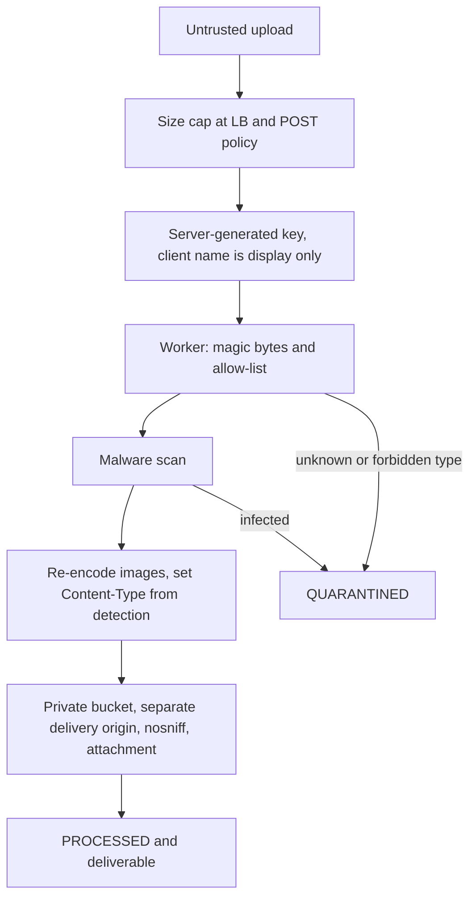
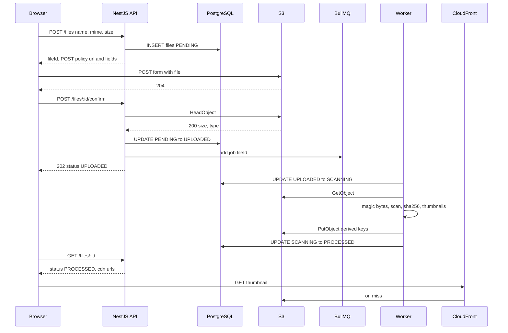

## 33.12 Security of file handling

#### Concept

File upload is the one feature where you invite strangers to hand you arbitrary bytes and then store, process and re-serve them. Every part of that sentence is an attack surface: the bytes (malware, polyglots, decompression bombs), the name (path traversal, encoding tricks), the type (HTML disguised as an image), the storage (public buckets), the delivery (signed URL leakage), and the API that hands out permission (abuse of URL issuance).

#### Why does it exist?

Because "it is just a file" is how most storage breaches start. The controls are individually simple; the discipline is applying all of them, every time, in the right layer.

#### Mental model

Imagine airport security for luggage. The bag is X-rayed (scan), the tag is printed by the airline, not written by the passenger (server-generated keys), the bag goes into the hold, not the cabin (private bucket, no execution), and the baggage claim ticket is single-use and expires (signed URLs). Any one of these being skipped is a story on the news.

#### How it works

**1. Content-type validation by magic bytes.** The browser sets `Content-Type` from the file extension; an attacker sets it to whatever they like. The only trustworthy signal is the first bytes of the content:

```ts
// magic-bytes.ts
export function sniffMime(buf: Buffer): string | null {
  if (buf.length < 12) return null;
  if (buf[0] === 0xff && buf[1] === 0xd8 && buf[2] === 0xff) return 'image/jpeg';
  if (buf.subarray(0, 8).equals(Buffer.from([0x89, 0x50, 0x4e, 0x47, 0x0d, 0x0a, 0x1a, 0x0a]))) return 'image/png';
  if (buf.subarray(0, 4).toString('ascii') === 'RIFF' && buf.subarray(8, 12).toString('ascii') === 'WEBP') return 'image/webp';
  if (buf.subarray(0, 5).toString('ascii') === '%PDF-') return 'application/pdf';
  if (buf.subarray(0, 4).toString('ascii') === 'GIF8') return 'image/gif';
  return null; // unknown: reject, do not guess
}
export const sniffImageType = (buf: Buffer) => { const m = sniffMime(buf); return m?.startsWith('image/') ? m : null; };
```

The `file-type` package covers hundreds of formats and is the practical choice; the point is that detection happens on bytes, in the pipeline, and the detected type is what gets written as `Content-Type` on the final object. A file whose detected type does not match an allow-list is quarantined, not stored with a guessed type.

**2. Size limits at every layer.** Load balancer or ingress body limit, POST policy `content-length-range`, `multer` `limits`, `ParseFilePipe` validators, and a per-user quota in the database. Each layer catches what the previous missed and each costs less than the next.

**3. Path traversal and filename handling.** The client's filename is *display data*. It never becomes part of a key, a path, or a header without sanitization. `../../etc/passwd`, null bytes, and 10,000-character names are all normal inputs. Keys are server-generated UUIDs; the original name is stored in a `text` column and re-emitted only inside a quoted, sanitized `Content-Disposition` (RFC 5987 `filename*=UTF-8''...` for non-ASCII).

**4. No execution, no HTML.** Never serve user uploads from the same origin as your app. If `evil.html` (or an SVG with a `<script>`) is served from `app.example.com`, it runs with your users' cookies: stored XSS via S3. Serve uploads from a separate domain (`cdn-usercontent.example.com`), set `Content-Type` from detection, add `X-Content-Type-Options: nosniff` and `Content-Disposition: attachment` for anything not in a small inline allow-list (JPEG, PNG, WebP, PDF), and consider a CSP `sandbox` header on the CDN response. SVG is executable content; treat it as such (rasterize or forbid).

**5. Private buckets, always.** Block Public Access at the account level. Delivery goes through CloudFront with OAC and signed URLs or cookies for anything non-public.

**6. PII and regulated data.** Separate buckets for regulated content (KYC, medical) with SSE-KMS and a customer-managed key, CloudTrail data events, and tighter lifecycle. Never put PII in keys or in user metadata (both appear in logs and inventories). Deletion requests must cover derivatives and backups.

**7. Signed URL leakage.** Short expiry (minutes), per-object scope, never in query strings that get logged by third parties (referrer headers leak them; use `Referrer-Policy: no-referrer` on pages that embed them). For shareable links, issue a *redirect endpoint* under your control (`GET /files/:id/download`) that checks authorization and returns a fresh short-lived URL each time (33.13).

**8. Rate limiting URL issuance.** Signing costs you nothing and costs the attacker nothing; the bucket fill and the request bill are yours. `@nestjs/throttler` on the issue endpoint, per-user pending quota, and an alert on issuance spikes.



#### Practical example

A social app allows image posts. Attack attempts seen in a typical month: SVGs with embedded scripts (rejected: SVG not on the allow-list), a GIF with an HTML payload appended (re-encoded through `sharp`, payload gone), a 900 by 900 pixel PNG that decompresses to 4 GB (`limitInputPixels` rejects it), a filename `">.png` (stored as text, HTML-escaped when rendered, never in a header unquoted), and 40,000 pre-signed URL requests in an hour from one account (throttled at 30 per minute, account flagged).

#### NestJS example

A response interceptor for the download path that hardens every file response:

```ts
// file-response-headers.interceptor.ts
import { CallHandler, ExecutionContext, Injectable, NestInterceptor } from '@nestjs/common';
import { Observable } from 'rxjs';
import { tap } from 'rxjs/operators';
import { Response } from 'express';

const INLINE_OK = new Set(['image/jpeg', 'image/png', 'image/webp', 'application/pdf']);

export function contentDisposition(name: string, mime: string): string {
  const ascii = name.replace(/[^\x20-\x7e]/g, '_').replace(/["\\]/g, '_').slice(0, 150);
  const utf8 = encodeURIComponent(name.slice(0, 150));
  const type = INLINE_OK.has(mime) ? 'inline' : 'attachment';
  return `${type}; filename="${ascii}"; filename*=UTF-8''${utf8}`;
}

@Injectable()
export class FileResponseHeadersInterceptor implements NestInterceptor {
  intercept(ctx: ExecutionContext, next: CallHandler): Observable<unknown> {
    const res = ctx.switchToHttp().getResponse<Response>();
    res.setHeader('X-Content-Type-Options', 'nosniff');
    res.setHeader('Content-Security-Policy', "default-src 'none'; sandbox");
    res.setHeader('Cache-Control', 'private, no-store');
    res.setHeader('Referrer-Policy', 'no-referrer');
    return next.handle().pipe(tap(() => { /* headers already set before the stream starts */ }));
  }
}
```

#### PostgreSQL example

Per-tenant quotas and abuse detection live next to the data:

```sql
-- Issuance velocity per user over the last 10 minutes (for throttling beyond the in-memory limiter)
SELECT count(*) FROM files WHERE owner_id = $1 AND created_at > now() - interval '10 minutes';

-- Tenants with an unusual quarantine ratio today (abuse signal)
SELECT tenant_id,
       count(*) FILTER (WHERE status = 'QUARANTINED') AS quarantined,
       count(*) AS total
  FROM files
 WHERE created_at > now() - interval '1 day'
 GROUP BY tenant_id
HAVING count(*) FILTER (WHERE status = 'QUARANTINED') > 5;
```

#### Production scenario

A security review of a file feature takes an afternoon with a checklist: where does the client name go, what sets `Content-Type`, which origin serves the bytes, which bucket setting blocks public access, how long do URLs live, what is the allow-list, where is the scan, what is the quota. The controls cost almost nothing at runtime: magic-bytes detection is microseconds, scanning is seconds in a worker, headers are free.

#### Failure scenario

A support portal lets customers attach files to tickets and serves them from `app.example.com/attachments/:id` with the client-declared `Content-Type`. An attacker uploads `screenshot.png` that is actually HTML with `Content-Type: text/html`, then opens a ticket asking an agent to "look at the screenshot". The agent clicks; the page runs in the app's origin with the agent's session and calls the admin API to export customer data. Root causes: trusted declared type, same-origin serving, no `nosniff`, no sandbox. Each control alone would have stopped it.

#### Edge cases & failure modes

- Polyglot files that are both a valid JPEG and a valid ZIP or script: re-encoding images destroys the second personality; for PDFs, sanitize or serve only as attachment with sandbox.
- Filenames with RTL override characters that make `invoice.exe` display as `invoice.pdf`; strip Unicode control characters.
- Zip bombs in "import" features: cap decompressed size and entry count before extracting.
- Scanner signatures lag zero-day malware; scanning is necessary, not sufficient; sandboxed delivery is the second layer.
- A signed URL embedded in an email is forwarded; the recipient gets the file until expiry. Use the redirect endpoint for anything user-shared.
- EXIF GPS in photos leaks the uploader's home address; strip on ingest.

#### How a Senior Backend Engineer thinks about this

Untrusted bytes stay untrusted until the pipeline says otherwise, and even trusted bytes are served from an origin where they cannot hurt anyone. The senior chooses the delivery origin and the `Content-Type` policy before writing the upload code, because those two decisions determine whether an XSS is possible at all.

#### Common mistakes

- Using the client's `Content-Type` when writing to S3.
- Serving uploads from the app origin because "the CDN was extra work".
- Allowing SVG "because it is an image".
- Long-lived signed URLs stored in the database as "the file URL".

#### Interview questions

1. **How can an image upload become an XSS?** Expected: HTML or SVG stored with a permissive type served from the app origin; fixes are detection, separate origin, nosniff, sandbox, attachment.
2. **Where should upload size be enforced?** Expected: every layer, cheapest first: LB, POST policy at S3, parser limits, validators, quotas.
3. **What is the risk of a leaked pre-signed GET URL and how do you contain it?** Expected: anyone can read that object until expiry; short expiry, redirect endpoint, no-referrer, do not store URLs.
4. **Why is the client filename dangerous?** Expected: traversal, header injection, encoding tricks; keep it as display data only.

#### Practical exercise

Write a security test suite for an upload feature: HTML-as-PNG, SVG with script, path traversal filename, 1 KB decompression bomb PNG, EICAR in a PDF, 50,000 URL issuance requests. Acceptance criteria: each is rejected or quarantined at the documented layer; the delivered files carry `nosniff`, sandbox CSP and the correct `Content-Disposition`; no test file is ever served with `text/html`.

## 33.13 Downloads

#### Concept

There are two ways to deliver a file: redirect the client to a signed URL (S3 or CloudFront) so the bytes flow from storage to the client directly, or stream the bytes through NestJS. The first is the default. The second is for when the server must do something to the bytes or the headers that the storage layer cannot: transform on the fly, apply complex authorization per byte range, or hide the storage entirely.

#### Why does it exist?

Downloads are where authorization meets bandwidth. You want the authorization decision in your code and the bandwidth on S3 and CloudFront. The redirect pattern gives you both: `GET /files/:id/download` runs your guard and returns a `302` to a URL that expires in a minute.

#### Mental model

Imagine a library. The redirect model: you show your card at the desk, the librarian hands you a slip with a shelf code valid for five minutes, and you fetch the book yourself. The streaming model: the librarian walks to the shelf, brings the book, and reads it to you. The second is only worth it if the librarian has to translate it as they go.

#### How it works

**Redirect model:**

1. `GET /files/:id/download` with the user's session.
2. Guard checks the user may read this file (owner, share, tenant admin). Row must be `PROCESSED`.
3. Sign a `GetObjectCommand` (or a CloudFront URL) with `ResponseContentDisposition` and `ResponseContentType` overrides, expiring in 60 seconds.
4. Return `302 Location: <signed url>` (or `200 { url }` for API clients that need the URL in JSON).
5. The client fetches from S3 or the CDN. Range requests, resume, and parallel chunks work natively because S3 supports `Range` and returns `206 Partial Content` with `Content-Range` and `Accept-Ranges: bytes`.

**Streaming model:**

1. Same guard.
2. `GetObjectCommand` with the client's `Range` header forwarded.
3. Pipe `Body` to the response with `StreamableFile`, forwarding `Content-Length`, `Content-Range`, `Content-Type`, `ETag`, `Last-Modified`, and setting `Content-Disposition` yourself.
4. Handle client disconnect by destroying the S3 stream so you do not keep pulling bytes for nobody.

Cost comparison for a 100 MB file at 1,000 downloads per day: through NestJS, 100 GB per day through the load balancer and pods, roughly 30 seconds of pod socket time per download, and ALB processing fees. Redirected to CloudFront: zero pod time, cached at the edge for popular files, and CloudFront's per-GB price is lower than ALB plus EC2 egress.

#### Practical example

An invoice download in an e-commerce account page uses the redirect model. A "watermarked preview" of a stock photo uses the streaming model because the watermark is applied per user on the fly (and cached in Redis by `{fileId, userId}` for repeat views). A video course player uses CloudFront signed cookies so the `<video>` element can issue range requests to the CDN directly.

#### NestJS example

```ts
// download.controller.ts
import {
  Controller, Get, Param, ParseUUIDPipe, Req, Res, UseGuards, UseInterceptors,
  NotFoundException, ForbiddenException, StreamableFile, Headers,
} from '@nestjs/common';
import { Request, Response } from 'express';
import { S3Client, GetObjectCommand } from '@aws-sdk/client-s3';
import { Inject } from '@nestjs/common';
import { Readable } from 'node:stream';
import { S3_CLIENT } from '../s3/s3.module';
import { JwtAuthGuard } from '../auth/jwt-auth.guard';
import { FileRepository } from './file.repository';
import { FileAccessService } from './file-access.service';
import { PresignService } from './presign.service';
import { FileStatus } from './file-status';
import { FileResponseHeadersInterceptor, contentDisposition } from './file-response-headers.interceptor';

@Controller('files')
@UseGuards(JwtAuthGuard)
export class DownloadController {
  constructor(
    @Inject(S3_CLIENT) private readonly s3: S3Client,
    private readonly files: FileRepository,
    private readonly access: FileAccessService,
    private readonly presign: PresignService,
  ) {}

  /** Default: authorize, then redirect to a 60 s signed URL. Bytes never touch this pod. */
  @Get(':id/download')
  async download(@Req() req: Request & { user: { id: string } }, @Param('id', ParseUUIDPipe) id: string, @Res() res: Response) {
    const rec = await this.files.findOrFail(id);
    if (rec.status !== FileStatus.PROCESSED) throw new NotFoundException();
    if (!(await this.access.canRead(req.user.id, rec))) throw new ForbiddenException();
    const url = await this.presign.signGet(rec.key, rec.originalName, false, 60);
    res.setHeader('Cache-Control', 'private, no-store');
    res.redirect(302, url);
  }

  /** Streaming variant: only when the server must control headers or transform bytes. */
  @Get(':id/stream')
  @UseInterceptors(FileResponseHeadersInterceptor)
  async stream(
    @Req() req: Request & { user: { id: string } },
    @Param('id', ParseUUIDPipe) id: string,
    @Headers('range') range: string | undefined,
    @Res({ passthrough: true }) res: Response,
  ): Promise<StreamableFile> {
    const rec = await this.files.findOrFail(id);
    if (rec.status !== FileStatus.PROCESSED) throw new NotFoundException();
    if (!(await this.access.canRead(req.user.id, rec))) throw new ForbiddenException();

    const obj = await this.s3.send(new GetObjectCommand({ Bucket: rec.bucket, Key: rec.key, Range: range }));
    const body = obj.Body as Readable;
    res.status(range ? 206 : 200);
    res.setHeader('Accept-Ranges', 'bytes');
    if (obj.ContentRange) res.setHeader('Content-Range', obj.ContentRange);
    if (obj.ETag) res.setHeader('ETag', obj.ETag);
    res.setHeader('Content-Disposition', contentDisposition(rec.originalName, rec.detectedMime ?? 'application/octet-stream'));
    // Stop pulling from S3 if the client goes away mid-transfer.
    req.on('close', () => body.destroy());
    return new StreamableFile(body, { type: rec.detectedMime ?? 'application/octet-stream', length: obj.ContentLength });
  }
}
```

Note the `Content-Type` comes from `detectedMime`, set by the pipeline, never from the client's declaration.

#### PostgreSQL example

Authorization for downloads is a query, and it should be indexed:

```sql
-- Can user U read file F? Owner, or file shared with U, or U is admin of the tenant.
SELECT 1
  FROM files f
 WHERE f.id = $2 AND f.status = 'PROCESSED'
   AND (
        f.owner_id = $1
     OR EXISTS (SELECT 1 FROM file_shares s WHERE s.file_id = f.id AND s.user_id = $1 AND (s.expires_at IS NULL OR s.expires_at > now()))
     OR EXISTS (SELECT 1 FROM tenant_members m WHERE m.tenant_id = f.tenant_id AND m.user_id = $1 AND m.role = 'admin')
   );
CREATE INDEX file_shares_user_idx ON file_shares (user_id, file_id);
```

#### Production scenario

Download authorization at 200 requests per second: the query above is 1 to 2 ms with warm indexes; signing is 0.2 ms; the redirect response is under 5 ms total. The same 200 requests per second streamed through pods at an average of 5 MB each is 1 GB/s through Node.js, which is a different and much larger deployment. Monitor: redirect count, 403 rate (authorization failures, often a bug after a permissions change), and for the streaming route, bytes served and concurrent streams per pod.

#### Failure scenario

A product team wants "download all attachments as a zip". The first version streams every S3 object through the pod, zips in memory, and returns the archive. A customer with 4,000 attachments totaling 9 GB clicks it; the pod is OOM-killed and the ALB returns 502 to every other user on that pod. The second version enqueues a job, a worker streams objects one at a time into a zip stream that is multipart-uploaded to `exports/`, and the user gets an email with a redirect link that expires in 24 hours. The API never touches the bytes.

#### Edge cases & failure modes

- Range header with an invalid range: S3 returns `416`; forward it rather than crashing.
- Client aborts: without `body.destroy()` the pod keeps downloading from S3 and pays egress for nothing.
- A redirect URL cached by a browser or proxy: `Cache-Control: no-store` on the redirect response.
- `Content-Disposition` with non-ASCII names breaks in older clients without the `filename*` form.
- Signed URL expires while a slow client is mid-download: S3 checks the signature at request start, so an in-progress transfer completes; a resume after expiry fails, and the client must re-request the redirect.
- Files in Glacier classes return `InvalidObjectState`; surface a "restore requested, try again in N hours" response rather than a 500.

#### How a Senior Backend Engineer thinks about this

Authorization in the API, bytes on the edge. The senior reaches for the streaming route only with a specific reason and a size cap, and they put a job and an email between the user and any "download everything" feature.

#### Common mistakes

- Streaming everything through NestJS "so we can log downloads" (log the redirect instead).
- Returning a 24-hour signed URL from the download endpoint and calling it a share link.
- Forgetting `Accept-Ranges` and `206` handling so video scrubbing does not work.

#### Interview questions

1. **When do you stream a file through the API instead of redirecting?** Expected: transform on the fly, header control, hide storage, tiny files; otherwise redirect.
2. **How do range requests work with S3?** Expected: `Range` header, `206`, `Content-Range`; S3 supports natively; forward when streaming.
3. **How do you implement "download as zip" for thousands of files?** Expected: async job, streaming zip into multipart upload, link by email; never in the request.

#### Practical exercise

Implement both routes. Acceptance criteria: a `curl -r 0-1023` against the stream route returns `206` with 1,024 bytes and a correct `Content-Range`; the redirect route returns `302` with a URL that fails after 60 seconds; aborting a 1 GB stream at 10 percent stops S3 egress within 2 seconds (check bytes read on the pod).

## 33.14 NestJS upload architecture: the full worked example

This section assembles everything above into one coherent flow for a product-image upload in an e-commerce seller portal. Requirements: images up to 10 MB, JPEG/PNG/WebP, direct-to-S3, scanned and thumbnailed before they appear on the storefront, delivered by CDN.



The service that ties the pieces together:

```ts
// files.service.ts
import { Injectable, ConflictException, NotFoundException, ForbiddenException, Inject } from '@nestjs/common';
import { InjectQueue } from '@nestjs/bullmq';
import { Queue } from 'bullmq';
import { S3Client, HeadObjectCommand } from '@aws-sdk/client-s3';
import { DataSource } from 'typeorm';
import { S3_CLIENT } from '../s3/s3.module';
import { ObjectKeyService } from '../s3/object-key.service';
import { PresignService } from './presign.service';
import { FileRepository } from './file.repository';
import { FileRecord } from './file.entity';
import { FileStatus } from './file-status';
import { CreateUploadDto } from './create-upload.dto';
import { CdnUrlService } from '../cdn/cdn-url.service';

const MAX_PENDING_PER_HOUR = 100;

@Injectable()
export class FilesService {
  private readonly bucket = process.env.UPLOADS_BUCKET!;
  constructor(
    @Inject(S3_CLIENT) private readonly s3: S3Client,
    private readonly keys: ObjectKeyService,
    private readonly presign: PresignService,
    private readonly files: FileRepository,
    private readonly cdn: CdnUrlService,
    private readonly ds: DataSource,
    @InjectQueue('file-processing') private readonly queue: Queue,
  ) {}

  async createPendingUpload(user: { id: string; tenantId: string }, dto: CreateUploadDto) {
    const pending = await this.files.countPendingSince(user.id, new Date(Date.now() - 3600_000));
    if (pending >= MAX_PENDING_PER_HOUR) throw new ConflictException('Too many uploads in progress');

    const ext = dto.mimeType.split('/')[1] === 'jpeg' ? 'jpg' : dto.mimeType.split('/')[1];
    const key = this.keys.build('uploads', user.tenantId, ext);

    const rec = await this.ds.transaction(async (em) => em.save(FileRecord, em.create(FileRecord, {
      tenantId: user.tenantId, ownerId: user.id, bucket: this.bucket, key,
      originalName: dto.filename.slice(0, 255), declaredMime: dto.mimeType, status: FileStatus.PENDING,
    })));

    const upload = await this.presign.signPost(key, dto.mimeType.split('/')[0] + '/', dto.sizeBytes);
    return { fileId: rec.id, upload }; // { url, fields } for the browser form POST
  }

  async confirmUpload(userId: string, fileId: string) {
    const rec = await this.files.findOrFail(fileId);
    if (rec.ownerId !== userId) throw new ForbiddenException();
    if (rec.status === FileStatus.UPLOADED || rec.status === FileStatus.PROCESSED) return { status: rec.status }; // idempotent
    if (rec.status !== FileStatus.PENDING) throw new ConflictException(`File is ${rec.status}`);

    let head;
    try {
      head = await this.s3.send(new HeadObjectCommand({ Bucket: rec.bucket, Key: rec.key }));
    } catch (e: any) {
      if (e?.$metadata?.httpStatusCode === 404) throw new ConflictException('Object not uploaded yet');
      throw e;
    }
    if ((head.ContentLength ?? 0) === 0 || (head.ContentLength ?? 0) > 10 * 1024 * 1024) {
      throw new ConflictException('Object size out of range'); // janitor will expire it
    }
    const moved = await this.files.transition(fileId, FileStatus.PENDING, FileStatus.UPLOADED, {
      sizeBytes: String(head.ContentLength),
    });
    if (!moved) throw new ConflictException('File state changed');

    // jobId = fileId makes a double confirm enqueue once; attempts and backoff handle transient failures.
    await this.queue.add('process', { fileId }, { jobId: fileId, attempts: 4, backoff: { type: 'exponential', delay: 5000 }, removeOnComplete: true });
    return { status: FileStatus.UPLOADED };
  }

  async describe(userId: string, fileId: string) {
    const rec = await this.files.findWithDerivatives(fileId);
    if (!rec) throw new NotFoundException();
    if (rec.ownerId !== userId) throw new ForbiddenException();
    const thumb = rec.derivatives.find((d) => d.kind === 'thumb_256');
    return {
      id: rec.id, status: rec.status, size: rec.sizeBytes, mime: rec.detectedMime,
      urls: rec.status === FileStatus.PROCESSED
        ? { original: this.cdn.privateUrl(rec.key), thumb: thumb ? this.cdn.publicUrl(thumb.key) : null }
        : null,
    };
  }
}
```

The janitor that closes the loop on orphans:

```ts
// file-janitor.service.ts
import { Injectable, Logger, Inject } from '@nestjs/common';
import { Cron } from '@nestjs/schedule';
import { S3Client, HeadObjectCommand, DeleteObjectCommand } from '@aws-sdk/client-s3';
import { InjectQueue } from '@nestjs/bullmq';
import { Queue } from 'bullmq';
import { S3_CLIENT } from '../s3/s3.module';
import { FileRepository } from './file.repository';
import { FileStatus } from './file-status';

@Injectable()
export class FileJanitorService {
  private readonly log = new Logger(FileJanitorService.name);
  constructor(
    @Inject(S3_CLIENT) private readonly s3: S3Client,
    private readonly files: FileRepository,
    @InjectQueue('file-processing') private readonly queue: Queue,
  ) {}

  @Cron('*/5 * * * *') // every 5 minutes; single instance via a leader lock in production
  async sweepPending() {
    const stale = await this.files.findPendingOlderThan(new Date(Date.now() - 60 * 60_000), 500);
    for (const rec of stale) {
      try {
        await this.s3.send(new HeadObjectCommand({ Bucket: rec.bucket, Key: rec.key }));
        // Object exists but confirm was lost: promote and process instead of losing the upload.
        if (await this.files.transition(rec.id, FileStatus.PENDING, FileStatus.UPLOADED)) {
          await this.queue.add('process', { fileId: rec.id }, { jobId: rec.id, attempts: 4 });
        }
      } catch (e: any) {
        if (e?.$metadata?.httpStatusCode === 404) {
          await this.files.transition(rec.id, FileStatus.PENDING, FileStatus.EXPIRED);
        } else {
          this.log.warn({ fileId: rec.id, msg: 'head failed, will retry', err: e?.name });
        }
      }
    }
    // SCANNING rows stuck for 30+ minutes: worker died; put them back for a retry.
    const stuck = await this.files.findScanningOlderThan(new Date(Date.now() - 30 * 60_000), 100);
    for (const rec of stuck) {
      if (await this.files.transition(rec.id, FileStatus.SCANNING, FileStatus.UPLOADED)) {
        await this.queue.add('process', { fileId: rec.id }, { jobId: `${rec.id}:retry:${Date.now()}`, attempts: 2 });
      }
    }
  }
}
```

(`SCANNING -> UPLOADED` must be added to `ALLOWED_TRANSITIONS` for the janitor's use.)

Deployment shape: the API deployment handles the JSON endpoints and never streams bytes; the worker deployment runs the BullMQ processor with ClamAV as a sidecar or a shared service; the CDN sits in front of the bucket with OAC; lifecycle rules abort multipart after 3 days and expire `uploads/` objects whose rows are `EXPIRED` via a nightly DB-driven job. Dashboards: URLs issued, confirmed, processed, quarantined per hour; queue depth and oldest job age; DLQ depth; CDN hit ratio.

## 33.15 Edge cases & failure modes

- **Upload succeeded but confirm never called (orphans).** The browser closed after the S3 `POST`. The row is `PENDING`, the object exists. The janitor's `HeadObject` promotes it to `UPLOADED` and processing continues; without a janitor the object costs money and the user thinks the upload failed. The S3 event notification safety net catches the same case faster.
- **Duplicate uploads (content hash dedup).** The same PDF uploaded twice by the same tenant. The worker computes SHA-256, finds a `PROCESSED` row with the same hash in the same tenant, points the new row at the existing key and deletes the new object. Never dedup across tenants; the existence check itself would leak information.
- **Huge files timing out through the API.** A 3 GB upload through `FileInterceptor` hits the ALB idle timeout (60 seconds default) or the pod's memory limit. Fix is architectural: pre-signed multipart, not a bigger timeout.
- **Multipart parts left forever (cost).** Every abandoned multipart upload bills at Standard rates and is invisible to normal listings. `AbortIncompleteMultipartUpload` at 3 days, plus the `multipart_uploads` table janitor.
- **Pre-signed URL reused or leaked.** A `PUT` URL can be used repeatedly until expiry; the last body wins. The pipeline treats every object as untrusted until scanned, expiry is minutes, and after `PROCESSED` the original upload URL has long expired. A leaked `GET` URL exposes one object until expiry; the redirect endpoint keeps that window to a minute.
- **Wrong content type sniffed as HTML (stored XSS via S3).** Client declares `text/html` or the browser sniffs it; served from the app origin it executes. Detection sets the type, uploads are served from a separate origin with `nosniff` and a sandbox CSP, and HTML and SVG are not on the allow-list.
- **CDN eventual consistency after replace.** Overwriting a key leaves stale copies at edges for the TTL; invalidations are slow and cost money. Never overwrite; every version is a new key with `immutable` caching.
- **S3 throttling (503 SlowDown).** Bursts above the per-prefix rate return `SlowDown`. The SDK retries with backoff (`maxAttempts`); browsers need retry logic in the upload code; spread hot writes across prefixes only if you actually exceed 3,500 writes per second on one prefix.
- **Region outage.** Uploads fail, downloads fail unless CloudFront has cached them. Mitigation is Cross-Region Replication to a second bucket and a CloudFront origin group with failover; RPO is replication lag (typically seconds to minutes) and it doubles storage cost. Decide per bucket whether that is worth it (see Part 38 — Backup, Restore and Disaster Recovery).
- **Lifecycle deleting needed files.** A rule with a wrong prefix or empty filter deletes production data; versioning turns that into a delete-marker cleanup instead of a loss. Lifecycle rules live in infrastructure code with review.
- **Bucket public by mistake.** A developer disables Block Public Access for a test and forgets; enumerable keys make it a breach. Account-level Block Public Access plus an organization policy that denies changing it; UUID keys so nothing is guessable even if it happens.
- **Clock skew invalidating signatures.** SigV4 tolerates 15 minutes between the signer's clock and S3's. A pod with broken NTP produces URLs that fail with `RequestTimeTooSkewed`, which looks like a permissions error. Alert on NTP drift on nodes.
- **Filename encoding issues.** Names with emoji, RTL overrides, quotes or newlines break `Content-Disposition` and log lines. Keys are UUIDs; display names are sanitized for headers with `filename*=UTF-8''` encoding and stripped of control characters.
- **Virus in file processed before scan.** A pipeline that extracts PDF text and indexes it before the scan verdict has already handed malicious content to a downstream system. The scan is the first step after magic-byte detection; nothing reads deeper into the bytes until it passes.
- **Confirm called before the upload finished.** `HeadObject` 404s; the API returns 409 and the client retries after the `PUT` completes. Never mark `UPLOADED` optimistically.
- **KMS key disabled or throttled.** Every read fails with `KMS.DisabledException` or `ThrottlingException`; alert on KMS key state changes and enable bucket keys.
- **Disk-based temp files piling up on API pods.** For the small through-the-API path with `diskStorage`, a crashed request leaves a temp file. Use `emptyDir` with a size limit and a cleanup on startup.

## Senior Checklist — Part 33

- [ ] I understand the concept
- [ ] I can explain it simply
- [ ] I can implement it
- [ ] I understand its failure modes
- [ ] I understand its scaling limitations
- [ ] I understand its security implications
- [ ] I understand its operational implications
- [ ] I can choose between alternatives
- [ ] I can explain the tradeoffs
- [ ] I can answer senior-level interview questions
- [ ] I can explain why local disk fails with multiple pods and when it is still acceptable
- [ ] I can design an S3 key scheme that supports lifecycle rules and tenant deletion
- [ ] I can implement a pre-signed upload flow with a confirm endpoint and a `files` state machine
- [ ] I can implement resumable multipart uploads and know the abort and lifecycle story
- [ ] I can explain why uploads are served from a separate origin with detected content types
- [ ] I can design an idempotent processing pipeline with scan, derivatives and a DLQ
- [ ] I can put CloudFront in front of a private bucket with OAC and signed URLs
- [ ] I can list the lifecycle rules every bucket needs and the cost traps of storage classes
- [ ] I can choose between redirect-to-signed-URL and streaming through NestJS for downloads

## Part 33 — Key Takeaways

- Bytes live in object storage; facts about bytes live in PostgreSQL; delivery is the CDN's job. NestJS pods coordinate and never carry large files.
- Local disk is a buffer, not storage. If a pod vanishing loses a user file, the design is wrong.
- S3 is strongly consistent and eleven-nines durable, but durability does not protect against your own deletes; versioning and reviewed lifecycle rules do.
- Keys are server-generated UUIDs under purpose and tenant prefixes; never overwrite a key with new content.
- Pre-signed URLs are short-lived, narrowly scoped bearer tokens; the POST policy is where S3 enforces size and type; the confirm endpoint is how your database learns the truth.
- The `files.status` state machine, written only through guarded conditional updates, is what makes direct-to-S3 uploads safe.
- Nothing reads uploaded content before magic-byte detection and a malware scan; nothing is delivered before `PROCESSED`.
- Serve user content from a separate origin with detected `Content-Type`, `nosniff`, a sandbox CSP and `attachment` for anything not on a small inline allow-list.
- Multipart uploads need an abort path and an `AbortIncompleteMultipartUpload` lifecycle rule, or they bill forever invisibly.
- Downloads are authorization in the API plus a redirect to a one-minute signed URL; stream through NestJS only with a reason and a size cap.
- Measure the issue-to-confirm funnel and the processing queue; they are the only visibility into a flow that bypasses your servers.
