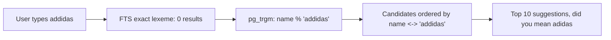

## 34.3 Inverted indexes

#### Concept

An inverted index maps each term to the list of documents that contain it. A normal ("forward") index goes from document to its contents; the inverted one goes from content to documents. Every full-text search engine, from PostgreSQL's GIN to Lucene inside Elasticsearch, is an inverted index plus a ranking function.

#### Why does it exist?

To answer "which documents contain the word `shoe`?" without reading every document. With 2 million products, a sequential scan reads 2 million descriptions per query. An inverted index reads one short list. The cost moves from query time to index time, which is the right trade for data that is written once and searched thousands of times.

#### Mental model

Imagine the index at the back of a cookbook. Instead of flipping through 400 pages to find recipes with saffron, you look up "saffron" and find "pages 12, 88, 301". Two ingredients? Look up both and keep the page numbers in both lists. The book is the forward representation; the back-of-book index is the inverted one.

#### How it works

1. **Dictionary.** A sorted structure (B-tree in GIN, a finite state transducer in Lucene) of every distinct term. Lookup by term is a logarithmic or better search.
2. **Posting lists.** For each term, the sorted list of document ids (in PostgreSQL, heap tuple ids) that contain it, optionally with positions and frequencies. `shoe -> [12, 99, 777, 4410, ...]`.
3. **Compression.** Posting lists are stored as deltas between sorted ids and compressed, so a term in 500,000 documents takes a few hundred KB, not megabytes.
4. **Boolean operations.** `run AND shoe` is the intersection of two sorted lists, done with a merge walk; `OR` is a union; `NOT` is a difference. Skip pointers let the engine jump over long stretches of one list when the other is sparse.
5. **Scoring.** Lucene stores term frequency per posting so BM25 can be computed while walking; PostgreSQL's GIN stores only locations, and `ts_rank` re-reads the `tsvector` of each candidate row from the heap. That difference is why PostgreSQL ranking is proportional to match count while Lucene can stop early.

```text
Documents
  p12:  "trail running shoes"
  p99:  "running socks"
  p777: "leather shoes"

Inverted index (after stemming)
  leather -> [p777]
  run     -> [p12, p99]
  shoe    -> [p12, p777]
  sock    -> [p99]
  trail   -> [p12]

Query "running shoes" = run AND shoe
  [p12, p99] intersect [p12, p777] = [p12]
```

**Why GIN is an inverted index.** GIN (Generalized Inverted Index) is PostgreSQL's generic implementation of exactly this: a B-tree over *keys* (lexemes for `tsvector`, trigrams for `pg_trgm`, keys and values for `jsonb`), each pointing to a posting list (or a posting tree when the list is large) of heap tuple ids. The "generalized" part means the index does not know what a key is; the operator class (`tsvector_ops`, `gin_trgm_ops`, `jsonb_path_ops`) tells it how to extract keys from a value and from a query.

GIN has one notable optimization with an operational cost: the **pending list**. Because adding one row may touch dozens of keys (one per lexeme), GIN by default (`fastupdate = on`) appends new entries to an unsorted pending list and merges them into the main structure later, during `VACUUM` or when the list exceeds `gin_pending_list_limit` (default 4 MB). Inserts get faster; searches must scan the pending list linearly, so if it grows (heavy inserts, lazy autovacuum), search latency creeps up. Section 34.14 covers the failure.

#### Practical example

The `products_search_gin` index from 34.2 on 2 million products: about 180,000 distinct lexemes, index size 1.1 GB. The term `shoe` has a posting tree with 600,000 entries; `merino` has a posting list of 340. A query for `merino shoe` reads the short list, then probes the long one with the 340 candidates, and returns in 2 ms. A query for `shoe` alone returns 600,000 candidates and the *ranking* is what takes 400 ms.

#### PostgreSQL example

```sql
-- Inspect a GIN index: size and pending list
SELECT pg_size_pretty(pg_relation_size('products_search_gin')) AS index_size;
CREATE EXTENSION IF NOT EXISTS pageinspect;
SELECT * FROM gin_metapage_info(get_raw_page('products_search_gin', 0));
-- n_pending_pages and n_pending_tuples show pending list growth

-- Flush the pending list without a full VACUUM
SELECT gin_clean_pending_list('products_search_gin');

-- Turn fastupdate off for a search-heavy, insert-light table
ALTER INDEX products_search_gin SET (fastupdate = off);
```

#### Production scenario

Index build time: creating a GIN index on 2 million rows of product text takes 1 to 3 minutes with `maintenance_work_mem = 1GB`; use `CREATE INDEX CONCURRENTLY` in production so writes are not blocked. Write amplification: each inserted product adds 20 to 60 entries; on a table receiving 200 inserts per second that is around 10,000 index entries per second, comfortably handled with the pending list on. Monitor pending pages and autovacuum activity on the table.

#### Failure scenario

A nightly catalog import inserts 400,000 products in ten minutes. `autovacuum` is tuned to run rarely on this table because "it is mostly reads". The pending list grows to hundreds of MB. From 03:10 onwards every search scans the pending list linearly and p95 goes from 40 ms to 900 ms; the on-call gets paged for the search SLO. `SELECT gin_clean_pending_list(...)` takes 40 seconds and fixes it. Permanent fix: run the import with `fastupdate = off` for that index, or run `gin_clean_pending_list` at the end of the import, and give the table its own autovacuum settings.

#### Edge cases & failure modes

- GIN cannot do ordered scans; `ORDER BY` always needs a sort of the candidates.
- A GIN index on a very high-cardinality key set (unique ids) is a waste; use B-tree.
- Posting trees for extremely common terms are large; `VACUUM` must clean dead entries or bloat grows.
- Concurrent index creation can fail and leave an `INVALID` index that must be dropped.

#### How a Senior Backend Engineer thinks about this

Understanding the posting list model tells you the cost of every query before you run it: rare terms are cheap, common terms are expensive, and PostgreSQL pays that cost in ranking. The senior uses that to decide where a candidate cap, a cache or a move to Lucene is needed.

#### Interview questions

1. **What is an inverted index and how does it answer an AND query?** Expected: term to sorted posting list; intersection by merge walk with skip pointers.
2. **Why is GIN called "generalized"?** Expected: same structure for tsvector lexemes, trigrams, jsonb keys via operator classes.
3. **What is the GIN pending list and how can it hurt?** Expected: unsorted buffer of new entries for insert speed; searches scan it linearly; grows without vacuum.

#### Practical exercise

Insert 500,000 rows into a GIN-indexed table with `fastupdate` on, measure search latency before and after `gin_clean_pending_list`, then repeat with `fastupdate = off`. Acceptance criteria: a written table of insert throughput and search p95 under both settings, and a recommendation for your workload.

## 34.4 Tokenization and analysis

#### Concept

Analysis is the pipeline that turns raw text into index terms. It runs at index time on documents and at query time on the user's input, and the two must agree, or nothing matches. The steps: tokenize (split into words), normalize (lowercase, strip accents), filter (drop stop words), transform (stem, apply synonyms), and optionally expand (n-grams for partial matching).

#### Why does it exist?

Because "Running", "running", "runs", "ran" and "runner" are the same idea to a shopper and five different strings to a computer. Analysis collapses the variations into one term at both ends so a query for any of them finds all of them. Every relevance problem you will ever debug is, at its root, an analysis question: "what terms did this document produce, and what terms did this query produce?"

#### Mental model

Imagine two people who must agree on how to file paperwork so that either can find it later. They agree on rules: everything in lowercase, plural becomes singular, "Ltd." and "Limited" are the same, ignore "the" and "of". The rules matter less than the fact that both follow *identical* rules. A single mismatch ("she files under plural, I search singular") makes documents disappear.

#### How it works

| Step | What it does | PostgreSQL | Elasticsearch / OpenSearch |
|---|---|---|---|
| Tokenizer | Splits text into tokens; recognizes emails, URLs, numbers | Built-in parser, token types (`asciiword`, `email`, `url`, `numword`) | `standard`, `whitespace`, `keyword`, `pattern`, `edge_ngram`, `ngram` tokenizers |
| Lowercase | `Shoe` = `shoe` | Always, in dictionaries | `lowercase` token filter |
| Accent folding | `café` = `cafe` | `unaccent` dictionary in a custom config | `asciifolding` filter |
| Stop words | Drop `the`, `a`, `of` | Part of language dictionaries (Snowball) | `stop` filter with a word list |
| Stemming | `running` = `run` | Snowball stemmers per language | `snowball`, `porter_stem`, `kstem`, language analyzers |
| Synonyms | `sneaker` = `trainer` = `running shoe` | `synonym` dictionary file, `thesaurus` dictionary for phrases | `synonym` and `synonym_graph` filters |
| N-grams | `shoe` becomes `sh`, `sho`, `hoe`, `shoe`; for partial and fuzzy | `pg_trgm` (trigrams) as a separate index | `ngram` filter |
| Edge n-grams | `shoe` becomes `s`, `sh`, `sho`, `shoe`; for prefix autocomplete | Not built in; trigram or B-tree prefix instead | `edge_ngram` filter, index-time only |

Two rules the mechanisms enforce:

1. **Same analyzer both sides**, with one deliberate exception: edge n-grams are applied at *index* time only. If you edge-n-gram the query too, `shoe` becomes `s` and matches everything starting with `s`. Elasticsearch has `analyzer` and `search_analyzer` on a field for exactly this.
2. **Analysis is baked into the index.** Changing the stemmer, adding a synonym, or turning on accent folding does not change existing index entries. You must reindex. In PostgreSQL that is rewriting the generated column; in Elasticsearch it is a new index and an alias swap (34.10).

#### Practical example

A food-delivery search: "biryani" is spelled "biriyani", "briyani" and "biryaani" by users. Synonyms map the variants to one term at both index and query time. "veg" and "vegetarian" are synonyms. "chicken" should not stem to "chick". A `restaurant_names` field uses a `keyword` analyzer with lowercase only so "Burger King" stays one token; a `dishes` field uses the language analyzer with the synonym filter; a `dishes.autocomplete` sub-field uses edge n-grams for the search box.

#### PostgreSQL example

A custom configuration with synonyms and accent folding. Synonym dictionaries read a file in `$SHAREDIR/tsearch_data`:

```text
# /usr/share/postgresql/16/tsearch_data/shop_synonyms.syn
sneaker trainer
sneakers trainer
trainers trainer
tee tshirt
t-shirt tshirt
```

```sql
CREATE TEXT SEARCH DICTIONARY shop_syn (TEMPLATE = synonym, SYNONYMS = shop_synonyms);
CREATE TEXT SEARCH CONFIGURATION shop_en (COPY = english);
ALTER TEXT SEARCH CONFIGURATION shop_en
  ALTER MAPPING FOR asciiword, asciihword, hword_asciipart, word, hword, hword_part
  WITH unaccent, shop_syn, english_stem;

SELECT to_tsvector('shop_en', 'Running Sneakers');   -- 'run':1 'trainer':2
SELECT to_tsvector('shop_en', 'Running Trainers');   -- 'run':1 'trainer':2
```

Both products now share the lexeme `trainer`, and so does the query. Rebuild stored vectors after changing a configuration.

#### NestJS example

The analysis contract belongs in code review, so encode it as a test that runs against the database:

```ts
// search-analysis.spec.ts (integration test against a real PostgreSQL)
import { DataSource } from 'typeorm';

describe('shop_en text search configuration', () => {
  let ds: DataSource;
  beforeAll(async () => { ds = new DataSource({ type: 'postgres', url: process.env.TEST_DATABASE_URL! }); await ds.initialize(); });
  afterAll(() => ds.destroy());

  const lexemes = async (text: string) => {
    const [{ v }] = await ds.query(`SELECT to_tsvector('shop_en', $1)::text AS v`, [text]);
    return v as string;
  };

  it('maps synonyms and stems consistently', async () => {
    expect(await lexemes('Running Sneakers')).toBe(await lexemes('running trainer'));
  });
  it('folds accents', async () => {
    expect(await lexemes('Café crème')).toContain("'cafe'");
  });
  it('keeps identifiers findable via simple config', async () => {
    const [{ v }] = await ds.query(`SELECT to_tsvector('simple', $1)::text AS v`, ['IT']);
    expect(v).toBe("'it':1");
  });
});
```

#### Production scenario

Analysis choices are relevance choices, and they need a feedback loop: a "query to terms" debugging endpoint (34.11) and a list of the top 200 queries with their zero-result rate. A synonym file grows from real query logs, five to twenty entries a month, reviewed by whoever owns search. Reindexing after each change is a scheduled job, not an emergency.

#### Failure scenario

A team switches the product name field from the `english` analyzer to a `standard` analyzer with no stemming "to make exact matches rank higher". They reindex. Searches for "running shoes" now miss every product named "Running Shoe" (singular). Zero-result rate doubles overnight; conversion from search drops 8 percent. Rolled back in a day; the postmortem introduces the analysis test above and an A/B process for analyzer changes.

#### Edge cases & failure modes

- Stemmers over-stem: `universe`, `university` and `universal` all become `univers`. Use a lighter stemmer (`kstem`) or a keyword marker for protected terms.
- Compound words in German, Dutch and Scandinavian languages need decompounding or n-grams.
- CJK languages have no spaces; the `standard` tokenizer splits into single characters; use `icu` or language-specific plugins (`kuromoji`, `nori`, `smartcn`).
- Emojis and symbols are dropped by most tokenizers; a product named "#1 Fan Tee" loses the `#1`.
- Synonym expansion at index time bloats the index; at query time it slows the query; choose per synonym set.
- Multi-word synonyms with `synonym_graph` must be applied at query time to keep positions consistent.

#### How a Senior Backend Engineer thinks about this

Before touching ranking, the senior asks "what tokens exist in the index for this document, and what tokens does this query produce?" They write those down (with `to_tsvector` or the `_analyze` API), and most "search is broken" tickets end there. They keep analyzers per field, not per index, and they have a reindex process ready before changing any of them.

#### Common mistakes

- Different analyzers at index and query time by accident (index built with `english`, query built with the session default `simple`).
- Applying edge n-grams to the query.
- Stemming identifiers and codes.
- Changing an analyzer without reindexing and being surprised nothing changed.

#### Interview questions

1. **Why must the query and the index use the same analysis?** Expected: terms must match byte for byte; different stems or case produce no matches. Follow-up: when do they intentionally differ? Edge n-grams for autocomplete.
2. **What is the difference between n-grams and edge n-grams?** Expected: all substrings of length n vs prefixes; fuzzy and infix vs prefix autocomplete.
3. **How do synonyms work and what is the index-time vs query-time trade-off?** Expected: index-time expands stored terms (bigger index, changes need reindex); query-time expands the query (slower queries, changes are instant).
4. **How would you debug "this product does not show up for this query"?** Expected: analyze both sides, compare terms, check filters, then check ranking.

#### Practical exercise

Create a custom PostgreSQL configuration with `unaccent` and a synonym dictionary of ten domain terms; write the analysis test; rebuild the stored vectors. Acceptance criteria: the test passes; a query for a synonym finds products indexed under the other term; `EXPLAIN` shows the GIN index still used.

## 34.5 Ranking: TF-IDF, BM25, boosting and business signals

#### Concept

Ranking assigns a score to each matching document and sorts by it. The classic score is TF-IDF: a term counts more when it appears often in *this* document (term frequency, TF) and when it is rare across *all* documents (inverse document frequency, IDF). BM25 is the modern refinement used by Lucene, Elasticsearch and OpenSearch by default; it caps the benefit of repeating a term and normalizes for document length. On top of the text score, real systems add field boosts, recency, popularity and business rules.

#### Why does it exist?

Because a query for "wireless mouse" matches 4,000 products and the user will look at five. If the five are wrong, the search is useless regardless of how fast it is. Ranking is the difference between a search engine and a filter that happens to accept text.

#### Mental model

Imagine asking a librarian for books about "Roman roads". A book that mentions "Roman" once in a footnote scores low. A book with "roads" in the title scores high. A word like "the" appears in every book, so matching it means nothing; a word like "aqueduct" appears in few, so matching it means a lot. And a 900-page encyclopedia that mentions everything once should not beat a 90-page book that is entirely about the topic. BM25 is those instincts written as a formula.

#### How it works

In simple language:

1. **Term frequency.** More occurrences of the query term in the document is better, but with diminishing returns: the tenth mention adds far less than the second. BM25's `k1` parameter (default 1.2) controls how fast the curve flattens.
2. **Inverse document frequency.** A term that appears in 1 percent of documents is worth much more than one in 60 percent. IDF is roughly `log(total_docs / docs_with_term)`.
3. **Length normalization.** A match in a short document is worth more than the same match in a long one, because the long one is less *about* the term. BM25's `b` parameter (default 0.75) controls how strongly length counts.
4. **Sum over query terms.** The document's score is the sum of its per-term scores. Documents matching more of the query's rare terms rise to the top.

PostgreSQL's `ts_rank` and `ts_rank_cd` are simpler: they use term frequency, field weights and (for `_cd`) proximity of query terms, with optional length normalization; they do *not* use IDF, because a `tsvector` has no view of the whole corpus. In practice that means a query with one rare term and one common term ranks the common term as heavily as the rare one. For product catalogs this is usually acceptable; for large heterogeneous text (support tickets, articles) it is the most visible quality gap versus Elasticsearch.

**Boosting fields.** A match in `name` should outrank a match in `description`. PostgreSQL: `setweight` A/B/C/D and the weights array in `ts_rank`. Elasticsearch: `multi_match` with `fields: ["name^3", "brand^2", "description"]`.

**Recency and popularity.** Text score alone ranks a 2019 product with a keyword-stuffed description above the 2026 bestseller. Real ranking blends signals: `final = text_score * (1 + log(1 + sales_30d)) * recency_decay`. In PostgreSQL that is arithmetic in `ORDER BY`; in Elasticsearch it is `function_score` with `field_value_factor` and `gauss` decay, or a `rank_feature` field.

**Business rules.** Sponsored products pinned to slot 1 and 4; out-of-stock demoted, not hidden; a brand the user has bought before boosted. These are explicit, not learned, and they belong in a layer over the search provider so they can be changed without touching the index.


#### Practical example

An e-commerce catalog blends three signals: `ts_rank_cd` with weights `{0.1, 0.2, 0.5, 1.0}`, a popularity factor from 30-day sales, and a small in-stock bonus. Sponsored placements are injected by the API layer after the search returns, so they do not distort the organic ranking or the analytics.

#### PostgreSQL example

```sql
-- Materialized popularity, refreshed hourly, so ranking does not join sales at query time
CREATE TABLE product_signals (
  product_id  bigint PRIMARY KEY REFERENCES products(id),
  sales_30d   int NOT NULL DEFAULT 0,
  rating      numeric(3,2),
  updated_at  timestamptz NOT NULL DEFAULT now()
);

WITH q AS (SELECT websearch_to_tsquery('shop_en', $1) AS query)
SELECT p.id, p.name,
       ts_rank_cd('{0.1, 0.2, 0.5, 1.0}', p.search_vector, q.query, 1) AS text_score,
       coalesce(s.sales_30d, 0) AS sales_30d,
       ts_rank_cd('{0.1, 0.2, 0.5, 1.0}', p.search_vector, q.query, 1)
         * (1 + ln(1 + coalesce(s.sales_30d, 0)))               -- popularity, log-damped
         * (CASE WHEN p.in_stock THEN 1.0 ELSE 0.6 END)          -- demote, do not hide
         * (1 + 0.2 * exp(-extract(epoch FROM now() - p.created_at) / 86400 / 60)) AS final_score  -- 60 day recency decay
  FROM products p
  JOIN q ON true
  LEFT JOIN product_signals s ON s.product_id = p.id
 WHERE p.tenant_id = $2 AND p.search_vector @@ q.query
 ORDER BY final_score DESC, p.id
 LIMIT 20;
```

#### NestJS example

Business rules sit in a service that decorates provider results, so the same rules apply whether the provider is PostgreSQL or OpenSearch:

```ts
// ranking-rules.service.ts
import { Injectable } from '@nestjs/common';

export interface RankedHit { id: string; score: number; inStock: boolean; brand: string | null; sponsored?: boolean }

@Injectable()
export class RankingRulesService {
  apply(hits: RankedHit[], ctx: { preferredBrands: Set<string>; sponsoredIds: string[] }): RankedHit[] {
    const boosted = hits.map((h) => ({
      ...h,
      score: h.score * (h.brand && ctx.preferredBrands.has(h.brand) ? 1.15 : 1) * (h.inStock ? 1 : 0.6),
    }));
    boosted.sort((a, b) => b.score - a.score || a.id.localeCompare(b.id)); // stable tiebreak
    // Pin up to two sponsored results at positions 0 and 3 without removing organic ones.
    const sponsored = boosted.filter((h) => ctx.sponsoredIds.includes(h.id)).slice(0, 2).map((h) => ({ ...h, sponsored: true }));
    const organic = boosted.filter((h) => !ctx.sponsoredIds.includes(h.id));
    const out = [...organic];
    if (sponsored[0]) out.splice(0, 0, sponsored[0]);
    if (sponsored[1]) out.splice(3, 0, sponsored[1]);
    return out;
  }
}
```

#### Production scenario

Ranking quality is measured, not argued: click-through rate on the first result, the position of the first click, zero-click searches, and conversion after search. A relevance change ships behind a flag to 10 percent of traffic and is compared on those metrics for a week. Latency cost of the blended PostgreSQL query above versus pure text ranking: about 15 percent, from the join and the arithmetic over the candidate set.

#### Failure scenario

A "boost by popularity" change multiplies the text score by raw `sales_30d`. A phone case with 40,000 sales now appears first for every query containing "phone", including "phone" itself, "phone charger", and "phone stand". Search conversion drops 12 percent in two days. The fix is the log damping shown above. Lesson: every signal needs a ceiling.

#### Edge cases & failure modes

- Scores are not comparable across queries (a 0.9 for one query and 0.9 for another mean nothing together); never threshold on absolute score.
- BM25 IDF is per shard in Elasticsearch by default; small indices with few shards get inconsistent scores; use one shard or `dfs_query_then_fetch` when testing.
- Ties: always add a deterministic tiebreak or pagination will show duplicates and skips.
- Keyword stuffing in seller-written descriptions games TF; length normalization and field caps help.
- Personalization signals leak across users if cached without the user in the key.

#### How a Senior Backend Engineer thinks about this

The senior separates *text relevance* (the engine's job), *signals* (data, refreshed on a schedule) and *rules* (product decisions, in application code). They insist on a measurement loop before tuning anything, and they treat every multiplier as something that needs a cap.

#### Common mistakes

- Sorting by `created_at DESC` and calling it search.
- Joining live sales counts into every search query.
- Hiding out-of-stock items instead of demoting them, so users think the product does not exist.
- Tuning ranking by looking at three queries the product manager typed.

#### Interview questions

1. **Explain BM25 in plain words.** Expected: term frequency with diminishing returns, rarity across the corpus, shorter documents win ties; `k1` and `b`.
2. **What does `ts_rank` lack compared to BM25?** Expected: IDF; it has no corpus-wide view.
3. **How do you combine text relevance with popularity without one dominating?** Expected: log or bounded transforms, multiplicative with caps, measured by CTR.
4. **How do you measure whether a ranking change was good?** Expected: online metrics (CTR at rank 1, zero-click rate, conversion) with a controlled rollout; offline judgments for regression.

#### Practical exercise

Add a `product_signals` table and the blended ranking query. Acceptance criteria: for the query "phone", the top 20 contain at most 3 accessories; latency increase under 20 percent versus text-only; a Jest test asserts that a sponsored pin never removes an organic result.

## 34.6 Fuzzy search

#### Concept

Fuzzy search matches strings that are *almost* equal: "adidas" for "addidas", "iphone" for "ipohne". Two techniques dominate: **trigram similarity** (compare the sets of three-character substrings; PostgreSQL `pg_trgm`) and **edit distance** (count the character insertions, deletions and substitutions between strings; Levenshtein; Elasticsearch `fuzziness`).

#### Why does it exist?

Users misspell. Product names contain brand words no dictionary stems. Full-text search is exact at the lexeme level: `addida` and `adida` are different terms and nothing matches. Fuzzy matching closes the gap for short strings like names, brands and SKUs, at a cost in precision and CPU.

#### Mental model

Imagine recognizing a friend's handwriting. Trigrams: you compare overlapping three-letter chunks; if most chunks of "addidas" and "adidas" agree, it is probably the same word. Edit distance: you count how many pen strokes would turn one into the other; one extra "d" is one edit.

#### How it works

**pg_trgm.** The extension splits a string into trigrams, padding with two spaces at the start and one at the end:

```sql
CREATE EXTENSION IF NOT EXISTS pg_trgm;
SELECT show_trgm('adidas');     -- {"  a"," ad","ada","adi","as ","das","did","ida","s  "}
SELECT similarity('adidas', 'addidas');   -- 0.5833
SELECT similarity('adidas', 'nike');      -- 0
```

`similarity(a, b)` is the size of the intersection of trigram sets divided by the size of the union, from 0 to 1. The `%` operator is `similarity(a, b) >= pg_trgm.similarity_threshold` (default 0.3, session-settable). `word_similarity` and `<%` handle a short query against a long string (the query appearing as a word inside the text). The `<->` operator returns the distance `1 - similarity`, and a GiST trigram index can *order* by it (a KNN scan), which is how you get "top 10 closest names" cheaply.

The trigram index also accelerates `LIKE` and `ILIKE` with a leading wildcard, which no B-tree can:

```sql
CREATE INDEX products_name_trgm ON products USING GIN (name gin_trgm_ops);
-- Now these use the index:
SELECT id, name FROM products WHERE name ILIKE '%adidas%';
SELECT id, name FROM products WHERE name % 'addidas';
-- Ordered by closeness needs GiST:
CREATE INDEX products_name_trgm_gist ON products USING GIST (name gist_trgm_ops);
SELECT id, name, name <-> 'addidas' AS dist FROM products ORDER BY name <-> 'addidas' LIMIT 10;
```

`EXPLAIN` for the `ILIKE` on 2 million rows: Bitmap Index Scan on `products_name_trgm` with a Recheck (the index finds rows containing all the pattern's trigrams; the heap check confirms the actual pattern). A pattern shorter than three characters yields no trigrams and falls back to a sequential scan.

**Levenshtein.** The `fuzzystrmatch` extension provides `levenshtein(a, b)` (and `soundex`, `metaphone`, `dmetaphone` for phonetic matching). It cannot use an index; it is a per-row computation, fine on a candidate set of a few hundred rows produced by a trigram index first, catastrophic on the whole table.

**Elasticsearch `fuzziness`.** A `match` or `multi_match` with `"fuzziness": "AUTO"` allows 0 edits for terms up to 2 characters, 1 edit for 3 to 5, and 2 edits above. Lucene builds a finite automaton for the term and walks the dictionary, so it is index-accelerated. Costs: fuzzy matches score lower than exact ones by default, and `prefix_length: 1` avoids matching every term with a different first letter.



#### Practical example

The catalog search runs FTS first. If it returns zero results (or fewer than 3), the API runs a trigram query against `name` and `brand` to produce "Did you mean *adidas*?" and also to show the closest products. This two-step keeps the fast, precise path for 95 percent of queries and spends trigram CPU only on the misses.

#### PostgreSQL example

```sql
-- Fallback for zero-result searches: closest brand and closest product names
SET pg_trgm.similarity_threshold = 0.35;

SELECT 'brand' AS kind, brand AS value, similarity(brand, $1) AS sim
  FROM (SELECT DISTINCT brand FROM products WHERE tenant_id = $2 AND brand IS NOT NULL) b
 WHERE brand % $1
UNION ALL
SELECT 'product', name, similarity(name, $1)
  FROM products
 WHERE tenant_id = $2 AND name % $1
 ORDER BY sim DESC
 LIMIT 10;
```

A common trick for multi-word queries: split into words, trigram-match each against a `distinct_terms` table (built from the catalog nightly), and reassemble the corrected query for FTS.

```sql
CREATE TABLE search_terms (term text PRIMARY KEY, doc_count int NOT NULL);
CREATE INDEX search_terms_trgm ON search_terms USING GIST (term gist_trgm_ops);
-- For each misspelled word: the closest known term weighted by how common it is
SELECT term FROM search_terms WHERE term % $1 ORDER BY (term <-> $1) - ln(doc_count) / 100 LIMIT 1;
```

#### TypeORM example

```ts
async didYouMean(tenantId: string, q: string): Promise<string | null> {
  const words = q.toLowerCase().split(/\s+/).filter((w) => w.length >= 3);
  const corrected: string[] = [];
  for (const w of words) {
    const rows = await this.ds.query(
      `SELECT term FROM search_terms WHERE term % $1 ORDER BY (term <-> $1) - ln(doc_count) / 100 LIMIT 1`, [w],
    );
    corrected.push(rows[0]?.term ?? w);
  }
  const suggestion = corrected.join(' ');
  return suggestion !== q.toLowerCase() ? suggestion : null;
}
```

#### Production scenario

Trigram index size is large: on a 2 million row `name` column it is roughly 400 MB (GIN), more for GiST. A `%` query against `name` costs 5 to 30 ms depending on how common the trigrams are; `ILIKE '%ab%'` on a two-letter pattern cannot use the index. Keep fuzzy matching on short columns (name, brand, SKU) and a terms table, never on descriptions. Zero-result fallback adds one query to about 5 percent of searches.

#### Failure scenario

A support tool searches tickets with `WHERE subject ILIKE '%' || $1 || '%' OR body ILIKE '%' || $1 || '%'` and no trigram index. It works at 100,000 tickets. At 50 million tickets each search is a 40-second sequential scan of a 60 GB table; agents fire off several searches while waiting, and the database's connection pool fills with scans. The fix is FTS on a generated column for `body` and a trigram index on `subject`, and a rewrite of the query. See 34.14 for the incident shape.

#### Edge cases & failure modes

- `similarity` is symmetric; `word_similarity` is not; choose deliberately for "query inside text".
- Threshold too low returns junk; too high misses; tune per column from real misspellings.
- Trigram indexes on long text explode in size; index short fields only.
- Non-Latin scripts: trigrams work on characters, so they work for CJK, but similarity thresholds differ.
- `levenshtein` on strings over 255 characters raises an error in `fuzzystrmatch`.
- Fuzzy matching in Elasticsearch across a `text` field with stemming can produce surprising matches (`shoes` fuzzily matching `shows`); prefer fuzziness on `keyword` sub-fields for names.

#### How a Senior Backend Engineer thinks about this

Fuzzy matching is a fallback and a suggestion engine, not the primary path: it is imprecise and comparatively expensive. The senior gates it behind zero or low results, restricts it to short fields, and measures how often the suggestion is clicked.

#### Common mistakes

- `ILIKE '%term%'` with no trigram index on a big table.
- Levenshtein over the whole table.
- Fuzzy matching on every query so exact matches get diluted with near-misses.

#### Interview questions

1. **How does `pg_trgm` make `ILIKE '%x%'` fast?** Expected: the pattern's trigrams are looked up in a GIN index; candidates are rechecked against the pattern; needs 3 or more characters.
2. **GIN vs GiST for trigrams?** Expected: GIN is faster for boolean matching; GiST supports ordering by distance (`<->`) for nearest-neighbor.
3. **When do you use edit distance over trigrams?** Expected: on a small candidate set for a final ranking, or in Elasticsearch where it is automaton-accelerated.
4. **Design a "did you mean" feature on PostgreSQL.** Expected: terms table from the corpus, trigram GiST, per-word correction weighted by frequency, triggered on low-result searches.

#### Practical exercise

Add trigram indexes on `name` and a `search_terms` table; implement the zero-result fallback and "did you mean". Acceptance criteria: `EXPLAIN` shows the trigram index for `name ILIKE '%adid%'`; "addidas" suggests "adidas"; the fallback runs only when FTS returns fewer than 3 results; p95 of the fallback under 50 ms.

## 34.7 Autocomplete

#### Concept

Autocomplete (typeahead) suggests completions as the user types: "iph" shows "iphone 15 case", "iphone charger". It is a *prefix* problem, not a full-text one, with a brutal latency budget: suggestions must appear within about 50 to 100 ms of a keystroke or they feel broken, and every keystroke is a request.

#### Why does it exist?

To reduce typing, prevent misspellings before they happen, and steer users toward queries that have results. It is also the highest-traffic search endpoint you will run: one search submission is preceded by five to ten autocomplete calls.

#### Mental model

Imagine a phone book. Finding all names starting with "Ma" is fast because the book is sorted; you open to "Ma" and read forward. That is a prefix scan on a sorted structure. Full-text search is the opposite (find "Martin" anywhere on the page), which is why you do not use it for typeahead.

#### How it works

Four implementations, cheapest to most capable:

1. **PostgreSQL B-tree with `text_pattern_ops`.** A B-tree can serve `LIKE 'iph%'` (no leading wildcard) if the column's collation is `C` or the index uses `text_pattern_ops`. Index `lower(name)` and query `lower(name) LIKE lower($1) || '%'`. Latency 1 to 3 ms on millions of rows. Prefix only, per-column, no ranking beyond `ORDER BY popularity`.
2. **PostgreSQL trigram.** `name ILIKE 'iph%'` uses the trigram GIN; also supports mid-word matches (`'%phone%'`). Slower than the B-tree for pure prefixes, more flexible.
3. **Redis sorted set prefix trick.** Store completions in a sorted set with score 0 (so ordering is lexicographic) and use `ZRANGEBYLEX key [iph [iph\xff LIMIT 0 10`. Sub-millisecond, in memory, trivially cached. Popularity ordering needs a second step (fetch scores from a hash) or the "all prefixes as members" variant where each prefix maps to a sorted set of completions scored by popularity.
4. **Elasticsearch completion suggester.** A `completion` field type backed by an in-memory finite state transducer; supports weights, fuzzy prefixes, and contexts (per category, per tenant). Fastest and most capable; needs the suggestions indexed as a separate structure and reindexed when the catalog changes.

Edge n-grams (34.4) are the alternative in Elasticsearch when you want autocomplete inside a regular `text` field with all the normal ranking; the completion suggester is the choice when you want the fastest possible prefix lookup over curated suggestion strings.

Common design regardless of engine:

- The *suggestion corpus* is curated: top past queries with result counts, product names, brands, categories. Not raw descriptions.
- Popular prefixes (the first two to three characters of common queries) are cached (Redis or CDN with a 5 minute TTL); the top 500 prefixes cover most keystrokes.
- Debounce on the client (100 to 150 ms) and cancel in-flight requests; the server sees a fraction of raw keystrokes.
- Minimum prefix length of 2, hard limit of 10 suggestions.

#### Practical example

An e-commerce search box: suggestions come from a `suggestions` table of 200,000 rows (query strings with 30-day popularity), served by a B-tree prefix query, cached in Redis per normalized prefix for 5 minutes. Cache hit ratio 92 percent. p95 latency 6 ms at the API (the Redis hit) and 18 ms on a miss.

#### PostgreSQL example

```sql
CREATE TABLE suggestions (
  tenant_id   uuid NOT NULL,
  phrase      text NOT NULL,        -- normalized: lowercase, trimmed, single spaces
  popularity  int  NOT NULL,        -- searches in the last 30 days that returned results
  PRIMARY KEY (tenant_id, phrase)
);
-- text_pattern_ops makes LIKE 'prefix%' use the B-tree regardless of collation
CREATE INDEX suggestions_prefix_idx ON suggestions (tenant_id, phrase text_pattern_ops);

-- The query: prefix scan then popularity order; LIMIT keeps it tiny
SELECT phrase, popularity
  FROM suggestions
 WHERE tenant_id = $1 AND phrase LIKE $2 || '%'
 ORDER BY popularity DESC
 LIMIT 10;
```

```text
Limit  (cost=93.10..93.12 rows=10 width=27) (actual time=1.94..1.95 rows=10 loops=1)
  ->  Sort  (cost=93.10..94.25 rows=460 width=27) (actual time=1.93..1.94 rows=10 loops=1)
        Sort Key: popularity DESC
        Sort Method: top-N heapsort  Memory: 26kB
        ->  Index Scan using suggestions_prefix_idx on suggestions  (cost=0.42..83.16 rows=460 width=27) (actual time=0.03..1.71 rows=471 loops=1)
              Index Cond: ((tenant_id = '...'::uuid) AND (phrase ~>=~ 'iph'::text) AND (phrase ~<~ 'iphf'::text))
              Filter: (phrase ~~ 'iph%'::text)
Execution Time: 1.98 ms
```

The planner turned the `LIKE` into a range scan between `iph` and `iphf`. For a two-character prefix matching 50,000 rows the sort dominates; that is what the cache is for.

#### NestJS example

```ts
// autocomplete.service.ts
import { Injectable, Inject } from '@nestjs/common';
import Redis from 'ioredis';
import { DataSource } from 'typeorm';

const REDIS = Symbol('REDIS');

@Injectable()
export class AutocompleteService {
  constructor(private readonly ds: DataSource, @Inject(REDIS) private readonly redis: Redis) {}

  async suggest(tenantId: string, rawPrefix: string): Promise<string[]> {
    const prefix = rawPrefix.toLowerCase().replace(/\s+/g, ' ').trim().slice(0, 40);
    if (prefix.length < 2) return [];
    const cacheKey = `ac:${tenantId}:${prefix}`;
    const cached = await this.redis.get(cacheKey);
    if (cached) return JSON.parse(cached);

    const rows: { phrase: string }[] = await this.ds.query(
      `SELECT phrase FROM suggestions WHERE tenant_id = $1 AND phrase LIKE $2 || '%' ORDER BY popularity DESC LIMIT 10`,
      [tenantId, prefix.replace(/[%_\\]/g, (c) => '\\' + c)], // escape LIKE wildcards in user input
    );
    const phrases = rows.map((r) => r.phrase);
    // Short TTL with jitter; popular prefixes stay hot, misses do not pile up.
    await this.redis.set(cacheKey, JSON.stringify(phrases), 'EX', 300 + Math.floor(Math.random() * 60));
    return phrases;
  }
}
```

The Redis-only variant for the hottest prefixes, using the lexicographic trick:

```ts
// All phrases in one sorted set with score 0; ZRANGEBYLEX gives a prefix range.
await redis.zadd('ac:phrases', 0, 'iphone 15 case', 0, 'iphone charger', 0, 'ipad mini');
const hits = await redis.zrangebylex('ac:phrases', '[iph', '[iph\xff', 'LIMIT', 0, 10);
```

#### Production scenario

Autocomplete traffic at 10x the search rate: 1,200 requests per second at peak for a site doing 120 searches per second. With a 92 percent Redis hit ratio the database sees about 100 prefix queries per second, each 2 ms. Without the cache, 1,200 sorts per second of several thousand rows each would take a measurable slice of the primary's CPU for a feature that tolerates 5-minute staleness perfectly.

#### Failure scenario

A launch day: the suggestions table is rebuilt at 00:00 by a job that `TRUNCATE`s and reloads it. The reload takes 4 minutes. During those minutes autocomplete returns empty for every prefix, the empty results are cached for 5 minutes, and the search box looks dead for nearly 10 minutes at the busiest hour in a different timezone. Fix: build into a new table and swap with a rename inside a transaction, and never cache empty results for long.

#### Edge cases & failure modes

- Unescaped `%` or `_` in the prefix turns the user's input into a wildcard pattern.
- A one-character prefix matches a huge range; enforce a minimum length.
- Cached suggestions leaking across tenants when the tenant is not in the cache key.
- Personal data in the suggestion corpus (a user searched for their own email) shown to other users; build the corpus from queries with a minimum distinct-user count.
- Client sends every keystroke with no debounce: 10x the traffic for nothing.
- Unicode normalization: "café" typed with a combining accent does not prefix-match a precomposed "café"; normalize with NFC on both sides.

#### How a Senior Backend Engineer thinks about this

Autocomplete is a cache problem with a database behind it. The senior curates the corpus (quality beats coverage), fixes the latency budget at 50 ms server-side, caches by normalized prefix, and refuses to point typeahead at the full-text index or the raw products table.

#### Common mistakes

- Using FTS prefix queries (`'iph':*`) for typeahead; they rank, they do not prefix-scan.
- No minimum prefix, no result limit, no debounce.
- `ILIKE` on a column whose index cannot serve prefix scans (default collation without `text_pattern_ops`).

#### Interview questions

1. **Why does `LIKE 'abc%'` sometimes not use a B-tree index?** Expected: non-C collation; `text_pattern_ops` or `COLLATE "C"` fixes it.
2. **Design autocomplete for 1,000 requests per second with a 50 ms budget.** Expected: curated suggestions table, B-tree prefix, Redis cache per prefix, debounce, min length, limit; or completion suggester.
3. **What is the Redis sorted-set prefix trick?** Expected: all members with score 0, `ZRANGEBYLEX` between `[prefix` and `[prefix\xff`.
4. **How do you keep the corpus free of PII?** Expected: minimum distinct-user threshold, deny-list patterns, human review of top entries.

#### Practical exercise

Build the suggestions table from search logs, the prefix endpoint with Redis caching, and a nightly rebuild with table swap. Acceptance criteria: p95 under 10 ms at 500 requests per second with `autocannon`; a rebuild causes no empty responses; `%` in the input does not act as a wildcard; suggestions for tenant A never appear for tenant B (test it).
