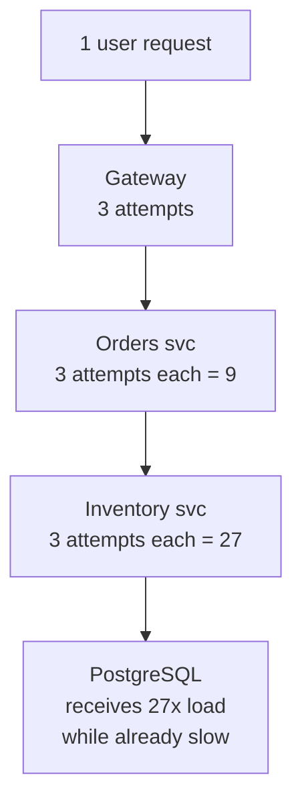

## 34.3 Retries

#### Concept

A retry is a second attempt at an operation that failed, on the theory that the failure was *transient*: a dropped packet, a pod that was mid-restart, a brief lock wait, a rate-limit window. Retries are cheap to write and dangerous to get wrong, because a retry is *extra load sent to a system that just told you it is struggling*. The whole craft of retrying is deciding **what** to retry, **how many** times, **how long** to wait between attempts, and **when to stop even though you could continue**.

#### Why does it exist?

Networks and distributed systems have a large class of failures that resolve themselves within milliseconds to seconds: a TCP `ECONNRESET` when a downstream pod is replaced during a rolling deploy, a `503` from a load balancer that has not yet noticed a healthy backend, a PostgreSQL serialization failure (`40001`) when two transactions touched the same rows, a Kafka `LEADER_NOT_AVAILABLE` during partition reassignment. Without retries, every one of these becomes a user-visible error, and at 1,000 RPS a 0.1% transient failure rate is one angry customer per second. With well-behaved retries those failures disappear into a metric.

#### Mental model

Imagine knocking on a door. If nobody answers, knocking again a moment later is reasonable; they may have been in another room. Knocking twenty times in a row, harder each time, is not; and if fifty people knock on the same door at once because it did not open the first time, the door will never open. Retries are the second knock. Backoff (next section) is waiting a moment. Retry budgets are the rule that says the whole building may not knock more than a certain number of times per minute.

#### How it works

1. The operation fails with an error.
2. **Classify** the error: is it retryable? (Transient, and the operation is safe to repeat.)
3. **Check the budget**: have we exhausted this call's attempts? Has the *service-wide* retry budget been spent? Is there still time in the deadline?
4. **Wait** with backoff and jitter (34.4), or as long as `Retry-After` says.
5. Try again, with the same idempotency key, and go to step 1.
6. On final failure, surface an error that says the operation may or may not have happened.

**Which errors are retryable?** This is the decision table every service needs, and it should live in code (an `isRetryable(err)` function), not in people's heads.

| Error class | Example | Retry? | Backoff | Breaker counts it? |
|---|---|---|---|---|
| Connection refused / reset | `ECONNREFUSED`, `ECONNRESET`, `EPIPE` | Yes (idempotent only) | Exponential + jitter | Yes |
| DNS failure | `ENOTFOUND`, `EAI_AGAIN` | Yes, 1–2 times | Short, jitter | Yes |
| Timeout | `AbortError`/`TimeoutError`, `ETIMEDOUT` | Only with idempotency key | Exponential + jitter | Yes |
| `503 Service Unavailable` | Rolling deploy, overload | Yes | Respect `Retry-After`, else exponential | Yes |
| `502` / `504` from gateway | Upstream flap | Yes | Exponential + jitter | Yes |
| `429 Too Many Requests` | Rate limited | Yes, few times | **Respect `Retry-After`**, else exponential | No (it is not failing, it is protecting itself) |
| `500 Internal Server Error` | Bug downstream | Usually no; maybe once | Exponential | Yes |
| `409 Conflict` (version mismatch) | Optimistic lock | Yes, re-read then retry | Immediate, small jitter | No |
| `400`, `401`, `403`, `404`, `422` | Bad request, auth, missing | **No** | None | No |
| PostgreSQL `40001`, `40P01` | Serialization failure, deadlock | Yes, whole transaction | Small jitter | No |
| PostgreSQL `57014`, `55P03` | Statement/lock timeout | Once, if idempotent | Jitter | Yes |
| PostgreSQL `53300` | Too many connections | Yes, short | Exponential | Yes |
| Kafka `LEADER_NOT_AVAILABLE`, `NOT_ENOUGH_REPLICAS` | Rebalance, ISR shrink | Yes (idempotent producer) | Built-in backoff | Yes |
| Redis `READONLY` (after failover) | Replica promoted | Yes, after reconnect | Short | Yes |
| Business error (`INSUFFICIENT_FUNDS`) | Payment declined | **No** | None | No |

Two rules dominate:

**Rule 1: Only retry idempotent operations, or operations protected by an idempotency key.** `GET`, `PUT` with full state, `DELETE` and `UPDATE ... SET x = 5` are naturally idempotent. `POST /charges` and `UPDATE ... SET balance = balance - 10` are not; retrying after a timeout may execute them twice. For those, you must send an idempotency key (Part 33 — Distributed Transactions: Sagas, Outbox, Inbox and Idempotency) so the server can recognise the repeat.

**Rule 2: Retries amplify load.** Consider a request path with three layers: gateway -> orders service -> inventory service -> PostgreSQL. Each layer retries 3 times (1 original + 2 retries... let's make it worst case, 3 attempts each). When PostgreSQL slows down, each inventory call fails, so inventory tries 3 times. Each orders call to inventory fails, so orders tries 3 times, each of which triggers 3 inventory attempts: 9. The gateway retries 3 times: 27. One user click becomes **27 database queries** at exactly the moment the database is struggling. This is the **retry storm**, and it is how a small slowdown becomes a total outage.



The fix is structural, not clever: **retry at one layer only** (usually the layer closest to the failure, or the one with the idempotency key), keep attempt counts small (2–3 total), and enforce a **retry budget**: a service-wide cap such as "retries may not exceed 10% of requests in any minute". When the budget is spent, failures are returned immediately instead of retried. This converts a storm into a plateau.

#### Practical example

Inventory reservation is called from the orders service. It is idempotent by design (the request carries `reservationId`, and the inventory service upserts on it). We retry it up to 3 attempts in total for `ECONNRESET`, `503`, `502`, `504` and timeouts, with a service-wide retry budget of 10%, all within the caller's deadline. The payment capture is *not* naturally idempotent, so we retry it only because we send an `Idempotency-Key` that the gateway honours, and we retry timeouts only once.

#### NestJS example

A hand-written retry helper that takes error classification, the deadline, and a retry budget into account. `p-retry` does most of this for you; the hand-written version makes the mechanics visible.

```ts
import { Injectable, Logger } from '@nestjs/common';
import { Deadline } from './deadline';
import { computeBackoff } from './backoff'; // see 34.4

export interface RetryPolicy {
  maxAttempts: number;            // total attempts including the first
  baseDelayMs: number;
  maxDelayMs: number;
  isRetryable: (err: unknown) => boolean;
  retryAfterMs?: (err: unknown) => number | undefined; // honour Retry-After
}

/** Token-bucket style budget: retries may not exceed `ratio` of calls. */
@Injectable()
export class RetryBudget {
  private calls = 0;
  private retries = 0;
  constructor(private readonly ratio = 0.1, private readonly minCalls = 100) {
    setInterval(() => { this.calls = 0; this.retries = 0; }, 60_000).unref();
  }
  recordCall() { this.calls++; }
  canRetry(): boolean {
    if (this.calls < this.minCalls) return true;     // warm-up: do not starve a quiet service
    return this.retries / this.calls < this.ratio;
  }
  recordRetry() { this.retries++; }
}

@Injectable()
export class Retrier {
  private readonly log = new Logger(Retrier.name);
  constructor(private readonly budget: RetryBudget) {}

  async run<T>(name: string, fn: () => Promise<T>, policy: RetryPolicy, deadline: Deadline): Promise<T> {
    this.budget.recordCall();
    let attempt = 0;
    for (;;) {
      attempt++;
      try {
        return await fn();
      } catch (err) {
        const last = attempt >= policy.maxAttempts;
        if (last || !policy.isRetryable(err) || !this.budget.canRetry()) throw err;

        const hinted = policy.retryAfterMs?.(err);
        const delay = hinted ?? computeBackoff(attempt, policy.baseDelayMs, policy.maxDelayMs);
        if (delay > deadline.remainingMs()) throw err;   // not enough time left to retry

        this.budget.recordRetry();
        this.log.warn({ msg: 'retrying', dependency: name, attempt, delay, err: String(err) });
        await new Promise((r) => setTimeout(r, delay));
      }
    }
  }
}
```

And the classification function for an HTTP dependency:

```ts
export function isRetryableHttpError(err: unknown): boolean {
  const e = err as { code?: string; name?: string; statusCode?: number };
  if (['ECONNRESET', 'ECONNREFUSED', 'EPIPE', 'EAI_AGAIN', 'ETIMEDOUT'].includes(e.code ?? '')) return true;
  if (e.name === 'TimeoutError' || e.name === 'AbortError') return true; // only safe with idempotency key
  return [429, 502, 503, 504].includes(e.statusCode ?? 0);
}

export function retryAfterMsFrom(err: unknown): number | undefined {
  const h = (err as { headers?: Record<string, string> }).headers?.['retry-after'];
  if (!h) return undefined;
  const secs = Number(h);
  if (!Number.isNaN(secs)) return Math.min(secs * 1000, 30_000);   // cap what we will honour
  const date = Date.parse(h);
  return Number.isNaN(date) ? undefined : Math.max(0, Math.min(date - Date.now(), 30_000));
}
```

Using `p-retry` instead, the same policy is:

```ts
import pRetry, { AbortError } from 'p-retry';

const result = await pRetry(
  () => this.inventory.reserve(items, deadline),
  {
    retries: 2,                 // 3 attempts in total
    factor: 2,
    minTimeout: 100,
    maxTimeout: 2_000,
    randomize: true,            // multiplies the delay by a random factor in [1, 2)
    shouldRetry: (err) => isRetryableHttpError(err) && this.budget.canRetry(),
    onFailedAttempt: (err) => this.log.warn({ attempt: err.attemptNumber, left: err.retriesLeft }),
  },
);
// Throw `new AbortError(err)` from inside the function to stop retrying immediately.
```

#### PostgreSQL example

The most legitimate retry in a database-backed service is the **serialization failure**. Under `REPEATABLE READ` or `SERIALIZABLE`, PostgreSQL will abort a transaction with SQLSTATE `40001` when it cannot guarantee isolation; the *entire transaction* must be rerun. Deadlocks (`40P01`) are the same: one victim is chosen and must retry.

```sql
BEGIN ISOLATION LEVEL SERIALIZABLE;
SELECT on_hand, reserved FROM inventory WHERE product_id = 'p_123';
UPDATE inventory SET reserved = reserved + 1 WHERE product_id = 'p_123';
COMMIT;
-- ERROR:  could not serialize access due to concurrent update  (SQLSTATE 40001)
-- Correct response: re-run the whole transaction from BEGIN, a few times, with a tiny jitter.
```

#### TypeORM example

```ts
async function withSerializableRetry<T>(ds: DataSource, work: (m: EntityManager) => Promise<T>): Promise<T> {
  for (let attempt = 1; ; attempt++) {
    try {
      return await ds.transaction('SERIALIZABLE', work);
    } catch (err) {
      const code = (err as { code?: string }).code;
      const retryable = code === '40001' || code === '40P01';
      if (!retryable || attempt >= 3) throw err;
      await new Promise((r) => setTimeout(r, Math.random() * 25 * attempt)); // tiny jitter
    }
  }
}

// usage
await withSerializableRetry(this.dataSource, async (m) => {
  const inv = await m.findOneByOrFail(Inventory, { productId });
  if (inv.onHand - inv.reserved < qty) throw new OutOfStockError(productId);
  await m.increment(Inventory, { productId }, 'reserved', qty);
});
```

#### Sequelize example

```ts
await sequelize.transaction(
  { isolationLevel: Transaction.ISOLATION_LEVELS.SERIALIZABLE },
  async (t) => {
    const inv = await Inventory.findOne({ where: { productId }, transaction: t, rejectOnEmpty: true });
    if (inv.onHand - inv.reserved < qty) throw new OutOfStockError(productId);
    await inv.increment('reserved', { by: qty, transaction: t });
  },
);
// Wrap the call above in the same 40001/40P01 retry loop; Sequelize surfaces the
// PostgreSQL code at err.original.code (or err.parent.code).
```

Sequelize also has a `retry` option on the constructor (`retry: { max: 3, match: [/SequelizeConnectionError/] }`) which retries *individual queries* on connection errors; it does not rerun whole transactions, so do not rely on it for serialization failures.

#### Production scenario

An orders service processes 800 RPS. Inventory reservation fails transiently 0.3% of the time (mostly `ECONNRESET` during inventory deploys, which happen 10 times a day). With 3-attempt retries and 100 ms base backoff, the user-visible failure rate drops from 0.3% to 0.002%, and the retry budget usage sits around 0.4%. During a real inventory outage the picture changes: the first attempt fails for 100% of calls, retries push the ratio toward 10%, the budget trips, and subsequent failures are returned immediately without retries. Inventory receives 1.1x normal load during its outage instead of 3x, which is the difference between recovering in 30 seconds and staying down because it is being hammered.

#### Failure scenario

At 11:03 a marketing push doubled traffic to a ride-booking API. The pricing service, a little under-provisioned, started returning `503` for 5% of requests. The booking service retried `503` five times with no backoff; the mobile app retried the booking call three times; the gateway retried `502` twice. Pricing went from 105% load to a computed worst case of 30x on the failing fraction, in practice about 4x overall, and fell over completely. Bookings dropped to zero for 22 minutes. The post-mortem action items: retry at one layer only (booking service), 3 attempts max, exponential backoff with full jitter, a 10% retry budget, and `Retry-After` headers from pricing that the booking service honours. In the load test that followed, the same traffic spike produced a 4% error rate for 90 seconds and then recovered on its own.

#### Edge cases & failure modes

- **Retrying a non-idempotent write after a timeout** double-executes it. A `POST /charges` timeout followed by a retry without an idempotency key is a double charge.
- **Retry storms** (the 27x math). Retry at one layer; enforce budgets.
- **Retries eating the deadline.** Three attempts of a 2 s call take 6 s inside a 3 s budget. Check remaining time before each attempt.
- **Retrying `400`/`404`.** You will never succeed; you only add latency and load.
- **Retrying `500`.** Sometimes transient, often a bug. At most one retry, and only for idempotent reads.
- **Ignoring `Retry-After`.** The downstream told you exactly when to come back; anything else is rude and counterproductive.
- **Synchronized retries.** Without jitter, all clients that failed at the same instant retry at the same instant (34.4).
- **Retries inside retries**: `p-retry` around an `axios` instance that has `axios-retry` configured, inside a BullMQ job with `attempts: 5`. Know every retry layer in the path.
- **Retrying inside a transaction** holds locks across the backoff. Retry the *whole* transaction, not a statement inside it.
- **Successful retry after partial success.** Attempt 1 wrote 3 of 5 rows and failed; attempt 2 writes 5. Without a transaction or idempotent upserts you now have 8.

#### How a Senior Backend Engineer thinks about this

The senior engineer's first question about any retry is "is this operation idempotent, and how do I know?" If the answer is "I think so", there is no retry until it is proven. Their second question is "who else in this path retries?" and they draw the layers to compute the amplification. They put retries as close to the failure as possible and as far from the user as possible, and they make the count small (2–3) because the data says almost all transient failures resolve on the first retry. They add a retry budget because they have watched a retry storm take down a database. And they make every retry visible: `retries_total{dependency, reason}` and `retry_budget_exhausted_total` are on the dashboard, because a rising retry rate is the earliest warning that a dependency is unhealthy.

To a product manager: "We automatically try again when a partner has a brief hiccup, so the customer never sees it. But we cap how often we do that, so a partner's bad day cannot become our bad day."

#### Common mistakes

- Blanket `retry(3)` around everything, including `POST`s.
- Retrying immediately with no delay ("it's just a network blip").
- Not distinguishing timeouts (unknown outcome) from connection refusals (known not to have happened).
- Copying `axios-retry` defaults, which retry on network errors and idempotent methods only, then wondering why `POST` is not retried; or, worse, forcing `retryCondition: () => true`.
- Forgetting that BullMQ `attempts` is itself a retry layer with its own backoff.

#### Interview questions

1. *Which HTTP status codes do you retry and which do you never retry? Why is `429` special?* Expected: retry 502/503/504/429 and connection errors; never 4xx client errors; `429` is retried only after `Retry-After` and does not count against the breaker.
2. *Explain retry amplification with three layers and three attempts each.* Expected: 3^3 = 27x on the failing fraction; fix with single-layer retries and budgets.
3. *What is a retry budget and how would you implement one?* Expected: ratio of retries to requests per window; refuse retries when exceeded; token bucket or counters.
4. *A payment call timed out. Do you retry it?* Expected: only if the request carried an idempotency key the gateway honours; otherwise mark pending and reconcile.
5. *How do you retry a PostgreSQL serialization failure correctly?* Expected: rerun the whole transaction from `BEGIN`, small number of attempts, jitter; never retry a single statement inside the failed transaction.

#### Practical exercise

Build a `Retrier` provider with a `RetryBudget` and the classification table above. Write a Jest test with a fake dependency that fails with `503` for the first N calls. Acceptance criteria: a `POST` without an idempotency key is never retried on timeout; `429` with `Retry-After: 2` waits 2 s; when the budget ratio exceeds 10% over 200 calls, no further retries are attempted and a `retry_budget_exhausted_total` counter increments.

## 34.4 Exponential backoff and jitter

#### Concept

**Backoff** is the wait between retry attempts. **Exponential backoff** makes each wait roughly double the previous one (100 ms, 200 ms, 400 ms, 800 ms), so a struggling dependency gets progressively more breathing room. **Jitter** adds randomness to each wait so that many clients that failed at the same moment do not all retry at the same moment. The two together are the standard, and the standard exists because each on its own is not enough.

#### Why does it exist?

Picture 2,000 NestJS pods, each with a Redis client, when Redis restarts. Every pod loses its connection at the same millisecond. With a fixed 1 s retry, all 2,000 reconnect at exactly t+1 s, Redis is still initialising, all 2,000 fail, and all 2,000 come back at t+2 s. That is a **thundering herd**: synchronized retries that arrive as a spike. Exponential backoff spaces the *rounds* out but does nothing about the *synchronization*; at t+1, t+3, t+7 you still get 2,000 simultaneous connections. Jitter breaks the synchronization by spreading each client's wait over an interval, so the 2,000 reconnects arrive as a smooth trickle over several seconds instead of as a wall.

#### Mental model

Imagine a stadium exit after a match. If everyone counts to ten and then walks to the gate at the same time, there is a crush. If everyone picks a random number between zero and ten, the crowd flows. Doubling the count each time the gate is found blocked (exponential) means people stop crowding a broken gate; picking a random number (jitter) means they do not all arrive together.

#### How it works

Let `base` be the initial delay (say 100 ms), `cap` the maximum delay (say 10 s), and `attempt` the retry number starting at 1.

```text
Exponential:          sleep = min(cap, base * 2^attempt)
Full jitter:          sleep = random(0, min(cap, base * 2^attempt))
Equal jitter:         temp  = min(cap, base * 2^attempt)
                      sleep = temp / 2 + random(0, temp / 2)
Decorrelated jitter:  sleep = min(cap, random(base, prev_sleep * 3))
```

- **Full jitter** spreads the wait uniformly from zero to the exponential value. It gives the best load smoothing (the AWS Architecture Blog analysis found it minimizes total work and completion time in contention). The cost is that a client may retry almost immediately, which is fine when the failure is contention and less fine when the downstream needs a guaranteed pause.
- **Equal jitter** guarantees at least half the exponential wait, then randomizes the other half. Choose it when the downstream genuinely needs a minimum pause (a restarting broker) and you still want de-synchronization.
- **Decorrelated jitter** uses the previous sleep as the input, producing a random walk that grows on average. It is a good default for long-lived reconnection loops (database, Kafka).

Attempt-by-attempt with base 100 ms, cap 10 s:

| Attempt | Exponential | Full jitter range | Equal jitter range |
|---|---|---|---|
| 1 | 200 ms | 0–200 ms | 100–200 ms |
| 2 | 400 ms | 0–400 ms | 200–400 ms |
| 3 | 800 ms | 0–800 ms | 400–800 ms |
| 4 | 1,600 ms | 0–1,600 ms | 800–1,600 ms |
| 5 | 3,200 ms | 0–3,200 ms | 1,600–3,200 ms |
| 7 | 10,000 ms (capped) | 0–10 s | 5–10 s |

**`Retry-After` takes precedence.** If the response carries `Retry-After` (seconds or an HTTP date), the downstream is telling you exactly when it will be ready. Honour it (with a sanity cap so a malicious or buggy `Retry-After: 86400` does not park your request for a day), and add a small jitter on top so that all your clients do not return at the same second.

#### Practical example

The Redis reconnection strategy in `ioredis` takes a function of the attempt number. Decorrelated or full jitter with a 5 s cap means 40 pods reconnect over a spread of several seconds after a Redis failover, rather than in one wall. For the payment gateway, equal jitter with base 200 ms and cap 2 s keeps retries inside the 3 s handler budget while guaranteeing the gateway at least 100 ms of quiet per client.

#### NestJS example

```ts
/** Backoff strategies. All return milliseconds. `attempt` starts at 1. */
export type JitterMode = 'none' | 'full' | 'equal' | 'decorrelated';

export function computeBackoff(
  attempt: number,
  baseMs: number,
  capMs: number,
  mode: JitterMode = 'full',
  prevMs = baseMs,
): number {
  const exp = Math.min(capMs, baseMs * 2 ** attempt);
  switch (mode) {
    case 'none':
      return exp;
    case 'full':
      return Math.floor(Math.random() * exp);
    case 'equal':
      return Math.floor(exp / 2 + Math.random() * (exp / 2));
    case 'decorrelated':
      return Math.floor(Math.min(capMs, baseMs + Math.random() * (prevMs * 3 - baseMs)));
  }
}

/** ioredis retryStrategy using decorrelated jitter, capped at 5 s, give up after 30 tries. */
let prev = 100;
export const redisRetryStrategy = (times: number): number | null => {
  if (times > 30) return null;                       // stop; let the health check fail the pod
  prev = computeBackoff(times, 100, 5_000, 'decorrelated', prev);
  return prev;
};
```

Wiring it into a NestJS Redis provider:

```ts
import { Provider } from '@nestjs/common';
import Redis from 'ioredis';

export const REDIS = Symbol('REDIS');

export const redisProvider: Provider = {
  provide: REDIS,
  useFactory: () =>
    new Redis({
      host: process.env.REDIS_HOST,
      port: 6379,
      connectTimeout: 1_000,
      commandTimeout: 300,          // a Redis call slower than 300 ms is a problem, not a wait
      maxRetriesPerRequest: 1,      // per-command retry while reconnecting
      enableOfflineQueue: false,    // fail fast instead of queueing commands while disconnected
      retryStrategy: redisRetryStrategy,
    }),
};
```

`enableOfflineQueue: false` deserves a note: with the default `true`, commands issued while Redis is down are queued in memory and replayed on reconnect. That is a hidden retry buffer with no bound, and during a long outage it grows until the pod runs out of memory. Failing fast is what you want in a request path; a cache miss is cheaper than an OOM.

#### PostgreSQL example

Reconnection to PostgreSQL after a failover follows the same logic. `pg.Pool` does not reconnect a broken client; it discards it and creates a new one on the next `connect()`. Your application-level "wait for the database" loop at startup should use jittered backoff so that 40 pods restarting after a database failover do not open 40 x 20 connections in the same 100 ms:

```ts
async function waitForDatabase(ds: DataSource, maxAttempts = 20): Promise<void> {
  let prev = 200;
  for (let attempt = 1; attempt <= maxAttempts; attempt++) {
    try {
      await ds.query('SELECT 1');
      return;
    } catch (err) {
      prev = computeBackoff(attempt, 200, 5_000, 'decorrelated', prev);
      console.warn(`db not ready (attempt ${attempt}), waiting ${prev} ms`);
      await new Promise((r) => setTimeout(r, prev));
    }
  }
  throw new Error('database unavailable after retries');
}
```

#### Production scenario

A Kafka cluster with 12 brokers performs a rolling restart. 300 consumer pods each lose one broker connection in turn. `kafkajs` defaults (`initialRetryTime: 300`, `factor: 0.2`, `multiplier: 2`, `maxRetryTime: 30000`, `retries: 5`) already include randomization; the effect is that reconnections to each restarted broker arrive spread over 1–3 s instead of as a spike, and broker CPU during the rolling restart shows small bumps rather than the vertical lines that used to precede a cascade of leader elections.

#### Failure scenario

A team replaced a library's default backoff with a fixed 500 ms retry "to make things faster". The next Redis failover (Redis replica promotion takes 1–3 s) produced 1,200 pods reconnecting in the same 50 ms window every 500 ms. The new primary spent its first 6 seconds accepting and dropping connections instead of serving traffic, `redis_connected_clients` sawtoothed, and the API error rate hit 40% for 90 seconds. Reverting to jittered exponential backoff cut the same failover's error window to under 8 seconds.

#### Edge cases & failure modes

- **Backoff without a cap** grows to minutes; requests hang past every deadline. Always cap, and always check the deadline before sleeping.
- **Jitter with `Math.random()` per process seeded identically** is not an issue in Node (V8 seeds from entropy), but in some container images with a fixed seed environment you can see synchronized "random" values. Verify once.
- **`Retry-After` longer than your deadline**: fail fast; do not wait.
- **`Retry-After` in the past** (clock skew): treat as zero.
- **Backoff inside a database transaction** holds locks while sleeping. Never sleep inside a transaction.
- **Backoff in BullMQ**: `backoff: { type: 'exponential', delay: 1000 }` has no jitter; supply a custom `backoffStrategy` on the worker if you have thousands of jobs failing together.

#### How a Senior Backend Engineer thinks about this

They know that the *shape* of the retry curve matters more than the exact numbers. They default to full jitter for request-path retries and decorrelated jitter for long-lived reconnection loops. They cap delays below the deadline. They read the downstream's `Retry-After` and treat ignoring it as a bug. And they test backoff behaviour under simulated mass failure (kill Redis in staging with 50 pods connected and watch `connected_clients`), because backoff bugs only show up under synchronized failure.

#### Common mistakes

- Exponential backoff with no jitter ("we have backoff" while the herd still thunders).
- Jitter with no exponential (random 0–100 ms forever, hammering the dependency).
- Not capping the delay.
- Sleeping past the deadline.
- Applying `Retry-After` without a maximum.

#### Interview questions

1. *Why is exponential backoff alone insufficient? What does jitter add?* Expected: exponential spaces rounds but keeps clients synchronized; jitter de-synchronizes them.
2. *Compare full jitter and equal jitter. When would you choose each?* Expected: full for maximum smoothing; equal when a minimum quiet period is needed.
3. *Write the formula for decorrelated jitter and explain why it uses the previous sleep.* Expected: `min(cap, random(base, prev*3))`; grows on average without a fixed schedule.
4. *A downstream returns `429` with `Retry-After: 120`. Your request deadline is 3 s. What do you do?* Expected: do not wait; fail fast with a clear error, optionally enqueue for later.

#### Practical exercise

Implement `computeBackoff` with all four modes and write a simulation: 1,000 clients fail at t=0 and retry up to 5 times against a dependency that recovers at t=2 s. Plot (or tabulate per 100 ms bucket) the number of retry arrivals per bucket for each mode. Acceptance criteria: the fixed-delay and no-jitter modes show spikes of near 1,000 in single buckets; full jitter's largest bucket is under 150; every mode's maximum delay never exceeds the cap.
