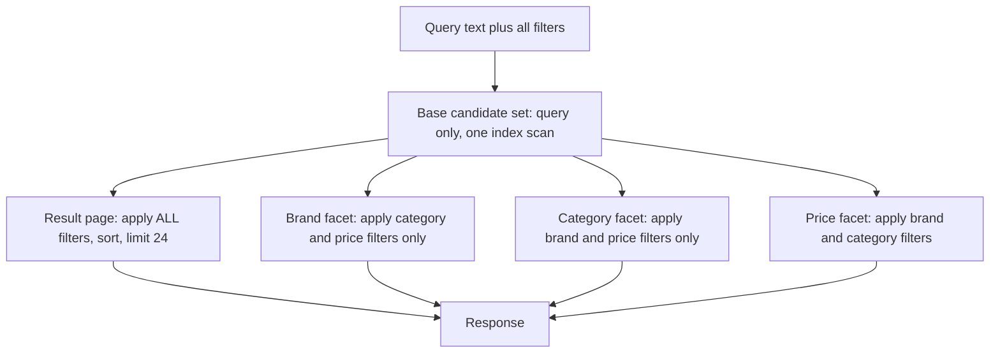
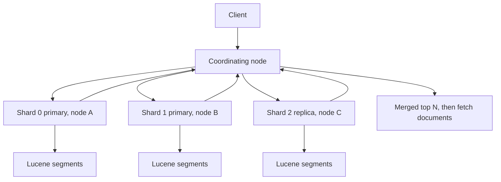
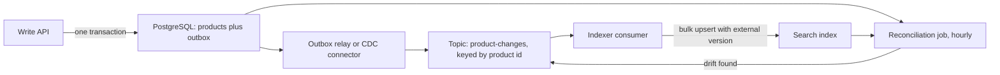

## 34.8 Faceted search and aggregations

#### Concept

Facets are the counted filters down the left of a product listing: "Nike (412)", "Adidas (288)", "Under $50 (1,904)". A facet is a grouped count over the *current result set*, computed on every request, alongside the results themselves. Faceting is not a filter; it is an aggregation that tells the user what filtering would do before they do it.

#### Why does it exist?

Because a query for "running shoes" returns 12,000 products and no human will page through them. Facets turn an unusable result set into a navigable one, and the counts are the important part: a facet with a count of zero should not be offered, and a facet with a count of 3 tells the user it is a dead end before they click. Search without facets is a list; search with facets is a tool.

#### Mental model

Imagine walking into a department store and seeing a sign at the entrance: "Shoes: 412 on this floor, 288 upstairs, 1,904 under $50." You have not walked anywhere yet, but you already know where to go. Now imagine the sign updating itself as you narrow down - once you pick "Nike", the price sign changes to show only Nike prices. That live recount is the whole feature, and it is also the whole cost.

#### How it works

The mechanics are simple; the expensive part is a rule that is easy to state and hard to implement:

> **Each facet's counts must reflect every other active filter, but not its own.**

If the user has selected brand "Nike" and category "Running", then:

- the **brand** facet must count over `query + category=Running` (ignoring the brand filter), so the user can see that Adidas also has 288 and can add it;
- the **category** facet must count over `query + brand=Nike` (ignoring the category filter);
- the **price** facet must count over `query + brand=Nike + category=Running` (all filters, since price is not selected);
- the **result list** must apply everything.

If you compute all facets over the fully filtered set, the brand facet shows "Nike (412)" and nothing else, and multi-select brand filtering becomes impossible - the user can never discover a second brand to add. This is the single most common facet bug, and it looks fine until a product manager tries to select two brands.

So a page with five facets needs, conceptually, six differently-filtered result sets. The naive implementation runs six searches. At 12,000 candidate rows and 25 ms per search, that is 150 ms of database time per page view - and this is a page every user hits.

The efficient implementation computes the *base* candidate set once, keeps it in memory, and runs each aggregation over it with a different `FILTER` predicate. In PostgreSQL that is a materialized CTE plus `UNION ALL`; in Elasticsearch it is one search with several named sub-aggregations under `filter` aggregations. One expensive scan, N cheap ones.



**Aggregation shapes you will need:**

- **Terms facet** - count per distinct value (brand, category, colour). Cap the number returned; a `colour` facet on user-supplied data can have 4,000 distinct values.
- **Range facet** - count per bucket (price under 50, 50 to 100, over 100). Buckets are chosen by the merchandising team, not computed, because "0-33rd percentile" is not a label anyone understands.
- **Boolean facet** - in stock, free shipping. Two counts.
- **Hierarchical facet** - category trees, where selecting "Shoes" should also count "Shoes > Running". Materialize the ancestor path so a single terms aggregation over `category_path` works.

#### PostgreSQL example

The schema, then the real query.

```sql
CREATE TABLE products (
  id            bigserial PRIMARY KEY,
  tenant_id     uuid   NOT NULL,
  name          text   NOT NULL,
  brand_id      bigint,
  category_id   bigint,
  price_cents   int    NOT NULL,
  in_stock      boolean NOT NULL DEFAULT true,
  search_vector tsvector GENERATED ALWAYS AS (
      setweight(to_tsvector('shop_en', coalesce(name, '')), 'A') ||
      setweight(to_tsvector('shop_en', coalesce(description, '')), 'D')) STORED,
  description   text
);
CREATE INDEX products_search_gin ON products USING GIN (search_vector);
CREATE INDEX products_tenant_brand ON products (tenant_id, brand_id) INCLUDE (price_cents);
CREATE INDEX products_tenant_cat   ON products (tenant_id, category_id) INCLUDE (price_cents);
```

The one-scan, correct-facets query. `MATERIALIZED` is the load-bearing keyword: without it PostgreSQL may inline the CTE into each `UNION ALL` branch and run the full-text scan five times.

```sql
WITH base AS MATERIALIZED (
  SELECT p.id, p.brand_id, p.category_id, p.price_cents, p.in_stock,
         -- Which of the active filters does this row pass? NULL parameter means "not filtered".
         ($3::bigint[] IS NULL OR p.category_id = ANY($3)) AS pass_cat,
         ($4::bigint[] IS NULL OR p.brand_id    = ANY($4)) AS pass_brand,
         ($5::int IS NULL OR (p.price_cents >= $5 AND p.price_cents < $6)) AS pass_price
    FROM products p
   WHERE p.tenant_id = $1
     AND p.search_vector @@ websearch_to_tsquery('shop_en', $2)
)
SELECT 'brand' AS facet, brand_id::text AS key, count(*) AS n
  FROM base WHERE pass_cat AND pass_price AND brand_id IS NOT NULL
 GROUP BY brand_id ORDER BY n DESC LIMIT 20
UNION ALL
SELECT 'category', category_id::text, count(*)
  FROM base WHERE pass_brand AND pass_price AND category_id IS NOT NULL
 GROUP BY category_id
UNION ALL
SELECT 'price', b.label, count(*)
  FROM base
  CROSS JOIN LATERAL (SELECT CASE WHEN price_cents <  5000 THEN 'under_50'
                                  WHEN price_cents < 10000 THEN '50_100'
                                  ELSE 'over_100' END AS label) b
 WHERE pass_cat AND pass_brand
 GROUP BY b.label
UNION ALL
SELECT 'total', 'all', count(*) FROM base WHERE pass_cat AND pass_brand AND pass_price;
```

When every facet is single-select (the simple case), you do not need the per-facet predicates at all, and one `GROUPING SETS` aggregate replaces the whole `UNION ALL`. One scan, one aggregate node:

```sql
SELECT grouping(brand_id, category_id) AS g, brand_id, category_id, count(*)
  FROM base
 WHERE pass_cat AND pass_brand AND pass_price
 GROUP BY GROUPING SETS ((brand_id), (category_id), ());
```

The plan on a 400,000-product catalogue for the query "running shoes" (12,400 candidates):

```text
CTE base  (cost=412.2..9840.5 rows=12118 width=33) (actual time=3.9..19.6 rows=12406 loops=1)
  ->  Bitmap Heap Scan on products p  (actual time=3.9..17.4 rows=12406 loops=1)
        Recheck Cond: (search_vector @@ '''run'' & ''shoe'''::tsquery)
        Filter: (tenant_id = '...'::uuid)
        Heap Blocks: exact=8112
        Buffers: shared hit=7204 read=1119
        ->  Bitmap Index Scan on products_search_gin  (actual time=2.6..2.6 rows=12690 loops=1)
Append  (actual time=24.1..30.8 rows=31 loops=1)
  ->  Limit -> Sort -> HashAggregate on base  (actual time=24.1..24.4 rows=20 loops=1)
  ->  HashAggregate on base  (actual time=2.1..2.2 rows=7 loops=1)
  ->  HashAggregate on base  (actual time=2.4..2.4 rows=3 loops=1)
  ->  Aggregate on base  (actual time=1.7..1.7 rows=1 loops=1)
Planning Time: 0.9 ms
Execution Time: 31.4 ms
```

Latency at 400k products, measured on a `db.r6g.large`-class instance with the working set cached:

| Query breadth | Candidates | Base scan | Facets | Total |
|---|---|---|---|---|
| Narrow: "merino running socks" | 340 | 3 ms | 2 ms | 5 ms |
| Typical: "running shoes" | 12,400 | 20 ms | 11 ms | 31 ms |
| Broad: "shoes" | 96,000 | 140 ms | 62 ms | 205 ms |
| Category browse, no text | 400,000 | 310 ms | 190 ms | 505 ms |

The shape of that table is the whole lesson. Facets cost roughly 50 to 70% on top of the search, and both grow linearly with the candidate set. The narrow queries are free; the broad ones are the problem, and broad ones are exactly what category pages and empty search boxes produce.

#### Elasticsearch example

The same page in one request. `post_filter` applies the selected-facet filter *after* aggregations are computed, which is the built-in answer to "ignore your own filter":

```json
{
  "size": 24,
  "query": {
    "bool": {
      "must":   [ { "multi_match": { "query": "running shoes", "fields": ["name^3","brand^2","description"] } } ],
      "filter": [ { "term": { "tenant_id": "t-9f2" } },
                  { "terms": { "category_id": [88, 91] } },
                  { "range": { "price_cents": { "gte": 0, "lt": 10000 } } } ]
    }
  },
  "post_filter": { "terms": { "brand_id": [12] } },
  "aggs": {
    "brands":     { "terms": { "field": "brand_id", "size": 20 } },
    "categories": { "filter": { "terms": { "brand_id": [12] } },
                    "aggs": { "by_cat": { "terms": { "field": "category_id", "size": 30 } } } },
    "price": { "filter": { "terms": { "brand_id": [12] } },
               "aggs": { "buckets": { "range": { "field": "price_cents",
                 "ranges": [ { "to": 5000, "key": "under_50" },
                             { "from": 5000, "to": 10000, "key": "50_100" },
                             { "from": 10000, "key": "over_100" } ] } } } }
  }
}
```

The `brands` aggregation sees the `post_filter`-free result set, so it still reports Adidas with 288. Every other aggregation wraps itself in a `filter` that re-applies the brand selection. This is fiddly and it is the correct shape; write it once in a builder and never by hand.

#### NestJS example

Caching is where facets become affordable. The cache key must contain everything that changes the counts - and nothing that does not, or the hit ratio collapses.

```ts
// src/search/facet-cache.service.ts
import { Injectable, Inject } from '@nestjs/common';
import { createHash } from 'node:crypto';
import Redis from 'ioredis';

export interface FacetRequest { tenantId: string; q: string; categoryIds?: number[]; brandIds?: number[]; priceMin?: number; priceMax?: number }

@Injectable()
export class FacetCacheService {
  constructor(@Inject('REDIS') private readonly redis: Redis) {}

  // Sort arrays so [12,7] and [7,12] hit the same entry. Round price to the bucket edges the UI offers.
  private key(r: FacetRequest): string {
    const canonical = JSON.stringify({
      q: r.q.toLowerCase().trim().replace(/\s+/g, ' '),
      c: [...(r.categoryIds ?? [])].sort((a, b) => a - b),
      b: [...(r.brandIds ?? [])].sort((a, b) => a - b),
      p: [r.priceMin ?? null, r.priceMax ?? null],
    });
    return `facets:v2:${r.tenantId}:${createHash('sha1').update(canonical).digest('base64url')}`;
  }

  async get<T>(r: FacetRequest): Promise<T | null> {
    const raw = await this.redis.get(this.key(r));
    return raw ? (JSON.parse(raw) as T) : null;
  }

  async set(r: FacetRequest, value: unknown, breadth: number): Promise<void> {
    // Broad, expensive queries are cached longer; narrow, cheap ones barely need it.
    const ttl = breadth > 50_000 ? 600 : breadth > 5_000 ? 120 : 30;
    await this.redis.set(this.key(r), JSON.stringify(value), 'EX', ttl + Math.floor(Math.random() * 15));
  }
}
```

#### Production scenario

A catalogue site with 400,000 products serves 90 search requests per second at peak. Without caching, facets would add roughly 25 ms of database CPU per request on average - about 2.2 seconds of CPU per wall-clock second, which is two and a half cores doing nothing but counting brands. With the cache above the hit ratio is 78%, because the head of the distribution is small: the top 300 query-and-filter combinations cover most traffic, and category browse pages with no filters are cached for 10 minutes and precomputed nightly into a `facet_snapshots` table so the first request after an eviction is not the slow one.

Three more levers used in practice: cap terms facets at the top 20 with a "show all brands" link that triggers a dedicated query; drop facet values with `min_doc_count` below 1 so the UI never offers a dead end; and display "1000+" instead of an exact count above a threshold, which lets you cap the aggregation.

#### Failure scenario

A merchandising change adds a `colour` facet. Colour is a free-text field filled in by 3,000 third-party sellers: "red", "Red", "RED", "cherry red", "red/white". The terms aggregation returns 41,000 distinct values. In PostgreSQL the `HashAggregate` for that branch exceeds `work_mem`, spills to disk, and the facet query goes from 31 ms to 2.4 seconds. In the Elasticsearch variant the same change would build 41,000 buckets per shard before reducing, with a corresponding memory spike on the coordinating node.

Symptom: search p95 jumps from 60 ms to 2.6 s within minutes of the deploy, but only for queries broad enough to match many sellers' products. Recovery: the facet is removed in 12 minutes. The permanent fix is a normalized `colour_id` referencing a controlled vocabulary of 24 colours, populated by a mapping table, with unmapped values grouped as "other". Rule adopted: **no facet on an uncontrolled field.**

#### Edge cases & failure modes

- Facet counts and result counts disagree when they are computed from different snapshots (a cached facet block with a live result list); pin both to the same request or accept and document a small drift.
- Zero-result facets offered to the user create dead ends; filter them out server-side.
- Multi-select facets are disjunctive within a facet and conjunctive across facets; getting this wrong is invisible until someone tries two brands.
- Deep facet trees (category hierarchies) need a materialized ancestor path or every request does a recursive CTE.
- High-cardinality terms aggregations explode memory on both engines.
- Elasticsearch terms aggregation counts are *approximate* across shards by default; `doc_count_error_upper_bound` tells you how wrong, and raising `shard_size` reduces it at a memory cost. Counts that must be exact need one shard or a two-pass approach.
- Permissions: a facet count computed before an access filter leaks the existence of documents the user may not see.
- Tenant id missing from the cache key leaks another tenant's counts, which is a data breach even though no documents are returned.
- Empty query with no filters is the most expensive request your search endpoint serves, and it is the default landing page.

#### How a Senior Backend Engineer thinks about this

They ask "how many candidate rows does the worst realistic query produce?" before choosing an approach, because facet cost is a function of that number and nothing else. They compute the base set once and aggregate over it many times, never once per facet. They insist on controlled vocabularies for anything faceted. They cache aggressively with a canonical key and a breadth-dependent TTL, and they precompute the head of the distribution. And they know the honest limit: PostgreSQL faceting is comfortable while the worst-case candidate set is in the tens of thousands, and starts to hurt in the hundreds of thousands.

#### Common mistakes

- Running one query per facet.
- Forgetting `MATERIALIZED` and silently running the full-text scan five times.
- Computing every facet over the fully filtered set, so multi-select can never work.
- Faceting on free-text fields.
- Caching facets without the tenant, or with the raw un-normalized query string.
- Treating Elasticsearch terms counts as exact.

#### Interview questions

1. **Why must a facet's counts ignore its own filter?** Expected: so the user can add a second value within that facet; otherwise multi-select is impossible and every other value shows zero.
2. **How do you compute five facets without running five searches?** Expected: materialize the base candidate set once, aggregate over it with per-facet `FILTER` predicates or `filter` sub-aggregations; in Elasticsearch, `post_filter` plus filtered aggs.
3. **What does `MATERIALIZED` do in a CTE and why does it matter here?** Expected: forces a tuplestore instead of inlining, so the expensive scan runs once.
4. **What makes a field unsafe to facet on?** Expected: high or uncontrolled cardinality; memory and bucket explosion; needs a normalized vocabulary.
5. **Are Elasticsearch terms aggregation counts exact?** Expected: no, approximate across shards; `doc_count_error_upper_bound`, `shard_size`, exact only with one shard.
6. **How would you cache facets and what goes in the key?** Expected: tenant, normalized query, sorted filter values, bucket edges; TTL by breadth; precompute the head.

#### Practical exercise

Build a faceted endpoint over 400,000 products with brand, category and price facets, correct multi-select semantics, and Redis caching. Acceptance criteria: `EXPLAIN (ANALYZE, BUFFERS)` shows one bitmap scan and four aggregate nodes; selecting one brand still shows counts for other brands; p95 under 80 ms at 100 requests per second with the cache warm; a test proves tenant A never sees tenant B's counts.

## 34.9 Elasticsearch and OpenSearch

#### Concept

Elasticsearch is a distributed search engine built on Lucene. You give it JSON documents; it analyses them into an inverted index, distributes that index across machines, and answers queries with ranking and aggregations in milliseconds. OpenSearch is a fork of Elasticsearch 7.10 maintained by AWS and others. Everything in this section applies to both unless stated.

#### Why does it exist?

Because at some point the search requirements outgrow what a relational database can do well: tuned relevance with real IDF, multi-language analysis, heavy faceting over millions of documents, sub-50 ms latency at high concurrency, and horizontal scale for search independent of your transactional database. Buying that means running a second stateful system, which is the tradeoff 34.12 makes explicit.

#### Mental model

Imagine a library that has been split across ten buildings. Each building holds a slice of the collection plus a complete back-of-book index for its own slice, and each has a duplicate in another building in case of fire. When you ask a question, a librarian at the front desk sends it to all ten, each searches its own slice and returns its ten best answers with scores, and the front desk merges the hundred candidates into a final top ten. That is sharding, replication and the query-then-fetch phase, and it explains nearly every behaviour that surprises people - including why scores can differ between shards.

#### How it works

**The model, in plain language:**

- **Document** - a JSON object with an `_id`. The unit of indexing and retrieval. Denormalized: a product document carries its brand name and category path, not foreign keys.
- **Index** - a named collection of documents with a mapping. Roughly "a table", except the analogy misleads: indices are cheap to create and are routinely created per time period or per large tenant.
- **Mapping** - the schema. Field types (`text`, `keyword`, `long`, `date`, `boolean`, `nested`, `object`), which analyzer each `text` field uses, and whether a field is indexed, stored or doc-valued. The critical distinction: **`text` is analysed** (tokenized, stemmed - good for matching, useless for exact filters and sorting), **`keyword` is not** (one token, exact - good for filters, aggregations and sorting). Most string fields want both, which is why the default is a `text` field with a `.keyword` sub-field.
- **Analyzer** - the tokenizer plus filters from 34.4, attached to a field, applied at index time and query time.
- **Shard** - a self-contained Lucene index. An index's documents are hashed by routing key (the `_id` by default) into a fixed number of primary shards. The number of primaries cannot be changed after creation without reindexing or splitting; this is the single most consequential decision at index-creation time.
- **Replica** - a copy of a primary shard on another node. Replicas provide availability and serve reads, so `replicas: 1` doubles both your storage and your read capacity. Replica count *can* be changed at any time.
- **Segment** - Lucene's immutable on-disk unit. Every refresh creates one; a background merge process combines small segments into larger ones. Deletes are tombstones until a merge removes them.



**Near-real-time and the one-second delay.** An indexed document is not searchable immediately. It sits in an in-memory buffer plus the translog until a **refresh** creates a new searchable segment. The default `index.refresh_interval` is `1s`. So "I just saved this product and search cannot find it" is not a bug; it is the design. Three knobs:

- `?refresh=wait_for` on the write blocks the response until the next refresh makes it visible. Use it on the one write path where the user immediately searches for what they created; never on bulk paths, where it will stall you.
- `?refresh=true` forces an immediate refresh. Never use it under load: it creates tiny segments and multiplies merge work.
- Raising `refresh_interval` to `30s` (or `-1` during a bulk load) dramatically improves indexing throughput at the cost of visibility delay. Setting it to `-1` during a reindex and back afterwards is standard practice.

Durability is separate: the translog is fsynced every 5 seconds by default (`index.translog.durability: request` makes it per-request and slower). A node crash can lose up to 5 seconds of writes. This is fine when PostgreSQL is the source of truth and the index can be rebuilt - which is the architecture 34.10 argues for.

**Query DSL essentials.**

```json
{
  "query": {
    "bool": {
      "must":   [ { "multi_match": { "query": "running shoes", "fields": ["name^3", "brand^2", "description"],
                                     "type": "best_fields", "fuzziness": "AUTO", "prefix_length": 1 } } ],
      "should": [ { "term": { "brand_id": { "value": 12, "boost": 1.4 } } } ],
      "filter": [ { "term": { "tenant_id": "t-9f2" } },
                  { "term": { "status": "active" } },
                  { "range": { "price_cents": { "gte": 1000, "lt": 20000 } } } ],
      "must_not": [ { "term": { "discontinued": true } } ]
    }
  },
  "sort": [ "_score", { "id": "asc" } ],
  "size": 24
}
```

- `match` analyses the query text with the field's analyzer and matches terms. `term` does not analyse - use it only on `keyword` fields, and expect zero results if you point it at a `text` field.
- `multi_match` runs the same query across several fields. `best_fields` (default) takes the best single field's score - right for "find the field that is about this". `most_fields` sums - right for the same text indexed several ways. `cross_fields` treats the fields as one big field - right for names split across `first_name`/`last_name`.
- `bool` combines: `must` (must match, **scored**), `should` (optional, **scored**, boosts), `filter` (must match, **not scored**), `must_not` (must not match, not scored).

**`filter` vs `query` context is the single most important performance idea in the DSL.** Clauses in query context compute a relevance score for every matching document. Clauses in filter context answer only yes or no, which means Elasticsearch can (a) skip scoring entirely and (b) cache the result as a bitset in the node query cache, reusing it across requests. A `term` filter on `tenant_id` that matches 200,000 documents is computed once and reused thousands of times; the same clause in `must` is scored on every request and cached never.

The rule: **anything that is a yes/no condition goes in `filter`. Only the text the user typed goes in `must`.** Tenant, status, category, price range, in-stock, date ranges - all filters. Getting this wrong is routinely worth a 3 to 10 times latency difference on filtered searches.

**Aggregations.** Bucket aggregations group documents (`terms`, `range`, `date_histogram`, `filters`, `nested`); metric aggregations compute values within a bucket (`sum`, `avg`, `min`, `max`, `cardinality`, `percentiles`). They nest. Cost is proportional to the matching set and the bucket count, and they run on the same threads as searches, so a heavy aggregation and a latency-sensitive search compete. Two honest limitations: `terms` counts are approximate across shards, and `cardinality` is a HyperLogLog++ estimate, accurate to roughly 1% at default precision.

**Deep pagination: `search_after`, not `from`/`size`.** `from: 10000, size: 20` makes every shard return 10,020 sorted hits to the coordinating node, which discards 10,000 of them. Cost grows linearly with the offset, memory grows with `from * shards`, and `index.max_result_window` caps it at 10,000 by default - a cap you should not raise. Instead, sort on a tiebroken key and pass the previous page's sort values:

```json
{ "size": 24,
  "query": { "bool": { "filter": [ { "term": { "tenant_id": "t-9f2" } } ] } },
  "sort": [ { "_score": "desc" }, { "id": "asc" } ],
  "search_after": [ 7.3421, 918273 ] }
```

Constant cost per page, no window limit. For a stable snapshot across a long scroll, open a point-in-time (`_pit`) and pass its id with `search_after`; `scroll` is the older mechanism and is now discouraged for user-facing paging.

**Shard sizing rules of thumb.** These are conventions from operating clusters, not laws:

- Target **10 to 50 GB per shard**. Below ~5 GB you are paying overhead for nothing; above ~50 GB, recovery, relocation and merges get slow.
- Keep **under about 20 shards per GB of JVM heap** per node. A node with 30 GB heap should hold at most ~600 shards; treat that as a ceiling, not a target.
- JVM heap: **at most 31 GB** (above that, compressed object pointers are lost and you get *less* usable memory), and no more than **half of RAM** - the other half is the OS page cache, which is where Lucene actually lives.
- Primaries = `ceil(expected_index_size_in_GB / 40)`, minimum 1. A 120 GB product index wants 3 primaries, not 30.
- Replicas: 1 for production, more only if read throughput demands it. Each replica is a full copy of the storage.
- Over-sharding is the more common mistake: thousands of tiny shards burn heap on cluster state and make every search fan out further than it needs to.

**What running a cluster actually costs in operations.** Be honest with yourself before choosing this:

- A minimum production topology is 3 dedicated master-eligible nodes (for quorum) plus 2 or more data nodes. Three data nodes with one replica is a common small production shape.
- JVM tuning, garbage-collection pauses, and circuit breakers that reject queries when memory is tight.
- Disk watermarks: at 85% Elasticsearch stops allocating new shards to a node, at 90% it starts relocating shards away, at 95% it sets indices read-only. Filling a disk turns your search cluster into a read-only cluster, and clearing the flag is a manual step people forget.
- Rolling upgrades with version compatibility rules, and major-version upgrades that require reindexing indices created two majors ago.
- Snapshots to object storage, restore drills, and the discipline to actually run them.
- Monitoring: cluster health (green/yellow/red), unassigned shards, heap pressure, search and indexing rates and latencies, thread-pool queue depth and rejections, merge and refresh times, segment counts.
- Someone on call who understands it. This is the real cost, and it is the one that is never in the proposal document.

**OpenSearch vs Elasticsearch licensing, honestly.** Elasticsearch was Apache 2.0 through version 7.10. In early 2021 Elastic changed the licence to a dual SSPL/Elastic License 2.0, neither of which is OSI-approved, primarily to prevent cloud providers from offering it as a managed service. AWS forked 7.10 and released it as OpenSearch under Apache 2.0, now under the Linux Foundation. In 2024 Elastic added AGPL-3.0 as a third option for Elasticsearch, restoring an OSI-approved choice. Practically: the two have diverged since 7.10 in APIs, features (Elastic's ES|QL and its vector search work; OpenSearch's own plugins), and client libraries, which are not interchangeable. Choose on where you run (OpenSearch if you want the AWS managed service; Elastic Cloud if you want Elastic's), what support you can buy, and which feature set you need - and write your application against the common subset of the query DSL, behind the port in 34.11, so the choice is reversible.

#### NestJS example

```ts
// src/search/opensearch.provider.ts
import { Injectable, Logger, OnModuleDestroy } from '@nestjs/common';
import { ConfigService } from '@nestjs/config';
import { Client } from '@opensearch-project/opensearch';

@Injectable()
export class OpenSearchClientProvider implements OnModuleDestroy {
  private readonly log = new Logger(OpenSearchClientProvider.name);
  readonly client: Client;

  constructor(cfg: ConfigService) {
    this.client = new Client({
      node: cfg.getOrThrow<string>('SEARCH_URL'),
      // A request that has not answered in 800 ms is worthless to a user-facing search page.
      requestTimeout: 800,
      maxRetries: 1,                 // one retry only: retries multiply load exactly when the cluster is sick
      compression: true,
      ssl: { rejectUnauthorized: true },
    });
  }
  async onModuleDestroy() { await this.client.close(); }
}
```

The mapping that matters, with `text` plus `keyword` and an explicit analyzer:

```json
{
  "settings": { "number_of_shards": 3, "number_of_replicas": 1, "refresh_interval": "1s" },
  "mappings": {
    "dynamic": "strict",
    "properties": {
      "tenant_id":   { "type": "keyword" },
      "name":        { "type": "text", "analyzer": "shop_en",
                       "fields": { "raw": { "type": "keyword", "ignore_above": 256 } } },
      "brand":       { "type": "text", "fields": { "raw": { "type": "keyword" } } },
      "brand_id":    { "type": "long" },
      "category_path": { "type": "keyword" },
      "price_cents": { "type": "long" },
      "in_stock":    { "type": "boolean" },
      "sales_30d":   { "type": "rank_feature" },
      "updated_at":  { "type": "date" }
    }
  }
}
```

`"dynamic": "strict"` is deliberate: it rejects documents containing fields the mapping does not declare, which prevents the mapping explosion in 34.14.

#### Production scenario

A marketplace index: 8 million products, 3 primary shards, 1 replica, 42 GB per primary, 6 data nodes with 64 GB RAM and 31 GB heap each. Peak 600 searches per second with facets, p50 12 ms, p95 45 ms, p99 130 ms. Indexing 400 documents per second steady from the CDC pipeline, bursting to 20,000 per second during a supplier import with `refresh_interval` temporarily at `30s`. Monthly cost of the managed cluster: roughly the same as the primary PostgreSQL instance. Operational load: about two engineer-days a month in steady state, plus a week per major upgrade.

#### Failure scenario

At 19:40 the cluster goes yellow, then red. A shard is unassigned. The cause: a data node's disk crossed the 95% flood-stage watermark because a reindex was running while daily snapshots had failed silently for a week. Elasticsearch set every index on that node to `read_only_allow_delete`. The indexer's bulk requests start failing with `cluster_block_exception`; searches still work, so nobody notices for 20 minutes, and the search index falls 20 minutes behind the catalogue.

Recovery: delete the failed snapshot's leftovers, free disk, then explicitly clear the read-only block with an index settings update - the block does not clear itself. Then replay the indexer's backlog from the outbox. Total drift: 34 minutes of stale search results.

Fixes: an alert on disk above 75%, an alert on snapshot job failure (the missing alert that made this possible), and an alert on index lag rather than on cluster health alone - because the symptom the users saw was staleness, not an error.

#### Edge cases & failure modes

- `term` query on a `text` field silently returns nothing, because the field is analysed and the query is not.
- Mapping conflicts across indices behind one alias make a search fail with a cryptic type error.
- The number of primary shards cannot be changed in place; only `_split`, `_shrink` or a reindex.
- A `nested` field is a separate Lucene document per element; a product with 200 variants indexes as 201 documents and counts against limits.
- Scores are not comparable across shards or across queries; `dfs_query_then_fetch` makes them comparable at a cost.
- Circuit breakers reject requests rather than let the JVM die; a rejected aggregation looks like a search failure to the user.
- Thread-pool rejections under bulk load return 429; the client must back off rather than retry immediately.
- A single oversized document can fail a whole bulk request depending on how you batch.
- Cross-cluster and cross-version client mismatches between Elasticsearch and OpenSearch clients fail in confusing ways.

#### How a Senior Backend Engineer thinks about this

They treat the cluster as a derived read model, never a source of truth, so a total loss means a rebuild and not a data-loss incident. They put every yes/no condition in `filter` context and can explain why. They size shards from expected data volume rather than from node count, and they resist per-tenant indices until a tenant is genuinely large. They will not adopt a search cluster until someone has answered "who is on call for this, and what do they do when it goes red?".

#### Common mistakes

- Putting filters in `must` and paying for scoring and losing the cache.
- Default 5 shards for a 2 GB index, or 30 shards for 120 GB.
- Heap above 31 GB, or heap equal to all of RAM.
- `refresh=true` on every write.
- Deep `from`/`size` pagination.
- Treating the index as the system of record.
- Dynamic mapping left on with user-supplied field names.

#### Interview questions

1. **Explain shards and replicas, and which can be changed after index creation.** Expected: primaries fixed at creation (split/shrink/reindex only), replicas adjustable anytime; replicas add availability and read capacity, not write capacity.
2. **What is the difference between `filter` and `query` context?** Expected: filter is unscored and cacheable as a bitset; query is scored and not cached. Follow-up: which clauses belong where in a product search?
3. **Why can a document not be found immediately after indexing?** Expected: refresh interval, in-memory buffer and translog; `wait_for` versus `true`; and why `true` is dangerous.
4. **`text` versus `keyword`?** Expected: analysed vs not; matching vs exact filtering, sorting and aggregating; multi-fields.
5. **Why is deep `from`/`size` pagination expensive, and what replaces it?** Expected: every shard returns `from + size`; `search_after` with a tiebreak, plus point-in-time for a stable snapshot.
6. **How would you size shards for a 300 GB index?** Expected: about 8 primaries at 40 GB each, replicas by availability need, checked against heap and shards-per-node limits.
7. **What does it actually cost to run a cluster?** Expected: masters plus data nodes, heap and page cache, disk watermarks, snapshots, upgrades, monitoring, on-call expertise.
8. **OpenSearch or Elasticsearch?** Expected: licence history in one line, divergence since 7.10, incompatible clients, decide on managed service, support and features; abstract behind a port.

#### Practical exercise

Stand up a single-node cluster in Docker, create the mapping above, index 100,000 products, and write the product search query with correct filter context. Acceptance criteria: `_search` with `profile: true` shows filters not contributing to scoring; moving `tenant_id` from `filter` to `must` measurably increases latency; `search_after` pages to result 50,000 while `from: 50000` is rejected by the result window.

## 34.10 Keeping the index in sync with PostgreSQL

#### Concept

PostgreSQL owns the data; the search index is a derived, denormalized copy optimized for reading. Keeping the copy correct is the hardest ongoing problem in any search system - harder than relevance, because relevance is a quality question and sync is a correctness question that decays silently.

#### Why does it exist?

Because the two systems cannot participate in one transaction. A product update either commits to PostgreSQL or does not; the index update either succeeds or does not; and there is no atomic bracket around both. Every synchronization design is an answer to "what happens when one succeeds and the other does not?".

#### Mental model

Imagine a library card catalogue kept on paper while the books live on the shelves. Someone must walk each new book to the catalogue and file a card. If they are interrupted, the book exists and the card does not - and nobody notices, because nobody looks for a book they do not know exists. The only way to find out is to periodically count the shelves and count the cards.

#### How it works

**The dual-write trap.** The obvious implementation:

```ts
await this.repo.save(product);          // PostgreSQL
await this.search.index(product);       // Elasticsearch
```

This is wrong in at least five ways, and none of them raise an error you will see:

1. The process crashes between the two lines. The row exists, the document does not. Forever.
2. The index call times out but actually succeeded; you retry and it is fine, or you roll back the transaction and now the index has a document for a row that does not exist.
3. The database transaction is rolled back *after* the index write by an outer transaction or an error in a later step. The index has a document that was never committed.
4. Two concurrent updates to the same product commit to PostgreSQL in order A then B, but reach the index in order B then A. The index now holds the older version, permanently. This one is the most insidious because it needs no failure at all - just ordinary concurrency.
5. Elasticsearch is briefly unavailable. Do you fail the user's write? Then your write path's availability is now the product of both systems'. Do you swallow the error? Then you have chosen silent drift.

Drift from dual writes is typically 0.01 to 0.5% of documents per month. That sounds small until it is the customer's product.

**The outbox / CDC approach.** Make the index update a consequence of the committed transaction rather than a sibling of it. Two variants, both covered in Part 19 — Event-Driven Architecture and Part 20 — Message Brokers:

- **Transactional outbox**: the same transaction that writes `products` inserts a row into `outbox`. A relay reads the outbox and publishes; an indexer consumes and writes to the search index. If it commits, the event exists; if it rolls back, it does not.
- **Change data capture**: a connector reads the PostgreSQL write-ahead log through a logical replication slot and emits a change event per row. No application code at all, and it captures changes made by migrations, admin tools and `psql` - which the outbox does not.



Two properties make this work. First, **partition by product id** so all changes to one product are ordered on one partition and processed by one consumer - which eliminates the out-of-order problem in point 4. Second, **external versioning**: send the row's `updated_at` (or a monotonic `version` column) as the document version with `version_type: external`, and the engine rejects any write whose version is not greater than what it already holds. Even if an old event is redelivered after a new one, it cannot overwrite newer data. That turns an at-least-once pipeline into an idempotent one.

**Deletes and soft deletes.** The asymmetry that catches people: a soft delete is an `UPDATE` and produces a change event naturally; a hard `DELETE` produces nothing an application-level polling indexer can see, because the row is simply gone. Handle it explicitly:

- **Soft deletes** (`deleted_at IS NOT NULL`): decide whether to remove the document or keep it with a flag. Keeping it with `status: "deleted"` and always filtering is better if you need it for admin search or restore; removing it is better for index size. Whichever you choose, make it a rule, because "sometimes we delete and sometimes we flag" is how deleted products end up in search.
- **Hard deletes**: the outbox row must be written in the same transaction as the delete (a trigger is a reasonable place), or you must use CDC, which sees deletes in the WAL. Polling `WHERE updated_at > $last` can never see them.
- **Cascades**: deleting a brand deletes or orphans thousands of products; that is thousands of index operations from one user action, and it must be throttled.
- **Tombstones**: in a compacted Kafka topic, a delete is a null-valued message for the key.

**Bulk indexing with backpressure.** Bulk operations are where people take a healthy cluster down:

- Batch by **size, not count**: 5 to 15 MB per bulk request is the usual sweet spot, which might be 500 documents or 5,000 depending on your documents.
- Limit **concurrency** to a small number of in-flight bulk requests, tuned to the cluster's write thread pool. More concurrency past that point produces rejections, not throughput.
- Treat **429 / `es_rejected_execution_exception`** as backpressure, not as an error: back off exponentially and retry only the rejected items. A bulk response is *partially* successful - you must inspect per-item results, because the HTTP status is 200 even when half the items failed.
- During a large load, set `refresh_interval: -1` and `number_of_replicas: 0`, then restore both afterwards. This can triple throughput.
- Rate-limit the indexer relative to search: search latency is the SLO, indexing is not.

**Zero-downtime reindexing with aliases.** Any analyzer change, mapping change or new field requires rebuilding the index (34.4). The alias pattern makes that invisible:

1. The application only ever talks to the alias `products`. It never names a concrete index.
2. Create `products_v3` with the new mapping, `refresh_interval: -1`, `replicas: 0`.
3. Backfill it from PostgreSQL - not from the old index, so you also fix any existing drift.
4. While backfilling, keep the live indexer **dual-writing** to both `products_v2` and `products_v3`, so changes during the build are not lost.
5. Restore `refresh_interval` and `replicas`, force a refresh, and verify: document counts within tolerance, a checksum sample, and a set of golden queries whose top results you compare against the old index.
6. Swap atomically. The alias update is a single cluster-state operation, so there is no moment where the alias points at nothing:

```json
POST /_aliases
{ "actions": [ { "remove": { "index": "products_v2", "alias": "products" } },
               { "add":    { "index": "products_v3", "alias": "products" } } ] }
```

7. Keep `products_v2` for a few days. Rollback is the same call with the actions reversed - which is why this pattern is worth the effort.

**The eventual-consistency window and the UI.** Between commit and visibility there is a real gap: outbox poll interval or CDC lag (typically 100 ms to 2 s) plus queue time plus the 1-second refresh. Call it 1 to 5 seconds normally, and minutes when something is behind. "I just created this product and cannot find it" is a genuine user experience, and the answer is not to make search synchronous. The answer is to design the UI honestly:

- After a create or update, redirect to the **detail page**, which reads from PostgreSQL by id and is always correct. Never redirect to a search results page.
- On a list the user has just modified, **merge the just-written record client-side** from the write response, or fetch by id from PostgreSQL and prepend it.
- Show an explicit "indexing, may take a moment" state on the one screen where users expect immediacy, with a poll that stops after a bounded time.
- For the specific write that a user will immediately search for, `refresh=wait_for` on that single write is acceptable - it costs one refresh interval of latency on one request.
- Publish index lag as a number the support team can see, so "search is stale" is a metric and not a debate.

**Detecting drift with reconciliation.** Everything above reduces drift; nothing eliminates it. A periodic job that compares the two systems is not optional, and the cheap version works well:

- **Phase 1, counts per bucket.** Group both sides by an hour or day bucket of `updated_at` and compare counts. Cheap on both sides: a `GROUP BY` in PostgreSQL, a `date_histogram` in the search engine.
- **Phase 2, checksums for mismatched buckets only.** For each bucket where the counts differ, compute an order-independent checksum of `(id, updated_at)` pairs on both sides and compare.
- **Phase 3, repair.** For a mismatched bucket, fetch the ids from both sides, diff them, and re-emit change events for the differences through the *normal* pipeline. Never write to the index directly from the repair job; if the pipeline is broken, the repair should surface that, not paper over it.
- Alert on the drift rate, not on any drift at all - a handful of documents mid-flight is normal.

#### PostgreSQL example

```sql
-- Trigger-written outbox, so hard deletes and admin SQL are captured too.
CREATE TABLE search_outbox (
  id          bigserial PRIMARY KEY,
  entity      text        NOT NULL,
  entity_id   bigint      NOT NULL,
  op          text        NOT NULL CHECK (op IN ('upsert','delete')),
  version     bigint      NOT NULL,           -- epoch micros of updated_at; the external version
  created_at  timestamptz NOT NULL DEFAULT now(),
  published_at timestamptz
);
CREATE INDEX search_outbox_unpublished ON search_outbox (id) WHERE published_at IS NULL;

CREATE OR REPLACE FUNCTION products_outbox() RETURNS trigger LANGUAGE plpgsql AS $$
BEGIN
  IF TG_OP = 'DELETE' THEN
    INSERT INTO search_outbox (entity, entity_id, op, version)
    VALUES ('product', OLD.id, 'delete', (extract(epoch FROM now()) * 1e6)::bigint);
    RETURN OLD;
  END IF;
  INSERT INTO search_outbox (entity, entity_id, op, version)
  VALUES ('product', NEW.id, 'upsert', (extract(epoch FROM NEW.updated_at) * 1e6)::bigint);
  RETURN NEW;
END $$;

CREATE TRIGGER products_outbox_trg
AFTER INSERT OR UPDATE OR DELETE ON products
FOR EACH ROW EXECUTE FUNCTION products_outbox();

-- Reconciliation phase 1: counts per hour bucket for the last 30 days.
SELECT date_trunc('hour', updated_at) AS bucket, count(*) AS n
  FROM products
 WHERE tenant_id = $1 AND deleted_at IS NULL AND updated_at >= now() - interval '30 days'
 GROUP BY 1 ORDER BY 1;

-- Reconciliation phase 2: checksum for one suspect bucket. XOR of per-row hashes is order independent.
SELECT count(*) AS n,
       to_hex(bit_xor(('x' || substr(md5(id::text || ':' || extract(epoch FROM updated_at)::bigint::text), 1, 16))::bit(64)::bigint)) AS checksum
  FROM products
 WHERE tenant_id = $1 AND deleted_at IS NULL
   AND updated_at >= $2 AND updated_at < $2 + interval '1 hour';
```

#### NestJS example

The indexer consumer: batched, version-guarded, and honest about partial bulk failures.

```ts
// src/search/product-indexer.service.ts
import { Injectable, Logger } from '@nestjs/common';
import { Client } from '@opensearch-project/opensearch';
import { DataSource } from 'typeorm';

interface Change { entityId: string; op: 'upsert' | 'delete'; version: number }

@Injectable()
export class ProductIndexerService {
  private readonly log = new Logger(ProductIndexerService.name);
  constructor(private readonly es: Client, private readonly ds: DataSource) {}

  async apply(changes: Change[]): Promise<{ retry: Change[] }> {
    const upserts = changes.filter((c) => c.op === 'upsert');
    const docs = upserts.length ? await this.loadDocuments(upserts.map((c) => c.entityId)) : new Map();

    const body: unknown[] = [];
    for (const c of changes) {
      if (c.op === 'delete' || !docs.has(c.entityId)) {
        // A row deleted between the event and the load is also a delete. Same outcome, no special case.
        body.push({ delete: { _index: 'products', _id: c.entityId, version: c.version, version_type: 'external' } });
      } else {
        body.push({ index: { _index: 'products', _id: c.entityId, version: c.version, version_type: 'external' } });
        body.push(docs.get(c.entityId));
      }
    }

    const res = await this.es.bulk({ body, refresh: false });
    const retry: Change[] = [];
    res.body.items.forEach((item: any, i: number) => {
      const r = item.index ?? item.delete;
      if (!r.error) return;
      // 409 means a NEWER version is already indexed. That is success, not failure: drop the stale event.
      if (r.status === 409) return;
      // 429 and 503 are backpressure: retry with backoff. Anything else is a bug worth logging loudly.
      if (r.status === 429 || r.status === 503) retry.push(changes[Math.floor(i)]);
      else this.log.error(`index ${r._id} failed: ${JSON.stringify(r.error)}`);
    });
    return { retry };
  }

  private async loadDocuments(ids: string[]): Promise<Map<string, unknown>> {
    // One denormalizing query for the whole batch. Never N+1 inside an indexer.
    const rows = await this.ds.query(
      `SELECT p.id, p.tenant_id, p.name, p.price_cents, p.in_stock, p.updated_at,
              b.name AS brand, p.brand_id, c.path AS category_path, coalesce(s.sales_30d, 0) AS sales_30d
         FROM products p
         LEFT JOIN brands b ON b.id = p.brand_id
         LEFT JOIN categories c ON c.id = p.category_id
         LEFT JOIN product_signals s ON s.product_id = p.id
        WHERE p.id = ANY($1::bigint[]) AND p.deleted_at IS NULL`, [ids]);
    return new Map(rows.map((r: any) => [String(r.id), r]));
  }
}
```

The 409 handling is the part to internalize: with external versioning, "conflict" means the index is already ahead, which is exactly what you want, and treating it as an error would produce an endless retry loop on perfectly correct data.

#### Production scenario

An 8-million-product index fed by CDC. Steady state: 400 changes per second, batched into bulk requests of about 8 MB every 400 ms, four in flight. End-to-end lag from commit to searchable, p95: 2.1 seconds. A full reindex from PostgreSQL takes 55 minutes at 2,400 documents per second with replicas off and refresh disabled, and is run on every mapping change and once a quarter regardless, because a reindex you have not rehearsed is a reindex that will fail when you need it. Reconciliation runs hourly over a 7-day window and nightly over 90 days; typical drift found: 3 to 20 documents, usually mid-flight, occasionally a genuine bug.

#### Failure scenario

At 09:05 a supplier integration updates 1.2 million products' prices in a single transaction. The trigger writes 1.2 million outbox rows. The relay, which has no rate limit, publishes them in four minutes. The indexer fans out bulk requests as fast as it can read.

The cluster's write thread pool saturates. Search latency p95 goes from 45 ms to 1,800 ms because indexing and searching share nodes. Merge pressure spikes. At 09:14 the circuit breaker starts rejecting aggregations, so faceted pages return errors. The store is effectively down while the database is perfectly healthy.

Recovery: the indexer is stopped at 09:19, the backlog drains slowly with a manual rate limit, everything is normal at 09:40. Search results are stale for 35 minutes, which nobody complains about, unlike the 14 minutes of errors.

Fixes: a token-bucket rate limit in the indexer sized so bulk indexing never exceeds a fixed share of cluster write capacity; a separate lower-priority queue for bulk-origin changes so a user-triggered edit still indexes in seconds during a mass update; an alert on search p95 that pauses the indexer automatically; and a rule that any batch job touching more than 10,000 rows must run through the bulk queue.

#### Edge cases & failure modes

- Reindexing *from the old index* copies existing drift into the new one; always rebuild from the source of truth.
- The alias points at two indices during a partial swap, so searches return duplicates - always use one atomic `_aliases` call.
- A backfill that reads with a plain `ORDER BY id LIMIT/OFFSET` misses rows inserted during the run; use keyset pagination on `id` and re-run the tail.
- An outbox that is never pruned grows unbounded; delete published rows older than a retention window, and index the partial `WHERE published_at IS NULL` so the poll stays fast.
- A CDC replication slot with no consumer prevents WAL cleanup and fills the database's disk - a search outage becoming a database outage.
- Denormalized fields go stale independently: a brand rename must re-index every product of that brand, which is a fan-out the outbox for `brands` must produce.
- Signals refreshed on a schedule (`sales_30d`) mean the document changes without the row changing; that reindex path needs its own trigger.
- Two indexer instances without partitioning apply changes out of order; external versioning saves you, its absence does not.
- Time skew between the database clock and the version field breaks external versioning; derive versions from the database, never from application clocks.
- A tenant deleted in PostgreSQL leaves documents in the index if the delete path was a cascade the outbox did not cover.

#### How a Senior Backend Engineer thinks about this

They refuse dual writes on principle, because the failure is silent and permanent. They make every index write idempotent and version-guarded, so replay is always safe and repair is always just "re-emit the event". They treat the index as disposable: a full rebuild must be a routine, rehearsed operation, not a crisis. They measure lag and drift as first-class metrics because those are what the user actually experiences. And they design the UI around the consistency window instead of pretending it does not exist.

#### Common mistakes

- Writing to PostgreSQL and the index in the same service method.
- Indexing inside an ORM entity hook, so a rolled-back transaction still indexes.
- Forgetting hard deletes entirely.
- No external version, so a redelivered old event silently reverts a document.
- Treating a 200 response from `_bulk` as success without reading the per-item results.
- Reindexing at peak with no rate limit.
- No reconciliation, so drift is discovered by a customer.

#### Interview questions

1. **Why is dual-writing to PostgreSQL and a search index wrong?** Expected: no shared transaction; crash between writes, rollback after index, out-of-order concurrent updates, availability coupling; drift is silent.
2. **Outbox or CDC - what does each catch that the other does not?** Expected: outbox needs application cooperation but is explicit and easy to shape; CDC captures every change including migrations and admin SQL, at the cost of a replication slot and connector operations.
3. **How do you make index writes idempotent and order-safe?** Expected: partition by entity id, external version from `updated_at`, treat 409 as success.
4. **Walk through a zero-downtime reindex.** Expected: alias indirection, new index with new mapping, dual-write during backfill, rebuild from the source of truth, verify counts and golden queries, atomic alias swap, keep the old index for rollback.
5. **A user creates a product and cannot find it in search. What do you tell them and what do you build?** Expected: explain the consistency window; redirect to a detail page read from PostgreSQL, merge client-side, bounded "indexing" state, `wait_for` on that one write, index-lag metric.
6. **How do you detect drift without comparing 8 million documents?** Expected: bucketed counts first, checksums only for mismatched buckets, repair by re-emitting events through the normal pipeline.
7. **How do you protect search latency during a mass reindex?** Expected: rate limit, separate bulk queue, refresh interval and replicas off, batch by bytes, respect 429 backpressure, automatic pause on latency SLO breach.

#### Practical exercise

Build an outbox trigger, a relay, an indexer with external versioning and bulk backpressure, and an hourly reconciliation job for a products table. Then perform a zero-downtime reindex behind an alias while writes continue. Acceptance criteria: killing the indexer mid-run loses no changes; replaying the last hour of outbox rows changes nothing in the index; the reconciliation job reports zero drift after a deliberate manual `DELETE` is repaired; the alias swap causes no failed searches under a load test; a deliberately injected stale event returns 409 and does not overwrite newer data.
