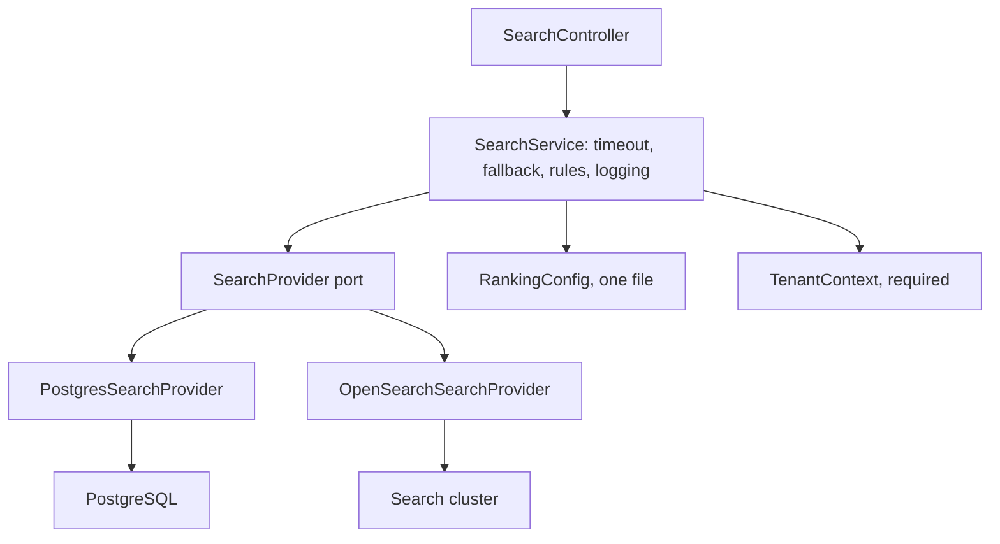
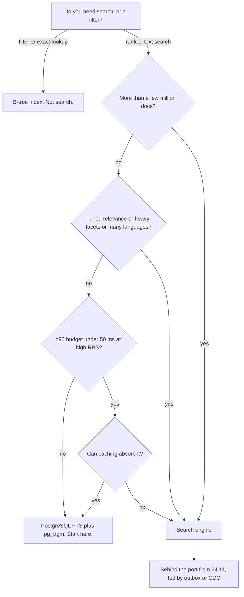

## 34.11 A search module in NestJS

#### Concept

Search is the feature most likely to change engines during a product's life: PostgreSQL full-text on day one, a search cluster in year two, maybe a hosted service after that. So the application code must not know which engine it is talking to. One port, several adapters, and a single place where ranking, tenant filtering, timeouts and fallbacks are decided.

#### Why does it exist?

Because the alternative - `elasticsearch.search({...})` scattered through fifteen services - makes the engine a permanent decision. It also makes every cross-cutting requirement (tenant isolation, timeouts, query logging, relevance debugging) something you have to remember fifteen times. You will forget once, and the once you forget will be tenant isolation.

#### Mental model

Imagine a translator sitting between your business and a foreign supplier. Your staff always speak your language; the translator handles whichever supplier you are using this year. When you switch suppliers you retrain one person, not the whole company. The port is the translator's job description: it must be written in terms of what your business needs, not in terms of what this year's supplier happens to offer.



#### How it works

**The port.** Design it around what the application asks for, not around either engine's DSL. If the interface mentions `tsquery` or `bool`, it is not a port.

```ts
// src/search/search-provider.port.ts
export interface SearchFilters {
  categoryIds?: number[]; brandIds?: number[];
  priceMinCents?: number; priceMaxCents?: number;
  inStockOnly?: boolean;
}
export type SortKey = 'relevance' | 'price_asc' | 'price_desc' | 'newest';

export interface SearchParams {
  tenantId: string;              // never optional, never defaulted
  query: string;                 // may be empty for a browse page
  filters: SearchFilters;
  sort: SortKey;
  cursor?: string;               // opaque; encodes the engine's continuation token
  limit: number;
  facets: ReadonlyArray<'brand' | 'category' | 'price'>;
  explain?: boolean;             // debugging only, gated by a role
}

export interface SearchHit { id: string; score: number; name: string; brand: string | null; priceCents: number; inStock: boolean }
export interface FacetBucket { key: string; label: string; count: number }
export interface SearchResult {
  hits: SearchHit[];
  totalApprox: number;
  nextCursor: string | null;
  facets: Record<string, FacetBucket[]>;
  tookMs: number;
  debug?: { parsedQuery: string; perHitScores?: Record<string, unknown> };
}

export interface SearchProvider {
  readonly name: 'postgres' | 'opensearch';
  search(params: SearchParams): Promise<SearchResult>;
  health(): Promise<boolean>;
}
export const SEARCH_PROVIDER = Symbol('SEARCH_PROVIDER');
```

**The DTOs, with allow-lists.** Every filter and sort value that reaches a query builder must come from a closed set. This is validation *and* it is the injection defence (34.13).

```ts
// src/search/dto/search-query.dto.ts
import { Type, Transform } from 'class-transformer';
import { IsArray, IsBoolean, IsIn, IsInt, IsOptional, IsString, Max, Min, MaxLength, ArrayMaxSize } from 'class-validator';

export class SearchQueryDto {
  @IsOptional() @IsString() @MaxLength(200)
  @Transform(({ value }) => String(value ?? '').replace(/\s+/g, ' ').trim())
  q = '';

  @IsOptional() @IsArray() @ArrayMaxSize(20) @Type(() => Number) @IsInt({ each: true })
  categoryIds?: number[];

  @IsOptional() @IsArray() @ArrayMaxSize(20) @Type(() => Number) @IsInt({ each: true })
  brandIds?: number[];

  @IsOptional() @Type(() => Number) @IsInt() @Min(0) @Max(100_000_00) priceMinCents?: number;
  @IsOptional() @Type(() => Number) @IsInt() @Min(0) @Max(100_000_00) priceMaxCents?: number;
  @IsOptional() @Transform(({ value }) => value === 'true' || value === true) @IsBoolean() inStockOnly?: boolean;

  // Allow-list, not a free string. An unknown sort key is a 400, never a SQL fragment.
  @IsOptional() @IsIn(['relevance', 'price_asc', 'price_desc', 'newest']) sort: 'relevance' | 'price_asc' | 'price_desc' | 'newest' = 'relevance';

  @IsOptional() @IsString() @MaxLength(512) cursor?: string;
  @IsOptional() @Type(() => Number) @IsInt() @Min(1) @Max(100) limit = 24;
}
```

**Ranking configuration in one place.** Weights get argued about, tuned, and reverted. Keeping them in one exported object means a relevance change is a one-file diff you can review, A/B test and roll back.

```ts
// src/search/ranking.config.ts
export const RANKING = {
  version: 7,                       // bump on every change; logged with each query for attribution
  fieldWeights: { name: 3.0, brand: 2.0, category: 1.2, description: 1.0 },
  pgWeightArray: [0.1, 0.2, 0.5, 1.0] as const,   // ts_rank weights D, C, B, A
  popularity: { enabled: true, dampening: 'log' as const, cap: 2.5 },
  recency: { halfLifeDays: 60, maxBoost: 1.2 },
  outOfStockMultiplier: 0.6,
  fuzzy: { enabled: true, minResultsBeforeFallback: 3, prefixLength: 1 },
} as const;
```

**The service: timeout, fallback, rules, logging.** This is where the cross-cutting concerns live so no adapter has to remember them.

```ts
// src/search/search.service.ts
import { Inject, Injectable, Logger } from '@nestjs/common';
import { SEARCH_PROVIDER, SearchProvider, SearchParams, SearchResult } from './search-provider.port';
import { RANKING } from './ranking.config';
import { SearchMetrics } from './search.metrics';

@Injectable()
export class SearchService {
  private readonly log = new Logger(SearchService.name);
  constructor(
    @Inject(SEARCH_PROVIDER) private readonly provider: SearchProvider,
    private readonly metrics: SearchMetrics,
  ) {}

  async search(params: SearchParams): Promise<SearchResult> {
    if (!params.tenantId) throw new Error('tenantId is required');   // belt and braces; the adapter asserts too
    const started = Date.now();
    try {
      return await this.withTimeout(this.provider.search(params), 800, () => this.degraded(params));
    } finally {
      this.metrics.observe({
        provider: this.provider.name, rankingVersion: RANKING.version,
        ms: Date.now() - started, facets: params.facets.length, hasQuery: params.query.length > 0,
      });
    }
  }

  // A slow search is worse than a simple one. Degrade: drop facets, drop fuzzy, cap the candidate set.
  private async degraded(p: SearchParams): Promise<SearchResult> {
    this.log.warn(`search timeout, degrading: q="${p.query.slice(0, 40)}" facets=${p.facets.length}`);
    this.metrics.incDegraded();
    const simple: SearchParams = { ...p, facets: [], sort: 'relevance', limit: Math.min(p.limit, 24) };
    return this.withTimeout(this.provider.search(simple), 500, async () => ({
      hits: [], totalApprox: 0, nextCursor: null, facets: {}, tookMs: -1,
    }));
  }

  private async withTimeout<T>(p: Promise<T>, ms: number, onTimeout: () => Promise<T>): Promise<T> {
    let timer: NodeJS.Timeout;
    const timeout = new Promise<'timeout'>((res) => { timer = setTimeout(() => res('timeout'), ms); });
    const winner = await Promise.race([p.then((v) => ({ v })), timeout]);
    clearTimeout(timer!);
    if (winner === 'timeout') return onTimeout();
    return (winner as { v: T }).v;
  }
}
```

**Tenant filtering that cannot be forgotten.** Three layers, because one is not enough:

1. `tenantId` is a required, non-optional field on `SearchParams` - a missing tenant is a TypeScript error, not a runtime bug.
2. It comes from the authenticated request context, never from a query parameter. A user cannot ask for another tenant's data because they have no way to express it.
3. Every adapter asserts it and adds the filter in a shared base method that the query builder cannot bypass.

```ts
// src/search/providers/postgres-search.provider.ts (excerpt)
private baseWhere(qb: SelectQueryBuilder<Product>, p: SearchParams): SelectQueryBuilder<Product> {
  if (!p.tenantId || !/^[0-9a-f-]{36}$/i.test(p.tenantId)) throw new Error('tenant scope missing or malformed');
  // Every query in this provider goes through here. There is no other entry point.
  return qb.where('p.tenant_id = :tenantId', { tenantId: p.tenantId })
           .andWhere('p.deleted_at IS NULL');
}

async search(p: SearchParams): Promise<SearchResult> {
  const qb = this.baseWhere(this.repo.createQueryBuilder('p'), p);
  if (p.query) {
    qb.andWhere(`p.search_vector @@ websearch_to_tsquery('shop_en', :q)`, { q: p.query })
      .addSelect(`ts_rank_cd(:w, p.search_vector, websearch_to_tsquery('shop_en', :q), 1)`, 'score')
      .setParameter('w', `{${RANKING.pgWeightArray.join(',')}}`);
  }
  if (p.filters.brandIds?.length) qb.andWhere('p.brand_id = ANY(:brands)', { brands: p.filters.brandIds });
  if (p.filters.inStockOnly) qb.andWhere('p.in_stock = true');
  // Sort comes from an allow-list mapped to fixed SQL. User input never becomes a column name.
  const ORDER: Record<SortKey, [string, 'ASC' | 'DESC']> = {
    relevance: ['score', 'DESC'], price_asc: ['p.price_cents', 'ASC'],
    price_desc: ['p.price_cents', 'DESC'], newest: ['p.created_at', 'DESC'],
  };
  const [col, dir] = ORDER[p.sort];
  qb.orderBy(col, dir).addOrderBy('p.id', 'ASC').limit(p.limit + 1);   // +1 to know whether a next page exists
  // ... execute, build cursor from the last row's sort values, map to SearchHit
}
```

**The relevance-debugging endpoint.** Support tickets say "product X does not come up for query Y". Without this endpoint that is an hour of guessing; with it, it is 30 seconds. Return the parsed query, the terms the document produced, the score breakdown, and every filter that was applied.

```ts
// src/search/search-debug.controller.ts
import { Controller, Get, Query, UseGuards } from '@nestjs/common';
import { RolesGuard, Roles } from '../auth/roles.guard';
import { SearchService } from './search.service';
import { TenantContext } from '../common/tenant.context';

@Controller({ path: 'search/_explain', version: '1' })
@UseGuards(RolesGuard)
@Roles('support', 'admin')          // never public: scores and parsed queries leak index internals
export class SearchDebugController {
  constructor(private readonly search: SearchService, private readonly tenant: TenantContext) {}

  @Get()
  async explain(@Query('q') q: string, @Query('productId') productId: string) {
    const res = await this.search.search({
      tenantId: this.tenant.require(), query: q ?? '', filters: {}, sort: 'relevance',
      limit: 50, facets: [], explain: true,
    });
    const rank = res.hits.findIndex((h) => h.id === productId);
    return {
      parsedQuery: res.debug?.parsedQuery,           // e.g. "'run' & 'shoe'"
      rankingVersion: res.debug ? undefined : null,
      found: rank >= 0, position: rank >= 0 ? rank + 1 : null,
      topTen: res.hits.slice(0, 10).map((h) => ({ id: h.id, name: h.name, score: h.score })),
      scoreOfRequested: rank >= 0 ? res.hits[rank].score : null,
      hint: rank >= 0 ? 'matched, ranked low' : 'not matched: check analysis, filters, or index lag',
      tookMs: res.tookMs,
    };
  }
}
```

**Module wiring: swap the engine with configuration, not with code.**

```ts
// src/search/search.module.ts
import { Module } from '@nestjs/common';
import { ConfigModule, ConfigService } from '@nestjs/config';
import { SEARCH_PROVIDER } from './search-provider.port';
import { PostgresSearchProvider } from './providers/postgres-search.provider';
import { OpenSearchSearchProvider } from './providers/opensearch-search.provider';

@Module({
  imports: [ConfigModule],
  providers: [
    PostgresSearchProvider, OpenSearchSearchProvider,
    { provide: SEARCH_PROVIDER,
      inject: [ConfigService, PostgresSearchProvider, OpenSearchSearchProvider],
      useFactory: (cfg: ConfigService, pg: PostgresSearchProvider, os: OpenSearchSearchProvider) =>
        cfg.get('SEARCH_ENGINE') === 'opensearch' ? os : pg },
  ],
  exports: [SEARCH_PROVIDER],
})
export class SearchModule {}
```

The same contract test suite runs against both providers. If a test passes on PostgreSQL and fails on OpenSearch, the port is leaking engine semantics and needs tightening - which is exactly the signal you want before the migration, not during it.

#### Production scenario

A team ships PostgreSQL search on day one behind this port. Eighteen months and 1.4 million products later, faceted category pages breach the 300 ms budget. They write the OpenSearch adapter in two weeks, run both providers in parallel behind a flag comparing results for 5% of traffic, find eleven ranking differences, fix nine and accept two, then flip the flag per tenant over a month. Application code changed in zero places outside `src/search/providers/`.

#### Failure scenario

The search cluster's p99 rises to 4 seconds during a shard relocation. The API has no timeout on the search call. Node's HTTP agent keeps 200 sockets open waiting; incoming requests queue on the event loop; the readiness probe times out; Kubernetes restarts pods; the restarts drop in-flight requests and increase load on the remaining pods. A slow dependency has become a full outage of the whole API, including endpoints that have nothing to do with search.

The `withTimeout` plus degraded fallback above is the fix, along with a bulkhead: search calls run against their own bounded concurrency so they cannot consume every socket. The lesson is the senior mantra applied to a dependency: *can it become slow?* is a more dangerous question than *can it fail?*, because failure is fast and slowness is contagious.

#### Common mistakes

- A port that exposes the engine's query DSL, so it abstracts nothing.
- Tenant id as an optional parameter, or read from the query string.
- Free-text sort or filter field names reaching a query builder.
- No timeout on the search call.
- Ranking weights scattered across three files and a database table.
- A public debug endpoint.

#### Interview questions

1. **Why put search behind a port, and what belongs in the port versus the adapter?** Expected: engine choice must be reversible; the port speaks business terms (query, filters, sort, cursor, facets); the adapter owns DSL, analysis and pagination mechanics.
2. **How do you guarantee tenant isolation in search?** Expected: required non-optional field, sourced from auth context, enforced in a single base method every query passes through, plus a test that a missing tenant throws.
3. **What do you do when the search backend is slow?** Expected: hard timeout, degrade to a simpler query without facets, bulkhead the concurrency, surface a degraded-mode metric; never let it queue.
4. **What does a relevance-debugging endpoint return and who may call it?** Expected: parsed query, document terms, score breakdown, applied filters, position; support and admin roles only.

#### Practical exercise

Implement the port, both adapters and one shared contract test suite. Acceptance criteria: the suite passes against both providers; removing the tenant filter from either adapter fails a test; a forced 2-second delay in the provider produces a degraded result within 900 ms rather than an error; the debug endpoint returns 403 for a normal user.

## 34.12 When PostgreSQL search is enough, and when it is not

#### Concept

The decision is not "which is better". PostgreSQL full-text plus trigram is a genuinely good search engine for a large class of products, and it comes with zero additional operational surface. A search cluster is more capable and costs you a distributed stateful system. The question is whether your requirements have crossed the line.

#### How it works

| Dimension | PostgreSQL is comfortable | Reach for a search engine |
|---|---|---|
| Document count | Up to a few million searchable rows | Tens of millions, or growing fast |
| Index size | GIN index fits in RAM alongside the working set | Index alone exceeds the database's memory budget |
| Query complexity | Terms, phrases, prefix, filters, simple boolean | Multi-field cross-field matching, nested documents, "more like this", vectors |
| Relevance | Field weights and a couple of business signals are enough | Tuned BM25, per-field analyzers, synonym sets you iterate on weekly, learning to rank |
| Facets | Worst-case candidate set in the tens of thousands | Hundreds of thousands of candidates, many facets, sub-100 ms |
| Latency budget | 50 to 300 ms acceptable | Consistent sub-50 ms p95 at high concurrency |
| Concurrency | Under ~100 searches per second, or heavily cached | Hundreds to thousands per second |
| Write rate | Steady updates; GIN pending list manageable | Very high update rates alongside heavy search |
| Languages | One or two, Snowball stemmers suffice | Many languages, CJK, decompounding, ICU |
| Operational cost | Free: it is the database you already run and back up | A cluster, upgrades, snapshots, heap tuning, on-call |
| Consistency | Read-your-writes for free, always current | Eventual, 1 to 5 seconds, plus a sync pipeline to own |
| Team skill | Everyone knows SQL | Someone must know Lucene, JVM and cluster operations |

**Concrete thresholds**, stated as honestly as such numbers can be. PostgreSQL full-text with a GIN index plus `pg_trgm` comfortably serves a catalogue **into the low millions of documents** with **simple relevance**, worst-case candidate sets in the **tens of thousands**, and a **p95 budget above about 100 ms** with caching in front. You start genuinely needing a search engine when any of these is true:

- you need **tuned relevance** you will iterate on: BM25 with per-field analyzers, synonym sets updated weekly, and the ability to measure a change;
- you need **heavy faceting** over hundreds of thousands of candidates on every request;
- you need **multi-language analysis** beyond one or two Snowball languages;
- you need **sub-50 ms p95 at high concurrency**, and caching cannot save you because the query space is too diverse;
- search load is starting to **compete with transactional load** on the same database, and a read replica is not enough because GIN index maintenance is on the primary;
- you need capabilities PostgreSQL does not have at all: nested document queries, "more like this", significant-terms, or dense-vector semantic search at scale.

Notice what is *not* on that list: "we have a lot of data" on its own, or "search feels slow" before anyone has run `EXPLAIN (ANALYZE, BUFFERS)`. Most search performance problems at small and medium scale are a missing index, a `LIKE '%x%'` without trigrams, ranking over an unbounded candidate set, or facets computed five times.



**The honest recommendation: start with PostgreSQL.** Not because it is always right, but because of what each choice costs when it is wrong. Starting with PostgreSQL and migrating later costs you two weeks of adapter work, done at a time when you know exactly what your relevance requirements are, because you have real query logs. Starting with a cluster you did not need costs you an ongoing operational burden, a sync pipeline, a consistency window in the UI, and a second thing to be woken up for - paid every month, starting immediately, in exchange for capabilities you may never use.

**The migration path**, when you do outgrow it:

1. Put the port from 34.11 in place *first*, while PostgreSQL is still the only provider. This is the whole trick: the migration is only cheap if the seam already exists.
2. Build the sync pipeline (34.10) and let it run for a week. Verify with reconciliation before anyone searches against it.
3. Write the second adapter and run the shared contract tests against it.
4. **Shadow mode**: for a sample of traffic, run both providers, serve PostgreSQL's results, and log the differences - overlap in the top 10, rank correlation, latency of each. Fix the differences you care about; document the ones you accept.
5. Roll out per tenant or per percentage behind a flag, watching zero-result rate and click-through on the first three results, not just latency.
6. Keep the PostgreSQL adapter working as a fallback for at least a quarter, and run its tests in CI. The day the cluster is red, a degraded search is much better than none.

#### How a Senior Backend Engineer thinks about this

They ask what the *worst realistic query* looks like - the empty search on the biggest category, with all facets - and size the decision on that, not on the average. They separate "search is slow" from "this query is slow" and refuse to buy infrastructure before reading a query plan. They build the seam early and the cluster late. And they say out loud, in the proposal, who will be on call for the cluster, because that sentence has ended more premature Elasticsearch projects than any benchmark.

#### Interview questions

1. **When is PostgreSQL full-text search not enough?** Expected: tuned relevance you iterate on, heavy facets over large candidate sets, many languages, sub-50 ms at high concurrency, search competing with transactional load, capabilities PostgreSQL lacks.
2. **Roughly how far does PostgreSQL FTS scale?** Expected: low millions of documents with simple relevance and candidate sets in the tens of thousands; the binding constraint is the worst-case candidate set, not the row count.
3. **How would you migrate from PostgreSQL search to a cluster with no downtime?** Expected: port first, sync pipeline, reconciliation, shadow mode with result comparison, flagged rollout by tenant, keep the old adapter as fallback.
4. **What does adopting a search cluster cost beyond the instances?** Expected: sync pipeline, consistency window in the UI, upgrades, snapshots, heap and shard tuning, monitoring, and on-call expertise.

#### Practical exercise

Write the decision for your own system as a one-page document: worst-case candidate set measured with `EXPLAIN (ANALYZE, BUFFERS)`, current and projected document counts, latency budget, facet requirements, languages, and the operational owner. Acceptance criteria: the recommendation is supported by measured numbers rather than adjectives, and names the specific requirement that would trigger a move.

## 34.13 Observability, security and cost of search

#### Concept

Search fails in ways that produce no errors. A relevance regression, a stale index, a stop word swallowing a product name - all return HTTP 200 with a plausible-looking empty page. So search needs its own metrics, and the most important ones are about results, not about latency.

#### How it works

**The metrics that matter:**

| Metric | Why | Alert on |
|---|---|---|
| Latency p50 / p95 / p99, split by "with facets" and "without" | The two have completely different distributions; averaging them hides both | p95 over budget for 5 minutes |
| **Zero-result rate** | The single best proxy for search quality. A step change means analysis, indexing or a data problem | Absolute above ~8%, or a 2x jump day over day |
| Click-through on the top 3 results | Tells you whether the ranking is right, which latency never does | 20% relative drop week over week |
| Position of the first click | Rising means users are scrolling to find what they wanted | trend |
| Query volume by normalized term | Finds the head you should optimize and the terms that suddenly spike | anomaly |
| **Index lag** - seconds between the source row's commit and its visibility in the index | The user-visible symptom of a broken pipeline | p95 over 30 s |
| Drift count from reconciliation | Correctness of the derived copy | any sustained non-zero |
| Degraded-mode rate | How often the fallback fires | above 1% |
| Cache hit ratio for facets and autocomplete | Directly drives database load | below the expected floor |
| Timeouts and provider errors | Distinguish "slow" from "broken" | any sustained |

Zero-result rate deserves the emphasis. It is cheap to compute, it catches analyzer mistakes, index outages, a mis-parsed query, a filter applied twice, and a bad synonym file - and it does all of that before a customer emails you. Track it overall and per top-200 query.

**Logging queries safely.** Query strings are user input, and users type surprising things into a search box: their own email address, an order number, a phone number, occasionally a password they meant to type elsewhere. So:

- Log the **normalized** query (lowercased, whitespace collapsed, truncated to 100 characters), not the raw one.
- **Redact** patterns that look like PII - email addresses, long digit runs, card-shaped numbers - before the string leaves the process.
- Do not put the query in a URL path or in a metric label. Metric labels with unbounded cardinality will take down your metrics backend faster than search will take down your database.
- Keep the *aggregate* long-term (query term plus daily count, for the suggestion corpus and analytics) and the *per-request* log short - 7 to 30 days.
- Never join the search log to a user id in a table that outlives your retention policy.

**Preventing injection when building a query DSL.** The concern is real and it is not "SQL injection" in the classic sense; it is *query injection* - user input changing the structure of the query rather than being data within it.

- **SQL:** always parameterize. `websearch_to_tsquery('shop_en', $1)` is safe; string-concatenating into `to_tsquery` is not, and it will also throw syntax errors on ordinary user input containing `&`, `|`, `!` or `:`. Prefer `websearch_to_tsquery` or `plainto_tsquery` precisely because they tolerate arbitrary text. Escape `%`, `_` and `\` before they reach a `LIKE` pattern.
- **Search DSL:** build **objects**, never strings. `{ match: { name: userInput } }` is safe because the input is a value in a JSON document. Concatenating user input into a query string template is how you get structure injection.
- **Never expose `query_string`** to user input. It accepts Lucene syntax, so a user can write field names they should not reach, regular expressions, or wildcard-prefixed terms that scan the entire dictionary - a cheap denial of service. If you need operator syntax, use `simple_query_string` with an explicit `flags` allow-list and an explicit `fields` list.
- **Disable scripting** in queries built from user input, and reject any request whose payload contains a `script` key if you build DSL from client-supplied structures at all. Better: do not accept client-supplied DSL. The DTO allow-list in 34.11 means the client sends values, never query shapes.
- Bound everything: `limit` maximum, filter array sizes, query length, facet count, and a server-side timeout so an expensive query cannot run forever.

**Tenant isolation in the index.** Three models, with honest tradeoffs:

- **Shared index with a `tenant_id` filter.** Simplest, most efficient, one mapping to maintain. The risk is that one forgotten filter leaks data - which is why the enforcement lives in one method in one adapter, and why a test asserts it. Add routing by tenant so a tenant's documents live on one shard and searches touch fewer shards.
- **Index per tenant.** Strong isolation, per-tenant mappings and reindexing. Falls apart past a few hundred tenants because of shard-count limits and cluster-state size. Reasonable for tens of large tenants; wrong for thousands of small ones.
- **Alias per tenant over a shared index** with a filtered alias: the filter is defined in cluster state rather than in your query, so application code cannot forget it. A good middle ground.

Whichever you choose, remember that **facets and suggestions leak too**. A brand facet computed before the tenant filter, an autocomplete corpus built from all tenants' queries, a `cardinality` aggregation, even a `doc_count` - each can reveal the existence of data the caller may not see. Apply the tenant filter first, always, and put it in the cache key.

**Cost drivers.** What actually moves the bill:

- **Index size times (1 + replicas)**, which is storage and, more importantly, the RAM you need for the page cache. Denormalized fields you never query are pure cost - `"index": false` for display-only fields, and do not store the full description twice.
- **Refresh interval**: a 1-second refresh on a high-write index creates many small segments and constant merge CPU. Raising it to 5 or 30 seconds where visibility allows is often the single cheapest win.
- **Node count driven by peak concurrency**, not by data size, once the data fits.
- **Reindex compute**, which is a periodic doubling of write load; schedule it off-peak.
- **Autocomplete traffic**, which is 5 to 10 times search traffic and must be cached or it dominates everything (34.7).
- **Facets**, which add 50 to 70% to every search that computes them; cache them separately from results so the results can be fresher.
- **Cross-AZ data transfer** for replication in a multi-zone cluster - real money, invisible until the bill arrives.
- On the PostgreSQL side: GIN index size in shared buffers, the maintenance cost of the pending list, and the CPU of ranking over large candidate sets.

#### Common mistakes

- Alerting on latency only, so a relevance regression ships silently.
- Logging raw query strings forever.
- Query text as a Prometheus label.
- Exposing `query_string` or accepting client-supplied DSL.
- Tenant filter applied to results but not to facets or suggestions.
- A 1-second refresh interval on an index nobody reads in real time.

#### Interview questions

1. **What is the most useful single search metric and why?** Expected: zero-result rate; cheap, catches analysis, indexing and data problems before users report them.
2. **How do you log search queries without creating a privacy problem?** Expected: normalize, truncate, redact PII patterns, short per-request retention, aggregate long-term, never as a metric label.
3. **How do you prevent query injection into a search DSL?** Expected: build objects not strings, allow-list filters and sorts, never expose `query_string` or scripts, parameterize SQL, bound every limit.
4. **Compare tenant isolation strategies in a search index.** Expected: shared with filter (efficient, one mistake leaks), index per tenant (isolated, does not scale past hundreds), filtered alias (filter in cluster state, good middle ground); facets and suggestions leak too.
5. **What drives the cost of a search cluster?** Expected: index size times replicas and the RAM behind it, refresh and merge, peak concurrency, reindex compute, autocomplete traffic, facets, cross-AZ transfer.

## 34.14 Edge cases and failure modes

**The index is out of sync after a failed publish.** The outbox relay crashes between publishing and marking rows published, so a batch is republished - harmless with external versioning, catastrophic without. Or it marks rows published and *then* crashes before the broker accepted them, so those changes are lost forever and no error is ever raised. Mark published only after a confirmed broker acknowledgement, accept duplicates, and let reconciliation catch the rest.

**A reindex doubles cluster load at peak.** Someone starts a rebuild at 11:00 because the mapping change is ready. Indexing and search share thread pools and page cache; search p95 triples; the store degrades while every dashboard on the database side is green. Rate-limit reindexing, run it off-peak, and wire an automatic pause when search p95 breaches its SLO.

**Mapping explosion from dynamic fields.** Dynamic mapping is on, and a supplier feed contains per-product attribute objects with the attribute name as a key: `attributes.shoe_size_eu_42`, `attributes.thread_count_400`. Each new key becomes a new field in the mapping. At 12,000 fields the cluster state is megabytes, every node must hold it, updates take seconds, and eventually the field limit trips and indexing stops. Fix: `"dynamic": "strict"`, and model attributes as a `nested` array of `{ name, value }` pairs instead of as keys. Prevention is entirely at mapping-design time; recovery requires a reindex.

**Deep pagination.** A crawler walks to page 900. `from: 21600` forces every shard to sort and return 21,600 hits to the coordinating node; in PostgreSQL the equivalent `OFFSET 21600` sorts the entire candidate set every time. Both degrade smoothly right up to the point where they do not. Use `search_after` or keyset cursors, cap the maximum page for anonymous traffic, and remember that the result window default of 10,000 exists to protect you.

**A stop word removes a meaningful term.** A product is literally called "IT" - an IT support service, a book titled *It*, a brand named "The". The `english` configuration drops it as a stop word, the document's vector contains nothing for it, and searching for the exact name returns zero results. The customer is certain your search is broken, and they are right. Fixes: index the name field with the `simple` configuration as well as the language one and search both, or use a `keyword` sub-field for exact name matching, or maintain a protected-terms list. Related: single-character and two-character queries produce no trigrams either.

**Language mismatch.** A German product description is analysed with the `english` stemmer. "Laufschuhe" is not decompounded into "Lauf" and "Schuhe", so a search for "Schuhe" misses it. Symptom: a per-locale zero-result rate that is fine for one market and terrible for another - which nobody notices until that market's revenue is questioned. Detect the document's language at index time, store it, and route to a per-language field (`name.de`, `name.en`); at query time use the user's locale, falling back to a multi-language field.

**`ILIKE '%term%'` sequentially scanning 50 million rows.** The support tool from 34.6, at scale: no trigram index, so every search is a full scan of a 60 GB table taking 40 seconds. Agents get impatient and fire three more searches; the connection pool fills with sequential scans; unrelated queries queue behind them and the whole application slows down. A pattern shorter than three characters cannot use a trigram index at all, so even after adding one, `ILIKE '%it%'` still scans. Enforce a minimum query length, add the trigram index, and put a `statement_timeout` on the search role so a runaway query dies at 3 seconds instead of 40.

**GIN pending-list growth slowing inserts and searches.** Covered in 34.3: `fastupdate` buffers new entries in an unsorted list that every search must scan linearly. A bulk import plus lazy autovacuum grows it to hundreds of megabytes and search p95 goes from 40 ms to 900 ms with no code change and no plan change - which is what makes it hard to diagnose. Watch `gin_metapage_info`, run `gin_clean_pending_list` after bulk loads, or set `fastupdate = off` on search-heavy tables.

**A relevance regression after an analyzer change, with no way to measure it.** Someone swaps a stemmer or adds twenty synonyms. Nothing errors. Conversion drops 6% over the following week and is attributed to seasonality. Without a measurement loop you cannot even have the argument. The minimum viable loop: a golden set of 200 query-and-expected-result pairs run in CI as a regression test, plus zero-result rate and click-through at rank 1-3 compared before and after, plus a flagged rollout so you have a control group. Relevance changes without a control group are guesses with a deploy attached.

**Hot shards.** Routing by tenant id puts one enormous tenant entirely on one shard; that node's CPU sits at 90% while others idle. Or a `date_histogram`-partitioned index sends all of today's writes to one shard. Symptom: cluster-wide averages look fine and p99 is terrible. Fix: do not route by a skewed key, split the giant tenant into its own index, or use a routing key with more entropy.

**Oversized documents.** A product with 5,000 review texts denormalized into one document; a document with a 12 MB `description`. Large documents slow indexing, blow up highlighting, break bulk batching, and can exceed the HTTP payload limit. Keep documents to what search needs: index the fields you match and filter on, store an id, and fetch the rest from PostgreSQL for display. Cap field lengths at index time (`ignore_above` for keywords, an explicit truncation for text).

**PII in the search index.** Denormalization pulls in a customer's email or phone number "because it might be useful for admin search". Now personal data lives in a second system with its own backups, snapshots and access controls - and a deletion request must be honoured there too, in every snapshot. Rules: index the minimum, keep PII out of any index that a customer-facing endpoint queries, use a separate admin index with its own access control if you truly need it, and make sure your data-deletion job covers the search index and its retention.

**Tenant leakage in results.** The worst failure in this part. A missing filter on one code path, a facet computed before the filter, an autocomplete corpus built from every tenant's queries, a cached result keyed without the tenant, or an admin endpoint that "temporarily" skips the filter. It is a data breach, it is usually found by a customer, and it is entirely preventable by the three-layer enforcement in 34.11 plus a test that asserts tenant B's document can never appear for tenant A - on results, facets *and* suggestions.

**Two more that bite in practice.** *Highlighting on a huge field* re-analyses the entire text per hit and can dominate query time; cap it with `fragment_size` and `number_of_fragments`, or highlight a truncated copy. *A synonym file that fails to load* after a config change silently starts a node with the previous analyzer definition, so half your shards analyse differently from the other half and results depend on which replica served the request.

## Senior Checklist — Part 34

- [ ] I understand the concept
- [ ] I can explain it simply
- [ ] I can implement it
- [ ] I understand its failure modes
- [ ] I understand its scaling limitations
- [ ] I understand its security implications
- [ ] I understand its operational implications
- [ ] I can choose between alternatives
- [ ] I can explain the tradeoffs
- [ ] I can answer senior-level interview questions
- [ ] I can tell search apart from filtering and lookup, and pick the right index for each
- [ ] I can build PostgreSQL full-text search with weights, a generated `tsvector` column and a GIN index
- [ ] I can explain an inverted index, posting lists and the GIN pending list
- [ ] I can debug "this document does not match this query" by comparing the terms on both sides
- [ ] I can explain BM25 in plain words and why `ts_rank` differs
- [ ] I can implement fuzzy matching and "did you mean" with `pg_trgm`, and know when not to
- [ ] I can build autocomplete within a 50 ms budget and explain the cache design
- [ ] I can compute correct multi-select facets in one scan and explain why counts ignore their own filter
- [ ] I can explain shards, replicas, refresh, and `filter` versus `query` context
- [ ] I can size shards and say what a cluster costs to operate
- [ ] I can keep an index in sync with PostgreSQL using an outbox or CDC, with idempotent, version-guarded writes
- [ ] I can run a zero-downtime reindex behind an alias and roll it back
- [ ] I can detect drift with bucketed counts and checksums
- [ ] I can put search behind a port so the engine choice is reversible
- [ ] I can guarantee tenant isolation across results, facets and suggestions
- [ ] I can name the metrics that catch a relevance regression before a customer does

## Part 34 — Key Takeaways

- Search is ranking; filtering is exclusion; lookup is exact. Confusing them produces both bad relevance and bad plans.
- Every relevance bug is an analysis question first: what terms did the document produce, and what terms did the query produce? Answer that before touching ranking.
- PostgreSQL full-text plus `pg_trgm` is a real search engine that comfortably serves catalogues into the low millions of documents with simple relevance. Start there.
- The binding constraint is the worst-case candidate set, not the row count. Broad queries and empty category pages are what break you.
- Facet counts must ignore their own filter, or multi-select is impossible. Compute the base set once and aggregate over it many times.
- In a search cluster, put every yes/no condition in `filter` context: unscored and cached. Only the user's text belongs in `must`.
- Never dual-write to the database and the index. Use an outbox or CDC, partition by entity id, and guard every write with an external version so replay is safe.
- The index is a derived read model, never the source of truth. A full rebuild behind an alias must be routine, rehearsed and reversible.
- Design the UI around the one-to-five-second consistency window instead of pretending it is not there: read the detail page from PostgreSQL, and publish index lag as a metric.
- Put search behind a port on day one. The migration to a cluster is cheap only if the seam already exists.
- Tenant isolation must be enforced in one place that no query can bypass, and it must cover facets and suggestions, not just results.
- Zero-result rate and click-through at ranks one to three catch the failures that latency graphs never will. A relevance change without a control group is a guess with a deploy attached.
- Before buying a cluster, answer the question that ends most premature migrations: who is on call for it, and what do they do when it goes red?
