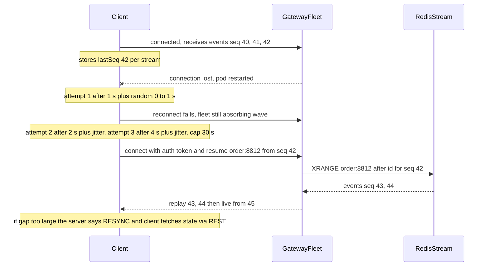
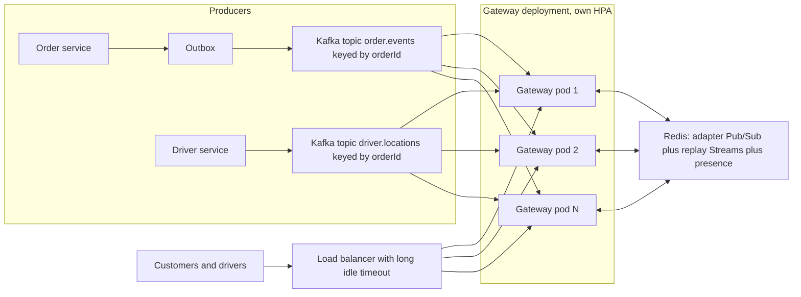

## 34.9 Reconnection and resume

### 34.9.1 Exponential backoff with jitter, and resuming from a sequence number

#### Concept

Connections drop. Trains go through tunnels, pods roll, load balancers time out. Reconnection is the client's job; **resume** is the shared contract that makes a reconnect invisible to the user: the client tells the server the last event it saw, and the server replays what was missed. Without resume, every reconnect is a data loss window; without backoff, every mass disconnect is a self-inflicted denial of service.

#### Why does it exist?

When a pod holding 20,000 connections dies, 20,000 clients notice within 45 seconds and all try to reconnect. If they retry immediately and at the same cadence, the remaining pods see a synchronized wave every second until it succeeds, and each wave costs 20,000 TLS handshakes and JWT verifications. A pod that was fine at 2,000 handshakes per second falls over at 20,000, its clients disconnect, and the wave grows. This is the **thundering herd**, and jitter is the cure.

#### Mental model

Imagine a fire alarm in a stadium and one exit. If everyone runs to it at once, nobody gets out. If people leave section by section with a few seconds between them, the same exit clears the stadium. Exponential backoff is "wait longer each time the door is blocked"; jitter is "and do not all wait the same amount".

#### How it works



1. **Detect.** The client learns the connection is dead from a close event or a missed ping.
2. **Back off.** Attempt n waits `min(cap, base * 2^n)` plus random jitter. With base 1 second, cap 30 seconds and full jitter, attempts land at roughly 0 to 1 s, 0 to 2 s, 0 to 4 s, and so on. Socket.IO's client implements exactly this with `reconnectionDelay`, `reconnectionDelayMax` and `randomizationFactor`.
3. **Reconnect and authenticate.** A fresh handshake; the token may need refreshing first if it expired during the outage.
4. **Resume.** The client sends, per stream it cares about, the last sequence number or event id it processed. The server replays from the buffer (a Redis Stream per room, capped at a few hundred entries or a few minutes), then switches to live.
5. **Resync when the buffer cannot cover the gap.** If the last id is older than the buffer, the server replies `RESYNC`; the client fetches the full current state via REST and starts fresh from the current sequence. This is the fallback that makes the whole design safe: the replay buffer is an optimization, and REST is the source of truth.

```ts
// Client side (browser or React Native) with the Socket.IO client
const socket = io('https://rt.example.com/orders', {
  transports: ['websocket'],
  auth: (cb) => cb({ token: getFreshAccessToken() }),   // called on every (re)connect, so expired tokens are refreshed
  reconnection: true,
  reconnectionDelay: 1_000,
  reconnectionDelayMax: 30_000,
  randomizationFactor: 0.5,                             // jitter: each delay is multiplied by a random factor in 0.5 to 1.5
});

socket.on('connect', () => {
  for (const [orderId, lastSeq] of lastSeqByOrder) {
    socket.emit('order.resume', { orderId, lastSeq }, (ack: { status: 'OK' | 'RESYNC' }) => {
      if (ack.status === 'RESYNC') refetchOrderState(orderId);   // buffer could not cover the gap
    });
  }
});

socket.on('order.status', (ev) => {
  if (ev.seq <= (lastSeqByOrder.get(ev.orderId) ?? 0)) return;   // duplicate after replay: ignore
  applyEvent(ev);
  lastSeqByOrder.set(ev.orderId, ev.seq);
});
```

#### NestJS example

The server side of resume reads the Redis Stream for the room. Each business event written to the stream carries a monotonically increasing `seq` from PostgreSQL (the order's `version` column is a natural choice), so the client's `lastSeq` maps to a stream position.

```ts
// realtime/order-stream.service.ts
import { Injectable } from '@nestjs/common';
import Redis from 'ioredis';

export interface OrderEvent { seq: number; type: string; payload: unknown; }

@Injectable()
export class OrderStreamService {
  constructor(private readonly redis: Redis) {}

  // Called by the Kafka consumer for every business event, before emitting to the room.
  async append(orderId: string, ev: OrderEvent): Promise<void> {
    // Cap the stream at roughly 500 entries; older entries are trimmed lazily.
    await this.redis.xadd(`stream:order:${orderId}`, 'MAXLEN', '~', '500', '*',
      'seq', String(ev.seq), 'type', ev.type, 'payload', JSON.stringify(ev.payload));
    await this.redis.expire(`stream:order:${orderId}`, 6 * 3600);   // no order is tracked for more than 6 h
  }

  // Returns events after lastSeq, or null when the buffer no longer covers that point.
  async replaySince(orderId: string, lastSeq: number): Promise<OrderEvent[] | null> {
    const raw = await this.redis.xrange(`stream:order:${orderId}`, '-', '+');
    const events = raw.map(([, fields]) => this.parse(fields));
    if (events.length === 0) return lastSeq === 0 ? [] : null;
    if (events[0].seq > lastSeq + 1) return null;         // the client's position was trimmed away
    return events.filter((e) => e.seq > lastSeq);
  }

  private parse(fields: string[]): OrderEvent {
    const f: Record<string, string> = {};
    for (let i = 0; i < fields.length; i += 2) f[fields[i]] = fields[i + 1];
    return { seq: Number(f.seq), type: f.type, payload: JSON.parse(f.payload) };
  }
}

// In the gateway
@UseGuards(WsAuthGuard)
@SubscribeMessage('order.resume')
async resume(@ConnectedSocket() client: Socket, @MessageBody() dto: ResumeOrderDto) {
  if (!(await this.orders.canView(client.data.userId, dto.orderId))) throw new WsException('FORBIDDEN');
  await client.join(`order:${dto.orderId}`);            // join first so live events are not missed during replay
  const missed = await this.stream.replaySince(dto.orderId, dto.lastSeq);
  if (missed === null) return { status: 'RESYNC' };
  for (const ev of missed) client.emit('order.status', { orderId: dto.orderId, ...ev });
  return { status: 'OK', replayed: missed.length };
}
```

Joining the room *before* replaying means a live event that arrives during the replay is delivered too, possibly twice (once from replay, once live). The client's `seq` check makes the duplicate harmless. That is the at-least-once plus dedup pattern from 34.10.

#### Production scenario

A gateway fleet loses one pod of ten at 20:00 during peak: 20,000 clients disconnect. With full jitter and a 30 second cap, the remaining nine pods see about 4,000 reconnects in the first second, 2,500 in the second, and the wave is fully absorbed in 12 seconds with p99 handshake latency staying under 150 ms. Without jitter, the same fleet saw 20,000 reconnects in the first 200 ms, two more pods hit their file descriptor limit, and the cascade took 4 minutes to settle. Resume replayed on average 1.3 events per client from Redis Streams; 0.2 percent of clients got `RESYNC` because their last event was more than 500 events back (long-running admin dashboards).

#### Failure scenario

At 03:30 a Redis maintenance failover clears the Streams (the instance was configured without persistence, which was fine for the adapter but not for the replay buffer that had been added to the same instance). Every reconnecting client sends `order.resume` with a real `lastSeq`, the stream is empty, and the server, following the code above, returns `RESYNC`. Ten thousand clients refetch order state via REST within 30 seconds, a 100x spike on `GET /orders/:id`. The API survived because the endpoint was cached, but the retrospective moved the replay stream to a persistent Redis with AOF enabled and added a small random delay to the client's resync fetch.

#### Edge cases & failure modes

- **Token expired during the outage.** The reconnect fails with `UNAUTHORIZED` and the naive client retries forever with the same token. Refresh the token in the `auth` callback and stop retrying after a 401.
- **Reconnect to the same dead pod** because the load balancer has not yet noticed it is gone; the first attempt fails, backoff handles it.
- **Replay before join** misses live events emitted during the replay; join first, dedup by sequence.
- **Buffers per room grow without bound** if `MAXLEN` and `EXPIRE` are forgotten; 200,000 orders times 10,000 events is Redis out of memory.
- **Clients that never reset their backoff** after a successful connection start the next outage at the 30 second cap. Reset on `connect`.
- **A client that resumes with a `lastSeq` from a different stream** (a bug in client state) receives nothing or `RESYNC`; never trust it for authorization, only for positioning.

#### How a Senior Backend Engineer thinks about this

They design the resume contract before the first message is sent: every stream has a monotonically increasing sequence, every client stores the last sequence it applied, every reconnect carries it, and REST remains the source of truth for a full resync. They insist on jitter in every client library and test it by killing a pod under load. They keep the replay buffer on persistent Redis, separate from the adapter's Pub/Sub instance if budget allows, because the two have different durability needs.

## 34.10 Ordering and delivery guarantees

### 34.10.1 Per-connection ordering, cross-pod ordering and at-least-once plus dedup

#### Concept

A single TCP connection delivers bytes in order, so messages written to one socket by one process arrive in the order written. Everything beyond that single socket is unordered by default: two pods emitting to the same room, a replay racing a live event, a Kafka topic with several partitions, a retry after a timeout. Delivery guarantees are the promises you make on top of that: at-most-once (fire and forget), at-least-once (retry until acknowledged, accept duplicates), exactly-once (which in practice means at-least-once plus deduplication at the receiver).

#### Why does it exist?

An order status stream that shows "delivered" then "on the way" is a bug the customer notices immediately. A chat that shows a reply before the message it answers is unusable. A driver location that jumps backwards makes the map twitch. Ordering matters to humans in ways it never mattered to log lines.

#### Mental model

Imagine numbered pages of a report arriving by several couriers. Each courier hands over their pages in order, but couriers arrive in any order. If every page has a number, the reader can put them in order, notice that page 7 is missing and ask for it, and throw away a second copy of page 5. Sequence numbers are the page numbers; gap detection is noticing page 7 is missing.

#### How it works

1. **Assign a sequence at the source of truth.** The number must be assigned where the order of events is decided, which for an order is the database transaction that changes its state. PostgreSQL's `version` column (incremented on every update, or a `@VersionColumn` in TypeORM) gives a strictly increasing per-order sequence for free, and it is assigned under the row lock so two concurrent updates cannot share a number.
2. **Carry the sequence end to end.** Into the outbox row, the Kafka message, the Redis Stream entry and the WebSocket payload.
3. **Preserve order per key upstream.** Kafka keeps order per partition; publish every event for one order with the order id as the message key so they land on the same partition, and consume each partition with one consumer at a time. This gives per-order ordering across the whole pipeline without global ordering (which does not scale).
4. **Client applies events in sequence.** It keeps `lastSeq` per stream, ignores `seq <= lastSeq` (duplicates) and, on `seq > lastSeq + 1` (a gap), either waits briefly for the missing event or asks for a replay from `lastSeq`.
5. **Server emits are at-least-once by construction** whenever replay exists, and the client's dedup makes the visible result exactly-once.

```ts
// Client-side ordering and gap detection for one stream
function onEvent(ev: { seq: number }, state: { lastSeq: number; pending: Map<number, unknown> }) {
  if (ev.seq <= state.lastSeq) return;                 // duplicate
  if (ev.seq === state.lastSeq + 1) {
    apply(ev); state.lastSeq = ev.seq;
    while (state.pending.has(state.lastSeq + 1)) {     // drain buffered out-of-order events
      apply(state.pending.get(state.lastSeq + 1)); state.pending.delete(++state.lastSeq);
    }
    return;
  }
  state.pending.set(ev.seq, ev);                       // gap: hold it
  if (state.pending.size > 20) requestReplay(state.lastSeq);   // gap is not closing; refetch
}
```

**Cross-pod ordering.** Two pods emitting to the same room can interleave in any order at the client; nothing in Redis Pub/Sub prevents it. If a room's events come from one Kafka partition consumed by one consumer, this cannot happen for that room, because only one pod emits for it at a time. If several producers can emit for the same room (an order updated by the customer service and the driver service), the sequence number is the only thing that makes the client's view consistent, and the client-side reorder buffer above is what applies it.

**Delivery guarantee decision table.**

| Guarantee | Server does | Client does | Use for |
|---|---|---|---|
| At-most-once | Emit once, no buffer, `volatile` | Nothing | Typing indicators, cursor positions, high-frequency telemetry where the next value supersedes |
| At-least-once | Emit and keep in a replay buffer; replay on resume | Dedup by sequence | Order status, chat messages, notifications |
| Effectively exactly-once | At-least-once, plus idempotent server-side handling of client messages by `clientMessageId` | Dedup incoming by sequence; attach a unique id to every outgoing message; retry until acked | Chat sends, collaborative edits, anything a user would notice twice |

#### PostgreSQL example

The sequence comes from the row. With optimistic locking it is also the concurrency guard.

```sql
-- version increments on every state change and becomes the event sequence
CREATE TABLE orders (
  id          uuid PRIMARY KEY,
  status      text NOT NULL,
  version     integer NOT NULL DEFAULT 0,
  updated_at  timestamptz NOT NULL DEFAULT now()
);

-- Update under the row lock; the returned version is the seq for the emitted event.
UPDATE orders SET status = 'on_the_way', version = version + 1, updated_at = now()
WHERE id = $1 AND status = 'preparing'
RETURNING version AS seq;
```

The outbox row for this change stores `seq`, the Kafka message carries it, and the client sees `seq: 5` after `seq: 4` no matter which pod delivered it.

#### TypeORM example

```ts
@Entity('orders')
export class Order {
  @PrimaryGeneratedColumn('uuid') id: string;
  @Column() status: string;
  @VersionColumn() version: number;   // incremented automatically on save; used as the event seq
}

// In the service, after save(), order.version is the new sequence.
const saved = await manager.save(order);
await outbox.insert({ aggregateId: saved.id, seq: saved.version, type: 'order.status', payload: { status: saved.status } });
```

#### Edge cases & failure modes

- **Sequence assigned in the gateway** instead of at the source: two pods assign overlapping numbers and the client's dedup discards real events.
- **Kafka key missing**: events for one order spread across partitions and arrive out of order at the gateway.
- **Consumer rebalance**: for a few seconds two consumers may process the same partition's tail; at-least-once semantics and client dedup cover it.
- **Retrying a client message without an id**: a chat message sent, timed out and re-sent appears twice for everyone. Every client-originated message carries a UUID and the server dedups on it (a Redis `SET NX` with a 10 minute TTL, or a unique constraint).
- **Reorder buffer that never drains** because the gap event was genuinely lost upstream: cap the buffer and request replay.

#### How a Senior Backend Engineer thinks about this

They never promise global ordering; they promise per-key ordering and design the keys (order id, conversation id, document id). They put the sequence where the truth is decided, the database row, and carry it everywhere. They accept at-least-once as the honest guarantee and put deduplication at the edges, because "exactly-once" in a distributed system is at-least-once wearing a costume.

## 34.11 Security

### 34.11.1 Origin, auth, rate limits and payload limits

#### Concept

A WebSocket server is an open port that accepts long-lived connections from anyone who can reach it, holds memory per connection, runs code per message and can broadcast to thousands of clients per emit. Every one of those properties is an attack surface: connection floods, message floods, oversized payloads, cross-site connection hijacking, unauthorized room joins, and data leaks through broadcasts.

#### How it works

| Threat | Control |
|---|---|
| Cross-site WebSocket hijacking (a malicious page opens a socket to your origin and the browser sends your cookies) | Check `Origin` on the upgrade against an allowlist; Socket.IO's `cors.origin` does this. Prefer token auth over cookies for WebSockets |
| Unauthenticated connections held open | Authenticate in the handshake or within 5 seconds of connect; disconnect otherwise |
| Expired or revoked tokens on long connections | Store `exp` on the socket, check it on every message and on a periodic timer; on expiry emit `auth.expired` and disconnect; check a revocation set on connect |
| Unauthorized room joins | Every join validates ownership against the database or an ownership cache; room names are built server-side from validated ids |
| Message floods from one client | Per-socket token bucket: for example 20 messages per second burst, 5 per second sustained; disconnect on repeated violation |
| Connection floods from one IP | Rate limit upgrades per IP at the ingress or load balancer; the API gateway's WAF can do this before the pod sees it |
| Oversized payloads | `maxHttpBufferSize` in Socket.IO (default 1 MB; set 64 KB for most apps); `maxPayload` in `ws` |
| Malformed payloads | `ValidationPipe` with `whitelist: true` on every `@SubscribeMessage` handler, DTOs with `class-validator` |
| PII in broadcasts | Rooms carry only what every member may see; a driver's location goes to the order room, the driver's phone number never does |
| Information leakage in errors | `WsException` messages are codes (`FORBIDDEN`), not stack traces |
| Server-side request forgery via user-supplied URLs in messages | Never fetch a URL from a message payload without an allowlist |

```ts
// realtime/ws-rate-limit.guard.ts
import { CanActivate, ExecutionContext, Injectable } from '@nestjs/common';
import { WsException } from '@nestjs/websockets';
import { Socket } from 'socket.io';

const BURST = 20;
const REFILL_PER_SEC = 5;

@Injectable()
export class WsRateLimitGuard implements CanActivate {
  canActivate(ctx: ExecutionContext): boolean {
    const client = ctx.switchToWs().getClient<Socket>();
    const now = Date.now();
    const bucket = (client.data.bucket ??= { tokens: BURST, updatedAt: now });
    bucket.tokens = Math.min(BURST, bucket.tokens + ((now - bucket.updatedAt) / 1000) * REFILL_PER_SEC);
    bucket.updatedAt = now;
    if (bucket.tokens < 1) {
      client.data.violations = (client.data.violations ?? 0) + 1;
      if (client.data.violations > 10) client.disconnect(true);   // persistent abuser
      throw new WsException('RATE_LIMITED');
    }
    bucket.tokens -= 1;
    return true;
  }
}
```

Apply it with `@UseGuards(WsAuthGuard, WsRateLimitGuard)` on every handler. The bucket lives on the socket, so a reconnect resets it; the ingress-level per-IP limit covers reconnect abuse.

#### Failure scenario

A penetration test connects to the chat gateway with a valid user token and sends `{ "conversationId": "*" }` to the `join` handler. The handler built the room name as `conv:${dto.conversationId}` with no validation, and Socket.IO happily joined the socket to `conv:*`. Nothing was emitted to that literal room, so the tester found nothing, but the next test sent a conversation id belonging to another user, and the handler had no ownership check. Every message of every conversation was readable with one guessable id. Both bugs are one line each: `@IsUUID()` on the DTO and `canView` before `join`.

#### How a Senior Backend Engineer thinks about this

They treat every `@SubscribeMessage` handler like a `POST` endpoint: validated DTO, guard, rate limit, authorization, audit log. They keep secrets out of URLs and logs, bound every buffer, and assume a client will connect ten thousand times and send a megabyte per message until told otherwise. They ask the security team to test the WebSocket path explicitly, because most scanners only cover REST.

## 34.12 Scaling

### 34.12.1 Numbers, topology and protocol cost

#### Concept

Scaling real-time is about three limits: connections per pod (memory and file descriptors), messages per second per pod (CPU, mostly serialization and socket writes), and fan-out traffic through the Pub/Sub layer (Redis throughput and the per-pod cost of receiving every publish).

#### How it works

**Connections per pod.** With Socket.IO on Node.js, 20,000 to 30,000 mostly idle connections per 2 CPU, 3 GB pod is comfortable; 50,000 is possible with tuning; beyond that, single-process limits and GC pauses hurt tail latency. With raw `ws` and a binary protocol, 100,000 per pod is achievable. The number that actually bounds you is usually the reconnect wave a pod's death causes, not memory.

**Messages per pod.** JSON serialization is the CPU cost. `JSON.stringify` of a 200 byte object costs about 1 to 2 microseconds; emitting it to 1,000 sockets in a room costs one serialization (Socket.IO encodes once per emit) plus 1,000 socket writes at roughly 5 to 10 microseconds each. A pod can push 50,000 to 100,000 small messages per second before CPU saturates. Large payloads change the arithmetic: a 20 KB JSON to 1,000 sockets is 20 MB of writes per emit.

**Dedicated gateway versus embedded.** Embedding the gateway in the API pods is simplest and correct for small systems. It couples two very different workloads: a reconnect storm or a slow-client memory leak takes down checkout; scaling the API for CPU also scales the number of pods that must subscribe to Pub/Sub; rolling the API for a bug fix disconnects every real-time client. Past a few thousand connections, split the gateway into its own deployment with its own HPA, its own memory headroom and its own rollout schedule. The gateway then consumes Kafka and talks to Redis; it does not talk to PostgreSQL at all except for authorization lookups, which are cached.

**Horizontal scaling with the Redis adapter.** Each pod receives every publish. At N pods and P publishes per second, Redis delivers N times P messages per second and each pod deserializes P messages per second regardless of whether it has a member for the room. That is fine to about 20 pods and 10,000 publishes per second (200,000 deliveries per second, 10 to 20 percent CPU per pod on the adapter). Beyond that: shard rooms across Redis channels with the sharded adapter, or partition rooms by hash across gateway groups so a group only subscribes to its share, or use a message bus with real subscriptions (NATS, or Kafka with one consumer group per gateway group and topic partitioning by room hash).

**Binary protocols.** MessagePack or Protobuf cut payload size by 30 to 70 percent and serialization CPU by a similar factor; Socket.IO supports a MessagePack parser as a drop-in. The cost is debuggability (you cannot read the frames in the browser's network tab) and client complexity. Reach for it when messages per second per pod is your bottleneck and the payload is numeric (locations, telemetry, game state).



The Kafka consumer group across the gateway pods means each order's events are consumed by exactly one pod, which then publishes to the room through Redis. That pod may hold none of the room's sockets; the adapter handles it.

#### Production scenario

A ride-hailing product at evening peak: 400,000 concurrent riders and drivers, 20 gateway pods at 20,000 connections each, driver locations at one message per 3 seconds per active trip (60,000 trips: 20,000 messages per second), fan-out of one message to one rider each. Kafka partitions: 48 for `driver.locations`, consumed by 20 pods. Redis adapter traffic: 20,000 publishes per second, 400,000 deliveries per second across the fleet; each pod spends 15 percent of one core on the adapter and 25 percent on socket writes. The team is planning the sharded adapter for when the fleet passes 30 pods.

#### Failure scenario

An engineering team embeds the WebSocket gateway in the main API. A marketing push brings 80,000 users at once; each opens a socket. The API pods, sized for REST CPU, hit their file descriptor limit at 65,536 combined connections and start failing REST calls with `EMFILE`. Checkout is down because the tracking page is popular. The gateway was split out the following week, with `ulimit` set from the connection target and an HPA on a `websocket_connections` custom metric.

#### Edge cases & failure modes

- HPA on CPU alone scales the gateway down during a quiet period and then a single pod holds 80,000 connections; the next scale-up event drains them in a wave. Scale on connection count with a minimum replica floor.
- Kafka consumer group with more gateway pods than partitions leaves pods idle for consumption but still serving sockets; that is fine and expected.
- The adapter's request-response calls (`fetchSockets`) at 30 pods take seconds; anything on the hot path that uses them is a latency bug.
- A single 1 MB message to a room with 5,000 members is 5 GB of writes across the fleet. Cap payloads and send references (an id to fetch), not documents.

#### How a Senior Backend Engineer thinks about this

They start embedded, with the Redis adapter, and split the gateway out at the first sign of interference between workloads. They size pods by reconnect arithmetic, scale on connections, and keep the gateway ignorant of PostgreSQL. They resist binary protocols until serialization CPU is measured as the bottleneck. They explain to product that "one event to a million clients" is not a WebSocket problem but a fan-out problem that needs a hierarchy, batching or a CDN-style push, and they size the promise accordingly.

#### Interview questions

1. *A pod holding 20,000 connections dies. What happens and how do you make it survivable?* Expected: reconnect wave; exponential backoff with jitter on the client; resume by sequence with a bounded replay buffer; RESYNC via REST; pods sized with headroom.
2. *How do you guarantee ordering for one order's events across Kafka, Redis and several pods?* Expected: sequence assigned at the database row, Kafka keyed by order id, per-partition consumption, client dedup and reorder by sequence.
3. *What is the honest delivery guarantee of a WebSocket system and how do you get to effectively exactly-once?* Expected: at-least-once with replay; dedup by sequence downstream and by client message id upstream.
4. *List five security controls specific to WebSockets.* Expected: origin allowlist, handshake auth with expiry handling, per-room authorization, per-socket rate limiting, payload size limits, DTO validation.
5. *When do you split the gateway out of the API?* Expected: when connection-driven load (handshakes, memory, FDs) can interfere with REST, or rollouts of the API would disconnect clients; typically past a few thousand connections.
6. *What limits the Redis adapter, and what comes next?* Expected: every pod receives every publish; sharded adapter, room partitioning, or a bus with real subscriptions.

#### Practical exercise

Add resume, ordering and security to the order gateway:

1. Add a `version`-based sequence to order status events, carried through the outbox, Kafka (keyed by order id) and the Redis Stream.
2. Implement `order.resume` with replay from the stream and `RESYNC` when the gap exceeds the buffer.
3. Implement the client with full-jitter backoff, per-stream `lastSeq`, and a reorder buffer capped at 20 events.
4. Add `WsRateLimitGuard`, `maxHttpBufferSize: 65536`, an `Origin` allowlist and token expiry checks.
5. Acceptance: with the gateway running as three pods, killing one under a load of 5,000 connected clients results in every client reconnecting within 30 seconds with no missed or duplicated status events (verified by comparing each client's applied sequence list against the database); a client sending 100 messages in one second is rate limited and disconnected after repeated violations; a connection from a disallowed origin is refused at the handshake; a token that expires during the connection triggers `auth.expired` and a clean reconnect with a fresh token.
