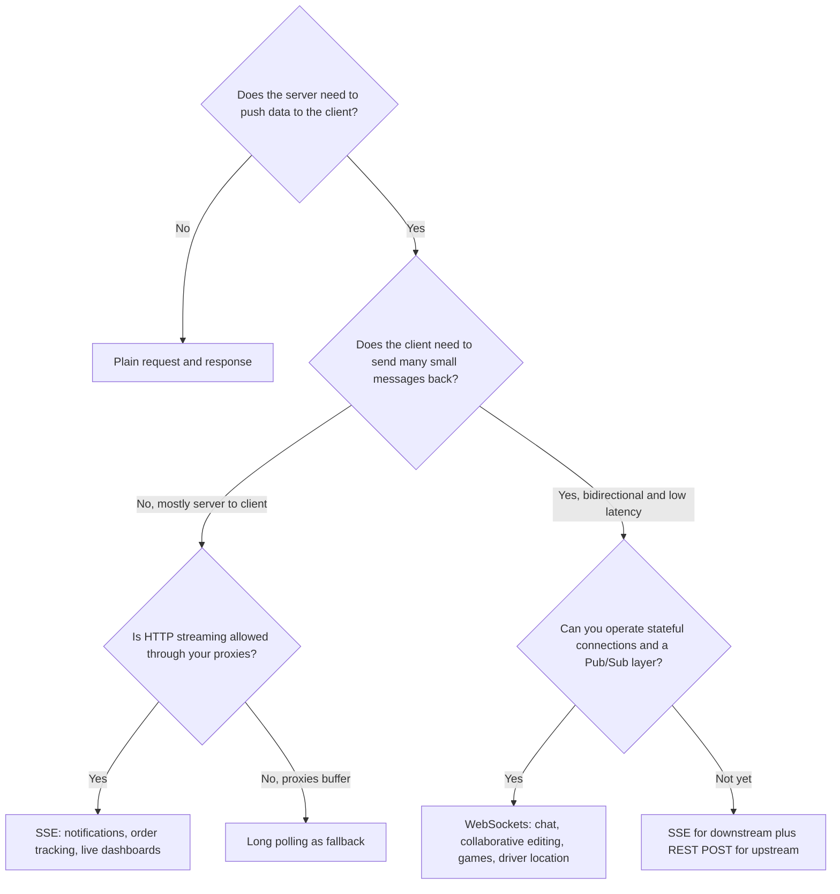
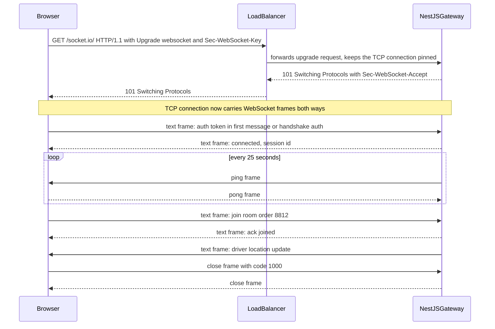

# Part 35 — Real-Time Systems: WebSockets, SSE and Pub/Sub

## 35.1 Choosing a real-time transport

HTTP was built for a client that asks and a server that answers. Real-time features invert that: the server has something to say and the client is waiting. A driver moved 200 metres, a payment was captured, a colleague typed a character. This part is about how to push those facts to thousands of connected clients from a NestJS backend, keep the connections alive, survive restarts, and not lose or duplicate messages while doing it.

### 35.1.1 WebSockets, SSE, long polling and polling compared

#### Concept

There are four mainstream ways to get server-originated data to a browser or mobile client:

- **Polling**: the client asks every N seconds. Simple, wasteful, delayed by up to N seconds.
- **Long polling**: the client asks, and the server holds the request open until it has something to say or a timeout passes. Then the client immediately asks again.
- **Server-Sent Events (SSE)**: one long-lived HTTP response that the server keeps writing to. One direction only: server to client.
- **WebSockets**: a TCP connection that starts as HTTP, upgrades to a bidirectional message protocol, and stays open. Either side can send at any time.

#### Why does it exist?

Each transport exists because the previous one was not enough for some use case. Polling is fine for a dashboard that refreshes every 30 seconds. It is useless for chat, where a 30 second delay is a broken product and a 1 second poll from 100,000 clients is 100,000 requests per second to serve mostly "nothing new". Long polling fixes the latency but still pays for a full HTTP request per message. SSE removes the per-message HTTP cost but cannot carry client-to-server messages. WebSockets remove every limitation at the price of a stateful connection you must manage.

#### Mental model

Imagine waiting for a parcel. Polling is walking to the door every five minutes to check. Long polling is standing at the door until the courier arrives or your legs give out, then standing again. SSE is a delivery slot under the door: parcels arrive without you doing anything, but you cannot send anything back through it. WebSockets is a phone call with the courier: either of you can talk whenever you want, as long as the line stays up.

#### How it works



The decision table a senior engineer keeps in their head:

| | Polling | Long polling | SSE | WebSockets |
|---|---|---|---|---|
| Direction | Client to server, server replies | Same, but replies are delayed until data exists | Server to client only | Both directions |
| Protocol | HTTP | HTTP | HTTP, `text/event-stream` | HTTP upgrade then `ws://` or `wss://` framing |
| Browser support | Universal | Universal | All modern browsers via `EventSource` | All modern browsers via `WebSocket` |
| Passes through proxies and load balancers | Always | Always, if timeouts are long enough | Usually; some proxies buffer the response | Needs explicit upgrade support and long idle timeouts |
| Auto-reconnect | You write it | You write it | Built into `EventSource`, with `Last-Event-ID` | You write it, or Socket.IO does |
| Connection cost | One request per poll | One open request per client | One open response per client | One TCP connection per client |
| Latency of a push | Up to the poll interval | Near zero while a poll is pending | Near zero | Near zero |
| Scaling shape | Stateless; scales like REST | Stateful while held; needs Pub/Sub to wake waiters | Stateful; needs Pub/Sub for fan-out | Stateful; needs Pub/Sub for fan-out |
| Connections per domain in the browser | Not a concern | HTTP/1.1 limit of 6 per host bites | HTTP/1.1 limit of 6 per host bites; fine on HTTP/2 | No practical per-host limit |
| Binary payloads | Yes | Yes | No, text only | Yes, native binary frames |
| Best for | Slow dashboards, admin screens | Fallback when nothing else works | Notifications, order status, price tickers, progress bars, log tails | Chat, presence, collaborative editing, multiplayer, high-frequency telemetry |

Two things people forget. First, **SSE is a normal HTTP response**, so everything you already have for REST works: cookies, JWT in headers, the same guards, the same load balancer, HTTP/2 multiplexing. Second, **WebSockets are not HTTP after the handshake**, so your interceptors, your API gateway's rate limiter and your CDN's rules may not apply. That difference is why SSE is the right default for "server pushes updates" and WebSockets are the right choice only when the client genuinely needs to talk back at high frequency.

#### Practical example

A food-delivery app has three real-time features. Order status for the customer ("preparing", "on the way", "delivered") is server-to-client, a few messages per order, and must survive a flaky mobile network: SSE. The driver's location on the map is server-to-client at 1 message per 2 seconds: SSE works, WebSockets work equally well. The in-app chat between customer and driver is bidirectional with typing indicators: WebSockets. Most teams pick one transport for all three (usually WebSockets via Socket.IO) to avoid running two systems, and that is a reasonable engineering trade as long as they understand that they took on connection state management for a feature that did not require it.

#### How a Senior Backend Engineer thinks about this

They ask "who initiates?" before anything else. If only the server initiates, they reach for SSE and keep the stateless REST path for client actions, because a `POST /orders/:id/messages` that goes through the usual guards, validation and rate limiting is simpler to secure than a WebSocket message handler. They pick WebSockets when a product needs sub-100 ms bidirectional traffic or binary payloads, and they accept the operational cost consciously. They refuse to add a WebSocket server to a monolith that has no Pub/Sub layer, because the first time it runs on two pods the messages stop arriving.

## 35.2 WebSockets

### 35.2.1 The upgrade handshake, frames and ping/pong

#### Concept

A WebSocket connection starts as an ordinary HTTP GET with an `Upgrade: websocket` header. If the server agrees, it replies `101 Switching Protocols`, and from that moment the TCP connection carries WebSocket **frames** instead of HTTP. A frame has a small header (2 to 14 bytes) with an opcode (text, binary, close, ping, pong), a payload length and, for client-to-server frames, a masking key. Messages can be split across frames. Ping and pong frames are the protocol's built-in heartbeat.

#### Why does it exist?

Before WebSockets, bidirectional real-time in the browser meant hacks: hidden iframes, long polling, Flash sockets. The upgrade handshake exists so a WebSocket can reuse port 443, pass through TLS and look like HTTP to firewalls for its first packet, and then become a lean framed protocol with 2 bytes of overhead per message instead of 500 bytes of HTTP headers.

#### How it works



1. The client sends `GET` with `Connection: Upgrade`, `Upgrade: websocket`, `Sec-WebSocket-Version: 13` and a random `Sec-WebSocket-Key`.
2. The server hashes the key with a fixed GUID, base64-encodes it and returns it as `Sec-WebSocket-Accept`. This proves the server understood the upgrade and prevents a caching proxy from replaying an old response.
3. Both sides now exchange frames. Text frames carry UTF-8, typically JSON; binary frames carry bytes, typically MessagePack or Protobuf.
4. Either side may send a ping; the other must answer with a pong carrying the same payload. Libraries do this for you: Socket.IO sends a ping every 25 seconds (`pingInterval`) and drops the connection if no pong arrives within 20 seconds (`pingTimeout`). The `ws` library exposes `socket.ping()` and a `pong` event and leaves the schedule to you.
5. A close frame carries a status code (1000 normal, 1001 going away, 1008 policy violation, 1011 server error) and an optional reason. A clean close is a two-way exchange; a TCP reset is not, and detection then depends on the heartbeat.

**Message formats.** Raw WebSockets give you frames with no structure; you design the envelope. A common one is `{ "type": "order.status", "id": 1842, "data": { ... } }` where `id` is a monotonically increasing sequence number per stream (used for gap detection in 35.10). Socket.IO adds its own layer on top: named events, acknowledgements, rooms, namespaces and automatic fallback to long polling, at the cost of a Socket.IO-specific protocol that plain `WebSocket` clients cannot speak. Choose Socket.IO when the clients are yours (web and mobile SDKs exist) and you want rooms and acks; choose raw `ws` when third parties connect or you need every byte.

### 35.2.2 Authentication and authorization on WebSockets

#### Concept

A WebSocket connection is authenticated once, at connect time, and then trusted for its lifetime. There is no per-message `Authorization` header. That single fact drives every design decision here.

#### How it works

Three places to put the credential:

| Method | How | Pros | Cons |
|---|---|---|---|
| Cookie | The browser sends cookies on the upgrade request | Works with existing session auth; not visible to JavaScript if `HttpOnly` | CSRF-like risk: any site can open a WebSocket to your origin and the cookie goes along, so you must check `Origin` |
| Query string or handshake auth | `io(url, { auth: { token } })` puts the token in the handshake payload; raw `ws` clients often use `?token=` | Works for mobile and non-browser clients | Query strings end up in proxy and access logs; prefer the Socket.IO `auth` object or a header when the client can set one |
| First message | Connect unauthenticated, send `{ type: "auth", token }` within 5 seconds or be disconnected | Keeps tokens out of URLs | The server must hold an unauthenticated connection briefly; needs a timeout |

Authorization is a second, separate step. "This is user 41" does not mean "user 41 may join room `order:8812`". Every `join` is checked against the database or a cached ownership record, and every server-side emit goes to a room, never to "everyone who asked".

#### NestJS example

`@nestjs/websockets` with `@nestjs/platform-socket.io` gives you a gateway class: a provider that owns a Socket.IO namespace, with decorated handlers for events. Guards work on gateways, but they run on message handlers, not on the connection itself, so connection auth lives in `handleConnection`.

```ts
// realtime/orders.gateway.ts
import {
  ConnectedSocket, MessageBody, OnGatewayConnection, OnGatewayDisconnect,
  SubscribeMessage, WebSocketGateway, WebSocketServer, WsException,
} from '@nestjs/websockets';
import { UseGuards, UsePipes, ValidationPipe, Logger } from '@nestjs/common';
import { Server, Socket } from 'socket.io';
import { JwtService } from '@nestjs/jwt';
import { WsAuthGuard } from './ws-auth.guard';
import { JoinOrderDto } from './dto/join-order.dto';

@WebSocketGateway({
  namespace: '/orders',
  cors: { origin: ['https://app.example.com'], credentials: true },
  pingInterval: 25_000,
  pingTimeout: 20_000,
  maxHttpBufferSize: 64 * 1024,   // reject any single message over 64 KB
})
export class OrdersGateway implements OnGatewayConnection, OnGatewayDisconnect {
  @WebSocketServer() server: Server;
  private readonly log = new Logger(OrdersGateway.name);

  constructor(private readonly jwt: JwtService, private readonly orders: OrdersAccessService) {}

  async handleConnection(client: Socket) {
    try {
      // Socket.IO clients send { auth: { token } } in the handshake; never read it from the query string.
      const token = client.handshake.auth?.token as string | undefined;
      if (!token) throw new Error('missing token');
      const payload = await this.jwt.verifyAsync<{ sub: string; exp: number }>(token);
      client.data.userId = payload.sub;
      client.data.tokenExp = payload.exp * 1000;
      client.join(`user:${payload.sub}`);        // personal room for notifications
    } catch (err) {
      this.log.warn({ err: (err as Error).message, ip: client.handshake.address }, 'ws auth failed');
      client.emit('error', { code: 'UNAUTHORIZED' });
      client.disconnect(true);                   // close the socket, do not keep an unauthenticated peer
    }
  }

  handleDisconnect(client: Socket) {
    this.log.debug({ userId: client.data.userId, reason: client.disconnected }, 'ws disconnected');
  }

  @UseGuards(WsAuthGuard)
  @UsePipes(new ValidationPipe({ whitelist: true }))
  @SubscribeMessage('order.join')
  async joinOrder(@ConnectedSocket() client: Socket, @MessageBody() dto: JoinOrderDto) {
    // Authorization per room: only the customer or the assigned driver may watch this order.
    const allowed = await this.orders.canView(client.data.userId, dto.orderId);
    if (!allowed) throw new WsException('FORBIDDEN');
    await client.join(`order:${dto.orderId}`);
    // Returning a value sends it as the acknowledgement if the client passed a callback.
    return { ok: true, room: `order:${dto.orderId}` };
  }

  @UseGuards(WsAuthGuard)
  @SubscribeMessage('order.leave')
  async leaveOrder(@ConnectedSocket() client: Socket, @MessageBody() dto: JoinOrderDto) {
    await client.leave(`order:${dto.orderId}`);
    return { ok: true };
  }
}
```

The guard for message handlers reads the user the connection handler stored and rejects expired tokens, which matters because a connection can outlive its token (see 35.15).

```ts
// realtime/ws-auth.guard.ts
import { CanActivate, ExecutionContext, Injectable } from '@nestjs/common';
import { WsException } from '@nestjs/websockets';
import { Socket } from 'socket.io';

@Injectable()
export class WsAuthGuard implements CanActivate {
  canActivate(ctx: ExecutionContext): boolean {
    const client = ctx.switchToWs().getClient<Socket>();
    if (!client.data.userId) throw new WsException('UNAUTHORIZED');
    if (client.data.tokenExp && Date.now() > client.data.tokenExp) {
      client.emit('auth.expired');            // tell the client to refresh and reconnect
      client.disconnect(true);
      throw new WsException('TOKEN_EXPIRED');
    }
    return true;
  }
}

// realtime/dto/join-order.dto.ts
import { IsUUID } from 'class-validator';
export class JoinOrderDto {
  @IsUUID() orderId: string;
}
```

Emitting from anywhere else in the application goes through the gateway's `server` reference and always targets a room:

```ts
// realtime/order-events.publisher.ts
@Injectable()
export class OrderEventsPublisher {
  constructor(private readonly gateway: OrdersGateway) {}

  statusChanged(orderId: string, status: string, seq: number) {
    // Every payload carries a sequence number so clients can detect gaps after a reconnect.
    this.gateway.server.to(`order:${orderId}`).emit('order.status', { orderId, status, seq, at: Date.now() });
  }
}
```

**Rooms and namespaces.** A namespace (`/orders`, `/chat`) is a logical channel with its own handlers and middleware over the same physical connection. A room is a named set of sockets inside a namespace; sockets join and leave freely, and emitting to a room fans out to every member. Rooms are the unit of authorization and the unit of fan-out: `order:8812`, `user:41`, `restaurant:77`. They exist in memory on the pod that holds the socket, which is why multi-pod deployments need the Redis adapter from 35.5.

**Acknowledgements.** A Socket.IO client can pass a callback as the last argument to `emit`; the server's return value from the `@SubscribeMessage` handler is delivered to that callback. Use acks for anything the client must know succeeded (joining a room, sending a chat message) and add a client-side timeout, because an ack never arrives if the pod restarts mid-handler.

If you prefer the lighter `ws` library, `@nestjs/platform-ws` provides `WsAdapter`; you lose rooms, namespaces and acks and gain a smaller protocol and lower per-connection memory. The gateway decorators are the same.

#### Production scenario

A gateway service with 8 pods, each holding 25,000 Socket.IO connections. Handshake rate during the evening peak is 400 per second, each verifying a JWT (about 0.1 ms of CPU) and one Redis lookup for the ownership cache (0.3 ms). Message rate is 6,000 outbound per second across the fleet, mostly location updates of 180 bytes each. CPU per pod sits at 30 to 40 percent of one core, almost entirely JSON serialization and socket writes; memory is about 20 KB per connection in Node.js plus kernel socket buffers, so 25,000 connections cost roughly 500 MB heap plus 200 MB of socket buffers.

#### Failure scenario

At 19:40, a developer ships a gateway change that reads the token from `client.handshake.query.token` "for the mobile app". The API gateway's access logs now contain every user's JWT in the URL. The logs ship to a third-party log vendor with 30 day retention. Security finds it in a routine scan a week later; every token has to be revoked and every user signed out. The rule that came out of the incident: tokens live in the Socket.IO `auth` object or an `Authorization` header, and the load balancer's log format strips query strings on upgrade requests.

#### Edge cases & failure modes

- A client connects, never authenticates and never sends anything; without a timeout the socket sits forever. Disconnect unauthenticated sockets after 5 seconds.
- A valid token for a deleted or banned user still connects if you only verify the signature. Check a revocation list or the user's status on connect and on a periodic re-check.
- `client.join` is asynchronous with the Redis adapter; emitting to the room in the same tick can miss the joining socket. `await` it.
- An exception thrown inside `handleConnection` does not automatically disconnect the socket; catch and `disconnect(true)` explicitly.
- Payloads over `maxHttpBufferSize` disconnect the client; choose the limit deliberately and tell the client team.

#### Common mistakes

- Trusting `Origin` implicitly. Configure `cors.origin` to the exact list; a wildcard with credentials is a cross-site WebSocket hijack waiting to happen.
- Emitting to `this.server.emit(...)` (everyone) because it was easier than rooms. Every customer sees every order.
- Doing database writes inside message handlers without the same validation, transactions and idempotency you would use in a REST controller.

## 35.3 Server-Sent Events

### 35.3.1 One-way streaming over plain HTTP

#### Concept

SSE is a response that never ends. The server sets `Content-Type: text/event-stream`, keeps the connection open, and writes events as small text blocks: `id: 42`, `event: order.status`, `data: {...}`, then a blank line. The browser's `EventSource` parses them, fires `onmessage` or a named listener, and, if the connection drops, reconnects automatically and sends the last id it saw in a `Last-Event-ID` header so the server can resume.

#### Why does it exist?

Most real-time features are one-way. Notifications, order status, price tickers, build logs, progress bars. Running a WebSocket infrastructure for those means paying for bidirectional connection management you never use. SSE gives you push over HTTP with everything HTTP already has: TLS, HTTP/2 multiplexing, cookies, the same guards and interceptors, the same load balancer rules, and a client that reconnects itself.

#### Mental model

Imagine a stock ticker tape machine in an old trading office. A paper strip comes out continuously; each printed line is an event. If the machine jams, you tear off the tape, note the last number printed, and ask the exchange to resend from there. You never type into the ticker.

#### How it works

1. The client opens `new EventSource('/orders/8812/events')`, with cookies, or with a token via a small polyfill that allows custom headers (the native `EventSource` cannot set headers, which pushes browser auth towards cookies).
2. The server responds `200` with `Content-Type: text/event-stream`, `Cache-Control: no-cache`, `Connection: keep-alive`, and for nginx, `X-Accel-Buffering: no` so the proxy does not hold the response until it is "complete".
3. Each event is written as text. `id:` sets the value the browser will send back as `Last-Event-ID`. `retry:` tells the browser how many milliseconds to wait before reconnecting.
4. The server writes a comment line (`: keepalive`) every 15 to 30 seconds so intermediaries do not close an idle connection.
5. On disconnect, the browser waits `retry` ms (default about 3 seconds), reconnects with `Last-Event-ID`, and the server replays anything after that id from its buffer (Redis Stream, database, or in-memory ring).

#### NestJS example

NestJS supports SSE with the `@Sse()` decorator on a controller method that returns an RxJS `Observable<MessageEvent>`. Each emitted `MessageEvent` (from `@nestjs/common`) becomes one event on the wire.

```ts
// orders/order-events.controller.ts
import { Controller, Headers, MessageEvent, Param, Sse, UseGuards, ParseUUIDPipe } from '@nestjs/common';
import { Observable, merge, interval, map, filter, from, concatWith } from 'rxjs';
import { JwtAuthGuard } from '../auth/jwt-auth.guard';
import { OrderOwnerGuard } from './order-owner.guard';
import { OrderEventStream } from './order-event.stream';

@Controller('orders')
export class OrderEventsController {
  constructor(private readonly stream: OrderEventStream) {}

  @UseGuards(JwtAuthGuard, OrderOwnerGuard)          // the same guards as REST
  @Sse(':id/events')
  events(
    @Param('id', ParseUUIDPipe) orderId: string,
    @Headers('last-event-id') lastEventId?: string,   // the browser sends this on reconnect
  ): Observable<MessageEvent> {
    // 1. Replay anything the client missed, from the Redis Stream for this order.
    const replay$ = from(this.stream.replaySince(orderId, lastEventId ?? '0')).pipe(
      map((ev) => this.toMessage(ev)),
    );
    // 2. Then live events published for this order.
    const live$ = this.stream.subscribe(orderId).pipe(map((ev) => this.toMessage(ev)));
    // 3. Keepalive comments so proxies and mobile networks do not close the idle connection.
    const keepalive$ = interval(20_000).pipe(map(() => ({ type: 'keepalive', data: '' }) as MessageEvent));
    return replay$.pipe(concatWith(merge(live$, keepalive$)));
  }

  private toMessage(ev: { id: string; type: string; payload: unknown }): MessageEvent {
    return { id: ev.id, type: ev.type, data: ev.payload, retry: 3_000 };
  }
}
```

`OrderEventStream` wraps a Redis Stream per order: `XADD order:8812 MAXLEN ~ 500 * type order.status payload {...}` on publish, `XRANGE order:8812 (lastId +` for replay, and a Redis Pub/Sub or `XREAD BLOCK` loop for live events. The Redis Stream id (`1725630131483-0`) doubles as the SSE `id`, so `Last-Event-ID` maps directly to `XRANGE`.

The response headers NestJS sets for `@Sse()` are correct out of the box; add the nginx header with an interceptor or at the ingress:

```yaml
# ingress annotation for nginx: do not buffer streaming responses, keep long connections
nginx.ingress.kubernetes.io/proxy-buffering: "off"
nginx.ingress.kubernetes.io/proxy-read-timeout: "3600"
```

#### Production scenario

An order tracking page opened by 40,000 customers during the dinner peak, each holding one SSE connection for the 30 to 45 minutes of a delivery. With HTTP/2, all of a customer's streams share one TCP connection. Each connection costs about 8 KB in Node.js (less than a Socket.IO socket, because there is no protocol state) and the fleet emits 5 events per order on average, so the total message rate is tiny; the cost is entirely in holding 40,000 open responses, which 3 pods handle comfortably. The 30 day p99 for "status change visible to the customer" is 180 ms, dominated by Kafka consumer latency, not by SSE.

#### Failure scenario

At 12:05 the platform team upgrades the ingress controller. The new config enables response buffering by default. SSE connections open fine, but customers see no events until the server closes the connection, because nginx is waiting for the "complete" response before forwarding it. Nothing errors; the order tracking page simply stops updating. The on-call notices only when support tickets arrive. The fix is the `proxy-buffering: "off"` annotation on the SSE route, and the lesson is a synthetic check that opens an SSE stream and asserts an event arrives within 30 seconds.

#### Edge cases & failure modes

- **Browser connection limits.** On HTTP/1.1, browsers allow about 6 connections per host. Six SSE tabs and the seventh request to the same host hangs. HTTP/2 removes the limit; if you cannot use HTTP/2, share one stream per origin via a `SharedWorker` or `BroadcastChannel`.
- **Proxies buffering.** nginx, some CDNs and some corporate proxies buffer or refuse `text/event-stream`. Send a 2 KB padding comment at the start for old proxies, set `X-Accel-Buffering: no`, and test through the real ingress.
- **No custom headers in `EventSource`.** Browser auth must be cookies or a query token; mobile clients using a raw HTTP client can send `Authorization`.
- **Replay without bounds.** A client reconnecting with a `Last-Event-ID` from a week ago asks for everything since; cap replay to the stream's `MAXLEN` and tell the client to refetch state via REST if the id is older than the buffer.
- **Event loop blocking on a slow client.** `res.write` returns `false` when the socket buffer is full; the Observable keeps emitting. A slow client on a tiny mobile link can accumulate memory in Node.js. Track `res.writableLength` or drop the connection when it exceeds a limit.
- **Text only.** Binary data must be base64 encoded, a 33 percent size penalty.

#### How a Senior Backend Engineer thinks about this

They choose SSE for every server-to-client feature until a product requirement forces bidirectional traffic, because it reuses the entire HTTP stack and the client reconnects itself. They put the replay buffer in Redis Streams, never in pod memory, so a reconnect to a different pod still resumes. They treat the ingress config as part of the feature and add a synthetic SSE check to the uptime monitor.

## 35.4 Long polling

### 35.4.1 How it works and why it is only a fallback

#### Concept

The client sends `GET /orders/8812/events?since=42`. The server checks for events after 42. If there are any, it responds immediately. If not, it holds the request open, up to a timeout (typically 20 to 30 seconds, under the load balancer's idle limit), responding as soon as an event arrives or with an empty `204` at the timeout. The client immediately sends the next request. The client never waits more than one round trip to learn about an event, but every event costs a full HTTP request and response.

#### Why does it exist?

Because some network paths break everything else. A corporate proxy that strips `Upgrade` headers, a mobile carrier that buffers streaming responses, an old embedded browser. Socket.IO starts with long polling and upgrades to WebSocket exactly because long polling works everywhere.

#### How it works in NestJS

```ts
// orders/order-poll.controller.ts
@Controller('orders')
export class OrderPollController {
  constructor(private readonly stream: OrderEventStream) {}

  @UseGuards(JwtAuthGuard, OrderOwnerGuard)
  @Get(':id/events/poll')
  async poll(
    @Param('id', ParseUUIDPipe) orderId: string,
    @Query('since') since = '0',
    @Res({ passthrough: true }) res: Response,
  ) {
    const events = await this.stream.replaySince(orderId, since);
    if (events.length > 0) return { events };
    // Nothing yet: wait for the first event or the timeout, whichever comes first.
    const next = await this.stream.waitForNext(orderId, 25_000);   // resolves null on timeout
    if (!next) { res.status(204); return; }
    return { events: [next] };
  }
}
```

`waitForNext` subscribes to the Redis Pub/Sub channel for the order and resolves on the first message or a timer. Keep the timeout below the load balancer's idle timeout (60 seconds on an AWS ALB by default) or the balancer closes the request first and the client sees an error instead of a `204`.

#### Edge cases & failure modes

- Every waiting request holds a Node.js promise and a Redis subscription; 50,000 clients polling is 50,000 pending handlers, the same memory as WebSockets plus a request object each.
- The gap between one poll's response and the next poll's arrival is a window where events must be buffered server-side, which is why `since` exists. Without it, events in the gap are lost.
- HTTP/1.1 connection limits apply; a page with three long polls to the same host has three of its six connections permanently busy.

#### How a Senior Backend Engineer thinks about this

They never design for long polling; they design for SSE or WebSockets with a `since` or `Last-Event-ID` resume contract, and long polling falls out of that same contract as a fallback. If a product asks "just poll every 2 seconds", they do the arithmetic aloud: 100,000 clients at 0.5 requests per second is 50,000 RPS of mostly-empty responses, which costs more than the entire real-time stack.

#### Interview questions

1. *When would you choose SSE over WebSockets?* Expected: server-to-client only, wants HTTP stack reuse, built-in reconnect with `Last-Event-ID`; WebSockets when bidirectional or binary. Follow-up: how do you handle client actions with SSE? (REST POST.)
2. *Walk through the WebSocket upgrade handshake.* Expected: GET with `Upgrade` and `Sec-WebSocket-Key`, 101 with `Sec-WebSocket-Accept`, then frames; why the key exists.
3. *How do you authenticate a WebSocket connection, and why is it different from REST?* Expected: once at connect, via handshake auth or cookie with `Origin` check; no per-message headers; must handle token expiry mid-connection.
4. *What breaks SSE in production?* Expected: proxy buffering, HTTP/1.1 connection limits, no custom headers in `EventSource`, unbounded replay.
5. *Why does Socket.IO start with long polling?* Expected: works through every proxy; upgrades opportunistically.
6. *Where does room authorization happen and why is it separate from authentication?* Expected: on every join, against ownership; identity is not permission.

#### Practical exercise

Build both transports for order tracking:

1. A NestJS `OrdersGateway` on namespace `/orders` with handshake JWT auth, `order.join` with ownership check and ack, and `order.status` emits to `order:{id}` rooms with a sequence number.
2. An `@Sse(':id/events')` endpoint on the same service, with replay from a Redis Stream via `Last-Event-ID` and a 20 second keepalive comment.
3. A long-poll fallback endpoint with `since` and a 25 second server timeout.
4. Acceptance: a browser client on the WebSocket path receives status updates within 100 ms of a `PATCH /orders/:id/status`; killing the SSE client mid-stream and reconnecting delivers exactly the missed events and no duplicates; an unauthenticated WebSocket is disconnected within 5 seconds; a user who does not own the order receives `FORBIDDEN` on join; running the SSE endpoint through a local nginx with buffering enabled fails your synthetic check and passes with buffering off.
