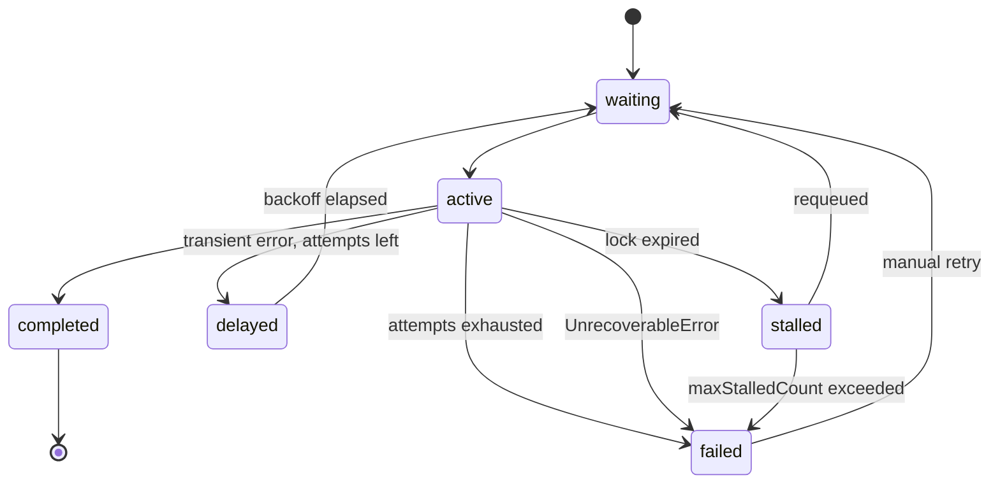
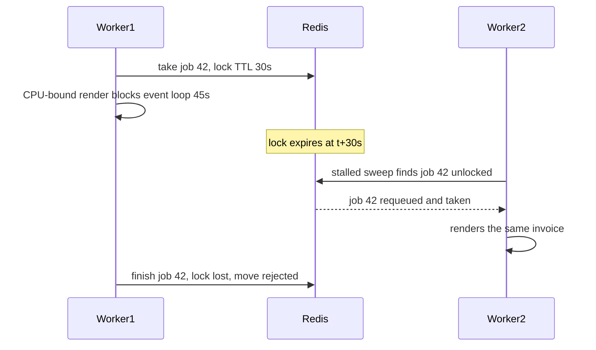
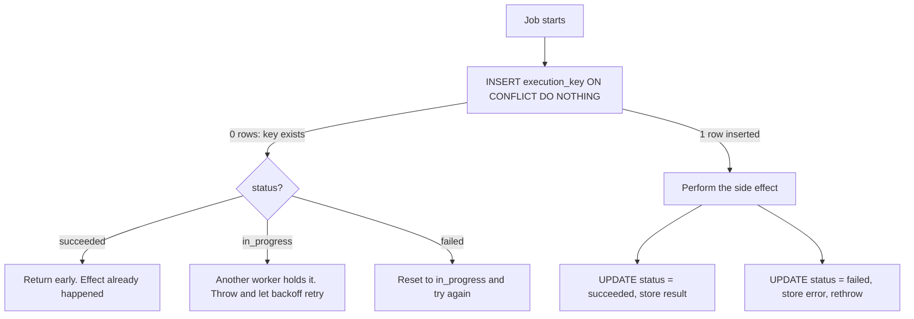

## 35.6 Retries and error classification

### 35.6.1 Not all errors deserve a retry

#### Concept

A retry is a bet that the failure was **temporary**. If the failure is permanent, retrying is pure waste: it burns worker capacity, fills your logs, hammers a dependency that is already unhappy, and delays every other job in the queue. Classifying errors correctly is the difference between a queue that heals itself and a queue that amplifies an outage.

Three classes:

| Class | Examples | What to do |
|---|---|---|
| **Transient** | `ECONNRESET`, `ETIMEDOUT`, HTTP 502/503/504, HTTP 429, PostgreSQL `40001` serialization failure, `40P01` deadlock, Redis `LOADING` | Retry with exponential backoff and jitter |
| **Permanent** | HTTP 400/404/422, validation failure, "order does not exist", unknown job name, foreign key violation on a row that was deleted | Do not retry. Fail immediately to the dead-letter queue |
| **Poison** | The payload itself crashes the handler: a malformed JSON blob, a 400 MB image, an infinite loop in a template | Do not retry. Quarantine and alert. Retrying will take the worker down again |

The third class is the one people forget, and it is the one that causes a total queue stall.

#### Why does it exist?

Because "retry 5 times with backoff" applied uniformly produces two opposite pathologies. Applied to permanent errors, it multiplies your error rate by five and delays the real work. Applied too aggressively to a struggling dependency, it produces a **retry storm**: the dependency is slow, so requests time out, so every job retries, so load triples, so the dependency dies completely. You did that. Your retry policy did that.

#### Mental model

Imagine knocking on a door. Nobody answers — maybe they are in the shower, so knocking again in a minute is sensible (transient). The house has been demolished — knocking a hundred times will not rebuild it (permanent). The door is wired to an alarm that shocks you unconscious — knocking again is how you end up in hospital twice (poison).

#### How it works

BullMQ increments `attemptsMade`, computes the backoff, and moves the job to `delayed` until the next attempt. When `attemptsMade` reaches `attempts`, the job moves to `failed` and stays there — that set *is* your dead-letter queue.

`UnrecoverableError` short-circuits the whole thing: throwing it moves the job straight to `failed` regardless of remaining attempts.



#### NestJS example

Classification belongs in one place, not scattered through handlers.

```ts
// jobs/error-classifier.ts
import { UnrecoverableError } from 'bullmq';
import { AxiosError } from 'axios';

const TRANSIENT_NET = new Set([
  'ECONNRESET', 'ECONNREFUSED', 'ETIMEDOUT', 'EAI_AGAIN', 'EPIPE', 'ENETUNREACH',
]);
const TRANSIENT_PG = new Set([
  '40001', // serialization_failure
  '40P01', // deadlock_detected
  '55P03', // lock_not_available
  '57P01', // admin_shutdown (failover)
  '53300', // too_many_connections
]);

export function isTransient(err: unknown): boolean {
  const e = err as NodeJS.ErrnoException & AxiosError & { code?: string };

  if (e?.code && TRANSIENT_NET.has(e.code)) return true;
  if (e?.code && TRANSIENT_PG.has(e.code)) return true;

  const status = e?.response?.status;
  if (status === 429) return true;              // rate limited: back off, definitely retry
  if (status && status >= 500) return true;     // their problem, probably temporary
  if (status && status >= 400) return false;    // our problem, retrying changes nothing

  return false; // default to NOT retrying: an unknown error retried 5x is 5x the noise
}

/** Convert a classified error into the shape BullMQ understands. */
export function toJobError(err: unknown): Error {
  if (isTransient(err)) return err as Error;    // let BullMQ retry
  const e = err as Error;
  const wrapped = new UnrecoverableError(`${e.name}: ${e.message}`);
  wrapped.cause = e;                            // keep the original stack for the DLQ
  return wrapped;
}
```

Note the default: **unknown errors do not retry**. That is a deliberate, slightly controversial choice. The alternative default (retry everything unknown) is friendlier to transient bugs and much less friendly to your log bill and your dependencies. Whichever you pick, pick it consciously and write it in the code as a comment, because the next engineer will wonder.

```ts
// integrations/warehouse.processor.ts
@Processor('integrations', { concurrency: 20, limiter: { max: 40, duration: 1_000 } })
export class WarehouseProcessor extends WorkerHost {
  async process(job: Job<{ orderId: string }>) {
    try {
      const order = await this.orders.findOne(job.data.orderId);
      if (!order) throw new UnrecoverableError(`order ${job.data.orderId} not found`);

      return await this.warehouse.pushOrder(order, {
        // The third party's idempotency key. Same key on every retry.
        idempotencyKey: `wh:${order.id}`,
        timeoutMs: 8_000,
      });
    } catch (err) {
      throw toJobError(err);
    }
  }
}
```

### 35.6.2 Backoff and jitter

Exponential backoff spreads retries out over time so a struggling dependency gets breathing room. `{ type: 'exponential', delay: 2000 }` gives 2 s, 4 s, 8 s, 16 s, 32 s.

The problem: if a dependency is down for 30 seconds and 4,000 jobs fail at the same moment, all 4,000 retry at exactly 2 s, then all 4,000 at 4 s. You have built a synchronized hammer. That is the **thundering herd**, and it is why every backoff needs **jitter**.

BullMQ lets you register custom backoff strategies on the worker:

```ts
// queues/backoff.ts
import { BullRootModuleOptions } from '@nestjs/bullmq';

export const jitteredExponential = (attemptsMade: number): number => {
  const base = 2_000;
  const cap = 5 * 60_000;                       // never wait more than 5 minutes
  const exp = Math.min(cap, base * 2 ** (attemptsMade - 1));
  // Full jitter: uniform in [0, exp). Spreads a synchronized herd across the window.
  return Math.floor(Math.random() * exp);
};
```

```ts
@Processor('integrations', {
  concurrency: 20,
  settings: {
    backoffStrategy: (attemptsMade: number) => jitteredExponential(attemptsMade),
  },
})
export class WarehouseProcessor extends WorkerHost { /* ... */ }
```

Then use `backoff: { type: 'custom' }` in the job options.

Two refinements worth knowing:

- **Honour `Retry-After`.** If a 429 or 503 carries `Retry-After: 120`, waiting 120 seconds is strictly better than guessing. Read the header, and use `job.moveToDelayed(Date.now() + seconds * 1000, token)` with a `DelayedError` so the attempt is not consumed.
- **Cap total retry time, not just attempt count.** Five attempts with exponential backoff from 30 s is about 15 minutes of trying. For a webhook delivery you may want 24 hours of trying with 12 attempts; for a "your OTP is 4821" SMS you want 2 attempts over 10 seconds, because a late OTP is worse than no OTP.

| Job type | attempts | base delay | Total window | Why |
|---|---|---|---|---|
| OTP SMS | 2 | 2 s | ~5 s | Useless if late |
| Order confirmation email | 5 | 5 s | ~8 min | Should arrive fast, tolerates a blip |
| Partner webhook delivery | 12 | 10 s, capped 1 h | ~24 h | Partners have long outages |
| Warehouse sync | 8 | 10 s, capped 15 min | ~2 h | Their maintenance windows are ~1 h |
| Nightly settlement | 1 | n/a | n/a | A human must decide to re-run |

### 35.6.3 Every retried job must be idempotent

This is not a guideline; it is the entry ticket. **The moment you set `attempts > 1`, you have promised that running the handler twice is safe.**

You do not get to choose whether jobs run twice. Even with `attempts: 1`, a worker can be `SIGKILL`ed after sending the email but before reporting completion, and the stalled-job mechanism will hand the job to another worker. At-least-once delivery is the only delivery guarantee any of these systems actually gives you. Exactly-once is a property of your *handler*, not of your queue.

Three levels of idempotency, cheapest first:

1. **Naturally idempotent.** `UPDATE orders SET status='expired' WHERE id=$1 AND status='awaiting_payment'` — running it twice changes nothing the second time. Prefer this. Design for it.
2. **Idempotency keys at the boundary.** Stripe, most payment gateways and well-built partner APIs accept an `Idempotency-Key` header and deduplicate server-side. Always send one, always derive it deterministically from the job (`refund:${orderId}:${attemptGroup}`), never from `Date.now()` or a fresh UUID.
3. **A local execution ledger.** When the side effect is with a partner who has no idempotency support (very common), record locally that you did it, in the same transaction as the business write. That is the `job_executions` table in 35.8.

## 35.7 Deduplication and job locking

### 35.7.1 Deterministic job ids

#### Concept

BullMQ ignores an `add()` whose `jobId` already exists in the queue. So if you can derive an id from the *meaning* of the work, duplicates collapse for free.

```ts
// The same order confirmation can be requested by an HTTP retry, an outbox sweep
// and a manual support action. All three produce the same id, so only one job exists.
await queue.add('order.confirmation', { v: 1, orderId }, { jobId: `confirm:${orderId}` });
```

#### The limits you must know

The dedupe is only as durable as the job record. Once the job completes and `removeOnComplete` deletes it, the id is free again and a new `add()` creates a new job. That is usually what you want (a job that already ran should be re-runnable), but it means `jobId` is **not** a permanent idempotency mechanism. It is a *debounce within the queue's retention window*.

Concretely:

- `removeOnComplete: true` — dedupe window is "while queued or running". Re-enqueueing 1 ms after completion creates a second job.
- `removeOnComplete: { age: 3600 }` — dedupe window is roughly one hour.
- A failed job stays in `failed`, so its id is still taken. Re-enqueueing the same id after a permanent failure **silently does nothing**. This surprises everyone once. If you need "retry after fixing the bug", you must remove the failed job first, or use `job.retry()`.

### 35.7.2 Debouncing repeated work

#### Practical example

A product's price changes seven times in ninety seconds because a merchant is dragging a slider. Each change fires `product.reindex`. Seven reindexes of the same product is six wasted Elasticsearch round trips, and the first six results are immediately stale.

The right behaviour is **debounce**: coalesce them into one job that runs shortly after the last change.

```ts
// search/reindex.service.ts
@Injectable()
export class ReindexService {
  constructor(@InjectQueue('search') private readonly queue: Queue) {}

  async scheduleReindex(productId: string): Promise<void> {
    const jobId = `reindex:${productId}`;
    const existing = await this.queue.getJob(jobId);

    // If a job is already waiting or delayed, push its run time out by 5 seconds.
    // If it is already active, leave it alone and add a follow-up.
    if (existing) {
      const state = await existing.getState();
      if (state === 'delayed' || state === 'waiting') {
        await existing.changeDelay(5_000);   // reset the debounce window
        return;
      }
      if (state === 'active') {
        // The running job will index a snapshot older than this change.
        // Queue exactly one follow-up, with a different id.
        await this.queue.add('product.reindex', { v: 1, productId },
          { jobId: `${jobId}:follow`, delay: 5_000 });
        return;
      }
    }

    await this.queue.add('product.reindex', { v: 1, productId },
      { jobId, delay: 5_000, attempts: 5, removeOnComplete: true });
  }
}
```

Seven slider drags become one reindex five seconds after the last one. Recent BullMQ versions also ship a first-class `deduplication: { id, ttl }` option that does the window-based part of this in Redis without the read-modify-write; use it if your version has it, but understand the mechanism above, because you will need the active-job case regardless.

The `active` branch is the subtle part. A job already running holds a snapshot from before your change. Skipping the follow-up means the index silently misses the last edit. This class of bug — "the search index is right 99 percent of the time" — is miserable to debug, so handle it explicitly.

### 35.7.3 Locks, stalled jobs, and why a job runs twice

#### Concept

When a BullMQ worker takes a job it sets a **lock** in Redis with a TTL of `lockDuration` (default 30 s) and renews it on a timer at roughly half that interval. If the lock expires without renewal, another worker's `stalledInterval` sweep (default every 30 s) notices an active job with no live lock, declares it **stalled**, and moves it back to `wait`.

That is the mechanism, and it is the honest answer to "can a job run twice?" — **yes**, in four situations:

1. The pod was `SIGKILL`ed (OOM, node failure, grace period exceeded) mid-job. The lock expires; another worker picks it up; the first worker had already sent the email.
2. The handler blocked the event loop for longer than `lockDuration`, so the renewal timer never fired. The worker is alive and still working, and a second worker starts the same job. Now you have two concurrent runs.
3. A network partition between the worker and Redis prevented renewal.
4. Redis failed over and lost the lock key (replication is asynchronous).



`maxStalledCount` (default 1) limits how many times a job may stall before it is failed outright, which stops an infinitely crash-looping job from cycling forever.

#### How to reduce the odds

- Set `lockDuration` above your p99 job duration for that queue. A 90-second PDF job under a 30-second lock stalls constantly.
- Never block the event loop (35.3.4). This is the single biggest cause.
- **Extend the lock explicitly for long jobs.** `process(job, token)` gives you the token; `job.extendLock(token, ms)` renews it. Call it from your own progress loop.

```ts
async process(job: Job<{ exportId: string }>, token?: string) {
  const rows = await this.repo.streamRows(job.data.exportId);
  let n = 0;
  for await (const row of rows) {
    await this.writer.write(row);
    if (++n % 5_000 === 0) {
      await job.updateProgress(n);              // visible in Bull Board
      if (token) await job.extendLock(token, 60_000); // I am alive, give me 60 more seconds
    }
  }
  return { rows: n };
}
```

- Accept that it can still happen and make the handler idempotent. Every mitigation above reduces probability; only idempotency reduces impact to zero.

### 35.7.4 PostgreSQL leases and heartbeats

The same problem exists in a PostgreSQL queue, and the solution has the same shape but is easier to inspect because it is rows you can `SELECT`.

```sql
CREATE TABLE job_queue (
  id            bigserial PRIMARY KEY,
  queue         text        NOT NULL,
  name          text        NOT NULL,
  payload       jsonb       NOT NULL,
  dedupe_key    text,                              -- deterministic id, optional
  run_at        timestamptz NOT NULL DEFAULT now(),
  attempts      int         NOT NULL DEFAULT 0,
  max_attempts  int         NOT NULL DEFAULT 5,
  status        text        NOT NULL DEFAULT 'ready',  -- ready|running|done|failed
  locked_until  timestamptz,
  locked_by     text,
  heartbeat_at  timestamptz,
  last_error    text,
  created_at    timestamptz NOT NULL DEFAULT now()
);

-- Only ready-and-due rows are ever scanned. A partial index keeps it tiny
-- even when the table has millions of completed rows.
CREATE INDEX idx_job_queue_ready
  ON job_queue (queue, run_at, id)
  WHERE status = 'ready';

-- Deduplication enforced by the database, not by application logic.
CREATE UNIQUE INDEX uq_job_queue_dedupe
  ON job_queue (queue, dedupe_key)
  WHERE dedupe_key IS NOT NULL AND status IN ('ready', 'running');
```

Claiming a batch:

```sql
-- SKIP LOCKED: concurrent workers never block each other; each gets a disjoint batch.
UPDATE job_queue j
SET status = 'running',
    locked_until = now() + interval '2 minutes',
    locked_by = $2,
    heartbeat_at = now(),
    attempts = attempts + 1
FROM (
  SELECT id
  FROM job_queue
  WHERE queue = $1
    AND (
      (status = 'ready'   AND run_at <= now()) OR
      (status = 'running' AND locked_until < now())   -- reclaim a dead worker's lease
    )
  ORDER BY run_at, id
  FOR UPDATE SKIP LOCKED
  LIMIT 20
) AS c
WHERE j.id = c.id
RETURNING j.id, j.name, j.payload, j.attempts, j.max_attempts;
```

`FOR UPDATE SKIP LOCKED` is the whole trick. Without it, twenty workers running this statement serialize on the same hot rows and your throughput collapses to one worker's worth. With it, PostgreSQL hands each worker a different set of rows and you scale close to linearly to a few thousand jobs per second — plenty for most systems, and far beyond what people assume a database queue can do.

The heartbeat, for long jobs:

```sql
-- Called every 30 seconds from the handler while it works.
UPDATE job_queue
SET heartbeat_at = now(), locked_until = now() + interval '2 minutes'
WHERE id = $1 AND locked_by = $2;
```

If that `UPDATE` reports zero rows, **someone else has taken your job**. The correct response is to stop immediately and not write anything, because a second worker is now doing this work. Checking the row count of your heartbeat is the closest thing to a fencing token you get in a simple queue, and it is worth the four lines.

## 35.8 Dead-letter queues and idempotent handlers

### 35.8.1 What a dead-letter queue is for

#### Concept

A **dead-letter queue** (DLQ) holds jobs that failed permanently: attempts exhausted, or an unrecoverable error. In BullMQ the `failed` set *is* the DLQ. In SQS and RabbitMQ it is a separate physical queue you configure. In a PostgreSQL queue it is `WHERE status = 'failed'`.

Its purpose is not storage. Its purpose is that **failure becomes visible and replayable instead of silent**. A queue without a DLQ discards work, and discarded work is discovered by customers.

#### Why does it exist?

Because the alternatives are worse. Retrying forever turns one poison job into a permanently blocked worker. Dropping the job loses an order confirmation, a refund, a webhook to a partner who is now out of sync with you. The DLQ is the place where "we could not do this" is written down.

#### What to do with it

1. **Alert on growth, not on size.** A DLQ with 340 old jobs from last month's incident is fine. A DLQ that gained 50 jobs in ten minutes is an incident. Alert on `increase(dlq_size[15m]) > 20`, and separately on `dlq_size > 0` for queues where the correct steady state is genuinely empty (payouts, refunds).
2. **Inspect.** Bull Board (`@bull-board/nestjs`) gives you a web UI over BullMQ: per-queue counts, job payloads, stack traces, and buttons to retry or delete. Put it behind your admin auth, not on the public internet, because job payloads are business data.
3. **Categorize.** Nine hundred failures with the same stack trace are one bug. Group by error class before you look at individual jobs.
4. **Replay deliberately.** Never a blind "retry all" during an incident: if the dependency is still down, you have just created a second retry storm on top of the first.

```ts
// admin/bull-board.module.ts
import { Module } from '@nestjs/common';
import { BullBoardModule } from '@bull-board/nestjs';
import { ExpressAdapter } from '@bull-board/express';
import { BullMQAdapter } from '@bull-board/api/bullMQAdapter';

@Module({
  imports: [
    BullBoardModule.forRoot({
      route: '/admin/queues',
      adapter: ExpressAdapter,
      // Basic auth or your admin guard middleware must be applied to this route.
    }),
    BullBoardModule.forFeature(
      { name: 'notifications', adapter: BullMQAdapter },
      { name: 'documents', adapter: BullMQAdapter },
      { name: 'integrations', adapter: BullMQAdapter },
    ),
  ],
})
export class QueueAdminModule {}
```

Replay tooling you actually want, as an admin endpoint rather than a developer with a Redis CLI:

```ts
// admin/dlq.service.ts
@Injectable()
export class DlqService {
  constructor(@InjectQueue('integrations') private readonly q: Queue) {}

  /** Replay failed jobs matching an error substring, slowly, with a hard cap. */
  async replay(opts: { match?: string; limit: number; spacingMs: number }): Promise<number> {
    const failed = await this.q.getFailed(0, opts.limit - 1);
    let replayed = 0;

    for (const job of failed) {
      if (opts.match && !(job.failedReason ?? '').includes(opts.match)) continue;
      // retry() resets attemptsMade and moves the job back to wait.
      await job.retry();
      replayed++;
      // Spacing prevents replaying 4,000 jobs into a dependency that just came back.
      if (opts.spacingMs) await sleep(opts.spacingMs);
    }
    return replayed;
  }

  async summary(): Promise<Record<string, number>> {
    const failed = await this.q.getFailed(0, 999);
    const byReason: Record<string, number> = {};
    for (const j of failed) {
      const key = (j.failedReason ?? 'unknown').split('\n')[0].slice(0, 120);
      byReason[key] = (byReason[key] ?? 0) + 1;
    }
    return byReason;
  }
}
```

#### Failure scenario

A team shipped a change to the invoice template that threw on orders with no billing address (a legacy data case, about 0.3 percent of orders). `attempts: 5` with exponential backoff meant each of those jobs occupied a worker slot five times over fifteen minutes. At 400 orders/minute, 0.3 percent is a little over one per minute, which does not sound like much — but the retries stacked, and with `concurrency: 3` on the documents queue, within two hours the queue depth was 11,000 and legitimate invoices were four hours late. Nobody was paged, because the alert was on `failed count > 100` and the failed count was only rising slowly; the jobs were mostly *retrying*, not *failed*.

Two fixes: classify "no billing address" as unrecoverable so it fails immediately (one attempt, not five), and alert on **the age of the oldest waiting job**, which had been over two hours for most of the incident. That metric is the subject of 35.9 and it is the one I would keep if I could only keep one.

### 35.8.2 The `job_executions` table

#### Concept

A tiny table that records, durably and transactionally, that a specific job did a specific side effect. It converts "at-least-once delivery" into "exactly-once effect", which is the only exactly-once that exists.

```sql
CREATE TABLE job_executions (
  execution_key text        PRIMARY KEY,   -- deterministic: 'email:order-confirmation:ord_8812'
  job_id        text        NOT NULL,      -- BullMQ job id, for tracing back
  queue         text        NOT NULL,
  status        text        NOT NULL,      -- 'in_progress' | 'succeeded' | 'failed'
  attempt       int         NOT NULL DEFAULT 1,
  result        jsonb,                     -- provider message id, S3 key, whatever proves it
  error         text,
  started_at    timestamptz NOT NULL DEFAULT now(),
  finished_at   timestamptz
);

-- Housekeeping: this table grows forever unless you prune it.
CREATE INDEX idx_job_executions_started ON job_executions (started_at);
```

The `execution_key` is the heart of it. It must be derived from **what the effect is**, not from the job id, because a retried or duplicated job gets a new attempt but must map to the same key. `email:order-confirmation:ord_8812` is right. `job:${job.id}` is wrong — a stalled job re-queued as a new id would slip through.

#### How it works



```ts
// jobs/idempotency.service.ts
import { Injectable } from '@nestjs/common';
import { DataSource } from 'typeorm';

export class AlreadyRunningError extends Error {}

@Injectable()
export class IdempotencyService {
  constructor(private readonly ds: DataSource) {}

  /**
   * Runs `fn` at most once per executionKey, ever.
   * Returns the stored result if the effect already happened.
   */
  async once<T>(
    executionKey: string,
    ctx: { jobId: string; queue: string; attempt: number },
    fn: () => Promise<T>,
  ): Promise<T> {
    const claimed = await this.ds.query(
      `INSERT INTO job_executions (execution_key, job_id, queue, status, attempt)
       VALUES ($1, $2, $3, 'in_progress', $4)
       ON CONFLICT (execution_key) DO UPDATE
         SET status = 'in_progress', attempt = $4, started_at = now(), error = NULL
         -- Only reclaim if it failed, or if a previous run died and went stale.
         WHERE job_executions.status = 'failed'
            OR (job_executions.status = 'in_progress'
                AND job_executions.started_at < now() - interval '10 minutes')
       RETURNING execution_key`,
      [executionKey, ctx.jobId, ctx.queue, ctx.attempt],
    );

    if (claimed.length === 0) {
      const [row] = await this.ds.query(
        `SELECT status, result FROM job_executions WHERE execution_key = $1`,
        [executionKey],
      );
      if (row?.status === 'succeeded') return row.result as T;   // done before: no-op
      throw new AlreadyRunningError(`${executionKey} is in progress elsewhere`);
    }

    try {
      const result = await fn();
      await this.ds.query(
        `UPDATE job_executions SET status='succeeded', result=$2, finished_at=now()
          WHERE execution_key=$1`,
        [executionKey, JSON.stringify(result ?? {})],
      );
      return result;
    } catch (err) {
      await this.ds.query(
        `UPDATE job_executions SET status='failed', error=$2, finished_at=now()
          WHERE execution_key=$1`,
        [executionKey, (err as Error).message.slice(0, 2_000)],
      );
      throw err;
    }
  }
}
```

Usage in a handler is one wrapper:

```ts
async process(job: Job<{ orderId: string }>) {
  const { orderId } = job.data;
  return this.idem.once(
    `email:order-confirmation:${orderId}`,
    { jobId: String(job.id), queue: 'notifications', attempt: job.attemptsMade + 1 },
    async () => {
      const order = await this.orders.findForNotification(orderId);
      if (!order) throw new UnrecoverableError(`order ${orderId} gone`);
      if (order.status === 'cancelled') return { skipped: true };
      const providerId = await this.mail.sendOrderConfirmation(order);
      return { providerId };
    },
  );
}
```

#### The honest caveat

There is still a window: the side effect succeeds, then the process dies before the `UPDATE status='succeeded'` lands. The next attempt sees `in_progress`, waits for the ten-minute staleness window, and re-runs. You cannot close that window without a distributed transaction across your database and the email provider, and that does not exist.

What you can do is shrink the consequences:

- Send a provider-side idempotency key so the *provider* deduplicates (best).
- Make the staleness window generous, so a slow-but-alive run is not duplicated.
- Choose a key granularity where a duplicate is tolerable. A duplicate confirmation email is embarrassing; a duplicate refund is a lawsuit. For refunds, do not rely on this pattern alone — use the provider's idempotency key, and reconcile.

#### Common mistakes

- Using the BullMQ job id as the execution key, so a re-queued stalled job gets a fresh key and runs again.
- Writing the ledger row in a *different* transaction from the business write, so a crash between them leaves them disagreeing. When the effect is a local database write, put both in one transaction and the problem disappears entirely.
- Never pruning `job_executions`. At 400 orders/minute with four jobs each it grows by 84 million rows a year. Partition by month and drop old partitions, or delete rows older than 90 days on a schedule.
- Storing the whole payload in `result`. Store the proof (provider message id, S3 key), not the input.

#### Interview questions

1. *How do you decide whether to retry an error?* Expected: classify transient/permanent/poison; retry only transient; use `UnrecoverableError` for permanent; quarantine poison. Follow-up: what is your default for an unknown error and why?
2. *Why does exponential backoff need jitter?* Expected: without it, all failures from one outage retry in lockstep and re-create the outage. Follow-up: full jitter versus decorrelated jitter.
3. *Can a BullMQ job run twice with `attempts: 1`?* Expected: yes — lock expiry from OOM, event-loop blocking, network partition, Redis failover, all producing a stalled requeue.
4. *What is `lockDuration` and how do you choose it?* Expected: how long a worker owns a job before the stalled sweep can reclaim it; set above p99 job duration and extend it explicitly for long jobs.
5. *Design an idempotent handler for "issue a refund".* Expected: deterministic execution key, ledger row claimed with `ON CONFLICT`, provider idempotency key, state re-check, and a reconciliation job as the final safety net.
6. *What lands in a dead-letter queue and what do you do with it?* Expected: permanently failed jobs; alert on growth rate, group by error, fix, then replay with spacing and a cap.

#### Practical exercise

Build a `refund.issue` job against a fake payment provider that randomly fails 30 percent of calls with a 503 and 5 percent with a 400.

Acceptance criteria: 503s retry with jittered exponential backoff and eventually succeed; 400s fail on the first attempt and land in the DLQ; kill the worker with `SIGKILL` mid-refund 20 times and prove with a `SELECT count(*)` on the provider's ledger that no order was refunded twice; the DLQ replay endpoint refuses to replay more than 100 jobs at once and spaces them by 200 ms.
