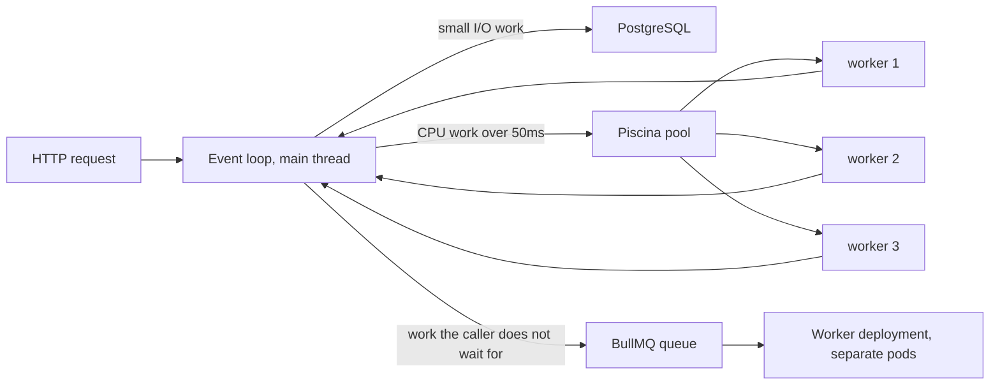
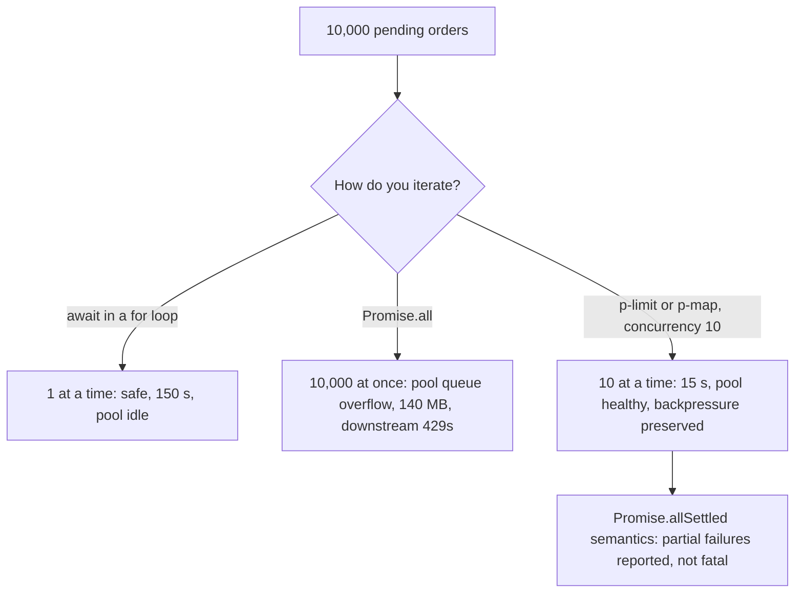

## 35.9 Thread pools and worker pools

#### Concept

Node gives you one thread for JavaScript. When work is I/O, that is plenty — the thread is idle most of the time anyway. When work is CPU, one thread is a hard ceiling, and everything else on the pod stops while it runs.

There are three separate pools in a typical Node backend, and confusing them is a common source of bad decisions:

1. **The libuv thread pool** — 4 threads by default, shared by `fs`, `dns.lookup`, `zlib`, and parts of `crypto`. You do not put your code on it. You only tune its size.
2. **`worker_threads`** — real OS threads running your JavaScript in separate V8 isolates, inside the same process. This is where CPU-bound application work goes when the result is needed to answer the current request.
3. **Worker processes / deployments** — separate Node processes (usually separate Kubernetes deployments) consuming from a queue. This is where CPU-bound work goes when the result is not needed synchronously.

The rule of thumb: **if the caller is waiting for it, use a worker thread; if the caller is not, use a queue and a worker deployment.**

#### Why does it exist?

Because a 400 ms PDF render on the API thread does not cost 400 ms — it costs 400 ms multiplied by every request that was in flight. At 500 RPS that is roughly 200 requests each delayed by up to 400 ms, plus the health probe. The work has to happen somewhere; the engineering choice is *where*, and the answer is "not on the thread that answers HTTP".

#### Mental model

Imagine a restaurant with one waiter (the event loop) who is very fast at taking orders and carrying plates but never cooks. The libuv pool is the four dishwashers in the back: you cannot ask them to cook, and if all four are busy, the plates back up. `worker_threads` are cooks you hire into the same kitchen: they cook in parallel, but you pay for the kitchen space, and passing ingredients to them costs time. A separate worker deployment is a second restaurant that only does catering: the customer does not wait at the table, they get a call when it is ready.

#### How it works

**The libuv pool.** Sized by `UV_THREADPOOL_SIZE` (default 4, maximum 1024) and **read once at process start** — setting it in JavaScript after the first `fs` call does nothing. Everything on it competes: a burst of `fs.readFile` will delay `dns.lookup`, which delays your outbound HTTP, which looks like "the payment provider got slow".

```bash
# Set it in the container, not in code.
UV_THREADPOOL_SIZE=8 node dist/main.js
```

Raise it if you do heavy `fs`, `zlib` or async `crypto` (`bcrypt.hash`, `crypto.scrypt`, `pbkdf2`). Do not raise it past roughly `cores * 2` for CPU-bound users of the pool, because they compete for the same cores.

**`worker_threads`.** Each worker is an OS thread with its own V8 isolate, its own heap and its own event loop. They do not share JavaScript objects; they communicate by structured-clone message passing (a copy) or by transferring an `ArrayBuffer` (zero-copy, but the sender loses it) or by sharing a `SharedArrayBuffer` (35.6).

Two costs decide whether a worker is worth it:

- **Startup**: 20-50 ms per worker (new isolate, module loading). So you pool them, you do not spawn per request.
- **Transfer**: structured-cloning a 20 MB buffer costs real milliseconds. If the payload is large and the computation is small, the copy dominates and a worker is slower than doing it inline.

Rule: worker threads pay off when the CPU work is **> ~50 ms** and the payload is **small relative to the work**, or transferable.

**Sizing a CPU worker pool.** CPU-bound work cannot go faster than the cores you have. In Kubernetes the number that matters is the pod's CPU *limit*, not the node's core count — `os.cpus().length` reports the node's cores and will lie to you badly (a pod with `limits.cpu: 1` on a 64-core node sees 64).

```ts
import { cpus } from 'node:os';
import { readFileSync } from 'node:fs';

// Read the real cgroup v2 quota; fall back to cpus() outside a container.
export function availableCpus(): number {
  try {
    const raw = readFileSync('/sys/fs/cgroup/cpu.max', 'utf8').trim();  // e.g. "200000 100000"
    const [quota, period] = raw.split(' ');
    if (quota !== 'max') return Math.max(1, Math.floor(Number(quota) / Number(period)));
  } catch { /* not in a cgroup v2 container */ }
  return cpus().length;
}

// Leave one core's worth of headroom for the event loop, GC and the HTTP server.
export const cpuPoolSize = Math.max(1, availableCpus() - 1);
```

For CPU-bound workers: **pool size = cores - 1**, never more. Extra threads do not add throughput; they add context switching, memory (each isolate is 10-30 MB), and latency variance.



#### NestJS example

`piscina` is the standard worker pool for Node: it manages thread lifecycle, queueing, idle timeouts and cancellation. Wrap it in a provider with proper lifecycle hooks so it shuts down cleanly.

```ts
// pdf-pool.provider.ts
import { Injectable, OnModuleDestroy, ServiceUnavailableException } from '@nestjs/common';
import { resolve } from 'node:path';
import Piscina from 'piscina';
import { cpuPoolSize } from './cpu';

@Injectable()
export class CpuPool implements OnModuleDestroy {
  private readonly pool = new Piscina({
    filename: resolve(__dirname, 'cpu.worker.js'),
    minThreads: 1,
    maxThreads: cpuPoolSize,
    idleTimeout: 30_000,
    // Bound the queue. Without this, a burst queues unboundedly and every
    // request waits behind it until the client times out anyway.
    maxQueue: cpuPoolSize * 4,
    concurrentTasksPerWorker: 1,   // CPU work: one task per thread
  });

  async run<TIn, TOut>(name: string, payload: TIn, signal?: AbortSignal): Promise<TOut> {
    try {
      return await this.pool.run(payload, { name, signal });
    } catch (err) {
      if ((err as Error).message?.includes('queue is full')) {
        throw new ServiceUnavailableException('render capacity exhausted');
      }
      throw err;
    }
  }

  get stats() {
    return {
      queueSize: this.pool.queueSize,
      utilization: this.pool.utilization,   // 0..1
      completed: this.pool.completed,
      waitTimeP99: this.pool.waitTime.p99,
    };
  }

  async onModuleDestroy() {
    await this.pool.destroy();   // let in-flight tasks finish before the pod exits
  }
}
```

```ts
// cpu.worker.ts — exported functions become task `name`s.
import { renderInvoicePdf } from './pdf';
import sharp from 'sharp';

export async function invoicePdf(payload: { order: OrderSnapshot }): Promise<Buffer> {
  return renderInvoicePdf(payload.order);              // ~350 ms of CPU
}

export async function thumbnail(payload: { image: ArrayBuffer; width: number }): Promise<Buffer> {
  return sharp(Buffer.from(payload.image)).resize(payload.width).webp({ quality: 82 }).toBuffer();
}
```

```ts
// invoices.controller.ts
@Get(':id/invoice.pdf')
async invoice(@Param('id') id: string, @Res() res: Response) {
  const order = await this.orders.snapshot(id);
  // Abort the worker task if the client disconnects or we exceed our own budget.
  const signal = AbortSignal.timeout(5_000);
  const pdf = await this.cpuPool.run<{ order: OrderSnapshot }, Buffer>('invoicePdf', { order }, signal);
  res.setHeader('Content-Type', 'application/pdf');
  res.send(pdf);
}
```

Three details that make this production code rather than a demo: `maxQueue` (backpressure instead of unbounded queueing), the `signal` (a client that gave up should not keep a core busy), and `onModuleDestroy` (a `SIGTERM` during a rolling deploy should not kill a half-rendered PDF).

Expose `stats` on your metrics endpoint. `utilization` near 1.0 with a growing `queueSize` means you need more pods, not more threads.

#### Separate worker deployments

For anything the caller is not waiting for — sending emails, generating a monthly report, re-indexing search, processing an uploaded video — the right shape is a queue plus a separate deployment. The reasons are operational, not stylistic:

- **Independent scaling.** API pods scale on RPS; worker pods scale on queue depth. A 40,000-job backlog should add worker pods without adding API pods.
- **Isolation.** A worker that OOMs on a 400 MB video does not take an API pod with it.
- **Different resource shapes.** API pods want `cpu: 500m, memory: 512Mi`; a video worker wants `cpu: 2, memory: 4Gi`.
- **Different shutdown behaviour.** API pods drain in seconds; a worker mid-job may need 120 seconds of `terminationGracePeriodSeconds`.

In NestJS this is usually one codebase with two entry points and a flag:

```ts
// main.ts
const role = process.env.APP_ROLE ?? 'api';
if (role === 'api') {
  const app = await NestFactory.create(ApiModule);
  await app.listen(3000);
} else {
  // No HTTP server. Just the processors, plus a health endpoint for probes.
  const app = await NestFactory.create(WorkerModule);
  app.enableShutdownHooks();
  await app.listen(3001);   // /health only
}
```

```yaml
# k8s: two deployments, one image
apiVersion: apps/v1
kind: Deployment
metadata: { name: shop-api }
spec:
  replicas: 6
  template:
    spec:
      containers:
        - name: app
          image: shop:1.42.0
          env:
            - { name: APP_ROLE, value: api }
            - { name: DB_POOL_MAX, value: "15" }
          resources: { requests: { cpu: 500m, memory: 512Mi }, limits: { cpu: "1", memory: 1Gi } }
---
apiVersion: apps/v1
kind: Deployment
metadata: { name: shop-workers }
spec:
  replicas: 3
  template:
    spec:
      terminationGracePeriodSeconds: 120
      containers:
        - name: app
          image: shop:1.42.0
          env:
            - { name: APP_ROLE, value: worker }
            - { name: WORKER_CONCURRENCY, value: "8" }
            - { name: DB_POOL_MAX, value: "10" }
          resources: { requests: { cpu: "1", memory: 2Gi }, limits: { cpu: "2", memory: 4Gi } }
```

#### BullMQ concurrency and rate limiting

BullMQ's `concurrency` is **how many jobs one worker process runs at once**. Because jobs are usually I/O-bound (an HTTP call to a mail provider, a database write), concurrency far above the core count is fine and normal — 20 concurrent email jobs on one core is reasonable. For CPU-bound jobs it is not: keep concurrency at or below cores, or hand the CPU part to a Piscina pool inside the job.

```ts
import { Processor, WorkerHost } from '@nestjs/bullmq';
import { Job } from 'bullmq';

@Processor('notifications', {
  concurrency: Number(process.env.WORKER_CONCURRENCY ?? 8),
  // Global across all workers on this queue: at most 100 jobs per second.
  limiter: { max: 100, duration: 1000 },
})
export class NotificationsProcessor extends WorkerHost {
  async process(job: Job<{ userId: string; template: string }>): Promise<void> {
    // Claim before the side effect so a retry cannot double-send (35.6).
    const claimed = await this.sends.claim(job.data.userId, job.data.template, job.id!);
    if (!claimed) return;
    await this.mail.send(job.data);     // I/O bound: high concurrency is fine
  }
}
```

The `limiter` is enforced across every worker on the queue via Redis, which is exactly what you need when the constraint is a third party's rate limit ("SendGrid allows 100/s for our plan"). Per-key limiting for a shared external resource uses a group key:

```ts
// Rate-limit per merchant, so one busy merchant cannot consume the whole budget.
await queue.add('sync', payload, { jobId: `sync:${merchantId}:${cursor}` });
// in the worker, when the merchant's API says 429:
await job.moveToDelayed(Date.now() + 30_000, job.token);
// or, to pause the whole queue's rate limiter for a window:
throw new RateLimitError();   // BullMQ's Worker.RateLimitError, honoured by the limiter
```

Also set `removeOnComplete` and `removeOnFail` — a queue that keeps every completed job will fill Redis, and "Redis out of memory" is a bad way to discover job retention.

```ts
BullModule.registerQueue({
  name: 'notifications',
  defaultJobOptions: {
    attempts: 5,
    backoff: { type: 'exponential', delay: 2_000 },
    removeOnComplete: { age: 3600, count: 1000 },
    removeOnFail: { age: 86_400 },
  },
});
```

#### The multiplication that catches everyone

This is the arithmetic senior engineers do before a deploy, and juniors do after an incident.

```text
Concurrent database operations from one deployment
  = pods x per-pod concurrency

API deployment:     6 pods x  up to 15 in-flight requests   = 90 connections wanted
Worker deployment:  3 pods x  8 BullMQ concurrency          = 24 connections wanted
Cron pod:           1 pod  x  2                             =  2
                                                            -----
                                                              116
```

Now add the pool caps and the database ceiling:

```text
API pool max     15  x 6 pods = 90 connections
Worker pool max  10  x 3 pods = 30
Cron pool max     5  x 1 pod  =  5
                              ----
                               125 potential connections

PostgreSQL max_connections    = 200
Reserved (superuser, replication, monitoring, migrations) = 15
Usable                        = 185      -> 125 fits, with room to scale to ~8 API pods
```

Three things fall out of this arithmetic and each has bitten a real team:

- **Scaling pods multiplies connections.** An HPA that scales the API from 6 to 20 pods under load takes the API's demand from 90 to 300 and blows past `max_connections`. Every new pod then fails to connect and CrashLoopBackOffs — *the autoscaler causes the outage*. Either cap `maxReplicas` against the arithmetic, or put PgBouncer in transaction mode between the app and PostgreSQL so the app-side number stops mattering.
- **Worker concurrency multiplies too.** Raising BullMQ `concurrency` from 8 to 40 to clear a backlog raises the worker deployment's demand from 24 to 120 and starves the API. The correct lever for a backlog is usually more worker *pods*, not higher concurrency, because pods come with their own resource limits.
- **Pool size must be at least the concurrency** the process can generate, or every job waits on the pool. Worker `concurrency: 8` with `DB_POOL_MAX: 4` means jobs queue on connections, and your queue-depth metric shows nothing because the jobs are "running".

And remember 35.4: if any code path holds two connections at once, add `N * (D - 1)` on top.

#### Production scenario

An e-commerce platform generates invoice PDFs. Originally synchronous on the API: 350 ms of CPU per PDF, 4 requests/second at peak. Event-loop lag p99 went to 320 ms and every endpoint's p99 tripled during business hours.

Fix, in two stages. Stage one: a Piscina pool with `maxThreads = 1` (the API pods have `limits.cpu: 1`, so `cores - 1 = 0`, floored to 1). Event-loop lag dropped to 4 ms immediately because the main thread stopped doing the work — but throughput was still 1 PDF at a time per pod, and `queueSize` grew during invoice runs. Stage two: bulk invoice generation moved to a queue and a worker deployment with `limits.cpu: 2` and `maxThreads: 1` per pod plus 4 replicas, so 4 PDFs render in parallel. On-demand single PDFs stayed on the API's Piscina pool because a user is waiting.

Result: API p99 45 ms unchanged during invoice runs; 12,000 monthly invoices generated in 18 minutes instead of 70; and the ability to scale invoice throughput by changing one `replicas` number.

#### Failure scenario

At 08:30 on the 1st of the month, the monthly-statement job started. It used `Promise.all` over 40,000 accounts, each producing a PDF with a Piscina pool that had **no `maxQueue`**. All 40,000 tasks were queued into the pool in about 900 ms.

Each queued task held its input payload — an account snapshot averaging 180 KB. 40,000 x 180 KB = 7.2 GB of retained memory. The pod's limit was 2 GB. At 08:30:14 the container was OOMKilled. Kubernetes restarted it, the job restarted from the beginning (no checkpointing), queued 40,000 tasks again, and was OOMKilled again. CrashLoopBackOff, five times, with exponential restart delay.

Three fixes: `maxQueue: maxThreads * 4` on the pool (so the pool applies backpressure and rejects rather than buffers), replacing `Promise.all` with `p-map` at concurrency 4 (so only 4 payloads are in memory at once), and checkpointing progress in a `statement_runs` table so a restart resumes rather than restarts. The memory profile went from 7.2 GB peak to 180 MB steady.

#### Edge cases & failure modes

- **`os.cpus().length` in a container** reports node cores, not the pod's CPU limit. Read the cgroup.
- **`UV_THREADPOOL_SIZE` set in JavaScript** after the first pool use has no effect.
- **Worker startup cost** (20-50 ms) makes per-request workers slower than inline work.
- **Structured-clone cost** on large payloads can exceed the computation; transfer `ArrayBuffer`s or pass a file path / S3 key instead.
- **Unbounded pool queue** turns a burst into an OOM.
- **A worker that throws an uncaught error** exits the thread; Piscina replaces it, but any in-flight task on it fails.
- **Native modules in workers** (`sharp`, `canvas`) can leak memory per worker; set `maxThreads` conservatively and consider recycling workers.
- **No graceful shutdown**: `SIGTERM` during a rolling deploy kills in-flight tasks. Use `onModuleDestroy` and `terminationGracePeriodSeconds`.
- **BullMQ concurrency above the DB pool size** makes jobs wait invisibly on connections.
- **HPA on the API multiplying connections** past `max_connections`.
- **Rate limiter shared across queues** — BullMQ's limiter is per queue, so two queues hitting the same third party need a shared limiter or one queue.

#### How a Senior Backend Engineer thinks about this

They start by asking whether the caller is waiting. That single question routes the work to a worker thread or to a queue, and everything else follows from it.

They size CPU pools to cores minus one and never higher, because they know extra threads on a CPU-bound workload are pure overhead. They bound every queue — the Piscina queue, the BullMQ queue's retention, the concurrency of any batch — because unbounded buffering converts a load spike into an OOM.

They keep the multiplication table in their head: pods x concurrency x pool size versus `max_connections`. Before approving an HPA change or a concurrency bump, they compute the new number. And they push back on "just increase concurrency" for a backlog, because concurrency inside a pod is bounded by that pod's CPU and memory, while replicas are not.

To a product manager: "Generating the PDF takes a third of a second of pure computing. If we do that on the machine that answers web requests, every other customer's page gets slower while it happens. So we do it on separate machines, and we can add more of those whenever the queue gets long."

#### Common mistakes

- CPU work on the request path because "it's only 100 ms".
- Spawning a `Worker` per request.
- `maxThreads` set to `cpus().length` inside a container with a CPU limit.
- No `maxQueue` on the pool.
- Raising BullMQ concurrency without raising the DB pool, or without checking `max_connections`.
- One deployment for API and workers, so a video job's memory kills an API pod.
- No `removeOnComplete`, filling Redis with finished jobs.
- Forgetting `enableShutdownHooks()` and `pool.destroy()`, losing in-flight work on every deploy.

#### Interview questions

1. *What is the difference between the libuv thread pool and `worker_threads`?* Expected: libuv is internal (fs, dns, zlib, crypto), sized by `UV_THREADPOOL_SIZE`, you cannot run your code on it; `worker_threads` are separate V8 isolates running your code.
2. *How do you size a CPU worker pool, and what number do you use in Kubernetes?* Expected: cores minus one; read the cgroup CPU quota, not `os.cpus()`.
3. *When is a worker thread the wrong choice?* Expected: when the work is I/O bound; when startup and structured-clone costs exceed the computation; when the caller does not need the result (use a queue).
4. *Six API pods with a pool of 15, three worker pods with concurrency 8 and a pool of 10. How many connections can you demand, and what is your `max_connections`?* Expected: 90 + 30 = 120 plus overhead; must fit under `max_connections` minus reserved slots; watch what the HPA does to it.
5. *Your queue backlog is 40,000 jobs. Do you raise concurrency or add pods?* Expected: usually pods, because concurrency is bounded by pod CPU/memory and multiplies DB connections; raise concurrency only if the jobs are I/O bound and the pool and downstream can take it.
6. *What does `maxQueue` protect you from?* Expected: unbounded buffering of task payloads; OOM under burst; it converts overload into a fast rejection you can shed.

#### Practical exercise

Build a NestJS endpoint that renders a PDF from an order. Implement three versions: (a) inline on the main thread, (b) Piscina with `maxThreads = cores - 1` and `maxQueue`, (c) enqueued to BullMQ with a separate worker process. Drive `/health` at 200 RPS with `autocannon` while calling the PDF endpoint 5 times per second.

Acceptance criteria: (a) shows `/health` p99 above 300 ms and event-loop lag above 200 ms; (b) shows `/health` p99 under 15 ms, and under a burst of 200 PDF requests returns 503 rather than OOMing; (c) shows `/health` unaffected and the endpoint returning 202 with a job id. Record connections used in each case and verify against your `max_connections` arithmetic.

## 35.10 Async processing patterns

#### Concept

Once you accept that everything in a Node backend is concurrent, the day-to-day question becomes: **how much concurrency, and who is holding the results?** The patterns in this section are the answers, and choosing the wrong one is how services run out of memory, connections, or work.

#### Why does it exist?

`await` in a loop is safe and slow. `Promise.all` is fast and unbounded. Neither is right for a batch of 10,000 items. Real backends need a dial between them, plus the ability to give up (timeouts, cancellation) and the ability to process more data than fits in memory (streaming).

#### Mental model

Imagine unloading a truck. `for await` in a loop is one person carrying one box at a time: safe, slow, never drops anything. `Promise.all` is opening the truck's tailgate and letting all 10,000 boxes fall out at once: fast, and now they are all on the ground and in the way. `p-limit` at concurrency 10 is ten people carrying boxes with a foreman who never lets more than ten be in motion. Streaming with `for await` is a conveyor belt: the boxes never pile up because they leave as fast as they arrive.

#### Fire-and-forget

The most common async mistake, and the one with the widest blast radius:

```ts
// THE BUG.
@Post()
async createOrder(@Body() dto: CreateOrderDto) {
  const order = await this.orders.create(dto);
  this.email.sendConfirmation(order);        // no await, no catch
  return order;
}
```

Two independent problems:

**It loses work.** The HTTP response is sent, the pod receives `SIGTERM` 20 ms later during a rolling deploy, and the email is never sent. There is no record that it was supposed to be, no retry, and no alert. Under a normal deploy cadence of 10 deploys a day with 4 seconds of in-flight work per pod, you quietly drop a handful of emails every day.

**It can crash the process.** Since Node 15, an unhandled promise rejection terminates the process by default (`--unhandled-rejections=throw`). If `sendConfirmation` rejects because the mail provider returned 503, there is no `.catch()`, so the whole pod dies — taking every other in-flight request with it. One flaky dependency becomes a CrashLoopBackOff.

The minimum acceptable version attaches a handler:

```ts
void this.email.sendConfirmation(order).catch((err) =>
  this.logger.error({ err, orderId: order.id }, 'confirmation email failed'),
);
```

That stops the crash. It still loses the work. The correct version records the intent durably before responding:

```ts
@Post()
async createOrder(@Body() dto: CreateOrderDto) {
  return this.dataSource.transaction(async (manager) => {
    const order = await manager.save(Order, Order.from(dto));
    // Transactional outbox: the intent to send is committed with the order.
    // A worker (or CDC) reads the outbox and does the sending, with retries.
    await manager.insert(OutboxMessage, {
      topic: 'order.confirmed',
      payload: { orderId: order.id },
      dedupeKey: `order.confirmed:${order.id}`,
    });
    return order;
  });
}
```

The rule: **fire-and-forget is acceptable only for work whose loss is genuinely free** — a best-effort metric increment, a cache warm. For anything a human would notice, the intent goes into the same transaction as the state change. (Part 33 — Distributed Transactions: Sagas, Outbox, Inbox and Idempotency covers the outbox in full.)

And always install the safety nets, so an escaped rejection is loud and the pod exits cleanly rather than mid-transaction:

```ts
process.on('unhandledRejection', (reason) => {
  logger.fatal({ reason }, 'unhandled rejection, shutting down');
  app.close().finally(() => process.exit(1));   // drain, then exit; let k8s restart us
});
```

#### `Promise.all` versus `Promise.allSettled`

`Promise.all` rejects as soon as **any** promise rejects, and it does not cancel the others. The rejected value propagates immediately; the other 49 promises keep running to completion with nobody listening. If one of them also rejects, that is now an unhandled rejection.

```ts
// If enrich() throws for item 3, you lose the results of items 1, 2, 4..50,
// and their work continues invisibly.
const results = await Promise.all(items.map((i) => enrich(i)));
```

`Promise.allSettled` never rejects. You get an array of `{ status: 'fulfilled', value }` or `{ status: 'rejected', reason }` and decide per item.

```ts
const settled = await Promise.allSettled(items.map((i) => enrich(i)));
const ok = settled.filter((r): r is PromiseFulfilledResult<Enriched> => r.status === 'fulfilled');
const failed = settled.filter((r) => r.status === 'rejected');
if (failed.length) {
  this.logger.warn({ failed: failed.length, total: items.length }, 'partial enrichment');
}
// Partial success is a real outcome: return 207-style partial results, or requeue the failures.
return ok.map((r) => r.value);
```

Choose by the semantics you want: **`all` for "all or nothing"** (three queries that build one response — if one fails the response is wrong anyway) and **`allSettled` for "best effort"** (enriching 50 orders with optional data, fanning out notifications, calling five recommendation providers).

Related: `Promise.race` resolves or rejects with the first settled promise (useful for timeouts, but the loser keeps running); `Promise.any` resolves with the first *fulfilled* one and rejects with an `AggregateError` only if all fail (useful for redundant providers).

#### The `Promise.all` over 10,000 items problem

```ts
// THE BUG, and it looks so reasonable.
const orders = await this.repo.find({ where: { status: 'PENDING' } });   // 10,000 rows
await Promise.all(orders.map((o) => this.reconcile(o)));                 // 10,000 at once
```

`Array.prototype.map` is synchronous. The moment this line runs, **all 10,000 `reconcile` calls have started** — every one of them has issued its first query or `fetch`. Then:

- **The connection pool.** With `max: 20`, twenty queries execute and 9,980 wait in the pool's queue. Each waiter has a `connectionTimeoutMillis` (often 30 s). Reconciling 10,000 orders at 15 ms each needs 150 seconds of pool time; at 20 concurrent that is 7.5 seconds of real work, but the 9,980th waiter has been queued the whole time and times out. You get thousands of `timeout exceeded when trying to connect` errors from work that would have succeeded serially.
- **Memory.** 10,000 in-flight promise chains, each retaining its closure, its order object, its intermediate results and its pending query. Measured on a real service: about 14 KB per in-flight chain, so ~140 MB — on top of the 10,000 loaded entities. A 512 MB pod does not survive this plus a GC cycle.
- **Downstream.** If `reconcile` calls a payment provider, you just sent 10,000 concurrent requests to a partner who rate-limits at 50/s. Their 429s become your retries become a retry storm.
- **The event loop.** 10,000 promise resolutions arriving together produce a microtask flood; event-loop lag spikes and every unrelated request on the pod slows down.

The fix is a concurrency limiter. `p-limit` wraps each call so at most `n` are in flight:

```ts
import pLimit from 'p-limit';

// Match concurrency to the scarcest downstream resource. Here: the DB pool,
// leaving headroom for the HTTP traffic this pod also serves.
const limit = pLimit(10);

const results = await Promise.allSettled(
  orders.map((order) => limit(() => this.reconcile(order))),
);
```

`p-map` is the same idea with a nicer shape for "map this array with bounded concurrency", plus `stopOnError: false` for best-effort batches:

```ts
import pMap from 'p-map';

const results = await pMap(
  orders,
  async (order) => this.reconcile(order),
  { concurrency: 10, stopOnError: false },
);
```

**Choosing the number.** Concurrency should be the minimum of what each downstream can take:

```text
concurrency = min(
  db_pool_max - headroom_for_http_traffic,      e.g. 15 - 5  = 10
  downstream_rate_limit x expected_latency,     e.g. 50/s x 0.2s = 10
  memory_budget / per_task_retained_bytes,      e.g. 200MB / 14KB = huge, not binding
  cores                                          if the task is CPU bound
)
```

Then verify by watching `pool.waitingCount` (35.12) and the downstream's error rate while the batch runs. If `waitingCount` is consistently above zero, your concurrency is too high for this pod.

For very large sets, do not load all 10,000 rows either — stream them (below) or page with a cursor.



#### Timeouts

Every remote call needs a deadline. Without one, your latency is defined by your slowest dependency's worst day.

```ts
// Node 18+: AbortSignal.timeout is the cleanest primitive.
const res = await fetch(url, { signal: AbortSignal.timeout(2_000) });

// Combine a timeout with an upstream cancellation signal.
const signal = AbortSignal.any([AbortSignal.timeout(2_000), req.signal]);
const res2 = await fetch(url, { signal });
```

For promises that do not accept a signal, wrap them — and clear the timer, or you leak a `setTimeout` per call and keep the event loop alive at shutdown:

```ts
export class TimeoutError extends Error {}

export function withTimeout<T>(promise: Promise<T>, ms: number, label: string): Promise<T> {
  let timer: NodeJS.Timeout;
  const timeout = new Promise<never>((_, reject) => {
    timer = setTimeout(() => reject(new TimeoutError(`${label} timed out after ${ms}ms`)), ms);
  });
  return Promise.race([promise, timeout]).finally(() => clearTimeout(timer));
}
```

Be honest about what this does: `Promise.race` **does not cancel the loser**. The underlying request keeps running, keeps its socket, and keeps its pool connection. A timeout wrapper limits how long *you wait*, not how long the work *runs*. That is why real cancellation matters.

Timeout budgets should decrease as you go down the stack: if the gateway times out at 10 s, the API should time out at 8 s, its database queries at 3 s, and its outbound HTTP at 2 s with one retry. Otherwise the client has already given up while your work continues, burning resources on a response nobody will read.

#### Cancellation with `AbortController`

`AbortController` gives you a signal you can pass down and a way to fire it. NestJS exposes the request's own abort signal through the underlying `Request` object, so a client that disconnects can stop your work.

```ts
@Get('search')
async search(@Query() q: SearchDto, @Req() req: Request) {
  // req.signal aborts when the client disconnects (Express 5 / Fastify).
  const signal = AbortSignal.any([req.signal, AbortSignal.timeout(3_000)]);

  const [products, facets] = await Promise.all([
    this.searchClient.query(q, { signal }),          // fetch honours the signal
    this.facets.compute(q, signal),                  // pass it further down
  ]);
  return { products, facets };
}
```

**Propagating cancellation into `fetch`** is native: pass `signal` and the socket is destroyed on abort, freeing the connection immediately.

**Propagating into `pg`** is different, and worth knowing precisely: node-postgres queries do not accept an `AbortSignal`. A running query occupies a server backend, and the only way to stop it is either a server-side timeout or an explicit cancel request on a *second* connection.

```ts
// 1. The simple, robust answer: a server-side deadline per transaction.
await this.dataSource.transaction(async (manager) => {
  await manager.query(`SET LOCAL statement_timeout = '3s'`);
  // Any statement in this transaction that exceeds 3 s is cancelled by PostgreSQL
  // with 57014 query_canceled. LOCAL means it reverts at commit, so the pooled
  // connection is not left with a modified setting.
  return manager.query(heavySql, params);
});
```

```ts
// 2. Explicit cancellation, when you need to stop a query already in flight.
async runCancellable<T>(sql: string, params: unknown[], signal: AbortSignal): Promise<T[]> {
  const client = await this.pool.connect();
  try {
    const { rows: [{ pid }] } = await client.query<{ pid: number }>('SELECT pg_backend_pid() AS pid');
    const onAbort = () => {
      // A DIFFERENT connection must send the cancel; the busy one cannot.
      void this.pool.query('SELECT pg_cancel_backend($1)', [pid]).catch(() => undefined);
    };
    signal.addEventListener('abort', onAbort, { once: true });
    try {
      const { rows } = await client.query<T>(sql, params);   // throws 57014 if cancelled
      return rows;
    } finally {
      signal.removeEventListener('abort', onAbort);
    }
  } finally {
    client.release();
  }
}
```

For 95% of services, option 1 (`statement_timeout`, set globally in the connection string or per transaction with `SET LOCAL`) is the right answer, and option 2 is reserved for genuinely long analytical queries a user can cancel. Note `pg_cancel_backend` politely cancels the current query; `pg_terminate_backend` kills the whole session and should not be used for this.

Also set `idle_in_transaction_session_timeout` on the database side (e.g. `30s`) so a bug that leaves a transaction open cannot hold locks forever.

#### Async iterators and `for await`

When the dataset is large, the answer is not "a bigger pod". It is to never hold the whole thing.

```ts
// Streaming a large result set: rows arrive in batches, memory stays flat.
import QueryStream from 'pg-query-stream';

async function* streamPendingOrders(pool: Pool): AsyncGenerator<OrderRow> {
  const client = await pool.connect();
  try {
    const query = new QueryStream(
      `SELECT id, total_cents, created_at FROM orders WHERE status = 'PENDING'`,
      [],
      { batchSize: 500 },       // rows fetched per round trip
    );
    const stream = client.query(query);
    for await (const row of stream) yield row as OrderRow;
  } finally {
    client.release();
  }
}
```

```ts
// Consume with bounded concurrency AND bounded memory.
import pMap from 'p-map';

// p-map accepts an async iterable, so nothing is materialised into an array.
await pMap(streamPendingOrders(this.pool), (order) => this.reconcile(order), {
  concurrency: 10,
  stopOnError: false,
});
```

This is the combination that makes large batch jobs safe: the source is an async iterator (constant memory) and the consumer is concurrency-limited (constant pressure on the pool and downstreams). Compare with `find()` + `Promise.all`, which is unbounded on both axes.

The same shape works for HTTP responses, S3 object listings, Kafka consumption and file processing:

```ts
// Stream a large CSV response to the client without buffering it.
@Get('export.csv')
async export(@Res() res: Response) {
  res.setHeader('Content-Type', 'text/csv');
  res.write('id,total,created_at\n');
  for await (const row of streamPendingOrders(this.pool)) {
    // Respect backpressure: if the socket buffer is full, wait for 'drain'.
    if (!res.write(`${row.id},${row.total_cents},${row.created_at.toISOString()}\n`)) {
      await once(res, 'drain');
    }
  }
  res.end();
}
```

That `if (!res.write(...)) await once(res, 'drain')` is backpressure, and skipping it is how a 2 million row export buffers 900 MB in the pod's memory because the client is on a slow connection.

For a plain `for await` over a generator with no concurrency, remember it is fully serial — each iteration waits for the previous one. That is often exactly right for ordered work, and exactly wrong for 10,000 independent items.

#### Production scenario

A nightly reconciliation processes 2.4 million payment records. The original version loaded them in pages of 10,000 and used `Promise.all` per page: memory peaked at 1.6 GB, the pod (2 GB limit) OOMed roughly one night in four, and the run took 95 minutes when it survived.

Rewritten as `pg-query-stream` + `pMap(concurrency: 12, stopOnError: false)` with `statement_timeout = '30s'` and per-record idempotency keys: memory flat at 210 MB, runtime 41 minutes, zero OOMs in eight months. The concurrency of 12 was chosen as `pool_max(16) - 4` and validated by watching `waitingCount` stay at 0 during a full run.

#### Failure scenario

At 03:00 a "resend failed webhooks" job ran with `Promise.all` over 8,400 pending webhooks. Every one issued an outbound HTTP POST with no timeout. The partner endpoint was down and their load balancer accepted connections but never responded.

8,400 sockets opened. Each held a promise chain and a 40 KB payload. The pod's file-descriptor limit (1024) was hit at socket 1,024; the remaining calls failed with `EMFILE`, which — being an unhandled rejection inside a `Promise.all` whose first rejection had already propagated — terminated the process. On restart the job ran again. Six restarts before someone disabled the cron.

Fixes: `pMap` at concurrency 20; `AbortSignal.timeout(5_000)` on every outbound call; a circuit breaker that opens after 20 consecutive failures to one host and skips the rest of the batch; `allSettled` semantics so one failure does not abandon the batch; and a job-level deadline so the run cannot exceed 15 minutes.

#### Edge cases & failure modes

- **Fire-and-forget loses work on `SIGTERM`** and crashes the process on rejection.
- **`Promise.all` does not cancel siblings** on rejection; their later rejections become unhandled.
- **`Promise.race` does not cancel the loser**; the work and its resources continue.
- **`map` starts everything immediately** — the array is built synchronously.
- **Concurrency higher than the pool** silently converts "running" into "waiting for a connection".
- **No timeout on outbound calls** means unbounded socket and memory growth.
- **File-descriptor limits** (`EMFILE`) under high fan-out.
- **`setTimeout` leaked** in a timeout wrapper keeps the event loop alive and delays shutdown.
- **Retries inside a concurrency-limited batch** multiply effective concurrency; count retries against the limit.
- **Backpressure ignored on a writable stream** buffers the whole response in memory.
- **`for await` over an infinite source** with no exit condition never completes; add a deadline or a max-items guard.
- **Cancelling a `pg` query needs a second connection**; if the pool is exhausted, you cannot even cancel.

#### How a Senior Backend Engineer thinks about this

Their default for any collection is "what is the concurrency, and what is the scarcest resource downstream?". They treat an unbounded `Promise.all` over anything whose size comes from the database as a bug on sight, because the size will grow and nobody will notice until it is 10,000.

They put a deadline on every remote call and make the budgets decrease down the stack. They know the difference between a timeout (I stop waiting) and cancellation (the work stops), and they know that only cancellation frees resources. They ask "what happens to the other 49 when one fails?" and choose `all` or `allSettled` deliberately rather than by habit.

They refuse fire-and-forget for anything that matters, because "the pod restarted" is a certainty, not a risk. And when a dataset is large, their instinct is to stream rather than to page, because streaming has no size that can surprise them.

To a product manager: "We can process the whole backlog at once or ten at a time. At once looks faster on paper and actually finishes slower, because the database and the partner's API both start refusing us. Ten at a time finishes in a quarter of the time and never falls over."

#### Common mistakes

- `Promise.all(items.map(...))` where `items` came from a query.
- No timeout on `fetch`.
- Fire-and-forget for emails, webhooks, analytics that someone will ask about later.
- Using `allSettled` and then ignoring the rejected entries.
- Setting concurrency higher than the connection pool.
- Using `Promise.race` for a timeout and assuming the work stopped.
- Loading a whole table with `find()` because it "only" has 200,000 rows.
- Writing to a response stream without checking the return value of `write`.

#### Interview questions

1. *What is wrong with `await Promise.all(rows.map(process))` for 10,000 rows?* Expected: all start at once; pool exhaustion and connection timeouts; memory; downstream rate limits; microtask flood. Follow-up: *what is your fix and how do you pick the concurrency?*
2. *`Promise.all` versus `Promise.allSettled` versus `Promise.any` — when each?* Expected: all-or-nothing; best-effort with per-item outcomes; first success among redundant providers.
3. *Does `Promise.race` with a timer cancel the slow operation?* Expected: no; it stops you waiting; the work and its connection continue; real cancellation needs `AbortController` or a server-side timeout.
4. *How do you cancel a running PostgreSQL query from Node?* Expected: `statement_timeout` (usually enough), or `pg_cancel_backend(pid)` issued on a different connection; node-postgres has no `AbortSignal` support for queries.
5. *Why is fire-and-forget dangerous in Node 18+?* Expected: unhandled rejection terminates the process; and the work is lost on pod restart. Follow-up: *what do you do instead?* Transactional outbox or a queue.
6. *How do you process 2 million rows in a pod with a 512 MB limit?* Expected: stream with a cursor or `pg-query-stream`, bounded concurrency with `p-map`, checkpointing so a restart resumes.
7. *What are timeout budgets and why must they decrease down the stack?* Expected: each layer's timeout is shorter than its caller's, so work stops before the caller gives up; otherwise you burn resources producing a response nobody reads.

#### Practical exercise

Write a batch job that reconciles `orders` where `status = 'PENDING'`, seeded with 20,000 rows, against a stub HTTP service with 80 ms latency that returns 429 above 25 concurrent requests. Implement three versions: serial `for await`, `Promise.all`, and `pMap` over a `pg-query-stream` with tuned concurrency. Run each in a container limited to 512 MB with a database pool of 10.

Acceptance criteria: the `Promise.all` version fails with pool connection timeouts or OOM; the serial version completes but takes over 25 minutes; the `pMap` version completes in under 3 minutes with peak RSS under 250 MB, `pool.waitingCount` at 0, and zero 429s from the stub. Then add `AbortSignal.timeout` and a run-level deadline, and prove the job aborts cleanly at the deadline with progress checkpointed.
