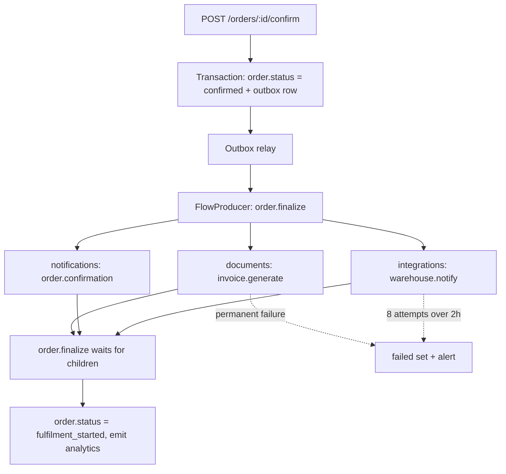
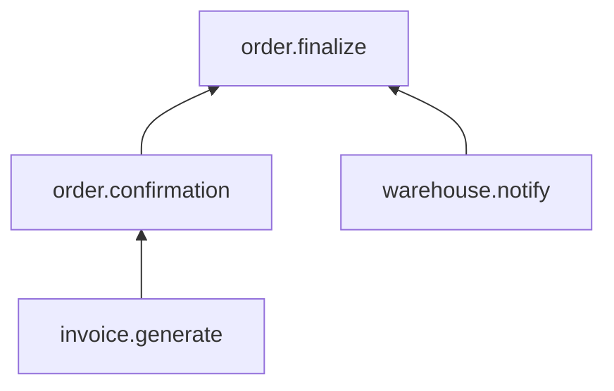

## 35.12 A worked example: the order confirmation pipeline

### 35.12.1 The requirement

When an order is confirmed we must, in parallel:

1. Generate an invoice PDF and store it in S3.
2. Send the customer a confirmation email that links to that invoice.
3. Notify the warehouse system so picking can start.

And when all three are done, mark the order `fulfilment_started` and emit an analytics event.

Constraints from the business: the email must arrive within 5 minutes at p99. The warehouse partner has a one-hour maintenance window most Sundays. No customer may ever receive two confirmation emails. No invoice may ever be generated twice with different numbers. Volume is 400 orders per minute at peak, 40 at night.

### 35.12.2 The shape



The email child depends on the invoice child's output (the S3 key goes in the email). BullMQ flows are a tree, not a DAG, so we express that dependency by nesting: the email job becomes the *parent* of the invoice job, and `order.finalize` is the parent of the email job and the warehouse job.



### 35.12.3 The schema

```sql
-- The business table. Note the columns that make the pipeline observable and idempotent.
ALTER TABLE orders
  ADD COLUMN confirmed_at          timestamptz,
  ADD COLUMN invoice_s3_key        text,
  ADD COLUMN invoice_number        text UNIQUE,        -- never two numbers for one order
  ADD COLUMN confirmation_sent_at  timestamptz,
  ADD COLUMN warehouse_notified_at timestamptz,
  ADD COLUMN fulfilment_started_at timestamptz;

-- The reconciliation sweep's index: cheap, partial, exactly the predicate we query.
CREATE INDEX idx_orders_awaiting_confirmation
  ON orders (confirmed_at)
  WHERE confirmation_sent_at IS NULL AND confirmed_at IS NOT NULL;

-- The execution ledger that makes every handler idempotent.
CREATE TABLE job_executions (
  execution_key text        PRIMARY KEY,
  job_id        text        NOT NULL,
  queue         text        NOT NULL,
  job_name      text        NOT NULL,
  status        text        NOT NULL CHECK (status IN ('in_progress','succeeded','failed')),
  attempt       int         NOT NULL DEFAULT 1,
  result        jsonb,
  error         text,
  started_at    timestamptz NOT NULL DEFAULT now(),
  finished_at   timestamptz
) PARTITION BY RANGE (started_at);

-- Monthly partitions so pruning is DROP TABLE, not DELETE of 8 million rows.
CREATE TABLE job_executions_2026_09 PARTITION OF job_executions
  FOR VALUES FROM ('2026-09-01') TO ('2026-10-01');
CREATE TABLE job_executions_2026_10 PARTITION OF job_executions
  FOR VALUES FROM ('2026-10-01') TO ('2026-11-01');

CREATE INDEX idx_job_executions_status ON job_executions (status, started_at)
  WHERE status <> 'succeeded';

-- Invoice numbers must be gapless-ish and never duplicated. A sequence per year.
CREATE SEQUENCE invoice_number_seq_2026 START 1;
```

Partitioning `job_executions` by month is not premature. At 400 orders/minute with three ledger rows each, that is 1,700 rows per minute, 2.4 million per day. Deleting 90-day-old rows from an unpartitioned table of 220 million rows is an autovacuum event you do not want. `DROP TABLE job_executions_2026_06` is instant.

### 35.12.4 The producer

```ts
// orders/order-confirmation.service.ts
import { Injectable } from '@nestjs/common';
import { DataSource } from 'typeorm';
import { Order } from './order.entity';
import { OutboxRecord } from '../outbox/outbox.entity';

@Injectable()
export class OrderConfirmationService {
  constructor(private readonly ds: DataSource) {}

  async confirm(orderId: string, correlationId: string): Promise<void> {
    await this.ds.transaction(async (em) => {
      const order = await em.findOne(Order, {
        where: { id: orderId },
        lock: { mode: 'pessimistic_write' },
      });
      if (!order) throw new NotFoundException(`order ${orderId}`);

      // Idempotent at the API level: confirming twice is a no-op, not a second pipeline.
      if (order.confirmedAt) return;

      order.status = 'confirmed';
      order.confirmedAt = new Date();
      await em.save(order);

      // The outbox row and the order row commit together, or neither does.
      await em.save(new OutboxRecord({
        aggregate: 'order',
        aggregateId: order.id,
        jobQueue: 'orders',
        jobName: 'order.pipeline.start',
        payload: { v: 1, orderId: order.id, correlationId },
        dedupeKey: `pipeline:${order.id}`,
      }));
    });
  }
}
```

The relay from 35.11 picks that row up within a second and starts the flow:

```ts
// orders/order-flow.service.ts
import { Injectable } from '@nestjs/common';
import { InjectFlowProducer } from '@nestjs/bullmq';
import { FlowProducer } from 'bullmq';

@Injectable()
export class OrderFlowService {
  constructor(@InjectFlowProducer('orders') private readonly flow: FlowProducer) {}

  async start(orderId: string, correlationId: string): Promise<void> {
    const data = { v: 1 as const, orderId, correlationId };

    await this.flow.add({
      name: 'order.finalize',
      queueName: 'orders',
      data,
      opts: { jobId: `finalize:${orderId}`, attempts: 3, removeOnComplete: { age: 86_400 } },
      children: [
        {
          // Email waits for the invoice, because it links to the PDF.
          name: 'order.confirmation',
          queueName: 'notifications',
          data,
          opts: {
            jobId: `confirm:${orderId}`,
            attempts: 5,
            backoff: { type: 'custom' },
            failParentOnFailure: true,
          },
          children: [
            {
              name: 'invoice.generate',
              queueName: 'documents',
              data,
              opts: {
                jobId: `invoice:${orderId}`,
                attempts: 5,
                backoff: { type: 'custom' },
                failParentOnFailure: true,
              },
            },
          ],
        },
        {
          // The warehouse is independent and is allowed to be slow for hours.
          name: 'warehouse.notify',
          queueName: 'integrations',
          data,
          opts: {
            jobId: `wh:${orderId}`,
            attempts: 8,
            backoff: { type: 'custom' },
            failParentOnFailure: false,   // a warehouse outage must not block finalize
          },
        },
      ],
    });
  }
}
```

Read the two `failParentOnFailure` values carefully; that is a business decision expressed in configuration. If the invoice can never be produced, the email is meaningless and the pipeline must be declared failed and looked at by a human. If the warehouse is down, we still want the customer emailed and the order marked started; the warehouse gets its own DLQ alert and its own recovery.

### 35.12.5 The processors

```ts
// documents/invoice.processor.ts
import { Processor, WorkerHost } from '@nestjs/bullmq';
import { Logger } from '@nestjs/common';
import { Job, UnrecoverableError } from 'bullmq';

type Payload = { v: 1; orderId: string; correlationId: string };

@Processor('documents', { concurrency: 3, lockDuration: 120_000 })
export class InvoiceProcessor extends WorkerHost {
  private readonly log = new Logger(InvoiceProcessor.name);

  constructor(
    private readonly orders: OrdersService,
    private readonly pdf: PdfPoolService,
    private readonly s3: S3Service,
    private readonly idem: IdempotencyService,
    private readonly ds: DataSource,
  ) { super(); }

  async process(job: Job<Payload>) {
    const { orderId, correlationId } = job.data;

    return this.idem.once(
      `invoice:${orderId}`,                        // one invoice per order, forever
      { jobId: String(job.id), queue: 'documents', attempt: job.attemptsMade + 1 },
      async () => {
        const order = await this.orders.findWithItems(orderId);
        if (!order) throw new UnrecoverableError(`order ${orderId} not found`);
        if (!order.billingAddress) {
          // Legacy data, not a transient problem. Fail once, land in the DLQ.
          throw new UnrecoverableError(`order ${orderId} has no billing address`);
        }

        // Allocate the invoice number inside a transaction with the S3 write recorded after.
        const number = await this.ds.transaction(async (em) => {
          const [{ nextval }] = await em.query(`SELECT nextval('invoice_number_seq_2026')`);
          const n = `INV-2026-${String(nextval).padStart(7, '0')}`;
          await em.update(Order, { id: orderId }, { invoiceNumber: n });
          return n;
        });

        const buffer = await this.pdf.render(toInvoiceView(order, number), 20_000);
        const key = `invoices/2026/${orderId}/${number}.pdf`;
        await this.s3.put(key, buffer, 'application/pdf');
        await this.orders.setInvoiceKey(orderId, key);

        this.log.log({ orderId, number, key, correlationId, bytes: buffer.length },
          'invoice generated');
        // The parent reads this with getChildrenValues().
        return { invoiceS3Key: key, invoiceNumber: number };
      },
    );
  }
}
```

```ts
// notifications/order-confirmation.processor.ts
@Processor('notifications', {
  concurrency: 25,
  limiter: { max: 80, duration: 1_000 },   // provider contract: 100/s, leave headroom
})
export class OrderConfirmationProcessor extends WorkerHost {
  async process(job: Job<Payload>) {
    const { orderId, correlationId } = job.data;

    // The child's return value: no extra database round trip, no stale S3 key.
    const children = await job.getChildrenValues<{ invoiceS3Key: string; invoiceNumber: string }>();
    const invoice = Object.values(children)[0];

    return this.idem.once(
      `email:order-confirmation:${orderId}`,
      { jobId: String(job.id), queue: 'notifications', attempt: job.attemptsMade + 1 },
      async () => {
        const order = await this.orders.findForNotification(orderId);
        if (!order) throw new UnrecoverableError(`order ${orderId} gone`);
        if (order.status === 'cancelled') return { skipped: 'cancelled' };

        const link = await this.s3.signedUrl(invoice.invoiceS3Key, 7 * 24 * 3600);
        const providerId = await this.mail.send({
          to: order.customerEmail,
          template: 'order-confirmation',
          data: { orderNumber: order.number, invoiceNumber: invoice.invoiceNumber, link },
          // The provider deduplicates on this even if our ledger write is lost.
          idempotencyKey: `order-confirmation:${orderId}`,
        });

        await this.orders.markConfirmationSent(orderId);
        return { providerId };
      },
    );
  }
}
```

```ts
// orders/order-finalize.processor.ts
@Processor('orders', { concurrency: 10 })
export class OrderFinalizeProcessor extends WorkerHost {
  async process(job: Job<Payload>) {
    const { orderId } = job.data;
    // Reaching here means every child completed.
    await this.orders.startFulfilment(orderId);
    this.analytics.emit('order.fulfilment_started', { orderId });
    return { finalized: true };
  }
}
```

### 35.12.6 The safety nets

Three of them, and each one has caught a real bug:

```ts
// orders/pipeline-reconciler.service.ts
@Injectable()
export class PipelineReconciler {
  // 1. Confirmed but never emailed: catches lost jobs from any cause.
  @Cron('*/10 * * * *')
  async resendMissingConfirmations() {
    const rows = await this.ds.query(
      `SELECT id FROM orders
        WHERE confirmed_at IS NOT NULL
          AND confirmation_sent_at IS NULL
          AND confirmed_at < now() - interval '15 minutes'
          AND confirmed_at > now() - interval '7 days'
        ORDER BY confirmed_at LIMIT 500`,
    );
    for (const r of rows) await this.flow.start(r.id, `reconcile:${r.id}`);
  }

  // 2. Flows stuck waiting for children that will never arrive.
  @Cron('*/15 * * * *')
  async findOrphanedFlows() {
    const counts = await this.ordersQueue.getJobCounts('waiting-children');
    if (counts['waiting-children'] > 50) {
      this.log.error({ count: counts['waiting-children'] }, 'orphaned flow parents');
    }
  }

  // 3. Ledger rows stuck in_progress: a worker died mid-effect.
  @Cron('*/5 * * * *')
  async findStuckExecutions() {
    const [{ count }] = await this.ds.query(
      `SELECT count(*)::int FROM job_executions
        WHERE status = 'in_progress' AND started_at < now() - interval '30 minutes'`,
    );
    if (count > 0) this.log.error({ count }, 'stuck job executions');
  }
}
```

### 35.12.7 What this costs

At 400 orders per minute: 400 outbox inserts (0.3 ms each, negligible), 1,600 jobs per minute across four queues, 1,200 ledger rows per minute. Redis holds roughly 1,600 job hashes at maybe 700 bytes each in the retention window, about 70 MB at a one-hour retention. Workers: 2 pods for notifications, 3 for documents (PDF-bound), 2 for integrations. The p99 end-to-end from confirm to email delivered is about 9 seconds, dominated by the PDF render, well inside the 5-minute promise.

## 35.13 Operations and edge cases

### 35.13.1 Routine operations

**Draining a queue for maintenance.** You want workers to finish what they hold and take nothing new.

```ts
// Pause the queue globally: producers can still add, workers stop taking new jobs.
await queue.pause();
// Wait for active to reach zero, then do the maintenance.
while ((await queue.getJobCounts('active')).active > 0) await sleep(1_000);
// ... run the migration ...
await queue.resume();
```

`pause()` in BullMQ pauses consumption, not production, which is what you want: the backlog builds up in Redis and drains afterwards. Watch the oldest-waiting-job metric while paused, because your SLO clock keeps running.

**Replaying a dead-letter queue.** Never blind, never all at once.

```bash
# 1. What is in there?
curl -s -H "$ADMIN" localhost:3000/admin/dlq/integrations/summary | jq
# {"Request failed with status code 503": 812, "no billing address": 27}

# 2. Fix the cause. Confirm the dependency is healthy.
# 3. Replay only the class you fixed, capped and spaced.
curl -s -X POST -H "$ADMIN" localhost:3000/admin/dlq/integrations/replay \
  -d '{"match":"status code 503","limit":100,"spacingMs":200}'
# 4. Watch the failure rate. If it climbs again, stop. Repeat in batches.
```

**Purging safely.** `queue.obliterate()` deletes everything including active jobs and is almost never what you want in production. Prefer `queue.clean(ageMs, limit, 'completed')` for retention cleanup, and delete failed jobs only after exporting them:

```ts
// Export before deleting. A DLQ entry is evidence.
const failed = await queue.getFailed(0, 4_999);
await this.s3.put(`dlq-archive/${queue.name}/${Date.now()}.json`,
  Buffer.from(JSON.stringify(failed.map((j) => ({ id: j.id, name: j.name, data: j.data, reason: j.failedReason })))));
await queue.clean(0, 5_000, 'failed');
```

**Changing a repeatable schedule.** Remove the old one first, then add the new one, and verify with `queue.getRepeatableJobs()` (or `getJobSchedulers()`) that exactly one entry exists. Deploying a changed cron pattern without removing the old key is how a job ends up running at both 02:00 and 03:00 for six months.

**Rolling out a payload change.** Bump `v` in the payload, make the handler accept both versions, deploy the handler first, then deploy the producer. Remove the old branch only after the queue has fully drained of v1 jobs — check with a quick scan of `getWaiting()` and `getDelayed()`. This is Part 24 — Backward and Forward Compatibility applied to queues, and skipping it means every job already in the queue crashes on the new code.

### 35.13.2 The comprehensive failure list

**A job runs twice after a lease expiry.** The worker was `SIGKILL`ed or blocked the event loop past `lockDuration`; the stalled sweep requeued the job; the side effect was already done. *Detect:* `job_stalled_total` above zero, duplicate rows in the ledger. *Fix:* idempotent handlers with an execution key, `lockDuration` above p99 duration, `extendLock` for long jobs, grace period above p99 duration.

**Jobs lost when Redis restarts.** Redis with `appendonly no` and no replica loses everything in memory. A `maxmemory-policy` of `allkeys-lru` silently evicts job hashes while the queue looks healthy. *Detect:* queue depth drops to zero with no corresponding completions; the ledger shows orders with no execution row. *Fix:* `appendonly yes` with `appendfsync everysec`, `maxmemory-policy noeviction`, a replica with automatic failover, and the reconciliation sweep. Or accept the loss deliberately for genuinely disposable work and write that decision down.

**A poison job blocks a worker.** A payload that crashes the process (not throws — crashes: a native library segfault, an OOM on a 400 MB image) takes the pod with it. Kubernetes restarts it, it takes the same job, it dies again. `CrashLoopBackOff` with a queue that never drains. *Detect:* pod restart count climbing plus zero completions plus non-zero depth. *Fix:* `maxStalledCount` so the job is failed after a couple of stalls, size limits validated at enqueue time, and running risky rendering in a child process so a crash kills the thread and not the pod.

**A retry storm against a third party.** The partner slows down, jobs time out, all of them retry on the same exponential schedule, and the retries arrive as a synchronized wave that finishes the partner off. *Detect:* their error rate correlates with your retry spikes; your `delayed` count oscillates. *Fix:* jitter, a queue limiter, a circuit breaker in the client (Part 30 — Resilience Patterns) that fails fast while open so jobs delay cheaply rather than holding sockets, and honouring `Retry-After`.

**Cron firing on every replica.** Covered in 35.4. *Detect:* the job's log line appears N times with N different pod names. *Fix:* a dedicated scheduler Deployment, BullMQ repeatable jobs, or the claimed `job_schedules` row. Plus a unique constraint on the business period so it cannot matter.

**DST double-fire.** The 02:00 job runs twice on the fall-back Sunday, or not at all in spring. *Detect:* twice-yearly, always on a Sunday, always at 02:00. *Fix:* schedule in UTC, avoid 00:00 to 03:00 local, and put a `UNIQUE (business_date)` row at the top of the handler.

**Delayed jobs firing late in a burst.** Redis was down or the worker was scaled to zero for an hour. When it returns, 40,000 delayed jobs become runnable in the same second and stampede the database and the mail provider. *Detect:* a vertical cliff in queue depth, followed by connection-pool exhaustion. *Fix:* a queue limiter (a rate limiter is a shock absorber), jitter added to delays at enqueue time, and a bounded worker concurrency so the database pool is never the thing that breaks.

**Huge payloads bloating Redis.** Someone put a base64 image in a job. 500 KB times 20,000 queued jobs is 10 GB and Redis starts evicting or refusing writes. *Detect:* `INFO memory` and `MEMORY USAGE` on a sample job key; a step change in `used_memory` with no traffic change. *Fix:* ids only, an assertion at enqueue time that `JSON.stringify(payload).length < 4096`, and store real content in S3.

**Orphaned parent flows.** A child failed permanently without `failParentOnFailure`, so the parent sits in `waiting-children` forever. It is not in `waiting`, not in `failed`, and invisible on the dashboard everyone looks at. *Detect:* graph `waiting-children` explicitly; alert if it exceeds a small number or if any parent is older than an hour. *Fix:* set `failParentOnFailure` deliberately per child, and add the orphan sweep from 35.12.6.

**Worker OOM on a big batch.** `find()` on 2 million rows, or ten concurrent PDFs at 180 MB each. The pod is OOMKilled with no stack trace. *Detect:* `OOMKilled` in the pod's last state, memory sawtooth ending in a cliff. *Fix:* stream instead of accumulate, chunk and checkpoint, per-queue concurrency, `--max-old-space-size` below the container limit.

**Queue depth exploding silently.** Everything is green: no errors, no failures, no restarts. Workers are just slower than producers because a query got 20 times slower after a data-volume change. *Detect:* this is exactly why the oldest-waiting-job alert exists; no error-based alert will ever catch it. *Fix:* alert on age, autoscale on depth, and graph the job duration histogram per job name so a regression is obvious.

**Jobs referencing rows deleted since enqueue.** The order was hard-deleted by a GDPR erasure job; the confirmation job runs an hour later and throws "not found" five times. *Detect:* a cluster of `not found` in the DLQ. *Fix:* classify "not found" as unrecoverable so it fails once, prefer soft deletes for entities that jobs reference, and have the erasure process cancel pending jobs for that entity.

**Priority starvation.** High-priority jobs arrive faster than they drain, so priority-9 jobs never run. Weeks later someone notices the nightly digest has not been sent since March. *Detect:* the oldest-waiting-job metric, sliced by priority. *Fix:* avoid priorities in favour of separate queues with their own workers (a "fast lane" and a "bulk lane"), or age priorities upward over time.

**The queue that has no owner.** Nobody knows what `legacy-sync` does, it has 40,000 failed jobs from 2024, and its alert was muted. *Fix:* every queue gets a named owning team, a runbook, an SLO for oldest-waiting-job, and a review of its DLQ at least monthly. A queue without an owner is a future incident with a delay fuse.

#### How a Senior Backend Engineer thinks about all this

They treat a queue as a **promise with a deadline**, not as a place to throw work. Before adding a queue they ask: who consumes this, how late can it be, what happens if it runs twice, what happens if it never runs, and who gets paged. They insist on idempotency before they allow retries. They alert on the age of the oldest job, not on depth. They keep payloads to ids. And they add the reconciliation sweep even when the design is already correct, because designs are correct and production is not.

They also know when *not* to use a queue: when the caller needs the answer, when the volume is three jobs a day and a cron would do, and when the "job" is really an event that three other teams want, which belongs in a log.

#### Interview questions

1. *Walk me through an order confirmation pipeline from the HTTP request to the email, and name every place it can lose or duplicate work.* Expected: transactional enqueue gap, stalled requeue, provider double-send, orphaned flow parent, DLQ, reconciliation.
2. *Your documents queue has 11,000 waiting jobs and a 0 percent failure rate. What is wrong and what do you check first?* Expected: workers are too slow or too few; check oldest-waiting-job age, job duration p95 by name, worker replica count, event loop lag, database pool saturation.
3. *How do you deploy a change to a job payload shape safely?* Expected: version the payload, deploy the consumer first with both branches, drain, then change the producer, then remove the old branch.
4. *When would you deliberately let a queue lose jobs?* Expected: genuinely disposable work such as cache warming or analytics sampling, where the cost of durability exceeds the cost of loss, decided explicitly and documented.
5. *A child in a flow failed permanently. What happens to the parent, and what should happen?* Expected: it hangs in `waiting-children` unless `failParentOnFailure` is set; the choice is a business decision per child.
6. *Design the alerting for a queue with a 5-minute delivery promise.* Expected: page on oldest-waiting-job over 300 s for 5 m, page on no-completions-with-backlog, page on DLQ growth, ticket on failure ratio and stalls, each with a runbook.

#### Practical exercise

Build the full pipeline from 35.12 against local Docker containers for PostgreSQL, Redis, MinIO and a fake mail provider.

Acceptance criteria:

1. Confirming an order twice produces exactly one invoice number, one email and one warehouse call, proved by `SELECT count(*) FROM job_executions`.
2. Killing the documents worker with `SIGKILL` mid-render 20 times produces no duplicate invoice numbers.
3. Stopping the fake mail provider for 10 minutes produces zero HTTP 5xx on the API, a rising `notifications` backlog, and full delivery within 2 minutes of it returning.
4. Making the warehouse endpoint return 400 permanently sends its jobs to the DLQ on the first attempt, leaves the parent flow able to finalize, and fires the DLQ growth alert.
5. Deleting a job from Redis by hand results in the email being sent anyway within 15 minutes, by the reconciliation sweep.
6. `curl localhost:3000/metrics` exposes `job_queue_oldest_waiting_seconds` and it rises visibly when you pause the workers.

## Senior Checklist — Part 35

- [ ] I understand the concept
- [ ] I can explain it simply
- [ ] I can implement it
- [ ] I understand its failure modes
- [ ] I understand its scaling limitations
- [ ] I understand its security implications
- [ ] I understand its operational implications
- [ ] I can choose between alternatives
- [ ] I can explain the tradeoffs
- [ ] I can answer senior-level interview questions
- [ ] I can decide, line by line, what stays in the request path and what becomes a job, and justify it with latency and failure-rate numbers
- [ ] Every job payload in my system carries ids and a version field, contains no personal data, and is under a few kilobytes
- [ ] I run workers as a separate Deployment with their own scaling signal, concurrency, memory limit and grace period longer than p99 job duration
- [ ] I can explain why a cron decorator fires once per replica and name three correct fixes
- [ ] I schedule financially significant jobs in UTC and enforce once-per-period with a unique constraint on the business date
- [ ] Every delayed job re-reads current state before acting and never trusts its payload
- [ ] I classify errors as transient, permanent or poison, and use `UnrecoverableError` for the permanent ones
- [ ] Every backoff in my system has jitter, and every retried handler is idempotent
- [ ] I can explain `lockDuration`, `stalledInterval` and the four ways a job genuinely runs twice
- [ ] I have a dead-letter queue, an alert on its growth rate, an inspection UI behind admin auth, and spaced, capped replay tooling
- [ ] I alert on the age of the oldest waiting job, not just on depth
- [ ] I can implement a PostgreSQL queue with `FOR UPDATE SKIP LOCKED`, a lease, a heartbeat and a partial index
- [ ] I can explain the transactional enqueue problem and implement the outbox, the in-database queue and the `afterCommit` hook
- [ ] Every critical pipeline has a reconciliation sweep that finds work the queue lost

## Part 35 — Key Takeaways

- Background jobs exist for two different reasons: latency and, more importantly, decoupling your availability from every dependency's availability.
- Work stays synchronous when the caller's next decision depends on it; everything else is a job.
- Pass ids in payloads, never objects. The payload is a stale snapshot the moment it is written.
- Workers belong in their own Deployment, scaled on queue depth, with a grace period longer than the longest job and concurrency sized by memory per job.
- `@Cron` fires in every replica. Own the schedule in Redis or in a claimed database row, and make the job idempotent on its business period so it cannot matter.
- Schedule anything financial in UTC; DST makes 02:00 happen twice or never.
- A delayed job's first act is to re-read state and decide whether the action is still appropriate.
- Classify errors before you retry: transient gets exponential backoff with jitter, permanent gets `UnrecoverableError`, poison gets quarantined.
- At-least-once is the only delivery guarantee you get. Exactly-once is a property of your handler, built from a deterministic execution key and a ledger row.
- The dead-letter queue is where failure becomes visible instead of silent. Alert on its growth rate and replay it deliberately, spaced and capped.
- The age of the oldest waiting job is the real SLI. Depth without drain rate tells you nothing about customers.
- Queues are not ordered. Converge on current state, guard with versions, or use a log if ordering is a hard requirement.
- Redis plus BullMQ cannot enqueue inside your database transaction. Use an outbox, a PostgreSQL queue, or accept documented loss.
- Chunk and checkpoint big batches so deploys, retries and 40-minute exports all survive.
- Whatever the design, add a reconciliation sweep. It is one indexed query and it catches every gap you did not predict.
