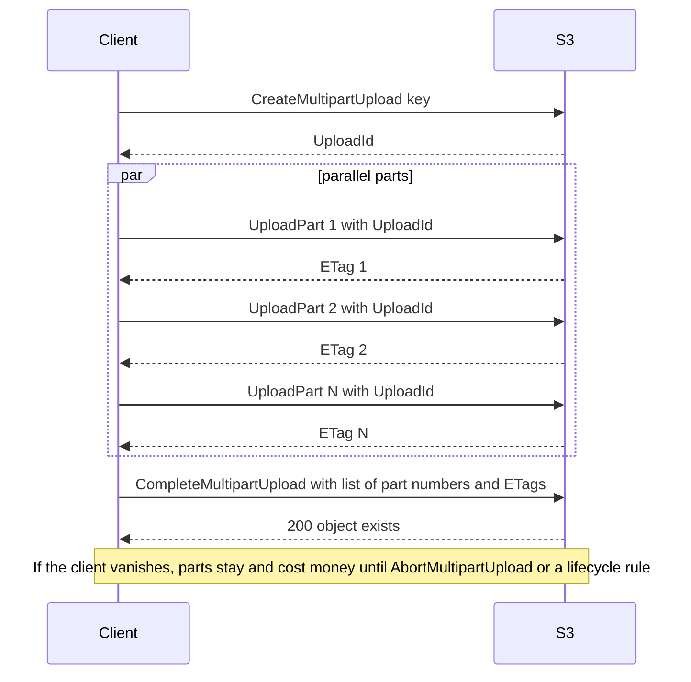
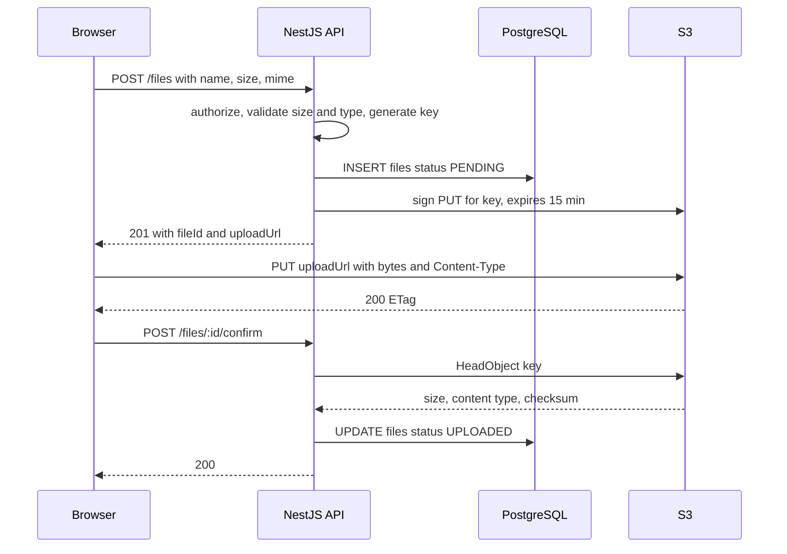

## 36.5 Small uploads through NestJS: FileInterceptor and busboy

#### Concept

There are two ways bytes can enter your system: through your API pods, or directly into S3 with your API only issuing permission. This section covers the first, because it is right for small files (a 200 KB avatar, a 2 MB CSV) and because you need to understand its cost to appreciate why large files must not use it.

`multer` (wrapped by NestJS's `FileInterceptor`) parses `multipart/form-data` and gives you the file as a buffer or a temp file. `busboy` is the streaming parser underneath `multer`; using it directly lets you pipe the incoming stream straight to S3 without buffering the whole file.

#### Why does it exist?

Sometimes the server must see the bytes before they are stored: to validate a CSV's header row, to strip EXIF GPS data from a photo, to scan a document synchronously, or because the client is a legacy integration that can only `POST` to your API. For files under a few megabytes, the simplicity of "one request, done" beats the pre-signed dance.

#### Mental model

Imagine a receptionist who accepts parcels. For a letter, the receptionist opens it, checks it, and files it: fast and safe. For a refrigerator, the receptionist should not carry it through the lobby; they should hand the courier a key to the loading dock. `FileInterceptor` is the receptionist opening letters. Pre-signed URLs are the loading-dock key.

#### How it works

1. The browser sends `Content-Type: multipart/form-data; boundary=...`. The body is a sequence of parts, each with headers and bytes.
2. `busboy` reads the request stream, finds boundaries, and emits `field` and `file` events. The `file` event hands you a readable stream of that part's bytes *while they are still arriving*.
3. `multer` on top of `busboy` collects each file into memory (`memoryStorage`) or a temp file (`diskStorage`) and calls your handler when the whole body has been read.
4. Your service validates, then writes to S3 with `PutObjectCommand` (buffer) or the `Upload` helper (stream, see 36.6).

Cost per upload through a pod: the request occupies a socket and a worker for the whole transfer; on a slow mobile connection a 5 MB upload can hold that for 30 seconds. Memory storage holds the whole file in the heap. Twenty concurrent 50 MB uploads through `memoryStorage` is 1 GB of heap and an `OOMKilled` pod.

#### Practical example

A ride-booking app lets drivers upload a profile photo (max 2 MB, JPEG or PNG). Requirements: strip EXIF metadata (GPS coordinates of where the photo was taken), resize to 512 by 512, store in S3, update the driver record. The server must see the bytes to strip and resize, the file is small, so `FileInterceptor` with memory storage is a reasonable choice.

#### NestJS example

```ts
// driver-photo.controller.ts
import {
  Controller, Post, Param, ParseUUIDPipe, UploadedFile, UseInterceptors,
  ParseFilePipe, MaxFileSizeValidator, BadRequestException, UseGuards,
} from '@nestjs/common';
import { FileInterceptor } from '@nestjs/platform-express';
import { memoryStorage } from 'multer';
import { JwtAuthGuard } from '../auth/jwt-auth.guard';
import { DriverPhotoService } from './driver-photo.service';
import { sniffImageType } from '../files/magic-bytes';

@Controller('drivers')
@UseGuards(JwtAuthGuard)
export class DriverPhotoController {
  constructor(private readonly photos: DriverPhotoService) {}

  @Post(':id/photo')
  @UseInterceptors(FileInterceptor('photo', {
    storage: memoryStorage(),
    limits: { fileSize: 2 * 1024 * 1024, files: 1, fields: 0 }, // multer aborts the stream past 2 MB
  }))
  async upload(
    @Param('id', ParseUUIDPipe) driverId: string,
    @UploadedFile(new ParseFilePipe({
      fileIsRequired: true,
      validators: [new MaxFileSizeValidator({ maxSize: 2 * 1024 * 1024 })],
    }))
    file: Express.Multer.File,
  ) {
    // Client mimetype is a hint; magic bytes are the truth.
    const detected = sniffImageType(file.buffer);
    if (detected !== 'image/jpeg' && detected !== 'image/png') {
      throw new BadRequestException('Only JPEG or PNG images are accepted');
    }
    return this.photos.replacePhoto(driverId, file.buffer, detected);
  }
}
```

```ts
// driver-photo.service.ts
import { Inject, Injectable, Logger } from '@nestjs/common';
import { S3Client, PutObjectCommand } from '@aws-sdk/client-s3';
import sharp from 'sharp';
import { S3_CLIENT } from '../s3/s3.module';
import { ObjectKeyService } from '../s3/object-key.service';
import { DriverRepository } from './driver.repository';

@Injectable()
export class DriverPhotoService {
  private readonly log = new Logger(DriverPhotoService.name);
  constructor(
    @Inject(S3_CLIENT) private readonly s3: S3Client,
    private readonly keys: ObjectKeyService,
    private readonly drivers: DriverRepository,
  ) {}

  async replacePhoto(driverId: string, input: Buffer, mime: string) {
    // sharp re-encodes the image: this drops EXIF (GPS) and neutralizes
    // polyglot files that are both a valid image and a valid script.
    const webp = await sharp(input).rotate().resize(512, 512, { fit: 'cover' }).webp({ quality: 82 }).toBuffer();
    const key = this.keys.build('derived', driverId, 'webp'); // new key every time, never overwrite
    await this.s3.send(new PutObjectCommand({
      Bucket: process.env.UPLOADS_BUCKET!, Key: key, Body: webp,
      ContentType: 'image/webp', CacheControl: 'public, max-age=31536000, immutable',
    }));
    const previousKey = await this.drivers.setPhotoKey(driverId, key); // returns old key
    this.log.log({ msg: 'driver photo replaced', driverId, key, previousKey, inMime: mime });
    // previousKey is deleted by a scheduled job after 24 h, not here, so CDN edges
    // and in-flight pages that still reference it do not break.
    return { key };
  }
}
```

When the server needs to see the bytes but must not hold them all in memory (a 200 MB CSV whose rows are inserted as they stream), use `busboy` directly and pipe to S3 and a parser at the same time:

```ts
// stream-upload.controller.ts
import { Controller, Post, Req, BadRequestException, PayloadTooLargeException } from '@nestjs/common';
import { Request } from 'express';
import busboy from 'busboy';
import { PassThrough } from 'node:stream';
import { Upload } from '@aws-sdk/lib-storage';
import { Inject } from '@nestjs/common';
import { S3Client } from '@aws-sdk/client-s3';
import { S3_CLIENT } from '../s3/s3.module';

@Controller('imports')
export class StreamUploadController {
  constructor(@Inject(S3_CLIENT) private readonly s3: S3Client) {}

  @Post('stream')
  async stream(@Req() req: Request): Promise<{ key: string; bytes: number }> {
    return new Promise((resolve, reject) => {
      const bb = busboy({ headers: req.headers, limits: { fileSize: 200 * 1024 * 1024, files: 1 } });
      let handled = false;

      bb.on('file', (_name, fileStream, info) => {
        handled = true;
        const key = `imports/${Date.now()}-${info.filename.replace(/[^\w.-]/g, '_').slice(0, 80)}`;
        const pass = new PassThrough();
        let bytes = 0;
        fileStream.on('data', (chunk: Buffer) => { bytes += chunk.length; });
        fileStream.on('limit', () => { pass.destroy(new PayloadTooLargeException('File exceeds 200 MB')); });
        fileStream.pipe(pass);

        // lib-storage Upload streams to S3 in 5 MB+ parts as bytes arrive.
        new Upload({ client: this.s3, params: { Bucket: process.env.UPLOADS_BUCKET!, Key: key, Body: pass, ContentType: 'text/csv' }, partSize: 8 * 1024 * 1024, queueSize: 3 })
          .done()
          .then(() => resolve({ key, bytes }))
          .catch(reject);
      });
      bb.on('error', reject);
      bb.on('finish', () => { if (!handled) reject(new BadRequestException('No file part')); });
      req.pipe(bb);
    });
  }
}
```

Memory stays flat regardless of file size because `PassThrough` applies backpressure: if S3 is slow, the request stream pauses.

#### PostgreSQL example

Store the outcome, not the bytes, and do it after S3 confirms the write:

```sql
UPDATE drivers
   SET photo_key = $2, photo_updated_at = now()
 WHERE id = $1
RETURNING (SELECT photo_key FROM drivers WHERE id = $1) AS previous_key;
```

The subselect runs before the update within the same statement, so you get the old key back for deferred deletion.

#### Production scenario

A pod handling 50 concurrent avatar uploads at 2 MB uses about 100 MB of extra heap for buffers plus `sharp` working memory (roughly 3 to 4 times the decoded image size per operation). Set container memory limits accordingly and cap concurrent uploads per pod with `limits` and a rate limiter (`@nestjs/throttler`) on the upload route. Upload latency end to end: 300 ms network plus 60 ms `sharp` plus 40 ms S3 `PUT` plus 3 ms PostgreSQL.

When not to do this: any file that can exceed 10 MB, any client on a slow network, any endpoint that is hot. Go to pre-signed URLs (36.7).

#### Failure scenario

A marketing team adds "upload your video testimonial" to the same `FileInterceptor` endpoint with `fileSize: 500 MB` and `memoryStorage`. During a campaign, 40 users upload at once. Each pod has a 1 GB memory limit. Three pods are `OOMKilled` within two minutes, Kubernetes restarts them, in-flight uploads fail, users retry, and the retry storm keeps the pods in `CrashLoopBackOff`. The API is down for everything, including checkout, because uploads share the deployment. Fix: pre-signed URLs for video, and a separate deployment for any endpoint that streams bytes.

#### Edge cases & failure modes

- `limits.fileSize` exceeded: multer emits an error mid-stream; make sure your exception filter maps `LIMIT_FILE_SIZE` to 413 and that the client sees it rather than a socket reset.
- Client sends `Content-Length` smaller than actual body; the parser hangs waiting; set `server.requestTimeout` and `headersTimeout`.
- Missing boundary in `Content-Type`: `busboy` throws synchronously in the constructor; wrap it.
- Nginx or ALB in front has its own body limit (`client_max_body_size` defaults to 1 MB in nginx); the 413 arrives before NestJS sees anything.
- `sharp` on a crafted image (decompression bomb: 1 KB PNG that decodes to 20,000 by 20,000 pixels) allocates 1.6 GB; set `sharp({ limitInputPixels })`.
- Two uploads for the same driver at the same time: last write wins on `photo_key`; the loser's object is orphaned until cleanup.

#### How a Senior Backend Engineer thinks about this

Through-the-API uploads are a budgeted resource, not a default. The senior sets a hard size ceiling (typically 5 to 10 MB), isolates upload endpoints into their own deployment or at least their own rate-limit bucket, always re-encodes images, and never lets a client filename touch a path or a key.

#### Common mistakes

- `memoryStorage` with no `limits`.
- Trusting `file.mimetype` (set by the browser from the extension).
- Doing image processing in the request when a queue would do; a 20 MB PNG resize blocks the event loop's thread pool for seconds.
- Deleting the old object synchronously before the CDN has moved on.

#### Interview questions

1. **What is the difference between `multer` and `busboy`?** Expected: busboy is the streaming parser; multer wraps it and buffers into memory or disk; use busboy directly to stream to S3 with bounded memory.
2. **Why re-encode uploaded images?** Expected: strips EXIF and metadata, defeats polyglot files, normalizes format; costs CPU.
3. **How do you protect a pod from a large upload?** Expected: size limits at LB, parser and validator; streaming; separate deployment; rate limiting; pre-signed URLs for anything big.
4. **What is backpressure and why does it matter here?** Expected: a slow consumer pauses the producer; without it buffers grow unbounded.

#### Practical exercise

Implement the streaming CSV import above and prove that memory stays flat: upload a 500 MB file while watching `process.memoryUsage().rss`. Acceptance criteria: RSS growth under 100 MB during the upload; the S3 object size equals the file size; a client disconnect at 50 percent aborts the multipart upload (check `ListMultipartUploads` is empty afterwards).

## 36.6 Multipart upload

#### Concept

Multipart upload splits one object into parts (5 MB to 5 GB each, up to 10,000 parts), uploads them independently, and then asks S3 to assemble them into a single object. Parts can be uploaded in parallel, retried individually, and the whole upload can be paused and resumed. It is mandatory above 5 GB and recommended above about 100 MB.

#### Why does it exist?

A single 3 GB `PUT` over a flaky connection fails at 2.9 GB and must restart from zero. It also uses one TCP connection, which on a high-latency link caps throughput. Multipart turns one fragile transfer into 300 small, retryable, parallel ones.

#### Mental model

Imagine shipping a car overseas. You could build one giant crate and hope the crane does not drop it. Or you ship it as numbered boxes on several trucks; if box 47 falls off, you resend box 47. The receiving dock reassembles the car when all boxes have arrived, and if you stop halfway the dock keeps the boxes in a corner until you either finish or tell them to throw them away. That corner costs rent every day.

#### How it works



1. `CreateMultipartUpload` returns an `UploadId`. The object does not exist yet.
2. `UploadPart` for each part number 1..N, each returning an `ETag`. Parts can arrive in any order and be re-uploaded (the last one for a part number wins).
3. `CompleteMultipartUpload` sends the ordered list of `{ PartNumber, ETag }`. S3 assembles the object. Only now does the key become visible.
4. `AbortMultipartUpload` discards parts. If nobody calls it, the parts sit in the bucket, billed at Standard rates, invisible to `LIST` and to the console's size view. A lifecycle rule `AbortIncompleteMultipartUpload` with `DaysAfterInitiation: 3` is mandatory hygiene.

Resuming: keep the `UploadId` and the list of `ETag`s you have. `ListParts` tells you which part numbers S3 already has. Upload the missing ones and complete.

The `ETag` of a multipart object is not the MD5 of the content; it is the MD5 of the concatenated part MD5s followed by `-N`. If you need a content checksum, use `ChecksumAlgorithm: 'SHA256'` on each part and the object gets a composite checksum, or compute your own SHA-256 as you stream (36.11).

#### Practical example

A video platform accepts 4 GB raw uploads from creators. Requirements: uploads from a browser, resumable after a laptop sleeps, no bytes through the API. The browser asks the API for an `UploadId` and a batch of pre-signed `UploadPart` URLs (36.7), uploads 8 parts at a time, stores progress in `localStorage`, and asks the API to complete when done. The API is involved for three tiny requests; the 4 GB go straight to S3.

#### NestJS example

Server side, when the server itself has the stream (an export generated by a worker, or the busboy case above), `@aws-sdk/lib-storage`'s `Upload` handles the whole multipart protocol:

```ts
// export-writer.service.ts
import { Inject, Injectable, Logger } from '@nestjs/common';
import { S3Client } from '@aws-sdk/client-s3';
import { Upload } from '@aws-sdk/lib-storage';
import { Readable } from 'node:stream';
import { S3_CLIENT } from '../s3/s3.module';

@Injectable()
export class ExportWriterService {
  private readonly log = new Logger(ExportWriterService.name);
  constructor(@Inject(S3_CLIENT) private readonly s3: S3Client) {}

  async writeCsv(key: string, rows: AsyncIterable<string>): Promise<{ key: string; etag?: string }> {
    const body = Readable.from(rows); // rows streamed from a PostgreSQL cursor
    const upload = new Upload({
      client: this.s3,
      params: { Bucket: process.env.EXPORTS_BUCKET!, Key: key, Body: body, ContentType: 'text/csv' },
      partSize: 10 * 1024 * 1024, // 10 MB parts; 5 MB is the minimum
      queueSize: 4,               // 4 parts in flight in parallel
      leavePartsOnError: false,   // abort the multipart upload if anything fails
    });
    upload.on('httpUploadProgress', (p) => this.log.debug({ key, loaded: p.loaded, part: p.part }));
    const result = await upload.done();
    return { key, etag: result.ETag };
  }
}
```

Client-driven multipart, where the API only coordinates:

```ts
// multipart.service.ts
import { Inject, Injectable } from '@nestjs/common';
import {
  S3Client, CreateMultipartUploadCommand, UploadPartCommand,
  CompleteMultipartUploadCommand, AbortMultipartUploadCommand, ListPartsCommand,
} from '@aws-sdk/client-s3';
import { getSignedUrl } from '@aws-sdk/s3-request-presigner';
import { S3_CLIENT } from '../s3/s3.module';

@Injectable()
export class MultipartService {
  private readonly bucket = process.env.UPLOADS_BUCKET!;
  constructor(@Inject(S3_CLIENT) private readonly s3: S3Client) {}

  async start(key: string, contentType: string) {
    const res = await this.s3.send(new CreateMultipartUploadCommand({
      Bucket: this.bucket, Key: key, ContentType: contentType,
    }));
    return { uploadId: res.UploadId! };
  }

  // Issue a batch of part URLs; the browser PUTs each part directly to S3.
  async signParts(key: string, uploadId: string, from: number, to: number) {
    const urls: { partNumber: number; url: string }[] = [];
    for (let n = from; n <= to; n++) {
      const url = await getSignedUrl(this.s3, new UploadPartCommand({
        Bucket: this.bucket, Key: key, UploadId: uploadId, PartNumber: n,
      }), { expiresIn: 3600 });
      urls.push({ partNumber: n, url });
    }
    return urls;
  }

  async listUploadedParts(key: string, uploadId: string) {
    const res = await this.s3.send(new ListPartsCommand({ Bucket: this.bucket, Key: key, UploadId: uploadId }));
    return (res.Parts ?? []).map((p) => ({ partNumber: p.PartNumber!, etag: p.ETag!, size: p.Size! }));
  }

  async complete(key: string, uploadId: string, parts: { partNumber: number; etag: string }[]) {
    return this.s3.send(new CompleteMultipartUploadCommand({
      Bucket: this.bucket, Key: key, UploadId: uploadId,
      MultipartUpload: { Parts: parts.sort((a, b) => a.partNumber - b.partNumber).map((p) => ({ PartNumber: p.partNumber, ETag: p.etag })) },
    }));
  }

  async abort(key: string, uploadId: string) {
    await this.s3.send(new AbortMultipartUploadCommand({ Bucket: this.bucket, Key: key, UploadId: uploadId }));
  }
}
```

The browser reads the `ETag` response header from each part `PUT`; the bucket's CORS configuration must include `ExposeHeaders: ["ETag"]` or the browser cannot read it.

#### PostgreSQL example

Track in-progress multipart uploads so you can abort them when the user gives up, and so a restart of the API does not lose the `UploadId`:

```sql
CREATE TABLE multipart_uploads (
  file_id     uuid PRIMARY KEY REFERENCES files(id),
  upload_id   text NOT NULL,
  parts_total int  NOT NULL,
  started_at  timestamptz NOT NULL DEFAULT now(),
  last_seen_at timestamptz NOT NULL DEFAULT now()
);
-- A janitor job: abort uploads idle for 24 h and mark the file FAILED.
SELECT file_id, upload_id FROM multipart_uploads WHERE last_seen_at < now() - interval '24 hours';
```

#### Production scenario

Throughput: a browser uploading 8 parts of 10 MB in parallel to same-continent S3 typically reaches 50 to 150 Mbit/s on a home connection, limited by the uplink, not S3. From an EC2 instance in the same region, `Upload` with `queueSize: 8` pushes 500 MB/s or more. Monitoring: count of in-progress uploads (from your table), age of the oldest, `AbortMultipartUpload` rate, and a monthly check of `ListMultipartUploads` on each bucket, which should be near empty if the lifecycle rule works.

#### Failure scenario

A data team runs a nightly job that streams 40 GB of Parquet to S3 with a home-grown multipart client. On failure it logs and exits without aborting. Nine months later the finance team asks why the "empty" analytics bucket costs $900 per month. `ListMultipartUploads` shows 38 TB of orphaned parts. A single lifecycle rule would have cost nothing.

#### Edge cases & failure modes

- Part smaller than 5 MB that is not the last part: `CompleteMultipartUpload` fails with `EntityTooSmall`.
- Same part number uploaded twice: the later one wins; make sure your retry uses the newest `ETag`.
- `CompleteMultipartUpload` can take seconds for thousands of parts and may return 200 with an error in the body; the SDK handles this, hand-rolled clients often do not.
- The completed object's `ETag` is not an MD5; do not use it for dedup.
- Abandoned uploads are invisible in normal listings and cost money forever without a lifecycle rule.
- Pre-signed part URLs that expire mid-upload: issue in batches and re-sign on 403.
- Client clock skew invalidates SigV4 signatures with `RequestTimeTooSkewed` (tolerance 15 minutes).

#### How a Senior Backend Engineer thinks about this

Multipart is the default for anything above 100 MB, and the abort story is designed before the upload story. The senior insists on the lifecycle rule as a Terraform-managed bucket default, tracks `UploadId`s in the database, and never lets a browser hold the only copy of state needed to finish.

#### Common mistakes

- Uploading a 2 GB file with a single `PutObject` from a browser and calling the failure "network issues".
- Forgetting `ExposeHeaders: ETag` in CORS, so the browser cannot complete.
- No abort path, no lifecycle rule, no monitoring of orphaned parts.

#### Interview questions

1. **Walk me through multipart upload and where its state lives.** Expected: create, parts with ETags, complete; state is the UploadId plus ETags, kept by the client and preferably mirrored in your database.
2. **What happens to parts if the client disappears?** Expected: billed until abort; lifecycle `AbortIncompleteMultipartUpload`.
3. **Why is the ETag of a multipart object not usable as a checksum?** Expected: it is an MD5 of part MD5s with a part count suffix.
4. **How do you resume an upload after a browser restart?** Expected: persist UploadId and key; `ListParts` to find what S3 has; upload the rest; complete.

#### Practical exercise

Build a resumable browser upload: the API issues `UploadId` and signed part URLs in batches of 10; the browser uploads 4 parts in parallel and stores progress in `localStorage`; a "resume" button calls `ListParts` via the API and continues. Acceptance criteria: killing the tab at 60 percent and resuming uploads only the missing parts; abandoning the upload and waiting for the janitor produces zero entries in `ListMultipartUploads`.

## 36.7 Pre-signed URLs

#### Concept

A pre-signed URL is a normal S3 URL with a signature attached that grants whoever holds it the right to perform exactly one operation (`PUT` this key, or `GET` this key) until an expiry time. Your API creates it using its own IAM credentials and hands it to the browser. The browser then talks to S3 directly. Your pods never see the bytes.

A pre-signed `POST` (a "POST policy") is the same idea for HTML form uploads, with the extra ability to constrain content length range and content type in the signed policy.

#### Why does it exist?

Every byte that passes through a NestJS pod costs event-loop time, memory, a socket, and a load balancer's bandwidth, and adds a hop's worth of latency and failure. S3 can absorb terabytes per second; your pod can absorb maybe 100 MB/s. Pre-signed URLs let S3 do the byte work while your API keeps control of *who may upload what, where, and how big*.

#### Mental model

Imagine a hotel that gives guests a key card valid for one room for one night. The front desk (your API) checks identity, decides which room (the key), programs the expiry, and hands over the card. The guest walks to the room on their own; the receptionist does not carry the luggage. If the card is lost, the finder can open that one room until midnight, which is why the card is scoped and short-lived.

#### How it works



1. **Issue.** The client asks the API for permission, sending the intended content type and size. The API authorizes the user, checks quotas, generates a key, writes a `PENDING` row, and signs a `PutObjectCommand` for that key with `expiresIn` of a few minutes. If `ContentType` (and optionally `ContentLength`) are in the signed command, the browser must send exactly those headers or S3 rejects with 403.
2. **Upload.** The browser `PUT`s to the signed URL. S3 verifies the signature, expiry and any signed headers, stores the object, returns 200.
3. **Confirm.** The browser tells the API it is done. The API runs `HeadObject` to verify the object exists with the expected size and type, then moves the row to `UPLOADED` and enqueues processing (36.11). Without this step the database believes in files that may never have arrived.

Expiry: the URL is valid until `expiresIn` seconds after signing, and never longer than the signing credentials are valid. A pod using an IAM role has STS credentials that rotate (typically valid up to 6 to 12 hours). Signing with `expiresIn: 7 days` using role credentials produces a URL that silently dies when the role credentials expire. Keep upload URLs to 5 to 15 minutes and download URLs to minutes, not days.

POST policies: `createPresignedPost` from `@aws-sdk/s3-presigned-post` builds a set of form fields and a policy document. Conditions like `['content-length-range', 1, 10485760]` and `['starts-with', '$Content-Type', 'image/']` are enforced by S3 at upload time. This is the only way to enforce a size cap on a browser upload; a pre-signed `PUT` can pin an exact `Content-Length` but cannot say "at most".

#### Practical example

An e-commerce seller portal lets sellers upload product images up to 10 MB. Flow: `POST /products/:id/images` returns a `fileId` and POST policy fields; the browser submits the form to S3; then `POST /files/:fileId/confirm`. The API pods handle two tiny JSON requests per image. At 5,000 image uploads per hour, that is nothing; the same traffic through the pods would be 50 GB per hour of body streaming.

#### NestJS example

```ts
// create-upload.dto.ts
import { IsIn, IsInt, IsString, Max, MaxLength, Min } from 'class-validator';

export class CreateUploadDto {
  @IsString() @MaxLength(255) filename!: string;      // display only, never used in the key
  @IsIn(['image/jpeg', 'image/png', 'image/webp', 'application/pdf']) mimeType!: string;
  @IsInt() @Min(1) @Max(10 * 1024 * 1024) sizeBytes!: number;
}
```

```ts
// presign.service.ts
import { Inject, Injectable } from '@nestjs/common';
import { S3Client, PutObjectCommand, GetObjectCommand } from '@aws-sdk/client-s3';
import { getSignedUrl } from '@aws-sdk/s3-request-presigner';
import { createPresignedPost } from '@aws-sdk/s3-presigned-post';
import { S3_CLIENT } from '../s3/s3.module';

@Injectable()
export class PresignService {
  private readonly bucket = process.env.UPLOADS_BUCKET!;
  constructor(@Inject(S3_CLIENT) private readonly s3: S3Client) {}

  // Pre-signed PUT: simplest; pins Content-Type and exact Content-Length.
  async signPut(key: string, mimeType: string, sizeBytes: number) {
    const cmd = new PutObjectCommand({ Bucket: this.bucket, Key: key, ContentType: mimeType, ContentLength: sizeBytes });
    return getSignedUrl(this.s3, cmd, { expiresIn: 15 * 60 });
  }

  // POST policy: enforces a size RANGE and a content-type prefix at S3.
  async signPost(key: string, mimePrefix: string, maxBytes: number) {
    return createPresignedPost(this.s3, {
      Bucket: this.bucket,
      Key: key,
      Conditions: [
        ['content-length-range', 1, maxBytes],
        ['starts-with', '$Content-Type', mimePrefix],
        { 'x-amz-server-side-encryption': 'aws:kms' },
      ],
      Fields: { 'x-amz-server-side-encryption': 'aws:kms' },
      Expires: 15 * 60,
    }); // returns { url, fields }; the browser posts fields plus the file as multipart form
  }

  // Download: short expiry; force a safe filename and disposition.
  async signGet(key: string, downloadName: string, inline = false) {
    const disposition = `${inline ? 'inline' : 'attachment'}; filename="${downloadName.replace(/["\r\n]/g, '')}"`;
    const cmd = new GetObjectCommand({ Bucket: this.bucket, Key: key, ResponseContentDisposition: disposition });
    return getSignedUrl(this.s3, cmd, { expiresIn: 5 * 60 });
  }
}
```

```ts
// files.controller.ts
import { Body, Controller, Param, ParseUUIDPipe, Post, Req, UseGuards } from '@nestjs/common';
import { Throttle } from '@nestjs/throttler';
import { JwtAuthGuard } from '../auth/jwt-auth.guard';
import { CreateUploadDto } from './create-upload.dto';
import { FilesService } from './files.service';

@Controller('files')
@UseGuards(JwtAuthGuard)
export class FilesController {
  constructor(private readonly files: FilesService) {}

  @Post()
  @Throttle({ default: { limit: 30, ttl: 60_000 } }) // 30 URL issuances per minute per user
  create(@Req() req: { user: { id: string; tenantId: string } }, @Body() dto: CreateUploadDto) {
    return this.files.createPendingUpload(req.user, dto); // { fileId, upload: { url, fields } }
  }

  @Post(':id/confirm')
  confirm(@Req() req: { user: { id: string } }, @Param('id', ParseUUIDPipe) id: string) {
    return this.files.confirmUpload(req.user.id, id);
  }
}
```

`FilesService` is shown in full in 36.14.

#### PostgreSQL example

Issuing URLs is cheap for you and useful for an abuser (they can fill your bucket). Track issuance:

```sql
-- Per-user pending quota check inside createPendingUpload
SELECT count(*) FILTER (WHERE status = 'PENDING' AND created_at > now() - interval '1 hour') AS pending_last_hour,
       coalesce(sum(size_bytes) FILTER (WHERE status IN ('UPLOADED','PROCESSED')), 0) AS stored_bytes
  FROM files
 WHERE owner_id = $1;
```

Refuse to issue a new URL when `pending_last_hour` exceeds a threshold (say 100) or `stored_bytes` exceeds the plan's quota.

#### Production scenario

A document-heavy SaaS issues 200,000 pre-signed URLs per day. Signing is local CPU work (HMAC-SHA256), about 0.2 ms, no network call, so the API cost is the JSON request itself. The bucket's CORS rule allows `PUT` and `POST` from the app origin only, with `MaxAgeSeconds: 3000` so the browser does not preflight every upload. Observability: a metric for URLs issued vs confirmed per hour; if the confirm ratio drops below 90 percent, something in the browser flow is broken (CORS change, expired URLs, S3 outage).

When not to use pre-signed URLs: when the server must transform or inspect the bytes synchronously before storing (rare; usually async processing is fine), or when the client cannot reach S3 directly (locked-down corporate networks that only allow your domain; a CloudFront distribution in front of the upload bucket with signed URLs solves that too).

#### Failure scenario

At 11:05 a deploy changes the bucket CORS configuration while tightening security and drops `PUT` from `AllowedMethods`. Every browser upload fails with a CORS error, which the browser reports as a generic network failure. The API sees nothing: URLs are issued fine, confirm calls never arrive. Only the "issued vs confirmed" metric moves. The on-call notices 40 minutes later from a support ticket. Action items: alert on confirm ratio, test the full browser flow in CI against a staging bucket, manage CORS in Terraform with review.

#### Edge cases & failure modes

- URL leaked: anyone with it can upload to *that key* (PUT) or read *that object* (GET) until expiry. Mitigation: short expiry, per-file keys, confirm step, and the fact that a PUT URL cannot be used to write anywhere else.
- URL reused: a PUT URL can be used many times until expiry; the last body wins. The confirm step and processing pipeline should treat the object as untrusted until scanned; after `PROCESSED`, the object should be copied to a final key or the upload URL long expired.
- Signed headers mismatch: signing with `ContentType` but the browser sending a different one gives a 403 `SignatureDoesNotMatch`; the error is opaque, log the signed headers.
- Clock skew on the client's machine affects nothing (the signature carries the server's time), but skew on the *signing* pod does; keep NTP healthy.
- Credential expiry shorter than `expiresIn` silently kills long URLs.
- S3 returns `SlowDown` (503) under burst; the browser must retry with backoff.
- Presigned GET of a non-existent key returns a valid-looking URL that 404s; check the row status before signing downloads.
- User deleted between issue and confirm: confirm must re-authorize, not trust the row.

#### How a Senior Backend Engineer thinks about this

The senior treats a pre-signed URL as a bearer token with a narrow scope and a short life. They put the size constraint in the POST policy where S3 enforces it, they never trust an upload that has not been confirmed and scanned, and they measure the issue-to-confirm funnel because it is the only visibility they have into a flow that bypasses their servers.

#### Common mistakes

- `expiresIn: 604800` (7 days) "so the link in the email keeps working"; use a short-lived redirect endpoint instead (36.13).
- Issuing PUT URLs with no size constraint and no quota.
- Skipping the confirm step and marking the file as uploaded when the URL is issued.
- Using one wildcard key like `uploads/${userId}/*` in the policy; a POST policy can require an exact key or a prefix, choose exact.

#### Interview questions

1. **Why should large uploads not pass through the API?** Expected: pod CPU, memory, sockets, LB bandwidth, latency, failure surface; S3 scales, pods do not.
2. **How do you cap upload size for a browser upload that goes directly to S3?** Expected: POST policy `content-length-range`; pre-signed PUT can pin an exact `Content-Length` only.
3. **What happens if a pre-signed URL leaks?** Expected: scoped to one operation and key until expiry; keep expiry short; confirm and scan; do not put secrets in keys.
4. **Why do you need a confirm endpoint?** Expected: the API otherwise cannot know whether the upload happened; `HeadObject` verifies; it triggers processing and prevents orphans.
5. **What limits the maximum expiry of a pre-signed URL?** Expected: 7 days hard limit for SigV4, and the lifetime of the credentials used to sign; role credentials are hours.

#### Practical exercise

Implement the issue, upload and confirm flow with a POST policy limiting uploads to 10 MB and `image/` types. Acceptance criteria: an 11 MB upload is rejected by S3 (not by your API); a `text/html` upload is rejected by S3; a confirm on a file that was never uploaded returns 409 and leaves the row `PENDING`; the confirm ratio metric appears in Prometheus.
