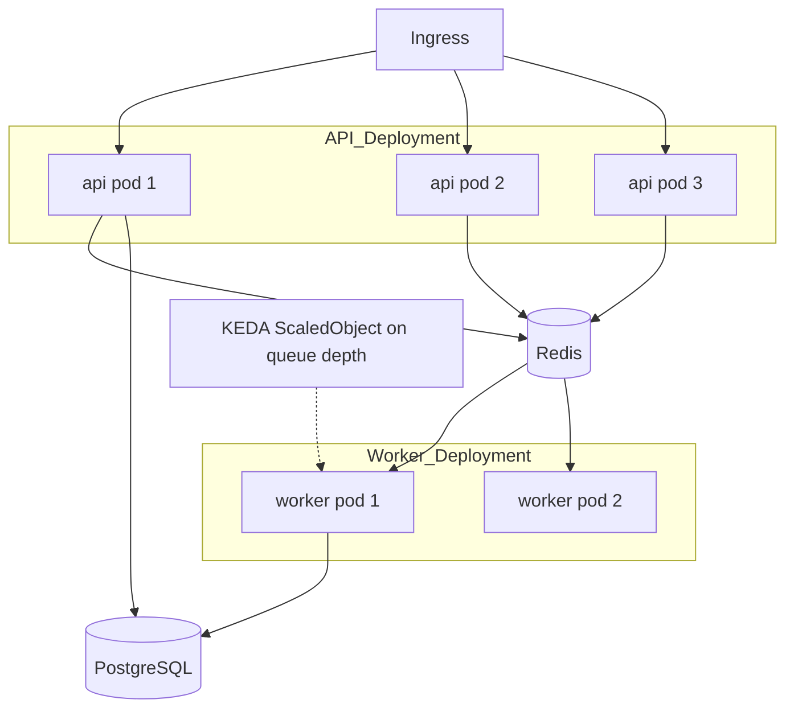
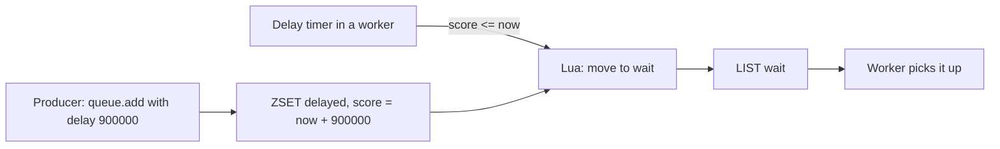

## 36.3 Workers as a separate deployment

### 36.3.1 Why workers do not belong in the API pods

#### Concept

A worker is a process that runs `Worker` instances and no HTTP server. It ships from the same repository and the same Docker image as the API, but it is a **different Kubernetes Deployment**, with a different command, different replica count, different resource limits and different scaling rules.

The tempting alternative is to let the API pods also run the processors. It works on day one. It is one of the most reliable ways to cause a checkout outage on day 200.

#### Why does it exist?

Four independent reasons, and any one of them is sufficient.

**Resource contention.** Node.js is single-threaded for your JavaScript. A worker rendering a PDF with a CPU-bound library blocks the event loop for 400 ms. If that process is also serving HTTP, every request queued behind it waits 400 ms. Your p99 becomes a function of PDF sizes. We measured this once: adding image thumbnailing to API pods moved p99 from 210 ms to 3.4 s while p50 barely moved, which is the signature of event-loop blocking.

**Different scaling signals.** The API scales on requests per second and CPU. The worker scales on **queue depth**. These move independently: at 03:00 the API is idle and the nightly report queue has 12,000 jobs. If they share a Deployment you either over-provision the API all night or under-provision the workers.

**Different failure blast radius.** A worker that leaks memory gets OOMKilled. If it is an API pod, you just dropped in-flight customer requests. If it is a worker pod, BullMQ's stalled-job detection re-queues the job and nobody notices.

**Different deploy risk.** You often want to pause workers during a risky migration while keeping the API serving reads. You cannot do that if they are the same pods.

#### Mental model

Imagine a shop with a counter and a back room. The counter serves customers: fast, interruptible, always staffed. The back room does stock-taking, packing and paperwork: slow, batched, can be paused. Putting both in the same person means every customer waits while that person counts boxes. Every business that has ever existed separates them. Do the same.

#### How it works



One image, two entrypoints. The API bootstraps the HTTP server; the worker bootstraps a Nest application context with the processor modules and no listener.

```ts
// main.worker.ts
import { NestFactory } from '@nestjs/core';
import { Logger } from 'nestjs-pino';
import { WorkerAppModule } from './worker-app.module';

async function bootstrap() {
  // createApplicationContext: DI, config, database, processors -- but no HTTP listener.
  const app = await NestFactory.createApplicationContext(WorkerAppModule, { bufferLogs: true });
  app.useLogger(app.get(Logger));

  // Kubernetes sends SIGTERM; enableShutdownHooks wires it into onModuleDestroy.
  app.enableShutdownHooks();

  const log = new Logger('worker');
  log.log(`worker started, queues=${process.env.WORKER_QUEUES}`);
}
bootstrap();
```

```dockerfile
# One image, two commands.
# api:    CMD ["node", "dist/main.js"]
# worker: CMD ["node", "dist/main.worker.js"]
```

Which queues a pod serves comes from configuration, so you can split hot queues onto their own Deployment later without a code change:

```ts
// worker-app.module.ts (fragment)
const enabled = (process.env.WORKER_QUEUES ?? 'notifications,documents,integrations').split(',');

@Module({
  imports: [
    QueuesModule,
    ...(enabled.includes('notifications') ? [NotificationModule] : []),
    ...(enabled.includes('documents') ? [DocumentModule] : []),
    ...(enabled.includes('integrations') ? [IntegrationModule] : []),
  ],
})
export class WorkerAppModule {}
```

### 36.3.2 Scaling on queue depth

CPU is the wrong signal for a worker that spends 95 percent of its time waiting on a third-party HTTP call. The right signal is **how much work is waiting** and, better, **how old the oldest waiting job is**.

With KEDA on Kubernetes:

```yaml
apiVersion: keda.sh/v1alpha1
kind: ScaledObject
metadata:
  name: notifications-worker
spec:
  scaleTargetRef:
    name: notifications-worker
  minReplicaCount: 2      # never zero for a queue with an SLA on latency
  maxReplicaCount: 20
  pollingInterval: 15
  cooldownPeriod: 120     # do not thrash; workers are expensive to start
  triggers:
    - type: redis
      metadata:
        address: redis.prod.svc.cluster.local:6379
        listName: "bull:prod:notifications:wait"
        listLength: "200"   # target: 200 waiting jobs per replica
```

Two production notes. First, `minReplicaCount: 0` is attractive for cost but means the first job after a quiet period waits for a cold start, which for a Node image with a database connection pool is 8 to 25 seconds. For anything user-visible, keep at least one. Second, `cooldownPeriod` matters more than you think: a queue that spikes and drains every 30 seconds will otherwise start and kill pods continuously, and a pod killed mid-job produces a stalled job.

### 36.3.3 Graceful shutdown

#### Concept

When Kubernetes wants a pod gone it sends `SIGTERM`, waits `terminationGracePeriodSeconds` (default 30), then sends `SIGKILL`. A worker that ignores `SIGTERM` gets killed mid-job. That job is not lost — BullMQ will eventually detect it as stalled and retry it — but "eventually" is up to `stalledInterval` (default 30 s) times `maxStalledCount`, and the retry may duplicate side effects.

Correct behaviour on `SIGTERM`: **stop taking new jobs, finish the current ones, then exit.**

#### NestJS example

`@nestjs/bullmq` closes its workers in `onModuleDestroy`, and `worker.close()` in BullMQ waits for active jobs to finish by default. So `app.enableShutdownHooks()` plus a correct grace period is most of the work. Make it explicit and observable:

```ts
// common/worker-lifecycle.service.ts
import { Injectable, Logger, OnApplicationShutdown } from '@nestjs/common';
import { InjectQueue } from '@nestjs/bullmq';
import { Queue } from 'bullmq';

@Injectable()
export class WorkerLifecycleService implements OnApplicationShutdown {
  private readonly log = new Logger(WorkerLifecycleService.name);

  constructor(@InjectQueue('documents') private readonly queue: Queue) {}

  async onApplicationShutdown(signal?: string) {
    this.log.warn({ signal }, 'shutdown signal received, draining worker');
    // Nest closes the Worker for us; this hook is where we flush metrics,
    // close the tracer and log how long the drain took.
    const t0 = Date.now();
    await this.queue.close();
    this.log.warn({ drainMs: Date.now() - t0 }, 'worker drained');
  }
}
```

```yaml
spec:
  template:
    spec:
      # Must be longer than your longest job, plus a margin.
      terminationGracePeriodSeconds: 120
      containers:
        - name: worker
          image: orders:2.14.3
          command: ["node", "dist/main.worker.js"]
          resources:
            requests: { cpu: "250m", memory: "512Mi" }
            limits:   { memory: "1Gi" }
```

The rule: `terminationGracePeriodSeconds` must exceed your p99 job duration. If your PDF job takes 90 seconds at p99 and your grace period is 30, every deploy kills roughly one PDF job per pod and produces a duplicate invoice on retry. That is a real incident I have watched happen, and the fix was a one-line YAML change.

For very long jobs (a 40-minute export), do not raise the grace period to 40 minutes. Make the job **checkpointed and resumable** instead — see 36.10.

### 36.3.4 CPU-bound jobs and worker threads

Node.js runs your JavaScript on one thread. A job that spends 3 seconds in `sharp`, `pdfkit`, `zlib.gzipSync`, `JSON.parse` of a 60 MB string, or a crypto loop blocks that thread. With `concurrency: 10`, the other nine jobs are frozen. Worse, BullMQ's own heartbeat — the timer that renews the job lock — is also frozen, so a long synchronous block causes your *own* job to be declared stalled and re-run by another worker. That is the mechanism behind "the report generated three times".

Three fixes, in order of preference:

1. **Use the async API.** `sharp` is async and does its work on libuv's threadpool. `zlib.gzip` is async. `crypto.pbkdf2` is async. Most heavy native libraries have a non-blocking variant, and it uses the threadpool for free. Raise `UV_THREADPOOL_SIZE` (default 4) to about your concurrency if you lean on it.
2. **Move the work to a `worker_thread`.** BullMQ supports a sandboxed processor: pass a file path instead of a function and each job runs in a separate process. In a NestJS app that means giving up DI inside the handler, so many teams instead use a small typed pool.
3. **Move the work out of Node entirely.** Image and video processing at scale belongs in a dedicated service (or a Lambda, or ffmpeg in its own container). Node is a poor CPU host and an excellent orchestrator.

```ts
// documents/pdf.worker.ts  (runs inside a worker_thread)
import { parentPort, workerData } from 'node:worker_threads';
import { renderInvoicePdf } from './render-invoice';

(async () => {
  const buffer = await renderInvoicePdf(workerData.invoice);
  parentPort!.postMessage(buffer, [buffer.buffer]); // transfer, do not copy
})();
```

```ts
// documents/pdf-pool.service.ts
import { Injectable } from '@nestjs/common';
import { Worker } from 'node:worker_threads';
import { join } from 'node:path';

@Injectable()
export class PdfPoolService {
  render(invoice: InvoiceView, timeoutMs = 20_000): Promise<Buffer> {
    return new Promise((resolve, reject) => {
      const w = new Worker(join(__dirname, 'pdf.worker.js'), { workerData: { invoice } });
      const timer = setTimeout(() => { w.terminate(); reject(new Error('pdf render timeout')); }, timeoutMs);
      w.once('message', (buf: Buffer) => { clearTimeout(timer); resolve(buf); });
      w.once('error', (err) => { clearTimeout(timer); reject(err); });
      w.once('exit', (code) => { if (code !== 0) reject(new Error(`pdf worker exit ${code}`)); });
    });
  }
}
```

Spawning a thread costs 10 to 30 ms, so for jobs under about 100 ms of CPU it is not worth it. Above that it is the difference between a healthy worker and a stalled one.

### 36.3.5 Memory per job

Budget memory as `concurrency x peak RSS per job + baseline`. A Node process baseline with a Nest app, TypeORM and a connection pool is 120 to 200 MB. A PDF job peaks at 180 MB. At `concurrency: 10` you are asking for 2 GB, and your limit is 1 Gi, so the pod is OOMKilled roughly every 40 minutes and you get duplicate invoices.

The senior move is to size concurrency per queue rather than globally:

| Queue | Work | Concurrency | Memory limit | Why |
|---|---|---|---|---|
| `notifications` | HTTP call to a mail provider | 30 | 512 Mi | I/O bound, tiny heap per job |
| `integrations` | HTTP call to partner APIs | 20 | 512 Mi | I/O bound, rate-limited anyway |
| `documents` | PDF render | 3 | 1 Gi | 180 MB peak per job |
| `exports` | CSV of 2M rows, streamed | 2 | 1 Gi | streamed, but holds a DB cursor |

Also set `--max-old-space-size` a little **below** the container limit (for a 1 Gi limit, use `--max-old-space-size=768`). Otherwise V8 happily grows past the cgroup limit and the kernel kills the process without a JavaScript heap error, giving you an `OOMKilled` with no stack trace and no clue.

#### Edge cases & failure modes

- Worker pod killed mid-job because the grace period is shorter than the job.
- Autoscaler scaling to zero and the first job of the morning waiting 20 s for a cold start.
- A CPU-bound job freezing the lock heartbeat and causing self-inflicted stalls.
- `UV_THREADPOOL_SIZE` of 4 throttling ten concurrent `sharp` calls to four at a time.
- Workers sharing a database connection pool sized for the API, exhausting PostgreSQL `max_connections` when the autoscaler adds ten pods (see Part 19 — PostgreSQL Internals; use PgBouncer).
- One worker Deployment serving all queues, so a poison job in `documents` starves `notifications`.

## 36.4 Scheduled jobs

### 36.4.1 Cron in a single process

#### Concept

A **scheduled job** runs on a clock rather than in response to an event: the nightly settlement at 02:00, the hourly stock sync, the every-five-minutes retry sweep. `@nestjs/schedule` gives you `@Cron`, `@Interval` and `@Timeout` decorators backed by an in-process timer.

```ts
// billing/settlement.scheduler.ts
import { Injectable, Logger } from '@nestjs/common';
import { Cron, CronExpression } from '@nestjs/schedule';

@Injectable()
export class SettlementScheduler {
  private readonly log = new Logger(SettlementScheduler.name);

  @Cron('0 2 * * *', { name: 'nightly-settlement', timeZone: 'Asia/Kolkata' })
  async runNightlySettlement() {
    this.log.log('starting nightly settlement');
    await this.settlement.run();
  }
}
```

This is correct, simple and completely wrong in production the moment you have more than one replica.

#### Failure scenario

At 02:00 on 14 March, the nightly settlement ran. It ran five times, because the `orders-api` Deployment had five replicas and `@Cron` fires in every process. Each run read the day's unsettled orders, created payout rows and called the payment provider's payout API. The provider is idempotent per idempotency key, and the code did not send one. Three of the five runs raced past the `WHERE settled = false` check before any of them wrote `settled = true`. Merchants were paid three times, totalling about 4.1 crore rupees. Recovery took nine days and a lot of apologetic phone calls.

The bug was one line: a cron decorator in a module that was imported by the API, which runs with `replicas: 5`.

#### The three correct answers

**Answer 1: run the scheduler in exactly one process.** Put `ScheduleModule.forRoot()` and every `@Cron` class in a dedicated Deployment with `replicas: 1` and `strategy: Recreate`. Simple, obvious, and it has a real weakness: during a rolling deploy or a node failure there is a window with zero schedulers, so a job scheduled in that window never fires. Acceptable for "refresh the cache" and unacceptable for "settle payments".

**Answer 2: let the queue own the schedule.** BullMQ repeatable jobs store the schedule in Redis. Any number of processes may declare the same repeatable job; Redis holds one entry, and exactly one job instance is produced per tick, then consumed by exactly one worker.

```ts
// billing/settlement-schedule.service.ts
import { Injectable, OnApplicationBootstrap } from '@nestjs/common';
import { InjectQueue } from '@nestjs/bullmq';
import { Queue } from 'bullmq';

@Injectable()
export class SettlementScheduleService implements OnApplicationBootstrap {
  constructor(@InjectQueue('billing') private readonly queue: Queue) {}

  async onApplicationBootstrap() {
    // Declaring the same repeatable job from every replica is safe:
    // the repeat key is derived from name + pattern + tz, so it is upserted, not duplicated.
    await this.queue.add(
      'settlement.nightly',
      { v: 1 },
      {
        repeat: { pattern: '0 2 * * *', tz: 'Asia/Kolkata' },
        // A deterministic id per fire time is added by BullMQ itself; keep attempts low
        // because a settlement retry must be deliberate, not automatic.
        attempts: 1,
        removeOnComplete: { count: 100 },
        removeOnFail: { age: 30 * 24 * 3600 },
      },
    );
  }
}
```

Newer BullMQ versions expose `queue.upsertJobScheduler(id, repeatOpts, template)`, which makes the upsert explicit and lets you change a schedule without hunting for the old repeat key. Either way, the rule is: **changing a cron pattern does not remove the old one.** You must call `queue.removeRepeatable(...)` or `queue.removeJobScheduler(id)` for the old pattern, or you will silently run both. Teams discover this when a job starts running at both 02:00 and 03:00.

**Answer 3: put the schedule in PostgreSQL and claim it with a lock.** This is the most durable and the one I reach for when the job is financially significant, because the schedule, the claim and the business writes can all live in one transaction.

### 36.4.2 A `job_schedules` table claimed with SKIP LOCKED

```sql
CREATE TABLE job_schedules (
  id              text PRIMARY KEY,               -- 'nightly-settlement'
  cron            text        NOT NULL,           -- '0 2 * * *'
  timezone        text        NOT NULL DEFAULT 'UTC',
  enabled         boolean     NOT NULL DEFAULT true,
  next_run_at     timestamptz NOT NULL,
  last_run_at     timestamptz,
  last_status     text,                           -- 'ok' | 'failed'
  running_until   timestamptz,                    -- lease held by the current runner
  runner_id       text,                           -- pod name, for debugging
  catch_up        boolean     NOT NULL DEFAULT false
);

-- The scheduler only ever scans due rows, so index exactly that.
CREATE INDEX idx_job_schedules_due
  ON job_schedules (next_run_at)
  WHERE enabled;
```

Every replica runs a cheap tick every 10 seconds. The tick tries to claim due rows; `FOR UPDATE SKIP LOCKED` means the losers do not block, they just find nothing.

```sql
-- One tick. Runs inside a transaction, in every replica, every 10 seconds.
WITH due AS (
  SELECT id
  FROM job_schedules
  WHERE enabled
    AND next_run_at <= now()
    AND (running_until IS NULL OR running_until < now())
  ORDER BY next_run_at
  FOR UPDATE SKIP LOCKED
  LIMIT 5
)
UPDATE job_schedules s
SET running_until = now() + interval '10 minutes',
    runner_id     = $1,
    last_run_at   = now()
FROM due
WHERE s.id = due.id
RETURNING s.id, s.cron, s.timezone, s.catch_up, s.next_run_at;
```

Whoever gets a row runs the job, then sets `next_run_at` from the cron expression and clears the lease. Whoever gets nothing goes back to sleep. There is no leader election, no ZooKeeper, no distributed lock service — just a row and a transaction.

```ts
// scheduler/db-scheduler.service.ts
import { Injectable, Logger } from '@nestjs/common';
import { Cron, CronExpression } from '@nestjs/schedule';
import { DataSource } from 'typeorm';
import { CronExpressionParser } from 'cron-parser';

@Injectable()
export class DbSchedulerService {
  private readonly log = new Logger(DbSchedulerService.name);
  private readonly runnerId = process.env.HOSTNAME ?? 'local';

  constructor(private readonly ds: DataSource, private readonly registry: JobRegistry) {}

  // Safe to run in every replica: the claim is what serializes it.
  @Cron(CronExpression.EVERY_10_SECONDS, { name: 'schedule-tick' })
  async tick(): Promise<void> {
    const claimed = await this.ds.transaction(async (em) =>
      em.query(CLAIM_DUE_SQL, [this.runnerId]),
    );

    for (const row of claimed) {
      try {
        await this.registry.run(row.id);
        await this.finish(row, 'ok');
      } catch (err) {
        this.log.error({ scheduleId: row.id, err }, 'scheduled job failed');
        await this.finish(row, 'failed');
      }
    }
  }

  private async finish(row: ScheduleRow, status: 'ok' | 'failed') {
    // Compute the next fire time in the schedule's own timezone, from "now",
    // so a slow run does not cause an immediate second run.
    const next = CronExpressionParser.parse(row.cron, { tz: row.timezone }).next().toDate();
    await this.ds.query(
      `UPDATE job_schedules
          SET next_run_at = $2, running_until = NULL, runner_id = NULL, last_status = $3
        WHERE id = $1`,
      [row.id, next, status],
    );
  }
}
```

Notice `running_until`. If the pod holding the lease dies, the lease expires after ten minutes and another replica picks the job up. That is a **lease**, not a lock, and it is why a job can run twice: if the first pod was merely slow (a 12-minute run under a 10-minute lease), two pods run it concurrently. Set the lease longer than the p99 run time, and heartbeat it for long jobs (36.7).

### 36.4.3 Timezones, DST, and the 2 a.m. problem

#### Concept

Cron expressions are wall-clock expressions. Wall clocks in most of the world jump twice a year. A job scheduled at `0 2 * * *` in `America/New_York`:

- On the spring-forward Sunday, 02:00 **does not exist**. The clock goes 01:59:59 then 03:00:00. The job does not run that day.
- On the fall-back Sunday, 02:00 **happens twice**. Naive schedulers run the job twice.

If that job is "settle yesterday's payments", one of those outcomes is a missing day of payouts and the other is double payouts.

#### How to handle it

1. **Schedule financially significant jobs in UTC.** `tz: 'UTC'` with `0 21 * * *` never skips and never repeats. Then convert to local time for the *business logic* ("yesterday" in `Asia/Kolkata`), not for the *trigger*. This is the single best fix and it costs nothing.
2. **If it must be local, avoid 00:00 to 03:00.** A job at `0 4 * * *` is immune to DST in every timezone that shifts at 02:00 or 03:00.
3. **Make the job idempotent on its business day.** A settlement job that takes a `business_date` and has a unique constraint on `(business_date)` in a `settlement_runs` table simply cannot run twice, DST or not. This is the belt to the UTC braces.
4. **Store the timezone with the schedule, never rely on the pod's `TZ`.** Containers default to UTC; developers' laptops do not. A cron that works locally and fires 5.5 hours late in production is a classic.

```sql
-- Idempotency for a daily job, enforced by the database, not by the scheduler.
CREATE TABLE settlement_runs (
  business_date date PRIMARY KEY,
  started_at    timestamptz NOT NULL DEFAULT now(),
  finished_at   timestamptz,
  status        text NOT NULL DEFAULT 'running',
  runner_id     text NOT NULL
);

-- The job's first statement. If it conflicts, another run owns this date: exit quietly.
INSERT INTO settlement_runs (business_date, runner_id)
VALUES ($1, $2)
ON CONFLICT (business_date) DO NOTHING
RETURNING business_date;
```

If that `RETURNING` gives you zero rows, someone else has the day. Log and return. Five replicas, a DST double-fire and a manual re-trigger all collapse into exactly one settlement.

### 36.4.4 Missed runs and the catch-up policy

The scheduler was down from 01:40 to 02:30 (a bad deploy, a node drain, a Redis failover). Three jobs should have fired. What now? There is no universal right answer, so **decide per job and write it down**.

| Policy | Behaviour | Use for |
|---|---|---|
| **Skip** | Ignore missed fires; next run is the next scheduled time | Cache warmers, metric rollups that recompute from scratch, health sweeps |
| **Run once** | Fire immediately, once, regardless of how many were missed | Sync jobs whose work is "reconcile current state" |
| **Catch up all** | Fire once per missed slot, in order | Per-period jobs: daily settlement, hourly billing snapshots |
| **Alert only** | Do not run; page a human | Anything where an unsupervised late run is dangerous |

With the `job_schedules` table this is a `catch_up boolean` column and three lines in `finish()`: if `catch_up` is true, advance `next_run_at` by exactly one cron step from the *previous* `next_run_at` rather than from `now()`, so the scheduler naturally walks forward through the missed slots one tick at a time. If it is false, compute from `now()` and skip the gap.

Guard the catch-up: if the gap is more than, say, 24 slots, do not run 24 settlements at 09:00 on a Monday. Cap it, log loudly, and page. "The scheduler was down for two days and then fired 48 hourly billing jobs in ninety seconds" is its own incident.

## 36.5 Delayed jobs

### 36.5.1 The mechanism

#### Concept

A **delayed job** is enqueued now and becomes runnable at a future time. `delay: 900_000` means "not before fifteen minutes from now". It is not "exactly in fifteen minutes"; it is "no earlier than".

#### How it works

BullMQ stores delayed jobs in a Redis **sorted set** (`ZADD`) scored by the timestamp at which they become runnable. A worker keeps a timer for the earliest score. When that time arrives, a Lua script atomically moves every job whose score has passed from `delayed` into `wait` (or `prioritized`), and normal workers pick them up.



Consequences you must understand:

- **Cost is O(log n) per insert** and memory is one sorted-set entry plus one job hash per delayed job. Two million delayed jobs is real memory; measure it.
- **Precision is best-effort.** Expect delivery within a second of the deadline on a healthy system, and a burst when the system was unhealthy.
- **If Redis has no persistence, delayed jobs die with it.** A 15-minute payment timeout is a business rule; storing it only in a non-persistent Redis is storing a business rule in a cache. See 36.10.

### 36.5.2 The canonical example: cancel unpaid orders after 15 minutes

#### Practical example

The requirement: when a customer places an order with "pay later" (UPI intent, bank transfer, cash-on-delivery verification), hold the inventory for 15 minutes. If payment has not arrived, cancel the order and release the stock.

The naive implementation is a cron every minute scanning for `status = 'awaiting_payment' AND created_at < now() - interval '15 minutes'`. That works, and for low volume it is genuinely the right answer — it is simple, it is durable, and it self-heals after downtime. Its cost is a table scan (or an index scan on a partial index) every minute forever, and up to 60 seconds of imprecision.

The delayed-job implementation is precise and costs nothing when idle:

```ts
// orders/orders.service.ts (fragment)
await this.expiryQueue.add(
  'order.expire',
  { v: 1, orderId: order.id },
  {
    delay: 15 * 60 * 1000,
    // Deterministic id so a retry of the HTTP request cannot schedule two expiries.
    jobId: `expire:${order.id}`,
    attempts: 3,
    backoff: { type: 'exponential', delay: 30_000 },
  },
);
```

```ts
// orders/order-expiry.processor.ts
@Processor('order-expiry', { concurrency: 20 })
export class OrderExpiryProcessor extends WorkerHost {
  private readonly log = new Logger(OrderExpiryProcessor.name);

  constructor(private readonly ds: DataSource) { super(); }

  async process(job: Job<{ orderId: string }>) {
    const { orderId } = job.data;

    // Re-check state inside a transaction with a row lock. The payload is 15 minutes
    // old and is only a hint that we should LOOK, never a statement of fact.
    return this.ds.transaction(async (em) => {
      const order = await em.findOne(Order, {
        where: { id: orderId },
        lock: { mode: 'pessimistic_write' },   // SELECT ... FOR UPDATE
      });

      if (!order) return { skipped: 'gone' };
      if (order.status !== 'awaiting_payment') {
        // Paid, cancelled by the user, or already expired. All fine. Do nothing.
        return { skipped: order.status };
      }

      order.status = 'expired';
      order.expiredAt = new Date();
      await em.save(order);
      await this.inventory.releaseReservation(em, order.id); // same transaction
      this.log.log({ orderId }, 'order expired, stock released');
      return { expired: true };
    });
  }
}
```

### 36.5.3 Cancellation when payment arrives first

There are two ways to handle "the customer paid at minute 4, so the expiry job must not fire".

**Option A: remove the job.** Because we used a deterministic `jobId`, the payment handler can delete it.

```ts
// payments/payment-confirmed.handler.ts
const job = await this.expiryQueue.getJob(`expire:${orderId}`);
// remove() throws if the job is currently active; that is fine, the state check saves us.
await job?.remove().catch(() => undefined);
```

**Option B: let it fire and no-op.** The handler already checks state, sees `status = 'paid'`, and returns.

**Do both, and rely only on B.** Removing the job is an optimization that keeps Redis small and keeps the dashboard clean. The state check is the correctness mechanism. This is the most important sentence in this section:

> A delayed job's payload describes the world at enqueue time. By the time it runs, that world is minutes or hours old. The job's first act must be to re-read the current state and decide whether the action is still appropriate.

Every delayed-job bug I have debugged in fifteen years is a violation of that rule: the "abandoned cart" email sent to someone who checked out, the "your trial ends tomorrow" email to a paying customer, the subscription cancelled after the user renewed, the order expired after payment landed in a webhook the code raced against.

#### Failure scenario

A payments team stored the amount in the delayed job payload: `{ orderId, amountToRefund: 4999 }`. Between enqueue and execution the customer removed an item and the order total dropped to 2499. The job refunded 4999. Twelve thousand orders over three weeks, discovered by finance, not by monitoring. Payload said 4999; the database said 2499; nobody asked the database.

#### Edge cases & failure modes

- A delay longer than your Redis retention or your maxmemory eviction policy will silently drop jobs. Set `maxmemory-policy noeviction` on a Redis used as a queue. `allkeys-lru` on a queue Redis is a data-loss bug.
- Delays of days or weeks belong in PostgreSQL, not a Redis sorted set. Anything beyond about 24 hours: put a row with a `due_at` column and sweep it.
- After an outage, thousands of delayed jobs become runnable at the same instant and overwhelm downstream services. Add a queue limiter, and consider jittering delays by a few seconds at enqueue time.
- Clock skew between the producer and Redis shifts every delay. Redis's own clock decides; producers only supply a duration, which is why `delay` is a duration and not a timestamp.
- Cancelling by `remove()` fails silently if the job is already active. Only the state check protects you.

#### Interview questions

1. *How would you implement "cancel unpaid orders after 15 minutes" and what are the trade-offs?* Expected: delayed job for precision versus a periodic sweep for durability and simplicity; both require a state re-check; ideally run the sweep as a safety net alongside the delayed job.
2. *Your cron job ran five times last night. Why?* Expected: `@Cron` fires per process and the Deployment has five replicas. Follow-up: three fixes, and which one you would pick for a payout job.
3. *What happens to a `0 2 * * *` job on the DST fall-back night?* Expected: 02:00 occurs twice, so it can run twice; the fixes are UTC scheduling, avoiding 00:00 to 03:00, and a unique constraint on the business date.
4. *Where does BullMQ store delayed jobs and what does that imply?* Expected: a Redis sorted set scored by run-at time, moved to `wait` by a Lua script; implies memory cost, best-effort precision, and total loss if Redis has no persistence.
5. *Why must a delayed job re-read state?* Expected: the payload is a stale snapshot; give the refund-amount or cancel-after-payment example.

#### Practical exercise

Implement order expiry twice: once as a BullMQ delayed job and once as a PostgreSQL sweep over a partial index on `(created_at) WHERE status = 'awaiting_payment'`.

Acceptance criteria: with 50,000 pending orders, measure the sweep's `EXPLAIN (ANALYZE, BUFFERS)` cost per minute and the Redis memory used by 50,000 delayed jobs; kill Redis without persistence and show the delayed jobs are gone while the sweep still works; pay an order at minute 4 and prove with a test that neither implementation cancels it; restart the app during a delay and prove the job still fires.
