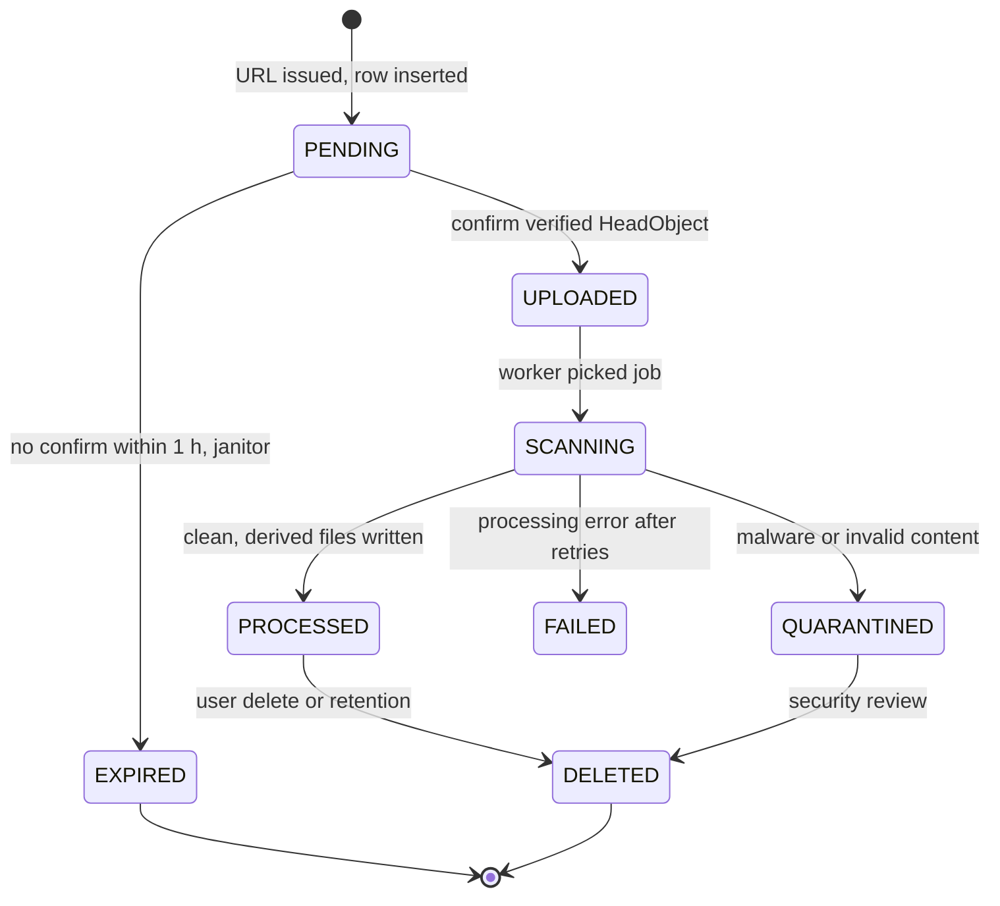
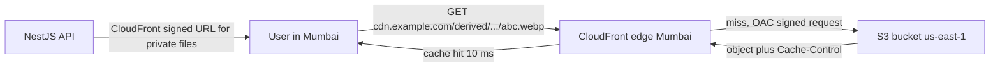
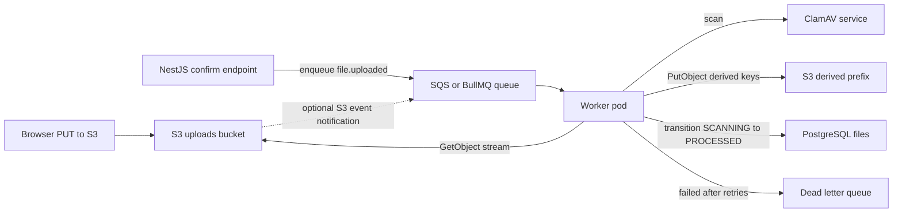

## 36.8 File metadata: the files table and its state machine

#### Concept

S3 knows bytes. PostgreSQL knows *facts*: who owns the file, what it is for, whether it has been scanned, whether it is safe to show, which product it belongs to. The `files` table is the system of record for those facts, and its `status` column is a state machine that tells the rest of the application what it may do with the object.

#### Why does it exist?

Without a metadata table you end up listing S3 to answer "what files does this user have", trusting S3 metadata that the uploader controlled, and having no way to say "this file exists but has not been virus-scanned yet". The state machine is what makes a direct-to-S3 upload safe: the object can land in the bucket at any time, but nothing in the app treats it as real until the row says so.

#### Mental model

Imagine a parcel locker at a post office. Anyone with a code can drop a parcel in a locker (the upload). But the parcel is not "delivered" until a clerk opens the locker, checks the label and weight, scans it for anything dangerous, and writes it into the ledger. The ledger, not the locker, is what the counter staff look at when a customer asks "did my parcel arrive?".

#### How it works



Rules that the state machine enforces:

1. Only `PROCESSED` files can be delivered to other users. `UPLOADED` files can be shown back to the uploader as "processing".
2. Transitions are made with a conditional `UPDATE ... WHERE status = 'expected'` so two workers cannot both process the same file, and a late confirm cannot resurrect an `EXPIRED` file.
3. `PENDING` rows older than the URL expiry plus a grace period are the *orphan candidates*: either the upload never happened (delete the row) or it happened and confirm was lost (a janitor calls `HeadObject`, and if the object exists, promotes to `UPLOADED`).
4. Every transition writes `updated_at` and, for failures, a `failure_reason`, so support can answer "why is my file stuck".

#### Practical example

A marketplace stores seller documents (business license, ID). Sellers upload, see "under review", and the compliance team sees only `PROCESSED` documents with a clean scan and extracted text. A document whose scan flags malware goes to `QUARANTINED`, the seller sees "rejected", and security gets a ticket. A document uploaded but never confirmed (seller closed the tab) is cleaned up after an hour.

#### NestJS example

Transitions are centralized so no controller changes `status` directly:

```ts
// file-status.ts
export enum FileStatus {
  PENDING = 'PENDING', UPLOADED = 'UPLOADED', SCANNING = 'SCANNING',
  PROCESSED = 'PROCESSED', QUARANTINED = 'QUARANTINED', FAILED = 'FAILED',
  EXPIRED = 'EXPIRED', DELETED = 'DELETED',
}

export const ALLOWED_TRANSITIONS: Record<FileStatus, FileStatus[]> = {
  [FileStatus.PENDING]: [FileStatus.UPLOADED, FileStatus.EXPIRED],
  [FileStatus.UPLOADED]: [FileStatus.SCANNING],
  [FileStatus.SCANNING]: [FileStatus.PROCESSED, FileStatus.QUARANTINED, FileStatus.FAILED],
  [FileStatus.PROCESSED]: [FileStatus.DELETED],
  [FileStatus.QUARANTINED]: [FileStatus.DELETED],
  [FileStatus.FAILED]: [FileStatus.SCANNING, FileStatus.DELETED], // manual retry
  [FileStatus.EXPIRED]: [],
  [FileStatus.DELETED]: [],
};
```

#### PostgreSQL example

```sql
CREATE TYPE file_status AS ENUM ('PENDING','UPLOADED','SCANNING','PROCESSED','QUARANTINED','FAILED','EXPIRED','DELETED');

CREATE TABLE files (
  id               uuid PRIMARY KEY DEFAULT gen_random_uuid(),
  tenant_id        uuid NOT NULL,
  owner_id         uuid NOT NULL REFERENCES users(id),
  bucket           text NOT NULL,
  key              text NOT NULL,
  original_name    text NOT NULL,             -- display only, sanitized
  declared_mime    text NOT NULL,             -- what the client said
  detected_mime    text,                      -- what magic bytes said, set by worker
  size_bytes       bigint,
  checksum_sha256  text,
  status           file_status NOT NULL DEFAULT 'PENDING',
  scan_status      text,                      -- 'clean', 'infected:Trojan.X', null
  failure_reason   text,
  created_at       timestamptz NOT NULL DEFAULT now(),
  updated_at       timestamptz NOT NULL DEFAULT now(),
  UNIQUE (bucket, key)
);

CREATE INDEX files_owner_idx    ON files (owner_id, created_at DESC) WHERE status <> 'DELETED';
CREATE INDEX files_pending_idx  ON files (created_at) WHERE status = 'PENDING';   -- janitor scan
CREATE INDEX files_checksum_idx ON files (tenant_id, checksum_sha256) WHERE checksum_sha256 IS NOT NULL; -- dedup

-- Derived files (thumbnails, extracted text) point at their source.
CREATE TABLE file_derivatives (
  id         uuid PRIMARY KEY DEFAULT gen_random_uuid(),
  file_id    uuid NOT NULL REFERENCES files(id) ON DELETE CASCADE,
  kind       text NOT NULL,       -- 'thumb_256', 'thumb_1024', 'pdf_text'
  bucket     text NOT NULL,
  key        text NOT NULL,
  size_bytes bigint,
  UNIQUE (file_id, kind)
);
```

The conditional transition:

```sql
UPDATE files
   SET status = 'UPLOADED', size_bytes = $2, detected_mime = $3, updated_at = now()
 WHERE id = $1 AND status = 'PENDING'
RETURNING id;
-- zero rows returned means someone else moved it or it expired: do not proceed
```

#### TypeORM example

```ts
// file.entity.ts
import { Entity, PrimaryGeneratedColumn, Column, CreateDateColumn, UpdateDateColumn, Index, Unique } from 'typeorm';
import { FileStatus } from './file-status';

@Entity('files')
@Unique(['bucket', 'key'])
@Index(['ownerId', 'createdAt'])
export class FileRecord {
  @PrimaryGeneratedColumn('uuid') id!: string;
  @Column({ type: 'uuid', name: 'tenant_id' }) tenantId!: string;
  @Column({ type: 'uuid', name: 'owner_id' }) ownerId!: string;
  @Column({ type: 'text' }) bucket!: string;
  @Column({ type: 'text' }) key!: string;
  @Column({ type: 'text', name: 'original_name' }) originalName!: string;
  @Column({ type: 'text', name: 'declared_mime' }) declaredMime!: string;
  @Column({ type: 'text', name: 'detected_mime', nullable: true }) detectedMime!: string | null;
  @Column({ type: 'bigint', name: 'size_bytes', nullable: true }) sizeBytes!: string | null; // bigint comes back as string
  @Column({ type: 'text', name: 'checksum_sha256', nullable: true }) checksumSha256!: string | null;
  @Column({ type: 'enum', enum: FileStatus, default: FileStatus.PENDING }) status!: FileStatus;
  @Column({ type: 'text', name: 'failure_reason', nullable: true }) failureReason!: string | null;
  @CreateDateColumn({ type: 'timestamptz', name: 'created_at' }) createdAt!: Date;
  @UpdateDateColumn({ type: 'timestamptz', name: 'updated_at' }) updatedAt!: Date;
}
```

```ts
// file.repository.ts (transition helper)
import { Injectable } from '@nestjs/common';
import { InjectRepository } from '@nestjs/typeorm';
import { Repository } from 'typeorm';
import { FileRecord } from './file.entity';
import { FileStatus, ALLOWED_TRANSITIONS } from './file-status';

@Injectable()
export class FileRepository {
  constructor(@InjectRepository(FileRecord) private readonly repo: Repository<FileRecord>) {}

  /** Returns true if the transition happened; false if the row was not in `from`. */
  async transition(id: string, from: FileStatus, to: FileStatus, patch: Partial<FileRecord> = {}): Promise<boolean> {
    if (!ALLOWED_TRANSITIONS[from].includes(to)) throw new Error(`Illegal transition ${from} -> ${to}`);
    const result = await this.repo.createQueryBuilder()
      .update(FileRecord)
      .set({ ...patch, status: to })
      .where('id = :id AND status = :from', { id, from })
      .execute();
    return (result.affected ?? 0) === 1;
  }
}
```

#### Sequelize example

```ts
// file.model.ts
import { Table, Column, Model, DataType, PrimaryKey, Default } from 'sequelize-typescript';

@Table({ tableName: 'files', underscored: true, timestamps: true })
export class FileModel extends Model {
  @PrimaryKey @Default(DataType.UUIDV4) @Column(DataType.UUID) id!: string;
  @Column(DataType.UUID) tenantId!: string;
  @Column(DataType.UUID) ownerId!: string;
  @Column(DataType.TEXT) bucket!: string;
  @Column(DataType.TEXT) key!: string;
  @Column(DataType.BIGINT) sizeBytes!: number | null;
  @Column(DataType.TEXT) checksumSha256!: string | null;
  @Column(DataType.ENUM('PENDING','UPLOADED','SCANNING','PROCESSED','QUARANTINED','FAILED','EXPIRED','DELETED')) status!: string;
}

// Conditional transition: affected-row count is the truth.
const [affected] = await FileModel.update(
  { status: 'UPLOADED', sizeBytes: head.ContentLength },
  { where: { id: fileId, status: 'PENDING' } },
);
if (affected !== 1) throw new ConflictException('File is not pending');
```

#### Production scenario

A files table for a mid-size SaaS: 40 million rows, 25 GB. The partial index on `PENDING` rows stays tiny (a few thousand rows) so the janitor query runs in milliseconds every minute. The dedup index on `(tenant_id, checksum_sha256)` lets a second upload of the same invoice reuse the existing object: the new row points at the same key, and a reference count (or a `DELETE` guarded by "no other row uses this key") governs physical deletion.

Orphan cleanup, two directions:

- Rows without objects: `PENDING` older than 1 hour, `HeadObject` says 404, mark `EXPIRED`.
- Objects without rows: a weekly S3 Inventory report (a CSV of every key) joined against the `files` table in a batch job; unknown keys older than 7 days are deleted. Never do this with `LIST` at scale.

#### Failure scenario

A confirm endpoint bug marks files `PROCESSED` directly, skipping the scan. Three weeks later an uploaded "invoice.pdf" that is actually a malware dropper is downloaded by 200 customer-support agents from the admin panel. The state machine existed but was bypassed by one `repo.save({ status: 'PROCESSED' })`. The fix is the `transition()` helper as the only write path to `status`, with a database-level check: a trigger that rejects `PROCESSED` unless `scan_status = 'clean'`.

#### Edge cases & failure modes

- Confirm called twice: second call finds `UPLOADED`, returns 200 idempotently instead of 409.
- Confirm called before the browser's `PUT` finished (a client bug): `HeadObject` 404s; return 409 and let the client retry after upload.
- Row deleted while the worker processes it: the worker's transition affects 0 rows; it must abort and delete any derivative it wrote.
- Same checksum, different tenants: never dedup across tenants (cross-tenant existence leak).
- `bigint` in TypeORM is returned as a string; compare as strings or `BigInt`.
- Janitor and confirm race: both try `PENDING -> X`; the conditional update guarantees exactly one wins.

#### How a Senior Backend Engineer thinks about this

The row is the truth, the object is a payload. The senior designs the state machine first, makes `status` writable only through a guarded transition, adds the janitor on day one, and refuses to serve any file the pipeline has not blessed.

#### Common mistakes

- No `status` column: "if the row exists the file exists".
- Storing the CDN URL in the row.
- Physical delete in S3 inside the HTTP request that deletes the row; if the S3 call fails the row is gone and the object lingers forever. Mark `DELETED`, let a job delete bytes.

#### Interview questions

1. **Why is a `status` column necessary when uploads go directly to S3?** Expected: the API cannot see the upload happen; the object is untrusted until confirmed and scanned.
2. **How do you find orphaned objects in a bucket with 50 million keys?** Expected: S3 Inventory joined with the table in a batch job.
3. **How do you prevent two workers processing the same file?** Expected: conditional `UPDATE ... WHERE status = 'UPLOADED'` claiming into `SCANNING`.

#### Practical exercise

Implement the state machine with the `transition()` helper and a database trigger enforcing `PROCESSED` requires `scan_status = 'clean'`. Acceptance criteria: an attempt to save `PROCESSED` without a clean scan fails at the database; running two workers against the same `UPLOADED` row results in exactly one processing.

## 36.9 CDN delivery

#### Concept

A Content Delivery Network (CDN) is a fleet of caching proxies at the edge of the internet, close to users. CloudFront in front of S3 means a user in Mumbai fetches a product image from an edge in Mumbai (10 ms) instead of from a bucket in Virginia (250 ms), and S3 sees one request per edge per cache lifetime instead of one per user.

#### Why does it exist?

Latency (distance), cost (S3 request fees and egress are higher than CloudFront's), and load (S3 and your origin see a fraction of requests). Also security: the bucket stays private, CloudFront is the only principal allowed to read it (Origin Access Control), and private content is gated with CloudFront signed URLs or signed cookies.

#### Mental model

Imagine a publisher with one printing press in one city. Instead of mailing every copy from the press, they stock copies in every city's bookshop. The shop only orders from the press when it runs out. For members-only books, the shop asks to see a membership card (signed cookie) before handing the book over.

#### How it works

1. DNS points `cdn.example.com` at the CloudFront distribution.
2. The distribution has the S3 bucket as origin, with OAC so S3 accepts requests only from this distribution.
3. On a request, the edge checks its cache by URL (and any headers or query strings you configured as part of the cache key). Miss: fetch from S3, cache according to `Cache-Control` or the distribution's default TTL, return.
4. Private content: your API generates a *CloudFront* signed URL (different from an S3 pre-signed URL) with an expiry, using a private key registered in a CloudFront key group. Or it sets signed cookies so a whole set of paths (`/tenants/42/*`) becomes accessible for a session.
5. Invalidation: `CreateInvalidation` with paths purges them from every edge. It takes seconds to minutes and costs about $0.005 per path beyond 1,000 per month. The correct design makes invalidation unnecessary: every new version of a file gets a *new key* and long `Cache-Control: immutable`.
6. Image resizing on the fly: a small service (Lambda@Edge, or a NestJS image service behind CloudFront) that takes `/img/{key}?w=400` and produces a resized variant; CloudFront caches the result so the resize happens once per size per image.



#### Practical example

Product images: public, immutable, new key per version, `Cache-Control: public, max-age=31536000, immutable`, served via `cdn.example.com`. Cache hit ratio above 95 percent. Invoices: private, `Cache-Control: private, no-store`, served via CloudFront signed URLs that expire in 5 minutes, issued by the API after an authorization check.

#### NestJS example

```ts
// cdn-url.service.ts
import { Injectable } from '@nestjs/common';
import { getSignedUrl } from '@aws-sdk/cloudfront-signer';

@Injectable()
export class CdnUrlService {
  private readonly base = process.env.CDN_BASE_URL!;            // https://cdn.example.com
  private readonly keyPairId = process.env.CF_KEY_PAIR_ID!;
  private readonly privateKey = process.env.CF_PRIVATE_KEY!;    // from a secret manager, PEM

  /** Public immutable asset: plain URL, cached for a year at the edge. */
  publicUrl(key: string): string {
    return `${this.base}/${encodeURI(key)}`;
  }

  /** Private file: CloudFront signed URL, 5 minute expiry. */
  privateUrl(key: string, ttlSeconds = 300): string {
    return getSignedUrl({
      url: `${this.base}/${encodeURI(key)}`,
      keyPairId: this.keyPairId,
      privateKey: this.privateKey,
      dateLessThan: new Date(Date.now() + ttlSeconds * 1000).toISOString(),
    });
  }
}
```

#### Production scenario

A catalog serving 50 million image views per day: with a 96 percent hit ratio, S3 sees 2 million `GET`s per day (about $25 per month in requests) and CloudFront delivers roughly 15 TB per month at about $0.085 per GB for the first 10 TB (approximate US pricing, S3 to CloudFront transfer is free). Median image latency drops from 180 ms to 25 ms worldwide. Monitor: cache hit ratio, 4xx and 5xx rates per distribution, origin latency.

#### Failure scenario

A team stores avatars at `avatars/{userId}.jpg` and overwrites on change, with a 24-hour CDN TTL. A user uploads a new photo and sees the old one. Support says "clear your cache". The team adds an invalidation call per upload; at 20,000 avatar changes per day the invalidation bill is $100 per day and edges still lag by a minute. The fix, in one line: new key per version, immutable caching, invalidation removed.

#### Edge cases & failure modes

- CDN caches a 403 or 404 from a not-yet-available object (`Error Caching Minimum TTL` defaults to 10 seconds for some codes, configurable); set error TTL low for private paths.
- Query strings ignored in the cache key by default; if `?w=400` matters, add it to the cache policy.
- `Vary: Origin` and CORS headers must be forwarded and cached correctly or the browser blocks image drawing to canvas.
- Signed cookies do not work cross-domain; the CDN must be on a subdomain of the app.
- A CloudFront private key leak lets anyone sign; rotate via key groups.
- Regional S3 outage: CloudFront origin failover to a replica bucket in another region using an origin group.

#### How a Senior Backend Engineer thinks about this

Immutable keys plus long TTLs is the whole strategy; invalidation is a sign the design is wrong. The senior keeps the bucket private, puts CloudFront in the read path for everything users see, and keeps the API out of the byte path entirely.

#### Common mistakes

- Serving S3 pre-signed URLs to browsers for public images (no caching, request fees, slow).
- Overwriting keys and fighting the cache.
- One distribution and one cache policy for public and private content.

#### Interview questions

1. **S3 pre-signed URL vs CloudFront signed URL: when each?** Expected: S3 pre-signed for uploads and rare downloads; CloudFront signed for delivery of private content at the edge with caching.
2. **How do you handle a replaced image without invalidation?** Expected: new key per version, immutable cache headers.
3. **What is OAC and why does it matter?** Expected: lets CloudFront read a private bucket; users cannot bypass the CDN.

#### Practical exercise

Put CloudFront with OAC in front of a private bucket; serve public images with immutable caching and invoices with signed URLs. Acceptance criteria: direct bucket URL returns 403; a replaced image is visible worldwide immediately because its key changed; a signed invoice URL stops working after 5 minutes.

## 36.10 Lifecycle policies

#### Concept

A lifecycle policy is a set of rules on a bucket that S3 applies automatically: move objects matching a prefix or tag to a cheaper storage class after N days, expire them after M days, delete old non-current versions, and abort incomplete multipart uploads. It is how you keep storage cost from growing forever without writing cleanup code.

#### Why does it exist?

Files accumulate. Temp exports, abandoned uploads, superseded versions, logs, thumbnails for deleted products. Nobody is paid to delete them. Lifecycle rules encode the retention decision once and run daily, for free.

#### Mental model

Imagine a records office with a written policy: "paperwork under a year old stays in the front cabinets; one to seven years goes to the basement; after seven years it is shredded; abandoned half-filled forms are binned after three days." The clerks follow it every night without being told.

#### How it works

Rules are evaluated once a day per object. A rule has a filter (prefix, tags, size range), and actions:

| Action | Typical setting | Why |
|---|---|---|
| `Transition` to Standard-IA | 30 days after creation | Reads drop off after a month; IA is about half the price |
| `Transition` to Glacier Instant | 180 days | Compliance archives that are rarely read |
| `Expiration` | 7 days for `exports/`, 1 day for `tmp/` | Temp files |
| `NoncurrentVersionTransition` and `NoncurrentVersionExpiration` | Expire after 30 non-current days, keep 3 newer versions | Versioning as undo, not as infinite history |
| `AbortIncompleteMultipartUpload` | 3 days after initiation | Orphaned parts |
| `ExpiredObjectDeleteMarker` | true | Cleans delete markers with no versions left |

Minimum billable durations matter: Standard-IA charges for at least 30 days and Glacier classes for 90 or 180 days, plus a per-object transition request fee; transitioning millions of tiny thumbnails to IA can cost more than it saves. Objects under 128 KB are not transitioned to IA by default for this reason.

A Terraform-flavored expression of the rules (shown as the JSON the API accepts):

```json
{
  "Rules": [
    { "ID": "abort-mpu", "Status": "Enabled", "Filter": {}, "AbortIncompleteMultipartUpload": { "DaysAfterInitiation": 3 } },
    { "ID": "exports-expire", "Status": "Enabled", "Filter": { "Prefix": "exports/" }, "Expiration": { "Days": 7 } },
    { "ID": "uploads-tier", "Status": "Enabled", "Filter": { "Prefix": "uploads/" },
      "Transitions": [ { "Days": 30, "StorageClass": "STANDARD_IA" }, { "Days": 365, "StorageClass": "GLACIER_IR" } ],
      "NoncurrentVersionExpiration": { "NoncurrentDays": 30, "NewerNoncurrentVersions": 3 } }
  ]
}
```

#### Practical example

An e-commerce platform's uploads bucket holds 12 TB: 3 TB of product images (hot), 8 TB of order documents older than 90 days (cold), 1 TB of abandoned uploads and old versions. After lifecycle rules: images stay Standard ($70 per month), documents move to Glacier Instant ($32 per month instead of $184), the junk is gone. Savings roughly $170 per month for a one-time configuration.

#### PostgreSQL example

Lifecycle deletes objects; it does not update your table. Keep them consistent by making the database drive retention where the rule is data-dependent, and letting S3 handle the pure time-based cases:

```sql
-- Nightly: files whose product was deleted more than 30 days ago
SELECT f.id, f.bucket, f.key
  FROM files f
  JOIN products p ON p.image_file_id = f.id
 WHERE p.deleted_at < now() - interval '30 days'
   AND f.status = 'PROCESSED'
 LIMIT 5000;
-- worker deletes objects and derivatives, then marks rows DELETED
```

#### Production scenario

Storage classes and lifecycle are the single biggest lever on the S3 bill; a bucket with mixed hot and cold data typically drops 40 to 70 percent in cost after tiering. Monitor with S3 Storage Lens: bytes per storage class, incomplete multipart bytes, non-current version bytes. Alert if non-current bytes exceed 20 percent of current.

#### Failure scenario

A rule intended for `tmp/` is written with an empty filter (`"Filter": {}`) and `Expiration: 1 day`. The next morning every object in the production uploads bucket older than a day is gone. Versioning was enabled, so the objects are behind delete markers and can be restored by removing the markers, which takes a scripted afternoon. Without versioning it would have been total loss. Two controls: lifecycle rules in Terraform with review and a plan diff, and versioning on every bucket that holds user data.

#### Edge cases & failure modes

- Rules apply per bucket, not per key; a prefix typo affects nothing (silent no-op) or everything.
- Expiration is asynchronous: objects past their date may be visible for hours.
- Transition to Glacier Flexible or Deep Archive makes `GetObject` fail until a restore is requested; the app must handle `InvalidObjectState`.
- Versioned buckets with no non-current expiration double or triple storage silently.
- Objects with Object Lock (compliance mode) cannot be expired until the retention date.
- Lifecycle does not delete the row; the app sees a `PROCESSED` row and a 404 object.

#### How a Senior Backend Engineer thinks about this

Retention is a product decision written as code. The senior asks "how long must we keep this, legally and for users?" per prefix, encodes the answers as lifecycle rules in infrastructure code, turns on versioning as the undo button, and reconciles the table against S3 Inventory monthly.

#### Common mistakes

- No `AbortIncompleteMultipartUpload` rule.
- Transitioning millions of small objects to IA and paying more.
- Enabling versioning without a non-current expiration.

#### Interview questions

1. **Which lifecycle rule should exist on every bucket?** Expected: abort incomplete multipart uploads.
2. **Why can moving data to a cheaper class cost more?** Expected: minimum storage durations, per-object transition fees, retrieval fees, small objects.
3. **How do you keep the database consistent with lifecycle deletions?** Expected: DB-driven retention for data-dependent rules; S3 Inventory reconciliation.

#### Practical exercise

Write lifecycle rules for a bucket with `uploads/`, `derived/`, `exports/` and `tmp/` prefixes and versioning on. Acceptance criteria: a reviewer can state, per prefix, when objects are tiered and deleted; the rules are in Terraform; Storage Lens shows non-current bytes trending down after 30 days.

## 36.11 The processing pipeline

#### Concept

After an upload is confirmed, work happens: virus scan, magic-bytes validation, thumbnail generation, PDF text extraction, EXIF stripping, transcoding. None of this belongs in the HTTP request. It runs in a background worker triggered by an event, is idempotent, writes derived files under their own keys, and moves the `files` row through the state machine.

#### Why does it exist?

Processing is slow (seconds to minutes), CPU heavy, failure prone (corrupt files, third-party scanner timeouts), and must not block the user. It must also be *authoritative*: the file is not safe until the pipeline says so.

#### Mental model

Imagine airport baggage. You drop the bag at the counter (upload), get a receipt (file id), and walk away. Behind the wall, the bag goes through the X-ray (scan), gets a tag (metadata), maybe gets opened (extraction), and only then is loaded on the plane (`PROCESSED`). If the X-ray flags it, it goes to a separate room (`QUARANTINED`). You never wait at the counter for the X-ray.

#### How it works



1. **Trigger.** Either the confirm endpoint enqueues a job (deterministic, carries the `fileId`), or an S3 event notification (`s3:ObjectCreated:*`) to SQS or EventBridge fires on the object itself. Prefer the confirm-driven job as the primary trigger and S3 events as a safety net for lost confirms; both must be idempotent because you will sometimes get both.
2. **Claim.** The worker runs `transition(UPLOADED -> SCANNING)`. If 0 rows are affected, another worker has it or it is not in a processable state; ack the message and stop.
3. **Fetch and validate.** Stream the object, read the first bytes for magic-byte detection, compute SHA-256 while streaming, compare size to `HeadObject`.
4. **Scan.** Send the stream to ClamAV (or a managed scanner). Infected: `transition(SCANNING -> QUARANTINED)`, optionally copy to a quarantine bucket with restricted access, delete from uploads.
5. **Derive.** Thumbnails via `sharp`, PDF text via `pdf-parse` or a Textract call, each written to `derived/...` keys. Record in `file_derivatives`. Writes are idempotent because keys are deterministic (`derived/{tenant}/{fileId}_thumb256.webp`).
6. **Finish.** `transition(SCANNING -> PROCESSED)` with `checksum_sha256`, `detected_mime`. Emit `file.processed` for the rest of the app (attach to product, notify user).
7. **Fail.** Exceptions retry with backoff (3 to 5 attempts); then `transition(SCANNING -> FAILED)` with the reason and the message goes to a dead-letter queue for a human.

#### Practical example

A legal-tech product ingests contracts as PDFs up to 50 MB. Pipeline per file: magic bytes (must be `%PDF`), scan (1 to 4 seconds), text extraction (2 to 20 seconds), page thumbnails (1 second per page). The worker pool is 6 pods with concurrency 2, sized for the p95 of 40 seconds per file and a target of 30 files per minute. The user sees "processing" for under a minute.

#### NestJS example

```ts
// file-processing.processor.ts
import { Processor, WorkerHost } from '@nestjs/bullmq';
import { Job } from 'bullmq';
import { Inject, Logger } from '@nestjs/common';
import { S3Client, GetObjectCommand, PutObjectCommand } from '@aws-sdk/client-s3';
import { createHash } from 'node:crypto';
import sharp from 'sharp';
import { S3_CLIENT } from '../s3/s3.module';
import { FileRepository } from './file.repository';
import { FileStatus } from './file-status';
import { sniffMime } from './magic-bytes';
import { ClamAvClient } from './clamav.client';

@Processor('file-processing', { concurrency: 2 })
export class FileProcessingProcessor extends WorkerHost {
  private readonly log = new Logger(FileProcessingProcessor.name);
  constructor(
    @Inject(S3_CLIENT) private readonly s3: S3Client,
    private readonly files: FileRepository,
    private readonly clamav: ClamAvClient,
  ) { super(); }

  async process(job: Job<{ fileId: string }>): Promise<void> {
    const { fileId } = job.data;
    const claimed = await this.files.transition(fileId, FileStatus.UPLOADED, FileStatus.SCANNING);
    if (!claimed) { this.log.warn({ fileId, msg: 'not claimable, skipping' }); return; } // idempotent no-op

    const rec = await this.files.findOrFail(fileId);
    const obj = await this.s3.send(new GetObjectCommand({ Bucket: rec.bucket, Key: rec.key }));
    const bytes = await obj.Body!.transformToByteArray(); // fine up to tens of MB; stream for larger
    const buf = Buffer.from(bytes);

    const detected = sniffMime(buf);
    if (!detected || !['image/jpeg', 'image/png', 'application/pdf'].includes(detected)) {
      await this.files.transition(fileId, FileStatus.SCANNING, FileStatus.QUARANTINED, { failureReason: `bad content type ${detected ?? 'unknown'}` });
      return;
    }
    const verdict = await this.clamav.scanBuffer(buf); // { clean: boolean; signature?: string }
    if (!verdict.clean) {
      await this.files.transition(fileId, FileStatus.SCANNING, FileStatus.QUARANTINED, { failureReason: `infected:${verdict.signature}` });
      return;
    }

    const sha256 = createHash('sha256').update(buf).digest('hex');
    if (detected.startsWith('image/')) {
      const thumb = await sharp(buf, { limitInputPixels: 50_000_000 }).rotate().resize(256, 256, { fit: 'inside' }).webp().toBuffer();
      const thumbKey = rec.key.replace(/^uploads\//, 'derived/').replace(/\.[^.]+$/, '') + '_thumb256.webp';
      await this.s3.send(new PutObjectCommand({ Bucket: rec.bucket, Key: thumbKey, Body: thumb, ContentType: 'image/webp', CacheControl: 'public, max-age=31536000, immutable' }));
      await this.files.upsertDerivative(fileId, 'thumb_256', rec.bucket, thumbKey, thumb.length);
    }
    const done = await this.files.transition(fileId, FileStatus.SCANNING, FileStatus.PROCESSED, { checksumSha256: sha256, detectedMime: detected });
    if (!done) this.log.error({ fileId, msg: 'row changed under us during processing' });
  }
}
```

The job is enqueued from the confirm endpoint with `jobId: fileId` so BullMQ deduplicates a double confirm, and with `attempts: 4, backoff: { type: 'exponential', delay: 5000 }`. For the S3-event safety net, an SQS consumer maps `key` to `fileId` via the table and enqueues the same job id.

#### PostgreSQL example

Deduplicate content by hash after processing, within a tenant:

```sql
-- Does an identical file already exist for this tenant?
SELECT id, key FROM files
 WHERE tenant_id = $1 AND checksum_sha256 = $2 AND status = 'PROCESSED' AND id <> $3
 LIMIT 1;
-- If yes: point the new row at the existing key, delete the new object, mark the new row PROCESSED.
```

#### Production scenario

Sizing: a `sharp` thumbnail of a 12-megapixel JPEG takes 80 to 150 ms and about 60 MB of RAM; ClamAV scanning a 10 MB file takes 1 to 3 seconds. A worker pod with 1 CPU and 1 GB handles about 2 files concurrently. Queue depth and job age are the key metrics; alert when the oldest waiting job exceeds 5 minutes. When a processing bug ships, the DLQ fills; the replay tool re-enqueues by `fileId` after the fix.

#### Failure scenario

At 02:14 the on-call is paged: file processing DLQ depth 4,000 and climbing. A vendor update changed the ClamAV daemon's socket path; every scan throws `ECONNREFUSED`, every job retries four times, and the queue is saturated with retries. Uploads still work (users see "processing"), which is the point of the design: the user-facing path is unaffected. The on-call rolls back the ClamAV deployment, replays the DLQ, and the backlog drains in 20 minutes. Action items: a health check on the scanner in the worker's readiness probe, and a circuit breaker so a dead scanner fails fast instead of retrying slowly.

#### Edge cases & failure modes

- Job runs twice (at-least-once delivery): the claim transition makes the second run a no-op; derived keys are deterministic so a partial first run is overwritten cleanly.
- File replaced under the same key mid-processing (should be impossible with immutable keys; another reason never to overwrite).
- Huge file loaded into memory: switch to streaming for anything above a few tens of MB; scan via stream, hash via stream.
- Scanner false positive quarantines a legitimate invoice: support flow to review and re-run.
- Worker crash after writing thumbnails but before the final transition: the row stays `SCANNING`; a janitor moves rows `SCANNING` older than 30 minutes back to `UPLOADED` for a retry.
- Processing reads a file *before* the scan verdict and passes extracted text to a downstream system: order the steps so nothing downstream sees content until `PROCESSED`.

#### How a Senior Backend Engineer thinks about this

The pipeline is the trust boundary. The senior orders steps so untrusted bytes touch as little as possible before the scan, makes every step idempotent, keys derived objects deterministically, keeps the DLQ and replay tooling ready before launch, and treats "user waits for processing" as a UX state, not a bug.

#### Common mistakes

- Processing inside the confirm request.
- Non-deterministic derived keys, so retries create duplicates.
- Trusting the client's declared mime type in the pipeline.
- No DLQ, so a poison file blocks the queue forever.

#### Interview questions

1. **How do you make file processing idempotent?** Expected: claim via conditional transition, deterministic derived keys, job id equals file id.
2. **Confirm-driven vs S3-event-driven processing?** Expected: confirm is deterministic and carries context; S3 events are a safety net; both must be idempotent.
3. **What must happen before any part of the system reads uploaded content?** Expected: magic-byte validation and malware scan; state `PROCESSED` gates delivery.

#### Practical exercise

Build the BullMQ processor with ClamAV in Docker (`clamav/clamav`). Acceptance criteria: uploading the EICAR test string as `invoice.pdf` ends in `QUARANTINED`; a JPEG produces a 256 px WebP thumbnail under `derived/`; running the job twice produces no duplicate derivatives; killing the worker mid-job leaves the row in a state the janitor recovers within 30 minutes.
