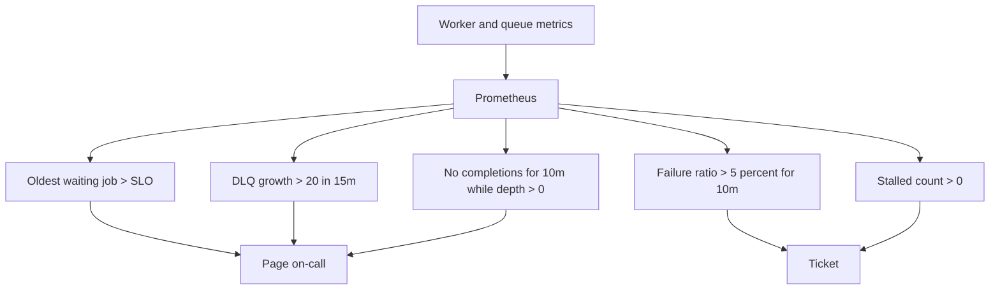
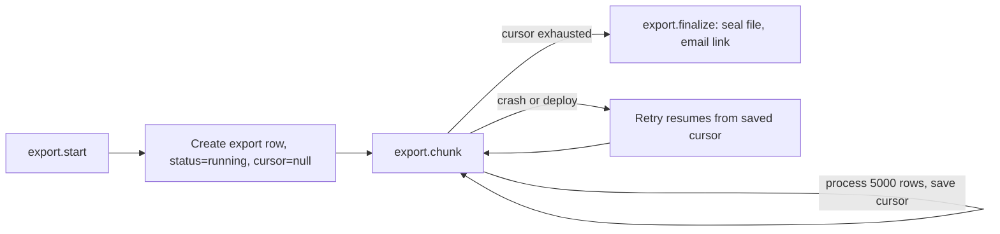
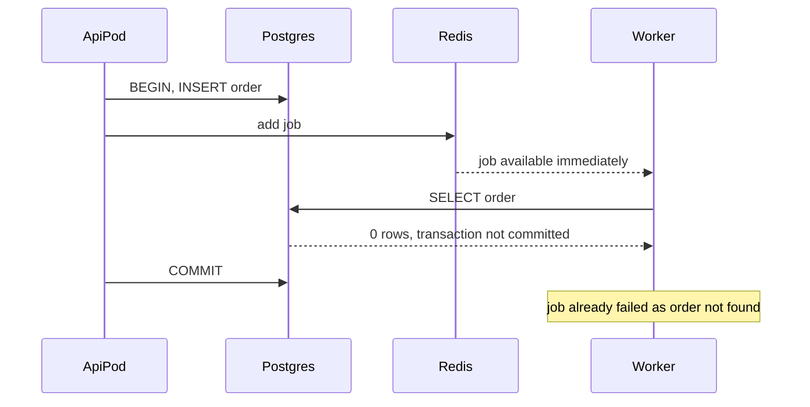

## 36.9 The job state machine and monitoring

### 36.9.1 The states

#### Concept

Every job in a queue is in exactly one state, and every operational question you will ever ask is really a question about how many jobs are in which state and how long they have been there.

| State | Meaning | What a growing count means |
|---|---|---|
| `waiting` | ready to run, nobody has taken it | Not enough workers, or workers are stuck |
| `active` | a worker holds it right now | Normal, unless it never drops (jobs hung on a dependency) |
| `delayed` | scheduled for a future time | Normal for retries and timers; a spike means mass retries |
| `prioritized` | waiting, but ordered by priority | Same as waiting; watch for starvation |
| `waiting-children` | a flow parent awaiting its children | Growing means orphaned flows |
| `completed` | finished successfully, retained per `removeOnComplete` | Growing without bound means retention is unset |
| `failed` | attempts exhausted or unrecoverable | This is your DLQ. Growth is an incident |
| `stalled` | lock expired while active | Any non-zero value is worth investigating |

Read that `delayed` row again. On a healthy system `delayed` is small and stable. During a third-party outage, every failed job sits in `delayed` waiting for its backoff, so `delayed` becomes a live picture of how much retrying is in flight. Many teams only graph `waiting` and are baffled that the queue "looks empty" during an outage.

### 36.9.2 The metric that actually matters

Queue depth is the metric everyone graphs. It is not the metric that tells you whether you have a problem.

Consider two queues, both with depth 5,000. The first drains 2,000 jobs per second, so the oldest waiting job is 2.5 seconds old and everything is fine. The second drains 3 jobs per second, so the oldest waiting job is 28 minutes old and customers have not received their order confirmations since lunch. Depth is identical. One is healthy and one is an outage.

> **The age of the oldest waiting job is the real service level indicator for a queue.** It is the queue's latency, expressed in the only units the business understands: how long a customer waits.

Everything else is diagnostics. Depth tells you *how much*; age tells you *how bad*.

```ts
// queues/queue-metrics.service.ts
import { Injectable, Logger } from '@nestjs/common';
import { InjectQueue } from '@nestjs/bullmq';
import { Queue } from 'bullmq';
import { Cron, CronExpression } from '@nestjs/schedule';
import { Gauge } from 'prom-client';

@Injectable()
export class QueueMetricsService {
  private readonly depth = new Gauge({
    name: 'job_queue_depth',
    help: 'Jobs per queue and state',
    labelNames: ['queue', 'state'] as const,
  });

  private readonly oldest = new Gauge({
    name: 'job_queue_oldest_waiting_seconds',
    help: 'Age of the oldest waiting job. This is the queue SLI.',
    labelNames: ['queue'] as const,
  });

  constructor(
    @InjectQueue('notifications') private readonly notifications: Queue,
    @InjectQueue('documents') private readonly documents: Queue,
    @InjectQueue('integrations') private readonly integrations: Queue,
  ) {}

  @Cron(CronExpression.EVERY_10_SECONDS)
  async collect(): Promise<void> {
    for (const q of [this.notifications, this.documents, this.integrations]) {
      const counts = await q.getJobCounts(
        'waiting', 'active', 'delayed', 'failed', 'completed', 'waiting-children',
      );
      for (const [state, value] of Object.entries(counts)) {
        this.depth.set({ queue: q.name, state }, value);
      }

      // getWaiting(0, 0) returns the head of the FIFO: the oldest waiting job.
      const [head] = await q.getWaiting(0, 0);
      const ageSeconds = head ? (Date.now() - head.timestamp) / 1000 : 0;
      this.oldest.set({ queue: q.name }, ageSeconds);
    }
  }
}
```

Instrument the worker itself too, with a histogram of job duration and a counter of outcomes. Labels are `queue` and `job_name` only — never `orderId`, never `userId`, or you will destroy Prometheus with cardinality (Part 43 — Observability).

```ts
private readonly duration = new Histogram({
  name: 'job_duration_seconds',
  help: 'Job processing duration',
  labelNames: ['queue', 'job_name', 'outcome'] as const,
  buckets: [0.05, 0.1, 0.25, 0.5, 1, 2.5, 5, 10, 30, 60, 300],
});
```

### 36.9.3 The alerts



```yaml
groups:
  - name: background-jobs
    rules:
      # The real SLI. Threshold comes from the business promise for that queue.
      - alert: QueueBacklogAging
        expr: job_queue_oldest_waiting_seconds{queue="notifications"} > 300
        for: 5m
        labels: { severity: page }
        annotations:
          summary: "Oldest waiting notification job is over 5 minutes old"
          runbook: "https://runbooks.internal/queues/backlog-aging"

      # Workers are alive but nothing is finishing: a poison job or a hung dependency.
      - alert: QueueNotDraining
        expr: |
          rate(job_duration_seconds_count{outcome="completed"}[10m]) == 0
          and job_queue_depth{state="waiting"} > 0
        for: 10m
        labels: { severity: page }

      - alert: DeadLetterGrowing
        expr: increase(job_queue_depth{state="failed"}[15m]) > 20
        for: 5m
        labels: { severity: page }

      - alert: JobFailureRatioHigh
        expr: |
          sum by (queue) (rate(job_duration_seconds_count{outcome="failed"}[10m]))
          /
          sum by (queue) (rate(job_duration_seconds_count[10m])) > 0.05
        for: 10m
        labels: { severity: ticket }

      - alert: JobsStalling
        expr: increase(job_stalled_total[30m]) > 0
        labels: { severity: ticket }
```

The threshold in the first alert is a *business* number, not a technical one. Ask the product owner: "how late can an order confirmation email be before a customer contacts support?" The answer is usually 5 to 15 minutes. That answer is your queue SLO, and it belongs in the alert. This is exactly the SLI/SLO thinking of Part 49 — Site Reliability Engineering, applied to asynchronous work.

Also graph, on the same dashboard: worker replica count, event loop lag per worker pod, Redis memory, and the p95 of `job_duration_seconds` per job name. When the backlog alarm fires, those four panels answer "not enough workers", "workers are blocked", "Redis is about to die" and "one job type got slow" in about fifteen seconds.

## 36.10 Ordering, big batches, and choosing a backend

### 36.10.1 Queues are not ordered

#### Concept

BullMQ is FIFO in the sense that jobs are *taken* in insertion order. It is emphatically not ordered in the sense that matters: with `concurrency: 10`, ten jobs run simultaneously and finish in whatever order they finish. Add retries, and a job enqueued first can complete ten minutes after a job enqueued later.

If your code assumes "the `order.created` job runs before the `order.updated` job", it is wrong, and it will be wrong in production about once a week.

#### How to get per-key ordering when you genuinely need it

**Option 1: do not need it.** Make handlers commutative. Instead of applying deltas, reload current state and converge to it. `reindex(productId)` reads the product and writes the current document; running it out of order is harmless because the last run wins with the truth. This is the best answer and it is available more often than people think.

**Option 2: version guards.** Put a monotonic version on the entity and refuse to apply older data.

```sql
UPDATE search_documents
SET body = $2, entity_version = $3
WHERE product_id = $1 AND entity_version < $3;   -- older events are silently dropped
```

**Option 3: one lane per key.** Serialize work for a single key while keeping parallelism across keys. In BullMQ this is a distributed mutex per key inside the handler (Redlock or a simple `SET key NX PX` lock), or a per-key sub-queue. In a PostgreSQL queue it is elegant: add an `ordering_key` column and only claim a row if no other row with the same key is `running`.

```sql
SELECT id FROM job_queue j
WHERE status = 'ready' AND run_at <= now()
  AND NOT EXISTS (
    SELECT 1 FROM job_queue r
    WHERE r.ordering_key = j.ordering_key AND r.status = 'running'
  )
ORDER BY run_at, id
FOR UPDATE SKIP LOCKED
LIMIT 20;
```

**Option 4: use a log, not a queue.** Kafka gives you strict ordering per partition, and partitioning by `orderId` gives you strict per-order ordering for free. If ordering is a hard requirement across many keys at high throughput, this is what Kafka is for. Do not bolt ordering onto Redis when the requirement is really "an ordered log".

### 36.10.2 Big batches: chunk, checkpoint, resume

#### Practical example

"Export all orders for merchant X as CSV" — 2.4 million rows, 40 minutes of work. One job that does it in a single pass has four problems: it exceeds every lock duration, it dies on deploy, its memory grows with the result set, and when it fails at minute 38 it starts again from row zero.

The pattern is **chunk plus checkpoint**.



```sql
CREATE TABLE export_jobs (
  id             uuid PRIMARY KEY,
  merchant_id    uuid NOT NULL,
  status         text NOT NULL DEFAULT 'running',   -- running|done|failed
  cursor_after   bigint,                            -- last order id written
  rows_written   bigint NOT NULL DEFAULT 0,
  s3_key         text,
  updated_at     timestamptz NOT NULL DEFAULT now()
);
```

```ts
async process(job: Job<{ exportId: string }>, token?: string) {
  const exp = await this.exports.findOneOrFail(job.data.exportId);
  const CHUNK = 5_000;

  // Keyset pagination, never OFFSET: OFFSET 2000000 re-scans two million rows.
  const rows = await this.orders.findAfter(exp.merchantId, exp.cursorAfter, CHUNK);

  if (rows.length === 0) {
    await this.exports.finalize(exp.id);
    return { done: true, rows: exp.rowsWritten };
  }

  await this.s3.appendPart(exp.s3Key, toCsv(rows));

  // Checkpoint before returning. A crash after this point loses at most one chunk,
  // and appending the same chunk twice is prevented by the multipart part number.
  await this.exports.checkpoint(exp.id, rows.at(-1)!.id, rows.length);

  if (token) await job.extendLock(token, 60_000);

  // Re-enqueue the next chunk instead of looping forever inside one job.
  await this.queue.add('export.chunk', job.data, { jobId: `export:${exp.id}:${exp.cursorAfter}` });
  return { chunk: rows.length };
}
```

Each chunk is a short job. Deploys are safe. Retries resume. Progress is a row you can `SELECT` and show in the UI. And because chunk jobs re-enqueue themselves, the queue's own concurrency limits keep a giant export from starving small ones.

Two extra rules for batch work: **stream, do not accumulate** (a TypeORM `QueryRunner` stream or `pg-query-stream`, never `find()` on two million rows), and **give big batches their own queue** so a merchant's 40-minute export cannot delay someone's order confirmation.

### 36.10.3 Choosing a backend

#### Decision table

| Property | Redis + BullMQ | PostgreSQL + SKIP LOCKED | Kafka | AWS SQS |
|---|---|---|---|---|
| **Durability** | Only as good as your Redis persistence and failover; async replication can lose the tail | Full ACID, WAL, PITR. Your strongest guarantee | Replicated log, very strong with `acks=all` | Managed, replicated, very strong |
| **Ordering** | None in practice | Per `ordering_key` if you implement it | Strict per partition | FIFO queues only, 300 msg/s per group |
| **Throughput** | 10k to 50k jobs/s | 1k to 5k jobs/s realistically; more with partitioning | Millions/s | ~3k/s standard, low for FIFO |
| **Delayed jobs** | Native, precise, sorted set | Native, `run_at` column, sweep-precision | Not natively; needs a scheduler topic | Max 15 minutes delay |
| **Visibility / tooling** | Excellent (Bull Board): payloads, stack traces, retry buttons | Excellent: it is just SQL. `SELECT * FROM job_queue` | Poor for job semantics; offsets, not jobs | Basic console; DLQ built in |
| **Retries / DLQ** | Built in | You implement it (30 lines) | Consumer-side; you build it | Built in, `maxReceiveCount` |
| **Priority** | Native | `ORDER BY priority, run_at` | No | No |
| **Transactional enqueue** | **No** — separate system from your database | **Yes** — same transaction as your business write | No | No |
| **Operational cost** | You run Redis (or pay for it) | Zero extra infrastructure | High: brokers, partitions, consumer groups | Zero, pay per request |
| **Fan-out to many consumers** | No, one consumer per job | No | Yes, that is the point | No (use SNS in front) |

#### How a Senior Backend Engineer chooses

The questions, in order:

1. *Is this a job or an event?* A **job** is a command with one owner: "send this email". An **event** is a fact many parties may care about: "an order was placed". Jobs go in a queue. Events go in Kafka or an event bus. Putting events in a job queue means adding a new consumer requires changing the producer, which defeats the entire purpose.
2. *Does the enqueue need to be atomic with a database write?* If yes, and you do not want an outbox, PostgreSQL wins immediately. This is 36.11 and it is the most under-appreciated row in that table.
3. *What is my throughput, honestly?* Most companies asking this question do fewer than 100 jobs per second. PostgreSQL handles that on a laptop. Do not adopt Kafka for 40 jobs a second.
4. *Do I already run Redis?* If yes, BullMQ costs you nothing new and gives excellent tooling. If no, adding Redis purely for a queue means adding a stateful system with its own failover, persistence config, memory limits and on-call burden — for work PostgreSQL could already do.
5. *Can I tolerate losing jobs?* Be honest. A Redis with `appendonly no` and no replica *will* lose jobs on a restart. If the job is "send a marketing email", fine. If it is "release the payment hold", not fine.

My default for a NestJS team that already runs both PostgreSQL and Redis: **BullMQ for volume and delayed work, plus a PostgreSQL outbox for anything that must be atomic with a business write.** That combination gets you the tooling and the correctness without a third system.

## 36.11 The transactional enqueue problem

### 36.11.1 The problem

#### Concept

You are inside a database transaction creating an order, and you want to enqueue a confirmation email. Redis is not part of that transaction. So you have exactly two choices about ordering, and both are broken.

**Enqueue before commit:**

```ts
await this.ds.transaction(async (em) => {
  const order = await em.save(new Order({ ... }));
  await this.queue.add('order.confirmation', { orderId: order.id }); // inside the transaction
});
```

The worker is fast — jobs are typically picked up within a millisecond or two. The transaction has not committed yet. The worker does `SELECT * FROM orders WHERE id = $1` and gets **nothing**, because the row is invisible outside the uncommitted transaction. The job fails with "order not found". If you classified that as unrecoverable, you just permanently lost the confirmation email. And if the transaction later rolls back, you have enqueued a job for an order that never existed.

**Enqueue after commit:**

```ts
const order = await this.ds.transaction(async (em) => em.save(new Order({ ... })));
await this.queue.add('order.confirmation', { orderId: order.id }); // after commit
```

Better, and this is what most code does. But the process can crash, the pod can be evicted, or Redis can be unreachable in the microseconds between the commit and the `add()`. The order exists; the job does not; nobody will ever notice, because there is no record that anything was supposed to happen. This is silent data loss, and it happens at a low but non-zero rate forever.



### 36.11.2 The three real solutions

#### Solution 1: the transactional outbox

Write the intent to a table **in the same transaction** as the business data. A separate relay reads that table and publishes to the queue.

```sql
CREATE TABLE outbox (
  id            bigserial PRIMARY KEY,
  aggregate     text        NOT NULL,     -- 'order'
  aggregate_id  text        NOT NULL,     -- 'ord_8812'
  job_queue     text        NOT NULL,     -- 'notifications'
  job_name      text        NOT NULL,     -- 'order.confirmation'
  payload       jsonb       NOT NULL,
  dedupe_key    text        NOT NULL,     -- becomes the BullMQ jobId
  created_at    timestamptz NOT NULL DEFAULT now(),
  published_at  timestamptz
);

CREATE INDEX idx_outbox_unpublished ON outbox (id) WHERE published_at IS NULL;
```

```ts
await this.ds.transaction(async (em) => {
  const order = await em.save(new Order({ ... }));
  await em.save(new OutboxRecord({
    aggregate: 'order',
    aggregateId: order.id,
    jobQueue: 'notifications',
    jobName: 'order.confirmation',
    payload: { v: 1, orderId: order.id, correlationId: ctx.correlationId },
    dedupeKey: `confirm:${order.id}`,
  }));
  // One commit. Either the order and the intent both exist, or neither does.
});
```

```ts
// outbox/outbox-relay.service.ts
@Cron(CronExpression.EVERY_SECOND)
async relay(): Promise<void> {
  await this.ds.transaction(async (em) => {
    const rows: OutboxRecord[] = await em.query(
      `SELECT * FROM outbox WHERE published_at IS NULL
       ORDER BY id FOR UPDATE SKIP LOCKED LIMIT 100`,
    );
    for (const row of rows) {
      // At-least-once: a crash after add() but before UPDATE republishes the job.
      // The deterministic jobId makes that harmless.
      await this.queues.get(row.job_queue).add(row.job_name, row.payload, { jobId: row.dedupe_key });
      await em.query(`UPDATE outbox SET published_at = now() WHERE id = $1`, [row.id]);
    }
  });
}
```

Trade-offs: adds one insert per job to the write transaction (about 0.3 ms), adds a relay to operate, adds latency equal to the polling interval (use `LISTEN`/`NOTIFY` or logical decoding to cut that to milliseconds), and needs a pruning job. In exchange you get a guarantee: **if the business write happened, the job will happen.** This is the same outbox pattern discussed in Part 30 — Distributed Transactions: Sagas, Outbox, Inbox and Idempotency; the only difference is that here the destination is a job queue rather than an event bus.

#### Solution 2: put the queue in PostgreSQL

If the queue *is* a table, the problem evaporates:

```ts
await this.ds.transaction(async (em) => {
  const order = await em.save(new Order({ ... }));
  await em.query(
    `INSERT INTO job_queue (queue, name, payload, dedupe_key)
     VALUES ('notifications', 'order.confirmation', $1, $2)`,
    [{ v: 1, orderId: order.id }, `confirm:${order.id}`],
  );
});
```

No relay, no second system, no eventual anything. The cost is throughput (thousands per second, not tens of thousands), no free tooling, and a table you must vacuum and prune diligently — a job table with high churn is a bloat and autovacuum story, so keep completed rows short-lived and consider partitioning by day (Part 19 — PostgreSQL Internals).

For most teams this is the correct default and they skip it because "a database is not a queue". A database is an excellent queue up to a few thousand jobs per second, which is more than most systems will ever need.

#### Solution 3: an `afterCommit` hook

Publish only after the transaction has definitely committed. TypeORM does not expose an `afterCommit` callback directly, so the common approach is to collect intents during the transaction and flush them after it returns; Sequelize has it natively.

```ts
// Sequelize: the hook only fires if the transaction actually committed.
await sequelize.transaction(async (t) => {
  const order = await Order.create({ ... }, { transaction: t });
  t.afterCommit(async () => {
    await queue.add('order.confirmation', { v: 1, orderId: order.id },
      { jobId: `confirm:${order.id}` });
  });
});
```

In NestJS the idiomatic version is to raise domain events inside the transaction and dispatch them after commit, with `@nestjs/event-emitter` or `@nestjs/cqrs`:

```ts
const order = await this.ds.transaction(async (em) => {
  const o = await em.save(new Order({ ... }));
  this.pending.push(new OrderCreatedEvent(o.id));   // buffered, not emitted yet
  return o;
});
// Only reached if the transaction committed.
for (const e of this.pending.drain()) this.events.emit(e.name, e);
```

Trade-off: this fixes the *ordering* problem (no more "order not found") but **not** the durability problem. A crash between commit and emit still loses the job. It is a genuine improvement over naive before-commit enqueueing and it costs almost nothing, so use it everywhere — but do not tell yourself it is a guarantee.

#### Decision

| Requirement | Use |
|---|---|
| Losing the job is embarrassing but survivable (marketing email, cache warm) | `afterCommit` hook |
| Losing the job costs money or breaks a promise (order confirmation, payout, partner webhook) | Outbox, or a PostgreSQL queue |
| You need the guarantee and low volume and no extra infra | PostgreSQL queue in the same transaction |
| You need the guarantee and high volume and BullMQ's tooling | Outbox relaying into BullMQ |

There is a fourth option people reach for and should not: two-phase commit across PostgreSQL and Redis. Redis does not support it, and even where XA exists, it converts two independent failure domains into one shared one. Do not.

#### The safety net nobody regrets

Whatever you choose, add a **reconciliation sweep**: a job that runs every ten minutes and asks "are there orders older than 15 minutes with `confirmation_sent_at IS NULL`?" and enqueues the missing ones. It costs one indexed query. It catches every gap in every mechanism above, including the ones you have not thought of, and it is the difference between "we lose 0.01 percent of confirmations forever" and "we lose none".

```sql
SELECT id FROM orders
WHERE status = 'confirmed'
  AND confirmation_sent_at IS NULL
  AND created_at < now() - interval '15 minutes'
  AND created_at > now() - interval '7 days'      -- bound it; never scan all history
ORDER BY created_at
LIMIT 500;
```

#### Interview questions

1. *You enqueue a job inside a database transaction and the worker says "order not found". Explain.* Expected: the worker read before the transaction committed; the row was invisible. Follow-up: three fixes and their trade-offs.
2. *What does the outbox pattern guarantee and what does it cost?* Expected: atomicity between business write and intent, at-least-once publication; costs an extra insert, a relay, polling latency and pruning.
3. *Why is enqueueing after commit not sufficient?* Expected: crash between commit and enqueue loses the job silently with no record.
4. *When is a PostgreSQL queue the right choice over Redis?* Expected: transactional enqueue, low-to-moderate throughput, no appetite for another stateful system, SQL-native inspection.
5. *What is the real SLI for a queue and why not depth?* Expected: age of the oldest waiting job; depth without drain rate says nothing about customer impact.
6. *How do you get per-key ordering out of an unordered queue?* Expected: converge instead of applying deltas, version guards, per-key locks or `ordering_key` claim guards, or use Kafka partitions.

#### Practical exercise

Reproduce the transactional enqueue bug on purpose, then fix it three ways.

Acceptance criteria: with the enqueue inside the transaction and a 200 ms artificial delay before commit, show the worker failing with "order not found" for at least 30 percent of requests; implement the `afterCommit` version and show the failure rate drops to zero under normal operation; kill the API pod between commit and enqueue (a `process.exit(1)` behind a feature flag) and show the job is lost; implement the outbox and show the same kill produces no loss; finally, add the reconciliation sweep and prove it recovers a job you deleted from the queue by hand.
