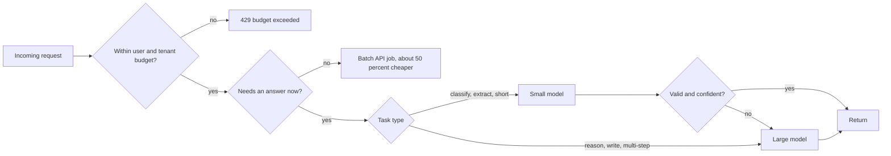

## 36.6 Cost engineering in practice: model routing, batching and token budgets

### 36.6.1 Routing, batching and budgets as code

#### Concept

Section 36.3.3 listed the levers. This section implements the three that need real code: **model routing** (send each request to the cheapest model that can do it well), **batching** (send non-urgent work through the provider's asynchronous batch API at a discount), and **token budgets** (cap how many tokens a user, a tenant or a feature may consume per day, enforced before the call, not discovered after).

#### Why does it exist?

Prices between model tiers differ by one to two orders of magnitude. A small model may cost $0.10 per million input tokens while a large one costs $4 or more. If every request goes to the large model "to be safe", you pay 40 times more than necessary on the share of traffic that a small model handles just as well. Batch APIs typically cost about half of the interactive price because the provider can schedule the work when it has spare capacity. And without a budget, one heavy user, one bug or one abusive script can spend a month's money in a day. These are the differences between an LLM feature that pays for itself and one that finance switches off.

#### Mental model

Imagine a hospital. Not every patient sees the senior consultant: a triage nurse sends a sprained ankle to a junior doctor and a chest pain to the specialist (routing). Routine lab tests are batched and run overnight at a lower cost (batching). And each department has a monthly budget it cannot overspend without approval (token budgets). The hospital still treats everyone properly; it just spends its expensive capacity where it matters.

#### How it works



1. **Budget check first.** Reserve an estimated token count against the user's and tenant's daily budget. If it does not fit, refuse with a clear message before spending anything.
2. **Urgency.** If nobody is waiting (overnight enrichment, weekly digests, re-classifying the archive), submit to the batch API and collect results later.
3. **Route by task.** Classification, extraction and short rewrites go to a small model. Open-ended reasoning, long writing and multi-step tool use go to a large one. The routing rule is usually plain code keyed by feature, not another LLM call.
4. **Escalate on doubt.** If the small model's output fails validation or reports low confidence, retry once on the large model. Measure how often this happens; if it is above about 10–15%, the task belongs on the large model.
5. **Reconcile.** After the call, replace the estimate with the real `usage` numbers in the ledger.

#### NestJS example

```ts
// llm/model-router.ts -- route by task, escalate on doubt
import { Injectable } from '@nestjs/common';

export type Task = 'classify' | 'extract' | 'summarize' | 'reason';

const SMALL = 'claude-haiku-5-5';  // cheap and fast
const LARGE = 'claude-opus-5-5';   // capable and expensive

@Injectable()
export class ModelRouter {
  pick(task: Task): { model: string; effort: 'low' | 'medium' | 'high' } {
    switch (task) {
      case 'classify':
      case 'extract':
        return { model: SMALL, effort: 'low' };
      case 'summarize':
        return { model: SMALL, effort: 'medium' };
      case 'reason':
        return { model: LARGE, effort: 'medium' };
    }
  }

  escalate(): { model: string; effort: 'medium' } {
    return { model: LARGE, effort: 'medium' };
  }
}
```

```ts
// enrichment/batch-enrichment.service.ts -- non-urgent work through the batch API
import { Inject, Injectable } from '@nestjs/common';
import Anthropic from '@anthropic-ai/sdk';
import { LLM_CLIENT } from '../llm/llm.module';

@Injectable()
export class BatchEnrichmentService {
  constructor(@Inject(LLM_CLIENT) private readonly client: Anthropic) {}

  async submit(products: { id: string; description: string }[]): Promise<string> {
    const batch = await this.client.messages.batches.create({
      requests: products.map((p) => ({
        custom_id: `product-${p.id}`, // results come back in ANY order: key by this id
        params: {
          model: 'claude-haiku-5-5',
          max_tokens: 300,
          system: 'Write a 2-sentence, factual product summary. No marketing claims.',
          messages: [{ role: 'user', content: p.description }],
        },
      })),
    });
    return batch.id; // store it; a scheduled job polls until processing_status === 'ended'
  }

  async collect(batchId: string, save: (productId: string, text: string) => Promise<void>) {
    const status = await this.client.messages.batches.retrieve(batchId);
    if (status.processing_status !== 'ended') return false;
    for await (const entry of await this.client.messages.batches.results(batchId)) {
      if (entry.result.type !== 'succeeded') continue; // errored/expired: re-queue separately
      const text = entry.result.message.content
        .filter((b): b is Anthropic.TextBlock => b.type === 'text')
        .map((b) => b.text)
        .join('');
      await save(entry.custom_id.replace('product-', ''), text);
    }
    return true;
  }
}
```

#### PostgreSQL example

A per-user daily token ledger, with an atomic "reserve if it fits" statement. One row per user per day, so contention is per user and never global.

```sql
CREATE TABLE llm_token_ledger (
  user_id      uuid    NOT NULL,
  day          date    NOT NULL,
  tokens_used  bigint  NOT NULL DEFAULT 0,
  PRIMARY KEY (user_id, day)
);

-- Reserve $2 tokens for user $1 only if the total stays within the daily limit $3.
-- Returns a row when the reservation succeeded, no row when the budget is exhausted.
INSERT INTO llm_token_ledger AS l (user_id, day, tokens_used)
VALUES ($1, current_date, $2)
ON CONFLICT (user_id, day) DO UPDATE
   SET tokens_used = l.tokens_used + EXCLUDED.tokens_used
 WHERE l.tokens_used + EXCLUDED.tokens_used <= $3
RETURNING tokens_used;

-- After the call: correct the estimate with the real usage (can be negative).
UPDATE llm_token_ledger
   SET tokens_used = tokens_used + $3          -- $3 = actual - reserved
 WHERE user_id = $1 AND day = current_date;
```

The `WHERE` on `DO UPDATE` makes the check and the increment one atomic step, so two concurrent requests cannot both squeeze under the limit (the race that a separate `SELECT` then `UPDATE` would have; see Part 20 — Database Transactions). The very first insert of the day bypasses the `WHERE`, so the application must also reject any single reservation larger than the limit. At a few hundred LLM requests per second this is comfortable for PostgreSQL; far beyond that, the same logic moves to a Redis Lua script (Part 26) with the database as the daily record.

#### TypeORM example

In a NestJS service the reserve statement runs through `DataSource.query()` with the three parameters; `rows.length === 1` means the reservation succeeded and an empty result means the budget is exhausted. Reject any single reservation larger than the daily limit in code before running it.

#### Production scenario

Cost per 1,000 requests for the same order-support workload (1,800 input, 250 output tokens) on different tiers, at illustrative list prices:

| Route | Input $/1M | Output $/1M | Cost per 1k requests | Typical p50 |
|---|---|---|---|---|
| Large model, interactive | $4.00 | $20.00 | ~$12.20 | 2–3 s |
| Large model, 1,500 tokens of prefix cached | $4.00 (reads ~$0.20) | $20.00 | ~$6.50 | 1.5–2.5 s |
| Small model, interactive | $0.10 | $0.50 | ~$0.31 | 0.5–1 s |
| Small model, batch (~50% off) | ~$0.05 | ~$0.25 | ~$0.15 | minutes to hours |

A team that routed classification and extraction (70% of its calls) to the small model, kept the large model for the 30% of calls that write answers, cached the prefix, and moved nightly enrichment to batch, cut its monthly bill from about $38,000 to about $9,000. Quality, measured on the evaluation set, did not move for the routed tasks.

#### Failure scenario

A router decided between small and large models by asking the small model "is this question hard?". It looked clever and cost little. Over three weeks, satisfaction scores for refund questions drifted down. The evaluation set had no refund-policy edge cases, so nothing failed in CI. The investigation found that the small model rated almost every question "easy", including multi-order refund disputes, which it then answered badly. The fix replaced LLM self-assessment with explicit routing by feature and by measurable signals (number of orders involved, whether a policy document was needed), added refund edge cases to the eval set, and added an escalation-rate metric. The lesson: route with rules you can test, and measure quality per route, not just overall.

#### Edge cases & failure modes

- **Escalation storms**: if 40% of small-model outputs fail validation, you pay for both models on those calls and it is cheaper to start on the large one.
- **Caches are per model**: routing the same prefix to two models writes two caches; frequent switching wastes the cache benefit.
- **Batch results arrive in any order** and some expire or error; key by `custom_id`, re-queue failures, never match by position.
- **Budget reset at midnight UTC** confuses users in other time zones; show "resets in N hours".
- **Shared accounts**: a per-user budget is useless if a tenant has 5,000 users; add a tenant budget too (Part 85).
- **Pricing changes**: keep model prices in configuration, not in code, and recompute dashboards when they change.

#### How a Senior Backend Engineer thinks about this

A senior treats model choice as a per-task decision backed by evaluation data, not as a global setting. They start every task on the capable model to establish a quality baseline, then move tasks down to cheaper models only where the evaluation shows no loss, and they keep the routing logic in plain, testable code. They push everything without a waiting human to batch, because half price for the same output is the easiest saving there is. They enforce budgets before calls at the user, tenant and feature level, because a budget enforced after the call is just a report. To a product manager they say: "We can serve this for about a third of a cent per request on the small model; the large model is 40 times more and only worth it for these two question types."

#### Common mistakes

- Using the largest model for everything "to be safe".
- Routing with an LLM's opinion of its own ability.
- Running nightly jobs through the interactive API at full price.
- Checking a budget with `SELECT` then `UPDATE`, letting concurrent requests overspend.
- Only user budgets, no tenant or feature budget.
- Measuring cost per call instead of cost per completed task, so escalations and retries hide.

#### Interview questions

1. **How do you decide which model serves a task?** By evaluation: establish the baseline on the capable model, then test cheaper models on the same eval set; route the task down only if quality holds. Use deterministic routing rules; measure escalation rate and quality per route.
2. **When would you use a batch API, and what must the consumer handle?** For work with no waiting user (enrichment, re-classification, reports) at roughly half price; the consumer must poll, key results by custom id because order is not guaranteed, and handle errored or expired entries.
3. **How do you enforce a per-user token budget without races?** An atomic conditional upsert (`ON CONFLICT ... DO UPDATE ... WHERE total + new <= limit RETURNING`) or a Redis script; reserve an estimate before the call and reconcile with actual usage after.
4. **Why measure cost per completed task rather than per call?** Retries, escalations and multi-turn loops multiply calls; a cheap model that needs two attempts and an escalation can cost more than the large model once.

#### Practical exercise

Add a `ModelRouter` and a token ledger to the order-support service. Route intent extraction to a small model with escalation on validation failure; route answer writing to a large model. Enforce a daily budget of 200,000 tokens per user and 20 million per tenant with the atomic upsert, reconciling after each call. Move the nightly product-summary job to the batch API. Acceptance criteria: a concurrency test with 50 parallel requests never exceeds the budget; the dashboard shows cost per 1,000 requests per route; batch results are matched by `custom_id`.

## 36.7 Observability for LLM features

### 36.7.1 Logs, metrics, traces and a cost dashboard

#### Concept

Observability for an LLM feature means being able to answer, quickly and with data: what did this call cost, how long did it take, which prompt version and model produced it, did it succeed, and what did the model say? It uses the same three tools as the rest of the system (logs, metrics and traces, Part 42 — Observability), plus a fourth that ordinary services rarely need: a **call ledger** that records every LLM call with its tokens and cost, so spend can be attributed to features, tenants and users.

#### Why does it exist?

An LLM feature can regress in three ways your normal dashboards will not show. It can get **more expensive** (an uncached prompt, a retry loop, a chatty prompt change) while every request still returns `200`. It can get **slower** in the long tail (a provider degradation, longer outputs). And it can get **worse** (more refusals, more truncations, more fallbacks, more thumbs-down) without any error. Each needs its own signal, and without them the first person to notice is either an angry customer or the finance team at month end.

#### Mental model

Imagine running a taxi company where every ride is metered by distance. You would want each ride logged (who, where, how far, what fare), a live board of rides per hour and average fare, and an alarm if fares in one district suddenly double. The call ledger is the ride log, the metrics are the live board, and the cost alert is the alarm. Traces are the GPS track of one ride when a customer complains.

#### How it works

What to record for every call, and where:

| Signal | Where it goes | Why |
|---|---|---|
| Feature, prompt id/version/hash, model | Ledger, logs, metric labels (not hash) | Attribute behavior and cost to a change |
| Input, output, cache-read, cache-write tokens | Ledger, metrics | Cost and cache effectiveness |
| Computed cost | Ledger, metric counter | Dashboards and alerts in money |
| Latency: time to first token, total | Metrics (histograms), traces | p50/p99, provider degradation |
| Stop reason, outcome (`ok`, `fallback`, `refused`...) | Ledger, metrics | Quality and failure rates |
| User and tenant id | Ledger only (never a metric label) | Per-customer cost without metric cardinality blowup |
| Prompt and output text | Separate, redacted, short-retention store | Debugging, evaluation cases |

The important design rule is **cardinality**: user ids, order ids and prompt hashes must never become Prometheus labels, because every distinct value creates a new time series and a million users means a million series. Low-cardinality dimensions (feature, model, outcome) go into metrics; high-cardinality ones go into the ledger and the logs.

#### NestJS example

```ts
// llm/llm-telemetry.service.ts -- metrics, trace span and ledger row for every call
import { Injectable } from '@nestjs/common';
import { Counter, Histogram } from 'prom-client';
import { trace } from '@opentelemetry/api';
import { DataSource } from 'typeorm';

const PRICES: Record<string, { in: number; out: number; cacheRead: number; cacheWrite: number }> = {
  // USD per 1M tokens; loaded from config in real code so price changes need no deploy
  'claude-opus-5-5': { in: 4.0, out: 20.0, cacheRead: 0.2, cacheWrite: 5.0 },
  'claude-haiku-5-5': { in: 0.1, out: 0.5, cacheRead: 0.01, cacheWrite: 0.125 },
};

const tokens = new Counter({ name: 'llm_tokens_total', help: 'LLM tokens', labelNames: ['feature', 'model', 'kind'] });
const cost = new Counter({ name: 'llm_cost_usd_total', help: 'LLM cost in USD', labelNames: ['feature', 'model'] });
const latency = new Histogram({
  name: 'llm_call_seconds', help: 'LLM call latency', labelNames: ['feature', 'model', 'outcome'],
  buckets: [0.25, 0.5, 1, 2, 4, 8, 16, 32],
});

export interface LlmCallRecord {
  feature: string; promptVersion: string; model: string; outcome: string; stopReason: string | null;
  usage: { input_tokens: number; output_tokens: number; cache_read_input_tokens?: number | null; cache_creation_input_tokens?: number | null };
  latencyMs: number; userId: string; tenantId: string;
}

@Injectable()
export class LlmTelemetryService {
  constructor(private readonly dataSource: DataSource) {}

  async record(r: LlmCallRecord): Promise<void> {
    const p = PRICES[r.model];
    const read = r.usage.cache_read_input_tokens ?? 0;
    const write = r.usage.cache_creation_input_tokens ?? 0;
    const usd = p
      ? (r.usage.input_tokens * p.in + r.usage.output_tokens * p.out + read * p.cacheRead + write * p.cacheWrite) / 1e6
      : 0;

    tokens.inc({ feature: r.feature, model: r.model, kind: 'input' }, r.usage.input_tokens);
    tokens.inc({ feature: r.feature, model: r.model, kind: 'output' }, r.usage.output_tokens);
    tokens.inc({ feature: r.feature, model: r.model, kind: 'cache_read' }, read);
    cost.inc({ feature: r.feature, model: r.model }, usd);
    latency.observe({ feature: r.feature, model: r.model, outcome: r.outcome }, r.latencyMs / 1000);

    const span = trace.getActiveSpan(); // attach to the request's trace (Part 42)
    span?.setAttributes({ 'llm.model': r.model, 'llm.tokens.input': r.usage.input_tokens,
      'llm.tokens.output': r.usage.output_tokens, 'llm.outcome': r.outcome, 'llm.cost_usd': usd });

    await this.dataSource.query(
      `INSERT INTO llm_calls (feature, prompt_version, model, outcome, stop_reason, input_tokens,
         output_tokens, cache_read_tokens, cache_write_tokens, cost_usd, latency_ms, user_id, tenant_id)
       VALUES ($1,$2,$3,$4,$5,$6,$7,$8,$9,$10,$11,$12,$13)`,
      [r.feature, r.promptVersion, r.model, r.outcome, r.stopReason, r.usage.input_tokens,
       r.usage.output_tokens, read, write, usd, r.latencyMs, r.userId, r.tenantId],
    );
  }
}
```

Note that the input-token count the provider reports excludes the cached tokens, which are reported separately; that is why the cost formula adds the three input categories rather than double-counting. For high volume, write ledger rows in batches through a queue rather than one insert per call on the request path.

#### PostgreSQL example

```sql
CREATE TABLE llm_calls (
  id                 bigint GENERATED ALWAYS AS IDENTITY,
  created_at         timestamptz NOT NULL DEFAULT now(),
  feature            text NOT NULL,
  prompt_version     text NOT NULL,
  model              text NOT NULL,
  outcome            text NOT NULL,          -- ok | fallback | refused | truncated | invalid
  stop_reason        text,
  input_tokens       int  NOT NULL,
  output_tokens      int  NOT NULL,
  cache_read_tokens  int  NOT NULL DEFAULT 0,
  cache_write_tokens int  NOT NULL DEFAULT 0,
  cost_usd           numeric(12,6) NOT NULL,
  latency_ms         int  NOT NULL,
  user_id            uuid NOT NULL,
  tenant_id          uuid NOT NULL,
  PRIMARY KEY (id, created_at)
) PARTITION BY RANGE (created_at);           -- monthly partitions, drop old ones (Part 22)

CREATE INDEX ON llm_calls (tenant_id, created_at);

-- Yesterday's cost per feature, cache hit share and fallback rate.
SELECT feature,
       round(sum(cost_usd), 2)                                         AS usd,
       round(1000 * sum(cost_usd) / count(*), 2)                       AS usd_per_1k,
       round(100.0 * sum(cache_read_tokens)
             / nullif(sum(input_tokens + cache_read_tokens), 0), 1)    AS cache_pct,
       round(100.0 * avg((outcome <> 'ok')::int), 2)                   AS degraded_pct
  FROM llm_calls
 WHERE created_at >= current_date - 1 AND created_at < current_date
 GROUP BY feature
 ORDER BY usd DESC;
```

#### Production scenario

The LLM dashboard has four rows: spend (cost per hour per feature, projected daily run rate, top 10 tenants by cost from the ledger), latency (p50/p99 total and time to first token per model), quality (outcome rates, thumbs-down rate, escalation rate) and cache (cache-read share of input tokens per feature). Two alerts page the on-call: a spend alert when the hourly cost of any feature exceeds twice its 7-day average for the same hour, and a degradation alert when the non-`ok` outcome rate exceeds 5% for 10 minutes. A Prometheus rule for the first looks like `sum by (feature) (rate(llm_cost_usd_total[1h])) > 2 * sum by (feature) (rate(llm_cost_usd_total[1h] offset 7d))`, a simple week-over-week comparison.

#### Failure scenario

A release added the current date and time to the order-support system prompt ("Today is ...") so the model could reason about delivery dates. It worked, and nobody noticed that the timestamp, which changed every second, sat at the very start of the cached prefix. The cache-read share fell from 82% to 0% and input cost nearly quadrupled. Because the team had the spend alert, the on-call got paged 50 minutes after the deploy, saw `cache_pct` at zero on the dashboard, and the fix (move the date after the cache breakpoint, rounded to the day) shipped within two hours: about $300 lost instead of roughly $15,000 over a month. The lesson: cost regressions are silent; only a cost metric with an alert makes them loud.

#### Edge cases & failure modes

- **High-cardinality labels** (user id, prompt hash) in Prometheus explode memory; keep them in the ledger.
- **Streaming calls**: record usage from the final message event, and record abandoned streams as an outcome, or their cost disappears from the books.
- **Content logs are a PII store**: redact, restrict access, and set short retention (36.5.2).
- **Provider-side billing differs** slightly from your computation (rounding, price changes); reconcile monthly with the invoice.
- **Ledger writes on the hot path** add latency; buffer and batch them.
- **Missing trace context in queue workers**: propagate the trace id in job data so a background call links to the request that caused it.

#### How a Senior Backend Engineer thinks about this

A senior treats money as a first-class metric for LLM features, alongside latency and errors, with an alert on it before launch, not after the first surprising invoice. They keep low-cardinality dimensions in metrics and per-customer detail in a ledger table, log the prompt version and model with every call so behavior changes are traceable, and store prompt and output text only under redaction and a retention policy. They wire LLM calls into the same traces as the rest of the request, so "why was this page slow?" shows the 4-second LLM span right next to the 3 ms database query. Before launch they ask: if this feature's cost doubled tonight, how long until someone knows?

#### Common mistakes

- No cost metric, so regressions show up on the invoice.
- User ids as metric labels.
- Logging full prompts with PII forever.
- Not recording prompt version and model, so "it got worse on Tuesday" cannot be traced.
- Only average latency; LLM latency is long-tailed and the p99 is what users remember.

#### Interview questions

1. **What would you put on a dashboard for an LLM feature?** Cost per hour and per 1,000 requests by feature and model, top tenants by cost, p50/p99 latency and time to first token, outcome rates (ok, fallback, refused, truncated), user feedback, and cache-read share. Alerts on spend anomalies and degradation rate.
2. **Why not put the user id on the cost metric?** Cardinality: each distinct label value is a time series; per-user attribution belongs in a ledger table queried on demand.
3. **How do you detect a prompt-caching regression?** Track the cache-read share of input tokens per feature; a drop to near zero after a deploy points at a changed prefix.
4. **How do you log prompts and outputs safely?** Redact PII before writing, store in a separate access-controlled store with short retention, and keep metrics and the ledger free of raw content.

#### Practical exercise

Instrument the order-support assistant: emit token, cost and latency metrics with `feature`, `model` and `outcome` labels, write a ledger row per call into a monthly-partitioned `llm_calls` table, attach LLM attributes to the active trace span, and build a dashboard with cost per 1,000 requests, cache share and degradation rate. Then deliberately add a timestamp to the start of the system prompt in a test environment. Acceptance criteria: the cache-share panel drops to zero and the spend alert fires within one evaluation window.
