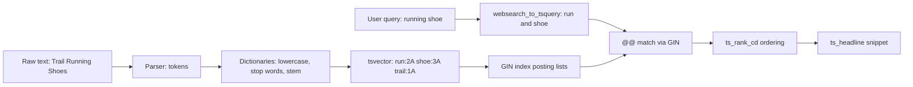

# Part 37 — Search: PostgreSQL Full-Text to Elasticsearch/OpenSearch

## 37.1 Search, filtering and lookup: three different problems

#### Concept

Developers use the word "search" for three things that have almost nothing in common:

- **Lookup.** "Give me order `ORD-2026-4471`." One key, one row, exact match. A B-tree index answers it in microseconds.
- **Filtering.** "Show me shoes, size 42, under 80 euros, in stock, sorted by price." Structured predicates on typed columns. Indexes, `WHERE` clauses, `ORDER BY`. The result set is exactly defined; there is no notion of "better" or "worse" matches, only in or out.
- **Search.** "running shoes for flat feet." Free text against free text. The user does not know the exact words in the product name; the product description was written by someone else; "running" should match "run", "runner" and "runs"; a typo should still find something; and the results must be *ranked*, because the user will look at the first five and no more.

Relevance is the thing that separates search from filtering. Relevance is a score that estimates how well a document answers a query, so the results can be ordered by that score. Filtering has no score. Lookup has no ordering. Search is the only one where the correct answer is fuzzy and "good enough, fast" beats "exact, slow".

#### Why does it exist?

Because humans do not know your schema. A user typing "iphone charger cable usb c" is not going to select `category = 'Cables'` and `connector_type = 'USB-C'`. They type words; the system must map words to products. Every product with a catalog, every app with user-generated content, every back office with tickets eventually needs this, and the naive answer, `WHERE name ILIKE '%iphone%charger%'`, is both wrong (no ranking, no stemming, no typo tolerance) and, on a large table, catastrophically slow (a sequential scan of every row for every keystroke).

#### Mental model

Imagine a library. Lookup is asking for a book by its catalog number: the librarian walks straight to the shelf. Filtering is asking for "all hardback history books published after 2010": the librarian uses the card catalog's categories. Search is walking in and saying "something about how the Romans built roads"; the librarian has to understand what you mean, recall which books talk about that, and hand you the *best* three first, not all four hundred that mention Rome.

#### How it works

A search system, at any scale, has the same four pieces:

1. **Analysis.** Text is broken into tokens (words), normalized (lowercased, stemmed, accents removed, stop words dropped). "Running Shoes" becomes `run`, `shoe`.
2. **Indexing.** An inverted index maps each token to the list of documents containing it. `shoe -> [12, 99, 4410, ...]`.
3. **Matching.** The query is analyzed the same way and the token lists are intersected or unioned.
4. **Ranking.** Each matching document gets a score (how many query terms, how rare they are, where they appear, how long the document is), and results are sorted by score.

PostgreSQL does all four inside the database with `tsvector`, `tsquery`, GIN indexes and `ts_rank`. Elasticsearch and OpenSearch do the same four with Lucene, at much larger scale, with far more control over analysis and ranking, at the cost of running a separate cluster and keeping it in sync.

```text
"Running Shoes for Flat Feet"
        |  analysis: lowercase, stop words, stemming
        v
   [run, shoe, flat, feet]
        |  indexing: inverted index
        v
   run  -> {p12, p99, p4410}
   shoe -> {p12, p99, p777}
   flat -> {p12, p2}
   feet -> {p12, p2, p99}
        |  matching + ranking
        v
   p12 (4 terms, short title)  score 0.91
   p99 (3 terms)               score 0.63
   p2  (2 terms)               score 0.20
```

#### Practical example

An e-commerce catalog with 2 million products. Three endpoints, three problems:

- `GET /products/:sku` is lookup: primary key, 1 ms.
- `GET /products?category=shoes&size=42&maxPrice=80&sort=price` is filtering: composite index, 3 to 10 ms.
- `GET /search?q=running+shoes+flat+feet` is search: full-text index plus ranking, 10 to 40 ms in PostgreSQL for this data size, 5 to 20 ms in Elasticsearch, and the results must be *good*, which is measured by whether users click them.

Mixing them up costs real money. A team that implements search as `ILIKE '%running%' AND ILIKE '%shoes%'` returns "Running Shoes Cleaning Kit" above actual running shoes and burns a CPU core per query.

#### How a Senior Backend Engineer thinks about this

The first question is always "which of the three is this?" The second is "what does the user do with the result?" If they look at the top five, relevance is the product. If they page through everything, it is filtering and ranking is a distraction. The senior refuses to build a search engine for what is actually a filter, and refuses to fake search with `ILIKE`.

#### Interview questions

1. **What is the difference between search and filtering?** Expected: filtering is exact predicates with no ranking; search is free text with relevance scoring; they need different indexes and different APIs.
2. **What does "relevance" mean technically?** Expected: a score estimating how well a document matches the query, used to order results; computed from term frequency, rarity, field weights and business signals.

## 37.2 Full-text search in PostgreSQL

#### Concept

PostgreSQL has a complete full-text search engine built in. It has been there since version 8.3 and it is good: dictionaries for two dozen languages, stemming, stop words, weighted fields, phrase queries, ranking functions, result highlighting, and a GIN index type that makes queries fast. For most products, it is all the search you need, and it comes with transactions, backups and the operational knowledge you already have.

The two core types:

- `tsvector`: a sorted list of normalized words (*lexemes*) with their positions in the original text. `'brown':3 'dog':9 'fox':4 'jump':5`.
- `tsquery`: a boolean expression over lexemes. `'run' & 'shoe' & !'nike'`.

The `@@` operator matches a `tsvector` against a `tsquery`.

#### Why does it exist?

Because `LIKE` cannot stem, cannot rank, cannot ignore stop words, cannot do phrase queries, and cannot use a B-tree index for `%term%`. Full-text search is a different data structure (the inverted index) and a different query language, packaged into the database so you do not need a second system.

#### Mental model

Imagine the index at the back of a textbook. It does not list every word; it lists the *important* words in their base form ("running" is filed under "run"), and for each one the pages where it appears. `to_tsvector` builds that index for one document. `to_tsquery` turns your question into the same base-form words. `@@` checks whether the pages overlap. `ts_rank` decides which page is the best answer, by counting how many of your words appear and how close together.

#### How it works

**Step 1: the text search configuration.** A configuration (for example `english`) defines a parser (splits text into tokens: words, numbers, emails, URLs) and a chain of dictionaries per token type. The `english` configuration maps normal words through a Snowball stemmer that also drops stop words.

```sql
SELECT to_tsvector('english', 'The quick brown foxes jumped over the lazy dogs');
--  'brown':3 'dog':9 'fox':4 'jump':5 'lazi':8 'quick':2
```

`The`, `over` and `the` are gone (stop words). `foxes` became `fox`, `jumped` became `jump`, `lazy` became `lazi` (stems are not always English words; they only need to be consistent between indexing and querying). Positions are kept so phrase queries and proximity ranking work.

**Step 2: the query.** Four constructors, from strictest to friendliest:

```sql
SELECT to_tsquery('english', 'running & shoes');          -- 'run' & 'shoe'   (you write the operators)
SELECT plainto_tsquery('english', 'running shoes');       -- 'run' & 'shoe'   (words ANDed)
SELECT phraseto_tsquery('english', 'running shoes');      -- 'run' <-> 'shoe' (adjacent, in order)
SELECT websearch_to_tsquery('english', '"running shoes" -nike or adidas');
--  'run' <-> 'shoe' & !'nike' | 'adida'                   (Google-like syntax, never throws on bad input)
```

`websearch_to_tsquery` is the one to expose to users: it accepts quoted phrases, `-` for negation, `or`, and never raises a syntax error on garbage input, which `to_tsquery` does.

**Step 3: weights.** A product's name matters more than its description. `setweight` tags lexemes with `A`, `B`, `C` or `D`, and `ts_rank` weights them (default weights 1.0, 0.4, 0.2, 0.1):

```sql
SELECT setweight(to_tsvector('english', 'Trail Running Shoes'), 'A')
    || setweight(to_tsvector('english', 'Lightweight shoes for running on trails'), 'B');
-- 'lightweight':4B 'run':2A,7B 'shoe':3A,5B 'trail':1A,9B
```

**Step 4: ranking.** `ts_rank(vector, query)` scores by term frequency and weights. `ts_rank_cd` (cover density) additionally rewards query terms appearing close together, which is usually what you want for product search. Both accept a normalization bitmask; `1` divides by `1 + log(document length)` so long descriptions do not win by repetition, `32` scales the score into 0..1.

**Step 5: the index.** A GIN (Generalized Inverted Index) on the `tsvector` column. GIN stores, for each lexeme, a posting list of the row locations that contain it; the `@@` operator becomes a lookup of a few posting lists and an intersection. Section 37.3 explains the structure.

**Step 6: keeping the vector current.** Since PostgreSQL 12, a `GENERATED ALWAYS AS (...) STORED` column recomputes the vector on every insert and update, with no trigger code. The expression must be immutable, which means you must pass the configuration explicitly (`to_tsvector('english', ...)`, never `to_tsvector(...)` relying on the session default).

**Step 7: highlighting.** `ts_headline` returns a fragment of the original text with query terms wrapped in markers, for search result snippets.



#### Practical example

Product search for an e-commerce catalog. Requirements: search name, brand, description and SKU; name and brand count more; users type natural queries with typos handled elsewhere (37.6); results ranked; snippets highlighted; filters (category, price) combined with search; 20 results per page.

#### PostgreSQL example

```sql
CREATE TABLE products (
  id           bigint GENERATED ALWAYS AS IDENTITY PRIMARY KEY,
  tenant_id    uuid   NOT NULL,
  sku          text   NOT NULL,
  name         text   NOT NULL,
  brand        text,
  description  text,
  category_id  int    NOT NULL,
  price_cents  int    NOT NULL,
  in_stock     boolean NOT NULL DEFAULT true,
  language     text   NOT NULL DEFAULT 'english',   -- per-row config name
  created_at   timestamptz NOT NULL DEFAULT now(),
  -- Weighted, generated, stored. 'simple' for SKU and brand so they are matched exactly, not stemmed.
  search_vector tsvector GENERATED ALWAYS AS (
       setweight(to_tsvector('simple',  coalesce(sku, '')),          'A')
    || setweight(to_tsvector('english', coalesce(name, '')),         'A')
    || setweight(to_tsvector('simple',  coalesce(brand, '')),        'B')
    || setweight(to_tsvector('english', coalesce(description, '')),  'C')
  ) STORED
);

CREATE INDEX products_search_gin ON products USING GIN (search_vector);
CREATE INDEX products_tenant_cat_price ON products (tenant_id, category_id, price_cents);
```

The query, with a filter, ranking and a headline:

```sql
WITH q AS (SELECT websearch_to_tsquery('english', $1) AS query)
SELECT p.id, p.name, p.brand, p.price_cents,
       ts_rank_cd(p.search_vector, q.query, 1) AS rank,
       ts_headline('english', coalesce(p.description, ''), q.query,
                   'StartSel=<mark>, StopSel=</mark>, MaxFragments=2, MaxWords=18, MinWords=6') AS snippet
  FROM products p, q
 WHERE p.tenant_id = $2
   AND p.search_vector @@ q.query
   AND ($3::int IS NULL OR p.category_id = $3)
   AND p.in_stock
 ORDER BY rank DESC, p.id
 LIMIT 20 OFFSET $4;
```

What the planner does for 2 million products and the query `running shoes`:

```text
Limit  (cost=1843.21..1843.26 rows=20 width=120) (actual time=18.402..18.409 rows=20 loops=1)
  Buffers: shared hit=2311
  ->  Sort  (cost=1843.21..1851.70 rows=3396 width=120) (actual time=18.400..18.403 rows=20 loops=1)
        Sort Key: (ts_rank_cd(p.search_vector, q.query, 1)) DESC, p.id
        Sort Method: top-N heapsort  Memory: 41kB
        ->  Bitmap Heap Scan on products p  (cost=71.32..1752.85 rows=3396 width=120) (actual time=1.912..15.877 rows=3412 loops=1)
              Recheck Cond: (search_vector @@ '''run'' & ''shoe'''::tsquery)
              Filter: (in_stock AND (tenant_id = '...'::uuid))
              Rows Removed by Filter: 188
              Heap Blocks: exact=2204
              Buffers: shared hit=2311
              ->  Bitmap Index Scan on products_search_gin  (cost=0.00..70.47 rows=3600 width=0) (actual time=1.402..1.402 rows=3600 loops=1)
                    Index Cond: (search_vector @@ '''run'' & ''shoe'''::tsquery)
                    Buffers: shared hit=18
Planning Time: 0.412 ms
Execution Time: 18.501 ms
```

Read it bottom up: the GIN index found 3,600 candidate rows in 1.4 ms by intersecting two posting lists. The heap scan fetched those rows (2,204 pages) and applied the remaining filters. `ts_rank_cd` ran on 3,412 rows and a top-N heapsort kept 20. Total 18 ms. Note the cost of ranking scales with the number of *matches*, not the table size: a query for a very common word (`shoes` alone, 400,000 matches) will take hundreds of milliseconds because every match is ranked. That is the fundamental limit of PostgreSQL FTS and the first reason teams move to Elasticsearch, which ranks with early termination and skip lists.

Multi-language: the generated column above uses one config. For per-row language, the expression must remain immutable; a `CASE` over a small set of literal configurations is:

```sql
ALTER TABLE products ADD COLUMN search_vector tsvector GENERATED ALWAYS AS (
  setweight(to_tsvector(CASE language WHEN 'german' THEN 'german'::regconfig
                                      WHEN 'french' THEN 'french'::regconfig
                                      ELSE 'english'::regconfig END, coalesce(name, '')), 'A')
  || setweight(to_tsvector(CASE language WHEN 'german' THEN 'german'::regconfig
                                         WHEN 'french' THEN 'french'::regconfig
                                         ELSE 'english'::regconfig END, coalesce(description, '')), 'C')
) STORED;
```

And the query must use the same configuration as the row's language, which means either you know the user's language or you run the query against the configuration that matches the catalog segment. Accent-insensitive search uses the `unaccent` extension as a dictionary in a custom configuration:

```sql
CREATE EXTENSION IF NOT EXISTS unaccent;
CREATE TEXT SEARCH CONFIGURATION english_unaccent (COPY = english);
ALTER TEXT SEARCH CONFIGURATION english_unaccent
  ALTER MAPPING FOR hword, hword_part, word WITH unaccent, english_stem;
SELECT to_tsvector('english_unaccent', 'Café Crème');  -- 'cafe':1 'creme':2
```

Stop words deserve a warning here: `to_tsvector('english', 'IT services')` yields only `'servic':2` because `it` is a stop word. A brand called "IT" or a product called "The The" is unfindable through the `english` config. That is why the `sku` and `brand` columns above use `simple` (lowercase only, no stemming, no stop words), and why the query side should try `simple` as a fallback when the `english` query comes back empty (37.14 covers this failure).

#### TypeORM example

Full-text queries are parameterized raw SQL or QueryBuilder with `setParameters`. Never interpolate the user's string.

```ts
// product-search.repository.ts
import { Injectable } from '@nestjs/common';
import { DataSource } from 'typeorm';

export interface ProductHit { id: string; name: string; brand: string | null; priceCents: number; rank: number; snippet: string }

@Injectable()
export class ProductSearchRepository {
  constructor(private readonly ds: DataSource) {}

  async search(tenantId: string, q: string, categoryId: number | null, limit = 20, offset = 0): Promise<ProductHit[]> {
    // QueryBuilder keeps the SQL readable and parameters bound.
    const rows = await this.ds.createQueryBuilder()
      .select('p.id', 'id')
      .addSelect('p.name', 'name')
      .addSelect('p.brand', 'brand')
      .addSelect('p.price_cents', 'priceCents')
      .addSelect(`ts_rank_cd(p.search_vector, websearch_to_tsquery('english', :q), 1)`, 'rank')
      .addSelect(`ts_headline('english', coalesce(p.description, ''), websearch_to_tsquery('english', :q), 'StartSel=<mark>, StopSel=</mark>, MaxWords=18, MinWords=6')`, 'snippet')
      .from('products', 'p')
      .where('p.tenant_id = :tenantId', { tenantId })
      .andWhere(`p.search_vector @@ websearch_to_tsquery('english', :q)`, { q })
      .andWhere('p.in_stock = true')
      .andWhere(categoryId === null ? '1=1' : 'p.category_id = :categoryId', { categoryId })
      .orderBy('rank', 'DESC')
      .addOrderBy('p.id', 'ASC')
      .limit(limit)
      .offset(offset)
      .getRawMany<ProductHit>();
    return rows.map((r) => ({ ...r, rank: Number(r.rank), priceCents: Number(r.priceCents) }));
  }
}
```

The entity can declare the generated column so migrations create it; TypeORM supports `asExpression` with `generatedType: 'STORED'`:

```ts
@Column({
  type: 'tsvector', select: false, insert: false, update: false,
  generatedType: 'STORED',
  asExpression: `setweight(to_tsvector('simple', coalesce(sku, '')), 'A') || setweight(to_tsvector('english', coalesce(name, '')), 'A') || setweight(to_tsvector('simple', coalesce(brand, '')), 'B') || setweight(to_tsvector('english', coalesce(description, '')), 'C')`,
})
searchVector!: string;
```

And the GIN index in a migration, because `@Index` cannot express the access method:

```ts
await queryRunner.query(`CREATE INDEX products_search_gin ON products USING GIN (search_vector)`);
```

#### Sequelize example

```ts
// product-search.sequelize.ts
import { Injectable } from '@nestjs/common';
import { InjectModel } from '@nestjs/sequelize';
import { Sequelize, QueryTypes } from 'sequelize';
import { Product } from './product.model';

@Injectable()
export class ProductSearchSequelize {
  constructor(@InjectModel(Product) private readonly products: typeof Product, private readonly sequelize: Sequelize) {}

  // Model-based with literal fragments; replacements are bound, never concatenated.
  async search(tenantId: string, q: string, limit = 20, offset = 0) {
    const query = `websearch_to_tsquery('english', :q)`;
    return this.products.findAll({
      attributes: [
        'id', 'name', 'brand', 'priceCents',
        [Sequelize.literal(`ts_rank_cd("Product"."search_vector", ${query}, 1)`), 'rank'],
        [Sequelize.literal(`ts_headline('english', coalesce("Product"."description", ''), ${query}, 'MaxWords=18, MinWords=6')`), 'snippet'],
      ],
      where: Sequelize.and(
        { tenantId, inStock: true },
        Sequelize.literal(`"Product"."search_vector" @@ ${query}`),
      ),
      order: [[Sequelize.literal('rank'), 'DESC'], ['id', 'ASC']],
      limit, offset,
      replacements: { q },
    });
  }

  // Raw variant when the query outgrows the model API.
  async searchRaw(tenantId: string, q: string) {
    return this.sequelize.query(
      `SELECT id, name, ts_rank_cd(search_vector, websearch_to_tsquery('english', :q), 1) AS rank
         FROM products WHERE tenant_id = :tenantId AND search_vector @@ websearch_to_tsquery('english', :q)
        ORDER BY rank DESC, id LIMIT 20`,
      { replacements: { q, tenantId }, type: QueryTypes.SELECT },
    );
  }
}
```

#### NestJS example

The controller validates the query DTO and delegates. The full search module with a provider port is in 37.11; the DTO is worth seeing now because it is where injection and abuse are stopped:

```ts
// search-products.dto.ts
import { IsInt, IsOptional, IsString, Max, MaxLength, Min, MinLength, IsIn, Matches } from 'class-validator';
import { Type } from 'class-transformer';

export class SearchProductsDto {
  @IsString() @MinLength(1) @MaxLength(200)
  @Matches(/^[^\x00-\x1f]+$/, { message: 'control characters are not allowed' })
  q!: string;

  @IsOptional() @Type(() => Number) @IsInt() @Min(1) categoryId?: number;
  @IsOptional() @Type(() => Number) @IsInt() @Min(0) minPriceCents?: number;
  @IsOptional() @Type(() => Number) @IsInt() @Min(0) maxPriceCents?: number;
  @IsOptional() @IsIn(['relevance', 'price_asc', 'price_desc', 'newest']) sort: 'relevance' | 'price_asc' | 'price_desc' | 'newest' = 'relevance';
  @IsOptional() @Type(() => Number) @IsInt() @Min(1) @Max(50) limit = 20;
  @IsOptional() @Type(() => Number) @IsInt() @Min(0) @Max(2000) offset = 0; // hard cap on deep paging
}
```

#### Production scenario

A marketplace with 3 million products, 120 search requests per second at peak, PostgreSQL on a 16 vCPU instance. FTS query p50 is 9 ms, p95 is 45 ms, p99 is 140 ms (the p99 is queries with common terms that match 100,000 or more rows and have to be ranked). CPU for search sits at 25 percent of the instance. The GIN index is 1.1 GB and fits in shared buffers. Inserts and updates on `products` cost an extra 0.3 ms each for the vector recompute and GIN entry. This is a perfectly healthy setup and it costs nothing beyond the database you already run.

Monitoring: `pg_stat_statements` for the search query's mean and p99, the ratio of zero-result searches (from your application logs), GIN index size, and the `pending list` size (37.14). When should you not use PostgreSQL FTS? When you need per-field analyzers with synonyms and n-grams, when ranking must combine text score with popularity and recency in tunable ways, when facet counts over millions of matches must be under 50 ms, or when the search load would take more than a third of the primary's CPU. The full decision table is in 37.12.

#### Failure scenario

At 14:20 on Black Friday, PostgreSQL CPU hits 95 percent. `pg_stat_statements` shows the search query at 800 ms mean. The cause: the marketing team added "shoes" as a suggested search on the home page, and "shoes" alone matches 600,000 products. Every one of those rows is fetched from the heap and ranked before the top 20 are picked. Mitigations that day: cap the candidate set by adding `AND category_id = ANY($1)` from the suggested link (so it becomes a filter plus search) and put a 60-second Redis cache on the top 100 queries. The longer-term fix was to route the top 1 percent of common single-word queries to a pre-computed "popular in category" result and keep FTS for the long tail. The lesson: FTS cost is proportional to matches, so common terms are your hot keys.

#### Edge cases & failure modes

- Empty `tsquery`: `websearch_to_tsquery('english', 'the it')` returns an empty query with a `NOTICE` and `@@` matches nothing; detect and fall back to `simple`.
- Generated column with a non-immutable expression fails at `CREATE TABLE`; `to_tsvector(text)` without a config is the usual culprit.
- Changing the text search configuration (adding synonyms, switching stemmer) does not rebuild stored vectors; you must `UPDATE products SET name = name` (or recreate the column) and reindex.
- `ts_headline` is expensive (it re-parses the document); only compute it for the 20 rows you return, never in a subquery over all matches.
- `OFFSET 10000` still ranks all matches and then skips; deep pagination is as expensive as page one plus the skip. Cap it.
- Prefix matching (`'run':*`) works in `to_tsquery` but not through `websearch_to_tsquery`; autocomplete is a separate design (37.7).
- Large documents (a 5 MB PDF text) produce huge vectors; `tsvector` is limited to 1 MB and positions to 16,383; truncate or split.

#### How a Senior Backend Engineer thinks about this

The senior starts with PostgreSQL FTS because it is transactional, backed up, and already operated. They design the weights and configurations deliberately (`simple` for identifiers, language config for prose), put the vector in a generated column with a GIN index, expose `websearch_to_tsquery` to users, and watch two metrics from day one: p99 latency and zero-result rate. They know the cost model (proportional to matches) and plan a cache and a candidate cap for common terms before the traffic arrives.

#### Common mistakes

- `ILIKE '%term%'` on a large table and calling it search.
- Computing `to_tsvector` in the `WHERE` clause at query time instead of indexing a stored column, so the GIN index is never used.
- Using `english` for SKUs and brand names, which stems `Nike` to `nike` (fine) but `IT` to nothing (not fine).
- Ranking with `ts_rank` on the full match set and then `OFFSET 5000`.
- Forgetting `coalesce` in the generated expression, so one NULL description makes the whole vector NULL.

#### Interview questions

1. **Explain `tsvector`, `tsquery` and `@@`.** Expected: normalized lexemes with positions; boolean lexeme expression; match operator that a GIN index accelerates.
2. **Why does FTS latency depend on the query and not the table size?** Expected: GIN finds matches fast; ranking touches every match; common terms are slow. Follow-up: how do you mitigate? Candidate caps via filters, caching hot queries, or move ranking to Elasticsearch.
3. **How do you keep the search vector up to date?** Expected: generated stored column with an immutable expression and explicit config; trigger in older versions.
4. **What is the role of `setweight`?** Expected: tags lexemes by field importance so `ts_rank` weights title matches above description matches.
5. **A brand named "IT" cannot be found. Why, and what do you do?** Expected: stop word in `english`; index identifiers with `simple` and fall back to `simple` on empty queries.
6. **Which `tsquery` constructor do you expose to users and why?** Expected: `websearch_to_tsquery`, because it accepts natural syntax and never throws.

#### Practical exercise

Build product search on a 1 million row `products` table (generate with `generate_series` and a word list). Acceptance criteria: a weighted generated `tsvector` column with a GIN index; `EXPLAIN (ANALYZE, BUFFERS)` shows a Bitmap Index Scan on the GIN index; a query with two rare terms returns in under 20 ms; a query for the most common word returns in under 300 ms with a category filter applied; the query `IT` returns the brand "IT" products via the `simple` fallback; highlighted snippets are computed only for the returned page.
